# 3FS / Fire-Flyer 精读：Fire-Flyer AI-HPC（SC 2024）与 3FS 设计说明（2025 开源）

> 资料一（同行评审论文）：Wei An, Xiao Bi, Guanting Chen, …, Liyue Zhang, …, Yuheng Zou（共 52 位作者，按姓氏字母排序）. *Fire-Flyer AI-HPC: A Cost-Effective Software-Hardware Co-Design for Deep Learning*. SC 2024（International Conference for High Performance Computing, Networking, Storage and Analysis），Atlanta，2024-11。机构：DeepSeek-AI。通讯作者标注为 Liyue Zhang。arXiv：<https://arxiv.org/abs/2408.14158>（本文依据 v2，2024-08-31）；IEEE：<https://dl.acm.org/doi/10.1109/SC41406.2024.00089>
>
> 资料二（非同行评审）：DeepSeek-AI. *3FS Design Notes* 与仓库 README，2025 年 2 月随 3FS 开源发布。仓库：<https://github.com/deepseek-ai/3FS>；设计说明：<https://github.com/deepseek-ai/3FS/blob/main/docs/design_notes.md>（本文依据 2026-11-22 抓取的 main 分支版本）
>
> 精读日期：2026-11-22。文中**数字、表格与机制描述均摘自上述两份资料**，分别以"论文 §x"和"设计说明"标注出处；标注"解读"的段落是本文作者的分析与推论，不是原文。
>
> 相关文档：本仓库基于源码的 3FS 系统调研 [project/3fs](../project/3fs/README.md)（元数据、数据路径、一致性、高可用、运维、性能八篇，源码基线 2026-05）；[工业界生产系统中的 3FS 小节](industry-production-systems.md#7-deepseek-fire-flyer-ai-hpc-与-3fs)、[新硬件综述中的 3FS 小节](new-hardware.md#10-3fsfire-flyer-file-systemai-时代的-rdma--nvme-分布式文件系统)、[HPC 与 AI 训练存储中的 3FS 小节](hpc-ai-storage.md#31-3fsfire-flyer-file-system-deepseek)、[FalconFS（NSDI 2026）精读](falconfs-nsdi2026.md)（另一条 AI 存储路线）；[Fire-Flyer AI-HPC 整篇精读](fireflyer-aihpc-sc2024.md)（计算、网络、平台与故障数据的细节）。

## 目录

- [0. 一页速览](#0-一页速览)
- [1. 两份资料的关系与阅读方式](#1-两份资料的关系与阅读方式)
- [2. Fire-Flyer 2：用 PCIe A100 换一半成本](#2-fire-flyer-2用-pcie-a100-换一半成本)
- [3. 存算一体的两层 Fat-Tree 网络](#3-存算一体的两层-fat-tree-网络)
- [4. HFReduce 与 HaiScale：计算侧的软硬协同](#4-hfreduce-与-haiscale计算侧的软硬协同)
- [5. 让存储流量与训练流量共存：防拥塞措施](#5-让存储流量与训练流量共存防拥塞措施)
- [6. 3FS 总体架构与硬件](#6-3fs-总体架构与硬件)
- [7. 接口：为什么是文件系统，以及如何绕开 FUSE](#7-接口为什么是文件系统以及如何绕开-fuse)
- [8. 元数据：无状态服务 + FoundationDB](#8-元数据无状态服务--foundationdb)
- [9. 数据放置：chunk、链与链表](#9-数据放置chunk链与链表)
- [10. 数据复制：改造过的 CRAQ](#10-数据复制改造过的-craq)
- [11. 故障检测与目标状态机](#11-故障检测与目标状态机)
- [12. 在线数据恢复](#12-在线数据恢复)
- [13. chunk 引擎](#13-chunk-引擎)
- [14. 上层应用：checkpoint、3FS-KV 与 KVCache、数据处理](#14-上层应用checkpoint3fs-kv-与-kvcache数据处理)
- [15. 稳定性：验证器与一年的硬件故障数据](#15-稳定性验证器与一年的硬件故障数据)
- [16. 性能数字汇总与口径核对](#16-性能数字汇总与口径核对)
- [17. 与相关系统的对比](#17-与相关系统的对比)
- [18. 整体总结](#18-整体总结)
- [参考](#参考)

---

## 0. 一页速览

**一句话**：DeepSeek（及其前身幻方 High-Flyer）没有买 DGX，而是用 **1 万张 PCIe A100 + 每节点一块 200 Gbps IB 网卡 + 存算共用的两层 Fat-Tree** 搭出 Fire-Flyer 2 集群，以约一半的成本拿到 DGX-A100 约 80% 的性能。硬件省下的钱用软件补：HFReduce 用 CPU 做 allreduce 绕开 PCIe 瓶颈，HaiScale 针对单网卡调整并行策略，**3FS** 则把 180 台存储节点的 2880 块 NVMe 和 360 个 200 Gbps 端口聚合成一个强一致、可随机读的共享文件系统，与训练通信共用同一张网而互不干扰。

| 维度 | 要点 |
|------|------|
| 集群 | 约 1,250 个 GPU 计算节点（每节点 8 × PCIe A100-40GB、1 × 200 Gbps IB）、约 200 台存储服务器，两个 800 端口 Fat-Tree 区，共 122 台交换机（论文 §III） |
| 成本 | 相对 DGX-A100：GEMM 性能 83%、节点价格 60%、单节点功耗 2500 W vs 4200 W；整体造价 11600 vs 23000（相对单位），网络 350 vs 4000（论文表 II、III） |
| 计算侧软件 | HFReduce：节点内 GPU→CPU 归约，再 CPU 间 RDMA 双二叉树 allreduce，带宽 6.3–8.1 GB/s vs NCCL 1.6–4.8 GB/s；HaiScale：DDP/FSDP/PP/TP/EP 针对 PCIe 架构优化（论文 §IV、§V） |
| 网络共存 | 四类流量用 IB SL/VL 隔离；静态路由代替自适应路由；**关闭 DCQCN**；3FS 用 request-to-send 控制客户端入向 incast（论文 §VI-A、§VIII-A） |
| 3FS 组件 | cluster manager（主备选举、心跳、链表下发）、无状态 meta service（元数据全部在 FoundationDB）、storage service（CRAQ 链复制 + chunk 引擎）、client（FUSE + 原生 USRBIO）（论文 §VI-B、设计说明） |
| 3FS 硬件 | 180 台存储节点，每台 16 × 15.36 TB PCIe 4.0 NVMe + 2 × 200 Gbps IB；理论出口 9 TB/s，论文称实测总读吞吐 8 TB/s（论文表 IV） |
| 元数据 | inode 键 = `"INOD" + 小端序 inode ID`（打散到 FDB 各节点），dentry 键 = `"DENT" + 父 ID + 名字`（目录内连续，range 扫描即 readdir）；所有命名空间操作是 FDB 可串行化快照隔离事务（设计说明） |
| 数据 | 文件按等长 chunk 切分，条带到链表中连续 k 条链（生产 stripe=200）；每条链在多个 SSD 的 target 上复制；写走头→尾，读可打到链上任意副本（设计说明） |
| 故障处理 | 心跳即租约；target 有 5 个公开状态（serving/syncing/waiting/lastsrv/offline）；故障 target 移到链尾，恢复时以整 chunk 覆盖写在线追平（设计说明） |
| 上层应用 | checkpoint 批量写 >10 GiB/s/节点、每 5 分钟一次；3FS-KV 支撑 DeepSeek 磁盘 KV Context Caching；smallpond GraySort 110.5 TiB 用时 30 分 14 秒（论文 §VII-A、§VI-B4、README） |

**解读**：

- 3FS 不是孤立设计的文件系统，而是"**省钱集群**"整体方案的一部分。它的很多选择——客户端直连存储、RDMA 拉取、request-to-send、存算共网——都要放到 Fire-Flyer 2 的网络与成本约束里才能理解。这也是本文把论文的集群部分和 3FS 设计说明放在一起读的原因。
- 3FS 的核心取舍是"**用三副本和 RDMA 换简单与带宽**"：元数据交给成熟的事务 KV，数据用链复制获得强一致和全副本读，客户端拿到布局后自己算 chunk 位置，元数据服务不在数据热路径上。它几乎没有为容量效率（无 EC）、小文件（无 packing）或通用 POSIX 完备性（无锁、无通用 xattr）做优化。
- 与 [FalconFS](falconfs-nsdi2026.md) 对照：两者都服务 AI 训练，但 FalconFS 主攻"海量小文件的元数据"，3FS 主攻"大块数据的聚合带宽"。3FS 的元数据路径是常规的客户端逐级解析 + FDB 事务；FalconFS 的数据路径则是普通 SSD 块存储。

---

## 1. 两份资料的关系与阅读方式

| | Fire-Flyer AI-HPC（SC 2024） | 3FS 设计说明 + README（2025） |
|--|-----------------------------|-------------------------------|
| 性质 | 同行评审会议论文 | 开源仓库文档，非同行评审 |
| 主题 | 整个 AI-HPC 集群的软硬协同：硬件、网络、通信库、训练框架、存储、调度、稳定性 | 只讲 3FS：接口、元数据、数据放置、复制、故障与恢复、chunk 引擎 |
| 3FS 篇幅 | §VI-B 约一栏，另在 §VI-A、§VII-A 涉及 | 全文 |
| 独有内容 | 存储节点硬件、request-to-send 拥塞控制、与网络的协同、3FS-KV、checkpoint manager | FoundationDB 键设计、文件长度维护、CRAQ 改造细节、目标状态机、恢复规则、chunk 引擎、USRBIO |
| 性能数字 | 8 TB/s 总读吞吐（无测试条件） | 6.6 TiB/s（500+ 客户端、带训练背景流量）、GraySort、KVCache |

**解读**：论文没有点名 FoundationDB，只说"分布式 KV 存储"；设计说明没有提 request-to-send，而这是论文强调的网络协同机制。两份资料需要互补着读。另外，论文的 §VI-B 小节编号与 §V-C 交错（PDF 中 "C. Summary" 与 "B. High-Throughput Distributed File System: 3FS" 相邻），按内容 3FS 属于 §VI-B。

---

## 2. Fire-Flyer 2：用 PCIe A100 换一半成本

### 2.1 为什么选 PCIe 而不是 SXM（论文 §III）

论文的判断依据是 2021 年建设时的负载：ResNet、Mask-RCNN、BERT、MAE 等主流模型参数量都在 10 亿以下，显存需求低（论文图 3），而 Fire-Flyer 1 的经验表明 PCIe A100 足够。设计时预留了 NVLink Bridge 的安装位置，LLM 时代到来后确实给成对 GPU 加装了 NVLink Bridge（600 GB/s）。

### 2.2 节点架构（论文 §III-A，图 4，表 I）

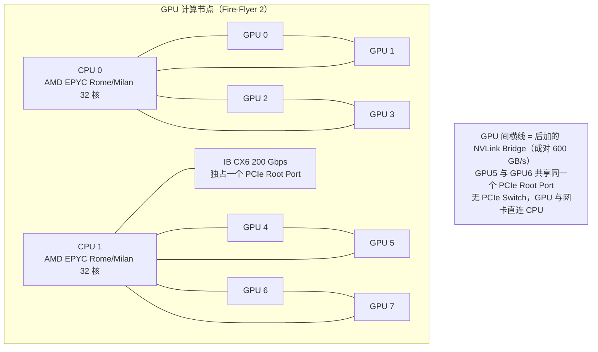

| 项 | Fire-Flyer 2 节点 | DGX-A100 |
|----|------------------|----------|
| CPU | 2 × AMD EPYC Rome/Milan 32 核 | 2 × AMD EPYC 7742 64 核 |
| 内存 | 512 GB，16 通道 DDR4-3200 | 2048 GB，16 通道 DDR4-3200 |
| GPU | 8 × PCIe A100-40GB | 8 × SXM A100-40GB |
| 网卡 | **1** × CX6 200 Gbps IB | **9** × CX6 200 Gbps IB |
| NVLink | 成对 GPU 之间 600 GB/s（Bridge） | 8 卡全互联 600 GB/s |

论文认为单块 200 Gbps 网卡足以同时满足 8 卡的存储 IO 和计算通信需求（论文 §III-A）。

### 2.3 成本账（论文表 II、表 III，§III-C）

| 指标 | Fire-Flyer 2 | DGX-A100 |
|------|-------------:|---------:|
| TF32 GEMM（TFLOPS/GPU） | 107 | 131 |
| FP16 GEMM（TFLOPS/GPU） | 220 | 263 |
| 相对性能 | 83% | 100% |
| 节点相对价格 | 60% | 100% |
| 性价比 | 1.38 | 1 |
| 单节点功耗（W，ResNet 训练平均） | 2500 | 4200 |

| 相对成本 | Fire-Flyer 2（两层 Fat-Tree 双区） | PCIe 架构 + 三层 Fat-Tree | DGX 架构 |
|---------|----:|----:|----:|
| 交换机数 | 122 | 200 | 1320 |
| 网络价格 | 350 | 600 | 4000 |
| 服务器价格 | 11250 | 11250 | 19000 |
| 总价 | 11600 | 11850 | 23000 |

- 总价约为 DGX 方案的 50.4%（"成本减半"），网络比同规模三层 Fat-Tree 省约 40%。
- 整个集群（含 IB 交换机与其他节点）功耗不超过 4 MW，约 3 MW 出头（论文 §VIII-C）。
- 论文多处表述为"以 60% 的成本拿到 80% 的性能"（节点价格口径）与"成本减半"（总价口径），两者口径不同。

---

## 3. 存算一体的两层 Fat-Tree 网络

### 3.1 拓扑（论文 §III-B，图 5）

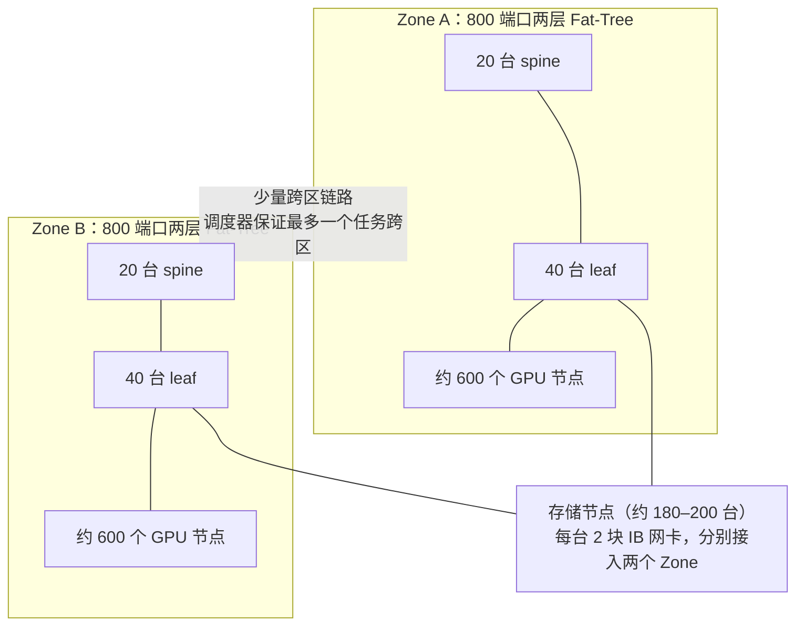

- 交换机：Mellanox QM8700，40 端口 × 200 Gbps；当时 RoCE 不够成熟，因此选 IB。
- 一个两层 Fat-Tree 最多接 800 个节点（20 spine + 40 leaf）。1 万卡需要约 1,250 个计算节点加近 200 台存储服务器，于是不上三层，而是做**两个区**。
- **存储节点双网卡分别接入两个区**，所有 GPU 节点共享同一套存储服务。
- 两个区之间只有少量链路。HAI 平台调度保证跨区的计算任务最多一个；NCCL 和 HFReduce 用双二叉树算法跨区运行，只有一对节点跨区通信。
- 不选 Dragonfly：其对分带宽不足以支撑存算一体网络（论文 §III-B）。

**解读**：存储节点双归属是这张网的关键。它让存储成为两个区的"公共设施"，不需要为跨区存储访问准备带宽；同时也意味着存储流量和训练通信必然在同一个 leaf/spine 上竞争，这正是 §5 各项防拥塞措施要解决的问题。

---

## 4. HFReduce 与 HaiScale：计算侧的软硬协同

这部分与存储没有直接关系，但它解释了 Fire-Flyer 2 的网络里有哪些流量、为什么能省掉多网卡。

### 4.1 HFReduce（论文 §IV，图 6，算法 1、2）

| 对比点 | NCCL ring | HFReduce |
|--------|-----------|----------|
| 每单位数据占用 PCIe 双向带宽 | (2n−1)/n 单位 | 1 单位（一次 D2H + 一次 H2D） |
| GPU kernel | 需要，占用 SM | 不需要，只用 Copy Engine，完全异步 |
| 186 MiB allreduce 节点间带宽（16–1440 GPU） | 1.6–4.8 GB/s | 6.3–8.1 GB/s |
| 加 NVLink 后 | — | 先在 NVLink 对内归约再上 CPU，>10 GB/s |

- **NCCL 慢的根因**：EPYC Rome 不支持 chained write，GPU 与 IB 网卡之间的 PCIe P2P 最多约 9 GiB/s，所以 NCCL 只有约 4 GB/s（论文 §IV-D2）。
- **HFReduce 的上限**：整个流程的内存读写量约为原数据的 24 倍，16 通道 DDR4-3200 实际约 320 GB/s，理论上限约 13.3 GB/s，考虑算法与网络后约 12 GB/s；实测略高于 8 GB/s，原因是 GPU5/GPU6 共享的 Root Port 到 CPU 内部总线只有约 37.5 GB/s（论文 §IV-D3）。

### 4.2 HaiScale（论文 §V）

| 场景 | 结果 |
|------|------|
| VGG16，HaiScale DDP（HFReduce）vs PyTorch DDP（NCCL） | 训练时间约为一半，32→512 GPU 并行效率约 88% |
| LLaMA-13B，64→512 GPU（PP=4） | 每步 64.118 s → 9.717 s，论文称并行效率 91%（按图中数据复算约 82.5%，91% 对应 256 卡，见 [整篇精读 §5.2](fireflyer-aihpc-sc2024.md#52-llm-训练优化论文-v-b)） |
| DeepSeekMoE-16B，40→640 GPU（PP=10） | 每步 79.615 s → 6.535 s，并行效率 76.14%；320 GPU 时 92.92% |
| GPT2-medium，HaiScale FSDP vs PyTorch FSDP | 16→128 GPU 并行效率 95%，训练时间约减半 |

流水线并行的一个 PCIe 特有优化：一个节点只有一块网卡，8 块 GPU 同时做 PP 通信会争抢带宽，于是让同节点的 8 块 GPU 属于不同的 DP rank，错开各自的 PP 通信时间（论文 §V-B2）。

---

## 5. 让存储流量与训练流量共存：防拥塞措施

### 5.1 四项措施（论文 §VI-A）

| 措施 | 做法 | 目的 |
|------|------|------|
| 流量分离 | 把 HFReduce、NCCL、3FS 存储、其他流量分成四类，建连时设置不同的 IB **Service Level**，映射到不同的 **Virtual Lane**，并配置各 VL 的比例 | 不同类流量互不干扰，避免队头阻塞 |
| 拓扑与路由 | 观察到在存储 incast 场景下**自适应路由会让拥塞扩散得更严重**，改用**静态路由**；把存储、计算、管理节点均匀分布，使存储流量均匀打到 leaf→spine 链路上 | 控制 incast 引起的拥塞扩散 |
| NCCL 调整 | 让 NCCL 拓扑经由同 NUMA 的网卡和 GPU；启用 PCIe Relaxed Ordering | 减少 CPU chiplet 互联造成的 PCIe 拥塞 |
| 3FS request-to-send | 见 §5.2 | 控制客户端侧 incast |

### 5.2 3FS 的 request-to-send（论文 §VI-B3）

存储网络是全对分带宽的 Fat-Tree，任何 3FS 客户端都能访问任何存储服务。峰值负载下，客户端侧出现 **incast 拥塞**（大量存储节点同时向一个客户端回数据）。为此在存储服务和客户端之间实现了 request-to-send 控制：

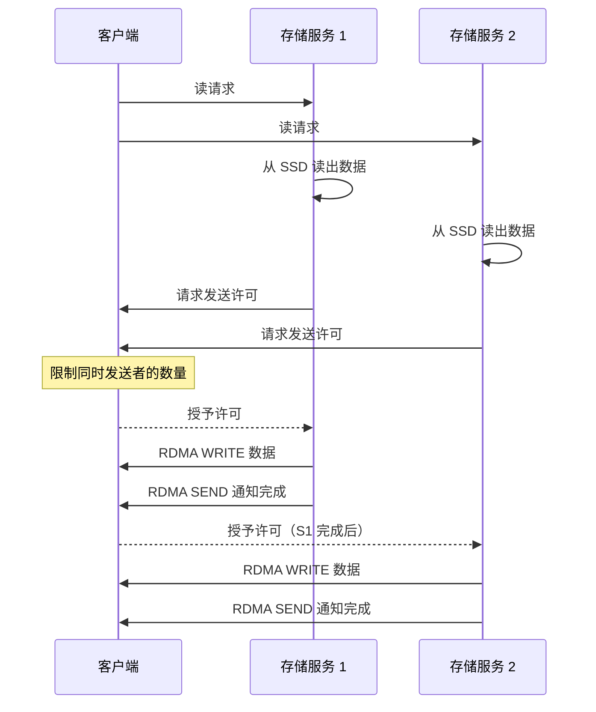

论文明确指出：request-to-send **增加了端到端 IO 延迟，但对于维持可持续的高吞吐是必需的**。

### 5.3 关闭 DCQCN（论文 §VIII-A）

IB 网卡默认用 DCQCN 做拥塞控制。论文表示找不到一组参数能同时适配 HFReduce 流量和 3FS 存储流量，因此**直接关闭 DCQCN**，依靠 §5.1 的网络调优让网络在没有拥塞控制的情况下保持无拥塞。DPU 允许自定义拥塞控制算法（HPCC、TIMELY），但会增加成本和运维复杂度。

**解读**：

- 这是一个非常"HPC 式"的选择：不依赖通用拥塞控制，而是由应用层（调度器限制跨区、3FS 限制并发发送者、SL/VL 静态配额）把流量"排好队"。它在单一租户、自己控制全部软件栈的集群里可行；在多租户云环境里很难复制。
- request-to-send 本质是**接收端驱动的流控**，与 Homa、NDP 等数据中心传输协议的接收端授权（grant）思想一致：拥塞点在接收端网卡，由接收端决定谁可以发。
- 论文未给出 request-to-send 的并发发送者上限、延迟增加多少等数字。

---

## 6. 3FS 总体架构与硬件

### 6.1 四个组件（论文 §VI-B3、设计说明）

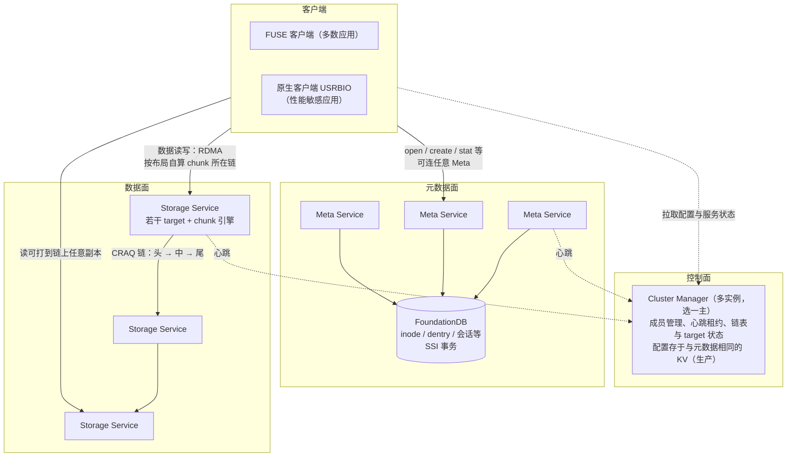

| 组件 | 职责 | 状态 |
|------|------|------|
| Cluster Manager | 接收心跳、处理成员变更、维护并下发链表与 target 状态；多实例部署、选主，主故障时提升另一实例 | 配置通常存于 ZooKeeper/etcd 等，生产中用与元数据相同的 KV 以减少依赖 |
| Meta Service | 实现文件系统语义（open、create 等） | **无状态**，全部状态在 FoundationDB；客户端可连任意实例 |
| Storage Service | 每个存储节点运行一个（设计说明：管理若干本地 SSD），提供 chunk 存储接口，实现 CRAQ | target 数据与 chunk 元数据（RocksDB） |
| Client | FUSE 客户端门槛低；原生客户端提供异步零拷贝 IO | 持有文件布局，自行计算 chunk 位置 |

所有组件都在 RDMA 网络（IB 或 RoCE）上互联（设计说明）。

### 6.2 存储节点硬件（论文表 IV、§VI-B2，README）

| 项 | 配置 |
|----|------|
| CPU | 1 × AMD EPYC 7742 64 核 |
| 内存 | 512 GB，8 通道 DDR4-3200 |
| 网卡 | 2 × Mellanox CX6 200 Gbps IB（分别接两个 Zone） |
| 数据盘 | 16 × 15.36 TB PCIe 4.0 x4 NVMe（README 写作 14 TiB，换算一致） |
| 规模 | 180 台，共 2880 块 NVMe、360 个 200 Gbps 端口 |
| 带宽 | 理论出口 9 TB/s，论文称实测总读吞吐 8 TB/s |
| 容量 | 论文称"超过 20 PiB 存储空间，采用镜像数据冗余" |

**解读（容量核对）**：2880 × 15.36 TB ≈ 44.2 PB ≈ 39.3 PiB 裸容量。若按设计说明示例的三副本，可用约 13.1 PiB；若按两副本"镜像"，约 19.6 PiB，与"超过 20 PiB"最接近。论文没有说明副本数，设计说明的示例链是三副本，生产配置不确定。此外，论文 §III-B 说"近 200 台存储服务器"，§VI-B2 说"部署了 180 台存储节点"，两处数字不一致。

---

## 7. 接口：为什么是文件系统，以及如何绕开 FUSE

### 7.1 为什么不用对象存储（设计说明）

| 需求 | 对象存储的不足 | 3FS 内部的使用方式 |
|------|----------------|-------------------|
| 原子目录操作 | 用 `/` 模拟目录，不支持原子移动文件/目录、递归删除目录 | 常见模式：先在临时目录写一批文件，再把整个目录**原子 rename** 到最终位置；海量小文件时递归删除很关键 |
| 符号链接与硬链接 | 不支持 | 用链接为动态追加的数据集创建**轻量快照** |
| 熟悉的接口 | 要学新 API | 大量数据集是 CSV/Parquet 文件，基于文件的 dataloader 很容易迁移到 FUSE 或原生客户端 |

### 7.2 FUSE 的局限（设计说明）

- **内存拷贝**：用户态守护进程无法访问应用内存，内核与用户态之间的数据搬运消耗内存带宽、增加延迟。
- **多线程支持原始**：FUSE 把请求放进一个由自旋锁保护的共享队列。实测 FUSE 只能处理约 **40 万次 4 KiB 读/秒**，增加并发只会加剧锁竞争，`perf` 显示内核自旋锁消耗大量 CPU。
- **同文件并发写**：Linux 5.x 的 FUSE 不支持对同一文件的并发写，应用改为并发写多个文件。
- **小随机读**：训练任务需要随机读样本，单次几 KB 到几 MB，且通常不按 4K 对齐；在 FUSE 挂载的 3FS 上表现差，SSD 与 RDMA 带宽用不满。

为什么不写内核模块：内核模块开发难度高，bug 难诊断，可能直接导致机器崩溃且不留日志；升级时必须干净停掉所有使用该文件系统的进程，否则只能重启机器。

### 7.3 USRBIO：FUSE 守护进程里的原生异步零拷贝客户端（设计说明）

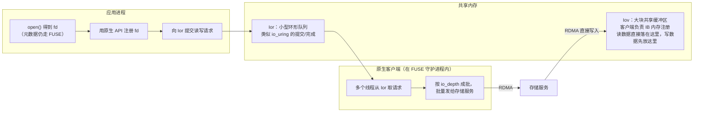

- 文件元数据操作（open/close/stat）仍由 FUSE 守护进程处理，保证与 POSIX API 一致，便于迁移现有代码。
- 多批请求可以并行处理，无论来自不同环还是同一环；多线程应用建议每线程一个环，共享环需要同步。
- 原生客户端把请求成批发给存储服务，降低小读请求的 RPC 开销。

**解读**：USRBIO 的定位很务实：**元数据走慢而兼容的 FUSE，数据走快而专用的共享内存环**。这与 DAOS 的 dfuse + 拦截库、Lustre 的 lockless direct IO 思路类似，但避免了 LD_PRELOAD 拦截的脆弱性，代价是应用需要显式改用 USRBIO API。

---

## 8. 元数据：无状态服务 + FoundationDB

### 8.1 论文版本（论文 §VI-B3）

文件系统元数据存在分布式 KV 存储的表里。每个文件或目录有唯一 inode ID；**inode 表**存 `inode ID → 元数据`（文件大小、数据位置信息等）；独立的**目录项表**存 `(父目录 inode ID, 名字) → (目标 inode ID, …)`，用于遍历目录和解析路径。meta service 的所有状态都持久化在分布式 KV 上，多个 meta service 并发处理客户端请求。

### 8.2 设计说明给出的细节

**键设计**：

| 记录 | 键 | 值 |
|------|-----|-----|
| inode | `"INOD"` + inode ID（**小端序**编码） | 所有类型：属主、权限、atime/mtime/ctime；文件：长度、chunk 大小、链表中选中的范围、shuffle 种子；目录：**父目录 inode ID**、子项默认布局（链表、chunk 大小、stripe 大小）；符号链接：目标路径 |
| dentry | `"DENT"` + 父 inode ID + 名字 | 目标 inode ID、inode 类型 |

- inode ID 是全局唯一、**单调递增**的 64 位整数。用小端序编码，是为了让连续分配的 ID 在键空间上分散到多个 FoundationDB 节点，避免写热点。
- 同一目录的 dentry 在键空间上天然连续，readdir 就是一次 range 查询。
- 目录 inode 记录父目录 ID，用于移动目录时的**环检测**：把 `dir_a/dir_b` 移到 `dir_c/` 下时，要向上检查 `dir_c` 的所有祖先，确保 `dir_c` 不是 `dir_b` 的后代。

**事务**：

- 只读事务：fstat、lookup、listdir 等；
- 读写事务：create、link、unlink、rename 等。FoundationDB 跟踪读写键集合做冲突检测，冲突时 meta service **自动重试**。多个 meta service 因此可以并行处理请求而保持元数据一致。
- FoundationDB 提供**可串行化快照隔离**（SSI）。meta service 无状态，可以随时升级或重启；客户端请求失败或超时时自动切换到其他 meta service。

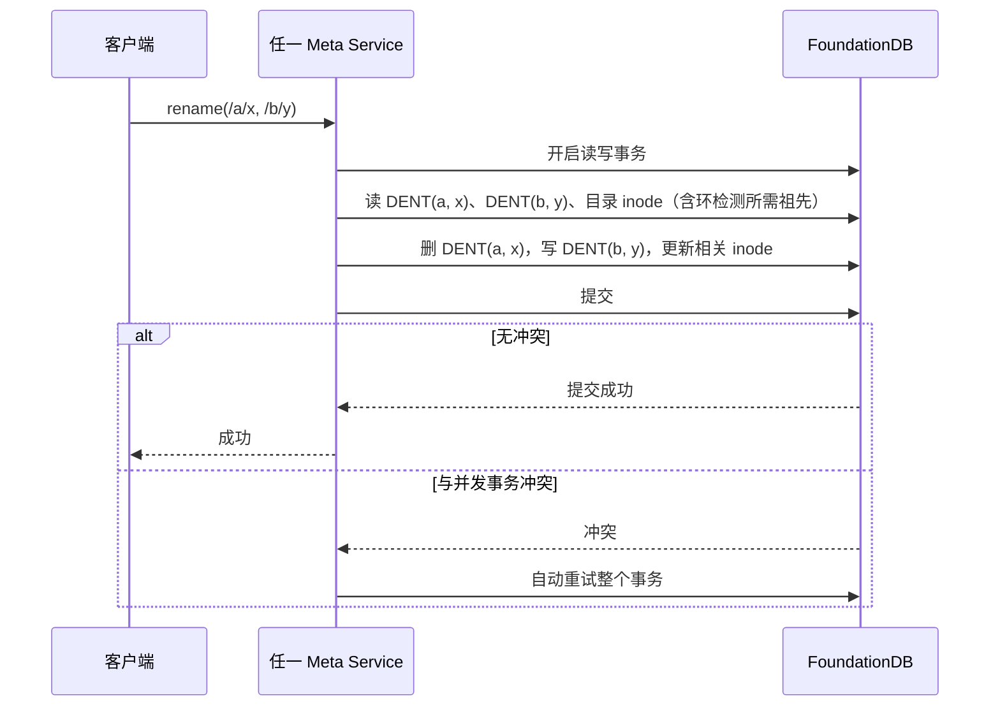

### 8.3 文件的位置信息（设计说明）

- 用户可按**目录**指定链表、chunk 大小和 stripe 大小，子项继承。
- 每个 chunk 的 ID = 文件 inode ID + chunk 序号。
- 创建文件时，meta service 用 round-robin 从指定链表中选出 stripe 大小个**连续的**链，再生成随机种子打乱这些链的顺序。
- 打开文件时，客户端从 meta service 拿到布局信息，之后**自行计算** chunk ID 和所在链，meta service 不参与数据操作的关键路径。

论文的表述稍有不同：meta service 为每个文件选择链表中的一个偏移量和 stripe 大小 k，文件 chunk 分配给从该偏移量开始的 k 条链（论文 §VI-B3）。设计说明补充了随机 shuffle 种子。

### 8.4 动态属性：打开的文件与文件长度（设计说明）

**不跟踪只读打开**：本地文件系统删除一个已打开的文件时，会推迟到所有 fd 关闭才真正删除，因此要跟踪所有 fd。训练任务启动时会打开大量文件，跟踪全部 fd 会给 meta service 和 FoundationDB 带来沉重负担。由于训练任务不依赖这一特性，**3FS 不跟踪只读模式打开的 fd**。

**跟踪写打开**：每个写模式 fd 都有一个文件会话（file session），因为删除正在写的文件可能留下并发写入产生的、无法回收的垃圾 chunk。有活跃写会话的文件被删除时，meta service 推迟删除直到所有 fd 关闭；meta service 定期检查客户端存活，清理离线客户端的会话。

**文件长度最终一致**：

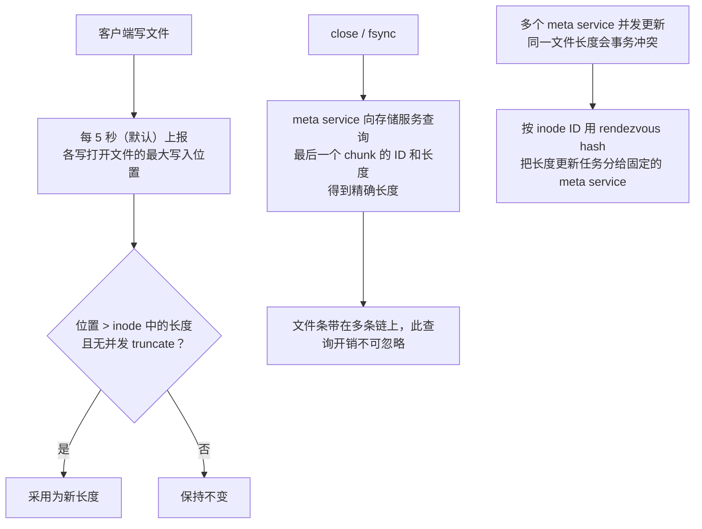

**小文件优化**：生产使用很大的 stripe 大小——**200**。小文件实际用到的链远少于 200。inode 中存一个"可能用到的链数"提示，初值 16，每当文件 chunk 写到更多链时翻倍；更新长度时只查这些链，不必查全部 200 条。同样的优化可以用于小文件删除。

**解读**：

- 3FS 的元数据设计是"**教科书式的 KV 化**"：inode 表 + dentry 表、目录内 dentry 连续、跨键操作用事务。新意不在结构，而在几处**针对训练负载的减法**：不跟踪只读 fd、文件长度最终一致、大 stripe + 链数提示。
- 与 [InfiniFS](infinifs-fast2022.md)、[CFS](cfs-eurosys2023.md) 相比，3FS 没有在元数据扩展性上做专门优化（没有特殊分区、没有可合并更新），也没有客户端路径解析加速——它把元数据性能上限交给了 FoundationDB。这对"文件大、数量适中"的负载足够，对 [FalconFS](falconfs-nsdi2026.md) 面对的"3000 亿小文件随机遍历"则未必。
- rename 走 FoundationDB 的通用事务，能保证原子性（包括目录 rename 和环检测）。这比 Tectonic 只有分片内事务的 ZippyDB 强，也是 3FS 敢于支持"临时目录写完再整体 rename"模式的原因。

---

## 9. 数据放置：chunk、链与链表

### 9.1 链与链表（设计说明）

每个 chunk 在一条 **target 链**上复制。每块 SSD 上创建多个 storage target，这些 target 加入不同的链。设计说明的例子：6 个节点 A–F，每节点 1 块 SSD，每块 SSD 建 5 个 target，共 30 个 target；三副本时链表如下：

| 链 | 版本 | Target 1（头） | Target 2 | Target 3（尾） |
|:--:|:----:|:----:|:----:|:----:|
| 1 | 1 | A1 | B1 | C1 |
| 2 | 1 | D1 | E1 | F1 |
| 3 | 1 | A2 | B2 | C2 |
| 4 | 1 | D2 | E2 | F2 |
| 5 | 1 | A3 | B3 | C3 |
| … | … | … | … | … |
| 10 | 1 | D5 | E5 | F5 |

- 每条链有**版本号**，链发生变化（如某个 target 离线）时递增。只有主 cluster manager 能修改链表。
- 可以构造多张链表满足不同放置需求，例如一张给批处理/离线任务、一张给在线服务，两张表使用互不相交的节点和 SSD。
- 每条链的状态独立变化，一条链可以属于多张链表。链表的作用是让 meta service 为每个文件选一张表，并把 chunk 条带到表中的链上。

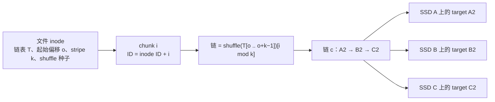

（图中的映射公式是对设计说明"选连续 k 条链并打乱"的示意，具体实现见 [project/3fs 数据路径篇](../project/3fs/3fs-data-path.md)。）

### 9.2 恢复期间的流量均衡（设计说明）

上表的布局有一个问题：A 故障时，A 的读流量全部转到 B 和 C，重负载下 B、C 立即被打满，成为整个系统的瓶颈；而更换 SSD 并把数据同步到新盘可能需要数小时，这段时间读吞吐都受损。

改进办法是让 A 与其他所有 SSD 都配对：

| 链 | Target 1（头） | Target 2 | Target 3（尾） |
|:--:|:----:|:----:|:----:|
| 1 | B1 | E1 | F1 |
| 2 | A1 | B2 | D1 |
| 3 | A2 | D2 | F2 |
| 4 | C1 | D3 | E2 |
| 5 | A3 | C2 | F3 |
| 6 | A4 | B3 | E3 |
| 7 | B4 | C3 | F4 |
| 8 | B5 | C4 | E4 |
| 9 | A5 | C5 | D4 |
| 10 | D5 | E5 | F5 |

A 故障时，其余每块 SSD 各承担 A 的 1/5 读流量。设计说明把这一问题形式化为**平衡不完全区组设计**（balanced incomplete block design，BIBD），用整数规划求解器求最优解。

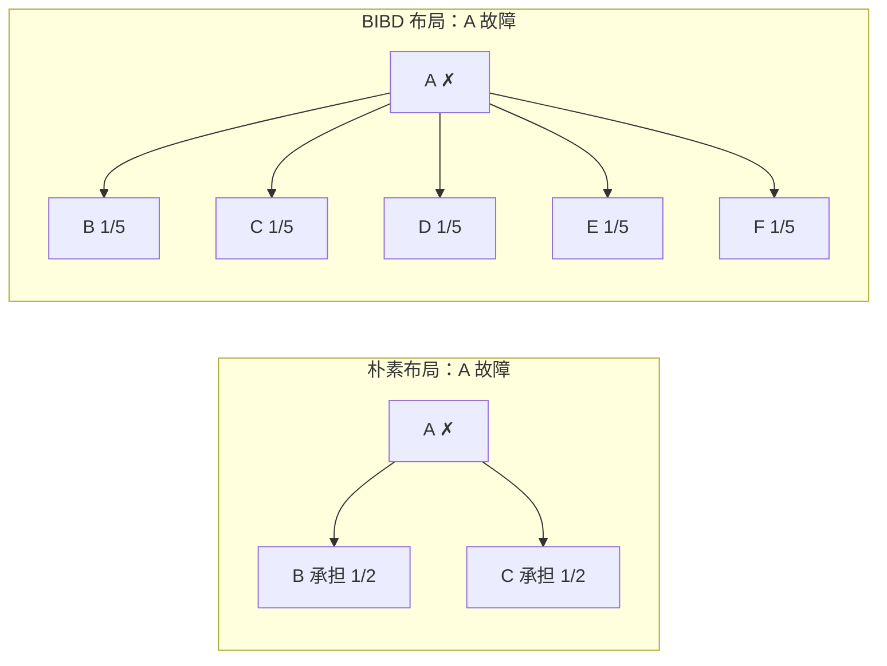

**解读**：这与 Ceph CRUSH 的"PG 打散"、HDFS 的随机放置解决的是同一个问题（故障时的恢复与降级读要摊到尽量多的盘上），但 3FS 的做法更"确定"：链表是离线算好、显式下发的，故障时的流量分布可以事先精确推算。代价是扩容时需要重新求解和迁移，详见 [project/3fs 运维篇](../project/3fs/3fs-operations.md)。

---

## 10. 数据复制：改造过的 CRAQ

### 10.1 为什么是 CRAQ（设计说明、论文 §VI-B3）

CRAQ（Chain Replication with Apportioned Queries，ATC 2009）是为读多写少负载优化的"**写全部、读任意**"复制协议。在全闪存系统里，利用全部副本的读带宽是达到最高读吞吐的关键。论文的说法是 CRAQ 的写全读任意"帮助释放所有 SSD 的吞吐与 IOPS"。

### 10.2 写流程（设计说明）

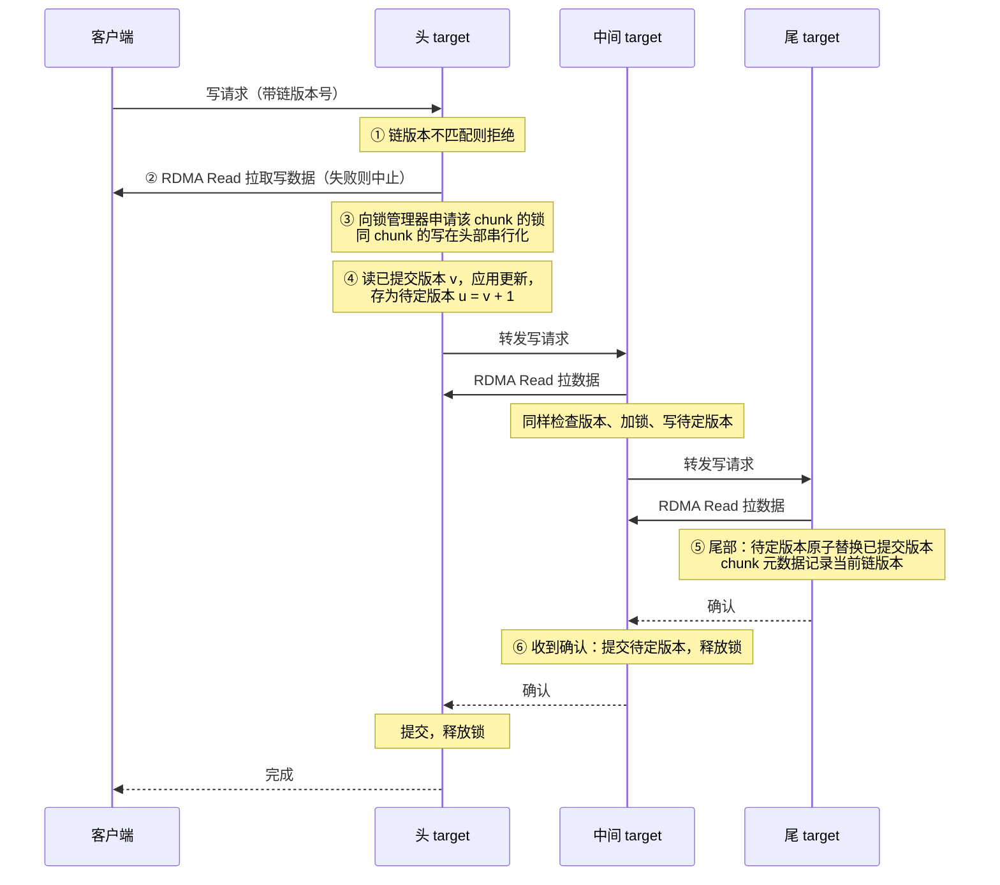

要点：

- 数据由**接收方用 RDMA Read 拉取**，而不是发送方推送。客户端或前驱失败时，RDMA Read 超时，写入中止。
- 每个 target 上一个 chunk 最多有两个版本：已提交版本 `v` 和待定版本 `u = v + 1`。
- 所有对同一 chunk 的写在头 target 串行化。

**故障中的写**（设计说明的例子）：链为 A→B→C，A 刚把写请求转发给 B，B 立即故障，请求丢失。cluster manager 检测到 B 故障后，把 B 标记为离线并**移到链尾**，广播新链表。A 收到新链表后把写请求转发给新的后继 C。C 可能还没收到新链表而拒绝，A 持续重发，C 最终拿到新链表后接受。

### 10.3 读流程与对 CRAQ 的改动（设计说明）

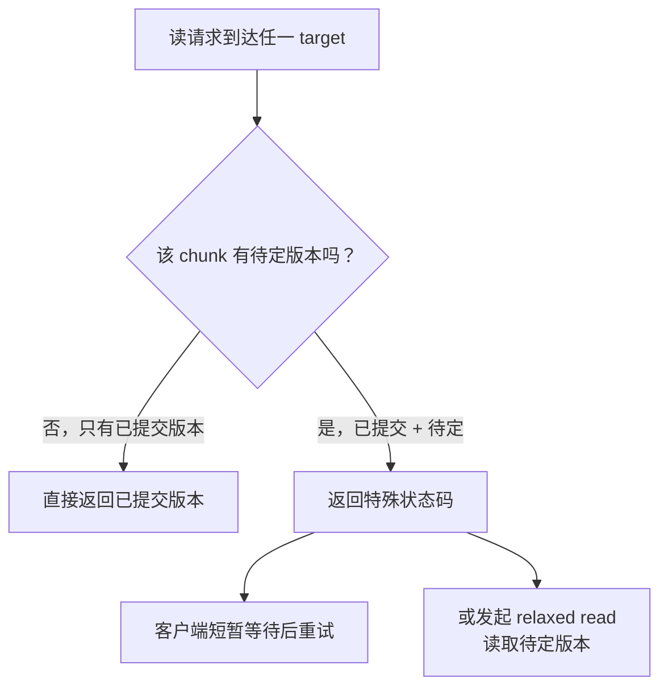

**与原版 CRAQ 的关键差别**：原版 CRAQ 遇到"脏"对象时，会向尾节点查询已提交版本号，然后返回对应版本（这就是"apportioned queries"的含义）。3FS **不向尾节点查询版本**，而是把决定权交给客户端：等待重试，或者显式接受 relaxed read。

**解读**：

- 所以 3FS 的"CRAQ"更准确地说是"**链复制 + 只读干净副本**"。去掉尾查询换来的是读路径上没有任何跨节点交互，代价是读到正在写的 chunk 时要重试。在训练数据"写一次、读多次"的负载下，这种冲突很少。
- 链复制的写延迟是整条链的串行延迟之和，慢节点会直接拉高写尾延迟；这在 checkpoint 场景下可以靠多文件并发掩盖。
- 一致性的边界是 **chunk**：单个 chunk 的写是原子、强一致的；跨 chunk 的写没有原子性，文件长度也只是最终一致（§8.4）。更详细的语义分析见 [project/3fs 一致性篇](../project/3fs/3fs-consistency.md)。

---

## 11. 故障检测与目标状态机

### 11.1 心跳即租约（设计说明）

- cluster manager 在可配置的时间 T 秒内没收到某服务的心跳，就宣布其故障。
- 服务如果 **T/2 秒**内无法与 cluster manager 通信，就停止处理请求并退出。心跳可视为对 manager 授予的**租约**的续期。
- meta service 无状态，cluster manager 提供在线 meta service 列表作为简单的服务发现；一个 meta service 宕机时客户端换一个即可。
- cluster manager 对**存储服务**的成员变更更关键：它维护链表和所有 storage target 状态的全局视图。

### 11.2 两层状态（设计说明）

| 公开状态 | 可读 | 可写 | 含义 |
|---------|:---:|:---:|------|
| serving | Y | Y | 服务存活，正常服务 |
| syncing | N | Y | 服务存活，数据恢复进行中 |
| waiting | N | N | 服务存活，数据恢复尚未开始 |
| lastsrv | N | N | 服务已宕，且它是链上最后一个 serving 的 target |
| offline | N | N | 服务已宕或存储介质故障 |

| 本地状态 | 含义 |
|---------|------|
| up-to-date | 服务存活，正常服务 |
| online | 服务存活，target 处于 syncing 或 waiting |
| offline | 服务已宕或存储介质故障 |

公开状态随链表下发给服务和客户端；本地状态只有存储服务和 cluster manager 知道，存在 manager 内存中。本地状态是触发事件，cluster manager 周期性扫描每条链，按状态转移表更新公开状态。

### 11.3 状态转移（设计说明的转移表，画成状态图）

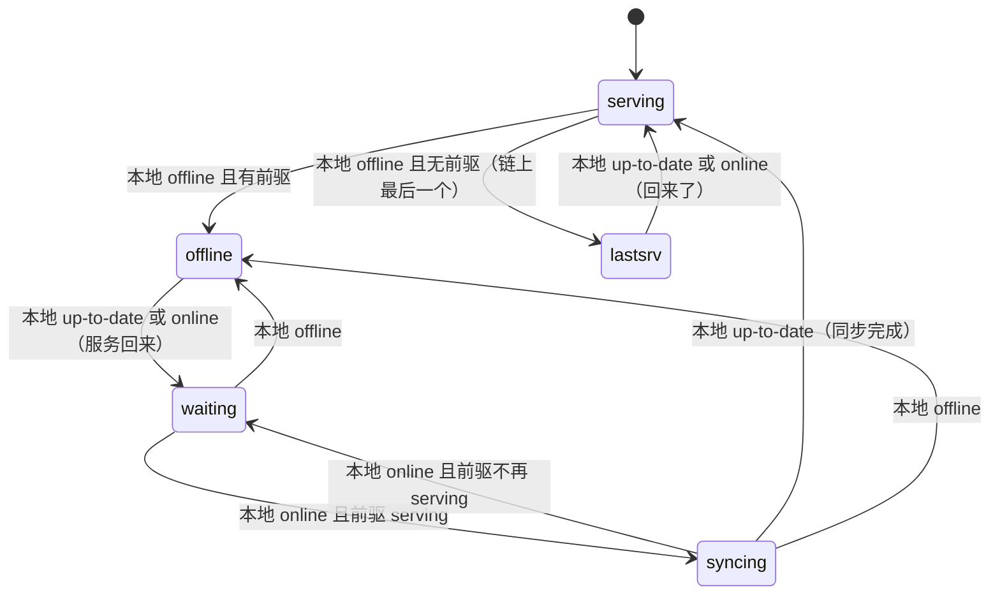

附加规则：

- 链有更新时链版本递增；
- target 被标记 offline 时**移到链尾**；
- 存储服务发现自己某个 target 的公开状态是 lastsrv 或 offline 时**立即退出**——它可能因网络分区与 manager 隔离；
- syncing 的 target 完成恢复后，存储服务在后续心跳中把其本地状态设为 up-to-date。

**解读**：

- **lastsrv** 状态是为"链上最后一个副本也挂了"准备的：它记住了谁拥有最新数据。当这个 target 回来时直接恢复为 serving，而不是像普通 offline 那样进入 waiting 等别人给它同步——此时已没有别人有更新的数据。
- "T/2 秒失联即自杀"与"T 秒无心跳即宣布故障"配合，保证 manager 宣布某服务故障时，该服务一定已经停止服务，避免脑裂下的双主写。这是经典的租约栅栏（lease fencing），链版本号则是第二道栅栏（§10.2 第①步）。
- 仓库 README 列出了 P 语言的形式化规范（"P Specifications"），说明这套协议做过模型检验，细节见 [project/3fs 高可用篇](../project/3fs/3fs-ha-recovery.md)。

---

## 12. 在线数据恢复

### 12.1 流程（设计说明）

存储服务退出（进程崩溃或升级重启）或介质故障时，相关 target 全部被标记为 offline 并移到链尾。服务重启后，每个 target 独立进入恢复，恢复与正常流量并行，尽量减少中断。

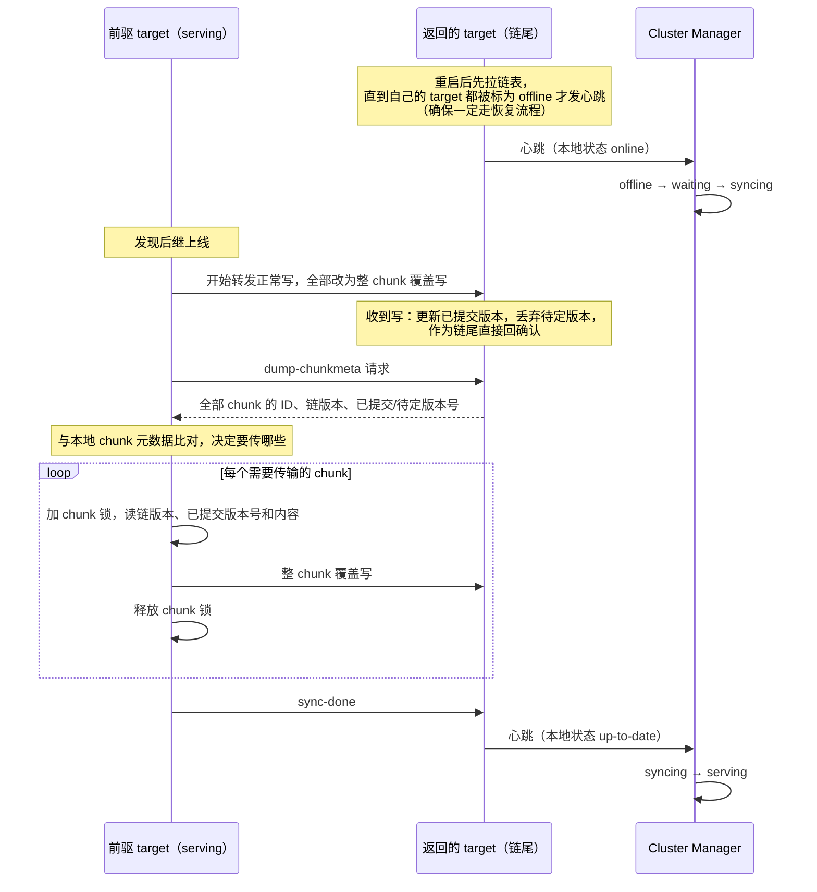

### 12.2 传输规则（设计说明）

| 条件 | 处理 |
|------|------|
| chunk 只在本地（前驱）存在 | 传输 |
| chunk 只在远端（返回 target）存在 | 删除 |
| 本地副本的链版本 > 远端副本 | 传输 |
| 链版本相同，但本地已提交版本号 ≠ 远端待定版本号 | 传输 |
| 其他 | 两副本相同，或正被进行中的写更新，无需处理 |

**解读**：

- 恢复期间所有写都改成**整 chunk 覆盖写**，是这个协议的关键简化：返回的 target 不需要拥有旧版本就能接受新写入，正常写和补数据可以并行，最终状态一定一致。代价是部分写被放大成整 chunk 写，恢复期间写带宽消耗增加。
- 恢复的粒度是**整个 target 的全量比对**，没有基于日志的增量追赶。target 短暂重启时，比对 chunk 元数据的开销与 target 上的 chunk 数成正比，而真正需要传的数据可能很少。
- 结合 §9.2 的 BIBD 布局，一块盘的恢复流量也被摊到所有与它配对的盘上。

---

## 13. chunk 引擎

### 13.1 结构（设计说明）

每块 SSD 上，chunk 引擎的持久化部分由**固定数量的数据文件**（存 chunk 数据）和一个 **RocksDB 实例**（存 chunk 元数据与其他系统信息）组成；另有内存中的 chunk 元数据缓存和一个 chunk 分配器。

| 接口 | 语义 |
|------|------|
| open/close | 从 RocksDB 加载元数据，重建分配器状态 |
| get | 通过哈希表缓存取 chunk 元数据和引用计数句柄，平均 O(1)，支持并发 |
| update | **写时复制**：先分配新 chunk 再改数据，旧 chunk 在所有句柄释放前仍可读 |
| commit | 用 RocksDB write batch 原子提交 chunk 元数据，同步刷新缓存 |

### 13.2 物理块分配（设计说明）

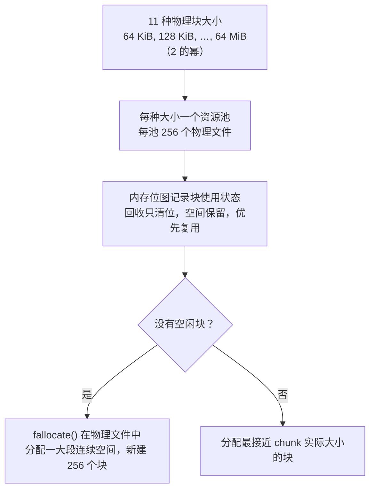

**写一个 chunk**：分配器先分配新物理块 → 把现有 chunk 数据读到缓冲区 → 应用更新 → 写入新块 → 用新块位置和原有元数据构造新元数据 → 在 RocksDB 中**原子更新**新元数据与新旧块的状态。**追加写**有优化：直接在现有块末尾原地追加。

**解读**：

- 写时复制 + 元数据原子切换，使单 chunk 更新天然崩溃一致，也让 §10 中"已提交版本/待定版本"能低成本共存：待定版本就是另一个物理块。
- 代价是**写放大**：非追加的部分写要读出整个 chunk、改完再整体写入新块。对训练数据和 checkpoint 这类整块写或追加写无所谓；对小随机覆盖写不友好。
- 物理块按 2 的幂分档，每个 chunk 可能浪费最多接近一半的块空间（例如 65 KiB 的 chunk 占 128 KiB 块）。设计说明没有讨论这部分空间开销。

---

## 14. 上层应用：checkpoint、3FS-KV 与 KVCache、数据处理

### 14.1 Checkpoint Manager（论文 §VII-A）

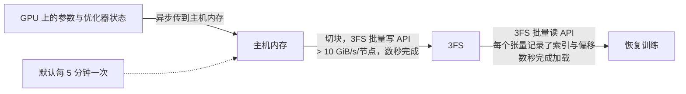

- 保存时每个张量记录其索引和在 checkpoint 中的偏移，加载时便于定位。
- 借助 3FS 的高写吞吐，周期保存在数秒内异步完成，不影响训练；硬件故障打断训练时只丢最近 5 分钟的进度。
- 与 HAI 平台的**分时调度**配合：任务需遵守平台规则——接收中断信号 → 保存 checkpoint → 通知集群 → 之后从 checkpoint 恢复。论文称这让集群利用率达到 99%（论文 §VI-C）。

### 14.2 3FS-KV 与 KVCache（论文 §VI-B4、README）

- **3FS-KV** 是构建在 3FS 之上的共享存储分布式数据处理系统，目前支持三种模型：**键值、消息队列、对象存储**；支持读写分离和按需启动，以充分利用 3FS 的高 IO 吞吐。
- 3FS-KV 支撑 DeepSeek 的**磁盘 KV Context Caching** 技术，论文称这把 LLM 服务成本降低了一个数量级。
- README 给出的 KVCache 数据：所有 KVCache 客户端（每节点 1 × 400 Gbps）的读吞吐峰值**最高 40 GiB/s**；同时展示了垃圾回收删除操作的 IOPS。

### 14.3 数据处理：smallpond GraySort（README）

| 项 | 配置/结果 |
|----|----------|
| 存储 | 25 个存储节点（每节点 2 NUMA、每 NUMA 1 个存储服务、2 × 400 Gbps） |
| 计算 | 50 个计算节点（2 NUMA、192 物理核、2.2 TiB 内存、1 × 200 Gbps） |
| 方法 | 两阶段：按键前缀位 shuffle 分区，再分区内排序；两阶段都读写 3FS |
| 结果 | 110.5 TiB、8,192 个分区，**30 分 14 秒**，平均 **3.66 TiB/min** |

### 14.4 训练数据读取（README）

README 把 dataloader 列为目标负载之一：通过支持跨计算节点**随机访问训练样本**，免去对数据集的预取或打乱。

**解读**：

- 3FS 的四类目标负载——数据准备、dataloader、checkpoint、KVCache——共同点是**大块 IO 或可批量化的 IO**。3FS 的设计几乎全部围绕"把 2880 块 SSD 的带宽交到客户端手里"展开，而 checkpoint 和 KVCache 恰好是 LLM 时代带宽需求最陡峭的两类负载。
- 用文件系统承载 KVCache 是一个值得注意的方向：KVCache 的访问模式是"写一次、近期读几次、可随时淘汰"，介于缓存和存储之间。3FS-KV 把 KV、消息队列、对象存储都构建在共享文件系统上，与 Tectonic 用一个文件系统同时承载 Blob 存储和数仓的思路相同——**一个强大的底层文件系统 + 多个薄的上层服务**。

---

## 15. 稳定性：验证器与一年的硬件故障数据

这部分不直接涉及 3FS 设计，但给出了 AI 集群存储所处的故障环境，对存储系统的故障模型有参考价值。

### 15.1 验证器（论文 §VII-B）

自动运维系统**每周**在节点上运行验证器，把故障节点从调度平台摘除。检查内容：硬件频率、链路速率与状态；CPU 压力与内存带宽；逐字节检查 GPU 显存；满显存 GEMM（同时检查 GPU 计算逻辑）；节点内 allreduce（检查 NVLink 带宽）；**存储带宽压力测试**。

### 15.2 GPU Xid 错误（论文表 V、表 VI）

| 类别 | Xid | 次数 | 占比 |
|------|-----|-----:|-----:|
| NVLink 错误 | 74 | 5,521 | 42.57% |
| 软件原因 | 13 / 31 / 43 / 45 | 45 / 2,487 / 4,342 / 240 | 0.35% / 19.18% / 33.48% / 1.85% |
| GPU ECC 错误 | 63 / 64 / 94 / 95 | 245 / 2 / 13 / 17 | 共约 2.1% |
| 不可纠正故障 | 44 / 48 / 61 / 62 / 69 / 79 | 1 / 2 / 13 / 3 / 1 / 37 | 共约 0.45% |
| GSP 错误 | 119 | 1 | 0.01% |
| 合计 | | 12,970 | 100% |

- NVLink Bridge 连接器固有故障率高，再乘以数千块 GPU，使 Xid 74 占比最高。论文对比另一篇 LLM 集群研究中 NVLink 相关故障占 52.42%（54/103）。
- 非法内存访问（Xid 43）占 33.48%，但也可能由显存数据损坏引起，排除软件 bug 后需考虑硬件。
- 论文还提到遇到过 **ECC 未检测到的计算错误和显存错误**，导致梯度范数尖峰、loss 爆炸甚至不收敛。

### 15.3 内存与网络故障（论文表 VII、图 10、图 11）

2023-10 至 2024-03 六个月间：CPU 内存 ECC 错误 54 次，**网络闪断 89 次**，GPU 显存相关 Xid（63/64/79/94/95）149 次，合计 292 次。除 Xid 74 外的硬件故障中，IB 链路故障约占 30%。附录表 VIII 列出了一年间 IB 闪断的逐日记录，在整个运行期内随机出现。注意 2023-10 的网络闪断在表 VII 中是 29 次，而表 VIII 当月逐日合计只有 13 次，见 [Fire-Flyer 整篇精读 §9.3](fireflyer-aihpc-sc2024.md#93-ib-网络闪断论文图-11表-viii)。

**解读**：对存储系统而言，这组数据有两点启示。第一，**网络闪断是常态**（六个月 89 次），存储客户端和链复制必须能容忍短暂的链路中断而不触发大规模恢复——这也是 3FS 心跳租约参数 T 的取值需要权衡的原因。第二，论文观察到 ECC 漏检的数据损坏，存储层的端到端校验（checksum）因此不可或缺；设计说明没有描述数据校验，[project/3fs 运维篇](../project/3fs/3fs-operations.md)基于源码对 checksum 有讨论。

---

## 16. 性能数字汇总与口径核对

| 数字 | 出处 | 条件 | 核对（解读） |
|------|------|------|-------------|
| 总读吞吐 **8 TB/s** | 论文 §VI-B2 | 180 节点，未说明客户端数、IO 大小、是否有背景流量 | 理论出口 360 × 200 Gbps = 9 TB/s，即约 89% 网卡线速 |
| 聚合读吞吐 **6.6 TiB/s** | README | 180 节点（每节点 2 × 200 Gbps、16 × 14 TiB NVMe），500+ 客户端节点（每节点 1 × 200 Gbps），**有训练任务背景流量**，大块读压测 | 约 7.26 TB/s；每存储节点约 37.5 GiB/s，每块 NVMe 约 2.35 GiB/s，瓶颈在网络而非 SSD |
| checkpoint 写 **> 10 GiB/s/节点** | 论文 §VII-A | 使用批量写 API | 单计算节点只有 1 × 200 Gbps（约 23.3 GiB/s），即约 43% 线速 |
| FUSE 约 **40 万次 4 KiB 读/秒** | 设计说明 | 增加并发不再提升 | 说明 USRBIO 的必要性 |
| GraySort **3.66 TiB/min** | README | 25 存储 + 50 计算节点 | 110.5 TiB / 30 分 14 秒，计算一致 |
| KVCache 读峰值 **40 GiB/s** | README | 客户端每节点 1 × 400 Gbps | 未说明客户端数量 |
| 容量 **> 20 PiB**（镜像冗余） | 论文 §VI-B2 | 2880 × 15.36 TB | 两副本约 19.6 PiB、三副本约 13.1 PiB，见 §6.2 |
| 存储节点数 | 论文 §III-B vs §VI-B2 | — | "近 200 台"与"180 台"不一致 |

**解读**：

- 8 TB/s 与 6.6 TiB/s 并不矛盾：前者没给条件，后者明确带有训练背景流量。引用时应注明出处与条件。
- 两份资料都**没有**给出：元数据操作吞吐（create/stat ops/s）、小文件随机读 IOPS、写吞吐（集群级）、单次 IO 延迟分布、故障恢复期间的性能曲线。这些恰好是通用文件系统评估中最常见的指标。3FS 的公开数据集中在"大块读带宽"这一个维度。
- 所有数字均为厂商自报，没有与其他系统在同一硬件上的对照实验。

---

## 17. 与相关系统的对比

### 17.1 论文自述（论文 §VI-B1）

论文把 3FS 类比为 **WekaFS、DAOS、BeeGFS**，区别在于 3FS 的设计与实现专门着眼于充分利用 NVMe SSD 的高 IOPS/吞吐和 RDMA 网络。论文没有展开对比。

### 17.2 与本仓库精读系统的对照（解读）

| 维度 | 3FS | FalconFS（NSDI'26） | Tectonic（FAST'21） | CFS（EuroSys'23） | DAOS |
|------|-----|---------------------|---------------------|-------------------|------|
| 目标负载 | AI 训练读、checkpoint、KVCache、数据处理 | DL 流水线海量小文件 | 多租户 Blob + 数仓 | 通用 POSIX | HPC / AI |
| 元数据存储 | FoundationDB（跨键 SSI 事务） | PostgreSQL 每 MNode | ZippyDB（分片内事务） | TafDB（单分片原语） | 自研，SCM/NVMe 上的 VOS |
| 元数据服务 | 无状态，任意实例 | 有状态 MNode + 协调者 | 无状态 | 无状态（去代理层） | 嵌在存储引擎 |
| 路径解析 | 客户端逐级（经 FUSE） | 服务端一跳 | 客户端逐级 | 客户端逐级 | 客户端（libdfs） |
| rename | FDB 事务，原子 | 协调者 2PL + 2PC | 同分片原子，跨分片非原子 | 快路径 / Renamer + 2PC | 事务 |
| 数据冗余 | 链复制（全副本） | 未讨论（File Store） | 副本 + RS 编码 | —（只讲元数据） | 副本 + EC |
| 一致性 | chunk 级强一致 | — | 单写者 | — | 事务 |
| 数据路径 | RDMA，存储端 Read 拉取，客户端 request-to-send | 普通块存储 | — | — | RDMA（libfabric） |
| 客户端 | FUSE + USRBIO 共享内存环 | 修改的 FUSE / 内核模块 | 库 | 库 | dfuse + 拦截库 + 原生 API |
| 读扩展 | 读任意干净副本 | — | — | — | — |

**解读**：

- **3FS 与 Tectonic** 同属"元数据下沉到 KV、服务无状态"一派。区别在于 3FS 选了带跨键事务的 FoundationDB，因此能保证原子 rename；Tectonic 接受分片内事务，用语义让步换底座的成熟度。数据面上，Tectonic 重容量效率（RS 编码），3FS 重带宽（全副本读）。
- **3FS 与 FalconFS** 是 AI 存储的两个极端：3FS 认为瓶颈在数据带宽，把元数据交给通用事务 KV；FalconFS 认为瓶颈在小文件元数据，把数据交给普通块存储。实际的 AI 集群两类负载都有，一个完整的 AI 存储系统可能需要 3FS 式的数据面加 FalconFS 式的元数据快路径。
- **3FS 与 DAOS**：两者都是 RDMA + NVMe 全闪，但 DAOS 是自研到底（SCM/VOS 存储引擎、自研元数据、EC），3FS 是"能借则借"（FoundationDB、RocksDB、XFS、FUSE）。3FS 的工程量和风险更可控，代价是依赖外部组件的运维和性能边界。

---

## 18. 整体总结

### 18.1 核心贡献

1. **省钱集群的完整实践**（论文）：PCIe A100 + 单网卡 + 存算共用两层 Fat-Tree 双区，以约一半的总价拿到 DGX-A100 约 80% 的性能，并公开了详细的成本、功耗和一年故障数据。
2. **存算一体网络的工程方法**（论文）：SL/VL 四类流量隔离、静态路由、关闭 DCQCN、存储节点双归属、调度器限制跨区任务，以及 3FS 的接收端驱动 request-to-send。
3. **3FS 的分离式架构**（论文 + 设计说明）：无状态 meta service + FoundationDB 事务元数据；客户端凭布局自算 chunk 位置，元数据不在数据热路径；数千 SSD 与数百节点带宽以位置无关的方式交给应用。
4. **改造的链复制**（设计说明）：RDMA Read 拉取式写、chunk 双版本、读任意干净副本、链版本栅栏；故障 target 移到链尾，恢复期间以整 chunk 覆盖写在线追平。
5. **显式的故障模型**（设计说明）：心跳租约与 T/2 自杀、5 个公开状态与转移表、lastsrv 保存最后副本、BIBD 链表布局把故障与恢复流量摊到所有配对盘上。
6. **面向训练负载的减法**（设计说明）：不跟踪只读 fd、文件长度最终一致、大 stripe + 链数提示、USRBIO 绕开 FUSE 数据路径。
7. **上层服务**：checkpoint manager（>10 GiB/s/节点）、3FS-KV（KV/消息队列/对象存储）与磁盘 KVCache、smallpond 数据处理。

### 18.2 设计哲学

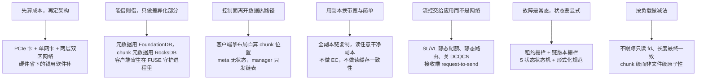

**解读**：Fire-Flyer 与 3FS 体现的是一种"**系统工程整体最优**"的思路：不追求单个组件的最优，而是让硬件、网络、通信库、文件系统、调度器、训练框架互相迁就。3FS 能关掉 DCQCN，是因为调度器限制了跨区任务、HFReduce 和存储流量被分到不同 VL；checkpoint 能每 5 分钟一次，是因为 3FS 写得快、HAI 平台又要求任务可中断。脱离这个整体，3FS 的一些设计（如依赖无损 IB 网络、request-to-send 增加延迟、三副本成本）就不一定是好选择。

### 18.3 优点与局限

| 优点 | 局限 / 未回答的问题 |
|------|---------------------|
| 数据路径极短：客户端 → 存储服务，RDMA 直达，元数据服务不参与 | **容量成本高**：全副本链复制，公开资料中没有 EC；论文"镜像冗余"的副本数不明 |
| 读带宽随副本数扩展，BIBD 布局让故障期间的降级读均匀分摊 | **写延迟**：写要串行穿过整条链，慢节点直接抬高尾延迟；部分写在 chunk 引擎中被放大为整块写 |
| 元数据语义清晰：FoundationDB 跨键事务保证原子 rename 与环检测 | **元数据性能上限交给 FoundationDB**，公开资料没有任何元数据吞吐数据；客户端仍逐级解析路径，没有面向海量小文件的优化 |
| 无状态 meta、显式状态机、在线恢复，运维模型清楚，并有形式化规范 | **一致性边界在 chunk**：跨 chunk 写非原子，文件长度最终一致，读到正在写的 chunk 需重试 |
| USRBIO 用共享内存环避开 FUSE 数据路径，且不需要内核模块 | **强依赖 RDMA 与无损网络**：关闭 DCQCN 的做法依赖单租户、自控全栈的环境；request-to-send 以延迟换吞吐 |
| 生产验证：支撑 DeepSeek 系列模型训练、checkpoint、KVCache | **论文对 3FS 着墨很少**：没有 3FS 自身的实验设计、对照系统或延迟数据；关键细节在非同行评审的设计说明中 |
| 开源（MIT 许可），代码与文档公开 | 数字口径不统一（8 TB/s vs 6.6 TiB/s、180 vs 近 200 台），均为厂商自报 |
| — | 恢复为全量 chunk 元数据比对，没有增量日志；扩容需重新求解链表 |

### 18.4 对分布式文件系统设计者的启示

1. **把"元数据服务不在数据热路径上"当作硬约束**：open 时一次性下发布局，之后客户端自行定位 chunk。这让元数据规模与数据带宽彻底解耦，元数据服务只需按文件数而非 IO 次数扩容。
2. **事务 KV 是元数据的务实底座**：选择支持跨键事务的 KV（FoundationDB 类）可以低成本获得原子 rename、环检测和无状态服务；但要提前测出其元数据吞吐上限，并为海量小文件场景准备快路径（参照 [FalconFS](falconfs-nsdi2026.md)）。
3. **inode ID 单调分配时要打散键**：小端序编码或哈希前缀，避免连续 ID 造成 KV 写热点。
4. **链复制 + 读任意干净副本**是读多写少负载下性价比很高的副本协议：实现比 Raft-per-chunk 简单，读带宽随副本数线性增长；配合"链版本号 + 租约"两道栅栏处理成员变更。
5. **恢复期间用整对象覆盖写**：让返回的副本不需要旧版本就能接受新写，在线恢复与正常写自然并行。
6. **离线求解副本布局**：用 BIBD/整数规划让每块盘与尽量多的盘配对，故障时降级读和恢复流量都能均匀分摊。
7. **接收端驱动的流控**：在 RDMA 大规模 incast 场景下，由客户端限制同时发送者数量，比依赖网络层拥塞控制更可控；但要量化它增加的延迟。
8. **按负载做语义减法并写清楚**：不跟踪只读 fd、长度最终一致、chunk 级原子性——这些都应在文档中显式声明，让应用知道边界在哪里。
9. **兼容层与性能层分开**：元数据走 FUSE 保持 POSIX 兼容，数据走共享内存异步接口拿性能；避免为了性能去写内核模块。

### 18.5 一张图看懂 Fire-Flyer + 3FS

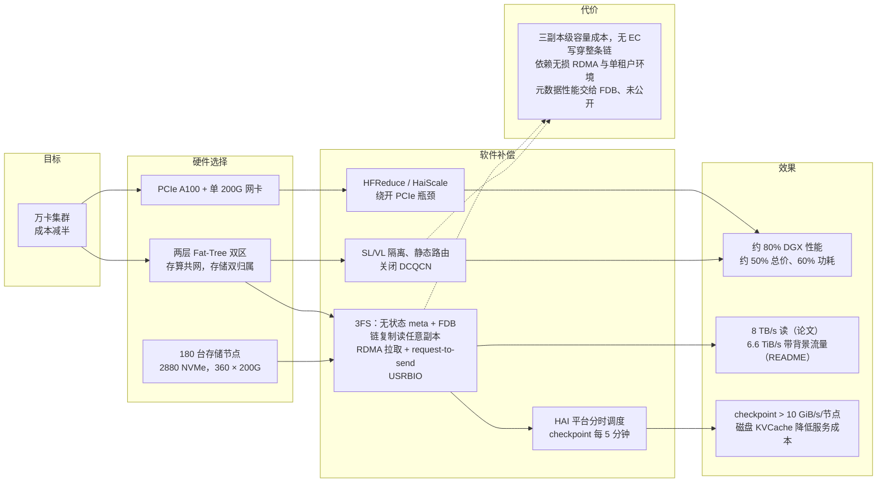

---

## 参考

- Wei An et al. *Fire-Flyer AI-HPC: A Cost-Effective Software-Hardware Co-Design for Deep Learning*. SC 2024. arXiv:2408.14158 <https://arxiv.org/abs/2408.14158>
- DeepSeek-AI. *3FS Design Notes*. <https://github.com/deepseek-ai/3FS/blob/main/docs/design_notes.md> ；仓库：<https://github.com/deepseek-ai/3FS>
- smallpond：<https://github.com/deepseek-ai/smallpond>
- HAI Platform：<https://github.com/HFAiLab/hai-platform>
- Jeff Terrace, Michael J. Freedman. *Object Storage on CRAQ: High-Throughput Chain Replication for Read-Mostly Workloads*. USENIX ATC 2009.
- Robbert van Renesse, Fred B. Schneider. *Chain Replication for Supporting High Throughput and Availability*. OSDI 2004.
- Jingyu Zhou et al. *FoundationDB: A Distributed Unbundled Transactional Key Value Store*. SIGMOD 2021.
- 本仓库 3FS 源码调研：[project/3fs/README.md](../project/3fs/README.md)（元数据、数据路径、一致性、高可用、运维、性能、评估）
- 本仓库相关精读：[FalconFS（NSDI 2026）](falconfs-nsdi2026.md)、[Tectonic（FAST 2021）](tectonic-fast2021/README.md)、[InfiniFS（FAST 2022）](infinifs-fast2022.md)、[CFS（EuroSys 2023）](cfs-eurosys2023.md)、[Tectonic-Shift（ATC 2023）](tectonic-shift-atc2023.md)
