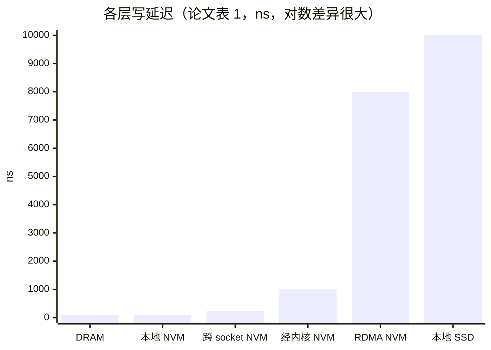
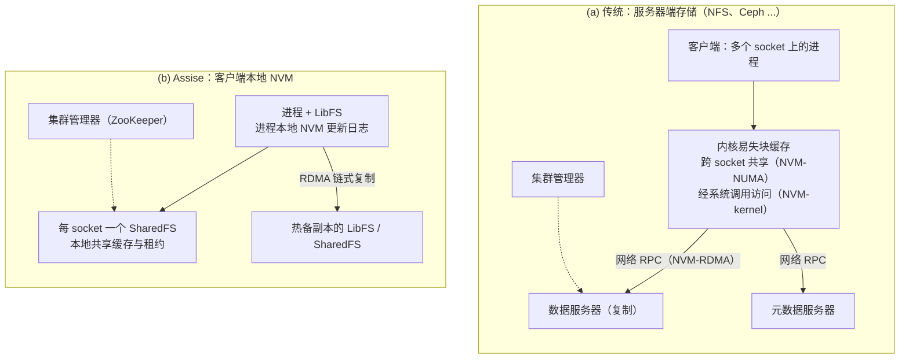
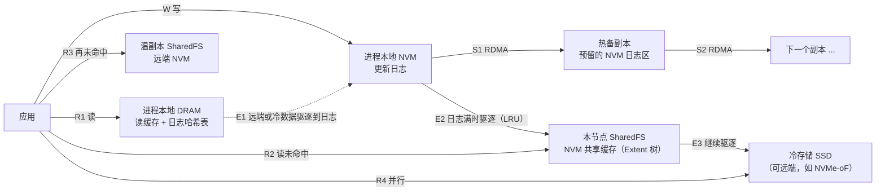
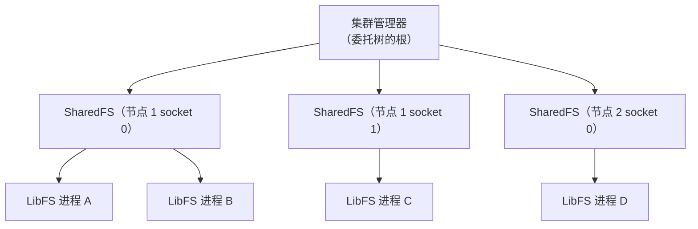
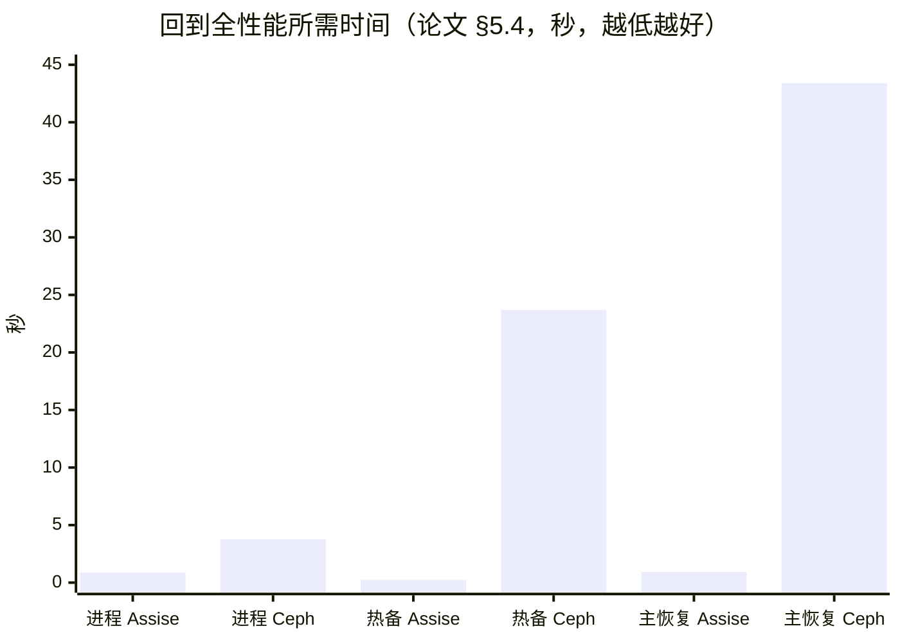
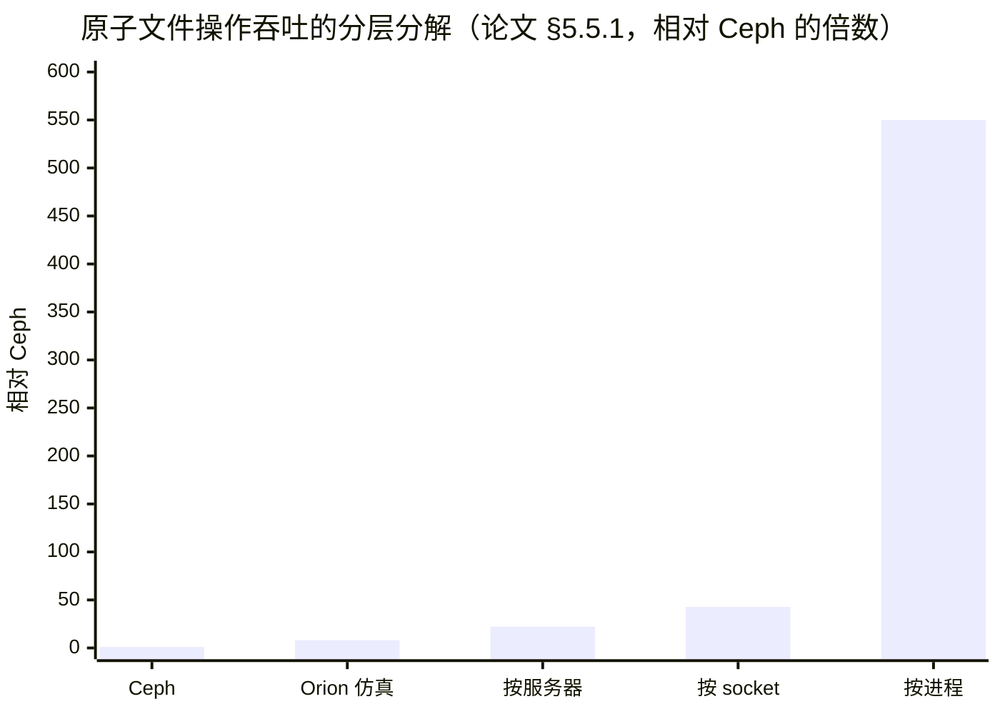
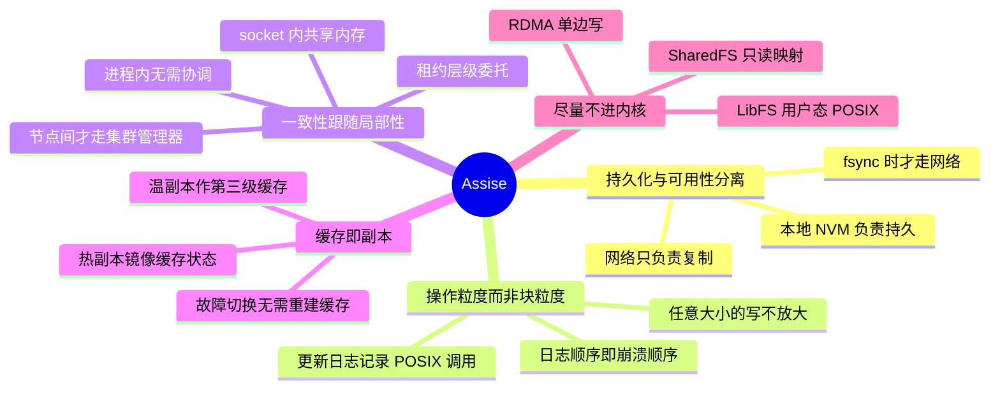
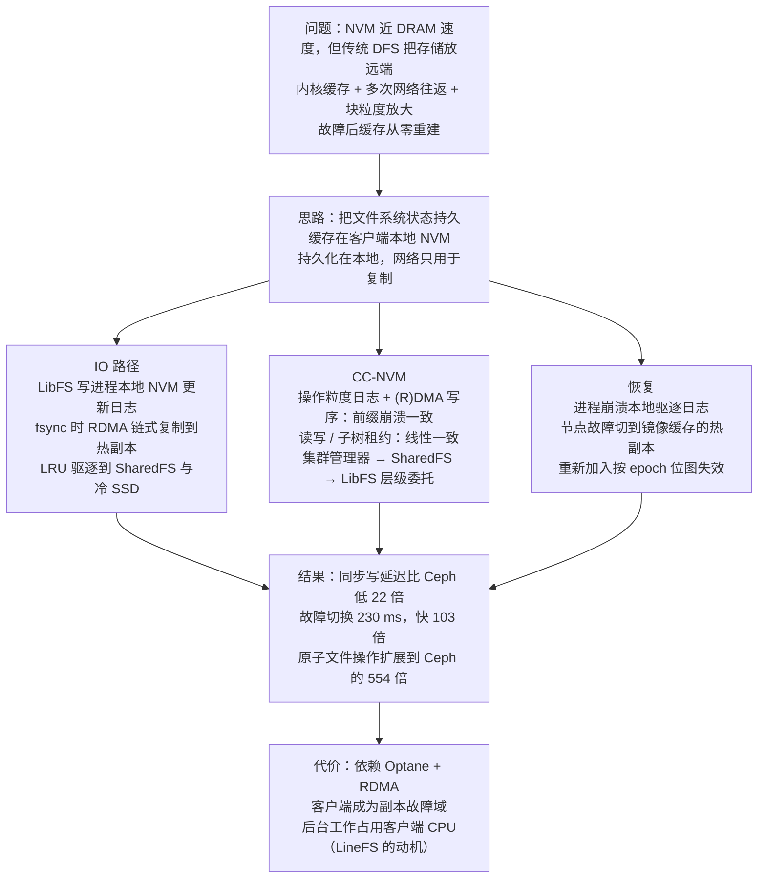

# Assise 精读：把持久内存放在客户端本地的分布式文件系统（OSDI 2020）

> 论文：Thomas E. Anderson, Marco Canini, Jongyul Kim†, Dejan Kostić, Youngjin Kwon, Simon Peter, Waleed Reda*, Henry N. Schuh†, Emmett Witchel（* 主要学生作者；† 共同学生作者）. *Assise: Performance and Availability via Client-local NVM in a Distributed File System*. USENIX OSDI '20，线上，2020-11-04～06，论文集第 1011–1027 页。
>
> 机构：University of Washington（Anderson、Schuh）；KAUST（Canini）；KAIST（Kim、Kwon）；KTH 皇家理工学院（Kostić、Reda）；Université catholique de Louvain（Reda）；UT Austin（Peter、Witchel）。
>
> 链接：<https://www.usenix.org/conference/osdi20/presentation/anderson>；PDF <https://www.usenix.org/system/files/osdi20-anderson.pdf>；代码 <https://github.com/ut-osa/assise>
>
> 篇幅：正文 14 页 + 参考文献 3 页，共 17 页；11 张图、4 张表。
>
> 精读日期：2026-11-24。**数字和机制描述都摘自论文**，用"论文 §x / 图 x / 表 x"标注出处。标"解读"的段落是本文作者的分析和推论，不是原文。多数图没有数据标签，图上读数为本文估读，标注"约"（对数坐标图误差较大）。标"示例"的是为说明机制构造的例子。
>
> 相关文档：
> - [新硬件综述 §2](new-hardware.md#2-assise-performance-and-availability-via-client-local-nvm-in-a-distributed-file-system)：本文的简述版。
> - [LineFS（SOSP 2021）精读](linefs-sosp2021.md)：在 Assise 之上把 SharedFS 的后台工作卸载到 SmartNIC，是 Assise 的直接后续。
> - [DAOS（SCFA 2020）精读](daos-scfa2020.md)：同为 Optane 时代的系统，但走"服务器端 PM + 用户态存储服务"路线。
> - [SingularFS（ATC 2023）精读](singularfs-atc2023.md)、[HMFS（SoCC 2025）精读](hmfs-socc2025.md)：PM 时代的元数据服务，与 Assise 的"数据与元数据都放客户端本地"形成对照。

## 目录

- [0. 一页速览](#0-一页速览)
- [1. 背景：NVM 改变了什么](#1-背景nvm-改变了什么)
- [2. 远端存储与本地 NVM 两种架构](#2-远端存储与本地-nvm-两种架构)
- [3. Assise 设计概览](#3-assise-设计概览)
- [4. IO 路径](#4-io-路径)
- [5. CC-NVM：崩溃一致的缓存一致性](#5-cc-nvm崩溃一致的缓存一致性)
- [6. 故障切换与恢复](#6-故障切换与恢复)
- [7. 讨论与实现](#7-讨论与实现)
- [8. 评估](#8-评估)
- [9. 论文中的不一致与可疑之处](#9-论文中的不一致与可疑之处)
- [10. 与本仓库中其他系统的对照](#10-与本仓库中其他系统的对照)
- [11. 整体总结](#11-整体总结)
- [参考](#参考)

---

## 0. 一页速览

**一句话**：传统分布式文件系统（NFS、Ceph、以及为 RDMA/NVM 重新设计的 Octopus、Orion）把存储放在远端服务器上，客户端内存只是内核里的易失块缓存。在 Optane 这类近 DRAM 速度的持久内存（NVM）面前，这种分工的开销就暴露出来了：访问内核缓存要系统调用，缓存未命中要多次网络往返，客户端故障后缓存要从零重建，按 4 KB 块管理缓存还会放大小 IO。Assise 反过来**把文件系统状态缓存在应用所在机器的本地 NVM 中**：每个进程一个用户态库文件系统 **LibFS**，写入先追加到进程本地 NVM 的**更新日志**，`fsync` 时经 RDMA **链式复制**到热备副本；每个 CPU socket 一个 **SharedFS** 守护进程管理共享缓存和租约。核心是 **CC-NVM**：一个持久、可复制的缓存一致性层，以 **IO 操作**（而不是固定块）为粒度，用可层级委托（集群 → 节点/socket → 进程）的**租约**提供线性一致，用日志顺序加 (R)DMA 写序提供**前缀崩溃一致**。结果：写延迟最多低 22 倍，吞吐最多高 56 倍，故障切换最多快 103 倍。

| 维度 | 要点 |
|------|------|
| 硬件前提 | 本地 NVM 读写 175/94 ns、顺序读写 32/11.2 GB/s，单价是 DRAM 的 39%；而经 RDMA 访问远端 NVM 读写 3/8 µs、3.8 GB/s（论文表 1） |
| 组件 | LibFS（每进程用户态库，POSIX 接口，内核旁路）；SharedFS（每 socket 守护进程，管本地租约和共享缓存）；集群管理器（ZooKeeper，成员与故障检测）；热备副本、温副本（论文 §3，表 2） |
| 写路径 | ① 写进程本地 NVM 更新日志（任意粒度）；② 经 RDMA 链式复制到热备副本（pessimistic 模式在 `fsync` 时同步，optimistic 模式延迟到 `dsync` 或驱逐时）；③ 日志满时按 LRU 驱逐到 SharedFS 共享缓存，再到冷存储（SSD）（论文 §3.2.1） |
| 读路径 | 进程本地读写缓存 → 节点本地 SharedFS 缓存 → 温副本远端 NVM 与冷存储并行（论文 §3.2.2） |
| 一致性 | 读写租约 + 子树租约，层级委托：集群管理器 → SharedFS → LibFS；租约转移前必须清理并驱逐持有者的缓存；租约转移本身在 NVM 中记录并复制（论文 §3.3） |
| 恢复 | 进程崩溃：本地 SharedFS 驱逐其日志；OS 崩溃：从 NVM 中的 OS 快照启动；节点故障：立即切换到热备副本；节点重新加入：按 epoch 位图失效期间被他人写过的文件（论文 §3.4） |
| 结果 | LevelDB 同步写延迟比 Ceph 低 22 倍；Varmail 吞吐约为 Ceph 的 55 倍；LevelDB 故障切换 230 ms 对 Ceph 23.7 s（103 倍）；原子文件操作扩展到 Ceph 的 554 倍、Orion（仿真）的 69 倍；Postfix 最多为 Ceph 的 5.6 倍；MinuteSort 比 NFS 快 2.2 倍（论文 §5） |

**解读**：

- Assise 的出发点是 NVM 带来的一个反转：**本地持久化比网络往返还快**。本地 NVM 写约 94 ns，RDMA 写远端 NVM 约 8 µs，相差近百倍。于是"持久化"不必再等网络，"高可用"才需要网络；把这两件事拆开，写延迟就由本地 NVM 决定，复制只在 `fsync` 时发生。
- 它其实是 [Strata](#10-与本仓库中其他系统的对照)（SOSP 2017，单机 NVM 文件系统，同样有 LibFS 更新日志和后台 digest）的分布式扩展：把 Strata 的"进程本地日志 + 共享区"加上 RDMA 链式复制和分布式租约。
- Optane 已于 2022 年停产，硬件前提不再成立。但"客户端本地持久写缓冲 + 操作粒度日志 + 链式复制 + 层级租约"这套组合，在 CXL 内存、低延迟 NVMe 或带电容的 DRAM 上仍有参考价值；后续的 [LineFS](linefs-sosp2021.md) 也是在 Assise 上改出来的。

---

## 1. 背景：NVM 改变了什么

### 1.1 存储层次的价格与性能（论文 §1、§2，表 1）

作者在测试床上测得的各层性能（2020 年 10 月价格）：

| 介质 | 读/写延迟 | 顺序读/写带宽（GB/s） | 价格（$/GB） |
|------|----------|---------------------|-------------|
| DDR4 DRAM | 82 ns | 107 / 80 | 9.77 |
| NVM（本地） | 175 / 94 ns | 32 / 11.2 | 3.83 |
| NVM-NUMA（跨 socket） | 230 ns | 4.8 / 7.4 | — |
| NVM-kernel（经内核） | 0.6 / 1 µs | — | — |
| NVM-RDMA（远端） | 3 / 8 µs | 3.8 | — |
| SSD（本地） | 10 µs | 2.4 / 2.0 | 0.32 |

- 本地 NVM 的延迟和带宽接近 DRAM，比 SSD 好两个数量级，单价只有 DRAM 的 39%。所以 NVM 既可以作为存储层次的最上层，也可以作为内存层次的最下层。
- 但经 RDMA、跨 socket 或经内核访问 NVM，延迟和带宽要差一个数量级。**要发挥 NVM 的潜力，必须高效使用本地 NVM。**
- **快速恢复**：绝大多数系统故障是软件崩溃，只需重启。把热数据缓存在 NVM 中可以跨重启保留，从这类常见故障中快速恢复。

### 1.2 传统做法的三个代价（论文 §1）

传统客户端-服务器 DFS（Amazon EFS、NFS、Ceph、Colossus/GFS，以及 NVM 重设计的 Octopus、Orion）把存储放在与客户端分离的服务器上，客户端内存是内核管理的易失块缓存。这在 SSD/HDD 时代很合理，在 NVM 时代则有三个代价：

1. **稳态性能**受访问内核客户端缓存的开销限制；缓存未命中时要多次网络往返，先查远端元数据服务器，再取数据；
2. **故障时**，客户端-服务器文件系统必须从零重建故障客户端的缓存，应用级服务恢复时间长，恢复期间网络利用率高；
3. 按**固定页块粒度**管理客户端缓存，会放大分布式应用常见的小 IO；IO 大于块时又会增加缓存一致性开销。

这些代价使 NVM 发挥不出性能，以至于存储界有人主张完全重新设计文件系统 API。Assise 的目标是**不改 API** 也能获得高性能。

### 1.3 相关工作的不足（论文 §2.1）

| 类别 | 代表 | 问题 |
|------|------|------|
| 块与对象存储 | EBS、S3、Ursa；Crail、Blizzard 在其上提供文件 API | 有最小 IO 粒度（EBS 16 KB），小 IO 有写放大；Crail、Blizzard 关注大流并行吞吐 |
| 内存 KV | RAMCloud | DRAM 容量有限，很多操作仍要走网络；DRAM 状态崩溃后无法恢复，易受级联故障影响；恢复要从远端节点拉取，需要全对分带宽网络 |
| 客户端-服务器 | Ceph | 网络和系统调用延迟损害 IO 延迟；网络带宽低于本地 NVM 带宽 |
| RDMA/NVM 重设计 | Octopus（FUSE，不复制，分布式哈希放置）、Orion（内核态，有元数据服务器，"内部客户端"可本地存数据） | 都不用内核旁路，都把存储远端池化；常规路径都要远程更新数据或元数据。Orion 因中心元数据服务器的更新争用只能扩展到少量客户端，且没有评估服务器故障切换 |
| 反向设计 | Clover KV | 元数据与应用同置，但数据放远端 |
| 血统 | Tachyon | 用血统重算避免复制，但要求应用使用复杂的血统跟踪 API |
| 租约 | Berkeley xFS 等 | xFS 在每个节点维护本地块级更新日志，以软件 RAID 5/6 条带化到其他节点；Assise 用操作日志、复制而非条带化日志，并做更新合并 |

Assise 的思路：消除本地 IO 的内核开销；常见情况下远程 IO 只需对最近的副本做一次操作；不需要专门的元数据服务器或分布式哈希来均衡负载；用租约在本地强制数据和元数据一致；支持经典 POSIX 文件 API，与现有应用完全兼容。

---

## 2. 远端存储与本地 NVM 两种架构

论文 §2.2，图 1：两种设计都用复制的集群管理器做成员管理和故障检测，其余方面完全不同。

- **传统设计**先把集群节点分成客户端和服务器。客户端把文件系统状态缓存在易失的内核缓冲区缓存中，跨 socket 共享、经昂贵的系统调用访问；持久状态在远端服务器的 NVM 中。为了持久化和一致性，客户端必须经网络与复制的存储和元数据服务器协调，延迟比本地 NVM 高。数据通常随机分布在复制的存储服务器上；由于原子更新大量存储节点开销大，崩溃一致性常常**只对集中管理的元数据**提供。
- **Assise** 不用远端存储服务器，进程经 LibFS 直接访问本地 NVM 中缓存的文件系统状态（LibFS 可以为故障切换而复制）。CC-NVM 通过每 socket 的 SharedFS 和集群管理器层级地协调各 LibFS。

---

## 3. Assise 设计概览

### 3.1 概念（论文 §3，表 2）

| 概念 | 说明 |
|------|------|
| LibFS | 每进程的用户态文件系统库 |
| SharedFS | 每 socket 的系统守护进程，管理本地租约 |
| CC-NVM | 具备线性一致性的崩溃一致缓存一致性层 |
| 热备副本（hot replica） | 缓存热的副本，用于快速故障切换 |
| 温副本（warm replica） | 为低延迟的远程温数据读提供 NVM |
| 集群管理器 | 容错的成员与租约服务（ZooKeeper） |

### 3.2 两种崩溃一致模式（论文 §3）

由挂载选项指定：

| 模式 | `fsync` 语义 | 复制时机 | 特点 |
|------|------------|---------|------|
| **pessimistic** | 强制立即同步复制，`fsync` 之前的所有写都能在故障后保留 | `fsync` 时 | 评估默认使用 |
| **optimistic** | 按顺序提交所有操作，但可以推迟复制，直到应用调用 **`dsync`** | `dsync` 或日志驱逐时 | 延迟更低、吞吐更高，可合并临时写；但无法本地恢复的崩溃可能丢数据 |

两种模式都保证**前缀崩溃一致**：所有可恢复的写都是有序的，写历史的某个前缀中不缺任何部分。

### 3.3 集群协调与故障检测（论文 §3.1）

- 每个 SharedFS 在集群管理器（ZooKeeper）注册。原型中由**管理员**决定哪个 SharedFS 复制命名空间的哪些部分、以及对任意子树采用哪种缓存策略（热或温副本），集群管理器记录这一映射。
- 某个子树第一次被访问时，LibFS 联系本地 SharedFS，后者查集群配置，建立从 LibFS 经该子树各热副本的 **RDMA 复制链**。每条链上的热副本为复制预留一定量的 NVM。分布式副本发现服务留作未来工作。
- **故障检测**：集群管理器每秒向每个活跃的 SharedFS 发心跳，超时无响应就把节点标记为故障，并通知所有相连的 SharedFS。节点恢复上线后联系集群管理器并发起恢复（§3.4）。

---

## 4. IO 路径

论文 §3.2，图 2：Assise 不用共享的内核缓冲区缓存，LibFS 先把文件系统状态缓存在**进程本地内存**中：NVM 存更新，DRAM 缓存读。

### 4.1 写路径（论文 §3.2.1）

写入涉及三个时间尺度不同的机制：

1. **W**：为了低延迟持久化，LibFS 直接写进程本地 NVM 缓存。为高效支持任意粒度的写，写缓存是一个**更新日志**而不是块缓存。
2. **S1、S2**：为了在节点故障后存活，LibFS 以内核旁路方式**链式复制**更新日志。
3. **E2**：更新日志超过阈值时发起驱逐，把内容移到 SharedFS。

**复制与崩溃一致**：

- pessimistic 模式下，`fsync` 强制立即同步复制，调用者阻塞直到 `fsync` 之前的所有写都已复制。
- optimistic 模式下可推迟复制，从而有机会**合并**临时的持久写（被覆盖或删除的文件），这在应用层提交协议中很常见；省掉这些写可以节省网络带宽。复制在 `dsync` 或日志驱逐时发起。
- 两种模式下，本地更新日志的内容都经 RDMA 写到链上第一个副本预留的 NVM（S1），该副本再写给下一个（S2），依此类推；最后一个副本沿链回送确认，表示整条链完成。

**缓存驱逐**：

- 更新日志满时，LibFS 先复制所有未复制的写，再按 **LRU** 驱逐：经 SharedFS 共享缓存到冷存储（E2、E3）。热副本把热数据留在 NVM，把温、冷数据移到冷存储；温副本把热、冷数据放冷存储，温数据留在 NVM 以加速温数据读（§3.5）。冷存储可以是远端的（如 NVMe-over-Fabrics）。
- 链上每个副本**并行驱逐**，完成后确认，保证所有副本缓存完全相同的状态，以便快速故障切换。
- 日志驱逐（E2）时直接向另一个 socket 上的 NVM 共享缓存做 store 指令，会有跨 socket 硬件缓存一致性的开销、限制吞吐。由于 CC-NVM 自己保证缓存一致性，Assise 可以**用 DMA 绕过硬件缓存一致性**，向 NVM-NUMA 驱逐，跨 socket 文件系统写吞吐提升最多 30%（§3.2.1；§5.2 实测为 44%，见 [§9](#9-论文中的不一致与可疑之处)）。

### 4.2 读路径（论文 §3.2.2）

LRU 驱逐保证所有数据的最新版本总在最快的缓存中。读时：

1. LibFS 先查进程私有的写缓存和读缓存（经日志哈希表和读缓存）（R1）；
2. 未命中则查节点本地的热 SharedFS 缓存（经索引 SharedFS 缓存的 extent 树）（R2）；
3. 再未命中，则查温副本的 SharedFS 缓存（若有）（R3），并**并行**查冷存储（R4）。

**读缓存管理**：最近读过的数据缓存在进程本地 DRAM 中，从本地 NVM 读来的除外（DRAM 缓存对它没有好处）。LibFS 从冷存储预取最多 256 KB，从远端 NVM 预取最多 4 KB；远端 NVM 读时先取回请求的数据，再预取其余部分，兼顾小读延迟和有空间局部性的负载。来自远端 NVM 和冷存储的数据从读缓存驱逐到进程本地更新日志（E1）。

### 4.3 权限与内核旁路（论文 §3.2.3）

- Assise 假设单一管理域，沿用 UNIX 的文件和目录属主与权限。
- **SharedFS 负责执法**：在缓存驱逐时检查权限和元数据完整性，在读时强制权限。为降低读节点本地 SharedFS 缓存的延迟，Assise 允许把 SharedFS 缓存中**有权访问**的部分**只读映射**到 LibFS 地址空间。文件或目录关闭、更新日志被驱逐时，LibFS 的缓存和映射失效。
- LibFS 的操作无法阻止一个线程破坏同进程另一线程在进程本地更新日志中的数据，但 SharedFS 会在元数据操作对其他进程可见之前验证其合法性。也就是说，进程可以破坏**自己**私有日志中的数据（内存保护键可以缓解线程间的破坏），但**不能破坏共享的文件系统（元）数据**：只有进程本地的写进入进程本地日志，多进程对任何文件系统对象（包括子树）的访问都由租约做访问控制且线性一致。

---

## 5. CC-NVM：崩溃一致的缓存一致性

CC-NVM 在进程间共享文件系统状态时提供带线性一致性的分布式缓存一致性；崩溃时提供前缀语义（论文 §3.3）。

### 5.1 前缀崩溃一致（论文 §3.3）

- CC-NVM 用进程本地 NVM 中的更新日志跟踪写入顺序：每个更新状态的 POSIX 调用都按顺序记入更新日志。
- 链式复制时，利用 **(R)DMA 的写序保证**把日志按序写到副本。
- optimistic 模式下，把合并后的文件系统操作包在一个 **Strata 事务**中，保证更新原子地持久化和复制，并能恢复写历史的一个前缀（§3.4）。

### 5.2 租约：线性一致的共享（论文 §3.3）

- 租约像读写锁，但可以被**撤销**（让给其他进程），也会在超时后**过期**（之后可重新获取）。
- CC-NVM 用租约授予对一组文件和目录的共享读或独占写访问：同一组可以同时有多个读租约，写租约是独占的。读写语义既适合读多、被广泛使用的共享文件和目录，也适合写密集但不常共享的文件和目录。
- **子树租约**：覆盖某个目录及其下所有文件和目录。例如持有 `/tmp/bwl-ssh/` 独占子树租约的 LibFS 可以在该子树内递归创建和修改文件与目录。
- **获取**：LibFS 必须经系统调用从 SharedFS 获取租约，才能缓存租约覆盖的数据。Assise 在第一次 IO 时获取，一直保留到被 SharedFS 撤销（另一个 LibFS 要访问、LibFS 崩溃或租约超时）。
- **撤销**：撤销延迟受一个**宽限期**限制，当前持有者可在其中完成进行中的 IO 再释放；宽限期后仍不交出，SharedFS 强制撤销，之后该文件上的 IO 被拒绝。SharedFS 强制要求：转移租约**之前**，持有者的读写缓存中被覆盖的数据必须已清理并驱逐，所需时间以持有者的更新日志大小为界。
- **持久化**：SharedFS 在 NVM 中记录并复制每次租约转移，以保证崩溃一致；LibFS 可以把 IO 与 SharedFS 的租约复制重叠，直到 `fsync`/`dsync`。

### 5.3 层级一致性（论文 §3.3）

为了把一致性维护尽量局部化，租约按层级委托：

1. LibFS 先向**本地** SharedFS 请求租约；
2. 本地 SharedFS 不是持有者时，询问集群管理器；
3. 没有当前持有者时，集群管理器把租约分配给请求的 SharedFS，后者委托给请求的 LibFS，并成为它的**租约管理者**；
4. 已有租约管理者时，SharedFS 把请求转发给管理者，并缓存管理者的信息（租约覆盖的命名空间和过期时间）。

集群管理器**每 5 秒**让 SharedFS 的租约管理权过期一次，这样 CC-NVM 能把租约管理迁移到本地 SharedFS，又不会让管理者变动太快，有利于扩展。同一节点或 socket 上的 LibFS 在常见情况下只需本地 SharedFS 委托，很少需要网络通信，这与许多分布式应用的数据分片模式吻合（§5.5）。

**示例**：节点 1 上的进程 A 第一次写 `/mail/alice/`。它向本地 SharedFS 请求写租约；本地 SharedFS 不是管理者，问集群管理器；集群管理器发现没有持有者，把管理权交给节点 1 的 SharedFS，后者再委托给进程 A。此后节点 1 上的进程 B 想写同一目录，只需节点 1 的 SharedFS 在本地把租约从 A 撤回、转给 B，不经网络；节点 2 上的进程 D 来写，才需要经集群管理器找到节点 1 的 SharedFS 并远程转移。

**解读**：层级租约把一致性的代价与数据共享的"距离"对齐：进程内免费，socket 内只需共享内存通信，节点内跨 socket 稍贵，跨节点才走网络。这和 CPU 缓存一致性的层级目录思路相同，只是粒度从缓存行变成了文件和子树。它的前提是应用的共享模式有局部性；§8.5 的 Postfix 实验正好说明了这一点：轮询分发邮件（没有局部性）比按用户分片慢约 20%。

---

## 6. 故障切换与恢复

Assise 把文件系统状态持久缓存在本地 NVM 中，用于快速恢复，并针对最常见的故障类型优化（论文 §3.4）：

| 故障 | 处理 | 评估结果（§5.4） |
|------|------|---------------|
| **应用进程崩溃**（最常见） | 本地 SharedFS 直接驱逐死掉的 LibFS 更新日志，恢复所有已完成的写（optimistic 模式也一样），再让它的租约过期。基于日志的驱逐是幂等的，驱逐期间系统崩溃也能保持一致。崩溃的进程在本地重启后可以立即重用全部文件系统状态；只需重建 LibFS 的 DRAM 只读缓存 | LevelDB 0.87 s 恢复，Ceph 3.78 s（4.34 倍） |
| **OS 崩溃后重启** | 可以在 NVM 中保存一份刚启动的 OS 的检查点来加速重启；启动后，Assise 检查 NVM 中的 SharedFS 日志，为之前运行的所有 LibFS 发起恢复 | 2.57 s（VM 快照 1.66 s + SharedFS 0.23 s + LevelDB 0.68 s） |
| **断电或硬件故障** | 不等节点恢复，立即切换到**热备副本**：副本的 SharedFS 接管故障节点的租约管理，用复制过来的 SharedFS 日志把租约重新授予应用副本；新实例能看到最近一次完成的 `fsync`/`dsync` 之前的所有 IO | 230 ms 恢复全性能，Ceph 23.7 s（103 倍） |
| **节点重新加入** | 集群管理器先确保该节点的所有租约都已过期。故障期间其他节点的写可能使其缓存失效：集群管理器维护一个 **epoch** 号，节点故障和恢复时递增并通知所有 SharedFS；所有 SharedFS 在一个稀疏文件中共享**每个 epoch 的位图**，记录该 epoch 内哪些 inode 被写过；所有节点恢复后删除该 epoch 的位图。重新加入的 SharedFS 向在线的 SharedFS 收集相关 epoch 位图，**失效所有自崩溃以来被写过的文件的每一个块** | 恢复后 938 ms 回到全性能，Ceph 43.4 s（46 倍） |

**温副本**（论文 §3.5）：为了充分利用表 1 的层次，远端 NVM 可以作为本地 DRAM、本地 NVM 之下的第三级缓存。温副本像热副本一样经链式复制接收所有更新，但采用不同的驱逐策略：跟踪 LibFS 和 SharedFS 缓存之外一部分"温数据"的 LRU 链。温副本不影响复制写的延迟，但让温数据的读从 NVM 而不是冷存储返回。LibFS 经 RDMA 从温副本读，延迟和带宽都优于冷存储。常见情况下应用不在温副本上运行；在所有热副本都级联崩溃的罕见情况下，进程可以切换到温副本，短期性能下降，之后温副本变为热副本，热数据迁回本地 NVM。

**解读**：节点重新加入时"失效被写过文件的每一个块"是一个很粗的策略，论文自己也说可以优化（只记被写的块，或对区域做校验和）。好处是位图很小、更新很快；代价是一个大文件只要被改过一个字节，重新加入的节点就要整个重新从副本读。对 LevelDB 这类"少数大 SST 文件 + 频繁新建"的负载问题不大，对大文件随机小写的负载会让恢复后的预热变慢。

---

## 7. 讨论与实现

### 7.1 规模化部署的考虑（论文 §3.6）

| 问题 | 论文的讨论 |
|------|-----------|
| 更新日志的内存占用 | 原型在进程创建时预分配每进程、每副本的更新日志。规模化时可按当前可用 NVM 容量和每进程 IO 需求**动态调整**大小，SharedFS 在驱逐时调整；最大开销是为 RDMA 注册内存（锁页并映射到网卡），可与驱逐重叠；可按倍数调整以减少调整次数 |
| RDMA 扩展性 | 每个进程和副本用 RDMA 可靠连接（RC），网卡要为每个连接维护状态，连接多了会挤爆网卡有限的内存。可以借助减少网卡缓存抖动的方案，或 Mellanox 的动态连接（DC）传输共享连接 |
| NVM 磨损 | 更新日志减少了写放大，但日志驱逐在最坏情况下有 **2 倍**写放大；可以靠合并部分消除（如 Varmail），也可以把日志页重映射到 SharedFS 共享缓存而不额外写（未来工作） |
| 安全 | 公有云中各租户数据通常加密：Optane 支持透明硬件加密，现代 RDMA 网卡支持传输加密 |

### 7.2 实现（论文 §4）

- 用 **libpmem** 持久化 NVM 数据，用 **libibverbs** 在用户态做 RDMA；拦截 POSIX 文件系统调用（syscall_intercept），在用户态调用 LibFS 的对应实现。
- 代码量：共 **28,982** 行 C，其中 LibFS **16,515** 行、SharedFS **6,563** 行、工具代码（哈希表、链表等）**5,904** 行；SharedFS 与 LibFS 经共享内存通信；冷存储（SSD、HDD）使用 Strata 的代码（不计入）。
- Optane 使用 **App-Direct** 模式：把 NVM 暴露为一段物理内存，访问最高效，但需要 OS 支持。其他模式更差：Memory 模式把 NVM 当易失内存、DRAM 作硬件管理的四级缓存；Sector 模式把 NVM 当磁盘，有 IO 放大和驱动开销。
- **以 Strata 为基础**：沿用 Strata 的 extent 树（基于 Ext4）索引 SharedFS 管理的存储、LibFS 更新日志和日志合并；扩展 extent 树以管理目录，扩展 Strata 的租约以支持委托。
- **RDMA 的使用**（论文 §4.2）：
  - 节点间用 RDMA **可靠连接（RC）**保证无损有序传输，头部开销低，对小 IO 吞吐友好；还能用绕过接收方 CPU 的单边操作。
  - **日志复制**：通常只需一次 RDMA 写，使用 **write-with-immediate**，在写的同时通知远端副本把数据转发给链上的下一个副本。例外是远端日志回绕，或本地日志因合并而碎片化、超过网卡 scatter-gather DMA 的上限。
  - **持久化**：RDMA 规范没有定义对远端 NVM 写的持久性；实践中需要远端 CPU 把 RDMA 写从缓存刷到 NVM。Assise 在每个副本上用 **CLWB + SFENCE** 刷出所有写，再确认复制成功。
  - **远端读**：经 RPC；用 inode 号而不是路径标识文件以减小请求；DRAM 读缓存位置预先在网卡注册，远端节点可以直接 RDMA 写到请求者的缓存，省一次拷贝。

---

## 8. 评估

### 8.1 实验环境与对比系统（论文 §5、§5.1，表 3）

| 项目 | 配置 |
|------|------|
| 测试床 | 5 台双路 Intel Cascade Lake-SP（2.2 GHz），共 48 核（96 超线程）、384 GB DDR4-2666、6 TB Optane DC PMM、375 GB Optane P4800X NVMe SSD、40GbE ConnectX-3 InfiniBand 网卡；每个处理器 6 条内存通道各插一条 DRAM 和一条 NVM；Fedora 27，内核 4.18.19 |
| 对比 | 内核 NFSv4（经 RDMA）；Ceph 14.2.1 + BlueStore（客户端用 Ceph 内核驱动 + IP over InfiniBand，这是最快的配置）；Octopus（RDMA + FUSE，直接 IO 模式）；Orion 未开源，尽可能仿真其行为 |
| 部署 | 默认把机器用作 Assise 的热副本、Octopus 的存储节点池、Ceph 的 OSD 和 MDS 副本；NFS 用一台作服务器、其余作客户端。应用放在 Assise 的热副本、Ceph 的 OSD 副本、Octopus 的存储节点、NFS 的客户端上。Assise 和 Ceph 的集群管理器另用 2 台机器。Ceph 的应用与 OSD 同机（集群小所致），对 Ceph 有利 |
| 缓存 | 所有系统都用 App-Direct 模式的 NVM 做持久化、DRAM 做非持久缓存（把 NVM 用作 Ceph/NFS 的易失缓存会使吞吐下降最多 25%）。为在有限数据集上覆盖各种缓存行为，把最快一级缓存都限制为 **3 GB**：Ceph、NFS 的内核缓冲区缓存 3 GB；Assise 的 LibFS 缓存分为 1 GB NVM 更新日志 + 2 GB DRAM 读缓存（SharedFS 二级缓存可用全部 NVM）。Assise 默认 **pessimistic** 模式 |
| 兼容性测试 | Assise 通过推荐给 NFS 的全部 **75** 个通用 xfstests（NFSv4.2 通过 71 个，Ceph 14.2.1 通过 69 个，部分源于其一致性模型较弱），也通过 CrashMonkey，能跑全部 Filebench 配置，通过 LevelDB 全部单元测试和 MinuteSort 校验 |

**功能对比**（论文表 3）：

| 特性 | Assise | Ceph | NFS | Octopus | Orion |
|------|--------|------|-----|---------|-------|
| 缓存可恢复 | ✓ | | | | |
| 本地一致性 | ✓ | | | | |
| 内核旁路 | ✓ | | | | |
| 线性一致 | ✓ | | | | ✓ |
| 数据崩溃一致 | ✓ | | | | ✓ |
| 字节粒度 | ✓ | | | ✓ | ✓ |
| 复制 | ✓ | ✓ | | | ✓ |
| RDMA | ✓ | ✓ | ✓ | ✓ | ✓ |

一致性语义：Assise 提供数据崩溃一致，Ceph/BlueStore 和 Octopus 只提供元数据崩溃一致；NFS 的崩溃一致取决于底层文件系统，这里用 EXT4-DAX，也只有元数据崩溃一致。共享数据时，NFS 提供 close-to-open 一致，Octopus 和 Ceph 提供"比 NFS 更强"的一致，Assise 提供线性一致。**所有对比中 Assise 的一致性都最强**；Octopus 和 NFS 不复制，在性能上占了"不公平"的便宜。Ceph 是最接近的对比对象。

### 8.2 微基准（论文 §5.2，图 3–图 5）

**写延迟**（图 3a，2 台机器，Assise-3r 用 3 台；向单个文件追加 1 GB，文件小于缓存，不发生驱逐；`write` 为实线、`fsync` 为柱高）：

| 观察 | 数据 |
|------|------|
| Assise 本地 write 延迟 | 与 Strata 相同 |
| 128 B 两节点复制写 | 平均延迟只比"本地写 + NVM-RDMA 写"之和高 **8%** |
| 三副本（Assise-3r） | 开销增至 **2.2 倍**（链式复制顺序 RPC） |
| 尾延迟 | 两副本时 P99 最多是平均值的 **2.1 倍**（Optane 写尾延迟）；三副本时差距缩小到 **19%** |
| Ceph、NFS | 用内核缓冲区缓存、与服务器按 4 KB 块交互。小写时 `fsync` 的网络 IO 放大使总写延迟最多高一个数量级；write 本身最多高 **3.2 倍**（内核穿越和拷贝）。大写（≥ 64 KB）时网络放大减小，但维护内核缓存的拷贝成了主要开销：write 延迟高于 Assise 的复制写延迟（最多是 Assise 非复制写的 2.7 倍），总延迟最多高 **7.2 倍**。Ceph 因复制，`fsync` 比 NFS 慢 |
| Octopus | 去掉内核缓存和块粒度后比 NFS、Ceph 好得多，但仍把所有 NVM 当远端并用 FUSE（约 10 µs）：小写（< 64 KB）延迟最多是 Assise 的 **2.1 倍**；大写摊薄开销后，Assise 因复制反而最多高 **1.7 倍**（Octopus 不复制，`fsync` 是空操作） |

**读延迟**（图 3b，读 1 GB 文件，暖缓存测命中、冷缓存测未命中）：

| 情况 | 观察 |
|------|------|
| 命中（HIT） | Assise 从 LibFS 读缓存返回，比 NFS 快最多 40%、比 Ceph 快最多 50% |
| Assise 本地未命中（MISS） | 从本地 SharedFS 返回，要读 extent 树索引，最多比 HIT 慢 3.2 倍（大 IO 读更多 extent） |
| Assise 远端未命中（RMT） | 一次 RDMA RPC |
| NFS、Ceph 未命中 | 要从远端服务器取，平均和尾延迟比 Assise-RMT、Assise-MISS 高到数量级；Ceph 的 OSD 读路径更复杂，比 NFS 差 |
| Octopus | 没有缓存，要串行地从远端 NVM 取元数据和数据：比命中缓存的其他系统高两个数量级，比 NFS、Ceph 未命中低一个数量级；小读（≤ 4 KB）因 FUSE 最多是 Assise-RMT 的 3.54 倍，大读（≥ 64 KB）最多 1.46 倍。让 FUSE 使用内核缓存后，命中延迟降到 Assise-HIT 的 1.8 倍，但写延迟因额外拷贝最多高一个数量级 |

**峰值吞吐**（图 4，24 线程 = 一个 socket 的全部核，4 KB IO，120 GB 数据集分成 24 个文件，每线程写 5 GB；Assise、Ceph 用 3 台机器做 3 副本；写不跟 `fsync`，访问量大于缓存，写时会驱逐；读从冷缓存开始；Octopus 在此实验中崩溃）：

| 指标 | Assise | Assise-DMA | NFS | Ceph |
|------|--------|-----------|-----|------|
| 顺序写（GB/s，约） | 约 2.8（NVM-RDMA 带宽的 **74%**） | 约 2.8 | 约 2.5（**66%**） | 约 0.87（Assise 的 31%） |
| 随机写（GB/s，约） | 约 2.6 | 约 2.6 | 约 0.4 | 约 0.55（Assise 是它的 **4.8 倍**） |
| 跨 socket 写（GB/s，约） | 约 1.8 | 约 2.6（**+44%**） | — | — |
| 顺序读（GB/s，约） | 约 29（本地 NVM 带宽的 **90%**） | 远端 RMT 约 3.8（满 NVM-RDMA 带宽） | 约 3.8 | 约 1.2 |
| 随机读（GB/s，约） | 约 22（**68%**） | 远端 RMT 约 3.8 | 约 0.7 | 约 0.4 |

- 顺序写受 NVM-RDMA 带宽限制，NFS 有协议开销，Assise 有日志头开销；链式复制对吞吐影响很小。Ceph 并行复制到两个远端副本，消耗 3 倍网络带宽。
- Assise 的写是日志结构的，顺序与随机写性能相近；NFS 和 Ceph 的随机写因缓存块误预取导致额外的远端读，表现很差。NFS 吞吐只有 Ceph 的 67%，原因是内核锁开销。
- 跨 socket：把所有文件放到远端 socket，Assise-DMA 比用非临时处理器写的 Assise 高 **44%**；写本地 socket 时两者相同。
- 读：本地顺序读与本地 NVM 带宽的差距（10%）来自元数据查找，随机读还受 PMM 缓冲区未命中影响。

**更新日志大小**（图 5，单进程顺序写 1 GB、4 KB 粒度，最坏情况）：日志从 16 MB 增到 2 GB（128 倍），吞吐只提升 **22%**。共享数据的负载差距应更小（租约转移时会驱逐日志）。按每台 6 TB NVM 计算，2 GB 日志可支持数千个进程，16 MB 日志可支持数十万个进程。

### 8.3 应用（论文 §5.3，图 6–图 8，表 4）

**LevelDB**（3 台机器，单线程 db_bench，16 B 键、1 KB 值、100 万对；图 6，µs，约）：

| 操作 | Assise | NFS | Ceph | Octopus |
|------|--------|-----|------|---------|
| 顺序读 | 约 1 | 约 1.2 | 约 0.8 | 约 15 |
| 随机读 | 约 6 | 约 9 | 约 4 | 约 70 |
| 倾斜读（1% 热键） | 约 2.5 | 约 1.5 | 约 2 | 约 60 |
| 顺序写 | 约 11 | 约 10 | 约 1,000 | 约 90 |
| 随机写 | 约 45 | 约 45 | 约 800 | 约 90 |
| 同步写（每次写后 `fsync`） | 约 60 | 约 100 | 约 1,300 | 约 300 |

- 读：Assise、Ceph、NFS 都靠缓存接近硬件速度。
- 非同步写：NFS 最多比 Assise 快 **26%**（批量进入客户端内核缓存，LevelDB 自己也有写缓冲）。
- 同步写：Assise 比 NFS 快 **69%**，比 Ceph 好 **22 倍**（Ceph 与 Assise 都复制）。Octopus 绕过缓存，读最差，写只比 Ceph 好（它不复制）。

**温副本**（图 7）：聚合缓存（LibFS + SharedFS）限制为 2 GB，本地 SSD 作冷存储，LevelDB 随机读 3 GB 数据集，均匀随机访问使 33% 的读是温数据。对比"3 个热副本"与"2 热 1 温"：50 分位两者相同（都命中缓存）；66 分位前者从 SSD 读，延迟是后者从温副本读的 **2.2 倍**；90 分位差距扩大到 **6 倍**。

**Filebench**（3 台机器；Varmail 和 Fileserver 工作集都是 1 万个文件，平均 16 KB 和 128 KB，以 16 KB 追加增长；Varmail 读写比 1:1，有严格持久化（日志和邮箱写后都 `fsync`），Fileserver 读写比 1:2 且不 `fsync`；图 8，Kops/s，对数坐标估读）：

| 系统 | Fileserver | Varmail |
|------|-----------|---------|
| Assise | 约 70 | 约 110 |
| Assise-Opt | 约 75（+7%） | 约 230（**2.1 倍**） |
| NFS | 约 9 | 约 15 |
| Ceph | 约 10 | 约 2 |
| Octopus | 约 10 | 约 21 |

Assise 比最好的对手 Octopus 高 **6.7 倍**（Fileserver）和 **5.1 倍**（Varmail）。Ceph 在 Varmail 上比 NFS 还差：严格持久化要求频繁复制，Varmail 是元数据密集的，MDS 有争用。optimistic 模式下把 Varmail 的邮箱写改为同步、日志写改为非同步，前缀语义让 Assise 能缓冲并合并临时的日志写而不丢一致性，吞吐提升 2.1 倍；Fileserver 冗余写少，只快 7%。

**解读**：摘要中"吞吐最高 56 倍"在正文中没有直接给出；按图 8 估读，Varmail 上 Assise 约 110 Kops/s、Ceph 约 2 Kops/s，比值约 55 倍，应当是其来源。

**MinuteSort**（Tencent Sort，MinuteSort Indy 类别：100 B 记录、10 B 键，均匀随机；每进程 2 GB 输入分区，160 或 320 个进程均匀分布在 4 台机器上；不需要复制故关闭；每个输出分区写完调用一次 `fsync`；表 4）：

| 系统 | 进程数 | 分区（s） | 排序（s） | 总计（s） | GB/s |
|------|-------|----------|----------|----------|------|
| Assise | 160 | 20.3 | 43.0 | **63.3** | 5.1 |
| Assise | 320 | 52.1 | 43.0 | **95.1** | 6.7 |
| NFS | 160 | 60.9 | 79.3 | **140.2** | 2.3 |
| NFS | 320 | 104.1 | 84.2 | **188.3** | 3.4 |
| DAX（直接映射 NVM） | 320 | — | 44.1 | — | — |

- Assise 比 NFS 快最多 **2.2 倍**；进程数翻倍只略微提升性能，Assise 受网络带宽限制。
- 为证明 POSIX 实现不拖累性能，把排序步骤改为用 EXT4-DAX 映射所有文件、用处理器 load 和非临时 store 直接在 NVM 中排序：排序阶段反而**慢 3%**。libc 在 DRAM 中缓冲 IO、每次向 NVM 写 4 KB，比直接交错追加 100 B 记录更好。

### 8.4 可用性（论文 §5.4，图 9）

LevelDB 读写比 1:1，测量故障前、中、后的操作延迟，5 次平均。

| 场景 | Assise | Ceph | 倍数 |
|------|--------|------|------|
| **进程故障**（杀掉 LevelDB 后本地重启） | 0.71 s 恢复数据库（含恢复故障进程的日志、重新获取所有租约）+ 0.16 s 回到全性能 = **0.87 s** | 可复用 DRAM 中共享的内核缓存：1.63 s 恢复 + 2.15 s 回到全性能 = **3.78 s** | 4.34 倍 |
| **OS 故障**（主节点跑在 VM 中，杀掉 VM 后从 NVM 中的快照启动新 VM） | VM 快照启动 1.66 s + SharedFS 恢复 0.23 s + LevelDB 恢复 0.68 s = **2.57 s** | — | 论文称比 Ceph 切换到备份快 40 倍 |
| **切换到热备**（2 台机器；LevelDB 客户端经集群管理器轮询成员状态，1 s 心跳超时；杀掉主节点的文件系统守护进程和 LevelDB） | 检测并在备机重启 LevelDB 用 1 s；Assise 只需在备机热副本上驱逐每进程日志（最多 1 GB），LevelDB 在检测后 **230 ms** 回到全性能 | 检测后 3.7 s 回到全性能，但随即在 compaction 时访问更多文件又卡 15.6 s，共 **23.7 s**：Ceph 丢了 DRAM 缓存，LevelDB 重启时要重建 | **103 倍** |
| **主节点恢复**（30 s 后重启主节点守护进程，模拟从 NVM 重启机器；期间备机上的操作需要在主节点上重放） | 按 epoch 发现过时文件，访问时从远端热副本读取并更新本地副本；LevelDB 在主节点重启后 **938 ms** 回到全性能 | 同样重建本地 OSD，但是急切地重建：LevelDB 13.2 s 后才服务第一个操作，第一次 compaction 又卡 24.9 s，**43.4 s** 回到全性能 | 46 倍 |
| **切换到冷备**（级联故障，副本缓存是冷的） | 故障检测后 303 ms 服务第一个请求（从 SSD 读，延迟较高），再过 2.5 s 回到全性能，此时整个数据集已迁回缓存 | — | — |

### 8.5 扩展性（论文 §5.5，图 10、图 11）

**分片的原子文件操作**（3 台机器 6 个 socket；进程在私有目录中并行 create、write、rename 4 KB 文件，每个进程 48 万个文件；为排除网络瓶颈关闭复制；Ceph 用 3 个分片的 MDS，每台一个，但分片对 Ceph 几乎无影响）：

| 配置 | 含义 | 结果 |
|------|------|------|
| Ceph | 每个客户端都要与远端 MDS 通信，原子操作开销高 | 最多约 8 Kops/s |
| Orion（仿真） | 限制 CC-NVM 只用一个 SharedFS 租约管理者：数据在本地 NVM，原子操作仍要远程租约管理者 | Ceph 的 **8 倍** |
| Assise-server | 按服务器分片租约管理 | Orion 的 **2.77 倍** |
| Assise-numa | 按 socket 分片 | 再 **1.93 倍** |
| Assise | 按进程分片 | 线性扩展直到 NVM 写带宽饱和，再 **12.86 倍** |
| 合计 | 192 个进程时 | Orion 的 **69 倍**，Ceph 的 **554 倍** |

（2.77 × 1.93 × 12.86 ≈ 68.7，与 69 倍一致；69 × 8 ≈ 552，与 554 倍一致。）

**Postfix 邮件投递**（未修改的 Postfix；负载均衡器把邮件分发到 3 台作为副本的机器上的 Postfix 队列，每台机器上的投递进程池把邮件写进进程私有目录的新文件，再 rename 到收件人的 Maildir；Enron 数据集 8 万封邮件，平均 4.5 个收件人，共 36 万次投递，平均 200 KB，共 70 GB；Ceph 用 2 个 MDS；图 11）：

| 配置 | 做法 | 结果（48 个进程，k 封/s，约） |
|------|------|---------------------------|
| Assise-rr | 轮询分发，缺乏局部性，同一 Maildir 的投递常要跨机器同步，CC-NVM 频繁远程委托租约 | 约 1.88；最多比 Ceph 高 **5.6 倍** |
| Assise-sharded | 按 Enron 子组织把 Maildir 分片到机器上，负载均衡器优先发给收件人所在分片 | 约 1.92；最多比轮询高 **20%**；15 个进程起受复制带宽限制 |
| Assise-private | 按投递进程分 Maildir 子目录，彻底消除同步（与现有邮件阅读器不兼容，是分片优化的极限） | 约 1.92，与 sharded 相近 |
| Ceph | 2 个 MDS（1 个、3 个表现相近） | 约 0.52；300 个进程时只比 48 个进程高 8%，受 MDS 限制 |

结论：负载分片得当时，层级一致性让 LibFS 进程在本地同步投递，性能和扩展性几乎与私有目录相同（论文 §5.5.2）。

---

## 9. 论文中的不一致与可疑之处

| 位置 | 问题 | 判断 |
|------|------|------|
| §3.2.1 与 §5.2 | 用 DMA 绕过硬件缓存一致性：§3.2.1 说跨 socket 写吞吐"最多提升 **30%**（§5.5）"；实验其实在 §5.2，结果是 **44%** | 数字与章节引用都不一致 |
| §5.4 | OS 故障切换 2.57 s，"比 Ceph 切换到备份**快 40 倍**"；而紧接着评估的 Ceph 热备切换是 23.7 s，23.7 / 2.57 ≈ **9.2 倍**；即使与 Ceph 主节点恢复的 43.4 s 比也只有约 17 倍 | 40 倍无法从论文数据推出 |
| 摘要、§1、§6 | "吞吐最高 **56 倍**"正文没有直接给出；按图 8 估读，Varmail 上 Assise 约 110、Ceph 约 2 Kops/s，约 55 倍 | 来源应是 Varmail 对 Ceph，但没有写明 |
| 摘要、§1、§6 | "扩展性好 **6 倍**"：§1 说的是 Postfix 48 个进程时 6 倍，§5.5.2 写"Assise-rr 最多比 Ceph 高 **5.6 倍**"；而 §5.5.1 的原子文件操作中 Assise 是 Ceph 的 **554 倍** | 摘要只取了 Postfix 的数字，低估了 §5.5.1 的结果；6 与 5.6 也不完全一致 |
| §5.3 | MinuteSort 的规则要求 60 秒内完成，Assise 160 个进程总时间 63.3 s，已超过一分钟 | 论文按"相同数据量"比较而非"相同时间"，属于方法上的说明，但读者容易误解为达到了 MinuteSort 标准 |
| §5.2 | 日志从 16 MB 到 2 GB 吞吐"只提升 22%"；图 5 中 16 MB 约为 0.78（相对 2 GB），对应约 28% | 小误差（约） |
| §5.1 | Octopus 和 NFS 不复制，Ceph 的应用与 OSD 同机，Orion 为仿真 | 论文自己承认对比条件不对等，但方向是对 Assise 不利（除 Ceph 同机外） |
| §3.1 | 哪个 SharedFS 复制哪些子树、子树用热还是温副本，原型中由**管理员手工配置** | 规模化部署需要的副本发现服务留作未来工作 |
| §3.6 | 日志驱逐最坏 2 倍写放大，每进程每副本预分配日志 | 磨损与内存占用只做了讨论，没有评估 |

---

## 10. 与本仓库中其他系统的对照

| 系统 | 持久数据放在哪里 | 元数据 | 一致性机制 | 复制 | 依赖硬件 |
|------|---------------|-------|-----------|------|---------|
| **Assise** | 应用所在节点的本地 NVM（进程日志 + SharedFS 共享缓存）+ 冷 SSD | 与数据一起在客户端本地 | 层级委托的读写/子树租约（CC-NVM），操作粒度 | 链式复制到热、温副本 | Optane PM + RDMA |
| [LineFS](linefs-sosp2021.md) | 同 Assise | 同 Assise | 同 Assise | 链式复制，由 SmartNIC 流水线执行 | Optane + BlueField SmartNIC |
| Octopus | 服务器 NVM 池（分布式哈希放置） | 服务器 | 元数据崩溃一致 | 不复制 | NVM + RDMA |
| Orion | 服务器 NVM，可有"内部客户端"本地存数据 | 中心元数据服务器 | 线性一致 | 复制 | NVM + RDMA，内核态 |
| Ceph | OSD（BlueStore） | MDS | 比 NFS 强，元数据崩溃一致 | 并行复制 | 通用 |
| [DAOS](daos-scfa2020.md) | 服务器端 PM（元数据、小 IO）+ NVMe | 服务器端 | 多版本对象 + 分布式事务 | 副本或 EC | Optane + NVMe + RDMA |
| [SingularFS](singularfs-atc2023.md) / [HMFS](hmfs-socc2025.md) | 元数据服务器的 PM | 服务器端 | 无日志有序更新 | — | PM + RDMA |
| [3FS](3fs-fireflyer-sc2024.md) | 存储服务器 NVMe | FoundationDB | 事务 + CRAQ 链式复制 | CRAQ | NVMe + RDMA |

**解读**：

- **Assise 是"客户端本地持久"路线的代表**，与几乎所有工业 DFS 的"客户端无状态、存储在服务端"假设相反。它证明了：当本地持久化比网络往返快两个数量级时，把持久状态放在客户端可以同时得到低延迟、快速恢复和强一致。代价是客户端节点同时成了数据副本的故障域，运维模型也随之改变。
- **链式复制**在 Assise（客户端日志的 RDMA 链式复制）和 [3FS](3fs-fireflyer-sc2024.md)（存储服务器之间的 CRAQ）中都出现了。Assise 的复制对象是**操作日志**，3FS 是**数据块**；Assise 由客户端发起并以单次 RDMA write-with-immediate 驱动整条链，3FS 由存储服务转发。
- **租约**在 Assise 中承担了元数据服务的角色：没有专门的元数据服务器，谁持有某个子树的写租约，谁就在本地维护它的元数据。这与 [FileScale](filescale-socc2023.md) 的"前缀独占的写回缓存"、[Mantle](mantle-sosp2025.md) 的"每命名空间一台 IndexNode"都是"**所有权代替协调**"的不同形态。
- **后续工作**：[LineFS](linefs-sosp2021.md) 发现 Assise 的 SharedFS 后台工作（发布、复制）在 100GbE 上要吃掉 5 个主机核，于是把它们卸载到 SmartNIC。这说明 Assise 把开销从"网络往返"转移到了"客户端 CPU"，客户端本地化并不是免费的。

---

## 11. 整体总结

### 11.1 核心贡献

1. **设计主张**：在 NVM 时代，分布式文件系统应以"客户端本地持久缓存"为首要设计原则，而不是远端存储服务器；用客户端本地 NVM 恢复缓存实现快速故障切换，并在本地同步读写（论文 §1、§3）。
2. **CC-NVM**：第一个持久且可用的分布式缓存一致性层，提供数据和元数据访问的局部性、为可用性复制、对所有文件系统 IO 提供线性一致和前缀崩溃一致（论文 §3.3）。
3. **系统实现**：约 2.9 万行 C，基于 Strata；用户态内核旁路、RDMA write-with-immediate 链式复制、CLWB + SFENCE 保证远端持久、跨 socket 用 DMA 绕过硬件一致性（论文 §4）。
4. **量化本地 NVM 相对远端 NVM 的收益**：写延迟最多低 22 倍，Varmail 吞吐约为 Ceph 的 55 倍，故障切换快 103 倍，原子文件操作扩展到 Ceph 的 554 倍（论文 §5）。

### 11.2 设计哲学

### 11.3 优点与局限

| 优点 | 局限 |
|------|------|
| 写延迟由本地 NVM 决定，复制只在 `fsync`/`dsync` 时发生 | 依赖 Optane PM（已停产）和 RDMA；规模化部署的 RC 连接数、日志内存占用只讨论未评估 |
| 缓存可恢复、热副本镜像缓存，故障切换 230 ms，进程崩溃 0.87 s | 客户端节点同时是数据副本的故障域，运维模型与"客户端无状态"的主流 DFS 冲突 |
| 层级租约让一致性代价与共享距离成正比，分片良好时接近私有目录性能 | 副本放置与子树策略由管理员手工配置；节点重新加入时整文件失效，粒度粗 |
| 操作粒度日志避免小 IO 放大，optimistic 模式可合并临时写 | 后台发布与复制消耗大量客户端 CPU（LineFS 测得 100GbE 下约 5 个核） |
| 通过 xfstests、CrashMonkey，一致性语义在对比系统中最强 | 多个汇总数字（56 倍、6 倍、40 倍、30%/44%）在正文中对不上或无出处 |

### 11.4 启示

1. **当本地持久化比网络快得多时，把"持久"和"可用"拆开**。持久化在本地完成、可用性靠异步或按需的复制，是 NVM（以及今天的 CXL 内存、带电容的 DRAM）给分布式存储带来的最重要的设计空间变化。
2. **以操作为单位记录，而不是以块为单位缓存**。操作日志天然支持任意粒度、天然有序（崩溃一致）、天然可合并（optimistic 模式），也是链式复制最方便的单位。
3. **让一致性代价随数据共享距离增长**。层级租约在进程、socket、节点、集群之间逐级委托，私有数据几乎零开销，真正共享的数据才付网络代价。这比"所有操作都问元数据服务器"更符合大多数应用的局部性。
4. **缓存可恢复就能快速切换**。传统 DFS 的故障切换慢，主要是因为缓存丢了要重建（Ceph 的 compaction 卡顿就是例子）；让热备副本镜像缓存状态，切换就只剩驱逐日志这一步。
5. **把开销从网络移到 CPU 之后，要记得看 CPU 账单**。Assise 省下了网络往返，却让客户端承担了日志发布、复制、索引维护等后台工作；LineFS 的出现正说明这笔账不能忽略。

### 11.5 一张图看懂 Assise

---

## 参考

- Thomas E. Anderson, Marco Canini, Jongyul Kim, Dejan Kostić, Youngjin Kwon, Simon Peter, Waleed Reda, Henry N. Schuh, Emmett Witchel. *Assise: Performance and Availability via Client-local NVM in a Distributed File System*. USENIX OSDI 2020. <https://www.usenix.org/conference/osdi20/presentation/anderson>
- Youngjin Kwon et al. *Strata: A Cross Media File System*. ACM SOSP 2017.
- Jongyul Kim et al. *LineFS: Efficient SmartNIC Offload of a Distributed File System with Pipeline Parallelism*. ACM SOSP 2021.（本仓库精读：[linefs-sosp2021.md](linefs-sosp2021.md)）
- Youyou Lu, Jiwu Shu, Youmin Chen, Tao Li. *Octopus: an RDMA-enabled Distributed Persistent Memory File System*. USENIX ATC 2017.
- Jian Yang, Joseph Izraelevitz, Steven Swanson. *Orion: A Distributed File System for Non-Volatile Main Memory and RDMA-Capable Networks*. USENIX FAST 2019.
- Robbert van Renesse, Fred B. Schneider. *Chain Replication for Supporting High Throughput and Availability*. USENIX OSDI 2004.
- Cary G. Gray, David R. Cheriton. *Leases: An Efficient Fault-Tolerant Mechanism for Distributed File Cache Consistency*. ACM SOSP 1989.
- Vijay Chidambaram et al. *Optimistic Crash Consistency*. ACM SOSP 2013.
- Thomas E. Anderson et al. *Serverless Network File Systems*（xFS）. ACM SOSP 1995.
- Diego Ongaro et al. *Fast Crash Recovery in RAMCloud*. ACM SOSP 2011.
- Patrick Hunt et al. *ZooKeeper: Wait-free Coordination for Internet-scale Systems*. USENIX ATC 2010.
- 本仓库相关：[新硬件综述](new-hardware.md)、[LineFS 精读](linefs-sosp2021.md)、[DAOS 精读](daos-scfa2020.md)、[SingularFS 精读](singularfs-atc2023.md)、[HMFS 精读](hmfs-socc2025.md)、[3FS 精读](3fs-fireflyer-sc2024.md)、[FileScale 精读](filescale-socc2023.md)、[Mantle 精读](mantle-sosp2025.md)
