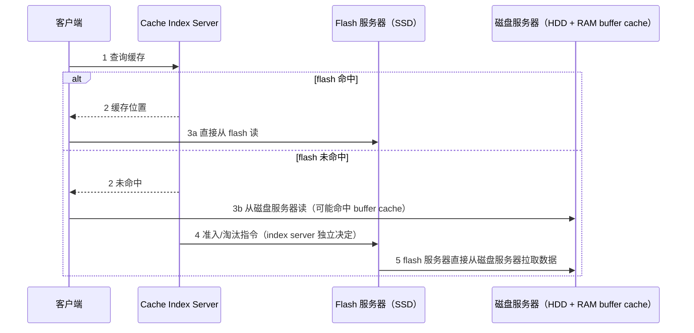
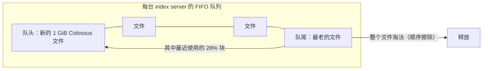
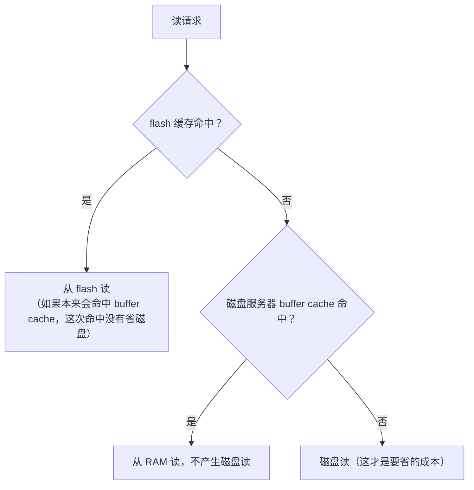
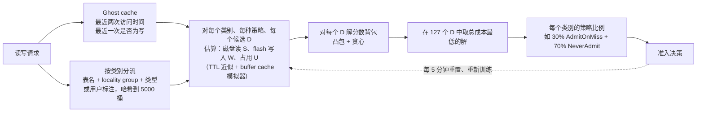
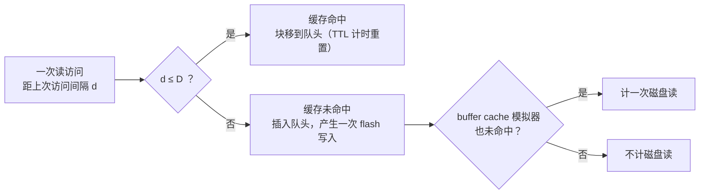
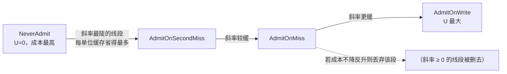
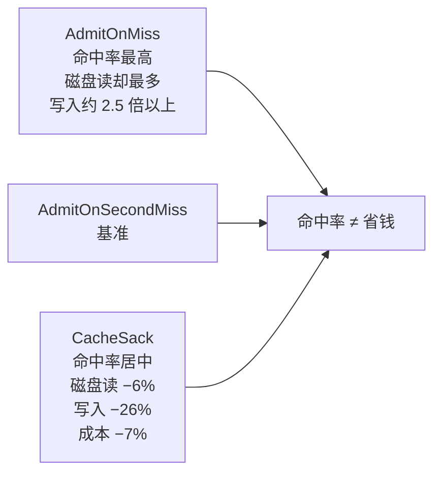
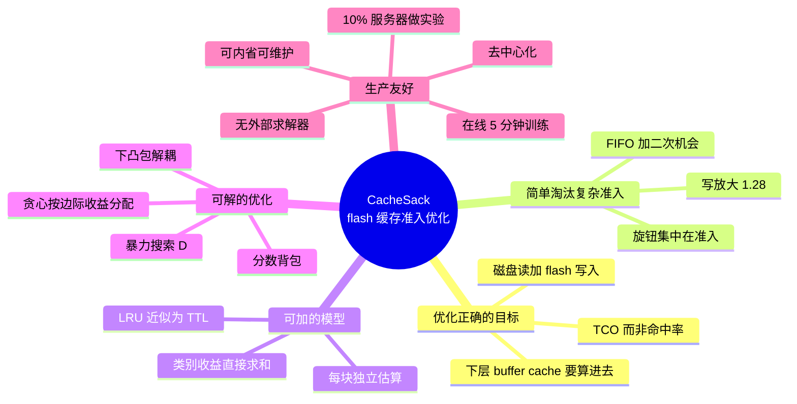
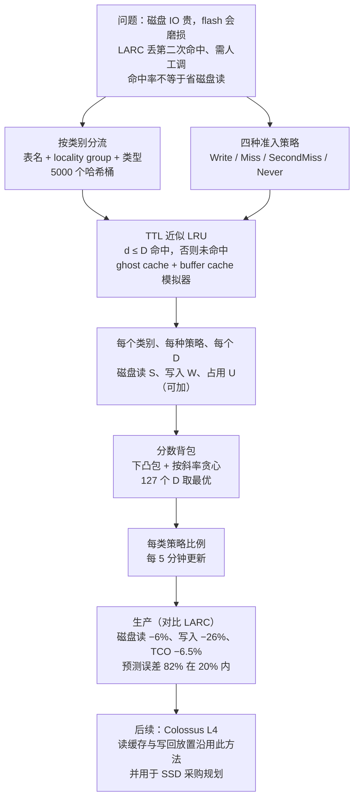

# CacheSack 精读：把 flash 缓存准入变成背包问题（USENIX ATC 2022）

> 论文：Tzu-Wei Yang, Seth Pollen, Mustafa Uysal, Arif Merchant, Homer Wolfmeister. *CacheSack: Admission Optimization for Google Datacenter Flash Caches*. USENIX ATC 2022，Carlsbad，2022-07。
>
> 机构：Google。
>
> 链接：<https://www.usenix.org/conference/atc22/presentation/yang-tzu-wei>；PDF <https://www.usenix.org/system/files/atc22-yang-tzu-wei.pdf>
>
> 扩展版：同一团队（加上 Junaid Khalid）在 ACM Transactions on Storage 19(2)，2023 发表 *CacheSack: Theory and Experience of Google's Admission Optimization for Datacenter Flash Caches*（<https://dl.acm.org/doi/10.1145/3582014>）。**本文只依据 ATC 2022 会议版**，期刊版的数字不同（见 §11）。
>
> 篇幅：正文 11 页 + 附录 A（数学模型）+ 参考文献，共 16 页（论文集第 1021–1036 页）；16 张图，无表格。
>
> 精读日期：2026-11-23。**数字和机制描述都摘自论文**，用"论文 §x / 图 x / 附录 A.x"标注出处。标"解读"的段落是本文作者的分析和推论，不是原文。论文的生产与仿真图都是归一化曲线、没有数据标签，图上读数为本文估读，标注"约"，误差约 ±5%。标"示例"的数字是本文为说明算法虚构的，不来自论文。
>
> 相关文档：[Colossus 精读](colossus-blog2021.md)（尤其 [§8 L4 缓存](colossus-blog2021.md#8-2025-续篇一ssd-放置与-l4-缓存)，2025 年 Google 说明 L4 的读缓存和写回放置都沿用 CacheSack 方法）、[工业界生产系统中的 CacheSack 小节](industry-production-systems.md#9-google-colossus-与-cachesack)、[Tectonic-Shift（ATC 2023）精读](tectonic-shift-atc2023.md)（Meta 的同类 flash 读缓存）。

## 目录

- [0. 一页速览](#0-一页速览)
- [1. 问题：磁盘 IO 贵，flash 会磨损](#1-问题磁盘-io-贵flash-会磨损)
- [2. Colossus Flash Cache 的结构](#2-colossus-flash-cache-的结构)
- [3. 为什么旧方案 LARC 不够](#3-为什么旧方案-larc-不够)
- [4. CacheSack 总览](#4-cachesack-总览)
- [5. 流量分类与四种准入策略](#5-流量分类与四种准入策略)
- [6. 用 TTL 近似 LRU：每个块独立估算](#6-用-ttl-近似-lru每个块独立估算)
- [7. 分数背包与凸包贪心](#7-分数背包与凸包贪心)
- [8. 工程落地](#8-工程落地)
- [9. 生产评估](#9-生产评估)
- [10. 仿真评估](#10-仿真评估)
- [11. 论文中的不一致与可疑之处](#11-论文中的不一致与可疑之处)
- [12. 与相关工作的对比](#12-与相关工作的对比)
- [13. 整体总结](#13-整体总结)
- [参考](#参考)

---

## 0. 一页速览

**一句话**：Colossus Flash Cache 是 Google 给 Colossus 用的通用 flash 读缓存，目标不是降低延迟，而是**减少昂贵的磁盘读**来省钱。CacheSack 是它的准入算法：把流量按 BigTable/Spanner 的表等信息分成若干**类别**，为每个类别估算四种准入策略（写入即缓存、首次未命中缓存、第二次未命中缓存、不缓存）各自带来的**磁盘读、flash 写入量和缓存占用**，再把"给每类选哪种策略"建模成**分数背包问题**，用凸包加贪心快速求出总成本最低的组合。估算靠一个关键近似：把 LRU 缓存看成"保留时间为 D 的 TTL 缓存"，这样每个块的效果可以独立计算再相加。2021 年 5 月上线后成为默认算法，相比旧算法 LARC，生产中磁盘读少 6%、flash 写入少 26%、总运营成本降低 6.5%。

| 维度 | 要点 |
|------|------|
| 系统 | Colossus Flash Cache：独立的 cache index server 只保存索引，数据在独立 flash 服务器上；未命中时由 flash 服务器直接从磁盘服务器拉数据（论文 §4，图 1） |
| 目标 | 最小化 TCO：磁盘读 + flash 写入（磨损）+ flash 占用；**不以降低延迟为目标**（论文 §1） |
| 旧方案 | LARC：第二次访问才插入。能过滤只访问一次的数据（超过 60% 的字节），但丢掉所有第二次访问的命中（访问多于一次的数据中 39% 恰好访问两次）（论文 §3.2–3.3，图 2） |
| 特殊难点 | 磁盘服务器上还有 RAM buffer cache，flash 命中率与磁盘读减少只弱相关（论文 §3.4，图 3） |
| 分类 | BigTable/Spanner：表名 + locality group + 类型；其他用户可自定义标注，缺省用 Colossus 路径中的用户名；哈希到 5000 个桶（论文 §5.1、§6.1） |
| 策略 | AdmitOnWrite > AdmitOnMiss > AdmitOnSecondMiss（LARC）> NeverAdmit，按激进程度排序（论文 §5.2） |
| 模型 | LRU ≈ TTL 缓存：访问间隔 d ≤ D 为命中，否则为未命中；每个块的磁盘读、写入量、"字节 × 时间"占用都可独立计算（论文 §5.3，附录 A.2） |
| 优化 | 分数背包：每类可按比例混用策略；对每类取 (占用, 成本) 点的下凸包，按斜率贪心分配缓存；对 127 个候选 D 各解一次，取最优（论文 §5.4–5.5，附录 A.4） |
| 工程 | 每个 index server 独立运行、互不影响；ghost cache 记录最近两次访问时间；382 个 buffer cache 模拟器；每 5 分钟重置并重新训练（论文 §6） |
| 生产效果 | 对比 LARC（一周平均）：磁盘读 −6%、flash 写入 −26%、总成本为其 93%；对比 AdmitOnMiss，总成本为其 78%；预测误差 51% 在 10% 以内、82% 在 20% 以内（论文 §7.1） |

**解读**：

- CacheSack 最值得学的不是背包本身，而是**把问题建模成能快速求解的形式**：TTL 近似让每个块的收益与其他块无关，于是类别的收益可以直接相加；允许分数策略让组合背包（NP 难）退化为分数背包（贪心可解）。两步近似都换来了"在一台 index server 上实时求解"。
- 论文反复强调"**命中率不是好指标**"：在有下层 RAM 缓存时，flash 命中可能只是抢走了本来就会命中 RAM 的请求。CacheSack 直接优化磁盘读和 flash 写入，而不是命中率，这对任何多层缓存都适用。
- 这篇论文是理解 Colossus L4 的钥匙：2025 年 Google 博客说明，L4 的读缓存插入策略和写回放置都使用 CacheSack 的方法（分类、观察、在线模拟、选策略）。

---

## 1. 问题：磁盘 IO 贵，flash 会磨损

### 1.1 为什么要 flash 缓存（论文 §1）

- 磁盘读是数据中心的主要成本之一：磁盘容量在增长，但 **IO 能力（每秒能提供的磁盘访问次数，主要是读）没有同比例增长**。为满足 IO 需求，不得不部署大量**不是为了容量而是为了 IO** 的硬盘，代价很高。
- Colossus Flash Cache 以远低于等量 RAM 缓存或多买硬盘的成本提升 IO 能力。它的首要设计目标是**减少硬盘读**，从而降低磁盘 IO 需求和成本。
- 它服务很多 Google 服务的读流量，包括 Colossus 以及 BigQuery、BigTable、F1、Spanner 等数据库系统。
- 降低读延迟虽然也是好事，但**不是 Colossus Flash Cache 的设计目标**，不在论文讨论范围内（论文脚注 1）。

**解读**：这与 [Colossus 博客](colossus-blog2021.md#7-存储效率flash-与-hdd-的配比)中"flash 只买到足以把每 GB 的 IO 密度压到磁盘能承受的程度"是同一逻辑。flash 缓存在这里是**磁盘 IO 的替代品**，衡量它的标准是"省了多少块磁盘的 IO"，而不是"快了多少"。

### 1.2 flash 缓存的两个特殊约束（论文 §1、§3.1–3.2）

| 约束 | 原因 | 影响 |
|------|------|------|
| 写放大 | flash 必须先擦除才能重写，擦除的最小单位是 flash block；非顺序淘汰（如 LRU）让空间碎片化，擦除前要搬走夹杂其中的有效数据 | 理想 LRU 不能直接用在 flash 上；Google 和 Facebook 的生产 flash 缓存都用 FIFO 类淘汰或专门算法 |
| 写寿命 | flash 擦写次数有限；写入时或首次读时就把所有数据放进缓存，会过早磨损 flash | 准入要挑数据，写入量本身就是成本 |

**解读**：RAM 缓存的设计重点通常是淘汰（evict 谁），flash 缓存的重点则转向准入（admit 谁）。因为淘汰为了控制写放大只能用简单的 FIFO 类方案，真正能调的旋钮只剩"放不放进来"。CacheSack 正是"简单淘汰 + 复杂准入"这一思路的代表。

---

## 2. Colossus Flash Cache 的结构

### 2.1 读路径（论文 §4，图 1）

| 组件 | 职责 |
|------|------|
| Cache Index Server | 不存数据，只在内存中维护索引（查找表），记录缓存数据在哪些 flash 驱动器上；每台负责键空间的一部分，彼此独立 |
| Flash 服务器 | 独立的存储服务器，保存缓存数据；准入时自己从磁盘服务器拉数据 |
| 磁盘服务器 | Colossus 的 D 服务器，带 RAM buffer cache，缓存最近的读写并预取少量数据，保留几秒 |

- 与 index server 通信的额外延迟相对远程磁盘读可以忽略；远程 flash 读与远程磁盘读的延迟差几个数量级，所以 Colossus Flash Cache **通常也会降低延迟**，但这不是服务目标，目标是**避免昂贵的磁盘读以降低 TCO**。
- Colossus 鼓励用户利用 buffer cache 设计负载以提升 IO 性能。

**解读**：这个结构与 [Colossus 2025 博客](colossus-blog2021.md#83-l4-读缓存)描述的 L4 读缓存完全对应（L4 index server、SSD 存储服务器从 HDD 服务器拉取数据），可以认为 L4 就是 Colossus Flash Cache 的后续名字或演进版本。索引与数据分离使准入决策可以完全在 index server 上做，不影响数据路径。

### 2.2 近似 LRU 的淘汰：FIFO + 二次机会（论文 §4）

理想 LRU 会造成非顺序写和写放大。Colossus Flash Cache 用类似 **Second Chance** 的方法近似 LRU：

- 每台 index server 管理一个 FIFO 队列，队列由许多固定大小的 Colossus 文件组成（通常 **1 GiB**），每个文件包含若干缓存块。
- 从队尾淘汰一个文件时，把其中**最近使用的 28%** 的块重新插入队头的文件。
- 28% 是实验选出的折中：比例越高，回收的热块越多、命中率越高，但重插入带来的写放大也越大。这样**写放大系数实际为 1.28**。
- 与已有比较研究相比，Second Chance 的性能与 LRU 很接近，因此建模时**把 Colossus Flash Cache 近似为 LRU 缓存**。

**解读**：写放大 1.28 是"设备层"之上的"应用层"写放大：以整文件为单位淘汰，SSD 内部几乎没有碎片整理开销，代价是 28% 的热块被再写一次。这是用可控的、可计量的写入替代不可控的 FTL 写放大。

### 2.3 Ghost cache 与去中心化（论文 §4）

- 每台 index server 维护一个 **ghost cache**：内存中的查找表，把数据的键映射到最后访问时间，**无论数据是否真的在 flash 上**。CacheSack 依赖它获得访问间隔，快速构建所有估计。
- 每台 index server 负责键空间的一部分，一台故障不影响其他。CacheSack 也同样去中心化：每台 index server 运行自己的 CacheSack 模型，只用自己收到的信息，其决策不影响其他 index server。

---

## 3. 为什么旧方案 LARC 不够

### 3.1 LARC 的作用（论文 §3.2，图 2）

LARC（Lazy Adaptive Replacement Cache）在**第二次访问**时才插入数据，以排除只访问一次的数据。图 2 显示，Colossus Flash Cache 中**超过 60% 的字节只被访问一次**，所以 LARC 能大幅减少 flash 写入、避免缓存污染。

### 3.2 LARC 的三个问题

| 问题 | 现象 | 当时的权宜之计 |
|------|------|---------------|
| 写入仍可能过多 | LARC 下 flash 写入仍可能过高 | 写速率限制器。这是"钝器"：不考虑对总成本的影响，对所有负载一视同仁；本可以让高可缓存负载突发写入、限制低可缓存负载 |
| 丢掉第二次命中 | 访问多于一次的数据中，**39% 恰好被访问两次**，这些第二次访问在 LARC 下全是未命中；Facebook 的社交网络照片缓存也有同样现象 | 监控性能损失，对受影响大的负载**手动关闭 LARC**（改为首次未命中即插入）。随着 Colossus Flash Cache 推广，手工维护越来越费力 |
| 与 buffer cache 的交互 | 见 §3.3 | — |

重新设计时的硬性要求是：准入算法必须**自动化，不需要人工调整**。

### 3.3 下层 RAM buffer cache 的干扰（论文 §3.4，图 3）

Colossus 在磁盘服务器上还有 RAM buffer cache。flash 未命中时，如果 buffer cache 命中，就**不会产生磁盘读**。

- 图 3 模拟了 10 个负载在**没有** Colossus Flash Cache 时 buffer cache 的未命中率，从**低于 20% 到高于 80%** 不等。这些未命中率就是 flash 缓存能减少磁盘读的**上限**。
- 对 buffer cache 未命中率低的负载，flash 命中可能只是**替代了 buffer cache 命中**，并没有减少磁盘读。
- 因此 **flash 命中率不是衡量 Colossus Flash Cache 效果的好指标**。生产结果（§9）显示，某种准入策略有时命中率更高，磁盘读却更多。

**解读**：很多 Colossus 用户会在头几秒内多次访问同一数据，只有第一次真正读盘，后续都命中 buffer cache。对这类负载，"首次未命中就插入 flash"会产生大量**无用的 flash 命中和无用的 flash 写入**。LARC 恰好能避免这种情况（第二次访问离第一次太近时不插入），这也是它在生产中表现不错的原因之一。

### 3.4 在线、实时的要求（论文 §3.5）

- Colossus Flash Cache 完全去中心化，准入算法只能使用单台 index server 的资源，机器学习模型等重量级算法可能不可行。
- 二进制每周更新一次，负载变化快得多，随二进制更新的离线训练静态模型难以适应，因此选择**在线训练**的模型。

---

## 4. CacheSack 总览

论文的贡献（§2）：

1. 把流量划分为多个类别，估算每类的磁盘读和写入成本，构建背包问题，为每类找到最小化总成本（磁盘读 + flash 写入字节）的准入策略。
2. 有效降低 Colossus Flash Cache 的 TCO：相比 LARC，磁盘读减少 6%，flash 写入减少 26%，TCO 改善 6.5%（一周平均）。
3. 实时运行，只占用 cache index server 的一小部分资源。
4. 完全去中心化：只需单台 index server 收到的信息，单台故障不影响其他。
5. 对 Google 主要数据库系统零配置；其他应用只需提供类别标注。

---

## 5. 流量分类与四种准入策略

### 5.1 流量分类（论文 §5.1）

| 流量来源 | 类别定义 |
|---------|---------|
| BigTable、Spanner | 表名 + **locality group** + 类型（Colossus Flash Cache 的大部分流量来自这些数据库） |
| 其他数据库 | 类似的组合 |
| 其他 Colossus 用户 | 用户给数据加**类别标注** |
| 无标注 | 使用 Colossus 文件路径中的**用户名** |

**解读**：数据库系统天然提供了很好的分类：同一张表、同一个 locality group（BigTable 中一起存储的一组列族）的数据通常有相似的访问模式。论文在相关工作部分指出，对非结构化数据分类通常是机器学习难题，而 Google 的数据库**免费提供了分类**，而且类别本身往往就暗示了可缓存性。这是 CacheSack 能用简单模型取得好效果的重要前提。

### 5.2 四种准入策略（论文 §5.2）

| 策略 | 何时插入 | 特点 |
|------|---------|------|
| **AdmitOnWrite**（AOW） | 写入时，或任何读未命中时 | 最激进，写入后马上读的数据受益最大 |
| **AdmitOnMiss**（AOM） | 任何读未命中时（写入时不插入） | 文献中最常见的传统策略 |
| **AdmitOnSecondMiss**（AOSM，即 LARC） | 第二次读访问（未命中）后才插入，且只有当上次访问时间不早于缓存中最老块的上次访问时间时才插入 | 抗扫描：只访问一次的数据不会进入缓存 |
| **NeverAdmit**（NA） | 从不插入 | 对不可缓存的类别，不浪费 flash |

激进程度：NeverAdmit < AdmitOnSecondMiss < AdmitOnMiss < AdmitOnWrite。

---

## 6. 用 TTL 近似 LRU：每个块独立估算

### 6.1 为什么需要近似（论文 §5.3）

最直接的办法是对所有"策略 × 类别"组合做模拟，但这是组合背包问题（NP 难）。CacheSack 最多允许 5000 个类别、4 种策略，组合数多达 **4^5000**，即使对降采样的 trace 也无法求解。

### 6.2 TTL 近似（论文 §5.3，图 4）

引入**建模的缓存保留时间 D**：一个块在 LRU 缓存中、没有被再次访问时，最多能停留多久。实际中保留时间变化缓慢，因此假设 D 为常数。

对某个块的一次读访问，计算距上次访问的间隔 d（首次读时 d = ∞）：

即把 LRU 缓存近似为"TTL 为 D、每次访问重置计时"的缓存。理论上，Fagin（1977）证明了 TTL 近似对独立同分布请求是渐近精确的；Jiang 等（2018）证明在访问平稳且遍历的假设下，缓存容量趋于无穷时 TTL 近似收敛到 LRU。生产中的精度见 §9.1。

**关键性质**：只要给定 D，**一个块的估计不受其他块或其他策略影响**。因此一个类别的磁盘读、缓存占用和写入字节，就是其中各块对应量的**简单求和**。

### 6.3 三个量的计算（附录 A.2）

对块 b，读访问时间为 t1, t2, …, tn，间隔 di = ti − ti−1，d1 = ∞。三个量都是 D 的函数：

| 量 | 含义 | AdmitOnMiss 的计算 |
|----|------|------------------|
| S(D) | 磁盘读次数 | di > D 且 buffer cache 模拟器也未命中的访问次数 |
| U(D) | 缓存占用（**字节 × 时间**，与 LHD 的概念相同） | Size(b) × Σ min(di, D) |
| W(D) | 写入 flash 的字节 | Size(b) × 满足 di > D 的访问次数 |

其他策略：

- **AdmitOnWrite**：把写入时刻也当作 t1，其余同 AOM。
- **AdmitOnSecondMiss**：访问 ti 命中当且仅当 di−1 ≤ D 且 di ≤ D；在 di ≤ D < di−1 时插入，插入时占用按 D 计。
- **NeverAdmit**：U = 0，W = 0，S 为 buffer cache 未命中次数。

**示例（本文构造，非论文数据）**：一个块在 0 时刻被写入，之后在 10 分钟、30 分钟、5 小时、5 小时 5 分钟被读取；取 D = 1 小时，并假设 buffer cache 全部未命中。

| 读访问 | 间隔 d | AdmitOnWrite | AdmitOnMiss | AdmitOnSecondMiss | NeverAdmit |
|-------|-------|-------------|------------|------------------|-----------|
| 0（写） | — | 插入（写 1 次） | — | — | — |
| 10 分钟 | 10 分钟（AOW）/ ∞（读序列中的首次） | 命中 | 未命中，插入 | 未命中，不插入 | 未命中 |
| 30 分钟 | 20 分钟 | 命中 | 命中 | 未命中，插入（20 分钟 ≤ D < ∞） | 未命中 |
| 5 小时 | 4.5 小时 | 未命中，插入 | 未命中，插入 | 未命中，不插入 | 未命中 |
| 5 小时 5 分钟 | 5 分钟 | 命中 | 命中 | 未命中，插入（5 分钟 ≤ D < 4.5 小时） | 未命中 |
| **磁盘读 S** | | 1 | 2 | 4 | 4 |
| **flash 写入次数 W** | | 2 | 2 | 2 | 0 |

可以看到，这个"每次被访问两次、两次之间隔几小时"的块，在 LARC 下付出了写入却一次命中都没拿到，正是 §3.2 描述的问题。CacheSack 对每个类别把这样的逐块结果加起来，就得到该类别在每种策略下的成本。

---

## 7. 分数背包与凸包贪心

### 7.1 问题形式（论文 §5.4，附录 A.3）

给定 D 和每个"类别 × 策略"的 (S, U, W)，问题变为：在缓存容量内，为每个类别选择策略，使总成本（磁盘读成本 + 写入字节成本）最小。磁盘读、flash 写入字节和 flash 存储的**相对成本系数是机密，论文未公开**。

CacheSack 进一步允许**分数策略**：例如对某个类别中 30% 的块用 AdmitOnMiss、20% 用 AdmitOnSecondMiss、10% 用 AdmitOnWrite、40% 用 NeverAdmit。于是问题成为一个线性规划：

- 目标：最小化 Σ_C Σ_p α_C^p × V_C^p(D)，其中 V = 磁盘读成本 + 写入成本。
- 约束：每类四个比例 α 之和为 1，且都在 [0, 1] 内；总占用 Σ_C Σ_p α_C^p × U_C^p(D) ≤ U_total。

### 7.2 凸包把四个比例变成一个变量（附录 A.4，图 16）

标准分数背包每个物品只有"放多少"一个自由度，这里每个类别有四个耦合的比例（三个自由度），不能直接套用贪心。CacheSack 用 **Andrew 单调链凸包算法**解耦：

1. 对每个类别，把四种策略画成 (占用 U, 成本 V) 平面上的四个点。
2. 取这些点的**下凸包**：它给出该类别在任意占用 u 下能达到的最低成本 F_C(u)（策略的凸组合）。
3. 去掉斜率非负的线段（多占缓存反而不省钱的部分），F_C 成为严格递减的分段线性函数。
4. 问题变成凸优化：min Σ_C F_C(u_C)，约束 Σ_C u_C ≤ U_total。

**贪心求解（最速下降）**：所有 u_C 从 0 开始；在所有类别的所有线段中，先选斜率最负（每单位缓存省钱最多）的线段，把对应类别的 u_C 推进；再选第二陡的，依次进行，直到 Σ u_C 达到 U_total。

**结果的结构**：最后被选中的那条线段所属类别，最优策略一般是**两种策略的凸组合**；其他所有类别的最优策略都**恰好是四种策略之一**。

**示例（本文构造，非论文数据）**：两个类别、缓存容量 10 个单位。

| 类别 | 线段 | 增加占用 | 降低成本 | 斜率（成本 / 占用） |
|------|------|---------|---------|-------------------|
| A（热表） | NA → AOM | 4 | 40 | −10 |
| A | AOM → AOW | 2 | 4 | −2 |
| B（扫描为主） | NA → AOSM | 3 | 15 | −5 |
| B | AOSM → AOM | 5 | 5 | −1 |

贪心顺序：A 的 −10（用 4）→ B 的 −5（用 3，累计 7）→ A 的 −2（用 2，累计 9）→ B 的 −1 只剩 1 个单位，推进 1/5。结果：A 用 AdmitOnWrite，B 用 80% AdmitOnSecondMiss + 20% AdmitOnMiss。

### 7.3 对 D 再做一层搜索（论文 §5.5，附录 A.5）

上面的解依赖 D，而 D 事先未知。论文指出可用 Brent 方法等标量优化，但实际采用更简单的暴力法：预设一组 D1 < D2 < … < Dm，对每个 D 解一次背包，取总成本最低者。得益于贪心算法，可以快速解很多个背包问题（目前 127 个）。

论文还指出：如果 LRU 缓存被 TTL 近似完美刻画，那么按最优策略比例运行后，LRU 缓存的实际保留时间恰好就是 D。

**解读**：

- 这一层设计很漂亮：**D 同时是模型参数和"缓存有多紧"的度量**。缓存容量越小，最优 D 越小，模型会倾向保守策略；容量越大，最优 D 越大，倾向激进策略。这解释了 §10 中 CacheSack 随缓存大小自动切换策略的行为。
- 每个类别的凸包斜率可以理解为"这个类别每占用一单位缓存能省多少钱"，贪心就是按这个"边际收益"排队发缓存。这和 [Colossus 博客](colossus-blog2021.md#84-l4-写回放置)中"在线模拟还能预测 SSD 多一些或少一些时能卸载多少 IO"是同一个模型的另一种用法：把 U_total 换个值再解一次，就得到容量规划的答案。

---

## 8. 工程落地

### 8.1 关键参数（论文 §6）

| 参数 | 取值 | 理由 |
|------|------|------|
| 类别桶数 | **5000**（哈希） | 内存与哈希冲突的折中。每台服务器的类别通常少于 100 个；95% 的客户端冲突率低于 1%，最坏低于 5%。每台 index server 用不同的哈希键并定期更换，冲突不会持续 |
| 小桶合并 | 查找量占比低于 **0.1%** 的桶并入一个兜底桶 | 训练数据不足的桶没有统计意义 |
| 候选 D | **127 个**：15 分钟 × 1.06^k，k = 0…126，最大约 16 天；第 128 个值留给正无穷 | 15 分钟以下意味着极其激进的淘汰与插入，会严重磨损 flash；按策略任何块最多在缓存中停留 15 天，因此工作范围为 15 分钟到 15 天。试过 255 个（3% 等比），结果相近，127 个（6% 等比）内存省一半 |
| Ghost cache | 记录最近**两次**访问时间，以及最近一次是否为写 | AdmitOnSecondMiss 需要两次访问时间，AdmitOnWrite 需要知道是否为写 |
| Ghost cache 容量 | TTL 至少为最优 D 的 **2 倍**（典型约 4 小时） | ghost cache 是模型的"真值"，只要其覆盖的历史长于最优 D，解就不受影响 |
| Buffer cache 模拟器 | **382 个**（3 × 127 + 1；NeverAdmit 与 D 无关） | 最耗计算的部分；模拟器很简单，只需过去几秒的访问历史，在低 QPS 服务器上约占 5% CPU |
| 训练周期 | 每 **5 分钟**重置模型，用这 5 分钟内的查找训练 | 一次查找包含最近两次访问时间，所以 5 分钟的查找可能包含数小时的信息。测试了多种时长，5 分钟磁盘读减少最多，但差异不显著 |

**解读（参数核对）**：15 分钟 × 1.06^126 ≈ 15 分钟 × 1,542 ≈ 23,130 分钟 ≈ 16.1 天，与论文"约 16 天"一致，比"15 天工作范围"略长一点。

### 8.2 经验教训（论文 §6.6）

| 教训 | 内容 |
|------|------|
| 自动优化促进了用户采用 | 过去用户要根据对负载的了解手动选择 AdmitOnMiss 或 AdmitOnSecondMiss，或在团队协助下做 A/B 实验；对 Spanner 这样的大用户还要提供手调的启发式策略。人工调优成本可能抵消硬件节省，劝退用户。CacheSack 基本无需配置，"设置后即可忘记"，新用户更愿意使用。有用户用手工最优策略覆盖 CacheSack 做实验，发现效果相当；上线后为 Spanner 定制的手调策略得以退役 |
| 实验基础设施加速了开发 | 可以用 **10%** 的 index server 测试新功能；index server 相互独立，实验最坏只造成轻微退化。全量上线前以实验方式运行了几个月，大部分问题在此阶段发现并修复；全量上线后没有因 CacheSack 回滚过二进制。每台服务器负责随机置换后的一部分键空间，统计上无法区分，因此可以同时比较实验组和对照组 |
| 模型可内省、可维护很重要 | 算法上线后由开发者和 SRE 运维，要求模型行为能被完全理解和监控。CacheSack 只假设 TTL 近似足够接近实际淘汰，所有行为都能从这一假设推导出来。非原作者也能保证测试覆盖、验证发布、扩展功能；上线后的维护和新功能开发都由团队其他成员完成，无需原设计者参与 |
| 简单实现优于通用求解器 | 用简单贪心算法，而不是通用线性规划求解库。开发多花了时间，但计算开销更小，减少外部依赖，提高可靠性；熟悉 Colossus Flash Cache 的人都能维护 |

**解读**：这一节比算法本身更能说明 CacheSack 为什么能在生产中活下来。论文 §3.5 已经排除了重量级 ML 模型，§6.6 又强调"可内省"和"不依赖通用求解器"。**能被 SRE 理解的模型**是大规模基础设施中算法落地的硬约束，这一点在很多学术缓存论文里常被忽略。

---

## 9. 生产评估

### 9.1 模型精度（论文 §7.1，图 5）

系统中有两层 LRU 近似：Colossus Flash Cache 用类 Second Chance 近似 LRU 淘汰，CacheSack 又用 TTL 近似 LRU。验证方法：对每个客户端，背包解给出采用最优策略时的**预测**磁盘读，生产中实际应用这些策略后，与磁盘服务器上的**实际**磁盘读比较。

| 相对误差 | 占比 |
|---------|-----:|
| ≤ 10% | 51% |
| ≤ 20% | 82% |

**解读**：从图 5 的 CDF 看，误差在约 20% 后很快趋平，约 95% 以上的误差在 30% 以内（估读）。对一个只用 5 分钟数据、靠两层近似的模型，这个精度足以支持"选哪种策略"的相对决策：策略之间的成本差异通常远大于 20% 的绝对误差。

### 9.2 策略分布（论文 §7.1，图 6）

图 6 展示了 CacheSack 在 10 个选定数据中心建议的策略分布。不同数据中心差异很大（估读）：有的以 AdmitOnWrite 和 AdmitOnMiss 为主，有的几乎全是 AdmitOnSecondMiss，有的 NeverAdmit 占一半以上。论文认为，虽然人工也可以为每个数据中心选静态策略，但 CacheSack 减少了人力、响应延迟和运维复杂度。

### 9.3 A/B 生产实验（论文 §7.1，图 7–10）

2021 年 8 月 1 日至 7 日，10% 的 index server 运行静态 AdmitOnMiss，另 10% 运行静态 AdmitOnSecondMiss，其余运行 CacheSack，同时比较。以 AdmitOnSecondMiss（LARC）为基准归一化：

| 指标 | CacheSack | AdmitOnSecondMiss | AdmitOnMiss | 出处 |
|------|----------:|------------------:|------------:|------|
| 磁盘读（相对 AOSM） | **0.94**（−6%） | 1.00 | 略高于 1（三者中最差） | 图 7 |
| flash 写入字节（相对 AOSM） | **0.74**（−26%） | 1.00 | 约 2.5–2.8（估读） | 图 8 |
| 总成本（相对 AOSM） | **0.93** | 1.00 | 约 1.19（= 0.93 / 0.78） | 图 9，正文 |
| 总成本（相对 AOM） | **0.78** | — | 1.00 | 正文 |
| flash 命中率 | 约 0.52（估读） | 约 0.50（估读） | 约 0.57（估读，最高） | 图 10 |

**AdmitOnMiss 命中率最高、磁盘读却最多的原因**：很多主要的 Colossus 用户会在头几秒内多次访问同一数据，只有第一次真正读盘。AdmitOnMiss 因此产生了大量完全不减少磁盘读的命中。AdmitOnSecondMiss 在最近访问时间太近、数据预计还在 buffer cache 中时不插入，避免了这个问题。

**解读**：

- 这组结果最有说服力的地方是"**三种算法在同一时间、统计上相同的流量下并排运行**"，消除了负载随时间变化的干扰。这得益于键空间随机切分、各 index server 独立的架构。
- CacheSack 的提升主要来自**写入减少**（−26%），磁盘读只减少 6%。也就是说，它相对 LARC 的主要价值是"用更少的 flash 磨损拿到略好的磁盘读"，而不是大幅减少磁盘读。

---

## 10. 仿真评估

论文用 Colossus Flash Cache 模拟器做了更多配置下的测试。模拟器使用与生产相同的代码，输入为生产 trace，平时也用于性能回归测试和客户的数据中心资源规划。这里使用的是一个大型生产缓存（百万 QPS 量级）两天的 trace，均匀采样自大量内部负载（论文 §7.2）。

### 10.1 缓存大小的影响（图 11–14）

| 缓存大小 | 静态策略的表现 | CacheSack |
|---------|--------------|-----------|
| 小 | AdmitOnSecondMiss 优于 AdmitOnMiss 和 AdmitOnWrite，因为排除了只用一次的键；AOM/AOW 频繁淘汰又重插入，写入量极大 | 学会使用更保守的策略，只把最有价值的部分放进缓存 |
| 大 | AdmitOnMiss 和 AdmitOnWrite 优于 AdmitOnSecondMiss，因为拿到了第二次访问的收益 | 学会使用更激进的策略 |

图上估读（横轴为归一化缓存大小 0–5，纵轴相对 AdmitOnSecondMiss）：

| 指标 | 缓存约 0.5 | 缓存约 5 |
|------|-----------|---------|
| CacheSack 磁盘读 | 约 1.0 | 约 0.45 |
| AdmitOnMiss 磁盘读 | 约 1.15–1.2 | 约 0.45 |
| CacheSack flash 写入 | 约 1.2 | 约 2.2 |
| AdmitOnMiss flash 写入 | 约 5–6 | 约 2.5 |

**总成本呈 U 形**（图 13）：缓存小时，磁盘读和 flash 写入是主要成本；缓存大时，flash 存储本身是主要成本。因此存在一个使总成本最低的最优缓存大小。论文称 CacheSack 在所有缓存大小下总成本都最低。

### 10.2 训练周期（图 15）

测试了 1 分钟到 8 小时的训练时长（覆盖了观察到的大部分负载时间变化）。命中率、磁盘读、写入字节和总成本都没有显著差异，因此不需要定制或自动调整，全部部署使用同一个值（5 分钟）。

**解读**：

- U 形总成本曲线是这篇论文给容量规划的直接启示：flash 缓存**不是越大越好**，存在一个总成本最低点，而且这个点可以用同一个模型算出来。
- 对训练周期不敏感，说明 ghost cache 中两次访问时间提供的长历史（中位数 20 小时，见 §12）比训练窗口长度更重要。

---

## 11. 论文中的不一致与可疑之处

| 位置 | 问题 | 本文的处理 |
|------|------|-----------|
| 摘要、§2、结论 vs §7.1 | 摘要和贡献列表称 TCO 改善 6.5%；§7.1 称 CacheSack 总成本为 AdmitOnSecondMiss 的 93%（即降低 7%） | 可能是不同口径或四舍五入，照录两者 |
| 会议版 vs 期刊版 | ATC 2022：TCO −6.5%、磁盘读 −6%、flash 写入 −26%；TOS 2023 扩展版：TCO −7.7%、磁盘读 −9.5%、flash 磨损 −17.8% | 引用时注明版本；本仓库 [工业界生产系统](industry-production-systems.md#9-google-colossus-与-cachesack) 原先引用的是期刊版数字，已加注 |
| §6.2 | 工作范围说是 15 分钟到 15 天，而最大候选 D 为 15 分钟 × 1.06^126 ≈ 16 天 | 差别很小，照录 |
| §7.2 vs 图 13 | 正文称 CacheSack 在所有缓存大小下总成本最低；图 13 下半部分在缓存约 0.3–1.2 区间，CacheSack 曲线略高于 AdmitOnSecondMiss（约 1.02–1.03，估读） | 结论在大部分区间成立，个别区间差距在估读误差附近 |
| §5.3 | 组合数在 PDF 文本中为 "45000"，应为 4^5000（上标丢失） | 按 4^5000 理解 |
| §6.3 | "典型约 4 小时"指的是 ghost cache TTL 还是最优 D 不清楚；§8 又说 ghost cache TTL 中位数为 20 小时 | 若最优 D 约 4 小时，2 倍规则要求 ghost cache TTL ≥ 8 小时，与中位数 20 小时相容 |
| §5.4、§7 | 磁盘读、flash 写入、flash 存储的相对成本系数保密 | 所有"总成本"只能看相对值，无法复现 |
| 与 2025 Colossus 博客的说法 | 2025 年博客称 L4 用"机器学习驱动的算法"在几种插入策略间选择，并指向 CacheSack；而论文 §3.5 明确说明重量级 ML 模型不可行，CacheSack 本身是在线统计 + 线性规划/贪心 | 理解为博客对"在线训练的模型"的宽泛称呼，CacheSack 不是神经网络类 ML |
| 正文拼写 | "cash sizes"（cache）、"add extend"等 | 不影响理解 |
| §6.5 与 §6.4 | PDF 版面中 §6.4、§6.5 的标题与内容交错 | 按内容阅读 |

---

## 12. 与相关工作的对比

### 12.1 生产 flash 缓存（论文 §8）

| 系统 | 淘汰 | 准入 | 历史信息 |
|------|------|------|---------|
| Google 早期（Janus）、Facebook McDipper | FIFO 类 | 简单 | — |
| RIPQ（Facebook，FAST 2015） | 非 FIFO 的高级算法，控制写放大 | — | — |
| Flashield（NSDI 2019） | CLOCK | DRAM 缓冲 + 轻量 SVM 分类器预测是否值得写 flash | DRAM 缓冲中的短历史 |
| CacheLib（Meta，OSDI 2020） | FIFO | 布隆过滤器统计过去 6 小时访问次数，预测未来访问 | 约 6 小时 |
| Kangaroo（SOSP 2021） | — | 优化 CacheLib 的极小对象 | — |
| DSS（SOSP 2011） | 按优先级启发式 | 预定义规则分类 IO | — |
| Amazon AQUA | — | 分析负载模式把数据放到合适的层，概念上与 CacheSack 相似 | — |
| **CacheSack** | Second Chance（FIFO + 28% 重插入） | 分类 + TTL 模型 + 分数背包 | ghost cache，TTL 中位数 **20 小时** |

论文的定位：与 Flashield 和 CacheLib 的高层思路相同，都是"**保持淘汰简单以控制写放大，用更复杂的准入提升缓存效果和 flash 寿命**"。区别在于 CacheSack 没有内存缓冲，而是扩大元数据表（ghost cache）以获得更完整的历史，历史长度是 Flashield、CacheLib 的数倍；并且把磁盘读和 flash 磨损两大成本放在一起整体最小化。

### 12.2 准入、淘汰与 ML 算法（论文 §8）

| 类别 | 代表 | 与 CacheSack 的关系 |
|------|------|-------------------|
| 准入 | LARC、TinyLFU（+ Doorkeeper、W-TinyLFU）、HEC、mARC | LARC 和非窗口版 TinyLFU 牺牲前几次命中来判断可缓存性，对长尾访问不利；TinyLFU 的多个附加结构需要额外调参，不适合通用缓存；mARC 在首次未命中和第二次未命中插入之间动态选择，可看作 CacheSack 只有两种策略的特例 |
| 淘汰 | 经济增值淘汰、Hyperbolic Caching、LHD、Hawkeye、多候选微缩模拟 | CacheSack 不改淘汰；"字节 × 时间"的占用概念与 LHD 相同 |
| ML | LFO、LRB、Parrot（学习 Belady OPT）、腾讯照片缓存的 ML 准入、LeCaR、Zhou 与 Maas 的对数正态间隔模型 | CacheSack 刻意不用重量级 ML，以满足去中心化、实时、可内省的要求 |

### 12.3 与 Tectonic-Shift 的对比

| 维度 | CacheSack（Google） | [Tectonic-Shift](tectonic-shift-atc2023.md)（Meta） |
|------|-------------------|--------------------------------------------------|
| 位置 | Colossus 之上的通用 flash 读缓存 | Tectonic 前面的 flash 读缓存，主要服务 ML 训练 |
| 准入信号 | 历史访问间隔（ghost cache）+ 数据库提供的类别 | 历史统计 + **训练作业规格（未来访问）** |
| 优化方法 | 分数背包，凸包贪心 | 基于作业规格的准入与重插入策略，PID 写入限速 |
| 目标 | TCO：磁盘读 + flash 写入 + flash 容量 | 功耗与 HDD IO |

**解读**：两者面对的是同一个问题（HDD 存储前加 flash 缓存，准入决定成败），但信号来源不同：CacheSack 只看过去，Shift 利用训练作业的"未来"。CacheSack 的优势是通用、可解释；Shift 的优势是对特定负载能预测未来访问。

---

## 13. 整体总结

### 13.1 核心贡献

1. **问题重定义**：flash 缓存的目标是最小化 TCO（磁盘读 + flash 写入 + flash 容量），而不是最大化命中率；在存在下层 RAM 缓存时，命中率与磁盘读只弱相关。
2. **TTL 近似使收益可加**：把 LRU 缓存近似为保留时间 D 的 TTL 缓存，每个块的磁盘读、写入、占用可以独立计算，类别的收益是块的简单求和。
3. **分数背包 + 凸包贪心**：允许按比例混用策略，用下凸包把每个类别的四个策略比例化为一维的递减分段线性函数，再按边际收益贪心分配缓存；对 127 个候选 D 各解一次取最优。
4. **可落地的工程设计**：每台 index server 独立运行、5 分钟重新训练、ghost cache 提供长历史、382 个 buffer cache 模拟器约 5% CPU、不依赖通用求解器。
5. **生产验证**：同期 A/B 对比，相比 LARC 磁盘读 −6%、flash 写入 −26%、总成本 −6.5%（或 −7%）；替代了包括 Spanner 在内的人工调优。

### 13.2 设计哲学

### 13.3 优点与局限

| 优点 | 局限 |
|------|------|
| 建模清晰，每一步近似都有理论依据或生产验证，模型行为可完全推导 | 成本系数保密，所有总成本只能看相对值，无法复现 |
| 生产 A/B 实验在同一时间、统计上等价的流量下进行，结论可信 | 相对 LARC 的磁盘读改善只有 6%，主要收益在 flash 写入；对 TCO 的总改善约 6.5–7% |
| 复杂度低，能在单台 index server 上实时运行 | 依赖数据库提供的天然类别；对无标注的通用负载，按用户名分类可能过粗 |
| 同一模型可用于运行时准入和容量规划（U 形总成本曲线） | 只优化准入，不改淘汰；TTL 近似在小缓存或强非平稳负载下误差可能变大（论文只给出整体误差分布） |
| 降低了用户使用缓存的门槛，替代了人工调优 | 只关注成本，不考虑延迟；对延迟敏感的负载需要其他机制 |

### 13.4 启示

**对缓存设计者**：

- **先确定要省的是什么**。在多层缓存体系中，上层缓存的命中率可能完全不反映真实收益，要直接对最终成本（磁盘读、写入磨损）建模。
- **flash 缓存的主战场在准入**。淘汰为了控制写放大只能用简单方案，准入策略的选择决定了 flash 寿命和缓存效果。
- **把复杂问题变成可加、可贪心的问题**。TTL 近似和分数松弛是两个通用技巧，可以用于很多"资源分配给多个类别"的场景（如 SSD 配额、内存池划分）。
- **按类别而不是按对象决策**。类别级统计更稳定、更便宜，也更容易解释；数据库表、租户、文件类型都是现成的类别来源。

**对存储系统设计者**：

- 同一个模型可以同时回答"**放不放进缓存**"和"**缓存该买多大**"。CacheSack 的 U 形总成本曲线和 Colossus L4 的容量规划用法，都说明了这一点。
- 生产算法的硬约束是**去中心化、实时、可内省**。宁可用简单贪心也不引入通用求解器，宁可放弃重量级 ML 也要让 SRE 能理解模型。
- 实验基础设施（10% 服务器、键空间随机切分）让新算法能在真实流量上安全对比，是基础设施团队值得投资的能力。

### 13.5 一张图看懂 CacheSack

---

## 参考

- Tzu-Wei Yang, Seth Pollen, Mustafa Uysal, Arif Merchant, Homer Wolfmeister. *CacheSack: Admission Optimization for Google Datacenter Flash Caches*. USENIX ATC 2022. <https://www.usenix.org/conference/atc22/presentation/yang-tzu-wei>
- Tzu-Wei Yang, Seth Pollen, Mustafa Uysal, Arif Merchant, Homer Wolfmeister, Junaid Khalid. *CacheSack: Theory and Experience of Google's Admission Optimization for Datacenter Flash Caches*. ACM Transactions on Storage 19(2), 2023. <https://dl.acm.org/doi/10.1145/3582014>
- Larry Greenfield, Seth Pollen. *Colossus under the hood: How we deliver SSD performance at HDD prices*. Google Cloud Blog, 2025-03-26.（L4 沿用 CacheSack 方法）
- Sai Huang et al. *Improving Flash-Based Disk Cache with Lazy Adaptive Replacement*（LARC）. ACM Transactions on Storage, 2016.
- Christoph Albrecht et al. *Janus: Optimal Flash Provisioning for Cloud Storage Workloads*. USENIX ATC 2013.
- Ronald Fagin. *Asymptotic Miss Ratios over Independent References*. JCSS, 1977.
- Bo Jiang, Philippe Nain, Don Towsley. *On the Convergence of the TTL Approximation for an LRU Cache under Independent Stationary Request Processes*. ACM TOMPECS, 2018.
- A. M. Andrew. *Another Efficient Algorithm for Convex Hulls in Two Dimensions*. Information Processing Letters, 1979.
- Benjamin Berg et al. *The CacheLib Caching Engine: Design and Experiences at Scale*. OSDI 2020.
- Assaf Eisenman et al. *Flashield: a Hybrid Key-value Cache that Controls Flash Write Amplification*. NSDI 2019.
- Linpeng Tang et al. *RIPQ: Advanced Photo Caching on Flash for Facebook*. FAST 2015.
- Gil Einziger, Roy Friedman, Ben Manes. *TinyLFU: A Highly Efficient Cache Admission Policy*. ACM TOS, 2017.
- Nathan Beckmann, Haoxian Chen, Asaf Cidon. *LHD: Improving Cache Hit Rate by Maximizing Hit Density*. NSDI 2018.
- 本仓库相关：[Colossus 精读](colossus-blog2021.md)、[Tectonic-Shift 精读](tectonic-shift-atc2023.md)、[工业界生产系统](industry-production-systems.md)
