# CFS 论文精读：Scaling Metadata Service for Distributed File System via Pruned Scope of Critical Sections（EuroSys 2023）

> 论文：Yiduo Wang, Yufei Wu, Cheng Li, Pengfei Zheng, Biao Cao, Yan Sun, Fei Zhou, Yinlong Xu, Yao Wang, Guangjun Xie. *CFS: Scaling Metadata Service for Distributed File System via Pruned Scope of Critical Sections*. ACM EuroSys 2023, pp. 132–147.
>
> 机构：中国科学技术大学、百度（中国）有限公司、安徽省高性能计算重点实验室。通讯作者 Cheng Li（李诚）。
>
> 链接：<https://dl.acm.org/doi/10.1145/3552326.3587443>（开放获取，CC BY 4.0）
>
> 精读日期：2026-11-22。文中**数字、表格与机制描述均摘自论文原文**（标注所在章节）；标注"解读"的段落是本文作者的分析与推论，不是论文原话。
>
> 注意区分：本文的 CFS 是**百度智能云文件存储 CFS**，不是京东的 ChubaoFS（SIGMOD 2019 论文也叫 "CFS"，现名 CubeFS）。
>
> 相关文档：[元数据扩展性综述中的 CFS 小节](metadata-scalability.md#23-cfs-scaling-metadata-service-for-distributed-file-system-via-pruned-scope-of-critical-sectionseurosys-2023)、[工业界生产系统中的 Baidu CFS 小节](industry-production-systems.md#5-baidu-cfseurosys-2023)、[InfiniFS（FAST 2022）精读](infinifs-fast2022.md)（CFS 的主要对比对象）、[Tectonic（FAST 2021）精读](tectonic-fast2021.md)、[λFS（ASPLOS '23）精读](lambdafs-asplos2023.md)（同以 HopsFS 为基线，方向正交：λFS 给代理层加弹性缓存，CFS 去掉代理层）。

## 目录

- [0. 一页速览](#0-一页速览)
- [1. 背景：元数据扩展被锁卡住](#1-背景元数据扩展被锁卡住)
- [2. 生产负载特征](#2-生产负载特征)
- [3. 设计思路：三处临界区裁剪](#3-设计思路三处临界区裁剪)
- [4. 总体架构](#4-总体架构)
- [5. 分层元数据组织与分区](#5-分层元数据组织与分区)
- [6. 单分片原子原语与冲突合并](#6-单分片原子原语与冲突合并)
- [7. 强一致 rename](#7-强一致-rename)
- [8. 垃圾回收](#8-垃圾回收)
- [9. 评估](#9-评估)
- [10. 与相关工作的对比](#10-与相关工作的对比)
- [11. 整体总结](#11-整体总结)

---

## 0. 一页速览

**一句话**：CFS 是百度智能云的全 POSIX 兼容分布式文件系统。它认为元数据扩展的瓶颈是**为保证原子性和隔离性而加的锁**，于是从三处裁剪临界区：把**文件属性**从数据库层剥离到数据存储层 FileStore（按 inode id 哈希），让剩下的**命名空间层级**在数据库 TafDB 里按父目录 id 范围分区、父目录属性与子项落在同一分片，从而消除跨分片事务；用**单分片原子原语**把一个元数据请求的"检查 + 读 + 写"压成一条命令，并用 **delta apply / last-writer-wins** 把并发修改父目录属性的"伪冲突"移出临界区；最后**砍掉元数据代理层**，由客户端库直接路由请求。

| 维度 | 要点 |
|------|------|
| 核心判断 | 锁开销在无竞争时已占 HopsFS create 处理时间的 **52.91%**，100% 竞争时达 **93.86%**（§2.2，图 4） |
| 负载依据 | 百度智能云 9 个生产负载中元数据操作占全部请求的 **67%–96%**；getattr 占元数据操作的 **75.25%**，lookup 占 **17.80%**，rename 只占 **0.12%**（§2，表 1） |
| 技术 1：分层元数据组织 | 文件属性存 FileStore（每节点 RocksDB，按 id 哈希）；目录属性、目录项存 TafDB 的单张 `inode_table`，主键 `<kID, kStr>`，按 kID 范围分区（§4.1） |
| 技术 2：单分片原子原语 | `insert_with_update`、`delete_with_update`、`insert_and_delete_with_update` 三条参数化原语；数值属性 delta apply，时间/权限 last-writer-wins（§4.2，表 2） |
| 技术 3：去代理层 | ClientLib 缓存 TafDB 与 FileStore 的分区信息，直接把请求发往 FileStore、TafDB 或 Renamer（§3.1、§3.2） |
| 跨层一致性 | TafDB 与 FileStore 之间**不做 2PC**：创建类请求最后改 TafDB，删除类请求最先改 TafDB，孤儿属性由后台 GC 清理（§4.1、§4.4） |
| rename | 约 99% 是同目录文件 rename，走单分片快路径；其余由 Renamer 协调者加锁 + 2PC，并做孤儿环检查（§4.3） |
| POSIX 兼容 | pjdfstest 8832 个用例全部通过（ext4 同样全过；XFS 失败 2 个，CephFS 失败 237 个）（§3.2） |
| 结果 | 50 节点集群：吞吐是 HopsFS 的 **1.76–75.82×**、InfiniFS 的 **1.22–4.10×**；高竞争 mkdir 是 InfiniFS 的 41.52–48.36×；3 个生产 trace 端到端吞吐是 InfiniFS 的 **1.62–2.55×**（§5） |
| 生产 | 在百度智能云运行 **3 年**，单个部署常承载数千个文件系统实例、数十亿以上文件（§5.8） |

---

## 1. 背景：元数据扩展被锁卡住

### 1.1 元数据操作占大头（§1、§2）

论文给出两条理由说明元数据扩展至关重要：

1. 现代负载中文件数暴涨，且多数文件只有几 KB 到几十 KB，元数据操作因此占主导；
2. 数据访问已经很快：文件数据可以在存储服务器间均衡并行，存储介质也在快速演进。

百度智能云 9 个代表性负载（社交网络、电商等）中，**元数据操作占 DFS 请求数的 67%–96%**；最偏斜的负载里，元数据操作数是数据操作的 **28.2 倍**（§2）。

### 1.2 主流架构：解耦 + 分离式元数据服务（§2.1，图 1）

从 GFS / HDFS 开始，DFS 把元数据与文件数据分开管理。为了扩展元数据，CephFS、Lustre 把命名空间分区到多台 MDS；HopsFS、InfiniFS 更进一步，采用**分离式（disaggregated）元数据架构**：下层是分片的数据库，上层是一层**元数据代理（proxy）**，负责把文件系统操作翻译成数据库事务。Azure ADLS 与 Facebook Tectonic 也采用了这种架构。

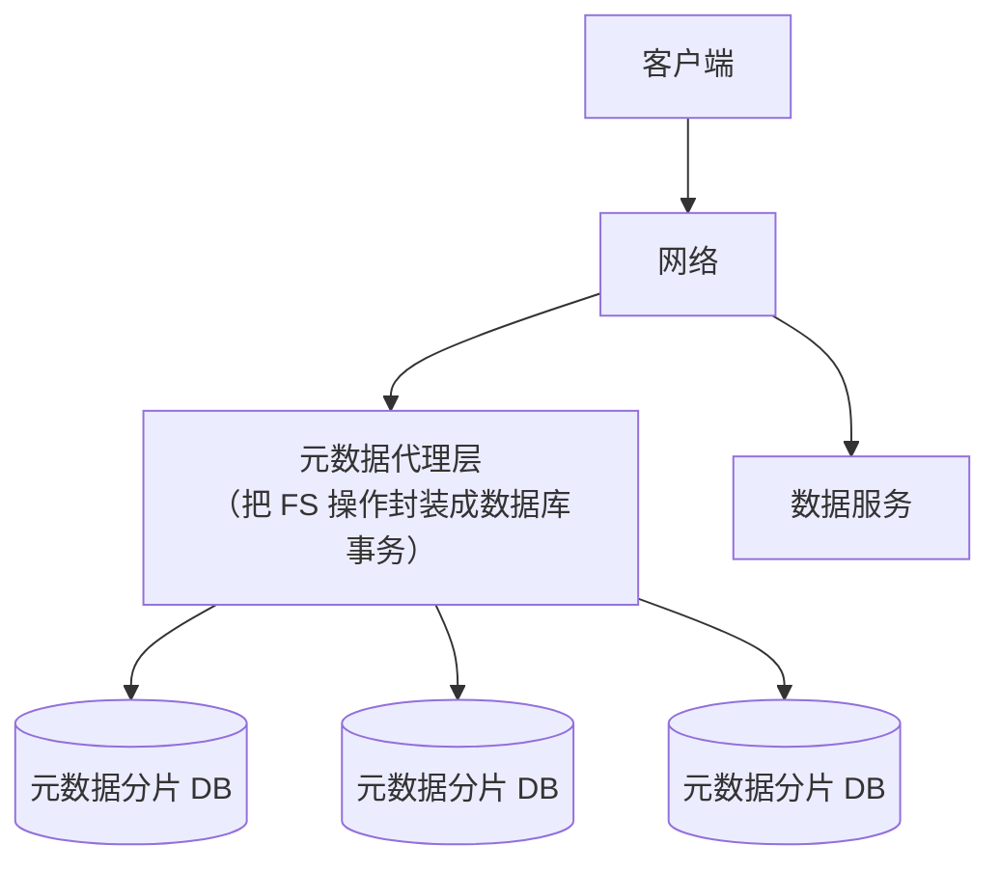

> 图：论文图 1 的分离式元数据架构。CFS 后面会把中间的代理层去掉。

### 1.3 POSIX 语义靠事务和锁（§2.2，图 2、图 3）

POSIX 要求元数据操作具备**原子性**（失败时不留下部分更新）和**隔离性**（并发请求之间不产生有害竞态）。传统做法是把一个系统调用涉及的多次读写封装成事务。论文以 HopsFS 的 create 为例（图 2）：

```sql
START TRANSACTION;
SET @parent := (SELECT * FROM inodes WHERE id=@parent_id); -- 检查父目录是否存在
IF @parent.type=DIR THEN
  INSERT (parent_id=@parent.id, id=@id, name=@name, ...) INTO inodes; -- 插入新文件记录
  UPDATE inodes SET (time=@now, ...) WHERE (id=@parent_id);          -- 更新父目录属性
COMMIT
```

执行流程（图 3）：

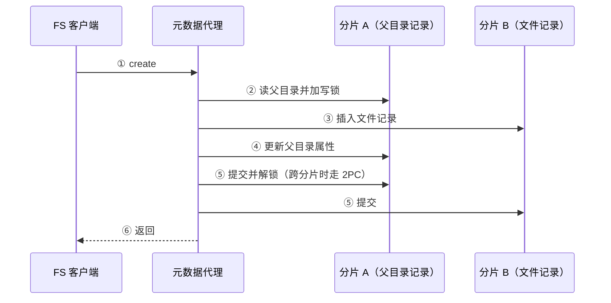

锁从第 ② 步一直持有到第 ⑤ 步，**整个事务的生命周期就是临界区**。

### 1.4 锁开销实测（§2.2，图 4）

作者用 3 个数据库实例的小规模 HopsFS，3–48 个并发客户端执行 create，并用"客户端访问同一目录的概率"模拟竞争率：

- 无竞争时，吞吐随客户端数近线性增长；竞争率升高后吞吐明显下降，**100% 竞争时吞吐曲线变平**（图 4a）；
- 延迟分解（图 4b）："执行"（③–⑤）和"其他"部分的耗时几乎不随竞争率变化，**锁等待**部分则急剧上升：

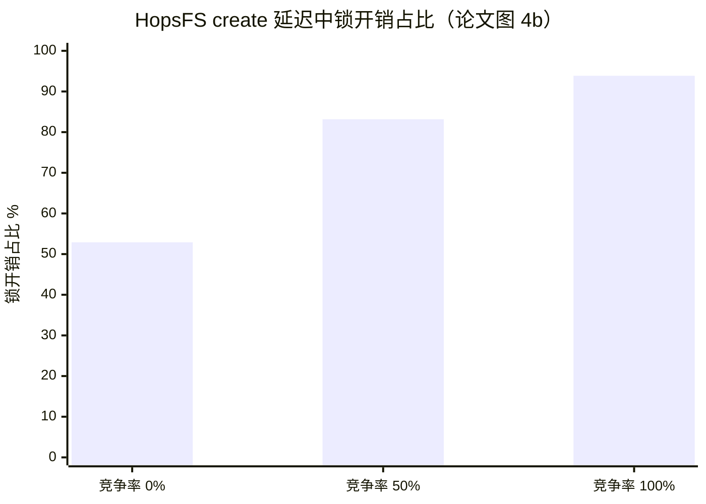

论文强调高竞争并不罕见：大数据分析等应用经常并发读写同一个共享目录。

### 1.5 分区方式让问题更糟（§2.2）

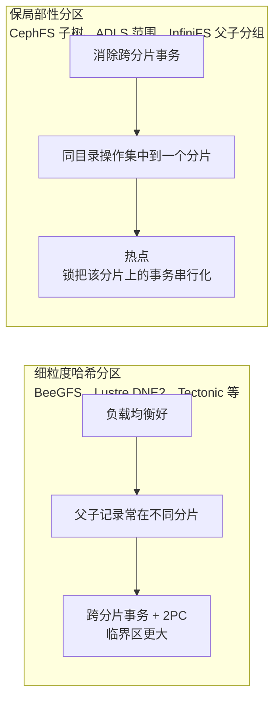

**解读**：这是元数据分区的经典两难。InfiniFS 的答案是"拆对象"（访问 / 内容元数据分别跟随父、子），在无竞争时已经能让多数操作单服务器完成；CFS 指出 InfiniFS 留下了两个问题：一是**单个分片内部仍要加锁**，同目录高并发时被串行化；二是**文件属性仍与目录绑在一起**，大目录的 getattr 会打到同一台服务器。CFS 的三项技术分别对着这两点和代理层开销。

---

## 2. 生产负载特征

### 2.1 元数据操作比例（论文表 1）

表 1 汇总了第 2 节 9 个负载中由 POSIX 调用触发的元数据操作比例：

| 操作 | 占比 | 操作 | 占比 | 操作 | 占比 |
|------|------|------|------|------|------|
| create | 1.44% | lookup | 17.80% | unlink | 1.14% |
| getattr | **75.25%** | mkdir | 0.08% | setattr | 3.21% |
| rmdir | 0.04% | readdir | 0.92% | rename | 0.12% |

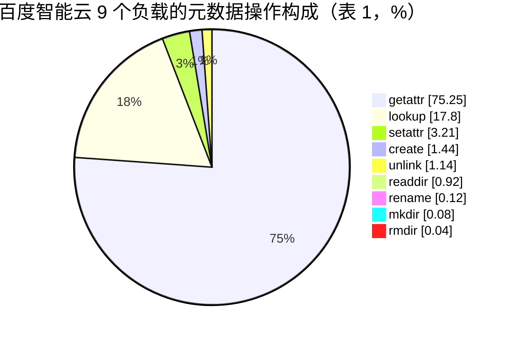

注：getattr 不是 POSIX 接口，而是 NFS 等 DFS 中实现 open、stat 的常用内部操作（§3.1 脚注）。

### 2.2 从表 1 得出的两类访问模式（§3.1）

- **文件属性类**（getattr、setattr，合计约 78%）：访问的是单个文件的属性，适合**扁平组织**，并且常与数据操作一起并行访问；
- **目录结构类**（create、unlink、mkdir、rmdir 等）：插入或删除子项，然后修改**父目录**属性，适合**保留层级结构**，并让父目录属性与子项 inode 放在一起。

**解读**：InfiniFS 的阿里云负载（文件操作 95.8%、目录 rename 约 0.0083%）和 CFS 的百度负载（getattr 75.25%、rename 0.12%）结论一致：读多写少，结构变更极少。两篇论文的不同在于 CFS 进一步把"文件属性读"单独拿出来做成扁平哈希访问。

---

## 3. 设计思路：三处临界区裁剪

论文沿用解耦与分离式架构，但在三处"安全地裁剪临界区"（§3.1）：

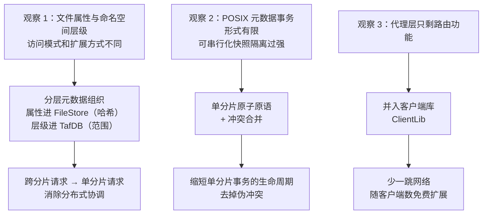

### 3.1 无协调时只会出现两类不一致（§3.1）

作者分析 POSIX 接口后得出：如果不做协调，元数据只可能出现两类不一致：

| 不一致 | 例子 | CFS 的处理 |
|--------|------|------------|
| **映射损坏**（corrupted mapping） | 文件创建成功了，但把它链接到父目录失败 | 跨两层的修改按**固定顺序**执行：内部索引可以暂时损坏，但对外**始终一致**（损坏状态不可见）；单分片内则把多对象修改合成一条命令一次执行 |
| **丢失更新**（lost update） | 同一父目录下并发两个 mkdir，都覆盖父目录的 links，最终比实际少 1 | 这类并发更新**总是可合并的**，视为伪冲突移出临界区 |

**解读**：这一节是全文的理论支点。数据库事务要防的是任意读写交错，而文件系统元数据请求只有少数几种固定"形状"。只要针对这几种形状证明"不会出现外部可见的不一致"，就可以把隔离级别从可串行化放宽到更弱，同时不违反 POSIX。这与作者之一 Cheng Li 早年在地理复制系统中提出的 RedBlue 一致性（OSDI 2012，论文引用 [38]）思路一脉相承：可交换的操作不需要协调。

---

## 4. 总体架构

### 4.1 四个组件（§3.2，图 5）

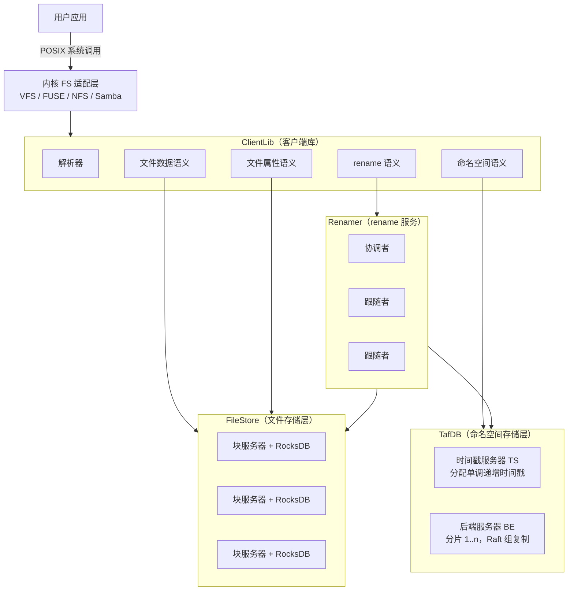

| 组件 | 职责与实现（§3.2） |
|------|-------------------|
| **TafDB** | 命名空间存储层：存除文件属性以外的全部命名空间层级，提供定制原语和放宽的原子性/隔离性。内部分两类进程：**时间戳服务器（TS）**分配单调递增时间戳给元数据事务定序；**后端服务器（BE）**以数据库表存元数据，按 Raft 组复制。所有经过 TafDB 的修改先写入目标 Raft-BE 组复制的 WAL |
| **FileStore** | 扁平的分布式对象存储，存文件数据块（CFS 的数据存储单元）。每个存储节点额外运行一个本地 **RocksDB** 存对应文件的属性。数据块和元数据 WAL 多副本，通常 3 副本 |
| **Renamer** | 专门处理 TafDB 单机处理不了的复杂 rename（与 InfiniFS 类似）。一组 Raft 保护的服务器，其中一个是协调者，协调者读写 TafDB 与 FileStore 执行合法 rename。可以小规模部署 |
| **ClientLib** | CFS 的入口，提供 getattr、create、mkdir 等元数据操作和 open、read、write 等文件操作；缓存 TafDB 与 FileStore 的**分区信息**，在客户端完成元数据解析与路由 |

ClientLib 到系统其余部分有**三条路径**：

1. 文件数据与文件属性请求 → FileStore；
2. 复杂 rename → Renamer；
3. 其余元数据请求 → TafDB。

**解读**：为什么不直接增强 TafDB 来处理复杂 rename？论文的回答是：那需要把 TafDB 提到最强隔离级别，会拖累所有其他元数据请求（§3.2）。这与 InfiniFS 的中心 rename 协调者是同一种取舍：**为罕见操作单独付费，不让它决定常见操作的架构**。

### 4.2 POSIX 接口如何映射（§3.2）

ClientLib 挂在 VFS 下，把用户态 POSIX 调用编排成 CFS 内部操作。论文给了两个例子：

- `open(O_CREAT)`：目标文件不存在时，由 `lookup` + `create` 组成；
- `read`：ClientLib 先向 FileStore 发 `getattr` 取修改时间等属性，**修改时间与缓存不同时**再向 FileStore 发 `read` 取数据。

此外还提供 FUSE、Samba、NFS-Ganesha 兼容接口。用 pjdfstest 做 POSIX 兼容测试：**ext4 与 CFS 通过全部 8832 个用例**，XFS 失败 2 个，CephFS 失败 237 个。

---

## 5. 分层元数据组织与分区

### 5.1 TafDB 中的单张 inode_table（§4.1，图 6）

除文件属性以外的全部元数据放在 TafDB 的一张大表 `inode_table` 中。与 HopsFS、ADLS 用多张表不同，单表设计避免了 create 这类"还要改父目录"的操作维护跨表一致性。

所有记录共享复合主键 `<kID, kStr>`：

| 记录类型 | kID | kStr | 主要字段 |
|----------|-----|------|----------|
| 目录或文件的 **inode id 记录** | 父目录 inode id | 自己的名字 | id、type 等 |
| 目录的 **属性记录** | 目录自己的 inode id | 保留关键字 `"/_ATTR"` | type、children、links、size、time、权限等 |

每条记录都有一组可选字段（id、type、children、links、size、time……），用不到的置 NULL。与 InfiniFS 一样，每个目录被拆成两条记录（id 记录 + 属性记录），这消除了两类记录之间的访问竞争。

论文图 6 的例子：根目录（id 0）下有目录 `dir1`（id 1），`dir1` 下有文件 `file1`（id 2）、`file2`（id 3）。

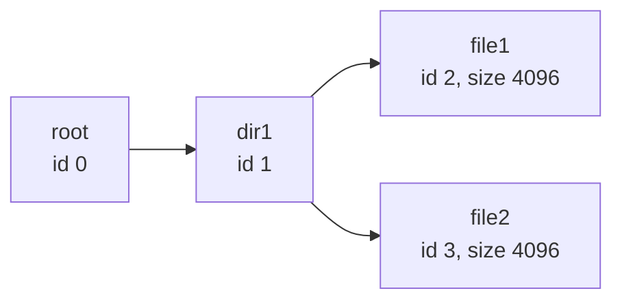

| 行 | kID | kStr | id | type | children | links | 存放位置 |
|----|-----|------|----|------|----------|-------|----------|
| 1 | 0 | dir1 | 1 | dir | | | TafDB |
| 2 | 1 | /_ATTR | | dir | 2 | … | TafDB |
| 3 | 1 | file1 | 2 | file | | | TafDB |
| 4 | 1 | file2 | 3 | file | | | TafDB |
| — | key = 2 | | | | | | FileStore：`{links=1, size=4096, …}` |
| — | key = 3 | | | | | | FileStore：`{links=1, size=4096, …}` |

### 5.2 两种分区方式（§4.1）

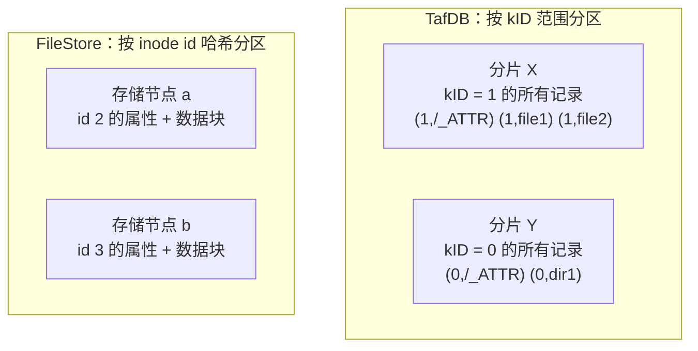

- **TafDB 按 kID 范围分区**：一个目录的属性记录（kID = 自身 id）和它所有子项的 id 记录（kID = 父 id = 该目录 id）主键前缀相同，自然落在**同一个分片**。因为文件属性已经移走，每个文件在 TafDB 里只剩一条 id 记录，论文给出每个**文件属性**约占 0.2KB，移走后即便**百万级文件的大目录**也不会超出单个 TafDB 分片的容量（§4.1）。
- **FileStore 按 inode id 哈希分区**：文件属性与文件数据放在同一个 FileStore 节点上，key 是 inode id，value 是编码后的属性字节流。哈希保证了属性在所有存储节点上均匀分布，即使大目录下的文件属性访问也能由很多节点并行服务；而 RocksDB 的简单 KV 接口也比经由 TafDB 访问更便宜。

**解读**：这里的关键是"**按访问模式给不同元数据选不同分区方式**"。TafDB 只需要处理结构类操作（插入/删除子项 + 改父目录属性），用范围分区保局部性；占比最高的 getattr/setattr 走哈希分区的 FileStore，不受目录大小影响。注意**目录属性仍在 TafDB**（`/_ATTR` 记录），只有文件属性下沉。所以一次 `stat(/a/b/f)` 的典型路径是：在 TafDB 逐级 lookup 拿到 f 的 inode id，再按 id 哈希到 FileStore 取属性。

### 5.3 不用 2PC 的跨层一致性（§4.1，图 7）

元数据跨 TafDB 和 FileStore 两层，理论上需要分布式事务保证原子性。CFS 用**确定的执行顺序**代替：

- **创建类请求**：把命名空间层级（TafDB）的更新放在**最后一步**；
- **删除类请求**：把命名空间层级的更新放在**第一步**。

这样故障只会留下"FileStore 里的孤儿属性记录"，它们对外不可见，由后台 GC 清理（第 8 节）。

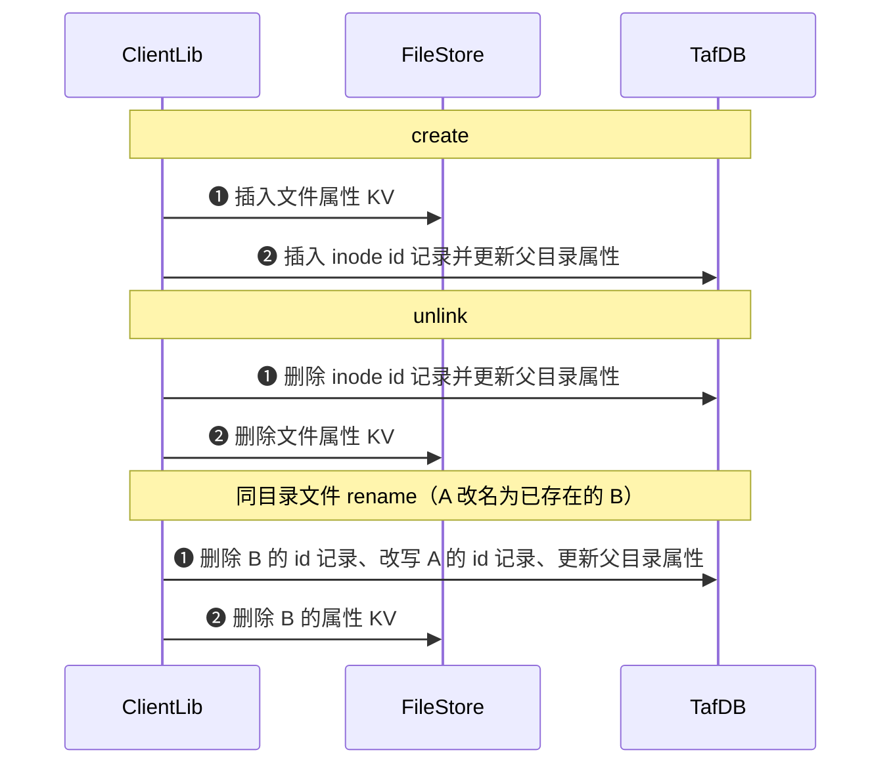

以 create 为例：如果在 FileStore 插入完成后崩溃，TafDB 的索引没有变化，恢复后这个新插入的属性不会被任何后续访问返回（§4.1）。

**解读**：这是一个很实用的工程模式——**"先写不可见的部分，最后写使其可见的索引；删除时反过来"**。它把原子性问题转化为垃圾回收问题，代价是需要一个可靠的 GC。对照 Tectonic：Tectonic 的 Name / File / Block 三层之间同样不做跨层事务，也依赖"先建下层、后建上层引用"的顺序，但没有专门的 GC 设计描述。

### 5.4 结果：大多数分布式事务变成单分片事务（§4.1）

文件属性移走 + 单表统一索引 + kID 范围分区三者叠加，使目录的属性记录与子项 id 记录同分片。于是传统设计中**绝大多数分布式事务都变成了单分片事务**：create、unlink、同目录 rename 都只碰一个 TafDB 分片（外加 FileStore 上无需协调的一次读写）。

**解读**：论文在 §5.2 评估中说 mkdir / rmdir 的"分布式元数据事务被完全消除"，但正文没有展开 mkdir 的执行细节。按表结构推理，mkdir 需要写两条 TafDB 记录：新目录在父目录下的 id 记录（kID = 父 id），以及新目录自己的 `/_ATTR` 记录（kID = 新 id）。这两条记录的 kID 不同，在范围分区下未必同一分片。合理的推测是 mkdir 同样采用"先写不可见部分"的顺序：先写新目录的 `/_ATTR` 记录（此时无人能通过名字找到它），再用 `insert_with_update` 原子地插入 id 记录并更新父目录；rmdir 则反过来，残留的孤儿记录由按需 GC 清理（§4.4 正好提到 rmdir 中断的情况）。这一点论文没有明说，读者实现时需要自行确认。

---

## 6. 单分片原子原语与冲突合并

### 6.1 问题：交互式事务太长（§4.2）

即使事务只碰一个分片，如果像图 2 那样由客户端一条条地发 SELECT、INSERT、UPDATE，事务的生命周期就包含多次网络往返，锁也要持有这么久。

### 6.2 三条单分片原子原语（论文表 2）

CFS 在 TafDB 中实现了三条**参数化原语**，把读、写和条件检查合成**一条命令**一次执行；条件为真时所有修改写入，否则什么也不发生：

| 原语 | 用途 | 语法 | 语义 |
|------|------|------|------|
| `insert_with_update` | create、mkdir、symlink、link | `INSERT (value_list) WITH UPDATE table SET (assignment_list) WHERE (update_cond)` | ① 检查匹配 update_cond 的记录存在；② 插入新 inode id 记录；③ 按 assignment_list 更新该记录 |
| `delete_with_update` | unlink、rmdir | `DELETE (delete_cond) WITH UPDATE table SET (assignment_list) WHERE (update_cond)` | ① 检查匹配 delete/update 条件的记录存在；② 删除匹配 delete_cond 的记录；③ 更新匹配 update_cond 的记录 |
| `insert_and_delete_with_update` | rename | `INSERT (value_list) WITH DELETE (delete_cond_list) WITH UPDATE table SET (assignment_list) WHERE (update_cond)` | ① 检查各条件；② 删除匹配任一 delete 条件的记录；③ 插入主键和字段改动后的新 id 记录；④ 更新匹配 update_cond 的记录 |

条件检查的写法（§4.2）：

- WHERE 子句写谓词：存在性检查直接写主键，**目录为空检查**写 `children = 0`；
- DELETE / UPDATE 子句也可以带谓词，对应修改失败即说明条件不满足；
- INSERT 自带**隐式存在性检查**：因记录重复而插入失败，说明目标已存在。

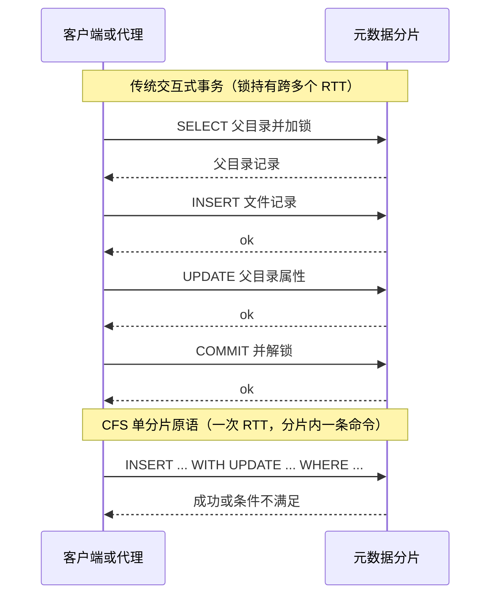

论文总结了三点好处（§4.2）：

1. 大幅减少 ClientLib 与 TafDB 之间的通信；
2. 单条命令快速执行，事务生命周期和锁竞争进一步缩短；
3. 同一原语换参数就能用于不同请求，不必逐个请求实现。

作者特别区分了原语与**数据库存储过程**：存储过程只是把语句打包，内部仍逐条执行；原语本身是**一条语句**，可以做得更快。

### 6.3 冲突合并：把伪冲突移出临界区（§4.2）

原语仍然需要锁，TafDB 仍可能把它们串行化。作者的第二个观察是：并发修改**同一父目录属性**的请求之间存在大量**伪冲突**。例如同目录下两个并发 create 都会更新父目录的 links、children、size、mtime，但这些修改**总是可合并的**。属性修改只有两类：

| 属性类型 | 例子 | 合并方式 |
|----------|------|----------|
| 数值型，只做增减 | links、children、size | **delta apply**：原语里编码正负增量，数据库可以按任意顺序应用，结果相同（满足交换律） |
| 覆盖型 | time、permission | **last-writer-wins**：以 TafDB 分配的单调递增时间戳为准，最终值取最大的已提交时间戳对应的值 |

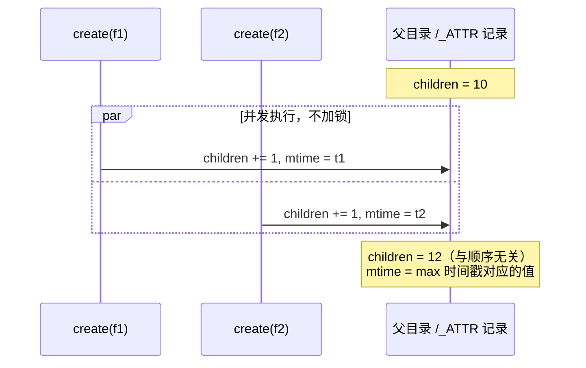

### 6.4 案例：create、unlink、同目录 rename（图 8）

**create**（图 8a）：

```sql
-- 向 FileStore 插入文件属性
FileStore.Put(key=@id, value={links=1, children=0, ...})
-- 向 TafDB 插入 inode 记录并更新父目录
INSERT (kID=@parent_id, kStr=@name, id=@id)
WITH UPDATE inode_table
SET (children+=1, mtime=@now, ...)
WHERE (kID=@parent_id, kStr="/_ATTR", type=dir)
```

`children += 1` 用 delta apply，`mtime = now` 用 last-writer-wins；两次插入都**不受任何锁保护**。

**unlink**（图 8b）：

```sql
-- 从 TafDB 删除 inode 记录并更新父目录
DELETE (kID=@parent_id, kStr=@name)
WITH UPDATE inode_table
SET (children-=1, mtime=@now, ...)
WHERE (kID=@parent_id, kStr="/_ATTR", type=dir)
FileStore.Delete(key=@id) -- 删除文件属性
```

**同目录文件 rename**（图 8c，A 改名为 B）：

```sql
-- 删除 A、B 的 inode 记录，插入新记录，同时更新父目录属性
INSERT (kID=@parent_id, kStr="B", id=@A_id)
WITH DELETE (kID=@parent_id, kStr="A", type=file),
            (kID=@parent_id, kStr="B", type=file, ifexist)
WITH UPDATE inode_table
SET (children-=Δ, mtime=@now, ...)
WHERE (kID=@parent_id, kStr="/_ATTR")
FileStore.Delete(key=@B_id) -- 删除 B 的属性
```

其中 `ifexist` 表示 B 不存在时忽略删除失败；Δ 由 TafDB 内部决定：B 不存在时为 0，存在时为 1（即 children 减 1）。

**解读**：delta apply + LWW 本质上是把父目录属性当成一个 **CRDT 风格的计数器 + LWW 寄存器**（论文相关工作也提到了 ElmerFS 用 CRDT 组织文件系统元数据）。它解决的正是"大目录 / 共享目录下并发 create"这个 AI 与大数据负载中最常见的热点。需要注意它成立的前提：父目录属性的修改只依赖"增量"，不依赖"读到的旧值"。像 rmdir 的"目录为空"检查需要读 children，所以 rmdir 仍要在原语内部做条件判断，和并发 create 之间仍然存在真正的冲突（这是正确的冲突，不能合并）。

---

## 7. 强一致 rename

### 7.1 为什么 rename 最复杂（§4.3）

最坏情况下一个 rename 要改**6 个元数据对象**：4 条属性记录和 2 条 inode id 记录（源、目标文件以及各自的父目录），可能跨多个分片。rename 占比虽小（表 1 中 0.12%），但会拖累尾延迟和整体扩展性。

关键观察：生产负载中**几乎 99% 的 rename 是同一目录内两个文件之间的 rename**。

### 7.2 快路径与常规路径（§4.3）

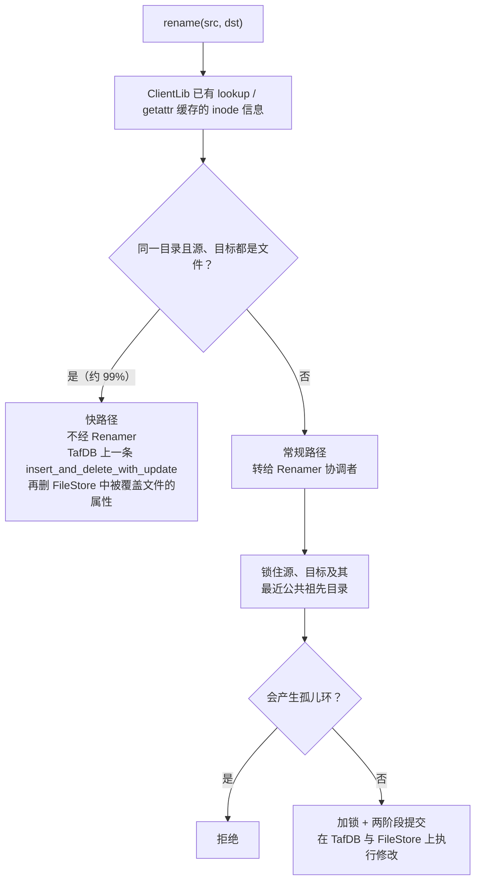

- **快路径**：POSIX rename 在 CFS 内部会先触发 lookup、getattr 取目标 inode，这些信息缓存在 ClientLib，足以让客户端判断是否走快路径。TafDB 原语内部仍会检查：A 必须是已存在的文件；B 不存在，或 B 存在且也是文件。
- **常规路径**：两个原因需要特殊处理：一是可能跨不同父目录、跨 TafDB 分片，无法用单分片原语，由 Renamer 协调者按传统的**加锁 + 2PC** 在 FileStore 与 TafDB 间执行；二是可能产生 POSIX 不允许的**孤儿环**（两个目录互为父目录，子树与整棵树断开），例如把祖先目录移到后代下面，或并发的常规路径请求未协调。Renamer 先锁住源/目标目录或文件及其**最近公共祖先**，再验证请求不会形成孤儿环。

两条路径互不干扰（§4.3）：快路径只碰文件、不碰目录，永远不会形成孤儿环；CFS 在单分片原语与常规分布式事务之间提供强隔离。

**解读**：

- 快路径的判断依赖客户端缓存，但**正确性不依赖缓存**：缓存可能过期，然而原语中的 `type=file` 等谓词在分片内原子检查，判断错了只会让原语失败，不会破坏一致性。这是"乐观判断 + 服务端原子校验"的典型用法，与 InfiniFS 的推测式解析如出一辙。
- 常规路径的吞吐论文没有单独报告（只报告了 90% 快路径 + 10% 常规路径的混合结果，见 9.6 节）。目录 rename 的扩展性与 InfiniFS 一样受限于单个协调者，只是 CFS 没有 InfiniFS 那样的客户端路径缓存需要广播失效。

---

## 8. 垃圾回收

由于 FileStore 和 TafDB 都由 Raft 保护，跨层不一致只会出现在 **ClientLib 在执行跨 TafDB 与 FileStore 的请求中途崩溃或被网络分区**时（§4.4）。CFS 用轻量的后台 GC 找出并清理孤儿记录：

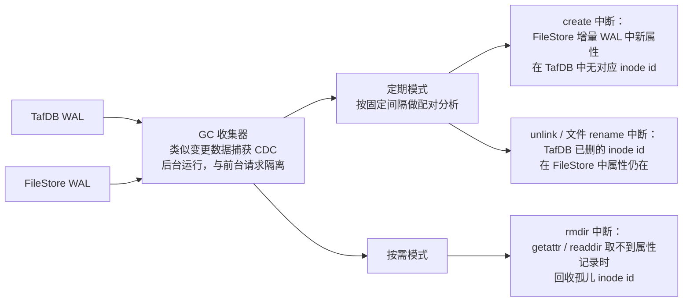

**解读**：用 WAL 做配对分析而不是全量扫描，开销只与近期修改量成正比，这是 GC 能保持轻量的关键。但定期模式意味着孤儿属性会在 FileStore 中存活一个 GC 周期；对配额、容量统计等需要精确计数的功能，需要额外处理（论文未讨论）。

---

## 9. 评估

### 9.1 实验设置（§5.1）

| 项目 | 配置 |
|------|------|
| 集群 | 50 台物理服务器：40 台部署 DFS（32 核、2 块 7TB NVMe SSD），10 台跑客户端（96 核），最多 500 个并发客户端；均为 128GB DRAM、CentOS 6.3 |
| 基线 | **HopsFS 3.2.0.4**（后端 MySQL NDB 8.0；因 bug 关闭了 namenode 的配额功能）；**InfiniFS**（未开源，作者按论文自行实现，验证其性能趋势及与 HopsFS 的差距与原论文一致） |
| 部署 | 每台服务器混合部署元数据服务和数据存储。HopsFS：每台运行 Hops-Namenode（代理层）+ NDB-Data（存储层）；InfiniFS：每台运行 InfiniFS-MDS + 数据库后端（**本地 TafDB**）；CFS：每台只运行一个 TafDB 实例。InfiniFS 与 CFS 都另配 3 节点 rename 集群 |
| 持久化 | 所有系统的 WAL 都写 NVMe SSD，3 副本 |
| 负载 | 类 mdtest 基准，变化竞争率、客户端数、目录大小等；文件操作在空文件上测试；另用 3 个生产 trace 并开启数据访问 |

**解读**：两点值得注意。第一，InfiniFS 的实现以 **TafDB 作为后端**，这让 CFS 与 InfiniFS 的对比更多地集中在"组织方式 + 原语 + 去代理"上，而不是存储引擎差异，比较公平；但它也不是 InfiniFS 原作者的实现。第二，InfiniFS 原论文在 RAMdisk 上评估，这里换成了带 3 副本 WAL 的 NVMe，绝对数字不能直接和 InfiniFS 原论文比。

### 9.2 无竞争的峰值吞吐与延迟（§5.2，图 9）

每个客户端只访问自己的私有目录（无冲突，对所有系统都是最好情况），测 7 种元数据请求。

**峰值吞吐（500 客户端）**：CFS 全部最优，对 HopsFS 加速 **1.76–75.82×**，对 InfiniFS 加速 **1.22–4.10×**。

| 请求 | 结果与原因（§5.2） |
|------|-------------------|
| create、unlink | HopsFS 因重度分布式协调不扩展；InfiniFS 与 CFS 接近，CFS 好 **22.32%–23.12%**。无竞争时 InfiniFS 的分区也能减少分布式事务，锁开销是常数；CFS 的优势来自临界区裁剪和客户端解析省下的资源 |
| mkdir、rmdir | HopsFS、InfiniFS 都因分布式协调扩展不好；CFS 完全消除了分布式事务，对二者加速 **1.76–49.45×** 和 **1.34–1.47×** |
| lookup、getattr、setattr | CFS 分别达到 **1.51M、3.44M、1.31M ops/s**。lookup：两者都读 TafDB，CFS 省了代理层；getattr / setattr：CFS 把文件属性卸载到更轻的 FileStore |

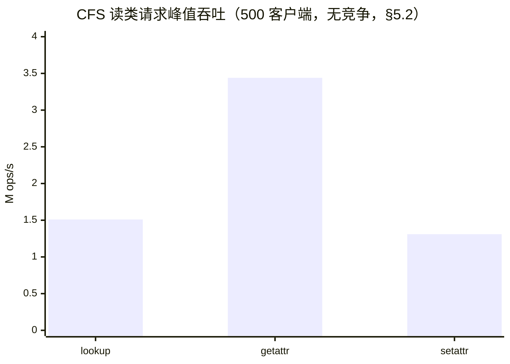

**平均延迟（单客户端轻载）**：

| 对比 | 结果 |
|------|------|
| InfiniFS vs HopsFS | 平均延迟降低 7.24%–88.16% |
| CFS create vs InfiniFS | **高 17.41%**：create 要多一次 RPC 把文件属性持久化到 FileStore |
| CFS unlink vs InfiniFS | 基本持平：对 FileStore 的删除是**异步写回**，延迟被隐藏 |
| CFS mkdir、rmdir vs InfiniFS | 分别降低 **29.87%**、**36.55%**（消除分布式事务、减少锁开销） |
| CFS lookup vs InfiniFS | 相同：两者都直接从 TafDB 读一个对象 |
| CFS getattr、setattr vs InfiniFS | 最多降低 **54.54%**（FileStore 处理更快） |

**解读**：create 延迟上升是分层组织的直接代价：一次 create 要写两层。生产中 create 通常紧接着写数据，论文在 9.7 节说明这次属性写入可以**捎带在数据块创建上**，所以真实负载里这次 RPC 的代价会被摊薄。

### 9.3 随客户端数的扩展性（§5.3，图 10）

客户端从 50 增加到 500，无竞争，测 create 和 getattr：

- **CFS** 扩展良好：500 客户端的吞吐是 50 客户端的 **6.88×**；
- **HopsFS** 扩展放缓：从 400 加到 500 客户端，create 和 getattr 吞吐只分别增加 4.87% 和 1.36%；
- **InfiniFS** 介于两者之间：create 扩展得不错，但和 CFS 的差距逐渐拉大（400 客户端时 CFS 是其 1.08×，500 客户端时 1.20×）；getattr 从 400 到 500 客户端几乎没有提升。

### 9.4 高竞争（§5.4，图 11）

500 客户端，用"强制一定数量的客户端访问共享文件或目录"模拟 0%、50%、100% 三档竞争率。竞争率越高，负载越集中到少数元数据服务器，三个系统都会下降：HopsFS 吞吐跌到约 **0.3K**，InfiniFS 跌到约 **21.1K**。

| 请求 | 竞争率 ≥ 50% 时 CFS 的倍数 | 原因 |
|------|---------------------------|------|
| create | HopsFS 的 **115.96–177.40×**；InfiniFS 的 **1.67–1.96×** | 裁剪后的临界区让并发 create 并行执行，客户端解析进一步提升吞吐 |
| mkdir | HopsFS 的 **55.18–62.42×**；InfiniFS 的 **41.52–48.36×** | HopsFS 和 InfiniFS 的 mkdir 都用 2PC；CFS 几乎无锁 |

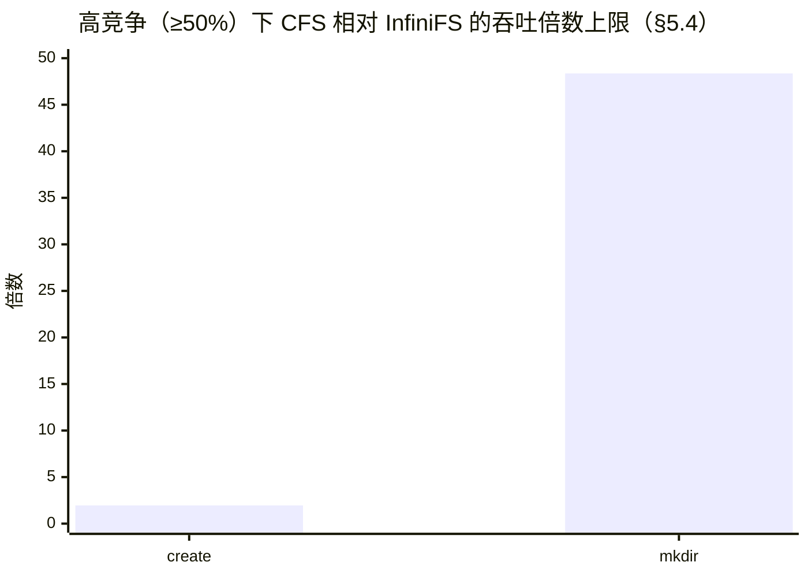

**解读**：

- 这组实验最能体现 CFS 与 InfiniFS 的本质区别：无竞争时两者 create 只差约 20%，一旦多个客户端挤在同一目录下，InfiniFS 的单分片锁把请求串行化，而 CFS 的 delta apply 让它们并行。
- 论文引言写高竞争下 mkdir 达到 **17.96K ops/s、是 InfiniFS 的 54.48×**，而 §5.4 正文给的 mkdir 倍数是 41.52–48.36×，两处数字不一致，可能来自不同的竞争率设置或修订遗漏。引用时建议以 §5.4 的区间为准，或同时注明。

### 9.5 大目录（§5.5，图 12）

500 个客户端同时访问一个含 **100 万个文件**的共享扁平目录：

- create、unlink、mkdir、rmdir、lookup：三个系统的绝对吞吐都远低于图 9，因为三者的分区方式都会把同一目录的子项聚在一台服务器上，相当于 100% 竞争；CFS 仍因消除协调和锁而明显领先；
- **getattr、setattr**：CFS 扩展良好，对 HopsFS 加速 **24.08–63.23×**，对 InfiniFS 加速 **20.84–34.19×**。原因是文件属性在 FileStore 中按哈希分布到所有节点；HopsFS 和 InfiniFS 仍用保局部性分区，属性访问有热点。

论文引言中"高竞争下 getattr 达到 **3.44M ops/s**、是 InfiniFS 的 **34.19×**"对应的正是这组大目录实验的上限。

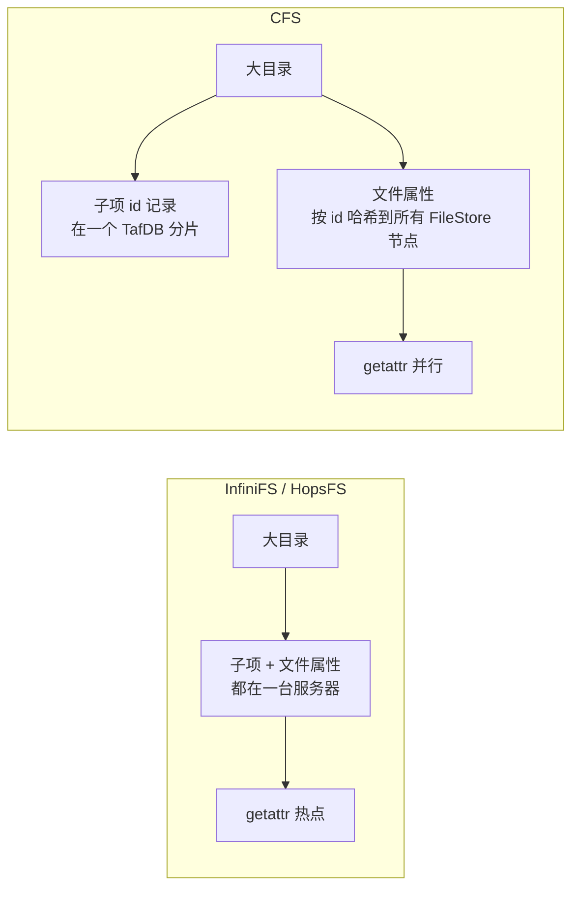

### 9.6 rename（§5.6）

负载：90% 同目录文件 rename + 10% 其他所有类型 rename，500 客户端。

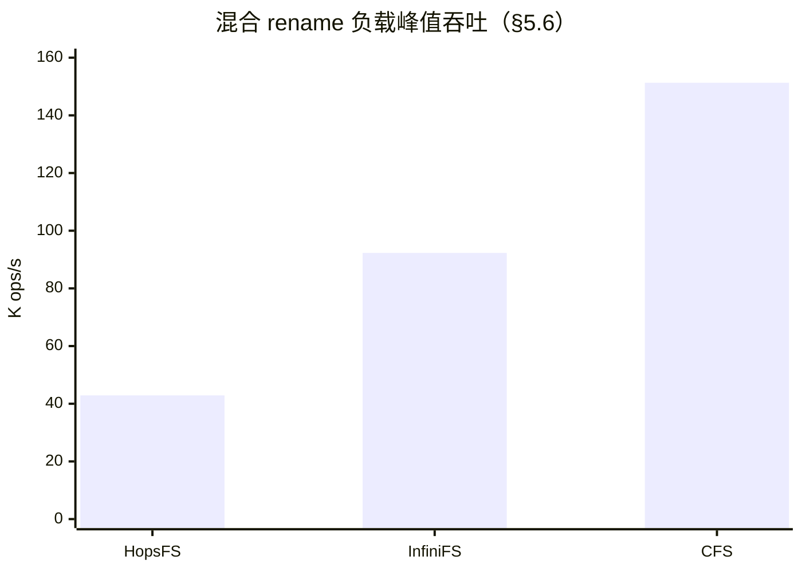

- CFS 峰值 **151.3K ops/s**，比 HopsFS（42.9K）高 252.68%，比 InfiniFS（92.3K）高 63.92%；
- HopsFS 的基于子树的加锁要锁两棵子树，扩展受限；CFS 在常规路径上与 InfiniFS 开销相同，优势全部来自同目录快路径；
- 尾延迟：CFS 的 **P99 为 20.75 ms**，比 HopsFS、InfiniFS 分别短 89.89%、72.78%；**P999 为 33.29 ms**，比基线短 79.00%–91.56%。

### 9.7 因素分析（§5.7，图 13）

在较小的集群上（6 台服务器、100 客户端、10% 竞争率）逐项叠加优化，结果归一化到 CFS-base：

| 配置 | 含义 |
|------|------|
| CFS-base | 全部元数据存 TafDB 并范围分区，部署元数据代理 |
| +new-org | 加入分层元数据组织（§4.1） |
| +primitives | 再加入单分片原语（§4.2） |
| +no-proxy | 再换成 ClientLib，即完整 CFS |

| 步骤 | create | mkdir | getattr |
|------|--------|-------|---------|
| CFS-base vs InfiniFS | 明显更差（CFS-base 大量用分布式事务，InfiniFS 已消除） | 与 InfiniFS 相近 | 与 InfiniFS 相近 |
| +new-org | 无效果：属性写入捎带在数据块创建上 | 无效果：不碰 FileStore | 吞吐 **3.19×**、延迟 **−69.96%** |
| +primitives | 显著提升，几乎追上 InfiniFS（吞吐低 7.52%、延迟高 8.63%，因为 CFS 额外创建数据块，而 InfiniFS 作为演示系统不创建） | 显著提升，吞吐是 InfiniFS 的 **2.70×** | 无效果：不涉及分布式事务和锁 |
| +no-proxy | 延迟再 **−20.42%** | 延迟再 **−20.38%** | 延迟再 **−32.23%** |

三项叠加后，CFS 对 CFS-base 和 InfiniFS 的吞吐加速分别为 **4.31–5.64×** 和 **1.17–5.64×**，延迟分别降低 13.55%–79.64% 和 76.66%–79.64%。

论文还指出：InfiniFS 也可以用客户端库，但收益很小。create、getattr 这类单服务器请求能缩短访问路径，但受限于没有 new-org 和 primitives；mkdir 这类多服务器请求的瓶颈是跨服务器分布式事务，客户端解析帮不上忙。结论是：**ClientLib 只有在元数据重组、分布式事务被消除之后才能发挥作用**。

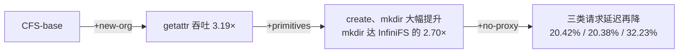

**解读**：三项优化"各管一类请求"：分层组织只帮 getattr，原语只帮写类请求，去代理对所有请求都有帮助但必须建立在前两者之上。这是一组很干净的因素分析，说明三项技术不是简单堆叠。

### 9.8 生产 trace（§5.8，表 3，图 14、图 15）

从第 2 节的 9 个生产负载中取 3 个 trace：

**文件与 I/O 大小**（图 14）：

- ≤ 32KB 的文件占比：tr-0 **75.27%**、tr-1 **91.34%**、tr-2 **87.51%**；
- ≤ 32KB 的 I/O 最高占 **96.37%**，其中 **45.20%–70.70%** 的 I/O 甚至不超过 1KB。

**操作构成**（表 3）：

| trace | 文件系统操作（POSIX 调用） | 元数据操作 |
|-------|---------------------------|------------|
| tr-0（只读） | stat 51.8%、open 24.4%、read 17.8%、opendir 6.0% | getattr 95.1%、lookup 4.9% |
| tr-1（读多，有写） | stat 47.2%、opendir 13.1%、read 11.6%、open(O_CREAT) 8.4%、write 8.2%、unlink 8.0%、open 3.1%、rename 0.3% | getattr 63.2%、lookup 23.9%、create 6.5%、unlink 6.1%、rename 0.2% |
| tr-2（读多，有写） | stat 49.3%、opendir 19.0%、write 6.3%、open(O_CREAT) 6.2%、chmod/chown 6.2%、open 5.6%、unlink 5.1%、mkdir 1.3%、read 1.0% | getattr 66.8%、lookup 18.1%、create 5.0%、setattr 5.0%、unlink 4.1%、mkdir 1.0% |

**性能**（50 服务器、500 客户端，开启数据访问；未比较 HopsFS，因为它只实现 HDFS 语义、只支持追加写，无法回放 trace 中的随机访问）：

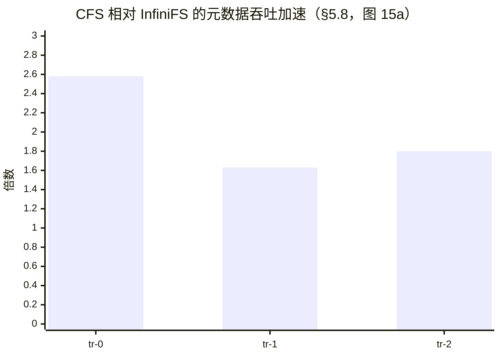

- 元数据吞吐加速 2.58×、1.63×、1.80×；**端到端**文件系统吞吐加速 **1.62–2.55×**；元数据吞吐的绝对值略高于文件系统操作，因为一个 FS 操作可能触发多个元数据操作（如 stat = lookup + getattr）；
- P999 尾延迟：元数据操作降低 **41.82%–63.69%**，文件系统操作降低 **35.06%–62.47%**；tr-1 的尾延迟改善最大，因为它的 rename 最多，而 rename 的开销被 CFS 大幅削减。

**生产部署**：CFS 在百度智能云运行 **3 年**，服务社交网络、电商、企业办公自动化、自动驾驶和机器学习等应用；单个 CFS 部署通常以多租户方式运行**数千个文件系统实例**（含元数据和数据服务器），可扩展到数十亿乃至更多文件（§5.8）。

---

## 10. 与相关工作的对比

### 10.1 论文自述的对比（§6）

| 方向 | 代表工作 | CFS 的不同 |
|------|----------|------------|
| 元数据解耦与分离式架构 | CalvinFS（CalvinDB）、HopsFS（NDB）、ADLS、Tectonic（ZippyDB）、InfiniFS | 都保留独立的元数据代理层作为网关；CFS **去掉代理层**，改为客户端解析 |
| 元数据组织 | HopsFS 用 MySQL 表；Tectonic、InfiniFS 映射为 KV；Tectonic 分 Name / File / Block 层；InfiniFS 分访问 / 内容元数据 | 这些逻辑层仍在**同一个存储**里；CFS 进一步区分文件属性与其余层级，放进**两种存储**（TafDB + FileStore） |
| 哈希分区 | BeeGFS、Lustre DNE2、SoMeta、SkyFS、PVFSv2、HBA、CalvinFS、Tectonic | 均衡好但引入跨分片协调 |
| 保局部性分区 | Sprite、Coda、Ursa Minor、Lustre DNE1、CephFS（子树）；ADLS（范围）；InfiniFS（局部性分组） | 易出热点；CFS 用分层存储**同时**得到局部性和均衡 |
| 事务与一致性 | HopsFS 行锁 + 2PC；GlobalFS 原子多播；Tectonic、InfiniFS 依赖单分片 KV 事务，跨分片时要么放弃（引入不一致）要么用 2PC；Spanner、CockroachDB 用乐观并发控制提供严格可串行化，低竞争下表现好 | CFS 用单分片原语代替（分布式）事务的概念，在不牺牲语义的前提下放宽原子性与隔离性，高竞争下也能扩展 |
| 弱一致与冲突合并 | 可交换操作放宽一致性（scalable commutativity rule、RedBlue）、Dynamo 冲突解决、ElmerFS 用 CRDT 组织地理复制文件系统元数据 | CFS 借鉴这一思路，并与单分片原语结合用于 DFS 元数据 |
| 硬件加速 | 单边 RDMA（Octopus）、持久内存（Assise、Orion）、SmartNIC 卸载（LineFS） | 与 CFS 正交 |

### 10.2 CFS 与 InfiniFS 逐项对照（解读）

| 维度 | InfiniFS（FAST 2022） | CFS（EuroSys 2023） |
|------|----------------------|---------------------|
| 目录元数据拆分 | 访问元数据（随父）+ 内容元数据（随自身） | id 记录（kID = 父 id）+ `/_ATTR` 属性记录（kID = 自身 id），本质相同 |
| 文件属性 | 与父目录内容同组，存在元数据服务器 | **下沉到 FileStore**，按 id 哈希，与数据同节点 |
| 分区方式 | 按目录 ID 一致性哈希（组粒度） | TafDB 按 kID **范围**分区；FileStore 按 id **哈希** |
| 单分片内并发 | KV 本地事务，同目录请求互斥 | 单命令原语 + delta apply / LWW，同目录 create 无锁并行 |
| mkdir / rmdir | 跨两台服务器，2PC | 论文称完全消除分布式事务（细节未展开，见 5.4 节解读） |
| 路径解析 | **推测式并行解析**（可预测目录 ID），约 1 RTT | 客户端缓存分区信息后逐级 lookup；论文**没有**路径解析加速 |
| 客户端缓存 | 乐观访问元数据缓存 + 服务端惰性失效 | 缓存分区信息和 lookup/getattr 得到的 inode；论文未描述失效协议 |
| 代理层 | 有元数据服务器进程 | 无，ClientLib 直连 TafDB / FileStore |
| rename | 中心协调者，目录 rename 广播失效 | 同目录文件 rename 快路径；其余 Renamer 加锁 + 2PC |
| 跨层原子性 | 不涉及（单层存储） | 固定执行顺序 + WAL 配对 GC，无 2PC |

**解读**：CFS 与 InfiniFS 不是替代关系，而是**互补**：InfiniFS 的强项是深路径解析和近根热点，CFS 的强项是同目录写竞争和大目录属性访问。CFS 的评估全部基于 mdtest 类的浅路径或 trace 回放，没有考察深路径场景；如果负载路径很深，CFS 逐级 lookup 的串行 RTT 会成为短板。同一团队后续的 Mantle（SOSP 2025，面向百度对象存储 BOS 的层级命名空间，见[元数据扩展性综述](metadata-scalability.md)）同样以 TafDB 为存储层，增加了每个命名空间一个的 IndexNode，在内存中完成整条路径解析（单 RPC lookup），可以看作对这一短板的补充。

```mermaid
quadrantChart
    title 元数据服务设计取舍（解读）
    x-axis "写竞争处理弱" --> "写竞争处理强"
    y-axis "路径解析慢" --> "路径解析快"
    quadrant-1 "两者兼顾"
    quadrant-2 "解析快、写竞争弱"
    quadrant-3 "两者皆弱"
    quadrant-4 "写竞争强、解析一般"
    "HopsFS": [0.15, 0.25]
    "InfiniFS": [0.4, 0.8]
    "CFS": [0.85, 0.4]
```

> 图中坐标是本文作者的定性判断，不是论文数据。

---

## 11. 整体总结

### 11.1 核心贡献

1. **问题定位**：用 HopsFS 实测证明元数据扩展的瓶颈是**锁**（无竞争时占 create 处理时间的 52.91%，100% 竞争时 93.86%），并指出分区方式会进一步放大这个问题。
2. **分层元数据组织**：把文件属性与其余命名空间层级分到两种存储，前者按 id 哈希保均衡、后者按父 id 范围分区保局部性，并用固定执行顺序 + GC 代替跨层 2PC，使绝大多数元数据请求变成单分片请求。
3. **单分片原子原语 + 冲突合并**：三条参数化原语把"检查 + 读 + 写"合成一条命令；delta apply 与 last-writer-wins 把并发修改父目录属性的伪冲突移出临界区。
4. **去代理层**：元数据解析并入客户端库，少一跳网络，且随客户端数免费扩展。
5. **生产验证**：在百度智能云运行 3 年；pjdfstest 全部 8832 个用例通过；50 节点评估中对 HopsFS / InfiniFS 加速 1.76–75.82× / 1.22–4.10×，高竞争和大目录场景下加速扩大一个数量级。

### 11.2 设计哲学

```mermaid
flowchart TB
    P1["瓶颈是锁，不是存储"] --> D1["优化目标 = 缩小临界区<br/>而不是更快的存储引擎"]
    P2["按访问模式选分区"] --> D2["文件属性：扁平 + 哈希<br/>命名空间层级：范围 + 局部性"]
    P3["只防真正可见的不一致"] --> D3["映射损坏 → 固定顺序 + GC<br/>丢失更新 → 可合并，不加锁"]
    P4["专用原语胜过通用事务"] --> D4["一条命令 = 检查 + 读 + 写<br/>参数化复用"]
    P5["逻辑变简单后，层就可以拿掉"] --> D5["代理层只剩路由 → 并入客户端"]
    P6["罕见操作走慢路径"] --> D6["99% rename 快路径<br/>其余交给 Renamer"]
```

**解读**：CFS 的思路可以概括为"**把数据库事务的通用性换成文件系统语义的专用性**"。HopsFS 把 POSIX 操作直接映射成通用 SQL 事务，得到正确性但付出了全部的锁代价；CFS 承认 POSIX 元数据操作只有少数几种形状，为每种形状设计"恰好够用"的原子性和隔离性。三项技术是一个依赖链：分层组织把事务变成单分片的，原语把单分片事务变短、把伪冲突去掉，事务足够简单之后代理层才变得多余。

### 11.3 优点与局限

| 优点 | 局限 / 未回答的问题 |
|------|---------------------|
| 高竞争与大目录场景收益最明显，正好对应 AI 训练、大数据分析中最常见的共享目录并发写 | **没有路径解析加速**：逐级 lookup，深路径场景未评估，这是 InfiniFS 的强项 |
| 文件属性哈希分布，大目录 getattr 不再有热点 | **create 延迟上升 17.41%**：分层组织多一次 RPC，元数据密集但不写数据的场景（如建大量空文件、目录树初始化）会感受到 |
| 跨层不用 2PC，靠顺序 + GC 保证对外一致 | GC 周期内孤儿属性仍占空间；对配额、容量统计的影响未讨论 |
| 原语参数化、可复用，实现成本低于逐操作写事务 | **强依赖 TafDB 的定制能力**（原语、delta apply、时间戳服务），换成通用 KV 或 NewSQL 难以照搬 |
| 有清晰的因素分析，三项技术的作用边界明确 | mkdir 如何避免跨分片写两条记录，论文没有展开 |
| 有生产 trace 回放和 POSIX 兼容测试，可信度较高 | 常规路径 rename（尤其目录 rename）的单独性能未报告，Renamer 协调者的扩展性未讨论 |
| 与 InfiniFS 的对比在同一存储后端（TafDB）上进行，较公平 | InfiniFS 是作者复现版本；引言与 §5.4 的 mkdir 倍数（54.48× vs 41.52–48.36×）不一致 |
| — | ClientLib 缓存的失效机制、客户端版本升级与多语言 SDK 的维护代价未讨论 |

### 11.4 对分布式文件系统设计者的启示

1. **先测锁开销，再谈扩展**：在加机器之前，先像图 4 那样分解单个元数据请求的延迟，看锁等待占多少。如果锁占一半以上，加分片解决不了问题。
2. **文件属性和目录结构分开存**：getattr/stat 往往占元数据操作的 70% 以上，把文件属性按 inode id 哈希放到数据节点（或独立 KV），能让最高频的操作完全避开目录热点。
3. **主键设计决定事务边界**：`<parent_id, name>` 与 `<dir_id, "/_ATTR">` 共享前缀，范围分区后父目录属性与子项天然同分片。设计 namespace 表时，应让"一次元数据请求要改的所有行"落在同一个主键前缀下。
4. **区分真冲突和伪冲突**：children、links、size 用增量，mtime、权限用最后写者胜；只有"目录非空才能删"这类依赖旧值的检查才是真冲突。
5. **"先写不可见、后写索引"代替跨系统 2PC**：配合基于 WAL 的配对 GC，可以在两个独立存储系统之间实现对外原子的元数据操作。
6. **为 rename 做负载统计**：如果大多数 rename 是同目录文件改名（如"写临时文件再 rename 成正式文件"的常见模式），就值得给它一条单分片快路径。
7. **代理层不是必需的**：当服务端逻辑足够简单、只剩路由时，把它并入客户端库能省一跳；但要同时考虑客户端版本管理、安全隔离和多语言 SDK 的成本。

### 11.5 一张图看懂 CFS

```mermaid
flowchart LR
    subgraph Problem["问题"]
        P1["锁开销占 52.91%–93.86%"]
        P2["分区两难：<br/>哈希要 2PC，局部性有热点"]
        P3["代理层多一跳"]
    end
    subgraph Tech["技术"]
        T1["分层元数据组织<br/>TafDB 范围分区 + FileStore 哈希"]
        T2["单分片原子原语<br/>+ delta apply / LWW"]
        T3["ClientLib 客户端解析"]
    end
    subgraph Result["效果"]
        R1["多数请求单分片<br/>大目录 getattr 不热点"]
        R2["同目录并发写无锁并行<br/>高竞争 mkdir 达 InfiniFS 的 41–48×"]
        R3["延迟再降 20%–32%"]
    end
    subgraph Cost["代价"]
        X["create 多一次 RPC（+17.41%）<br/>跨层依赖 GC<br/>深路径仍逐级解析<br/>复杂 rename 走 Renamer + 2PC"]
    end
    P1 --> T2
    P2 --> T1
    P3 --> T3
    T1 --> R1
    T2 --> R2
    T3 --> R3
    T1 -.-> X
    T3 -.-> X
```

---

## 参考

- Yiduo Wang et al. *CFS: Scaling Metadata Service for Distributed File System via Pruned Scope of Critical Sections*. ACM EuroSys 2023. <https://doi.org/10.1145/3552326.3587443>
- Wenhao Lv et al. *InfiniFS: An Efficient Metadata Service for Large-Scale Distributed Filesystems*. USENIX FAST 2022. 本仓库精读：[infinifs-fast2022.md](infinifs-fast2022.md)
- Salman Niazi et al. *HopsFS: Scaling Hierarchical File System Metadata Using NewSQL Databases*. USENIX FAST 2017.
- Satadru Pan et al. *Facebook's Tectonic Filesystem: Efficiency from Exascale*. USENIX FAST 2021. 本仓库精读：[tectonic-fast2021.md](tectonic-fast2021.md)
- Raghu Ramakrishnan et al. *Azure Data Lake Store: A Hyperscale Distributed File Service for Big Data Analytics*. SIGMOD 2017.
- Cheng Li et al. *Making Geo-Replicated Systems Fast as Possible, Consistent when Necessary*. OSDI 2012.
- Romain Vaillant et al. *CRDTs for Truly Concurrent File Systems*. HotStorage 2021.
- CFS POSIX 兼容性测试日志：<https://github.com/cfs-for-review/CFS-for-review>
- 后续工作 Mantle（SOSP 2025）与其他元数据系统：见[元数据扩展性综述](metadata-scalability.md)
