# Colossus 精读：Google 集群级文件系统的公开架构（2021 博客 + 2025 两篇续篇）

> 主资料：Dean Hildebrand（Google Cloud CTO 办公室技术总监）, Denis Serenyi（Distinguished Software Engineer）. *A peek behind Colossus, Google's file system*. Google Cloud Blog，2021-04-19。改写自 Google Cloud Next '20 演讲 *A peek at the Google Storage infrastructure behind the VM*。链接：<https://cloud.google.com/blog/products/storage-data-transfer/a-peek-behind-colossus-googles-file-system>
>
> 补充资料（同为 Google 官方博客，本文用来补全 2021 文中没有的细节）：
> - Larry Greenfield, Seth Pollen. *Colossus under the hood: How we deliver SSD performance at HDD prices*. 2025-03-26。<https://cloud.google.com/blog/products/storage-data-transfer/how-colossus-optimizes-data-placement-for-performance>
> - Denis Serenyi, Vivek Saraswat. *Colossus: the secret ingredient in Rapid Storage's high performance*. 2025-04-10。<https://cloud.google.com/blog/products/storage-data-transfer/how-the-colossus-stateful-protocol-benefits-rapid-storage>
>
> 性质：**都不是论文，也没有同行评审**。Colossus 至今没有正式学术论文，2021 年这篇博客约 1,700 词、2 张架构图，是 Google 对 Colossus 架构最常被引用的官方说明。
>
> 精读日期：2026-11-23（三篇博客均为当日抓取的版本）。文中用"2021 博客"、"2025 SSD 博客"、"2025 Rapid 博客"标注出处。标"解读"的段落是本文作者的分析和推论；凡是博客没有写、本文根据其他公开资料或常识补充的内容，都单独注明。
>
> 相关文档：[工业界生产系统中的 Colossus 小节](industry-production-systems.md#9-google-colossus-与-cachesack)（含 CacheSack）、[Tectonic（FAST 2021）精读](tectonic-fast2021.md)、[盘古 2.0（FAST 2023）精读](pangu-fast2023.md)、[Tectonic-Shift（ATC 2023）精读](tectonic-shift-atc2023.md)（与 L4 缓存同类的 flash 读缓存）。

## 目录

- [0. 一页速览](#0-一页速览)
- [1. 资料的性质与阅读方式](#1-资料的性质与阅读方式)
- [2. 从 GFS 到 Colossus](#2-从-gfs-到-colossus)
- [3. Google 存储的三块基石](#3-google-存储的三块基石)
- [4. Colossus 的五个组件](#4-colossus-的五个组件)
- [5. 典型集群：一个共享存储池](#5-典型集群一个共享存储池)
- [6. 屏蔽硬件复杂性](#6-屏蔽硬件复杂性)
- [7. 存储效率：flash 与 HDD 的配比](#7-存储效率flash-与-hdd-的配比)
- [8. 2025 续篇一：SSD 放置与 L4 缓存](#8-2025-续篇一ssd-放置与-l4-缓存)
- [9. 2025 续篇二：有状态协议与 Rapid Storage](#9-2025-续篇二有状态协议与-rapid-storage)
- [10. 公开数字汇总](#10-公开数字汇总)
- [11. 公开资料的空白与矛盾](#11-公开资料的空白与矛盾)
- [12. 与相关系统的对比](#12-与相关系统的对比)
- [13. 整体总结](#13-整体总结)
- [参考](#参考)

---

## 0. 一页速览

**一句话**：Colossus 是 GFS 的继任者，是 Google 的**集群级**文件系统，YouTube、Gmail、Drive、BigQuery 和 Google Cloud 的各类存储产品都建在它上面。它的核心改动是把 GFS 的单 master 换成**可水平扩展的 Curator + 存在 BigTable 里的元数据**，规模因此比最大的 GFS 集群提升了 100 倍以上；数据由客户端库直接读写 "D" 文件服务器，后台维护交给 Custodian。单个集群可达 EB 级、数万台机器，不同业务共享同一个存储池，用 flash 承载热数据、HDD 承载容量。

| 维度 | 要点 | 出处 |
|------|------|------|
| 定位 | GFS 的下一代；集群级文件系统，一个集群一个 Colossus（2025 博客补充：zonal，大多数数据中心只有一个集群） | 2021、2025 SSD |
| 客户端库 | "可能是整个文件系统最复杂的部分"：软件 RAID、多种编码，按应用需求调性能与成本 | 2021 |
| Curator | 可水平扩展的元数据服务，客户端直接找它做文件创建等控制操作 | 2021 |
| 元数据库 | Curator 把元数据存在 **BigTable**；这是相对 GFS 扩展 100 倍以上的关键 | 2021 |
| D 文件服务器 | "网络挂载的盘"，数据在客户端和 D 服务器之间直接传输，尽量减少网络跳数 | 2021 |
| Custodian | 后台存储管理：持久性、可用性、磁盘空间均衡、RAID 重建 | 2021 |
| 规模 | 单集群 EB 级、数万台机器；2025 年：很多集群多 EB，两个集群各超过 10 EB；最大集群读 >50 TB/s、写 >25 TB/s，最忙集群 >6 亿 IOPS | 2021、2025 SSD |
| 资源共享 | YouTube、GCE 虚拟机、Ads MapReduce 共享同一存储池，各自像拥有独立文件系统；为低延迟负载按峰值配资源，批处理填空闲 | 2021 |
| 服务层级 | 应用声明 IO、可用性、持久性需求，按抽象的"字节 + IO"单位申请资源 | 2021 |
| 冷热分层 | 最热数据放 flash；flash 买到让每 GB 的 IO 密度降到磁盘能承受的程度为止，磁盘买到容量够为止；新写数据均匀打散，变冷后迁到大容量盘 | 2021 |
| L4 缓存 | 分布式 SSD 读缓存 + 写回放置，用 CacheSack 的分类与在线模拟选策略 | 2025 SSD |
| 有状态协议 | 打开文件拿到 handle（含数据所在磁盘），之后直连磁盘读写；追加写并行写所有副本，用 quorum 避开慢盘；Rapid Storage 把这一协议开放给 GCS | 2025 Rapid |

**解读**：

- 2021 博客的信息量其实很有限：五个组件各一段，加上共享存储池和冷热分层两个观点，没有一致性模型、没有数据布局、没有故障恢复流程、没有性能数字。它之所以被反复引用，是因为这是 Google 少有的官方说法。2025 年两篇续篇补上了规模数字、只追加语义、SSD 放置和客户端协议，三篇合读才勉强能拼出 Colossus 的轮廓。
- Colossus 的设计思路与后来公开的 [Tectonic](tectonic-fast2021.md)、[盘古](pangu-fast2023.md) 高度一致：**元数据交给可扩展的 KV/表存储、客户端库承担冗余编码并直连存储节点、后台任务独立成组件、多业务共享一个大集群**。从时间上看，Colossus 是这条路线的先行者（2010 年前后已在使用）。
- Colossus 最独特的地方在于**用自己的上层系统存自己的元数据**：Curator 的元数据存在 BigTable 里，而 BigTable 本身又存在 Colossus 上。博客没有解释这个循环如何收敛，§4.3 讨论这一点。

---

## 1. 资料的性质与阅读方式

### 1.1 三篇博客的分工

| | 2021 博客 | 2025 SSD 博客 | 2025 Rapid 博客 |
|--|----------|--------------|----------------|
| 作者 | Dean Hildebrand、Denis Serenyi | Larry Greenfield、Seth Pollen | Denis Serenyi、Vivek Saraswat |
| 主题 | 组件、共享存储池、硬件抽象、冷热分层 | 规模数字、SSD 放置、L4 读缓存与写回 | 有状态协议、追加写、Rapid Storage |
| 图 | 控制面组件图、典型集群图 | L4 读缓存与写回流程图 | 追加写步骤图、所有权接管图 |
| 独有信息 | BigTable 存元数据、100 倍扩展、Custodian 职责 | zonal、只追加、>10 EB、50 TB/s、6 亿 IOPS、路径语法、L4 | handle、并行写副本 + quorum、版本号隔离旧客户端 |

> 2025 年两篇博客中的图本文没有转载，相应流程按文字描述重新绘制。

### 1.2 博客不能当论文读

- **没有评审、没有实验**：所有数字都是厂商自报，没有测试条件。
- **面向客户的写作目的**：2021 博客的主旨是"Google Cloud 能扩展，因为 Google 能扩展"，很多段落是在为云产品背书，技术细节点到为止。
- **组件名称是对外口径**：Curator、Custodian、D server 是 Google 对外使用的名字，内部实现可能比博客描述的更复杂。

**解读**：读这类资料时，最可靠的是**结构性的说法**（谁和谁直连、元数据存在哪里、后台任务由谁做），因为这些说法很难"夸大"；最不可靠的是**定性的效果描述**（"rock-solid"、"secret scaling superpower"）。本文的分析也按这个原则展开。

---

## 2. 从 GFS 到 Colossus

### 2.1 博客给出的动机（2021 博客）

- Colossus 是 GFS 的下一代，设计目标是提高存储扩展性和可用性，以应对越来越多应用的数据增长。
- Colossus 引入了**分布式元数据模型**，提供更可扩展、更高可用的元数据子系统。
- **最初的动机**是解决 GFS 在容纳**搜索相关元数据**时遇到的扩展上限。把文件元数据存进 BigTable，使 Colossus 的规模比最大的 GFS 集群**扩大了 100 倍以上**。
- 2025 SSD 博客补充：Colossus 把 GFS 的编程模型**简化为只追加的存储系统**，兼具文件系统熟悉的编程接口和对象存储的可扩展性。

### 2.2 GFS 的瓶颈在哪里（背景补充）

> 本小节不是博客内容，依据 GFS 原论文（SOSP 2003）和 ACM Queue 2009 年对 GFS 技术负责人 Sean Quinlan 的访谈 *GFS: Evolution on Fast-forward*，用于理解博客中"扩展上限"指什么。

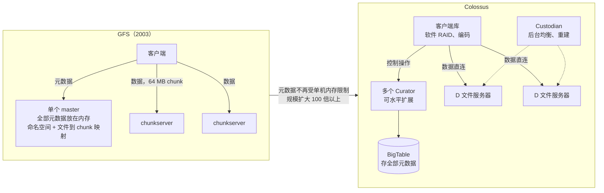

| 问题 | GFS | Colossus 的对应做法（博客） |
|------|-----|---------------------------|
| 元数据容量 | 单 master 内存决定文件数上限，文件越多越吃紧 | 元数据存 BigTable，Curator 可水平扩展 |
| 元数据可用性 | 单 master 故障切换期间不可用 | "更高可用的元数据子系统" |
| 编码与冗余 | 以副本为主 | 客户端库实现软件 RAID 和多种编码 |
| 后台任务 | 由 master 负责复制、均衡、GC | 独立的 Custodian |

**解读**：GFS 的单 master 设计在 2003 年是合理的简化（大文件、批处理、少量文件），但当 Gmail、搜索索引等应用带来海量小文件和低延迟需求时，单机内存和单点故障都成了硬约束。Colossus 的做法是把"元数据管理"从"一台机器的内存数据结构"变成"一个分布式表存储里的行"。这和 Tectonic 把元数据放进 ZippyDB、3FS 放进 FoundationDB 是同一思路。

---

## 3. Google 存储的三块基石

### 3.1 三个构件（2021 博客）

博客先介绍 Google 内部的分层：所有存储服务都由三个可扩展的基础服务构建。

| 构件 | 定位 |
|------|------|
| **Colossus** | 集群级文件系统，GFS 的继任者 |
| **Spanner** | 全球一致、可扩展的关系型数据库 |
| **Borg** | 可扩展的作业调度器，启动从计算到存储的所有服务；对 Kubernetes 的设计影响很大 |

当用户访问任一存储服务时：**Borg 分配所需资源，Spanner 保存关于访问权限和数据位置的全部元数据，Colossus 管理、存储并提供对全部数据的访问**。Firestore、Cloud SQL、Filestore、Cloud Storage 都是这样构建的。

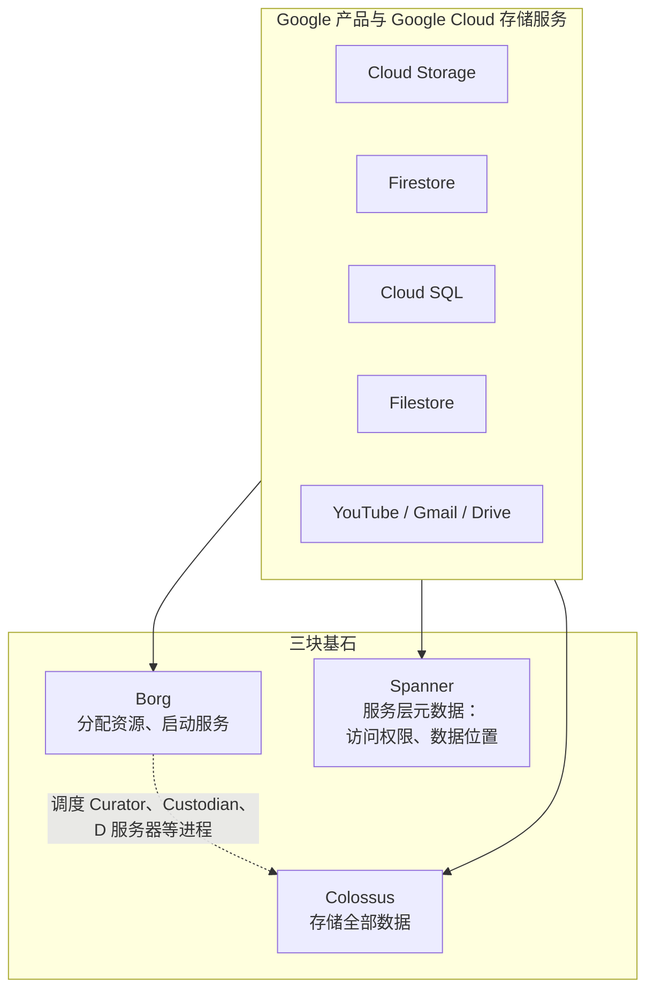

**解读**：

- 注意两层"元数据"的区别：**Spanner 存的是存储服务（如 Cloud Storage）的元数据**，例如对象名到 Colossus 文件的映射、访问权限；**BigTable 存的是 Colossus 文件系统自己的元数据**（§4.2）。混淆这两层是对 Colossus 最常见的误读，见 §11.1。
- Colossus 的组件本身也是 Borg 上的作业。这意味着存储服务可以像普通应用一样被调度、升级和扩缩容，这与传统存储系统"专用机器、专用部署"的做法不同。

---

## 4. Colossus 的五个组件

### 4.1 组件图（2021 博客图 1）

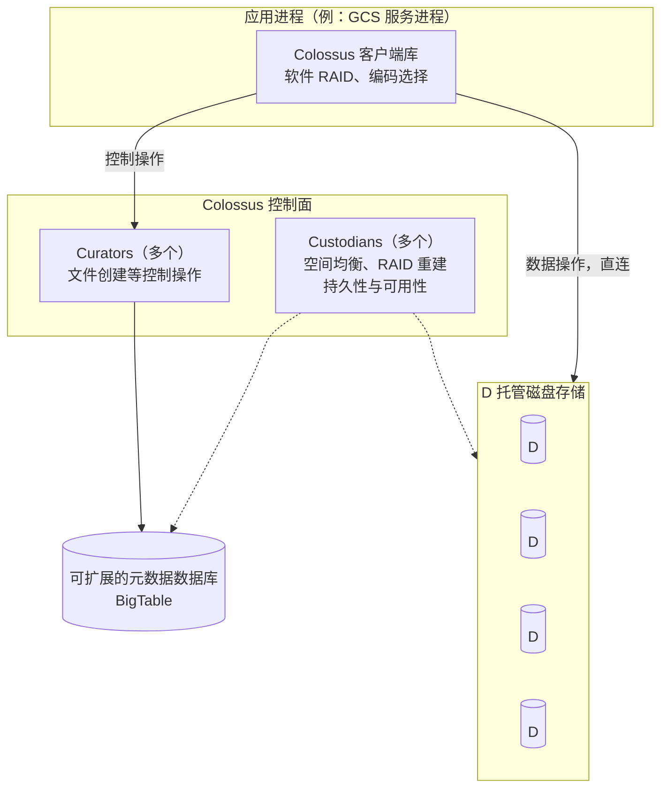

> 依据博客原图重绘。原图中 Custodian 与元数据库、D 存储之间没有画连线，图中虚线是本文根据 Custodian 的职责推断的。

### 4.2 逐个组件（2021 博客）

| 组件 | 博客原意 | 解读 |
|------|---------|------|
| **客户端库** | 应用和服务通过它与 Colossus 交互。它"可能是整个文件系统最复杂的部分"，包含软件 RAID 等大量按应用需求定制的功能。上层应用使用多种编码，在性能和成本之间为不同负载做精细权衡 | 冗余编码在客户端完成，存储节点只是"哑盘"。这和 Tectonic、盘古的重客户端一致：编码、并行写、重试都在客户端，数据路径上没有代理 |
| **Curator** | Colossus 的基础是可扩展的元数据服务，由许多 Curator 组成。客户端直接与 Curator 交互做文件创建等控制操作，Curator 可水平扩展 | Curator 本身大概率是无状态或弱状态的，状态都在 BigTable 里，所以才能水平扩展。博客没有说明文件如何分配到 Curator |
| **元数据库** | Curator 把文件系统元数据存在 BigTable（Google 的高性能 NoSQL 数据库）中，使规模比最大的 GFS 集群扩大 100 倍以上 | BigTable 按行键有序分区，天然适合存目录树（同目录下的文件行键相邻）。具体的表结构博客没有公开 |
| **D 文件服务器** | Colossus 尽量减少数据在网络上的跳数。数据直接在客户端和 "D" 文件服务器（网络挂载的盘）之间流动 | "D" 很可能取自 Disk。D 服务器只管盘上的数据块，不理解文件语义。2025 博客补充：D 服务器托管 HDD 或 SSD |
| **Custodian** | 后台存储管理器，负责维护数据的持久性、可用性和整体效率，处理磁盘空间均衡和 RAID 重建等任务 | 把后台任务从元数据路径中拆出来，前台控制操作的延迟就不会受重建、均衡等长时间任务影响。2025 SSD 博客把 Curator 和 Custodian 统称为"元数据服务" |

### 4.3 元数据的"自举"问题

BigTable 原本是构建在 GFS 之上的（BigTable 论文，OSDI 2006）；Colossus 时代，BigTable 运行在 Colossus 之上，而 Colossus 又把元数据存进 BigTable。这形成了一个循环：

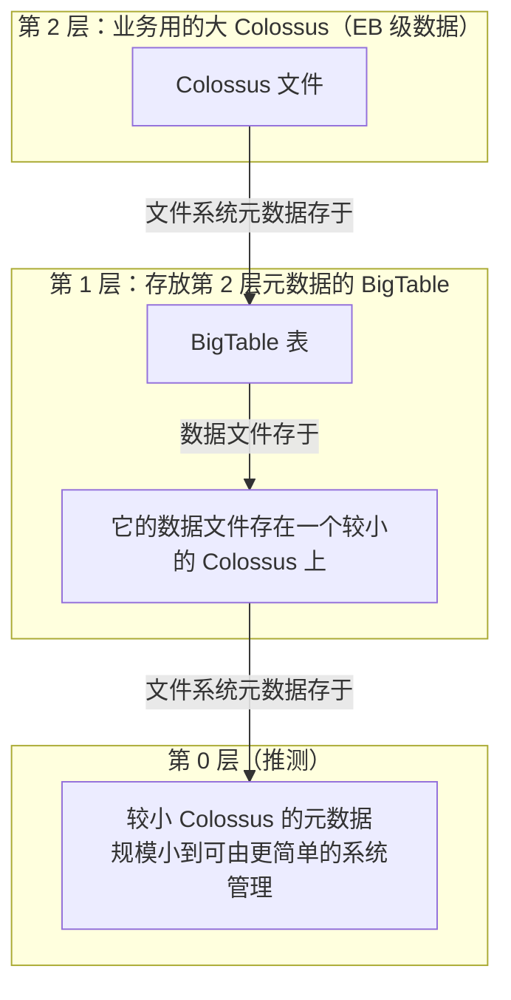

**解读（本文推测，博客未说明）**：

- 循环之所以能收敛，是因为每一层的元数据量远小于它所描述的数据量。一层 Colossus 的元数据存在 BigTable 里，这个 BigTable 的数据文件又存在一个更小的 Colossus 里，后者的元数据小到可以放在更简单的系统里（业界公开讨论中常提到 Chubby）。只需几层，元数据就小到可以由单机或简单的复制状态机管理。
- 这种设计的好处是**复用**：BigTable 已经解决了分区、负载均衡、故障恢复，Colossus 不必为元数据再造一套。代价是**依赖链变长**：BigTable 的故障会影响 Colossus 的元数据操作，而 BigTable 又依赖 Colossus 存数据，故障排查和启动顺序都更复杂。
- Tectonic 和 3FS 都选择了**不递归**的方式：元数据存在独立的 KV 系统（ZippyDB、FoundationDB）上，这些 KV 系统用本地盘而不是 Tectonic/3FS 本身。

---

## 5. 典型集群：一个共享存储池

### 5.1 一个集群上的多种负载（2021 博客图 2）

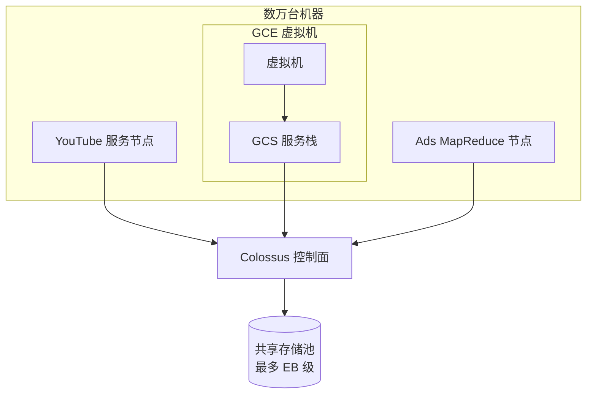

博客以 Cloud Storage 为例：Compute Engine 虚拟机访问 Cloud Storage、YouTube 服务节点、Ads MapReduce 节点**共享同一个底层文件系统**来完成请求。

- 单个 Colossus 集群可扩展到 **EB 级存储、数万台机器**。
- 关键是由 Colossus 控制面管理的**共享存储池**，同时让每个应用都"感觉自己拥有一个隔离的文件系统"。

### 5.2 资源解耦的收益（2021 博客）

资源解耦（disaggregation）让宝贵资源得到更高效的使用，降低所有负载的成本。例如，可以为 YouTube 视频这类低延迟负载**按峰值配置资源**，再让批处理分析负载**填补空闲时段**，从而更便宜地运行。

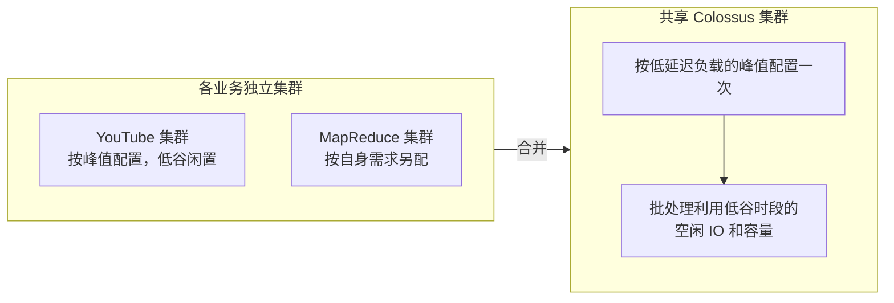

**解读**：

- 这与 [Tectonic](tectonic-fast2021.md) 的核心论点完全相同：Meta 把 Haystack、f4、HDFS 等多个专用集群合并成一个多租户 Tectonic 集群，靠的也是"不同负载的峰谷互补"。Tectonic 论文给出了详细的租户隔离机制（流量组、全局与本地限流），Colossus 博客只说了结论。
- "每个应用感觉拥有隔离的文件系统"需要强有力的**性能隔离**，否则批处理会拖慢 YouTube。博客没有描述隔离机制，§6 的"服务层级 + 抽象资源单位"可能是其中一部分。

---

## 6. 屏蔽硬件复杂性

### 6.1 服务层级（2021 博客）

- Google 服务的文件系统要满足非常高的吞吐和扩展要求，要处理**多 TB 的文件**和海量数据集。
- Google 数据中心的存储硬件种类繁多：各种尺寸和型号的机械盘与 flash 混在一起；应用对持久性、可用性和延迟的要求也千差万别。
- Colossus 提供一系列**服务层级**：应用声明自己对 IO、可用性和持久性的要求，然后以**抽象、无差别的单位（字节和 IO）**申请资源。

**解读**：把资源单位定义为"字节 + IO"而不是"多少块盘"，是 Colossus 能做冷热分层（§7）和共享存储池（§5）的前提：应用只关心自己买到了多少容量和多少 IO，至于这些 IO 由 flash 还是 HDD 提供、数据放在哪些盘上，由 Colossus 决定。这和云上"按容量 + IOPS 计费"的产品形态一脉相承。

### 6.2 故障是常态（2021 博客）

- 在 Google 的规模下，硬件"几乎一直在出故障"。这不是因为硬件不可靠，而是因为数量太多。
- 文件系统必须提供容错和透明恢复。Colossus **让 IO 绕开故障**，并做**快速后台恢复**，以提供高持久、高可用的存储。

**解读**："让 IO 绕开故障"对应客户端库的职责（编码后可以从剩余分片重建数据，读请求避开故障节点），"快速后台恢复"对应 Custodian 的 RAID 重建。博客没有给出恢复速度、编码参数等任何数字。

---

## 7. 存储效率：flash 与 HDD 的配比

### 7.1 flash 与磁盘各买多少（2021 博客）

Colossus 利用数据访问模式和频率差异很大（有频繁访问的热数据）这一事实，混合使用 flash 和磁盘：

- **最热的数据放在 flash 上**，以更高效地提供服务、降低延迟。
- **flash 只买到足以把每 GB 的 IO 密度压到磁盘通常能提供的水平，磁盘只买到足以保证容量**。配比合适时，存储效率最大化，避免浪费性的超配。

**解读（配比逻辑）**：可以把这句话理解为一个两约束问题。设集群数据总量为 C（GB），总 IO 需求为 I（IOPS），HDD 每 GB 能提供的 IO 密度为 d_hdd（IOPS/GB）。

| 约束 | 含义 |
|------|------|
| 容量 | HDD 总容量 ≥ C（大部分数据放在 HDD 上） |
| IO | flash 吸收的 IO ≥ I − d_hdd × C |

如果全部用 HDD，IO 需求 I 往往远大于 d_hdd × C，只能为了 IO 多买磁盘、浪费容量；如果全部用 flash，容量成本太高。最优点是：**HDD 按容量买，flash 按"超出 HDD 能力的那部分 IO"买**。热数据集中在少量数据上，所以少量 flash 就能吸收大部分 IO。2025 年的 L4 缓存（§8）就是自动找出这"少量热数据"的机制。

### 7.2 让磁盘又满又忙（2021 博客）

- 对基于磁盘的存储，Colossus 希望磁盘**既满又忙**，以避免多余的库存和浪费磁盘 IOPS。
- 为此 Colossus 用智能磁盘管理尽可能榨取可用的磁盘 IOPS：**新写入的数据（更热的数据）均匀分布在集群所有磁盘上**；随着数据变老、变冷，再**重新均衡并迁移到更大容量的磁盘上**。
- 这对分析类负载效果很好，因为这类数据通常随时间变冷。

**解读**：

- 大容量 HDD 的 IOPS 和小容量 HDD 差不多，所以每 GB 的 IO 密度更低。把热数据打散到所有盘上，是为了**用全部磁盘的 IOPS 服务热数据**；把冷数据集中到大盘上，是为了**让大盘贡献容量而不是 IO**。这样每块盘都能同时接近"满"和"忙"。
- 博客没有说明执行迁移的是哪个组件，按职责推断应是 Custodian（"磁盘空间均衡"）。

---

## 8. 2025 续篇一：SSD 放置与 L4 缓存

> 本节依据 2025 SSD 博客。

### 8.1 先补上的背景信息

2025 SSD 博客在开头补充了 2021 博客没写的几点：

| 信息 | 内容 |
|------|------|
| 范围 | 传统的 Colossus 文件系统**限定在单个数据中心**内；Colossus 是 **zonal** 产品，每个集群一个文件系统，而集群是 Google Cloud zone 的内部构件。大多数数据中心只有一个集群，因此只有一个 Colossus |
| 语义 | 把 GFS 的编程模型简化为**只追加**的存储系统 |
| 角色 | Curator 处理文件创建、删除等交互式控制操作；Custodian 维护持久性、可用性和磁盘空间均衡；客户端从 Curator 拿元数据后，直接把数据存到托管 HDD 或 SSD 的 D 服务器上 |
| 规模 | 很多 Colossus 文件系统有多个 EB；有两个文件系统各超过 10 EB |
| 吞吐 | 最大的几个文件系统经常超过**读 50 TB/s、写 25 TB/s** |
| IOPS | 最忙的单个集群读写合计超过 **6 亿 IOPS**；很多应用做的是小日志追加或小随机读 |

**不同产品对 Colossus 的需求差异很大**（2025 SSD 博客表格）：

| 应用 | IO 大小 | 期望性能 |
|------|--------|---------|
| BigQuery 扫描 | 几百 KB 到几十 MB | TB/s |
| Cloud Storage 标准层 | KB 到几十 MB | 几百毫秒 |
| Gmail 邮件 | 小于几百 KB | 几十毫秒 |
| Gmail 附件 | KB 到 MB | 秒级 |
| Hyperdisk 读 | KB 到几百 KB | <1 ms |
| YouTube 视频存储 | MB | 秒级 |

公开产品中的例子：Hyperdisk ML 用 Colossus SSD 支持 2,500 个节点以 1.2 TB/s 读取；Spanner 的分层存储在同一个文件系统里同时使用廉价 HDD 和高速 SSD；Cloud Storage 用 Colossus SSD 缓存支撑 AI/ML 应用的密集 IO；BigQuery 基于 Colossus 提供极快的大查询 IO。

**解读**：50 TB/s 的读吞吐，按 10 EB 计算，相当于每天能把全部数据读约 0.43 遍（50 TB/s × 86,400 s ≈ 4.3 EB）。如果这些 IO 全落在 HDD 上，需要的磁盘数量远超容量所需。这就是 SSD 放置和缓存必不可少的原因。

### 8.2 三种把数据放到 SSD 的方式

| 方式 | 做法 | 代价 |
|------|------|------|
| 强制放 SSD | 在路径中指定，如 `/cns/ex/home/leg/partition=ssd/myfile`，整个文件存在 SSD 上 | 最简单，也最贵 |
| 混合放置 | `/cns/ex/home/leg/partition=ssd.1/myfile`，只把**一个副本**放在 SSD 上 | 更便宜；但存 SSD 副本的 D 服务器不可用时，访问退化为 HDD 延迟 |
| L4 | 新的分布式 SSD 缓存技术，自动挑选最适合放 SSD 的数据 | Google 大部分数据采用这种方式 |

**解读**：路径中的 `/cns/` 前缀说明 Colossus 的命名空间是 Google 内部的 CNS 路径体系，放置策略作为路径的一部分表达，而不是通过单独的 API 或扩展属性。混合放置利用了多副本的特性：读请求优先走 SSD 副本，持久性仍由 HDD 副本保证。

### 8.3 L4 读缓存

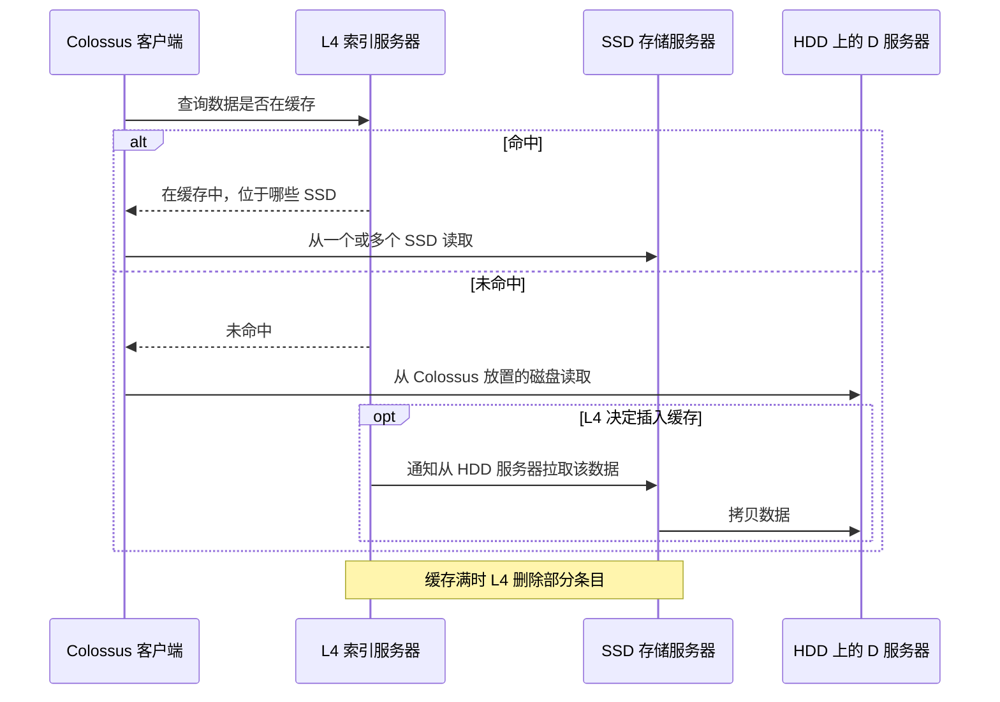

- L4 可以更激进或更保守地往 SSD 放数据。它用 **ML 驱动的算法**为每类负载在几种策略之间选择：**写入时插入**、**第一次读后插入**、**短时间内第二次读后才插入**。方法见 CacheSack 论文（ATC 2022）。
- 弱点：**新数据仍然先写到 HDD**。对两类数据效果不好：① 写入后很快被读取并删除的数据（如大批处理作业的中间结果）；② 数据库事务日志等频繁做小追加的文件。这两类负载都不适合 HDD，最好直接写到 SSD、完全跳过 HDD。

### 8.4 L4 写回放置

内部用户自己决定哪些文件放 SSD、买多少 SSD 配额、何时把旧文件迁回 HDD，这很难做对。L4 因此扩展为**写回缓存**：在新文件创建时建议 Curator 是否把它放到 SSD、放多久。

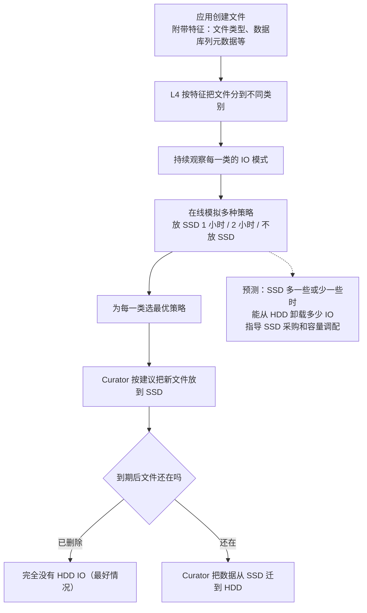

- 难点在于：文件创建时，Colossus 只知道创建它的应用和文件名，并不确定它将如何被使用。
- 解决办法与 L4 读缓存相同（CacheSack 方法）：按应用传入的特征把文件分类，观察每类的 IO 模式，对不同放置策略做在线模拟，为每类选最优策略。
- 在线模拟还能预测"SSD 容量更多或更少时 L4 会怎么选"，从而估算不同 SSD 数量能从 HDD 卸载多少 IO。这些信号驱动 SSD 硬件采购，并指导在应用之间调配 SSD 容量。
- 预测准确时，一小部分数据放在 SSD 上，吸收大部分读（读往往发生在文件刚创建后），再迁移到便宜的存储上。最好的情况是文件在迁移前就被删除，完全避免了 HDD IO。

**解读**：

- L4 把 2021 博客里"最热数据放 flash"的原则变成了可执行的系统：读缓存解决"读热的老数据"，写回放置解决"刚写就读、很快就删"的新数据。
- 最值得借鉴的是**在线模拟同时服务于运行时决策和容量规划**：同一套模型既决定每类文件的放置策略，又回答"多买多少 SSD 值得"。这把 §7.1 的配比问题从人工估算变成了数据驱动。
- 与 [Tectonic-Shift](tectonic-shift-atc2023.md) 对比：两者都是在 HDD 存储前加 flash 层吸收 IO，Shift 只做读缓存、并利用 ML 训练作业规格预测未来访问；L4 既做读缓存也做写入放置，信号来自文件特征和历史 IO 统计。

---

## 9. 2025 续篇二：有状态协议与 Rapid Storage

> 本节依据 2025 Rapid 博客。

### 9.1 handle：打开一次，之后直连磁盘

Colossus 客户端创建或读取文件时，先**打开文件并拿到一个 handle**。handle 是一组状态，包含该文件存储方式的全部信息，包括**数据存在哪些磁盘上**。之后读写都用这个 handle，通过一种优化过的、类 RDMA 的网络协议**直接和磁盘通信**（博客提到其网络系统 Snap 的论文，SOSP 2019）。

### 9.2 低延迟持久追加

handle 也支持**超低延迟的持久追加**，对数据库和流式分析尤其有用：

- Spanner 和 BigTable 都把事务写进日志文件，日志需要持久存储，并且处于数据库写操作的关键路径上。
- BigQuery 支持向表中流式写入，同时大规模并行批作业在计算刚摄入的数据。

这些应用以**追加模式**打开 Colossus 文件，客户端库用 handle 把数据直接写到网络上的磁盘。为保证持久性，Colossus 把数据复制到多块盘上，**并行写入，并用 quorum 技术避免等待慢盘**。

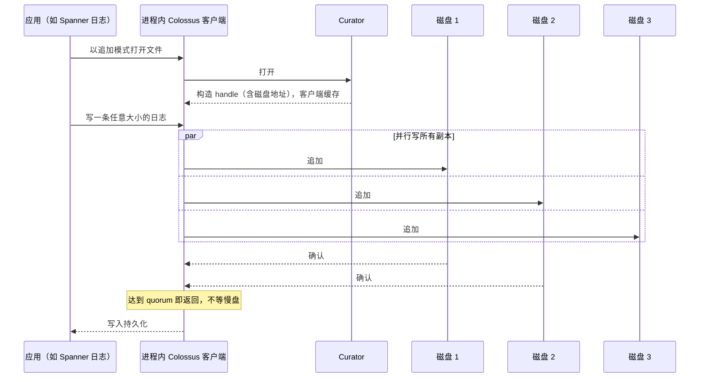

> 博客原图只画了步骤 1–3（打开、写调用、并行写所有磁盘）；"达到 quorum 即返回"按正文文字补画，quorum 的具体大小博客没有说明。

**解读**：quorum 写与盘古的 chasing（3 副本写成 2 个就返回，见 [盘古精读 §5.1](pangu-fast2023.md#51-chasing写成大多数就返回论文图-4)）、Tectonic 的 quorum append 是同一类技术。区别在于博客没有说明没写成功的副本如何补齐。

### 9.3 Rapid Storage：把有状态协议开放给 GCS

Cloud Storage 一向使用**无状态的 REST 协议**，简单且易扩展，但在 AI 和数据密集型负载下有两个障碍：**延迟较高**、**缺乏面向文件的语义**。Rapid Storage 增加了**基于 gRPC 的有状态流式协议**：

| 方面 | 做法 |
|------|------|
| 建流 | 客户端建立一个流，携带与 REST 相同的请求参数（bucket、对象名）；用户鉴权、元数据访问等耗时操作**前置到建流时**完成 |
| 后续读写 | 直接到 Colossus，没有额外开销；支持可追加写和重复的范围读，**亚毫秒级延迟** |
| 规模 | 单个 bucket 支持每秒 **2,000 万次请求** |
| 追加 | 持久写亚毫秒级；单个对象可无限次追加，直到对象大小上限 |
| 断流恢复 | 建流时客户端从 GCS 拿到 handle；流中断后可以用 handle 重新建流继续读写 |
| 单写者 | 同一时刻只允许一个 gRPC 流写一个对象；新流接管所有权，**事务性地锁住**之前的流 |
| 偏移校验 | 每次追加都带上写入偏移，即使出现网络分区和请求重放也能保证数据正确 |
| 生态 | SDK 支持 gRPC 流式追加；集成到 Cloud Storage FUSE；zonal bucket 原生支持分层命名空间 |

**所有权接管**的过程（博客图 2）：

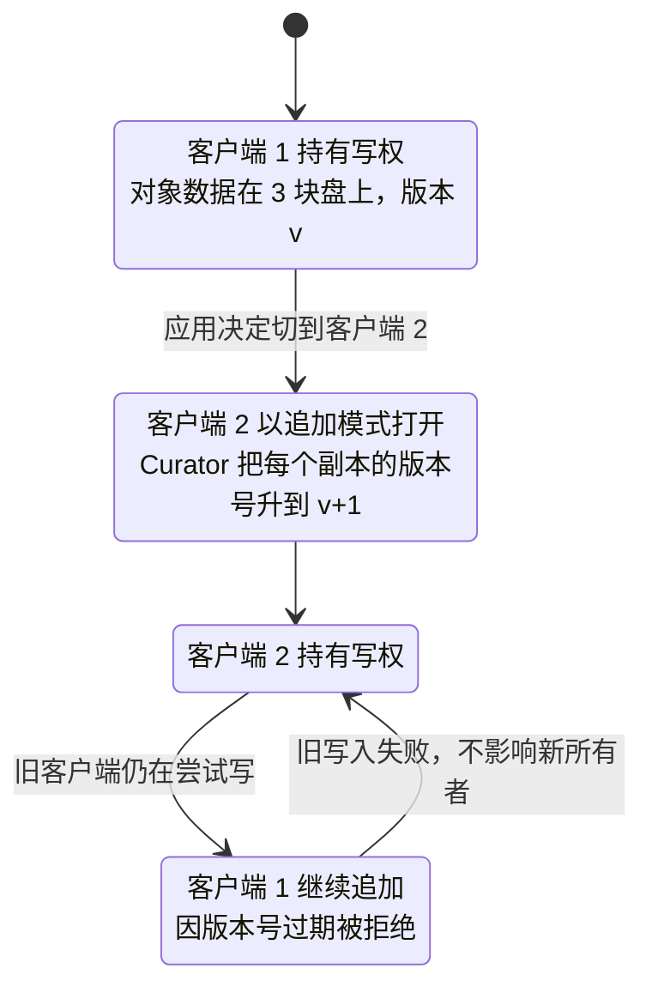

**解读**：

- 版本号隔离（fencing）是分布式系统中防止"旧主"写入的标准做法。这里的关键是版本号存在**每个数据副本**上，由 Curator 在接管时统一提升，所以旧客户端即使绕过 Curator、拿着缓存的 handle 直连磁盘，也会被磁盘拒绝。这正是"客户端直连存储"架构下保证单写者的必要条件。
- Rapid Storage 的意义在于：Colossus 内部早已具备的"有状态、直连、可追加"能力，第一次直接暴露给云客户。对象存储因此有了接近块存储的延迟和文件式的追加语义，面向的是 AI 训练的随机范围读、checkpoint 写入等场景。
- 这也从侧面证实了 Colossus 的语义：**只追加 + 单写者 + 客户端直连**，与 Tectonic 的"每个文件只有一个写者"、盘古的 FlatLogFile 一致。

---

## 10. 公开数字汇总

| 数字 | 出处 | 条件或说明 |
|------|------|-----------|
| 规模比最大的 GFS 集群扩大 100 倍以上 | 2021 博客 | 未说明是文件数、容量还是元数据操作量 |
| 单集群 EB 级、数万台机器 | 2021 博客（文字和图 2："Up to EiB(s) of storage"） | — |
| 很多文件系统多 EB；两个超过 10 EB | 2025 SSD 博客 | 每个集群一个文件系统 |
| 读 >50 TB/s、写 >25 TB/s | 2025 SSD 博客 | 最大的几个文件系统"经常"达到 |
| 读写合计 >6 亿 IOPS | 2025 SSD 博客 | 最忙的单个集群 |
| Hyperdisk ML：2,500 节点、1.2 TB/s | 2025 SSD 博客 | 使用 Colossus SSD |
| Rapid Storage：单 bucket 每秒 2,000 万请求，亚毫秒读写 | 2025 Rapid 博客 | 有状态 gRPC 流 |

**解读**：

- 所有数字都没有给出测试条件、时间窗口和硬件配置。"50 TB/s"按"超过 100 部 8K 电影每秒"来类比，属于营销表述。
- 博客从未给出任何**延迟分布、元数据操作吞吐（ops/s）、故障恢复速度、编码参数、存储开销**。对比 Tectonic 论文给出的元数据 QPS、尾延迟和存储开销，Colossus 公开资料的技术可验证性要弱得多。

---

## 11. 公开资料的空白与矛盾

### 11.1 元数据存在 BigTable 还是 Spanner？

| 资料 | 说法 |
|------|------|
| 2021 博客 | Curator 把文件系统元数据存在 **BigTable** |
| 2021 博客（同文另一段） | Spanner 存储（各存储服务的）访问权限和数据位置元数据 |
| Tectonic 论文（FAST 2021，§7 相关工作） | "Colossus uses **Spanner**, a globally consistent database to store filesystem metadata" |

**解读**：以 Google 官方博客为准，Colossus 文件系统元数据存在 BigTable。Tectonic 论文的说法很可能混淆了两层元数据：Spanner 存的是 Cloud Storage 等**上层服务**的元数据。这一点在本仓库的 [Tectonic 精读](tectonic-fast2021.md) 中按论文原文转述，已加注说明。

### 11.2 博客没有回答的问题

| 问题 | 现状 |
|------|------|
| 一致性模型 | 2021 博客只字未提；2025 年才说明只追加、单写者、版本号隔离 |
| 元数据如何在 Curator 之间分配 | 未说明 |
| BigTable 与 Colossus 的循环依赖如何引导 | 未说明（§4.3 为本文推测） |
| 编码方式 | 只说"软件 RAID""多种编码"，没有参数（副本数、RS 参数等） |
| chunk/块的大小和布局 | 未说明 |
| 故障检测与恢复速度 | 只说"快速后台恢复" |
| 多租户性能隔离 | 只说"每个应用感觉拥有隔离的文件系统" |
| 跨集群/跨地域 | 2025 年说明单个 Colossus 限定在一个数据中心（zonal）；跨区域复制显然由上层服务完成，但博客未说明 |

### 11.3 其他细节

- **"客户端是最复杂的部分"**与"Curator 是 Colossus 的基础"两句话并不矛盾，但说明 Colossus 的复杂度主要在客户端：编码、并行写、quorum、handle 管理、L4 查询都在客户端库里。这对客户端的升级和多语言支持是很大的负担（参见 [Fisc 精读](fisc-fast2023.md) 对重客户端的批评）。
- 2021 博客图 2 标注 "Up to EiB(s)"（二进制单位），正文写 "exabytes"（十进制）；2025 年写 "10 exabytes"。量级一致，单位口径不统一。
- 2021 博客把 BigTable 写作 "BigTable"，Google 的正式产品名是 "Bigtable"，属于笔误级差异。

---

## 12. 与相关系统的对比

| 维度 | GFS（SOSP 2003） | Colossus（博客） | Tectonic（FAST 2021） | 盘古 2.0（FAST 2023） | 3FS（2024–2025） |
|------|----------------|-----------------|---------------------|--------------------|----------------|
| 元数据服务 | 单 master，全内存 | 多个 Curator | 无状态 Name/File/Block 层 | master（Raft），命名空间与 stream 分离 | 无状态 meta service |
| 元数据存储 | master 内存 + 操作日志 | **BigTable**（自身跑在 Colossus 上） | ZippyDB（分片 KV） | master 自身 | FoundationDB |
| 后台任务 | master | **Custodian**（独立组件） | 后台服务（rebalancer、repairer 等） | GCWorker 等 | cluster manager、存储服务 |
| 客户端 | 轻客户端 + chunkserver 间流水线复制 | 重客户端，软件 RAID | 重客户端库 | 重客户端 | 客户端直连，FUSE 或原生 |
| 数据语义 | 追加为主，支持随机写 | 只追加，单写者 | 只追加，单写者 | 只追加 | 随机读写 |
| 冗余 | 3 副本 | 多种编码（未公开参数） | 副本与 RS 按租户选 | 3 副本 → EC | 链复制（副本） |
| flash 使用 | — | 热数据放 flash，L4 缓存与写回 | Tectonic-Shift 做读缓存 | 全 SSD | 全 NVMe |
| 规模 | 数百 TB 到 PB | 单集群 >10 EB | 单集群 EB 级 | EB 级（全局） | 单集群数十 PB |
| 公开程度 | 论文 | 博客 | 论文 | 论文 | 论文 + 开源 |

**解读**：

- 从 GFS 到 Colossus、再到 Tectonic 和盘古，业界的共识越来越清晰：**元数据存进可扩展的数据库、冗余编码交给客户端、后台任务独立、多业务共享一个大集群**。Colossus 是最早落地这一模式的系统，但因为没有论文，很多细节要从后来者的论文里"反推"。
- Colossus 与其他系统最大的差异是**元数据递归地存在自己之上**（BigTable on Colossus），以及**以 flash + HDD 混合为前提的成本优化**（L4）。3FS 和盘古 2.0 走全闪路线，不需要 L4 这样的分层；Tectonic 与 Colossus 一样以 HDD 为主，所以有了 Tectonic-Shift。

---

## 13. 整体总结

### 13.1 核心要点

1. **元数据可扩展**：用多个 Curator + BigTable 取代 GFS 单 master，规模提升 100 倍以上。这是 Colossus 诞生的直接原因。
2. **职责分离**：客户端库负责编码和数据路径，Curator 负责前台控制操作，Custodian 负责后台维护，D 服务器只负责存盘。数据不经过任何中间节点。
3. **共享存储池**：一个集群承载 YouTube、GCE、MapReduce 等所有负载，靠峰谷互补提高利用率，同时给每个应用提供"隔离文件系统"的体验。
4. **以成本为中心的介质配比**：flash 按超出 HDD 能力的 IO 来买，HDD 按容量来买；新数据打散到所有盘，冷数据迁到大盘；2025 年用 L4 自动化读缓存和写回放置，并用在线模拟指导 SSD 采购。
5. **有状态、直连、可追加**：打开文件拿 handle，之后直连磁盘；并行写副本、quorum 返回；版本号保证单写者。2025 年通过 Rapid Storage 开放给云客户。

### 13.2 设计哲学

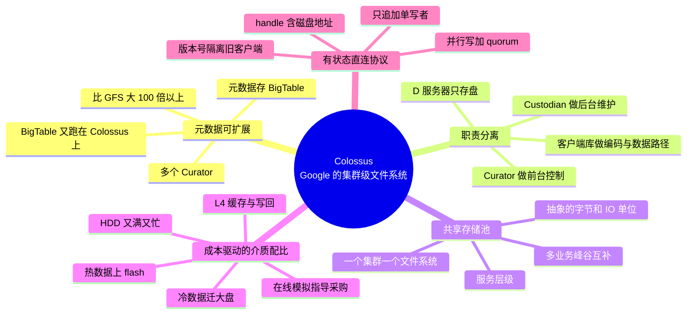

### 13.3 价值与局限

| 价值 | 局限 |
|------|------|
| 唯一的官方架构说明，给出了五个组件的分工和元数据存于 BigTable 的事实 | 不是论文，没有评审、实验和数据，所有说法无法独立验证 |
| "flash 按 IO、HDD 按容量"的配比原则简洁有力，2025 年的 L4 给出了自动化实现 | 2021 博客没有一致性模型、编码参数、恢复流程、隔离机制等关键细节 |
| 2025 年两篇续篇补充了规模数字、只追加语义和客户端协议，三篇合读可以拼出较完整的轮廓 | 元数据递归存储的引导方式、Curator 的分区方式完全没有公开 |
| 与 GFS、Tectonic、盘古放在一起，可以清晰看到分布式文件系统近二十年的演进路线 | 第三方论文（如 Tectonic）对 Colossus 的描述与官方博客存在出入，引用时需核对 |

### 13.4 启示

**对存储系统设计者**：

- **元数据不要自己造轮子**：把元数据存进成熟的分布式数据库，让元数据服务本身尽量无状态，是从 Colossus 到 Tectonic、3FS 一再被验证的做法。
- **前台和后台要分开**：Curator 与 Custodian 的划分，让元数据操作的延迟不受重建、均衡等长任务影响。
- **混合介质要按 IO 和容量两个约束分别配**：先算 HDD 按容量能提供多少 IO，缺口再用 flash 补；用访问特征分类和在线模拟决定哪些数据放 flash、放多久，并把同一套模型用于容量规划。
- **客户端直连架构下，单写者要靠存储端的版本号保证**，不能只靠元数据服务。

**对读资料的人**：

- 对没有论文的系统，**官方博客的结构性说法比第三方转述更可靠**，第三方论文的相关工作段落也可能出错（Spanner vs BigTable 就是一例）。
- 同一系统的不同年份资料要合读：2021 年没写的只追加语义、zonal 定位和协议细节，2025 年才补上。

### 13.5 一张图看懂 Colossus

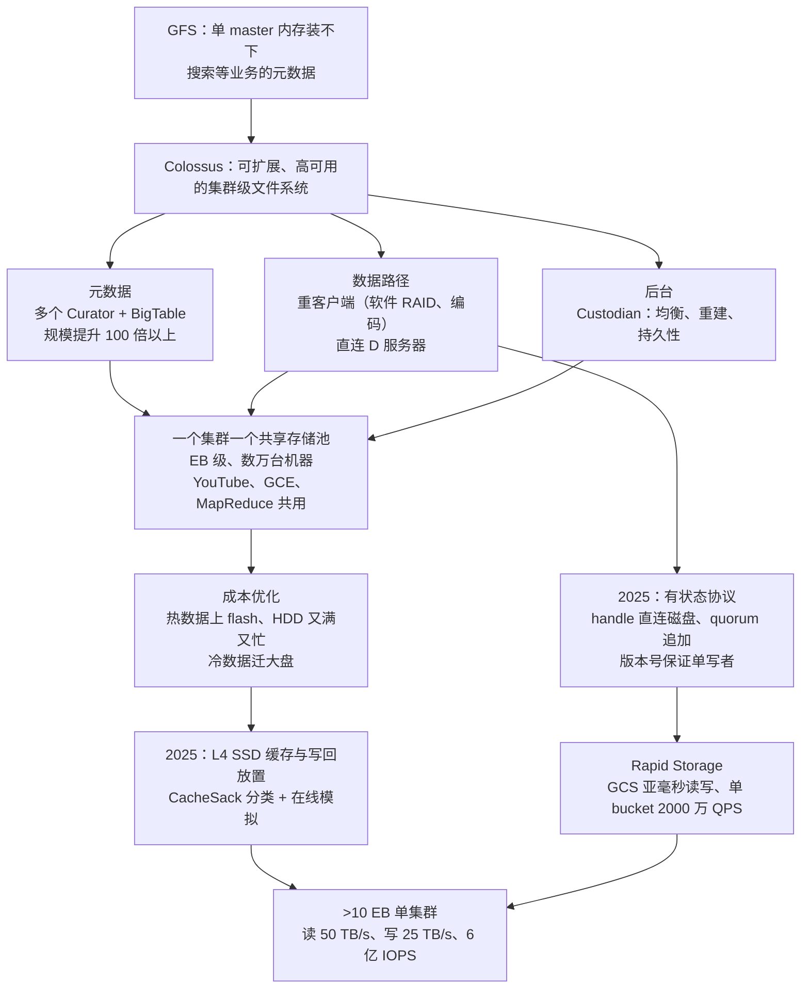

---

## 参考

- Dean Hildebrand, Denis Serenyi. *A peek behind Colossus, Google's file system*. Google Cloud Blog, 2021-04-19. <https://cloud.google.com/blog/products/storage-data-transfer/a-peek-behind-colossus-googles-file-system>
- Larry Greenfield, Seth Pollen. *Colossus under the hood: How we deliver SSD performance at HDD prices*. Google Cloud Blog, 2025-03-26. <https://cloud.google.com/blog/products/storage-data-transfer/how-colossus-optimizes-data-placement-for-performance>
- Denis Serenyi, Vivek Saraswat. *Colossus: the secret ingredient in Rapid Storage's high performance*. Google Cloud Blog, 2025-04-10. <https://cloud.google.com/blog/products/storage-data-transfer/how-the-colossus-stateful-protocol-benefits-rapid-storage>
- The Register 对 2025 SSD 博客的报道：*Even Google struggles to balance fast-but-pricey flash and cheap-but-slow hard disks*, 2025-03-27. <https://www.theregister.com/2025/03/27/google_l4_storage_performance_improvements/>
- Sanjay Ghemawat, Howard Gobioff, Shun-Tak Leung. *The Google File System*. SOSP 2003.
- Kirk McKusick, Sean Quinlan. *GFS: Evolution on Fast-forward*. ACM Queue, 2009.
- Fay Chang et al. *Bigtable: A Distributed Storage System for Structured Data*. OSDI 2006.
- Tzu-Wei Yang et al. *CacheSack: Admission Optimization for Google Datacenter Flash Caches*. USENIX ATC 2022.
- Michael Marty et al. *Snap: a Microkernel Approach to Host Networking*. SOSP 2019.
- Satadru Pan et al. *Facebook's Tectonic Filesystem: Efficiency from Exascale*. USENIX FAST 2021.（§7 相关工作中关于 Colossus 使用 Spanner 的说法）
- 本仓库相关：[工业界生产系统](industry-production-systems.md)、[Tectonic 精读](tectonic-fast2021.md)、[Tectonic-Shift 精读](tectonic-shift-atc2023.md)、[盘古 2.0 精读](pangu-fast2023.md)、[3FS 精读](3fs-fireflyer-sc2024.md)、[Fisc 精读](fisc-fast2023.md)
