# DAOS 论文精读：A Scale-Out High Performance Storage Stack for Storage Class Memory（SCFA 2020）

> 论文：Zhen Liang, Johann Lombardi, Mohamad Chaarawi, Michael Hennecke. *DAOS: A Scale-Out High Performance Storage Stack for Storage Class Memory*. In: D. K. Panda (Ed.), Supercomputing Frontiers（SCFA 2020），LNCS 12082, pp. 40–54, Springer, 2020。开放获取（CC BY 4.0）。
>
> 机构：Zhen Liang（Intel China，北京）、Johann Lombardi（Intel Corporation SAS，法国 Meudon）、Mohamad Chaarawi（Intel，美国 Austin）、Michael Hennecke（**Lenovo** Global Technology Germany，Essen）。
>
> 链接：<https://doi.org/10.1007/978-3-030-48842-0_3> ；代码：<https://github.com/daos-stack/daos>
>
> 篇幅：15 页（含 7 张图，无表格）。全文以架构介绍为主，评估只有 IO500 SC19 榜单结果。
>
> 精读日期：2026-11-23。文中**数字、图表与机制描述均摘自论文原文**（标注所在章节）；标注"解读"的段落是本文作者的分析与推论，不是论文原话。图 6、图 7 只有柱状图、没有数值标注，文中给出的数值是按坐标轴**读图估计**的，误差约 ±5%。
>
> 相关文档：[新硬件综述中的 DAOS 小节](new-hardware.md#8-daos面向-scmnvme-的用户态-scale-out-存储栈及其后-pm-时代演进)、[HPC 与 AI 存储综述中的 DAOS 小节](hpc-ai-storage.md#22-daos-a-scale-out-high-performance-storage-stack-for-storage-class-memory)、[3FS / Fire-Flyer 精读](3fs-fireflyer-sc2024.md)（另一套全用户态、客户端直连存储节点的系统）。

## 目录

- [0. 一页速览](#0-一页速览)
- [1. 问题：传统并行文件系统为何吃不到新硬件的红利](#1-问题传统并行文件系统为何吃不到新硬件的红利)
- [2. 系统架构：三块基石，全程用户态](#2-系统架构三块基石全程用户态)
- [3. I/O 服务：Argobots 用户级线程与轮询](#3-io-服务argobots-用户级线程与轮询)
- [4. 对象标识与算法放置](#4-对象标识与算法放置)
- [5. 数据保护与恢复](#5-数据保护与恢复)
- [6. 数据模型与中间件](#6-数据模型与中间件)
- [7. POSIX 支持：libdfs、dfuse 与拦截库](#7-posix-支持libdfsdfuse-与拦截库)
- [8. 评估：IO500 SC19](#8-评估io500-sc19)
- [9. 论文的不一致与留白](#9-论文的不一致与留白)
- [10. 整体总结](#10-整体总结)
- [参考](#参考)

---

## 0. 一页速览

**一句话**：DAOS（Distributed Asynchronous Object Storage）是 Intel 主导的开源分布式对象存储，从零开始为 **SCM（Optane 持久内存）+ NVMe SSD** 设计。I/O 路径全程在用户态、不做系统调用：元数据、索引和小 I/O 经 PMDK 用 load/store 直接写持久内存，大 I/O 经 SPDK 写 NVMe，网络经 Mercury/libfabric 轮询。服务端每个请求一个 Argobots 用户级线程。对象布局由 128 位对象 ID 算出来，不存布局元数据。POSIX 只是建在对象 API 之上的一个中间件库。论文用 IO500 SC19 证明了这套栈：10 节点挑战榜第 1，"hard" 与 "easy" 负载的性能非常接近。

| 维度 | 要点 |
|------|------|
| 要解决的问题 | 传统并行文件系统建在块设备和内核块 I/O 栈上，为磁盘设计的调度、合并、缓存、分布式锁，加上中断与多线程带来的上下文切换，在 3D-XPoint 和高速网络面前变成"纯开销"（§2） |
| 三块基石 | ① 持久内存 + PMDK：存全部内部元数据、应用 key 索引、延迟敏感的小 I/O；② NVMe + SPDK：大 I/O 及延迟要求不高的小 I/O；③ libfabric + Mercury：网络传输，轮询而非中断（§3.1，图 1） |
| 服务端并发 | 每个到达的 I/O 请求创建一个 Argobots ULT；ULT 在 I/O 未完成时主动让出，由负责轮询网络和 SPDK 的系统 ULT 唤醒。单个 xstream 每秒可创建数百万 ULT、做超过一千万次上下文切换（§3.2，图 2） |
| 放置 | 对象只由 128 位 ID 标识，其中少数位编码分布与保护策略（副本或 EC、条带数），其余位作伪随机种子，结合池配置**算出**布局；思路类似 Ceph，但不用 CRUSH（§3.3） |
| 副本 | primary 只转发 RPC，**所有副本直接 RDMA 从客户端缓冲区拉数据**；变种两阶段提交，失败节点被踢出事务、换算法选出的替补继续推进，不等待恢复（§3.3，图 3a） |
| 纠删码 | 客户端算校验；非整条带写不做读-改-写，而是把部分写**复制**到校验节点，凑满整条带或超时后再合并编码（§3.3，图 3b） |
| 完整性 | 服务崩溃靠 SWIM 检测，SSD 故障靠 SPDK 轮询设备状态，介质静默损坏靠端到端校验和；故障上报给基于 Raft 的 pool service，由它触发全池去中心化重建（§3.3） |
| 数据模型 | pool → container → object；对象分 KV（含多级 KV）和数组两类，都带版本；POSIX、MPI-IO、HDF5 都是其上的中间件（§4.1） |
| POSIX | libdfs 把命名空间封装进一个 container，文件和目录都映射为对象；dfuse 提供挂载点；拦截库把 read/write 截下来直接走 libdaos，绕过内核（§4.2，图 5） |
| 评估 | IO500 SC19，"Wolf" 集群 8 台存储节点（每台 12 条 Optane DCPMM）、双 Omni-Path 100；10 节点挑战榜总分第 1、带宽分第 1、元数据分约为第二名 3 倍；全榜第 2，只用 26 个客户端节点（§5，图 6、图 7） |

**解读**：

- DAOS 的核心判断是：**当介质延迟降到微秒级，软件栈本身就是瓶颈**。所以它把"去内核、去中断、去锁、去布局元数据"做到底，存储引擎、网络、调度全是用户态、异步、轮询式的。这套组合在 2020 年并不新鲜（SPDK、Seastar 都是同一思路），DAOS 的价值在于把它推到了一个**完整的、带副本/EC/重建/POSIX 的分布式存储系统**。
- 论文最有设计含量的两点是：**多版本数据模型**带来的"无读-改-写"（同时解释了 IOR-hard 与 EC 部分写两个现象），以及**副本写时所有副本从客户端拉数据**的数据流（按 HPC 网络"客户端-服务器带宽远大于服务器之间带宽"的特点定制）。
- 这篇论文更像一份**架构白皮书**：没有微基准、没有延迟数据、没有故障与重建实验，评估只有一次 IO500 提交，而且测试集群的配置里只出现了 Optane、没有出现 NVMe。读它主要读设计取舍，数字要谨慎看待（见 [§9](#9-论文的不一致与留白)）。

---

## 1. 问题：传统并行文件系统为何吃不到新硬件的红利

### 1.1 新负载与新硬件（§1）

论文开篇给出两个变化：

- **负载**：现代 I/O 负载中元数据的比例越来越高，数据也越来越不对齐、碎片化。传统存储栈对这类负载性能很差，既加延迟，又引入对齐约束。
- **硬件**：价格可接受的大容量持久内存，加上高速网络，提供了"重新定义存储范式"的机会。

作者认为这需要**彻底重想整个存储栈**：新栈必须从底层起拥抱**字节粒度、shared-nothing** 的接口，同时支持故障常态化的大规模分布式部署，还要在网络上保持低延迟和高带宽。

### 1.2 传统并行文件系统的三层开销（§2）

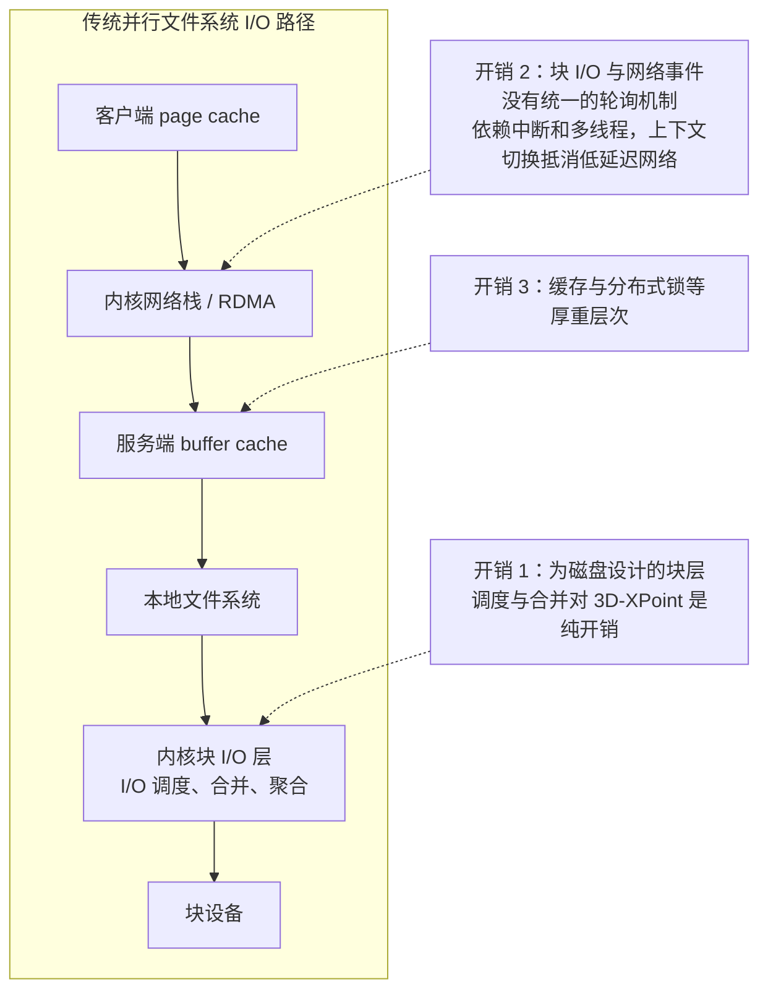

论文的三条论据：

1. **块层是为磁盘优化的**。I/O 调度器优化寻道，聚合和合并写请求，再把大块流式数据交给磁盘以获得高带宽。3D-XPoint 的延迟比传统介质低几个数量级，这些层次"变成了纯开销"（§2）。
2. **RDMA 的优势被线程模型吃掉**。多数并行文件系统已经能把 RDMA 当快速传输层，减少层间拷贝（比如从客户端 page cache 到服务端 buffer cache，再落块设备）。但传统栈缺少对块 I/O 和网络事件**统一的轮询/推进机制**，请求处理严重依赖中断和多线程来并发处理 RPC，上下文切换显著削弱了低延迟网络的优势（§2）。
3. **厚重的软件栈**。缓存和分布式锁等层次使得用户虽然能用 3D NAND、3D-XPoint 和高速网络拿到"一些"提升，却丢掉了这些技术的大部分好处（§2）。

**解读**：这三条论据都是定性的，论文没有给出任何"传统栈开销占比"的测量。它们对应 DAOS 的三个设计选择：用户态直接访问介质（对应 1）、统一轮询 + 用户级线程（对应 2）、无锁多版本 + 算法放置（对应 3）。

---

## 2. 系统架构：三块基石，全程用户态

### 2.1 总体结构（§3.1，图 1）

DAOS 绕过所有 Linux 内核 I/O，**端到端运行在用户态，I/O 过程中不做任何系统调用**（§3.1）。

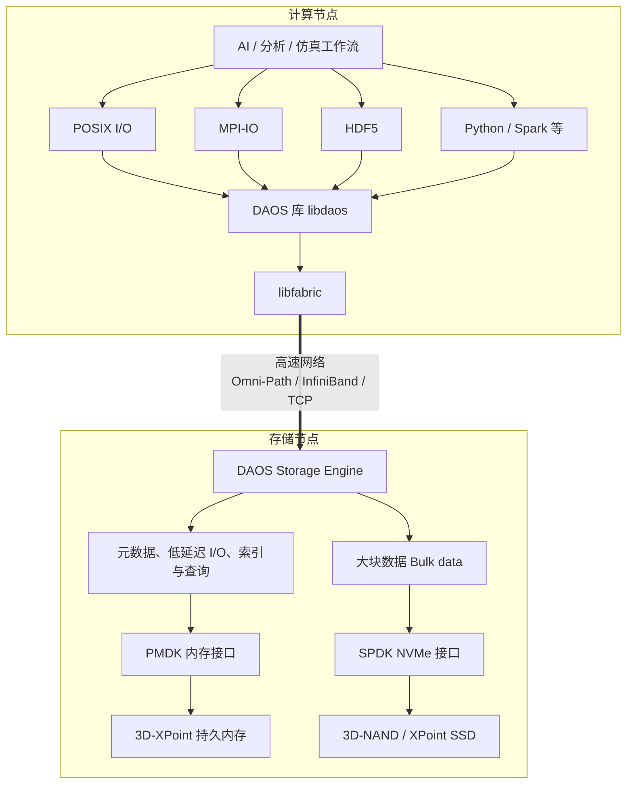

### 2.2 三块基石（§3.1）

| 基石 | 存什么 / 做什么 | 怎么访问 |
|------|----------------|---------|
| **持久内存 + PMDK** | 全部内部元数据、应用/中间件的 key 索引、延迟敏感的小 I/O | 启动时用系统调用初始化，例如把 DAX 文件系统上的 PM 文件映射到虚拟地址空间；运行后直接用 load/store 指令访问，不经过存储栈 |
| **NVMe SSD + SPDK** | 大 I/O，以及延迟要求不那么高的小 I/O | 通过 SPDK 队列对，从用户态**异步**提交多个 I/O；SPDK I/O 完成后，在持久内存里为 SSD 上的数据**建索引** |
| **libfabric + Mercury** | 网络传输层 | Mercury 提供基于回调的异步消息/数据传输 API，以及**不依赖线程的轮询 API**；DAOS 服务线程主动轮询网络事件，不用中断 |

为什么需要 NVMe：持久内存快，但容量小、性价比低，不可能只用它构建大容量存储层（§3.1）。

**明确的边界**：DAOS 专为 SCM 和 NVMe 设计，**不支持磁盘**。磁盘存储交给 Lustre、Spectrum Scale、CephFS 等传统系统，DAOS 可以与它们之间搬移数据（§3.1）。

**解读**：

- "PM 存元数据和索引，NVMe 存数据本体"这个分工，本质上把 PM 当成了**持久化的索引层**：SSD 上的数据块本身没有文件系统，它在哪里、属于哪个对象的哪个版本，全靠 PM 里的索引。这也解释了为什么 Optane 停产对 DAOS 是根本性冲击，而不只是换一种介质：索引层的持久化语义必须重做（后来的 Metadata-on-SSD 用 DRAM + WAL + checkpoint 来模拟，见 [§10.4](#104-后续演进解读)）。
- "不支持磁盘"是一个坦率的取舍。同年代的 Lustre、GPFS 都在往全闪方向加功能，DAOS 反过来把自己限定在高端介质，换取不背历史包袱。

---

## 3. I/O 服务：Argobots 用户级线程与轮询

### 3.1 客户端与服务端（§3.2）

- **客户端**：一个与应用链接、运行在应用地址空间里的库，它暴露的数据模型直接与各种传统数据格式和中间件集成。
- **服务端**（DAOS I/O server）：一个多租户守护进程，可直接跑在存储节点上，也可跑在容器里。它直接访问持久内存和 NVMe：元数据和小 I/O 存 PM，大 I/O 存 NVMe。

### 3.2 每个请求一个 ULT（§3.2）

DAOS 服务端**不靠创建 pthread** 来并发处理 I/O，而是为每个到达的 I/O 请求创建一个 **Argobots 用户级线程（ULT）**。ULT 是轻量执行单元，挂在一个执行流（xstream）上，xstream 映射到 DAOS 服务的一个 pthread。

这带来一个约束：任何 ULT 里的常规 POSIX I/O 调用、pthread 锁、同步消息等待，都会**阻塞整个 xstream 上所有 ULT**。DAOS 能用这个模型，是因为它的所有基石（PMDK、SPDK、Mercury）都提供**非阻塞的用户态接口**：I/O ULT 永远不会阻塞在系统调用上，而是在 I/O 或网络请求未完成时**主动让出**；之后由一个负责**轮询网络和 SPDK 完成事件**的系统 ULT 把它重新调度回来。

性能依据：基准测试显示，单个 xstream 每秒能创建数百万个 ULT，能做超过一千万次 ULT 上下文切换。论文认为这适合目标为**微秒级 I/O 延迟**的服务端（§3.2）。

### 3.3 一次 NVMe 写的九个步骤（图 2）

图 2 画的是一个 I/O XStream 内部的处理流程，绿色的是负责推进进度的轮询 ULT，其余是请求 ULT。九个步骤如下（按图中编号；文字解释是本文根据图和 §3.1、§3.2 的整理）：

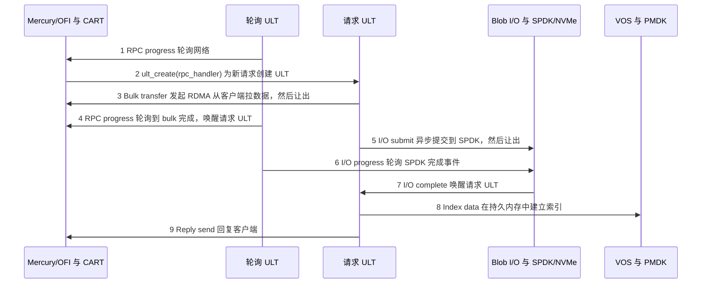

**解读**：

- 图中有三个名字正文没有解释：**CART**（DAOS 基于 Mercury 的 RPC 通信层）、**Blob I/O**（管理 NVMe 空间的模块）、**VOS**（Versioning Object Store，每个 target 上的本地多版本对象存储，跑在 PMDK 之上）。论文摘要说要"介绍 DAOS 存储引擎的架构"，但 VOS 这个核心组件在正文里一次都没出现，只在图 2 里露了个名字。
- 图 2 展示的是**大 I/O 落 NVMe** 的路径。按 §3.1 的分工，小 I/O 直接写 PM，推测会跳过步骤 5–7，在步骤 8 一并写入数据和索引；论文没有画出这条路径。
- 第 8 步"先写 SSD、完成后再在 PM 里建索引"是一个关键的顺序：数据落盘之后索引才可见，所以崩溃时最多丢掉一块没有索引指向的 SSD 空间，不会出现索引指向未写完的数据。这是用"写顺序"代替日志的常见做法，论文没有展开讨论。
- 这一套与 [3FS](3fs-fireflyer-sc2024.md) 的存储服务（协程 + RDMA 单边读客户端缓冲区）、Seastar 的 shard-per-core 是同一类设计：**把阻塞变成让出，把中断变成轮询，把线程变成协程**。

---

## 4. 对象标识与算法放置

### 4.1 128 位对象 ID（§3.3）

DAOS 以对象形式对外暴露存储，用户通过 key-value 或 key-array API 访问。为了避免扩展性问题和维护**每对象元数据**（比如描述数据位置的布局）的开销，DAOS 对象**只由一个 128 位 ID 标识**：

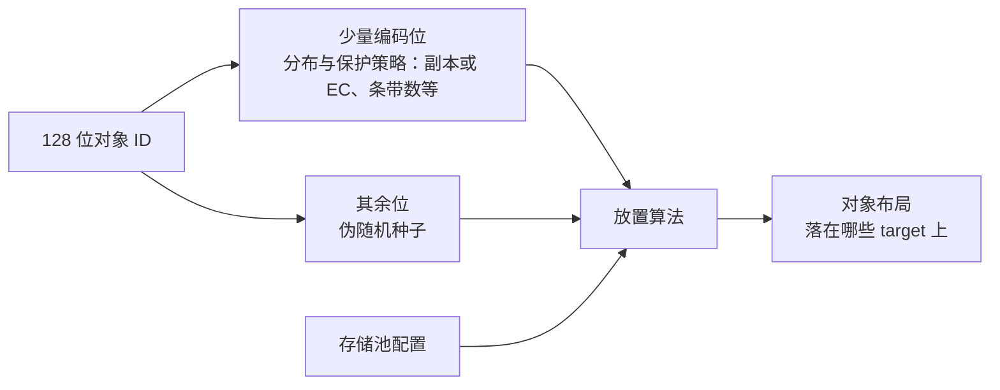

这称为**算法对象放置**（algorithmic object placement），与 Ceph 的数据放置思路类似，只是 DAOS 不用 CRUSH 算法。具体的放置算法和恢复协议，论文说只做高层描述，细节见在线设计文档（§3.3）。

**解读**：

- 把保护策略编码进对象 ID，意味着**对象一旦创建，其冗余方式就固定了**，要换就得换 ID（即复制成新对象）。好处是任何客户端和服务器拿到 ID 就能独立算出布局，不需要查元数据服务，这也是后面"去中心化重建"能成立的前提。
- 与 Ceph 的区别在于 Ceph 先把对象哈希到 PG，再由 CRUSH 把 PG 映射到 OSD；DAOS 论文只说了"不用 CRUSH"，没说用什么。读者要了解细节只能去看代码和设计文档，这是论文最大的信息缺口之一。

---

## 5. 数据保护与恢复

### 5.1 为什么必须做（§3.3）

DAOS 服务器把数据放在内存总线上的 SCM 和 PCIe 上的 SSD 里，没有传统存储中常见的 RAID 控制器保护。持久内存出现不可纠正错误或 SSD 介质损坏时，没有额外保护的应用就会丢数据/元数据。因此 DAOS 提供**副本**和**纠删码**两种保护，开启后对象被复制或切成数据块与校验块，分布到多个存储节点上；设备或节点故障时，对象仍可在**降级模式**下访问，冗余可以从副本或校验中恢复（§3.3）。

### 5.2 副本写：primary 转发 RPC，副本直接拉客户端数据（§3.3，图 3a）

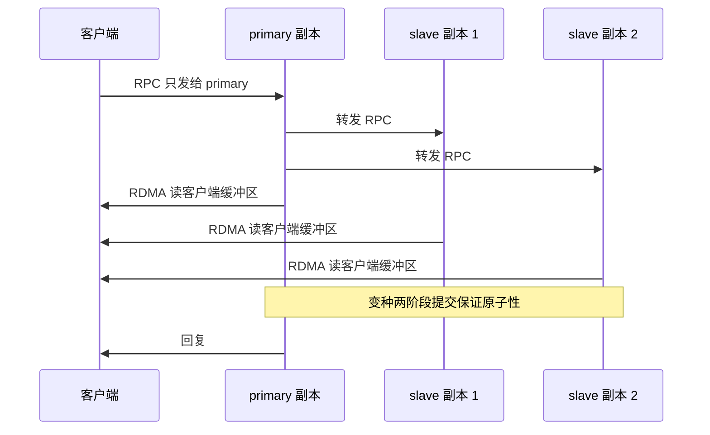

与传统主从复制的区别：**primary 只转发 RPC，不转发数据**；所有副本都发起 RDMA 请求，直接从**客户端缓冲区**取数据。

理由：在大多数 HPC 环境里，**客户端与服务器之间的网络带宽远高于服务器之间的带宽**，而服务器之间的带宽还要留给数据恢复和再平衡。如果在非 HPC 场景、服务器之间带宽更高，可以把数据通路改回传统模式（§3.3）。

**解读**：这是论文里最有"HPC 味"的设计。传统链式或主从复制让数据在服务器之间走一跳，省的是客户端的出口带宽；DAOS 反过来省服务器之间的带宽，代价是客户端出口流量变成副本数倍（3 副本即 3 倍）。在客户端节点远多于存储节点、计算网络带宽充裕的超算上，这个代价很划算；在以太网云环境里则未必。论文明确承认这一点，并保留了切换的可能。

### 5.3 变种两阶段提交：失败不等待（§3.3）

DAOS 用一个**两阶段提交的变种**保证副本更新的原子性：只要有一个副本不能应用更改，所有副本都应放弃。无故障时协议很直接。关键在于故障处理：

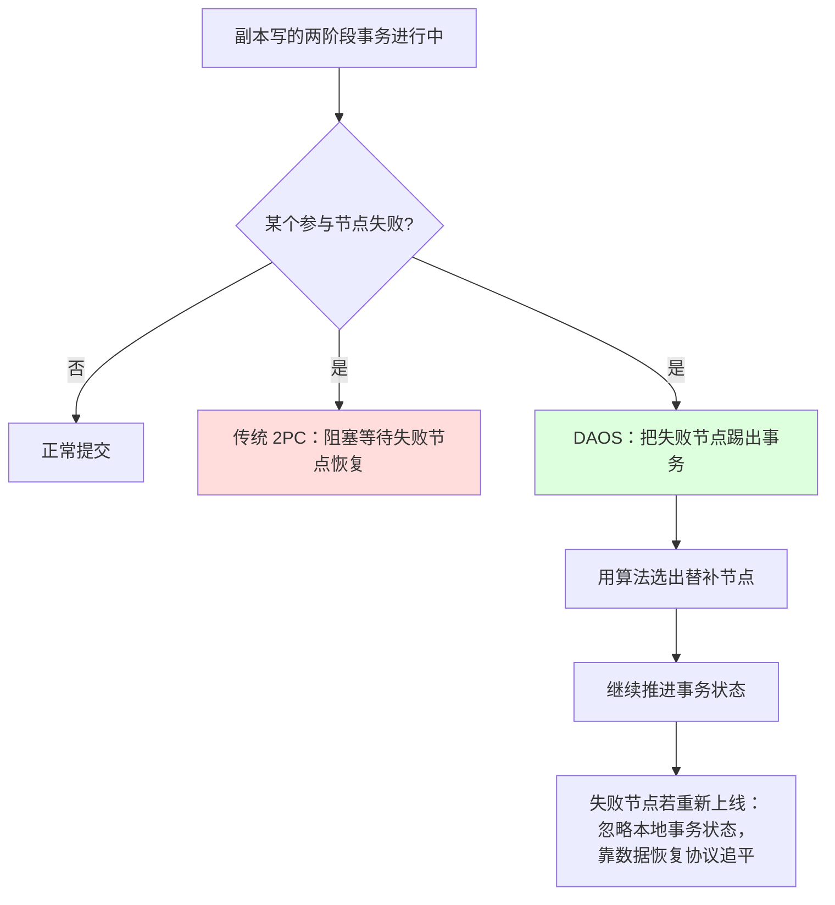

**解读**：这里的关键是"踢出失败节点"由谁决定、如何避免误判（网络分区时被踢出的节点其实还活着）。论文没有讲。按上下文推测，成员关系由 Raft 复制的 pool service 维护，失败节点被正式排除后才更换参与者，因此踢出是一个全局一致的决定。但论文没有给出协议细节，也没有讨论 coordinator（primary）本身失败时的处理。

### 5.4 去中心化重建（§3.3）

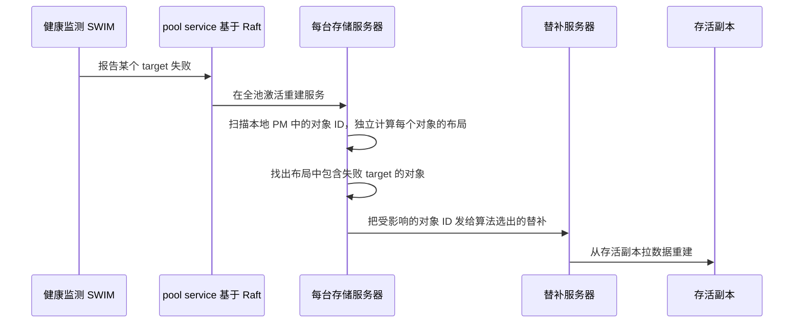

整个过程**没有中心节点做数据/元数据扫描或数据重建**，重建负载完全分散、并行（§3.3）。

**解读**：能做到"每台服务器自己扫自己"，依赖两个前提：对象 ID 就能算出布局（§3.3 的算法放置），以及对象 ID 本身存在 PM 里、扫描很快。这把"找出受影响对象"这一步从 O(全局元数据) 的中心任务，变成了每台服务器 O(本地对象数) 的并行任务。

### 5.5 纠删码（§3.3，图 3b）

EC 比副本省空间、省带宽，但计算更多。DAOS 的做法：

- **客户端编码**：客户端是链接在计算节点应用里的轻量库，而计算节点的算力远多于 DAOS 服务器，所以写时由客户端计算校验，为数据块和校验块都创建 RDMA 描述符，然后向校验组的 **leader 服务器**发 RPC 协调写入。
- **同样的数据流**：所有参与者都直接从客户端缓冲区拉数据，而不是从 leader 的缓存拉。原子性用与副本相同的两阶段提交保证。
- **非整条带写不做读-改-写**：

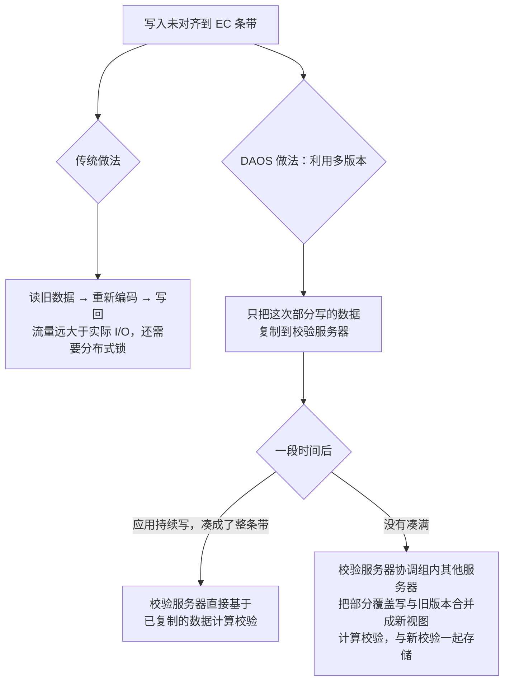

- **降级读**：副本只要换一个副本读；EC 则要求客户端取回整条带并在途中重建缺失分片，开销更大。
- **降级写**：与副本相同，两阶段提交不会被失败节点阻塞，一旦选出替补就立即继续。
- **重建**：协议与副本类似，但数据移动量大得多，这是所有基于校验的保护方案的共同特点（§3.3）。

**解读**：EC 部分写"先复制、后编码"是多版本模型的一个漂亮应用。部分写在短期内是以**副本**形式被保护的（数据所在服务器一份、校验服务器一份），整条带凑齐后再降为 EC 开销。这与很多对象存储"热数据副本、冷数据转 EC"的分层思路一致，但 DAOS 是在**单个条带粒度、按时间自动完成**的。代价是校验服务器要暂存这些副本并在后台做合并编码；论文没有给出这部分开销的数据。

### 5.6 端到端数据完整性（§3.3）

论文列出三类典型故障及其检测手段：

| 故障类型 | 检测方式 |
|---------|---------|
| 服务崩溃 | 运行类 gossip 的 **SWIM** 协议 |
| NVMe SSD 故障 | 通过 SPDK 轮询设备状态 |
| 存储介质导致的数据损坏 | 存储并校验 **checksum** |

端到端校验和的流程：

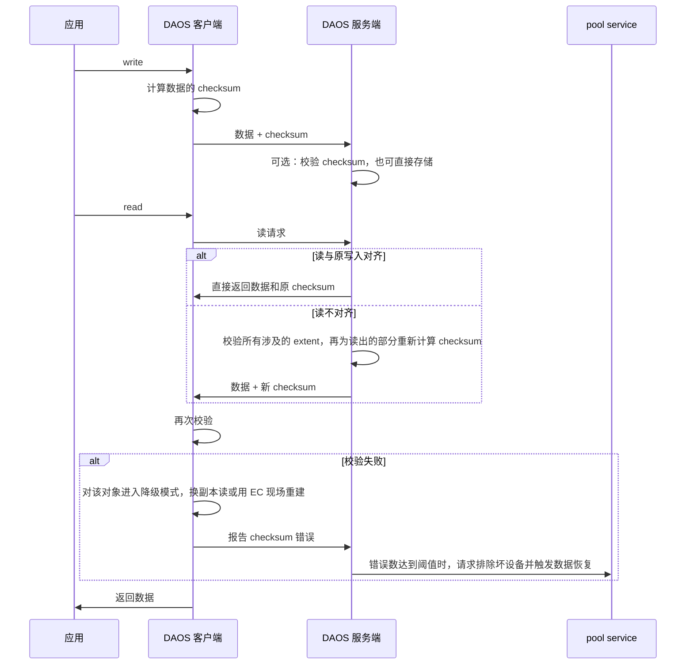

服务端会汇总本地校验和**scrubbing**（后台巡检）发现的错误，以及客户端上报的错误。checksum 本身存放在持久内存中，由 PM 模块的 ECC 保护。如果持久内存出现不可纠正错误，存储服务会被 **SIGBUS** 杀掉；此时 pool service 会**禁用整个存储节点**，在存活节点上开始数据恢复（§3.3）。

**解读**：

- 服务端校验可由用户按性能需求开关，这是把"端到端"的严格程度变成了一个可调参数。在客户端本身就会校验的前提下，关闭服务端校验仍能保证读出的数据正确，只是写入时就已损坏的数据要到读时才会被发现。
- PM 不可纠正错误直接导致**整个节点**被禁用，说明 PM 在 DAOS 里是单点：所有索引都在上面，一块 PM 出错，整节点的数据都无法再信任。

---

## 6. 数据模型与中间件

### 6.1 pool、container、object（§4.1，图 4）

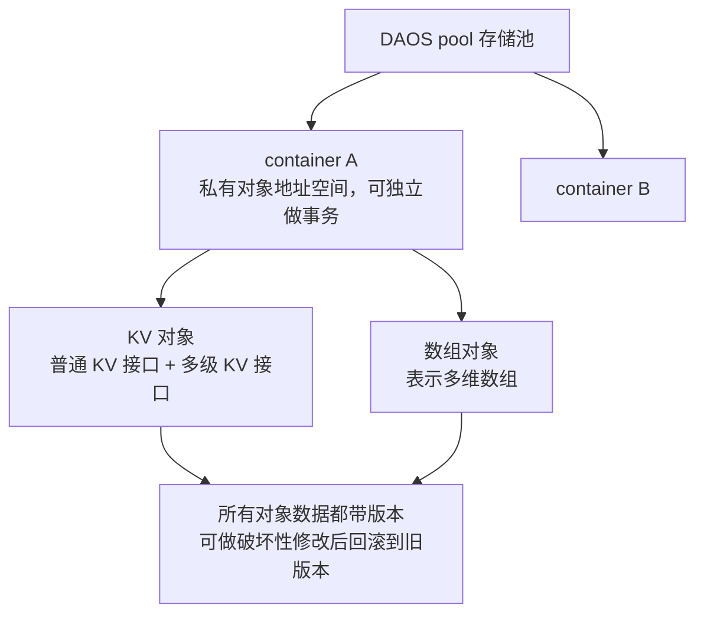

- **两类对象**：数组对象，用来表示多维数组；键值对象，原生支持常规 KV 接口和**多级 KV** 接口。
- **版本化**：KV 和数组对象的数据都带版本，应用可以做"破坏性"修改，然后回滚到数据集的旧版本。
- **container**：每个对象都属于一个 container。每个 container 是一个**私有的对象地址空间**，可以独立于同池中其他 container 被事务修改（§4.1）。

§3 开头还提到 DAOS 提供**事务化非阻塞 I/O、版本化数据模型和全局快照**（§3）。

图 4 想表达的是：应用自己的数据结构（key → value 的指针图）可以直接映射成 DAOS 中以 root 为起点的 KV 树，小的 value 留在 PM，大的 value（val2 续）落到 NVMe SSD 上。

**解读**：论文没有出现 dkey/akey、epoch 这些 DAOS 文档里的核心术语，只用"多级 KV"和"版本化"概括。读者要理解多级 KV 的具体层次（dkey 决定分布、akey 决定同一 dkey 下的属性）和 epoch 的语义，需要看 DAOS 设计文档或 2017 年的 arXiv 论文（论文参考文献 [1]）。

### 6.2 POSIX 只是一个中间件（§4.1）

当前所有 I/O 中间件都跑在 POSIX 之上，需要把自己的数据模型**序列化**成 POSIX 的目录 + 字节数组文件。DAOS 提供更丰富的 API，作为中间件和应用更高效的构件：

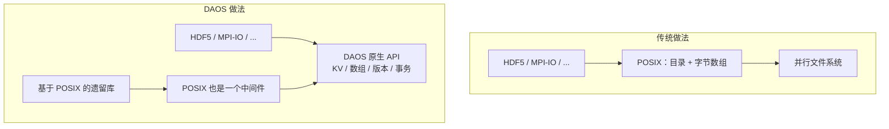

- 把 POSIX 当作 DAOS 上的一个中间件库实现，**所有建在 POSIX 上的库都能工作**；
- 同时中间件也可以**原生移植**到 DAOS 上，跳过 POSIX 序列化这一步（论文说它"有若干缺点"，但"不在本文讨论"）；
- 已实现的中间件：POSIX、MPI-IO、HDF5（§4.1）。

---

## 7. POSIX 支持：libdfs、dfuse 与拦截库

### 7.1 软件栈（§4.2，图 5）

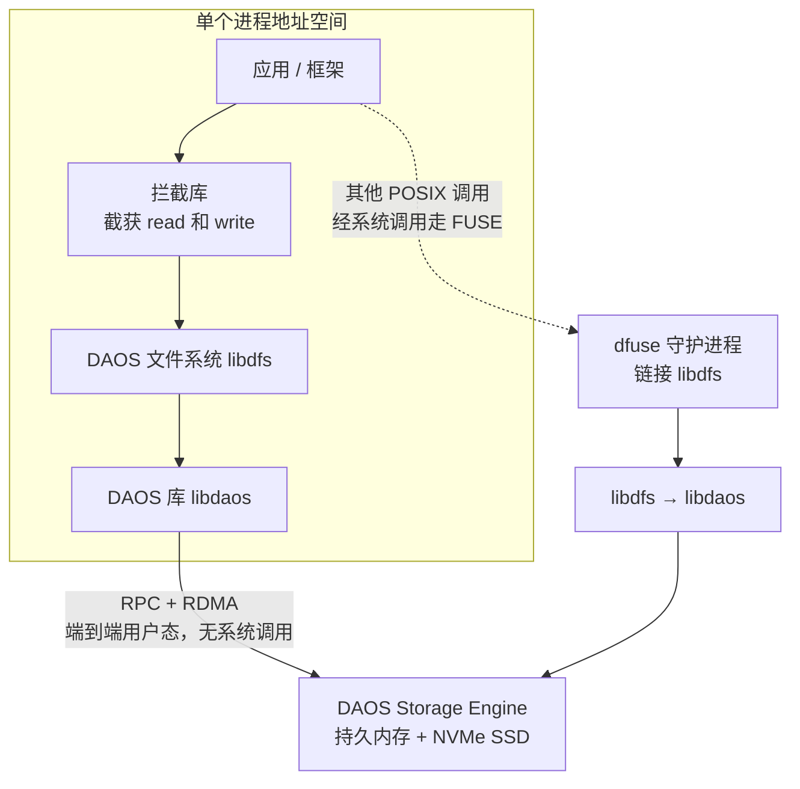

三层分工：

- **libdfs**：直接建在 DAOS API 上的类 POSIX API，在原生 libdaos 之上提供文件和目录抽象。一个 POSIX 命名空间封装在一个 container 中，**文件和目录都映射为该 container 里的对象**。这个封装的文件系统，其数据和元数据都**完全分布**在 DAOS 池的所有存储上（§4.2）。
- **dfuse**：链接了 libdfs 的 FUSE 守护进程，把 container 挂进 Linux 文件系统树；所有 FUSE 调用经 libdfs、libdaos 访问远程对象存储。它继承了 FUSE 的一般开销，包括系统调用等。这对多数文件系统操作是可接受的，但 read/write 如果都走系统调用，性能损失会很明显（§4.2）。
- **拦截库**：与 dfuse 配合工作，截获 POSIX 的 `read(2)` 和 `write(2)`，直接在应用上下文中通过 libdaos 发出 I/O，**无需修改应用**（§4.2）。

此外，libdfs 也可以通过 I/O 中间件的插件/shim 层直接链接，例如 Spark、MPI-IO、HDF5，同样对应用透明（§4.2）。

**解读**：

- 这是"元数据走慢路径、数据走快路径"的经典拆分：open、stat、mkdir 等元数据操作经 FUSE（有系统调用），read/write 由拦截库在用户态直通。它和 [3FS 的 USRBIO](3fs-fireflyer-sc2024.md)（FUSE 挂载点负责元数据，数据走共享内存环直达用户态客户端）是同一思路的两种实现。
- "整个命名空间在一个 container 里、文件和目录都是对象"意味着 DAOS 的 POSIX 没有独立的元数据服务器：目录就是一个 KV 对象（文件名 → 条目），按对象 ID 散布到所有 target 上。这是 IO500 元数据成绩好的结构性原因，但 rename 跨目录的原子性、目录内大量并发创建的冲突处理等问题，论文都没有涉及。
- 拦截库只截 read/write，所以 mmap、元数据密集的小文件负载仍然要经过 FUSE。论文没有给出 dfuse 与拦截库的性能对比，IO500 测试也没用这两者，而是直接用 DFS 后端（见 [§8.1](#81-测试方法用-dfs-api-直接改写-ior-与-mdtest5)）。

---

## 8. 评估：IO500 SC19

### 8.1 测试方法：用 DFS API 直接改写 IOR 与 mdtest（§5）

论文说明 DAOS 软件栈"仍在大量开发中"，结果基于 **DAOS 0.6**。IO500 的工作负载：

| 负载 | 内容 |
|------|------|
| IOR-Easy | 规整的大块顺序 I/O 带宽 |
| IOR-Hard | 小的不对齐 I/O（每次 **47001 字节**）跨步访问共享文件的带宽 |
| MDTest-Easy | 0 字节文件的元数据操作，每个 MPI 进程用独立目录 |
| MDTest-Hard | 小文件（**3901 字节**）在**共享目录**里的元数据操作 |
| Find | 通过目录遍历查找文件 |

作者为 IOR 和 mdtest 写了一个直接基于 DFS API 的 I/O 驱动，已被上游 ior-hpc 仓库接受。由于 DFS API 与 POSIX API 高度相似，改写很简单：

1. 增加初始化回调：连接 DAOS pool，打开封装命名空间的 container，在其上创建 DFS 挂载；
2. 为每个操作增加回调，把 POSIX 调用换成对应的 DFS 调用，例如 `mkdir()` → `dfs_mkdir()`、`open64()` → `dfs_open()`、`write()` → `dfs_write()`；
3. 增加结束回调：卸载 DFS，关闭 pool 和 container 句柄（§5）。

**解读**：这意味着 IO500 测到的是 **libdfs 原生接口**的性能，而不是普通应用经 dfuse + 拦截库得到的性能。对比对象（Lustre、WekaIO、GekkoFS）大多是走内核或 FUSE 的 POSIX 路径。这在 IO500 规则内是合法的，但读者不能把这个成绩直接等同为"未修改的 POSIX 应用在 DAOS 上的性能"。

### 8.2 测试集群"Wolf"（§5）

| 项目 | 配置 |
|------|------|
| 存储节点 | **8 台**双路，Intel Xeon Platinum 8260 |
| 持久内存 | 每节点 **12 条** Intel Optane DCPMM，论文写"容量 512 GiB（每节点共 3 TiB），app-direct/交错模式"（见 [§9](#9-论文的不一致与留白) 的数字矛盾） |
| 客户端节点 | 双路 Intel Xeon E5-2699 v4 |
| 网络 | 存储节点和客户端节点均为**每节点 2 块** Intel Omni-Path 100 网卡 |
| 软件 | DAOS 0.6 |

IO500 有两个榜单：**全榜**（Full/Ranked List）允许任意数量的客户端节点；**10 节点挑战榜**限定恰好 10 个客户端节点，为随客户端数扩展的负载提供标准化对比基础。两个榜单都不限制存储系统规模（§5）。

### 8.3 带宽：图 6（IOR，GB/s）

论文说：在 2019 年 11 月的 10 节点挑战榜上，DAOS 拿到**总排名第 1** 和最高的 "bw" 带宽分（四个 IOR 负载的几何平均）。由于多版本数据模型，DAOS 对小写和不对齐写**不需要读-改-写**，因此 "hard" 和 "easy" 的带宽非常接近，性能在各种负载下可预测（§5）。

图 6 读图估计值（GB/s，±5%）：

| 负载 | Intel/DAOS | Lustre/SuperPOD | WekaIO/Matrix | GekkoFS/NextGenIO |
|------|-----------:|----------------:|--------------:|------------------:|
| ior_easy_write | ≈110 | **≈274** | ≈82 | ≈68 |
| ior_easy_read | ≈185 | **≈287** | ≈87 | ≈38 |
| ior_hard_write | **≈94** | ≈11 | ≈26 | ≈4 |
| ior_hard_read | **≈126** | ≈66 | ≈57 | ≈23 |
| 几何平均（按估计值计算） | **≈124** | ≈87 | ≈57 | ≈21 |

**解读**：

- 论文正文只强调 DAOS 的"第 1"和 hard/easy 接近，**没有提到**在两个 easy 负载上 Lustre/SuperPOD 明显更快（写约 2.5 倍、读约 1.5 倍）。DAOS 的带宽分第一，是靠 hard 负载上的巨大优势拿到的：hard write 约为 Lustre 的 8–9 倍。
- 这恰好说明了 DAOS 的定位：**不是峰值带宽最高，而是最不怕"难看"的 I/O 模式**。IOR-hard 是 47001 字节、不对齐、多进程交错写同一文件，正是传统 POSIX 文件系统要做读-改-写和字节范围锁的场景。
- DAOS 的 hard/easy 比：写约 0.85，读约 0.68；Lustre 的写只有约 0.04。"非常接近"对写成立，对读则是"接近得多"。

### 8.4 元数据：图 7（mdtest，kIOPS）

论文说：DAOS 主导了总体 "md" 元数据分（所有 mdtest 负载的几何平均），与最近的竞争者相差**近 3 倍**。主要原因是轻量的端到端用户态存储栈，加上超低延迟网络和 DCPMM 介质。与带宽类似，DAOS 在各项元数据测试中的表现非常均衡，而其他文件系统在不同元数据负载间差异很大（§5）。

图 7 读图估计值（kIOPS，±5%）：

| 负载 | Intel/DAOS | Lustre/SuperPOD | WekaIO/Matrix | GekkoFS/NextGenIO |
|------|-----------:|----------------:|--------------:|------------------:|
| mdtest_easy_write | **≈2610** | ≈790 | ≈790 | ≈1740 |
| mdtest_hard_write | **≈1260** | ≈430 | ≈110 | ≈180 |
| mdtest_hard_read | **≈1890** | ≈470 | ≈500 | ≈500 |
| mdtest_easy_stat | ≈2850 | ≈2000 | **≈4140** | ≈1710 |
| mdtest_hard_stat | **≈2830** | ≈880 | 图中几乎不可见 | ≈1630 |
| mdtest_easy_delete | **≈1870** | ≈500 | ≈920 | ≈880 |
| mdtest_hard_delete | **≈1860** | ≈570 | ≈50 | ≈320 |
| 几何平均（7 项，按估计值计算，WekaIO 缺一项不计） | **≈2090** | ≈700 | — | ≈740 |

**解读**：

- 用读图估计值算出的几何平均，DAOS 约为 GekkoFS 的 2.8 倍、Lustre 的 3.0 倍，与论文"近 3 倍"的说法吻合。
- DAOS 唯一没拿第一的是 easy_stat，WekaIO 约 4140k 高于 DAOS 的约 2850k。论文正文同样没有提到这一点。
- DAOS 最大的优势在**共享目录**负载上（hard_write、hard_delete），这正是传统文件系统受目录锁限制的地方。DAOS 的目录是一个分布式 KV 对象，在同一目录下创建文件是对不同 key 的独立写，彼此不冲突。

### 8.5 全榜（§5）

DAOS 在 2019 年 11 月的全榜上排名**第 2**，只用了 **26 个客户端节点**。作者认为更多客户端节点会带来更好的成绩，尤其是随客户端数扩展的元数据测试；由于全榜中一些系统用了数百个客户端节点，直接比较不如 10 节点挑战榜有意义（§5）。

### 8.6 评估的整体评价（解读）

| 论文证明了的 | 论文没有证明的 |
|-------------|---------------|
| 在 IO500 上，DAOS 的 hard 负载远好于对手，各项负载之间表现均衡 | 单次操作的延迟（全文没有一个延迟数字，尽管反复强调"微秒级"） |
| 8 台 Optane 存储节点就能在 10 节点挑战榜上拿第 1 | NVMe 层的表现：Wolf 配置里只列了 DCPMM，没有提 SSD |
| libdfs 接口足够接近 POSIX，IOR/mdtest 可以很容易地移植 | dfuse 与拦截库路径的性能，以及与原生 libdfs 的差距 |
| | 副本、EC、端到端校验开启后的开销 |
| | 故障检测、降级读写、重建的速度和对前台的影响 |
| | 与其他系统在相同硬件下的对比（IO500 各系统的硬件差异很大） |

最后一行尤其重要：图 6、图 7 中的四个系统硬件完全不同，存储节点的数量、介质、网络都没有对齐。IO500 本身就是一个"系统级"榜单，它比的是"整套方案"，而不是"软件栈"。论文用它证明 DAOS 能把 Optane 用好是合理的，但不能据此得出"DAOS 的软件比 Lustre 快 N 倍"。

---

## 9. 论文的不一致与留白

### 9.1 数字与表述上的问题

1. **持久内存容量对不上**（§5）：论文写每节点 12 条 DCPMM、"容量 512 GiB"、"每节点共 3 TiB"。12 × 512 GiB = 6 TiB，不是 3 TiB；如果每节点 3 TiB，每条应为 256 GiB。Optane DCPMM 第一代有 128/256/512 GB 三种规格，两种读法都可能成立，论文没有给出更多信息来判断哪个数字是错的。
2. **"I/O 过程中不做系统调用"的适用范围**（§3.1 vs §4.2）：§3.1 说 DAOS "不做任何系统调用"，§4.2 则承认 dfuse 路径继承了 FUSE 的系统调用开销，只有经拦截库的 read/write 和直接用 libdfs/libdaos 的应用才是全用户态。前一句应理解为"DAOS 库与引擎本身"，而非所有 POSIX 访问。
3. **图 2 的拼写**：图中写作 `utl_create(rpc_handler)`，应为 `ult_create`。
4. **作者机构**：第四作者 Michael Hennecke 署名为 Lenovo，不是 Intel；本仓库原综述中写作"（Intel）"，已一并修正。

### 9.2 论文承诺了但没给的内容

- 摘要说要介绍"DAOS 存储引擎的架构"，但存储引擎的核心 VOS 只在图 2 中出现一个名字，正文没有任何解释。
- 放置算法、恢复协议的细节都指向在线设计文档（§3.3）。
- MPI-IO 和 HDF5 中间件明确留作"未来研究"（§6）。
- §4.1 说 POSIX 序列化"有若干缺点"，但"不在本文讨论"。

### 9.3 本仓库原有描述中需要修正的地方

对照原文，本仓库两篇综述中的 DAOS 小节有几处超出论文的说法（已在本次一并修正或加注）：

| 原描述 | 原文实际情况 |
|-------|-------------|
| 作者均为 Intel | 第四作者为 Lenovo |
| 对象为 key-array 结构（dkey/akey/数组），支持 epoch 版本 | 论文只说"KV 对象（含多级 KV）和数组对象，数据带版本"，没有出现 dkey/akey/epoch 术语。这些是 DAOS 文档的概念，不是本论文的内容 |
| 强依赖 RDMA 网络 | 论文明确说传输层可以是 Omni-Path、InfiniBand，**或标准 TCP 网络**（§3.1）；高性能当然依赖 RDMA，但不是硬依赖 |
| 每个 engine 独占核/盘/网口的 shared-nothing | 论文只在引言提到"字节粒度、shared-nothing 接口"，没有描述 engine 与核、盘、网口的对应关系，这是 DAOS 部署文档的内容 |
| SCFA'20 论文展示任意 IO 尺寸下接近介质极限的带宽/IOPS | 论文只有 IO500 结果，没有不同 I/O 尺寸的扫描，也没有与介质极限的对比 |
| DAOS 证明了该路线在万级盘规模的可运维性 | 论文的测试集群只有 8 台存储节点；大规模部署（如 Aurora）是论文之外的后续事实 |

---

## 10. 整体总结

### 10.1 核心贡献

1. **完整的全用户态分布式存储栈**：PMDK + SPDK + libfabric/Mercury + Argobots，把去内核、去中断、去线程阻塞贯彻到一个带副本、EC、重建、POSIX 的完整系统中。
2. **按 I/O 特性分配介质**：元数据、索引、小 I/O 进字节寻址的持久内存，大 I/O 进 NVMe，SSD 上的数据由 PM 中的索引管理。
3. **多版本数据模型**：一举消除了小写/不对齐写的读-改-写，既解释了 IOR-hard 的成绩，也支撑了 EC 部分写"先复制后编码"的方案。
4. **算法放置 + 去中心化重建**：128 位对象 ID 编码保护策略和随机种子，任何节点都能独立算出布局，重建无中心扫描点。
5. **面向 HPC 网络的数据流**：副本和 EC 写都让所有参与者直接 RDMA 拉客户端缓冲区，节省服务器之间的带宽；变种 2PC 失败不等待。
6. **POSIX 降级为中间件**：libdfs + dfuse + 拦截库的分层，使遗留应用无需修改，新中间件可以绕过 POSIX 序列化。

### 10.2 设计哲学

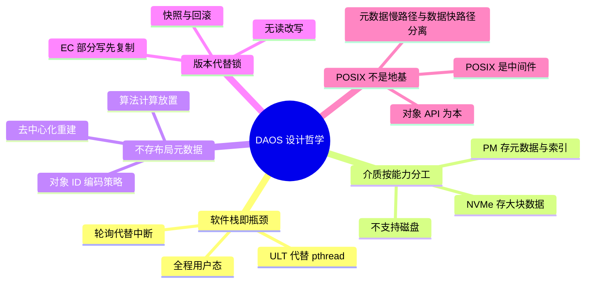

### 10.3 优点与局限

| 优点 | 局限 |
|------|------|
| 对"难看"的 I/O 模式（小、不对齐、共享文件、共享目录）表现远好于传统并行文件系统，各负载性能均衡、可预测 | 架构深度依赖 Optane 持久内存，Intel 2022 年宣布停产 Optane 后必须重做元数据层 |
| 无布局元数据、无中心重建点，理论上扩展性好 | 论文没有任何延迟、故障、重建、EC 开销的实验，评估只有一次 IO500 提交 |
| 副本/EC 写的数据流针对 HPC 网络优化，且可切回传统模式 | 副本写让客户端出口流量变成副本数倍，在以太网云环境中未必划算 |
| 端到端校验 + scrubbing + 阈值自动排除坏设备，完整性设计较完整 | PM 不可纠正错误导致整节点被禁用，PM 是节点级单点 |
| 开源，POSIX、MPI-IO、HDF5 多种接入方式并存 | POSIX 经 dfuse 仍有 FUSE 开销，拦截库只覆盖 read/write；POSIX 语义边界（rename、一致性）论文未讨论 |
| | 保护策略编码进对象 ID，对象创建后冗余方式不可原地更改 |

### 10.4 后续演进（解读）

以下内容**不在本论文中**，来自本仓库[新硬件综述 §8](new-hardware.md#8-daos面向-scmnvme-的用户态-scale-out-存储栈及其后-pm-时代演进) 的整理，未经本次逐条核对原文：

- 2022 年 Intel 宣布停止 Optane 业务后，DAOS 推出了"Metadata-on-SSD"架构（ISC 2023 workshop 论文 *DAOS Beyond Persistent Memory*），把原本放在 PM 里的元数据改为 DRAM 常驻 + WAL 落 NVMe + checkpoint 的方式，模拟 PM 的持久化语义。
- DAOS 成为 Argonne Aurora 超算的存储系统，并在之后多期 IO500 榜单上保持前列。项目后来转由 DAOS Foundation（Linux Foundation 旗下）管理。

本论文中"PM 存索引、SSD 数据落盘后在 PM 中建索引"的结构（[§3.3](#33-一次-nvme-写的九个步骤图-2)），正是后来必须改造的部分：一旦索引层不再是字节寻址的持久内存，"写完 SSD 再写索引"就需要显式的日志和检查点来保证持久性。

### 10.5 对分布式文件系统设计者的启示

1. **当介质足够快时，先砍软件栈**。DAOS 的成绩主要来自栈的轻量（论文自己也这么归因），而不是某个精巧算法。设计新系统时，先估算每次 I/O 在内核、上下文切换、锁上的开销，再决定是否值得走全用户态路线。
2. **版本化是消灭读-改-写的通用武器**。无论是不对齐写还是 EC 部分条带写，"先追加新版本、后台合并"都比"同步读-改-写 + 锁"更适合高并发。append-only 布局的系统可以直接借用这一思路。
3. **布局能算出来就别存**。对象 ID 编码策略 + 伪随机放置，让客户端直连、重建去中心化都变得自然。代价是策略不可变，以及成员变化时的数据迁移量取决于放置算法的设计。
4. **数据流要匹配网络拓扑**。"所有副本从客户端拉数据"是为 HPC 的胖客户端带宽定制的；在云上，服务器之间带宽往往更充裕，传统的链式或主从转发可能更合适。设计时应把这一点做成可配置项，而不是写死。
5. **不要把持久化格式绑死在特定硬件上**。DAOS 的元数据层与 Optane 深度耦合，Optane 停产后被迫做大改造。对介质假设弱的设计（如 WAL + checkpoint 的 KV、或 append-only 日志结构）更经得起硬件变化。
6. **评估要覆盖故障路径**。DAOS 论文花了大量篇幅描述副本、EC、重建和校验，却没有一个相关实验。对存储系统而言，降级读写和重建期间的前台性能往往比峰值性能更决定生产可用性。

### 10.6 一张图看懂 DAOS

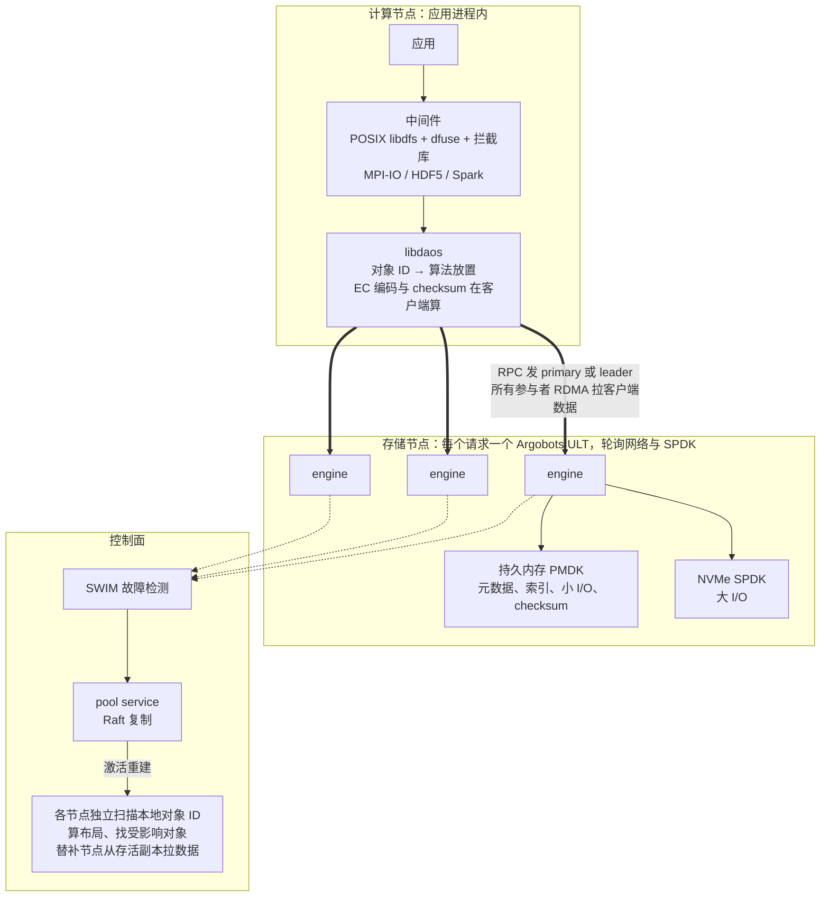

---

## 参考

- Zhen Liang, Johann Lombardi, Mohamad Chaarawi, Michael Hennecke. *DAOS: A Scale-Out High Performance Storage Stack for Storage Class Memory*. Supercomputing Frontiers (SCFA 2020), LNCS 12082, pp. 40–54, Springer, 2020. <https://doi.org/10.1007/978-3-030-48842-0_3>（CC BY 4.0）
- DAOS 代码与设计文档：<https://github.com/daos-stack/daos> ；架构概览：<https://github.com/daos-stack/daos/blob/release/2.4/docs/overview/architecture.md>
- M. S. Breitenfeld et al. *DAOS for Extreme-scale Systems in Scientific Applications*. 2017. <https://arxiv.org/abs/1712.00423>（论文参考文献 [1]，数据模型的更详细描述）
- S. Seo et al. *Argobots: A Lightweight Low-Level Threading and Tasking Framework*. IEEE TPDS 29(3), 2018.
- A. Das, I. Gupta, A. Motivala. *SWIM: Scalable Weakly-consistent Infection-style Process Group Membership Protocol*. DSN 2002.
- D. Ongaro, J. Ousterhout. *In Search of an Understandable Consensus Algorithm*. USENIX ATC 2014.
- S. A. Weil et al. *CRUSH: Controlled, Scalable, Decentralized Placement of Replicated Data*. SC 2006.
- IO500 榜单（2019 年 11 月）：<https://io500.org>
- M. Hennecke et al. *DAOS Beyond Persistent Memory: Architecture and Initial Performance Results*. ISC High Performance 2023 Workshops. <https://link.springer.com/chapter/10.1007/978-3-031-40843-4_26>（后续演进，本次未精读）
- 本仓库相关：[新硬件综述](new-hardware.md)（PM 停产后的格局）、[HPC 与 AI 存储综述](hpc-ai-storage.md)、[3FS / Fire-Flyer 精读](3fs-fireflyer-sc2024.md)（全用户态 + USRBIO 的对照）
