# DisCoGC 精读：用 discard 代替搬数据的分布式日志结构存储 GC（FAST 2026）

> 论文：Runhua Bian†, Liqiang Zhang†, Jinxin Liu, Jiacheng Zhang, Jianong Zhong, Jiahao Gu, Hao Guo, Zhihong Guo, Yunhao Li, Fenghao Zhang, Jiangkun Zhao, Yangming Chen, Guojun Li, Ruwen Fan, Haijia Shen, Chengyu Dong, Yao Wang, Rui Shi, Jiwu Shu, Youyou Lu*（共 20 位作者；† 共同一作，* 通讯作者）. *Discard-Based Garbage Collection for Distributed Log-Structured Storage Systems in ByteDance*. USENIX FAST 2026，Santa Clara，2026-02。
>
> 机构：字节跳动；清华大学（Runhua Bian 同时署名两家，Hao Guo、Ruwen Fan、Jiwu Shu、Youyou Lu 为清华）。
>
> 链接：<https://www.usenix.org/conference/fast26/presentation/bian>；PDF <https://www.usenix.org/system/files/fast26-bian.pdf>；幻灯片 <https://www.usenix.org/system/files/fast26_slides_bian.pdf>
>
> 篇幅：正文 13 页 + 参考文献，共 14 页（论文集第 493–506 页）；22 张图、2 张表。
>
> 精读日期：2026-11-24。**数字和机制描述都摘自论文**，用"论文 §x / 图 x / 表 x"标注出处。标"解读"的段落是本文作者的分析和推论，不是原文。论文多数图没有数据标签，图上读数为本文估读，标注"约"，误差约 ±5%。
>
> 相关文档：
> - [EBS Glory（FAST 2024）精读](ebs-fast2024.md)：阿里云块存储，架构与 ByteDrive 几乎一一对应（BlockServer、分段、LSM 索引、压缩、日志结构 + GC），可作对照。
> - [盘古 2.0（FAST 2023）精读](pangu-fast2023.md)：自包含 chunk 布局、用户态存储文件系统，与 ByteStore 的 UFS 思路相同。
> - [工业界生产系统中的简述](industry-production-systems.md)。

## 目录

- [0. 一页速览](#0-一页速览)
- [1. 问题：compaction 的两难](#1-问题compaction-的两难)
- [2. ByteDrive + ByteStore 的系统结构](#2-bytedrive--bytestore-的系统结构)
- [3. 生产 trace 分析](#3-生产-trace-分析)
- [4. LogFile discard 机制与四个难点](#4-logfile-discard-机制与四个难点)
- [5. 难点一：边界损失](#5-难点一边界损失)
- [6. 难点二：discard 批处理与调度](#6-难点二discard-批处理与调度)
- [7. 难点三：discard 与 compaction 的协同](#7-难点三discard-与-compaction-的协同)
- [8. 难点四：SSD trim 能力不足](#8-难点四ssd-trim-能力不足)
- [9. 部署与实现](#9-部署与实现)
- [10. 评估](#10-评估)
- [11. 经验：何时用、怎么调、怎么监控](#11-经验何时用怎么调怎么监控)
- [12. 论文中的不一致与可疑之处](#12-论文中的不一致与可疑之处)
- [13. 与相关工作的对比](#13-与相关工作的对比)
- [14. 整体总结](#14-整体总结)
- [参考](#参考)

---

## 0. 一页速览

**一句话**：字节跳动的 ByteStore 是一个基于 SSD 的分布式只追加存储，块存储 ByteDrive 等服务都建在它上面。原先的垃圾回收（GC）只有 **compaction**：把旧 LogFile 里的有效数据搬到新 LogFile，再删除旧文件。这带来"写放大与空间放大此消彼长"的两难，每月多花数百万美元 TCO。生产 trace 显示，很多负载写入连续、覆盖频繁，垃圾在 LogFile 中是**长而连续的一段**。DisCoGC 因此引入 **discard**：直接在 LogFile 中"打洞"回收这段垃圾，不搬有效数据；同时解决了跨层对齐导致的**边界损失**、元数据更新开销、文件碎片化、SSD trim 能力不足四个难点。生产集群中，空间放大降低 10%、总写放大降低 25%，**TCO 降低约 20%**，性能没有损失。

| 维度 | 要点 |
|------|------|
| 系统 | ByteDrive（块存储，Volume 层 + Segment 层，LSM 树索引，块级压缩）建在 ByteStore（LogFile → chunk → 副本/EC，ChunkServer 上的用户态文件系统 UFS）之上；ByteDrive 管理数千个集群、EB 级数据（论文 §2） |
| 问题 | compaction-only GC：激进回收则逻辑写放大高、SSD 磨损快、干扰前台；保守回收则空间放大高（论文 §1、§3.1，图 1） |
| 负载观察 | SAR（搜索/广告/推荐）与离线负载写入高度连续（合并后 65%、55% 的写大于 256 KiB），覆盖频繁；在线负载碎片化（60% 以上为 4 KiB）；生产混合负载中 90% 以上的失效区间大于 128 KiB、70% 以上大于 1 MiB（论文 §3.2、§6.2） |
| 机制 | BlockServer 扫描 LSM 树找出失效区间 → 通过 SDK 下发 discard → ChunkServer 的 UFS 修改 MetaPage 释放 cluster → 可选地向 SSD 发 trim（论文 §4.1） |
| 难点与对策 | ① 跨层对齐导致边界损失（可超过 50%）：**边界扩展** + **与 cluster 对齐的 EC 条带**；② 元数据更新开销：**批处理**（每请求最多 64 个区间）+ 并行度控制 + 流控；③ 文件碎片化：低频 **compaction** 兜底，LogFile 过多时改选文件最多的段；④ SSD trim IOPS 不足：**trim 过滤器**（只 trim ≥128 KiB）+ **trim 合并器**（论文 §4.2–4.5） |
| 生产效果 | 空间放大 1.37 → 1.23（−10%）；逻辑写放大 −32%；物理写放大最多 +10%；总写放大 −25%；TCO −20%；延迟和带宽无明显变化（论文 §6.2） |
| 测试床效果 | SAR 负载 TCO 估计降低 25% 以上；碎片化的在线负载也有 2%–5%；CPU 降到 compaction-only 的 82.9%，内存为 102.9%（论文 §6.3、§6.7） |

**解读**：

- DisCoGC 的核心洞察非常朴素：**如果垃圾本身是大块连续的，就没必要把它周围的有效数据搬走，直接把垃圾那段空间还回去即可**。compaction 是"以文件为单位回收"，discard 是"以区间为单位回收"。这与文件系统层面的 `fallocate(PUNCH_HOLE)`、SSD 层面的 trim 是同一个思想，难点在于在多层分布式栈中把它做对、做便宜。
- 论文最有价值的部分不是 discard 本身，而是**跨层对齐**的工程细节：块层压缩后的任意长度、EC 条带、UFS 的 cluster（4 × 4064 字节）、SSD 的 trim 粒度，每一层都有自己的分配单位，稍不对齐就会留下回收不掉的"边角料"，论文的例子中可超过一半。
- 与 [EBS Glory](ebs-fast2024.md) 对照：阿里 EBS 用"前台 EC + 压缩、跨盘合并"降低流量放大，GC 仍是搬数据；字节 ByteDrive 则在 GC 环节下功夫，用 discard 减少搬数据。两者面对的是同一类日志结构块存储，优化的是不同环节。

---

## 1. 问题：compaction 的两难

### 1.1 compaction-only GC（论文 §1、§3.1，图 6）

ByteStore 通过 LogFile 提供只追加接口，需要周期性 GC 回收失效数据占用的空间，GC 由 ByteDrive 等上层服务触发。最初 ByteDrive 使用基于 compaction 的 GC：

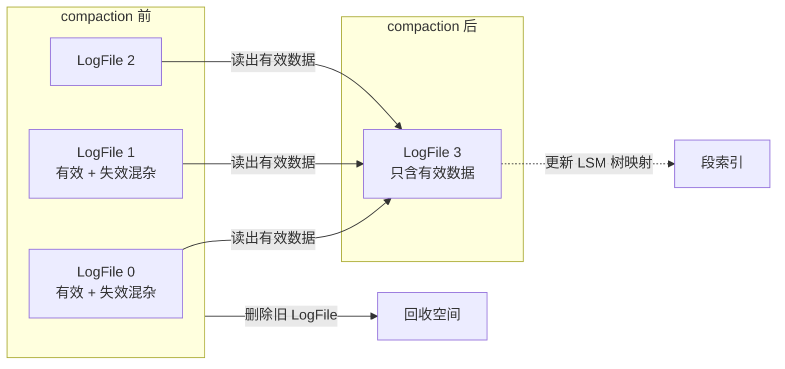

BlockServer 周期性扫描 LSM 树，计算每个 LogFile 的**垃圾率**；超过阈值的 LogFile 被 compaction：有效数据重写到新 LogFile，旧 LogFile 删除。

### 1.2 两种放大（论文 §3.1）

| 放大 | 来源 |
|------|------|
| 空间放大 | 失效数据仍占着 SSD 空间 |
| 逻辑写放大（LWA） | compaction 把有效数据重写到新 LogFile |
| 物理写放大（PWA） | SSD 内部的 GC 和磨损均衡 |
| 总写放大（WA） | WA = LWA × PWA；写放大增加写入 NAND 的数据量，占带宽、增延迟、缩短 SSD 寿命 |

**两难（图 1）**：写放大与空间放大负相关。为降低空间放大而采用激进 GC，会提高逻辑写放大、加速 SSD 磨损、降低前台 IO 性能。两种放大每月给字节跳动带来**数百万美元**的额外 TCO。

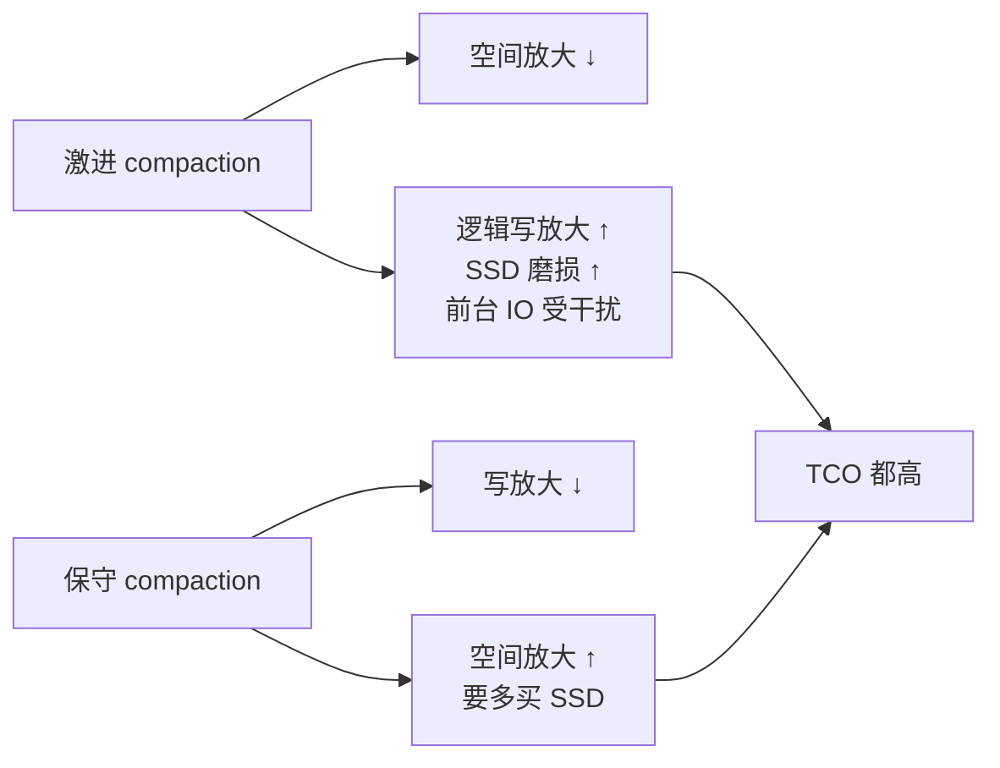

**解读**：compaction 的成本与**有效数据量**成正比，收益与**失效数据量**成正比。当一个 LogFile 中失效数据是散落的小块时，没有办法避开搬运有效数据；但如果失效数据是大段连续的，搬运有效数据就是纯浪费。DisCoGC 正是抓住了后一种情况。

---

## 2. ByteDrive + ByteStore 的系统结构

### 2.1 存储栈（论文 §2，图 2）

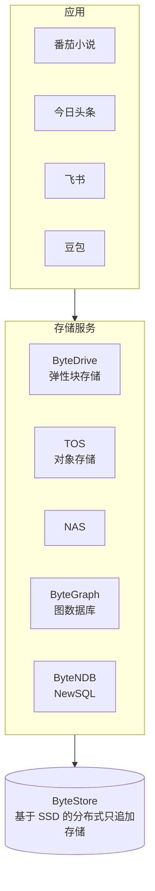

论文列出只追加存储相对原地更新的好处：天然支持 EC；已提交数据不可变，简化一致性；保留修改历史，便于实现快照、版本控制和崩溃恢复。ByteDrive 管理**数千个集群、EB 级数据**，为计算实例提供虚拟盘，实现存算分离。

### 2.2 ByteDrive：把随机写变成追加写（论文 §2.1，图 3）

| 层 | 职责 |
|----|------|
| **Volume 层** | 对外提供 4 KiB 粒度的随机读、写、trim；用户通过 BlockClient 库访问。每个卷的 LBA 空间切成多个**段**，分布在不同 BlockServer 上；段到服务器的映射由 BlockMaster 管理并缓存在 BlockClient。为均衡负载，卷内数据按 **128 KiB 条带**轮转分布到各段 |
| **Segment 层** | 把段上的随机写转成 ByteStore 上的追加写：先按块**压缩**（LZ4 或 deflate），给每个压缩块加记录压缩信息的头部，再追加写入 ByteStore；用 **LSM 树**把段上的 LBA 映射到 ByteStore 中最新的物理地址 |

### 2.3 ByteStore：LogFile、chunk 与 UFS（论文 §2.2，图 3、图 4）

**接口**：`append`（追加到 LogFile 末尾）、`read`（从任意偏移读）、`seal`（使 LogFile 不可变）。

**布局**：

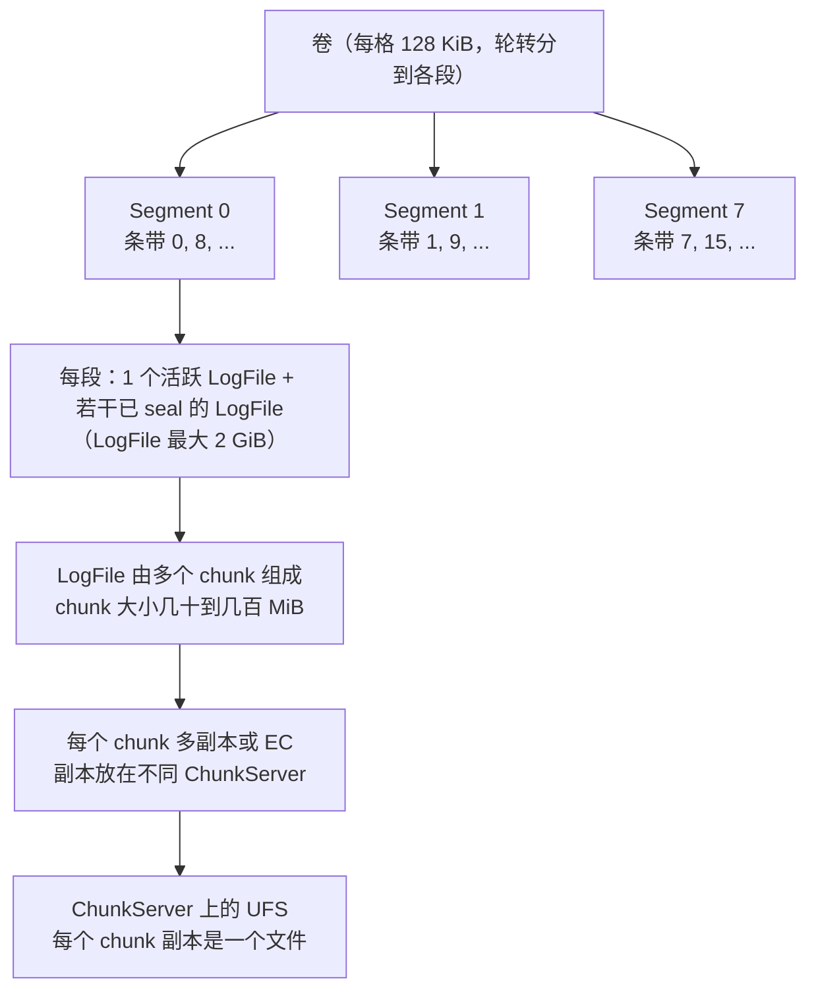

| 组件 | 内容 |
|------|------|
| LogFile | 上层服务看到的统一只追加视图，也是 **GC 的基本单位**；最大 2 GiB，以增加 GC 灵活性 |
| chunk | 大小可配置（几十到几百 MiB）：小 chunk 便于迁移和恢复，大 chunk 减少元数据开销 |
| MetaServer | 管理 ① LogFile 属性（总长、chunk 数、创建时间、权限、冗余策略）② chunk 属性（长度、副本位置）；后台重建丢失副本 |
| ByteStore SDK | **重客户端**：处理 IO 请求，实现 EC/副本协议，处理客户端侧的错误恢复（重试、备份读） |

**ChunkServer 上的用户态文件系统 UFS（图 4）**：

为了低延迟和高吞吐，ChunkServer 用自研 UFS 替代 Ext4、XFS 等内核文件系统，省去目录语义、日志等会带来额外写放大的功能。每个 chunk 副本作为一个文件管理。UFS 还负责 QoS、并发、完整性校验以及缓冲/直接 IO。

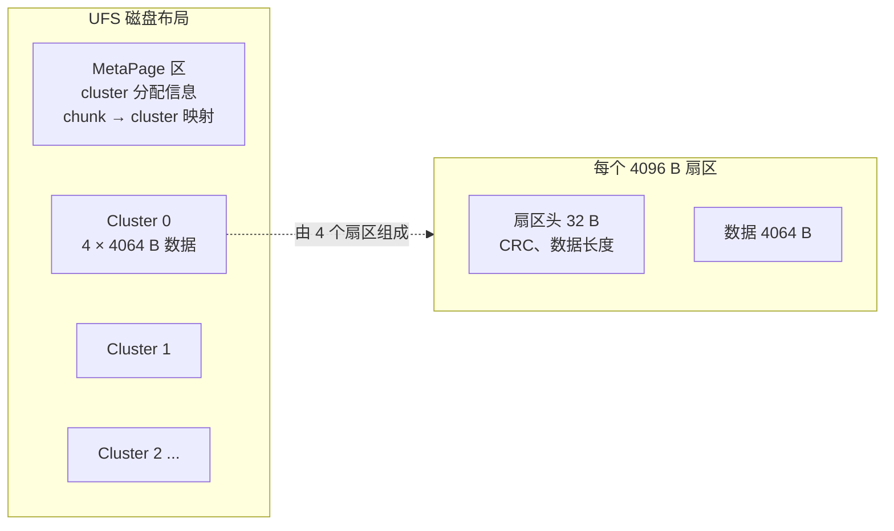

| 设计 | 理由 |
|------|------|
| 自包含扇区 | 每个 4 KiB 扇区前 32 B 存校验信息（CRC、数据长度），其余 4064 B 存数据。每个扇区可独立校验，保证写原子性；数据和校验信息一次顺序 IO 即可读写 |
| 不保持 4 KiB 数据对齐 | BlockServer 已压缩数据，ChunkServer 上保持 4 KiB 数据对齐既不现实也没必要（论文脚注 2） |
| cluster | 4 个扇区组成一个 cluster，作为分配单位，在空间管理开销和内部碎片之间折中 |

**解读**：自包含扇区与 [盘古的自包含 chunk 布局](pangu-fast2023.md#33-自包含-chunk-布局论文-313图-3)（每个 sector unit 带 footer）几乎相同。但正是这 32 B 的扇区头，让每个 cluster 的有效数据变成 4 × 4064 = 16,256 B 而不是 16 KiB，成为 §5 中"cluster 损失"的根源。

### 2.4 一次写的完整路径（论文 §2.3，图 5）

以三副本、用户写 [20 KiB, 200 KiB) 为例：

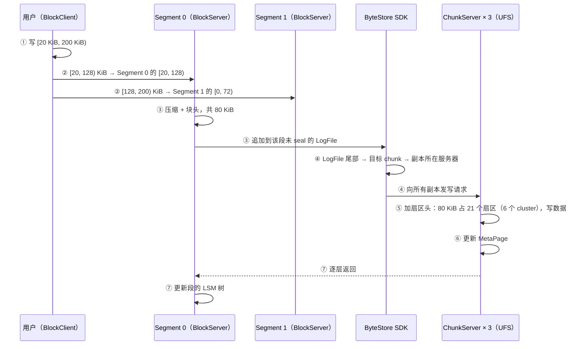

**解读（数字核对）**：80 KiB = 81,920 B，81,920 / 4064 ≈ 20.2，向上取整为 21 个扇区；21 / 4 = 5.25，向上取整为 6 个 cluster。与论文一致。

---

## 3. 生产 trace 分析

### 3.1 三类负载（论文 §3.2，图 7，表 1）

字节跳动的应用（头条、番茄小说、飞书、豆包等）通过共享组件（ByteES、Viking 做搜索，Spark、Flink 做推荐等）使用存储。每个组件作为容器实例运行在字节的容器引擎 TCE 上，TCE 把 ByteDrive 卷作为虚拟盘并格式化为 Ext4。用 blktrace 采集了三类负载的 ByteDrive 卷 trace：

| 类别 | 含义 |
|------|------|
| 在线（Online） | 实时服务，调度频繁 |
| SAR | 搜索、广告、推荐：倒排索引构建/更新、AI 模型下载/推理，中等频率调度 |
| 离线（Offline） | 长时间运行的分布式计算作业，调度不频繁 |

**表 1：trace 特征**

| 指标 | 在线 | SAR | 离线 |
|------|-----:|----:|-----:|
| 总写入量（TiB） | 46.74 | 33.82 | 70.84 |
| 写次数 | 5.28 × 10⁸ | 7.20 × 10⁷ | 1.38 × 10⁸ |
| 总读取量（TiB） | 9.51 | 0.71 | 37.97 |
| 读次数 | 2.21 × 10⁸ | 1.10 × 10⁷ | 6.52 × 10⁸ |
| 时长（天） | 2.64 | 1.74 | 2.60 |
| 卷大小（TiB） | 3.5 | 1.8 | 3.5 |
| 读写比（按大小，写:读） | 4.92 | 47.48 | 1.87 |
| 读写比（按次数，写:读） | 2.39 | 6.55 | 0.21 |
| 写 IOPS | 2,314 | 480 | 615 |
| 读 IOPS | 969 | 73 | 2,900 |
| 写带宽（MiB/s） | 215.0 | 236.5 | 330.1 |
| 读带宽（MiB/s） | 43.7 | 5.0 | 177.0 |
| 平均写大小（本文计算） | 约 93 KiB | 约 492 KiB | 约 538 KiB |

> 表 1 在 PDF 中的文本提取顺序被打乱，本文按"每天写次数 / 86,400 = 写 IOPS"和"总写入量 / 时长 = 写带宽"等关系逐列核对后重排，各列内部数字自洽。

**解读**：SAR 负载每天写入的数据量约为卷大小的 10 倍（33.82 TiB / 1.74 天 ≈ 19.4 TiB/天，卷 1.8 TiB），说明数据被频繁覆盖，几乎每天都要回收多倍于卷容量的垃圾。这正是 GC 成本高的根源。

### 3.2 三个发现（论文 §3.2，图 8–10）

| 维度 | 在线 | SAR | 离线 |
|------|------|-----|------|
| 时间动态（图 8） | 写 IOPS 稳定、偶有突发；写带宽有昼夜周期 | IOPS 和带宽都稳定 | 剧烈、随机变化（作业在计算密集和 IO 密集阶段间切换） |
| 合并后的写大小（图 9） | 60% 以上为 4 KiB，只有 12% 超过 256 KiB | **65% 大于 256 KiB**，只有 15% 为 4 KiB | **55% 大于 256 KiB** |
| 热点与覆盖（图 10） | 94% 的时间热点约每 5 秒随机转移（多个容器共享卷）；6% 的时间有横跨整盘的持续写（应用自己的日志结构 GC） | 大部分稀疏，偶有局部密集写突发，热点处覆盖频繁（倒排索引、AI 模型） | 更长的局部写突发，热点处覆盖频繁 |

> "连续写"定义为时间上相继、地址上相邻的一组写，从 GC 角度看等价于一次大写。例如 (100, 8)、(108, 16)、(124, 8) 合并为 (100, 32)。

**两个要点（论文原文）**：

- **要点 1**：SAR 和离线负载没有可预测的日周期，**在夜间低峰做 GC 不适用**。
- **要点 2**：SAR 和离线负载写入高度连续、覆盖频繁，在 LogFile 中形成**大而连续的垃圾**；在线负载写入碎片化、覆盖稀疏，垃圾也是碎片化的。

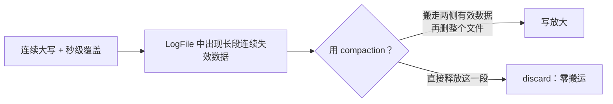

---

## 4. LogFile discard 机制与四个难点

### 4.1 discard 流程（论文 §4.1，图 11）

discard 回收 LogFile 中指定区间的物理空间，**不读也不重写有效数据**，在降低空间放大的同时不增加写放大。流程自上而下、异步，横跨 Segment 层到 UFS 层：

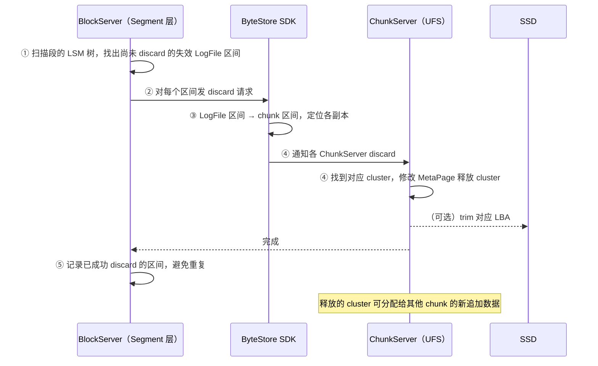

### 4.2 多层栈中的四个难点（论文 §1、§4.1）

| 难点 | 现象 | 对策（章节） |
|------|------|-------------|
| ① 边界损失 | 各层分配单位不对齐（EC 条带、UFS cluster），边界处的垃圾回收不掉 | 边界扩展、与 cluster 对齐的 EC 条带（§5） |
| ② 元数据更新开销 | 频繁 discard 触发频繁 MetaPage 修改，占用磁盘 IOPS 和 CPU，与前台 IO 争抢 | 批处理、并行度控制、流控（§6） |
| ③ 碎片化 | discard 在 LogFile 中打洞，使其变稀疏，LogFile 和 chunk 数量增加，ByteStore 和 ByteDrive 的元数据变大 | 低频 compaction 兜底（§7） |
| ④ trim 能力不足 | trim 能让 SSD 及时回收物理空间，但不同型号 SSD 的最大 trim IOPS 差异很大；trim 不及时会让 SSD GC 变激进，降低前台服务质量 | trim 过滤器与合并器（§8） |

> 论文说明："discard"指软件栈各层的操作，"trim"指 SSD 硬件上的操作，两者可互换使用。

---

## 5. 难点一：边界损失

### 5.1 两种边界损失（论文 §4.2，图 12）

| 类型 | 原因 |
|------|------|
| **EC 损失** | 使用 EC 时，SDK 必须以**完整 EC 条带**为单位 discard（例如 4+1、条带单元 16 KiB 时为 64 KiB 的倍数）；BlockServer 发出的 discard 是任意大小，不与条带对齐 |
| **Cluster 损失** | UFS 必须按 cluster（4 × 4064 B 数据）对齐 discard；但 EC 条带单元通常是 4 KiB 的倍数，下发到 UFS 的 discard 也是 4 KiB 的倍数，与 cluster 不对齐 |

**论文图 12 的例子（2+1 EC，本文按图中数字整理）**：

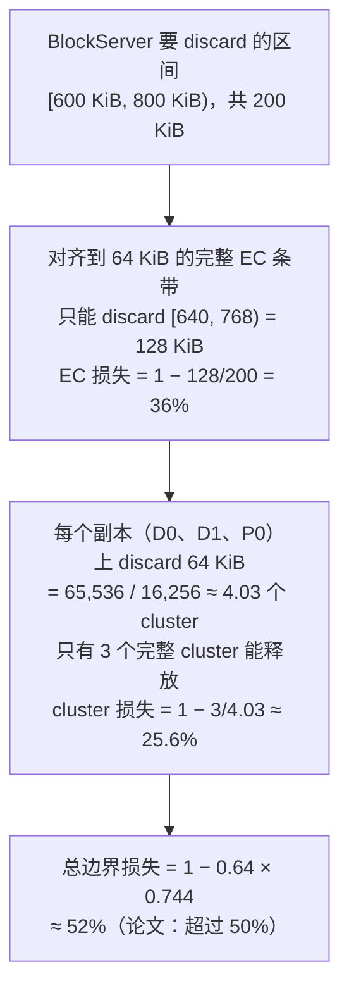

**难以追踪**：BlockServer 扫描 LSM 树时察觉不到边界损失；而在两层之间跟踪边界损失信息会产生大量内存开销（一个 EC 条带内可能有多个已 discard 的子区间，难以用节省内存的数据结构维护）。

### 5.2 对策一：边界扩展（论文 §4.2，图 13）

discard 操作在同一区间上是**可重入**的，因此 BlockServer 可以扩展 discard 范围来消除 EC 损失：discard 一个区间时，检查它是否与之前已 discard 的区间相邻；若相邻，就把当前 discard 范围向相邻区间**扩展最多几 MiB**，略微重叠。

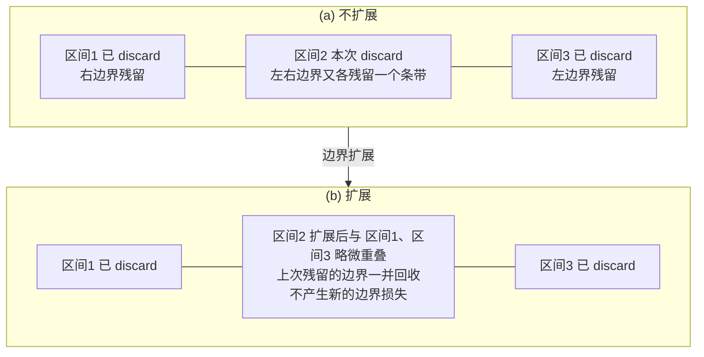

这样既回收了上次 discard 留下的边界垃圾，又避免产生新的边界损失。

### 5.3 对策二：discard 友好的 EC 条带（论文 §4.2，图 14）

把 EC 条带单元大小设为 **n × 4 × 4064 B**，与 UFS 的 cluster 对齐，从而消除 cluster 损失。由于 LogFile 接受任意大小的请求，这种对齐不影响写和 discard 的效率。

| 条带单元 | 每副本 discard | 释放的 cluster | cluster 损失 |
|---------|---------------|---------------|-------------|
| 16 KiB（不对齐） | 2 × 64 KiB = 2 × 4.03 个 cluster | 每副本 3 个 | 25.6% |
| 4 × 4064 B（对齐） | 2 × 16 × 4064 B = 2 × 4 个 cluster | 每副本 4 个 | 0 |

**解读**：

- 边界扩展利用了一个简单事实：**discard 是幂等的**。重复释放已经释放的空间没有副作用，所以可以大胆地"多删一点"去覆盖邻居留下的边角，而不必精确跟踪每个边角。这比维护一个跨层的边界损失账本简单得多。
- 对齐 EC 条带到 cluster，本质是把"扇区头 32 B"带来的非 2 次幂单位**向上传递**到 EC 层，让上层迁就下层。这类问题在任何"每块带校验头"的存储栈中都会出现。

---

## 6. 难点二：discard 批处理与调度

### 6.1 问题（论文 §4.3）

UFS 上每个 discard 请求都要修改 MetaPage，这需要 SSD 写入并消耗 CPU。当一批 discard 请求突然到达（例如 BlockServer 在一轮 LSM 树扫描中发出大量 discard），前台吞吐和延迟会下降。

### 6.2 三个机制（论文 §4.3）

| 机制 | 做法 |
|------|------|
| **批处理** | 多个 discard 指向同一 chunk 时，UFS 只需修改一次 MetaPage。BlockServer 把同一 LogFile 的多个 discard 区间合成一个请求，每请求的最大区间数可配置（**1–64**） |
| **并行度感知的调度** | discard 任务以段为粒度生成，并行度上限为 P。BlockServer 周期性选择 discard 区间最大的 top-k 个段（k 由 P 和进行中的任务数算出），把每段的 discard 区间映射到对应 LogFile，按 LogFile 批成单个请求发给 ByteStore |
| **流控** | 即便有批处理和并行度控制，段中大量可 discard 区间仍可能造成突发。BlockServer 限制最大 discard IOPS，减小性能波动 |

**解读**：三层控制（批大小、并发数、速率）对应三种资源：批处理省 MetaPage 写入（磁盘 IOPS），并发控制省 CPU 和队列，流控兜底防突发。§11.2 的调参经验显示，三者在突发时会自然协同：垃圾积压 → 每个 LogFile 的区间变多 → 批变大 → 回收加速。

---

## 7. 难点三：discard 与 compaction 的协同

### 7.1 碎片化带来的元数据开销（论文 §4.4）

discard 让 LogFile 和 chunk 变得稀疏、碎片化。ChunkServer 上的 SSD 空间使用保持稳定，但 LogFile 和 chunk 的**数量**增加，于是 BlockServer 的 LogFile 索引、MetaServer 的 chunk 索引、UFS 的 MetaPage 管理开销都随之增加。

### 7.2 互补的两种手段（论文 §4.4）

| | discard | compaction |
|--|---------|-----------|
| 写放大 | 不搬数据，无逻辑写放大 | 搬有效数据，有写放大 |
| 碎片 | 制造碎片（打洞） | 消除碎片（合并文件） |
| 能回收 | 大段连续垃圾 | 任何垃圾，包括边界损失和小块垃圾 |
| 频率 | **高频、轻量**，作为主要回收手段 | **低频**，缓解碎片和元数据压力 |

### 7.3 垃圾率的修正（论文 §4.4）

compaction-only 时：

> GR = 1 − 有效数据 / 总数据

引入 discard 后，"总数据"指 LogFile 中**所有尚未 discard 的数据**。但边界损失使一部分"BlockServer 认为已 discard"的区间实际上没有被释放，因此估计**每个边界的损失（LPB）为 EC 条带长度的一半**，修正为：

> GR = 1 − 有效数据 / (总数据 + LPB × 边界数)

**解读**：从 BlockServer 的视角，已 discard 区间不再计入"总数据"，但边界上残留的半个条带仍然占着空间。把 LPB × 边界数加回分母，让 compaction 能看到这部分"隐形垃圾"，从而在边界损失积累多的 LogFile 上触发 compaction 兜底。"半个条带"是对均匀分布下期望损失的估计。

### 7.4 双模式 compaction 调度（论文 §4.4）

compaction 与 discard 在 BlockServer 中独立调度，compaction 以**分钟级**间隔运行：

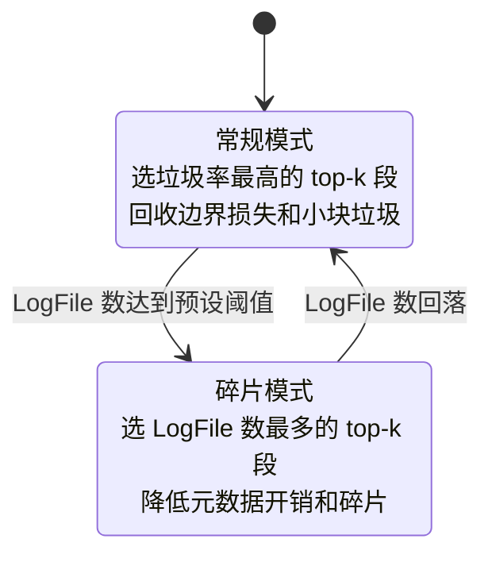

k 同样由类似 discard 的并行度控制机制管理。

**物理写放大的代价**：与 compaction-only 相比，DisCoGC 带来稍多的碎片，使 SSD GC 更频繁，**物理写放大增加 2%–10%**。但由于 discard 减少了 GC 中的数据搬运，写入 NAND 的总字节数仍然减少，SSD 寿命反而延长。

---

## 8. 难点四：SSD trim 能力不足

### 8.1 两个观察（论文 §4.5，表 2）

**观察：小于阈值的 trim 延迟低而稳定**。通过多种型号 SSD 的实测并与厂商讨论发现，trim 大小低于某个阈值（如 SSD 型号 A 为 128 MiB）时，trim 延迟低（1 ms 以下）且稳定。原因是 SSD 的两阶段 trim 实现：

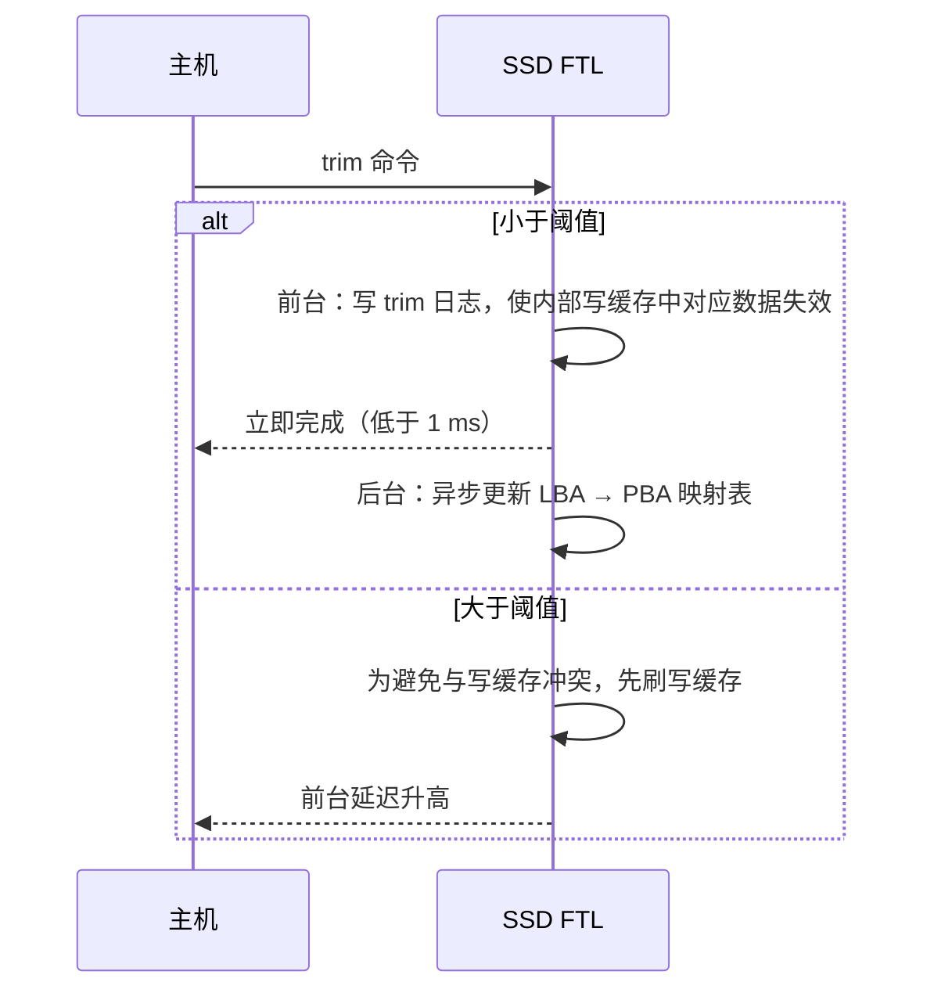

**挑战：trim IOPS 不足**。trim IOPS 往往满足不了频繁 GC 的需求：

**表 2：评估用 SSD**

| 型号 | 接口 | 容量 | 颗粒 | 读/写带宽 | 读/写 IOPS | **trim IOPS** |
|------|------|-----:|------|----------|-----------|-------------:|
| A | PCIe 5.0 | 7.68 TiB | TLC | 13.0 / 9.0 GiB/s | 2,800 K / 400 K | **160 K** |
| B | PCIe 4.0 | 7.5 TiB | TLC | 6.5 / 3.5 GiB/s | 900 K / 200 K | **6 K**（写 IOPS 的 3%） |

trim 不及时带来两个问题：① UFS 默认在 trim 成功后才把空间标记为"已释放"，trim 不及时会延迟空间回收，可能耗尽 UFS 容量导致系统故障；② 失效数据保留更久，降低 SSD GC 效率，SSD 空间使用率升高，SSD GC 变激进，物理写放大上升，前台服务质量下降。

### 8.2 对策：trim 过滤器与合并器（论文 §4.5）

| 机制 | 做法 | 代价 |
|------|------|------|
| **trim 过滤器** | 只对大区间（如 ≥ 128 KiB）发 trim，减少 trim 次数且不增加 trim 延迟 | 小区间不 trim，SSD GC 时会多搬一些失效数据 |
| **trim 合并器** | 把 LBA 上相邻的小区间合并成一个大区间，用一条命令 trim | 部分小区间合并失败；部分区间在被合并 trim 前可能被 SSD GC 搬动多次 |

两者以物理写放大略有上升为代价，减少 trim 次数。

**解读**：trim 能力是一个常被忽略的 SSD 选型指标。表 2 中两款都是数据中心 TLC 盘，写 IOPS 只差 2 倍，trim IOPS 却差 **27 倍**。对于依赖大量 trim 的日志结构系统，trim IOPS 低的盘会直接成为瓶颈，甚至让系统崩溃（§10.6）。

---

## 9. 部署与实现

### 9.1 分阶段部署（论文 §5）

| 措施 | 做法 |
|------|------|
| 先离线后在线 | 先在业务关键性较低的离线集群部署，逐步推广以控制风险 |
| 按卷开启 | 以卷为单位启用 DisCoGC，缩小潜在故障的影响，便于定向监控性能 |
| **Mock discard** | 灰度阶段在生产中启用"模拟 discard"：只在内存中记录 discard 状态，不真正释放数据。验证软件正确性、保证数据安全后，才在大规模集群上部署 |

### 9.2 崩溃一致性（论文 §5）

discard 相关元数据维护在 BlockServer 内存中，因此只需处理 BlockServer 元数据的崩溃一致性，ByteStore 的崩溃一致性由其原有设计保证。

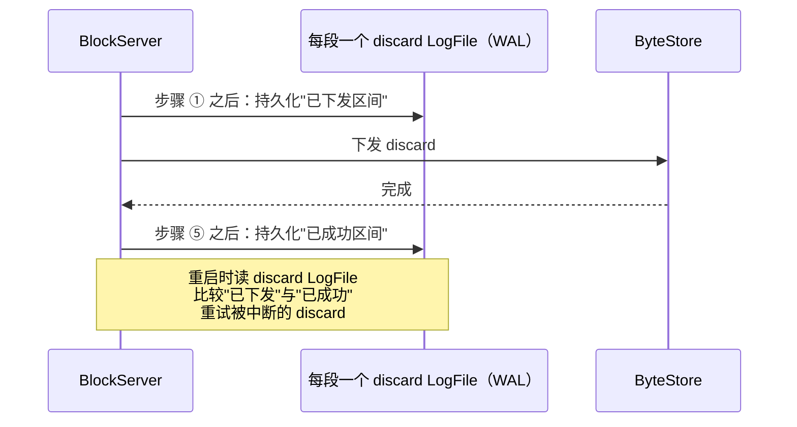

### 9.3 内存管理（论文 §5）

BlockServer 为每个 LogFile 维护两个位图：**已下发**区间和**已成功 discard** 区间，每一位代表 4 KiB 的未压缩数据。

| 优化 | 做法 | 效果 |
|------|------|------|
| Roaring bitmap | 垃圾区间长而连续，位图中有大段连续的 0 和 1，用 roaring bitmap 压缩 | 位图大小减半 |
| 记录失败而非成功 | 不直接记录"成功位图 S"，而记录"失败位图 F"，由 S = I & (~F) 推出（I 为已下发位图）；discard 失败很少，F 更稀疏、更易压缩 | 总位图大小再减少 25%–45% |

**解读（量级）**：每 4 KiB 一位，1 TiB 数据对应 2^28 位 = 32 MiB 的未压缩位图。两张位图、每台 BlockServer 承载数十 TiB 时，未压缩可达 GiB 级，所以压缩是必需的。§10.7 测得的内存只增加 2.9%，说明这两项优化有效。

---

## 10. 评估

### 10.1 实验环境（论文 §6.1）

- 生产集群：每台服务器 2 × 24 核 48 线程 CPU、256 GiB 内存、200 Gbps 网络、16 块 SSD。
- 离线测试床：10 台同配置服务器组成的 ByteDrive + ByteStore 集群，使用 §3 的三个 trace 和 FIO 基准。默认使用 SSD 型号 A。

### 10.2 生产集群（论文 §6.2，图 15、图 16）

混合负载（在线 + SAR + 离线），compaction-only 与 DisCoGC 的空间放大分别保持在 **1.37** 和 **1.23**。

| 指标 | 结果 |
|------|------|
| 失效区间大小（图 16） | 90% 以上大于 128 KiB，70% 以上超过 1 MiB，说明混合负载适合 DisCoGC |
| 逻辑写放大（图 15a） | 观察期内稳定；**降低 32%**（估读：compaction-only 约 2.1–2.3，DisCoGC 约 1.5） |
| 空间放大 | 降低 10%（1.37 → 1.23） |
| 物理写放大 | 最多增加 10% |
| 总写放大 | **降低 25%**（0.68 × 1.10 ≈ 0.75） |
| TCO | **降低 20%** |
| 延迟与带宽（图 15b、c） | 影响可忽略（估读：平均约 110 µs、P99 约 400 µs，两者重合；每 TiB 卷带宽约 30–40 MiB/s） |

### 10.3 测试床总体性能（论文 §6.3，图 17、图 18）

保持 SSD 使用率不变回放三个 trace 和一个合成 FIO 负载（32 MiB 范围内 64 KiB 随机写），绘制"空间放大—逻辑写放大"曲线：

- 四个负载的曲线都向**左下方**移动，即同样空间放大下写放大更低。
- **SAR** 收益最大（大而连续的垃圾），估计 TCO **降低 25% 以上**。
- **在线**收益最小（垃圾碎片化），但仍有改善；最坏情况下 DisCoGC 退化为 compaction-only，即使如此也能节省 **2%–5%** 的 TCO。
- FIO 也有显著改善。
- 前台写延迟（图 18）几乎不受影响：估读平均约 150 µs，P99 约 350–500 µs。

### 10.4 因素分析（论文 §6.4，图 19）

固定空间放大（在线 1.2，SAR 1.05，离线 1.2），逐项加入各技术，以 compaction-only 为基线：

| 步骤 | 逻辑写放大降幅（论文） | discard 比例（已 discard / 可 discard） |
|------|---------------------|----------------------------------|
| +Discard（含流控） | 8.4%–13.9% | 0.45–0.88（流控节流了部分请求） |
| +Batch（批大小 64） | 再降 2.7%–11.7% | 接近 1 |
| +BoundExt（边界扩展） | 再降 5.5%–16.1% | 接近 1 |

图中估读的逻辑写放大：

| 负载 | Compaction | +Discard | +Batch | +BoundExt | 总降幅 |
|------|----------:|---------:|-------:|----------:|------:|
| 在线 | 约 2.15 | 约 1.95 | 约 1.75 | 约 1.45 | 约 33% |
| SAR | 约 1.42 | 约 1.22 | 约 1.18 | 约 1.12 | 约 21% |
| 离线 | 约 1.47 | 约 1.38 | 约 1.25 | 约 1.12 | 约 24% |

各配置下前台带宽和延迟保持稳定。

**解读**：批处理把 discard 比例从不足 0.9 提到接近 1，说明在没有批处理时，**流控是主要瓶颈**：请求太多，被限速丢弃。批处理减少了请求数，让同样的 IOPS 额度能处理几乎所有可回收区间。边界扩展的贡献在三项中最大，说明边界损失在实际中确实不可忽视。

### 10.5 敏感性分析（论文 §6.5，图 20、图 21）

**SSD 空间使用率**（离线 trace，空间放大 1.2；生产中预留至少 20% SSD 空间，使用率上限 80%）：

| SSD 使用率 | 物理写放大（估读） | 逻辑写放大（估读） | 平均延迟（估读） |
|-----------|----------------:|----------------:|---------------:|
| 60% | 约 1.32 | 约 1.40 | 约 90 µs |
| 70% | 约 1.37 | 约 1.42 | 约 92 µs |
| 80% | 约 1.42 | 约 1.40 | 约 92 µs |

使用率越高，SSD GC 越激进，物理写放大越高；但逻辑写放大不受影响（由 compaction 的并行度限制决定），前台延迟也不变（此使用率下 SSD GC 不是瓶颈）。

**discard IOPS 上限**（FIO：8 MiB 范围内 64 KiB 随机写，空间放大 1.5；0 IOPS 即关闭 discard）：

| discard IOPS 上限 | 逻辑写放大（估读） | 平均延迟（估读） | P99 延迟（估读） |
|------------------|----------------:|---------------:|---------------:|
| 0（compaction-only） | 约 1.78 | 约 240 µs | 约 800 µs |
| 40 | 约 1.17 | 约 170 µs | 约 430 µs |
| 80 | 约 1.13 | 约 170 µs | 约 430 µs |
| 160 | 约 1.08 | 约 170 µs | 约 460 µs |
| 不限 | 约 1.08 | 约 175 µs | 约 560 µs |

上限越高，回收的垃圾越多，逻辑写放大越低；但在非零上限中，上限越高延迟越差，因为 discard 与前台 IO 争抢 CPU。

**解读**：图 21 有一个论文没有强调的细节：**关闭 discard（0 IOPS）时延迟反而最差**，P99 约 800 µs，远高于开启 discard 后的约 430 µs。原因应是 compaction-only 在这个高覆盖负载下要做大量搬运，对前台的干扰比轻量的 discard 大得多。这说明 discard 不仅省写放大，在高 GC 压力下还能改善尾延迟。流量上限设在 40–80 IOPS 区间即可拿到大部分收益。

### 10.6 trim 优化（论文 §6.6，图 22）

FIO（8 MiB 范围内 64 KiB 随机写），开启边界扩展等其他优化。"删除延迟"指 compaction 删除一个 chunk（可能包含多个 trim 区间）的平均延迟，反映高密度 trim 下的性能。

**SSD 型号 A（trim IOPS 160 K）**：

| 配置 | 物理写放大 | trim IOPS（估读） | 删除延迟（估读） |
|------|----------:|----------------:|---------------:|
| 不 trim | 1.4 | — | 约 180 µs |
| Trim | **1.3** | 约 5 K | 约 830 µs（+600 µs 左右） |
| + 过滤器 | 1.35 | 约 1.6 K | 约 540 µs |
| + 合并器 | 1.33 | 约 2.2 K | 约 600 µs |

型号 A 的 trim 能力充足：不加过滤时 trim IOPS 约 5 K，远低于上限 160 K；此时再限制 trim 反而让性能变差。

**SSD 型号 B（trim IOPS 6 K）**：

| 配置 | 物理写放大 | trim IOPS（估读） | 删除延迟 |
|------|----------:|----------------:|---------:|
| 不 trim | 未测（SSD GC 能力也差，系统会更快失败） | — | — |
| Trim | 约 2.65，很高 | 约 5.8 K（接近上限） | 超过 100 ms |
| + 过滤器 | **1.74** | **2.8 K** | **34 ms** |
| + 合并器 | **1.65** | 约 3 K | 约 35 ms |

型号 B 只开 trim 时 trim IOPS 打满，SSD 空间释放不及时，SSD GC 激进，前台性能下降，甚至可能导致系统崩溃。

**结论（论文）**：trim 命令对所有 SSD 都有益；但对 trim IOPS 不足的 SSD，需要额外的过滤和合并优化。

### 10.7 CPU 与内存（论文 §6.7）

回放离线 trace（SSD 使用率 60%，空间放大 1.25）：

| 资源 | DisCoGC / compaction-only |
|------|------------------------:|
| CPU | **82.9%**（compaction 读写密集，减少 compaction 就减少了 CPU） |
| 内存 | **102.9%**（discard 位图，经 §9.3 优化后开销很小） |

---

## 11. 经验：何时用、怎么调、怎么监控

### 11.1 是否采用 DisCoGC（论文 §7）

通过 trace 分析判断：

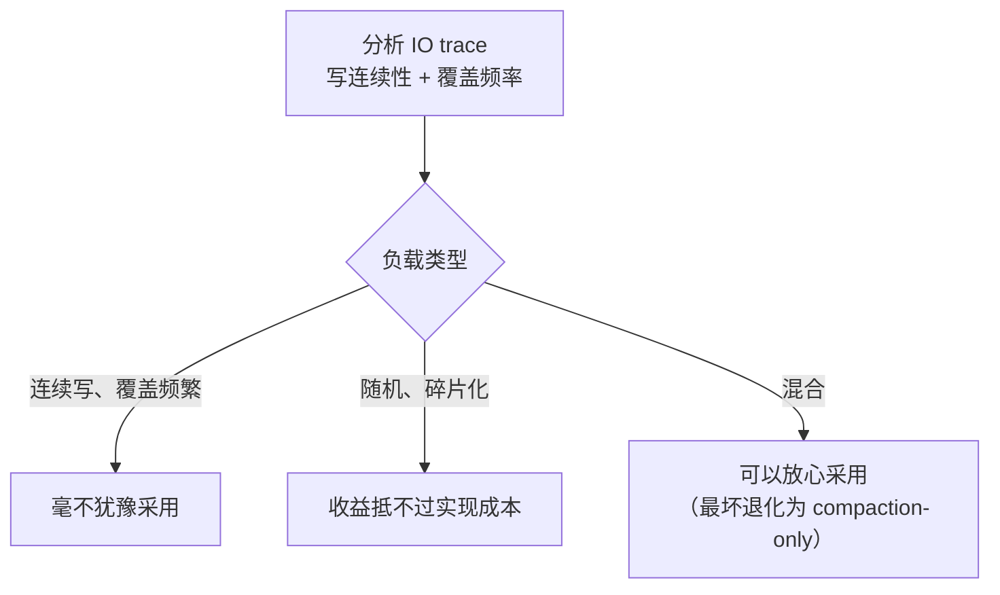

### 11.2 参数调优（论文 §7）

| 参数 | 经验 |
|------|------|
| 每批最大区间数 | 设为 32 或 64，防止 ChunkServer CPU 突发 |
| 最大 discard IOPS | 保证最坏情况下 CPU 开销增加少于 **2%** |
| 其他参数 | 在平均 CPU 开销保持 **1.2%** 的前提下尽量调大 |
| 调优后常态 | 批大小约 **10**，DisCoGC 的 CPU 占用约 **1%** |

**突发时的自适应**：写突发 → 大量 discard 请求 → 受并行度限制，垃圾先积累 → 每个 LogFile 的失效区间变多 → 批变大，回收加速。极端突发时批大小和 discard IOPS 都触顶，discard 单独无法有效回收，LogFile 垃圾率上升，于是由 compaction 回收。批处理、并行度控制和流控协同，**限住 DisCoGC 的最大 CPU 和 SSD 占用**，保证突发期间前台服务质量。

### 11.3 是否需要 trim 优化（论文 §7）

- 比较 SSD 的最大 trim IOPS 与负载需求来选择 SSD 型号。
- 若 SSD 的 trim IOPS 不加优化就能满足需求、且不降低前台性能，只开 trim，关闭其他优化。
- 否则同时开启过滤器和合并器（比只开过滤器更有效），并调整过滤阈值，使 trim IOPS 低于 SSD 最大 trim IOPS 的 **85%**。

### 11.4 监控与处置（论文 §7）

**告警条件**：discard 比例低于 **80%** 持续超过 **10 分钟**，同时 SSD 空间使用率高于 **85%** 且仍在上升。这意味着 discard 被并行度和流控节流、compaction 又来不及回收，SSD 有空间耗尽的风险。

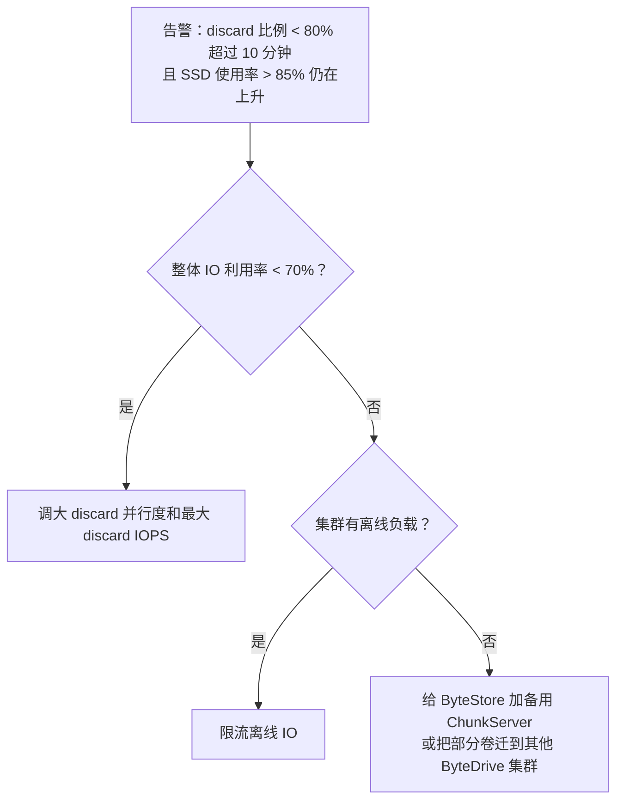

**解读**：这一节把"何时用—怎么调—怎么监控—出事怎么办"讲成了一套可执行的运维手册，是这篇论文相对一般 GC 论文最实用的地方。监控指标的选择也值得借鉴：**discard 比例**直接反映"回收能力是否跟得上产生垃圾的速度"，比单看空间使用率更早发出预警。

---

## 12. 论文中的不一致与可疑之处

| 位置 | 问题 | 本文的处理 |
|------|------|-----------|
| §6.3 vs §6.4 | §6.3 称在线负载从 DisCoGC 中**受益最少**；但图 19 中在线负载的逻辑写放大降幅（约 33%，估读）是三者中最大的（SAR 约 21%、离线约 24%）。两者的空间放大设定不同（§6.4 在线固定为 1.2），且 §6.3 讲的是 TCO 收益，口径不同，但论文没有解释这个反差 | 照录，提示口径差异 |
| §4.4 vs §6.3 | §4.4 称 DisCoGC 使物理写放大增加 2%–10%；§6.3 称测试床中物理写放大"在整个评估中保持稳定" | 理解为生产中有增加、测试床恒定 SSD 使用率时不明显 |
| §1 vs §6.2 | 引言称"空间放大降低 10% 的配置下，写放大降低 25%"，§6.2 给出逻辑写放大降低 32%、物理写放大最多增加 10%、总写放大降低 25%；0.68 × 1.10 ≈ 0.75，自洽 | 已核对 |
| §6.2 | "TCO 降低 20%"的计算方式（各项成本权重）未公开 | 只能接受结论 |
| 表 1 | PDF 文本中表格数字顺序错乱，需要按列关系重排才能读懂 | 本文已重排并核对（§3.1） |
| §5 | 每一位代表"4 KiB 未压缩数据"，而 LogFile 中存的是压缩后的数据；位图如何与 LogFile 物理偏移对应没有说明 | 照录 |
| §4.5 vs §6.6 | §4.5 以型号 A 的 128 MiB 为"trim 延迟稳定的阈值"，而 trim 过滤器的阈值是 128 KiB；两个"128"单位不同、含义不同，容易混淆 | 本文分别标注 |
| 图 21 | 关闭 discard（0 IOPS）时延迟最差，论文只讨论了非零上限下"上限越高延迟越差" | 见 §10.5 解读 |
| 全文 | 没有与其他 GC 优化方法（如按失效时间分离数据、热冷分离）做量化对比，基线只有自家的 compaction-only | 按经验报告阅读 |

---

## 13. 与相关工作的对比

### 13.1 论文中的相关工作（论文 §8）

| 方向 | 代表 | 与 DisCoGC 的关系 |
|------|------|-----------------|
| 写放大与空间放大 | FTL 写放大、文件系统层写放大、KV 存储写放大、各类空间放大研究 | DisCoGC 在多层分布式栈中改善两者的权衡 |
| 跨层 GC | 软件管理 flash / Open-Channel SSD（单层 GC）、文件系统与 FTL 的 GC 协同 | DisCoGC 面对的是"块层—LogFile—chunk—UFS—SSD"更多层的协同 |
| trim / discard | 2008–2011 年间 Linux、Windows、macOS 对 trim 的支持 | DisCoGC 把 discard 引入分布式日志存储，并解决 trim IOPS 不足 |
| Slack Space Recycling | 新写直接复用失效数据的日志空间，通过覆盖丢弃失效数据，避免 compaction | 思路相近，DisCoGC 用显式 discard 而非覆盖 |
| IPLFS | 用 discard/trim 丢弃失效数据，虚拟化出无限的逻辑地址空间 | 单机文件系统层面的类似思想 |

### 13.2 与本仓库中其他系统的对照

| 维度 | ByteDrive + ByteStore（本文） | 阿里 EBS3 + 盘古（[EBS Glory](ebs-fast2024.md)） |
|------|----------------------------|--------------------------------------------------|
| 块层 | BlockServer，段，128 KiB 条带轮转 | BlockServer，32 GiB 段，128 KiB 数据扇区轮转 |
| 索引 | LSM 树：段 LBA → ByteStore 物理地址 | LSM 树：VD LBA → DataFile 偏移 |
| 压缩 | 块级 LZ4 / deflate | LZ4（FPGA / CPU） |
| 底层 | ByteStore LogFile（最大 2 GiB）→ chunk → UFS | 盘古文件（DataFile 512 MiB）→ chunk → USSFS |
| 扇区格式 | 4 KiB 扇区 = 32 B 头 + 4064 B 数据 | 4 KiB 数据 + 64 B 头（DataFile）；盘古 sector unit 带 footer |
| GC 优化重点 | **discard 打洞**，减少搬运 | **前台 EC + 压缩、跨盘合并**，减少流量放大；GC 本身仍是搬运 |
| GC 写放大（压力最大的集群） | 生产逻辑写放大从约 2.2 降到约 1.5 | 小于 1.5 |

**解读**：两家的块存储架构几乎可以互相替换名词，说明"日志结构块存储 + 通用只追加底座"已是国内云厂商的共识。差别在于各自选择优化哪个环节：阿里优化写入路径（让数据一开始就以高效格式落盘），字节优化回收路径（让回收不必搬数据）。这两种思路并不冲突，理论上可以叠加。

---

## 14. 整体总结

### 14.1 核心贡献

1. **trace 驱动的问题定义**：通过生产 trace 发现 SAR 和离线负载写入连续、覆盖频繁，产生大段连续垃圾；生产混合负载中 70% 以上的失效区间超过 1 MiB。这为"不搬数据直接回收"提供了依据。
2. **把 discard 引入多层分布式日志存储**：BlockServer 扫描 LSM 树 → SDK 映射到 chunk 副本 → UFS 修改 MetaPage → SSD trim，异步、自上而下。
3. **解决跨层对齐**：边界扩展（利用 discard 的幂等性）消除 EC 损失，cluster 对齐的 EC 条带消除 cluster 损失；论文例子中原本超过 50% 的边界损失被消除。
4. **控制开销与副作用**：批处理、并行度控制、流控限制元数据更新和 CPU 开销；双模式 compaction 兜底碎片和边界垃圾；trim 过滤器和合并器适配 trim 能力弱的 SSD。
5. **生产验证与运维手册**：TCO 降低约 20%，性能无损；给出了是否采用、如何调参、如何选 SSD、如何监控和处置的具体规则。

### 14.2 设计哲学

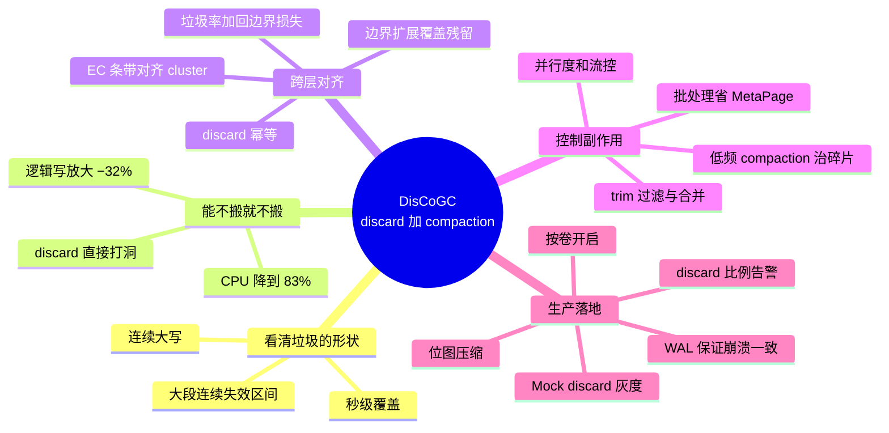

### 14.3 优点与局限

| 优点 | 局限 |
|------|------|
| 问题来自生产 trace，机制与负载特征一一对应 | 收益强依赖负载：碎片化负载只有 2%–5% 的 TCO 收益 |
| 跨层对齐的分析细致，边界扩展、条带对齐等做法简单有效 | TCO 计算方法未公开，"20%"无法复现 |
| 因素分析清晰，每项技术的贡献都量化了 | 只与自家 compaction-only 比较，没有与热冷分离、按失效时间放置等其他 GC 优化对比 |
| trim 能力的讨论填补了常被忽略的 SSD 选型维度 | 物理写放大会增加 2%–10%，碎片化带来的元数据增长只给出定性描述 |
| 部署、调参、监控、处置的经验完整，可直接借鉴 | 一些评估结论（在线负载受益多少）在不同章节口径不一 |

### 14.4 启示

**对日志结构存储的设计者**：

- **先看垃圾的形状再选 GC 方式**。分析 trace 中写的连续性和覆盖频率：大段连续的垃圾适合原地回收（discard、打洞），零散垃圾才需要搬运合并（compaction）。两者组合比任何一种单独使用都好。
- **跨层分配单位要统一设计**。块层压缩、EC 条带、文件系统 cluster、SSD 页和 trim 粒度，只要有一层不对齐，回收就会留下边角料。在带校验头的存储栈中，应让上层（EC 条带）迁就下层（cluster 的有效数据大小）。
- **利用幂等性简化跨层状态**。discard 可以重复执行，所以"多删一点覆盖邻居"比"精确记账每个边角"简单得多。类似的思路适用于其他幂等的回收或清理操作。
- **轻量手段做主力、重量手段做兜底**。高频、低成本的 discard 负责大部分回收，低频的 compaction 处理碎片和 discard 回收不掉的部分。

**对 SSD 选型与运维**：

- **trim IOPS 是日志结构系统的关键指标**，同为数据中心 TLC 盘，trim IOPS 可以相差 27 倍。选型时要用负载的 trim 需求去比对，必要时用过滤和合并把 trim IOPS 压到上限的 85% 以下。
- 监控"回收速度是否跟得上垃圾产生速度"（如 discard 比例），比只监控空间使用率更早发现风险。

### 14.5 一张图看懂 DisCoGC

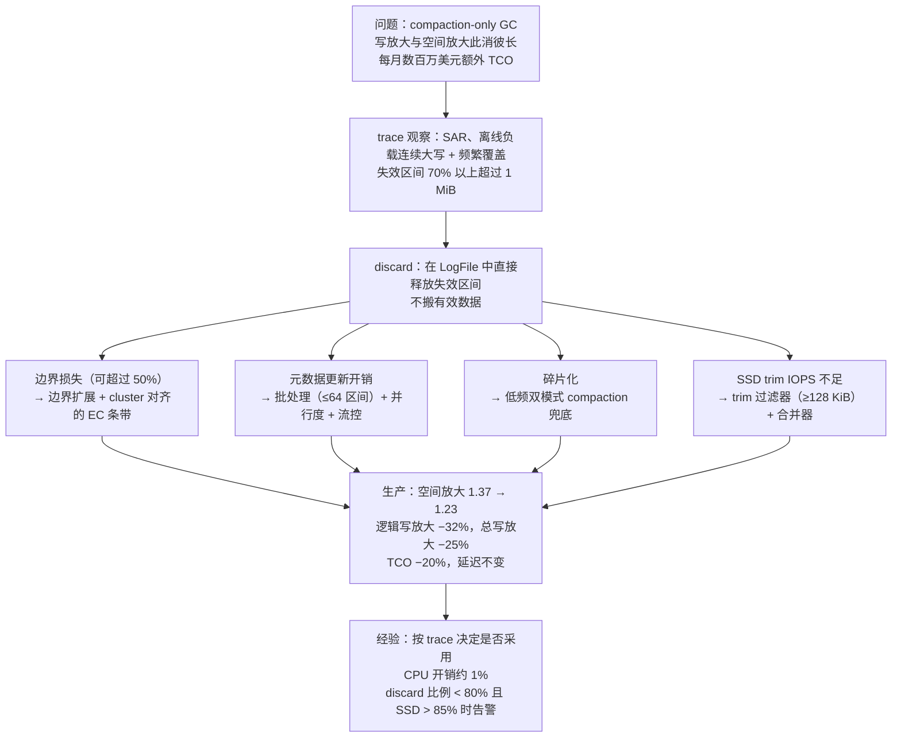

---

## 参考

- Runhua Bian, Liqiang Zhang, et al. *Discard-Based Garbage Collection for Distributed Log-Structured Storage Systems in ByteDance*. USENIX FAST 2026. <https://www.usenix.org/conference/fast26/presentation/bian>
- Weidong Zhang, Erci Xu, et al. *What's the Story in EBS Glory: Evolutions and Lessons in Building Cloud Block Store*. USENIX FAST 2024.（本仓库精读：[ebs-fast2024.md](ebs-fast2024.md)）
- Qiang Li et al. *More Than Capacity: Performance-oriented Evolution of Pangu in Alibaba*. USENIX FAST 2023.（本仓库精读：[pangu-fast2023.md](pangu-fast2023.md)）
- Qiuping Wang et al. *Separating Data via Block Invalidation Time Inference for Write Amplification Reduction in Log-Structured Storage*. USENIX FAST 2022.
- Mendel Rosenblum, John K. Ousterhout. *The Design and Implementation of a Log-Structured File System*. ACM SOSP 1991.
- Samy Chambi et al. *Better Bitmap Performance with Roaring Bitmaps*. Software: Practice and Experience, 2016.
- LWN.net. *Block Layer Discard Requests*, 2008. <https://lwn.net/Articles/293658/>
- 本仓库相关：[EBS Glory 精读](ebs-fast2024.md)、[盘古 2.0 精读](pangu-fast2023.md)、[工业界生产系统](industry-production-systems.md)、[客户端与通用技术](client-and-general-techniques.md)
