# DPFS 论文精读：DPU-Powered File System Virtualization（SYSTOR 2023）

> 论文：Peter-Jan Gootzen, Jonas Pfefferle, Radu Stoica, Animesh Trivedi. *DPFS: DPU-Powered File System Virtualization*. ACM SYSTOR 2023（16th ACM International Conference on Systems and Storage），Haifa，2023-06-05 至 06-07。
>
> 机构：Peter-Jan Gootzen（IBM Research Zurich，同时在 VU Amsterdam）、Jonas Pfefferle（IBM Research Yorktown Heights）、Radu Stoica（IBM Research Zurich）、Animesh Trivedi（VU Amsterdam）。Shepherd 为 Youyou Lu（陆游游）。
>
> 链接：<https://dl.acm.org/doi/10.1145/3579370.3594769> ；PDF（作者主页）：<https://animeshtrivedi.github.io/files/papers/2023-systor-dpfs.pdf> ；代码：<https://github.com/IBM/DPFS>
>
> 篇幅：6 页正文的短论文（含 4 张表、2 张图）。
>
> 精读日期：2026-11-22。文中**数字、表格与机制描述均摘自论文原文**（标注所在章节）；标注"解读"的段落是本文作者的分析与推论，不是论文原话。
>
> 相关文档：[客户端与通用技术综述中的 DPFS 小节](client-and-general-techniques.md#15-dpfs-dpu-powered-file-system-virtualization)、[新硬件综述中的 DPFS 小节](new-hardware.md#5-dpfs-dpu-powered-file-system-virtualization)、[Fisc（FAST 2023）精读](fisc-fast2023.md)（同年另一条 DPU 文件系统接入路线）。

## 目录

- [0. 一页速览](#0-一页速览)
- [1. 动机：云文件系统客户端的三个问题](#1-动机云文件系统客户端的三个问题)
- [2. 为什么在文件系统层卸载](#2-为什么在文件系统层卸载)
- [3. DPFS 的三层框架](#3-dpfs-的三层框架)
- [4. I/O 路径：主机 NFS vs DPFS](#4-io-路径主机-nfs-vs-dpfs)
- [5. DPFS-HAL 与 DPFS-FUSE](#5-dpfs-hal-与-dpfs-fuse)
- [6. 三个后端](#6-三个后端)
- [7. 评估](#7-评估)
- [8. 局限与后续工作](#8-局限与后续工作)
- [9. 与相关工作的对比](#9-与相关工作的对比)
- [10. 整体总结](#10-整体总结)
- [参考](#参考)

---

## 0. 一页速览

**一句话**：云上的分布式文件系统客户端又重又难调，还要跑在租户的 CPU 上。DPFS 把它整体搬到 DPU（NVIDIA BlueField-2）上：主机只用 Linux 内核自带的 **virtio-fs** 驱动，把 VFS 操作编码成 FUSE 消息，经 PCIe 上的 virtio 队列交给 DPU；DPU 上由云厂商实现和优化真正的文件系统客户端（论文实现了 NFS 和 RAMCloud KV 两个后端）。租户零安装、零配置，每次 I/O 消耗的主机 CPU 周期降为原来的 1/4.4。

| 维度 | 要点 |
|------|------|
| 要解决的问题 | ① 用 CPU 喂满高速 I/O 设备越来越贵（阿里 200 Gbps 块流量要 12 核；Ceph 单核只能跑约 10 Gbps）；② 客户端逻辑臃肿，动辄占用 GB 级内存；③ 文件系统 API 与实现紧耦合，租户换后端、调参数都很难（§1） |
| 为什么选文件系统层 | 块层卸载有 I/O 放大：一次 4 KiB 文件写在 ext4 上产生 5.2 次块 I/O（11.2× 字节放大），走 NVMe-oF 时 13.7 次；应用层卸载需要改应用。文件层只需一次文件操作跨 PCIe（§1，表 1） |
| 架构 | 三层：DPFS-HAL（屏蔽 DPU 厂商细节、轮询 virtio 队列）→ DPFS-FUSE（类 libfuse 的异步 API）→ 文件系统后端（§2） |
| 后端 | DPFS-null（空操作，测框架开销）、DPFS-NFS（libnfs + NVIDIA XLIO 部分 TCP 卸载）、DPFS-KV（RDMA 访问 RAMCloud）（§2.3、§2.4） |
| 框架开销 | DPFS-null 4 KiB 随机读写峰值 327K / 240K IOPS；64 KiB 读写峰值 5.87 / 4.32 GiB/s；基础延迟 38.6 / 43.3 µs（§3.1） |
| NFS 对比 | I/O 深度 ≤3 时主机 NFS 吞吐高 11%–21%；≥4 时 DPFS-NFS 高 12%–32%；单次 4 KiB 延迟 DPFS-NFS 更高（读 91.5 µs vs 71.2 µs）（§3.2，图 2） |
| 主机 CPU 效率 | 每次 4 KiB 操作的主机内核指令数少 62.8%，IPC 从 0.57 升到 0.94，合计每 I/O 主机 CPU 周期为主机 NFS 的 **1/4.4**（§3.4，表 4） |
| 局限 | 当时内核 virtio-fs 只用单个请求队列；FUSE 头占用 3–4 页，加上 XLIO 内存限制，队列深度只能到 16；BlueField-2 的 ARM A72 核偏弱，DPFS-NFS 的 4 KiB 吞吐只有 DPFS-null 的约 20%（§3.5） |

**解读**：

- DPFS 的核心主张不是"更快"，而是"**解耦**"：把文件系统的**接口**（标准 virtio-fs/FUSE，主机内核自带）和**实现**（DPU 上由云厂商控制的客户端）分开。性能上它只做到"与主机 NFS 相当"，在低队列深度下还更慢；真正的收益是主机 CPU 的节省、租户零配置，以及云厂商可以在不打扰租户的情况下更换后端。
- 与同年的 [Fisc（FAST 2023）](fisc-fast2023.md)相比，两者都用 DPU 做"租户 ↔ 存储"的跨域直通，但 DPFS 选了**标准** virtio-fs 和**通用** CPU 型 DPU，追求可移植与开放；Fisc 用**自定义** virtio-Fisc 设备和 FPGA 快路径，追求性能和规模化。
- 这是一篇 6 页的短论文，评估只有单机、单租户、单队列、4 KiB 为主，后端是 NFS 和一个扁平 KV。它证明的是"这条路走得通、主机 CPU 能省下来"，而不是"可以直接投产"。

---

## 1. 动机：云文件系统客户端的三个问题

### 1.1 背景（§1）

云上的文件系统服务包括传统分布式文件系统（HDFS、Ceph、GlusterFS）和云原生文件系统（CNFS）服务，如 Amazon EFS、阿里盘古、Azure Files。随着超融合基础设施的推进，需要高效、可扩展、高性能的云原生文件系统服务。租户访问这些服务通常有两种方式：用内核自带的 NFS 客户端，或者在租户机器上运行云厂商的文件系统客户端代码（§4）。

### 1.2 三个问题（§1）

| 问题 | 论文给出的证据 |
|------|---------------|
| **CPU 成本**：存储和网络设备性能持续上涨，CPU 性能增长停滞，在分离式存储下喂满 I/O 设备要消耗大量 CPU | 阿里报告传输 200 Gbps 块级流量需要 **12 个 CPU 核**；LineFS 报告 Ceph 在 100 Gbps 链路上，一个满载 CPU 核只能提供约 **10 Gbps** 带宽；近年流行的裸金属云更在乎 CPU 效率 |
| **客户端臃肿**：客户端要实现与元数据/数据服务器的通信与协调、缓冲区与连接管理、缓存等 | 分布式文件系统客户端占用 **GB 级 DRAM** 和大量 CPU 并不罕见，这限制了一台服务器能容纳的租户（VM、容器）数量 |
| **API 与实现紧耦合**：难以部署新的扩展或优化 | 一个使用 Ceph 的裸金属租户遇到元数据扩展性问题时，很难无中断地切换到 HopsFS 或 InfiniFS；许多 CNFS 有上百个性能参数，需要租户自己部署和调优 |

### 1.3 现有的"解耦"做法及其不足（§1、§4）

云厂商目前提供一种有限的解耦：在 CNFS 前面放一个 **NFS 网关**，租户用内核 NFS 客户端访问。论文认为这种方式让云厂商失去了对文件系统客户端的控制，并且后面会证明 Linux 内核 NFS 客户端本身开销很高（§3.4）。

**解读**：这三个问题其实分属两方。CPU 成本和客户端臃肿是**租户**的痛（花钱买的 CPU 和内存被存储客户端吃掉）；API 与实现紧耦合是**云厂商**的痛（想换后端、想做 QoS 和缓存，但客户端在租户手里）。DPFS 的方案同时回应双方：客户端搬到 DPU，租户省资源；DPU 归云厂商管，云厂商拿回控制权。

---

## 2. 为什么在文件系统层卸载

### 2.1 三个可选的卸载层次（§1）

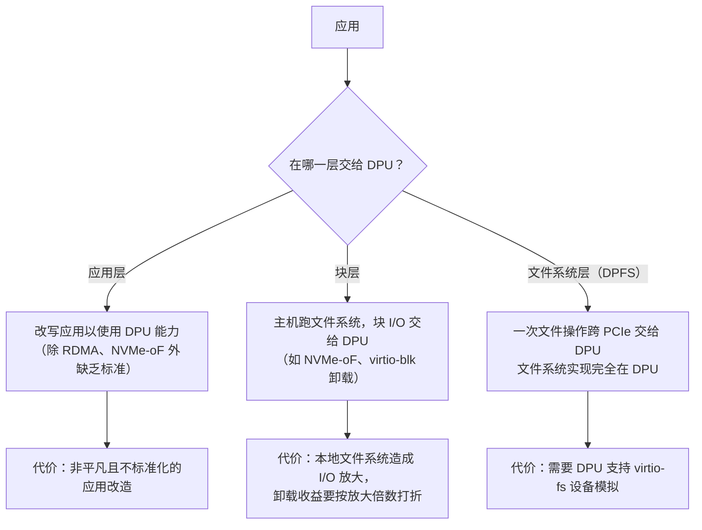

### 2.2 块层卸载的 I/O 放大（§1，表 1）

一次 4 KiB 文件写，在不同本地文件系统下产生的块操作（或 NVMe-oF 下的网络包）：

| | ext4 | ext4 + NVMe-oF | XFS | Btrfs |
|--|----:|----:|----:|----:|
| I/O 操作数 | 5.2 | 13.7 | 3 | 4.6 |
| 总字节（KiB） | 44.7 | 46.8 | 12 | 125.3 |
| 放大倍数 | 11.2× | 11.7× | 3× | 16× |

论文结论：根据文件系统不同，放大可达 3–16×，需要硬件卸载带来同等倍数的收益才能抵消；NVMe-oF 相对本地块 I/O 还会把平均操作数从 5.2 增加到 13.7。而文件系统层虚拟化只需"主机 → DPU 一次文件操作，DPU → 后端一次文件操作"（§1）。

**读表注意（解读）**：放大倍数是"总字节 / 4 KiB"。ext4（44.7/4 ≈ 11.2）、ext4 + NVMe-oF（46.8/4 ≈ 11.7）、XFS（12/4 = 3）都对得上，但 Btrfs 的 125.3/4 ≈ 31.3，与表中的 16× 不符；正文"3–16×"沿用了表中数字。另外表中"I/O 操作数"与"字节放大"是两个维度，正文论证时混用。

### 2.3 文件系统层卸载的额外好处（§1）

- **零配置**：所有 CNFS 配置和优化集中在 DPU 上，由云厂商负责，租户不需要任何调优。
- **隔离与安全**：DPU（运行云厂商逻辑）与租户（主机）在物理上分离，可以抑制基于资源共享的侧信道攻击，提升租户隔离。
- **"bump-in-the-wire"**：前端（标准文件系统 API）与后端（CNFS）解耦后，云厂商可以在 DPU 上做调度、缓存、配额、QoS 等网络与存储优化，而租户无需安装代码或更改配置。

---

## 3. DPFS 的三层框架

### 3.1 架构（§2，图 1 右侧）

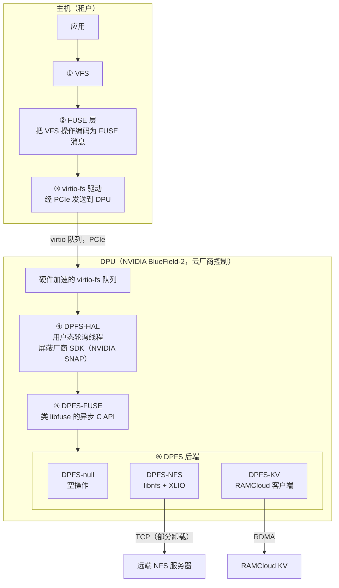

| 层 | 作用 |
|----|------|
| DPFS-HAL | DPU 硬件抽象层：封装厂商相关功能和主机-DPU 之间的优化，降低开发后端所需的 DPU 知识，简化维护，便于迁移到新型号或其他厂商的 DPU |
| DPFS-FUSE | 在原始 virtio-fs 协议缓冲区之上实现类 libfuse 的 API |
| 后端 | 连接远端文件系统的 DPU 侧逻辑；论文提供 null、NFS、KV 三个实现 |

**解读**：这个分层的价值在于把"DPU 编程"变成了"写一个 FUSE 文件系统"。开发者可以先在普通 Linux 上用 libfuse 开发和调试，等有 DPU 时再迁移过去（§2.2）。DPFS 的定位因此更像一个**开发框架**，而不是某个具体的文件系统。

---

## 4. I/O 路径：主机 NFS vs DPFS

### 4.1 两条路径（§2.1，图 1）

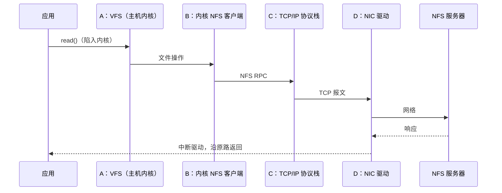

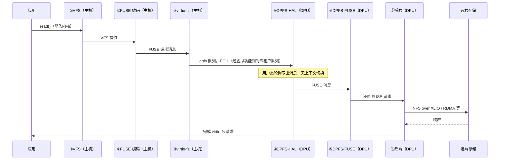

### 4.2 代码路径有多短（§2.1）

用 Linux 6.2 内核代码行数粗略衡量：主机 NFS 路径的 B–C 步（NFS + IPv4 TCP/IP）约 **18.1 万行**；DPFS 路径的 ②–③ 步（FUSE + virtio-fs）约 **1.3 万行**。DPU 上的客户端运行在用户态，不需要上下文切换，后端还可以使用 RDMA、TCP 卸载等硬件加速。

### 4.3 virtio-fs 用 FUSE，但没有 FUSE 的开销（§2.1）

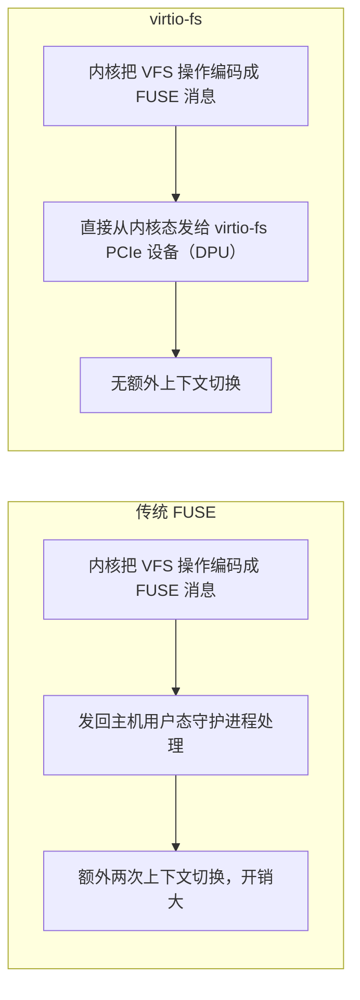

virtio-fs 只是借用 FUSE ABI 作为 VFS 操作的**标准化编码格式**；请求不会回到主机用户态，因此不会产生传统 FUSE 的额外开销（§2.1）。

**解读**：virtio-fs 原本是为 VM 与宿主机共享目录设计的（虚拟机内的 virtio-fs 驱动 → 宿主机上的 virtiofsd）。DPFS 的关键洞察是：**把"宿主机上的 virtiofsd"换成"DPU 上的程序"**，主机内核完全不知道对面是虚拟设备还是硬件设备。同样的思路也适用于裸金属——DPU 以 PCIe 设备身份出现在裸金属主机上，对租户来说和一块普通的 virtio 设备没有区别。

---

## 5. DPFS-HAL 与 DPFS-FUSE

### 5.1 DPFS-HAL（§2.2）

在 BlueField-2 上，固件把 virtio-fs 设备以 **RDMA 设备**的形式暴露给 DPU 用户态（通过 InfiniBand verbs）；NVIDIA 提供 **SNAP** 库来设置和配置 virtio 设备。DPFS-HAL 隐藏这些复杂性，只暴露与 virtio-fs 相关的配置参数。其 C API 允许：

- 注册 `handle_request` 回调；
- 在 virtio 队列上轮询（由 DPFS-HAL 管理的线程，或手动轮询）；
- **异步**完成 virtio-fs 请求。

### 5.2 DPFS-FUSE（§2.2）

直接基于 virtio-fs 协议开发后端很麻烦：开发者必须消费 Linux 内核通过 virtio-fs 暴露的原始 FUSE ABI，而这个 ABI 文档很少，本来是由 libfuse 这个参考实现来消费的。DPFS-FUSE 暴露一个与 libfuse 相似的 C API：

- 构建在 libfuse 之上；
- 增加了**异步操作**支持；
- 优化函数调用，减少数据拷贝和内存分配。

论文称这提升了 virtio-fs 文件系统的开发速度：开发者可以先用普通用户态 FUSE 开发，有 DPU 时再迁移（§2.2）。

---

## 6. 三个后端

### 6.1 DPFS-null（§2）

空操作后端，收到任何请求都立即回复。用于优化和基准测试主机-DPU 通信（即 DPFS-HAL 和 DPFS-FUSE 两层）。

### 6.2 DPFS-NFS：硬件加速的 NFS 客户端（§2.3）

- 使用 **libnfs**（用户态 NFS 客户端库）和 **NVIDIA XLIO**（重载 socket C API 的共享库，利用 BlueField-2 的网络卸载能力，减少但不能完全消除数据拷贝）。
- 好处：不需要修改主机文件系统客户端，也不需要修改远端文件系统服务——云厂商现有的 NFS 服务可以直接接入。
- 线程模型：

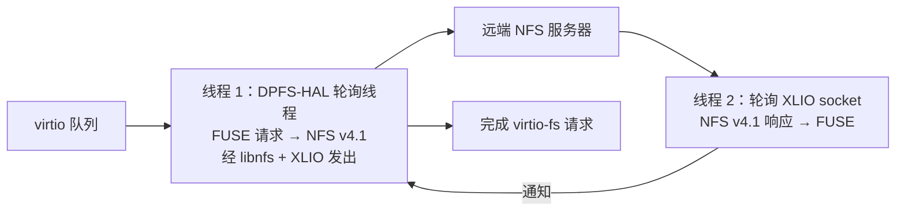

**在 DPU 上选哪种 NFS 客户端**（§2.3，4 KiB 访问延迟）：

| DPU 上的 NFS 客户端 | 读延迟 | 写延迟 |
|--------------------|------:|------:|
| Linux 内核 NFS 客户端（io_uring） | 100.5 µs | 101.9 µs |
| 纯软件 libnfs | 76.0 µs | 74.2 µs |
| libnfs + NVIDIA XLIO | **52.9 µs** | **52.2 µs** |

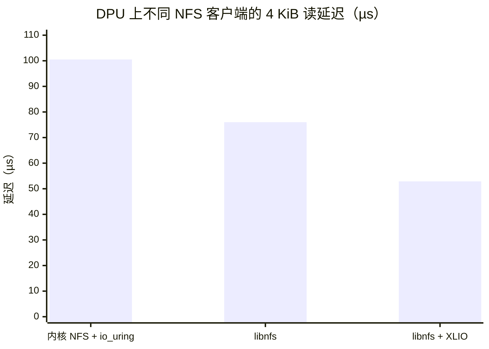

### 6.3 DPFS-KV：RAMCloud 后端（§2.4）

RAMCloud 是一个利用 RDMA 提供低延迟访问的分布式内存 KV 存储。DPFS-KV 把文件系统操作映射为 KV 操作：

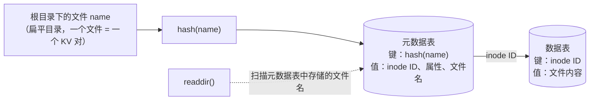

- RAMCloud 中存两张表：一张存数据（文件内容），一张存元数据（属性、名字等）。
- 元数据表以文件名的哈希为键，其中存放唯一的 inode ID，作为数据表的键。
- 为了支持扁平目录的 `readdir()`，元数据表里也存储文件名本身。

论文引用 Koo 等人的 OSDI'21 工作（*Modernizing File System through In-Storage Indexing*），指出 KV 存储可能是文件系统实现的更好底座（§2）。

**解读**：DPFS-KV 只有一层扁平目录，不支持目录树、rename 等，本质上是"用文件接口访问 KV"。它的意义在于展示**后端可以是任何东西**：租户看到的始终是标准文件系统，而云厂商可以针对小文件、低延迟等负载换一个完全不同的存储后端。

---

## 7. 评估

### 7.1 实验环境（§3，表 2）

| 项 | 配置 |
|----|------|
| 主机 CPU | 2 × Intel Xeon E5-2630 v3，2.4 GHz，每路 8 核；延迟实验时关闭 C-state |
| 主机内存 | 128 GiB DDR4-1866 |
| DPU | NVIDIA BlueField-2：8 × ARMv8 A72 @ 2.75 GHz，16 GiB DRAM（最大带宽 18 GiB/s），**PCIe 3.0** 连接主机，100 Gbps 链路连远端服务器；BlueField DPU OS 3.9.3 + 启用 virtio-fs 的**原型固件** |
| 软件 | Ubuntu 22.04，内核 6.2，fio 3.28（io_uring 引擎，2 个 fio 线程）；NFS v4.2，服务器参数 `async, no_subtree_check`，客户端参数 `async` |

**解读**：主机 CPU 是 2014 年的 Haswell，DPU 用 PCIe 3.0 接入，固件是 NVIDIA 提供的原型版本。这些条件下测得的绝对数字更多反映"原型可行性"，而不是该架构在新硬件上的上限。

### 7.2 框架自身的开销：DPFS-null（§3.1，图 2a）

随机读写，预热 10 秒，运行 60 秒：

| 指标 | 读 | 写 |
|------|---:|---:|
| 64 KiB 峰值吞吐（队列深度 16–32 时趋于平稳） | 5.87 GiB/s | 4.32 GiB/s |
| 4 KiB 峰值吞吐 | 1,278 MiB/s（327K IOPS） | 938 MiB/s（240K IOPS） |
| 4 KiB、队列深度 1 吞吐 | 193 MiB/s | 168 MiB/s |
| 推算的基础延迟开销 | **38.6 µs** | **43.3 µs** |

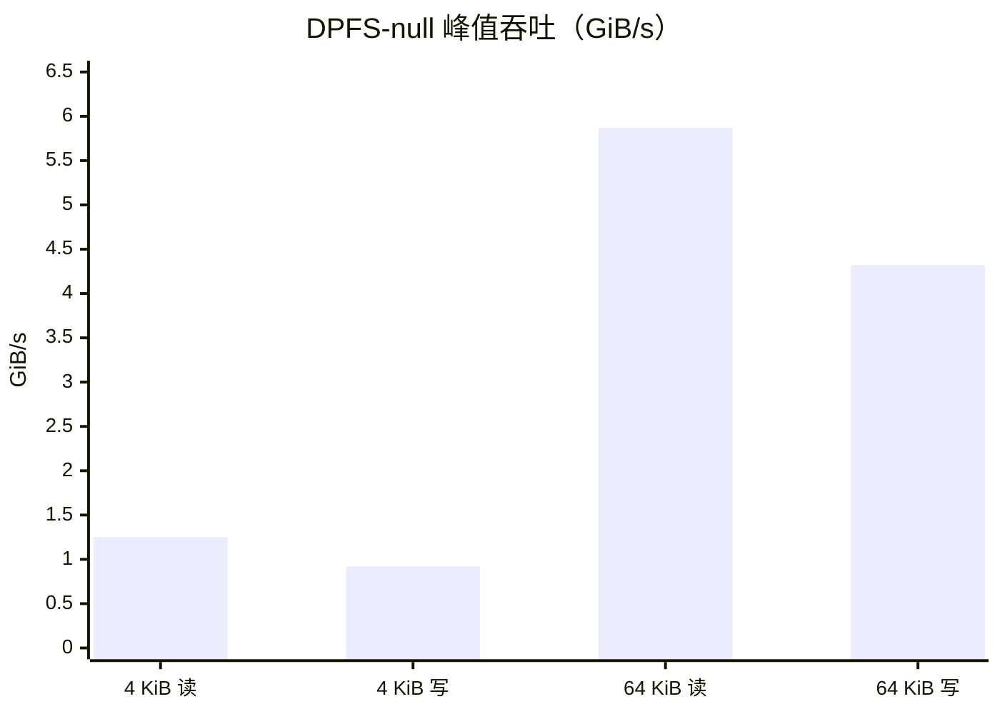

这些数字是 DPFS 能提供的**性能上限**：后端什么都不做，测到的全部是"主机 → PCIe → DPU 用户态 → 返回"这一来回的成本。

**解读**：约 40 µs 的基础延迟很高——同一时期本地 NVMe SSD 的 4 KiB 读延迟在 10 µs 量级，RDMA 往返在几微秒量级。这 40 µs 主要来自 BlueField-2 的 virtio-fs 设备模拟（固件 + ARM 核上的用户态处理），论文认为新一代 DPU 会改善（§3.2）。

### 7.3 DPFS-NFS vs 主机 NFS：吞吐（§3.2，图 2b）

4 KiB 随机读写，对比"主机内核 NFS 客户端（A–D）"与"DPFS-NFS（①–⑥）"访问同一个远端 NFS 服务器：

| I/O 深度 | 结果 |
|---------|------|
| 1–3 | 主机 NFS 吞吐**高** 11%–21% |
| ≥4 | DPFS-NFS 吞吐**高** 12%–32%，得益于部分卸载的网络栈 |
| >16 | 两者都不再扩展（见 §8） |

### 7.4 延迟分解（§3.2，图 2c）

4 KiB、I/O 深度 1：

| 配置 | 读 | 写 |
|------|---:|---:|
| 主机 NFS | 71.2 µs | 79 µs |
| DPFS-NFS 总延迟 | 91.5 µs | 95.5 µs |
| 　其中 DPU 引入（= DPFS-null） | 38.6 µs | 43.3 µs |
| 　其中 DPU 上的用户态 NFS（XLIO 卸载） | 52.9 µs | 52.2 µs |

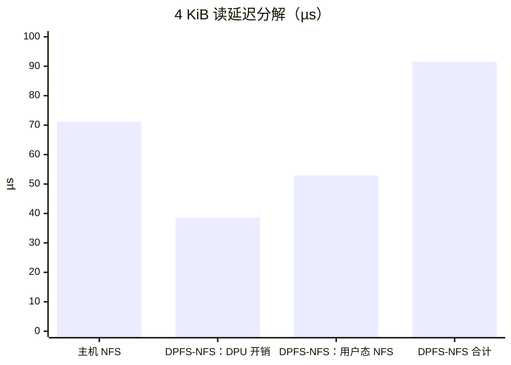

- 单队列深度下主机 NFS 更快。DPU 上的用户态 NFS 部分本身比主机 NFS 低 26.7%–33%，因为用了硬件卸载的网络栈；但加上约 40 µs 的 DPU 开销后整体变慢（§3.2）。
- 论文预期：DPU 引入的延迟会随新一代 DPU 改善；如果用原生 RDMA 实现 libnfs（而不是用 XLIO 模拟 socket 语义），用户态 NFS 部分也能进一步降低（§3.2）。

**核对（解读）**：按表中数字计算，用户态 NFS 相对主机 NFS 低 (71.2−52.9)/71.2 ≈ 25.7%（读）和 (79−52.2)/79 ≈ 33.9%（写），与正文"26.7%–33%"略有出入。

### 7.5 DPFS-KV（§3.3，表 3）

完整读写 4 KiB 文件（单次 I/O 访问整个文件），预热 5 秒，运行 10 秒：

| | 主机 NFS | DPFS-KV |
|--|--------:|--------:|
| 读 | 71.2 µs（σ 10 µs） | 62.6 µs（σ 19.4 µs） |
| 写 | 79 µs（σ 12.7 µs） | 70.79 µs（σ 21.2 µs） |

论文称 DPFS-KV 相对主机 NFS 有 7%–12% 的延迟收益，说明针对负载专门化后端可以带来优化。

**核对（解读）**：

- 按表计算，收益是读约 12.1%、写约 10.4%，"7%"无从得出。
- 表 3 的列标题在 PDF 中印为 "NFS / DPFS-NFS"，而表题和正文都说是 "Host NFS vs. DPFS-KV"，应为排版错误。
- DPFS-KV 的标准差约为主机 NFS 的 1.7–1.9 倍，尾延迟可能更差，论文未报告分位数。
- 这是"NFS（TCP，远端服务器）"与"RAMCloud（RDMA，内存 KV）"的对比，收益中有多少来自 DPU、多少来自"换成了内存 KV + RDMA"，论文没有拆分；按 §7.4，DPU 本身就要约 40 µs，说明 RAMCloud 访问部分只有约 20–30 µs。

### 7.6 主机 CPU 微架构分析：4.4× 从何而来（§3.4，表 4）

方法：用 `perf` 只统计**主机内核态**事件。先测空闲机器 10 分钟（5 次取平均），再跑 4 KiB 随机读写（读写各半、I/O 深度 128）10 分钟（5 次取平均），二者相减得到主机文件系统客户端的成本（主机 NFS vs virtio-fs + DPFS-NFS）。

| 指标 | 主机 NFS | DPFS-NFS | 变化 |
|------|--------:|--------:|-----:|
| 每次操作的指令数 | 88,453 | 32,907 | −62.80% |
| IPC | 0.57 | 0.94 | +64.21% |
| 分支预测失败率 | 2.02 | 1.06 | −47.42% |
| L1 数据缓存缺失率 | 8.82 | 3.82 | −56.65% |
| dTLB 缺失率 | 0.14 | 0.15 | +7.14% |
| 每次操作节省的 CPU 周期 | | | **4.4×** |

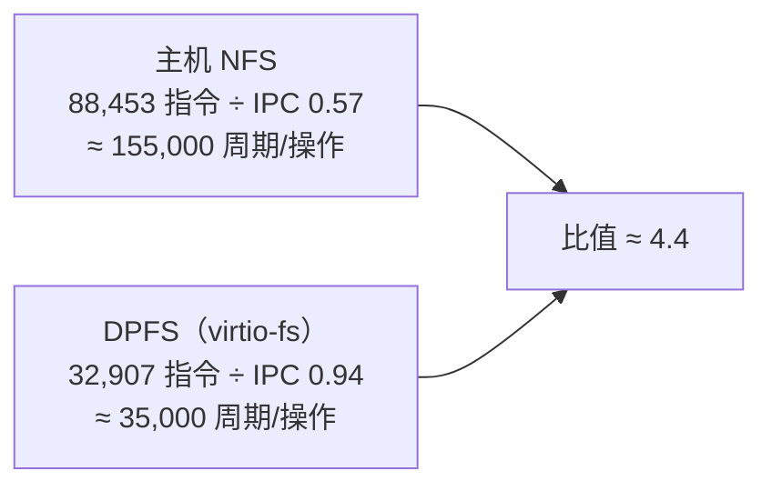

论文的解释：

1. DPFS 路径更轻，完成一次 4 KiB 随机操作的指令少 62.8%；
2. IPC 更高，一部分因为代码路径更短，一部分因为 DPFS-NFS 的请求分发和处理是**轮询**式的；
3. 分支和 L1 缓存缺失率更低，执行特征更简单；
4. dTLB 缺失率略高，归因于 virtio-fs 低效的页使用（见 §8）。

**解读**：

- 4.4× 是"**主机内核态** CPU 周期"的比值，不包括 DPU 上消耗的 ARM 核周期。它衡量的是"租户省了多少 CPU"，不是"整个系统省了多少 CPU"。从云厂商角度看，计算被转移到了 DPU 上，而 BlueField-2 的 8 个 A72 核本身也有成本。
- 测量在 I/O 深度 128 下进行，而 §8 指出 DPFS-NFS 的队列深度实际上限是 16，主机侧请求会在 virtio 队列前排队。这对"每次操作的主机周期"影响不大，但说明该测量不是在吞吐对等的条件下进行的。
- "轮询提高 IPC"指的是 **DPU 侧**的轮询；主机侧 virtio-fs 驱动仍是中断驱动的完成路径。论文对 IPC 提升原因的表述较笼统。

---

## 8. 局限与后续工作

### 8.1 论文自述的三个局限（§3.5）

| 局限 | 原因 | 影响 |
|------|------|------|
| **单队列** | 当时内核的 virtio-fs 实现不支持多队列，DPFS 每个租户只支持一个 virtio 队列；DPFS 自身的实现也只能用一个 DPU 线程处理这个队列 | 限制了图 2a、2b 中的吞吐。单队列只限制每个租户的吞吐，不限制租户数量 |
| **队列深度只能到 16** | FUSE 头占用过多页（读 3 页、写 4 页）；NVIDIA XLIO 在大内存下有瓶颈（与硬件紧耦合、大页、内存锁定），DPFS-NFS 的 virtio 队列最多只能配置 64 页 | 64 ÷ 4 = 16，DPFS-NFS 队列深度上限为 16 |
| **DPU 算力弱** | virtio-fs 操作流经 DPU 的 SoC，BlueField-2 的 ARM A72 核和单通道内存成为明显瓶颈 | DPFS-NFS 的 4 KiB 吞吐只有 DPFS-null 的约 **20%**，原因是 TCP 处理和多次额外数据拷贝 |

论文还提到正在为 DPFS 增加基于 SR-IOV 的多租户支持（§3.5）。作者预期下一代软硬件栈会缓解这些问题，把文件系统实现与硬件紧密集成以避免内存拷贝，可以加速大块负载。

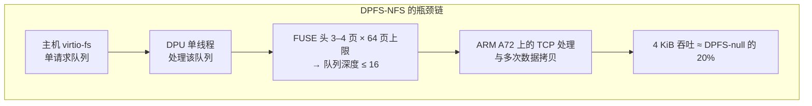

**读文注意（解读）**：

- §2.1 描述 I/O 路径时说请求"经虚拟功能（virtual functions）送到对应的租户和 virtio 队列"，但 §3.5 又说 SR-IOV 多租户支持仍在开发中。论文的实验实际上是**单租户**的。
- §3.5 称 BlueField-2 是"单通道 DDR3"，而表 2 给出的 DPU 内存带宽上限是 18 GiB/s；NVIDIA 公开的 BlueField-2 规格为 DDR4，"DDR3"疑为笔误。

### 8.2 后续进展（解读）

- **virtio-fs 多队列**：论文的第一作者 Peter-Jan Gootzen 后来向 Linux 内核提交了 "virtio-fs: add multi-queue support" 补丁（提交 529395d2，经 FUSE 维护者 Miklos Szeredi 合入其 FUSE 树，并由 Michael S. Tsirkin 确认）。补丁说明指出，原实现虽然会创建多个队列，但只把请求放进第一个请求队列；新实现在设备初始化时建立"CPU → 队列"映射，运行时按当前 CPU 选择队列。补丁中的性能测试用的是 KVM 虚拟机（32 核）+ **BlueField-3** 作为 virtio-fs 设备，报告读写都有显著加速。具体合入的主线内核版本本文未核实。这直接回应了论文 §3.5 的第一个局限。
- 这说明 DPFS 的思路后来进入了更标准化的路径：不是靠 DPFS 框架本身，而是通过改进 Linux 内核 virtio-fs 驱动和新一代 DPU，让"virtio-fs + DPU"成为通用方案。

---

## 9. 与相关工作的对比

### 9.1 论文自述（§4）

| 方向 | 代表 | 关系 |
|------|------|------|
| 租户访问云文件系统的现状 | 内核 NFS 客户端（EFS、Filestore、Azure Files）；在租户机器上运行厂商客户端（盘古、Colossus、Tectonic） | 隔离差，消耗租户 CPU 和内存 |
| DPU 虚拟化/加速网络功能 | Azure Accelerated Networking 等 | 同方向，不同服务 |
| DPU 用于块存储 | i10、MultiLanes、阿里 Luna/Solar、Gimbal、LeapIO | 同方向，块层（有 I/O 放大，见 §2.2） |
| DPU 用于 KV / 对象存储 | E3、SmartNIC KV 等 | 同方向，不同接口 |
| **LineFS**（SOSP'21） | 持久内存分布式文件系统，把嘈杂的后台任务卸载到 DPU | DPU 卸载用于**性能提升** |
| **Fisc**（FAST'23） | 云原生文件系统，把完整文件系统卸载到基于 FPGA 的 DPU 和远端服务器，使用自定义的 virtio-Fisc 设备接口 | 与 DPFS 一样用于**虚拟化**（解耦客户端与实现） |

DPFS 与这两者的区别：一是与 LineFS 相比，DPFS 和 Fisc 用 DPU 卸载来做**虚拟化**，降低主机 CPU 负担并增加云厂商对文件系统栈的控制，而 LineFS 是为了性能；二是与 Fisc 相比，DPFS 卸载到**现成的 CPU 型 DPU**（BlueField-2），使用**现有的 virtio-fs 主机软件栈**，并为实现不同后端提供**开放 API**（§4）。

### 9.2 与本仓库相关系统的对照（解读）

| 维度 | DPFS（SYSTOR'23） | Fisc（FAST'23） | LineFS（SOSP'21） | 主机 FUSE 客户端（如 3FS） |
|------|-------------------|-----------------|-------------------|---------------------------|
| 目标 | 解耦接口与实现、省主机 CPU、零配置 | 轻量客户端、集中网关的问题、规模化 | 性能：把后台任务卸到 SmartNIC | 兼容 POSIX |
| 主机侧接口 | 标准 virtio-fs（内核自带） | 自定义 virtio-Fisc / virtio-RPC 设备 + 容器内薄 RPC 客户端 | LibFS（主机） | FUSE 守护进程 |
| DPU 类型 | 现成 CPU 型（BlueField-2） | 自研 DPU + FPGA 快路径 | BlueField（SmartNIC） | 无 |
| DPU 上跑什么 | 完整文件系统客户端（NFS / KV 后端） | agent：网络、安全、路由（存储协议在存储侧 proxy） | 复制、压缩、发布等后台任务 | — |
| 后端 | 可插拔（NFS、RAMCloud） | 盘古 | Assise 式 PM 文件系统 | 自家存储 |
| 生产部署 | 否（研究原型） | 是（阿里云） | 否 | 是 |
| 多租户 | 计划用 SR-IOV，论文中未实现 | 是 | — | — |

**解读**：

- **DPFS 与 Fisc** 是同一想法的两种实现。Fisc 的切分点更靠后：DPU 上只做网络和路由，真正的存储协议在存储侧 proxy，用自定义接口换取性能和规模；DPFS 的切分点更靠前：整个客户端都在 DPU 上，用标准接口换取通用性。Fisc 有生产验证，DPFS 有开源代码和标准接口。详见 [Fisc 精读的对照节](fisc-fast2023.md)。
- **DPFS 与 3FS 的 USRBIO**（见 [3FS 精读](3fs-fireflyer-sc2024.md)）代表了解决"FUSE 慢"的两个方向：3FS 在主机上保留 FUSE 做元数据、另开共享内存环走数据；DPFS 把整个 FUSE 请求流直接从内核送到 DPU，主机上不再有用户态守护进程。
- 论文对比的基线只有**内核 NFS 客户端**，没有与主机上运行的用户态 libnfs、主机上运行的 virtiofsd、或者其他文件系统的原生客户端比较。"DPU 带来的收益"与"换成用户态 + 卸载网络栈带来的收益"没有完全分开。

---

## 10. 整体总结

### 10.1 核心贡献

1. **提出文件系统访问虚拟化的论点**：用 DPU 把云原生文件系统客户端从租户主机上剥离，标准接口留给租户、实现交给云厂商；并用 I/O 放大数据论证文件系统层比块层更适合卸载。
2. **DPFS 框架**：三层结构（DPFS-HAL、DPFS-FUSE、后端），把 DPU 上的文件系统开发变成"写一个类 libfuse 的异步 FUSE 文件系统"，并开源。
3. **两个实际后端**：DPFS-NFS 证明不改主机、不改远端服务即可接入现有 NFS 服务，并利用 XLIO 网络卸载；DPFS-KV 证明后端可以换成完全不同的存储（RDMA 内存 KV）。
4. **量化评估**：框架基础开销约 40 µs、4 KiB 峰值 327K 读 IOPS；高队列深度下吞吐比主机 NFS 高 12%–32%；每 I/O 主机 CPU 周期降为 1/4.4；并坦率地报告了单队列、队列深度和 DPU 算力三个瓶颈。

### 10.2 设计哲学

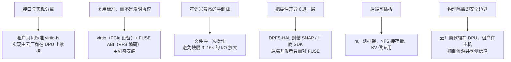

**解读**：DPFS 把 DPU 看作云厂商在租户机器里的"**大使馆**"：它物理上在租户的服务器里，但归云厂商管理。存储客户端这种"既需要贴近租户、又必须由服务方控制"的组件，正适合放在这里。virtio-fs 则是大使馆的"标准窗口"：租户用最普通的方式递交请求，窗口后面怎么处理完全由云厂商决定。

### 10.3 优点与局限

| 优点 | 局限 / 未回答的问题 |
|------|---------------------|
| 主机零安装、零配置：只用内核自带 virtio-fs 驱动 | **延迟更高**：DPU 引入约 40 µs 基础开销，单队列深度下 DPFS-NFS 比主机 NFS 慢约 28%（读 91.5 vs 71.2 µs） |
| 每 I/O 主机 CPU 周期降为 1/4.4，代码路径从约 18 万行降到约 1.3 万行 | **4.4× 只算主机**：DPU 上消耗的 ARM 周期未计入，系统整体 CPU 效率未评估 |
| 接口标准、框架开源、后端可插拔，开发者可先用普通 FUSE 开发 | **吞吐受限**：单 virtio 队列、单 DPU 线程、队列深度 ≤16；DPFS-NFS 的 4 KiB 吞吐只有框架上限的约 20% |
| 云厂商拿回客户端控制权，可在 DPU 上做缓存、QoS、配额 | **评估范围窄**：单租户、单机、只与内核 NFS 比较；没有元数据密集负载、大文件顺序负载、多租户干扰实验 |
| 物理隔离提升租户安全 | 依赖 NVIDIA 原型固件和 SNAP 库；BlueField-2 上的 virtio-fs 在发表时尚非正式功能 |
| 坦率报告了瓶颈，并指出可由内核与硬件演进解决 | **FUSE 语义即能力上限**：无法表达分布式文件系统特有的语义（如租约、布局提示、批量接口），主机侧缓存一致性如何与 DPU 后端协同未讨论 |
| — | 数字核对有出入：表 1 的 Btrfs 放大倍数、表 3 列标题与"7%–12%"、"26.7%–33%"；§2.1 与 §3.5 对多租户的表述不一致 |

### 10.4 对分布式文件系统设计者的启示

1. **客户端设计要为"被卸载"做准备**：如果客户端协议是简洁的请求/响应、本地状态少，未来把它整体迁移到 DPU（virtio-fs 形态）的成本就很低。反之，依赖大量主机内存缓存、复杂本地状态的客户端很难卸载。
2. **用 FUSE ABI 作为客户端的"内部 IR"**：DPFS-FUSE 表明，同一套 FUSE 风格的实现可以同时跑在主机用户态（libfuse）和 DPU（virtio-fs）上。新系统的客户端可以围绕一个类 libfuse 的异步接口实现，保留两种部署形态。
3. **在 DPU 上优先使用用户态网络栈和卸载能力**：同在 DPU 上，内核 NFS 客户端（约 100 µs）比 libnfs + XLIO（约 53 µs）慢近一倍；ARM 核弱，减少拷贝和上下文切换比在主机上更重要。
4. **评估卸载收益要算两笔账**：主机节省多少 CPU（租户视角），系统整体多花或少花多少（云厂商视角）。只报告前者容易高估收益。
5. **注意 virtio 队列与页的开销**：FUSE 头占 3–4 页会直接压低可用队列深度；设计 DPU 侧缓冲时要把"每请求元数据页数 × 队列深度"纳入内存预算。
6. **把"可插拔后端"当作云厂商的演进手段**：租户接口不变，后端可以从 NFS 网关逐步替换为原生协议、RDMA、KV 或面向特定负载的专用存储，而无需协调租户升级。
7. **与 Fisc 对照选择切分点**：追求通用性与标准接口时选 DPFS 式（整个客户端在 DPU、virtio-fs 标准设备）；追求极致性能与规模时选 Fisc 式（DPU 只做网络和路由、自定义设备接口、存储协议放到存储侧）。

### 10.5 一张图看懂 DPFS

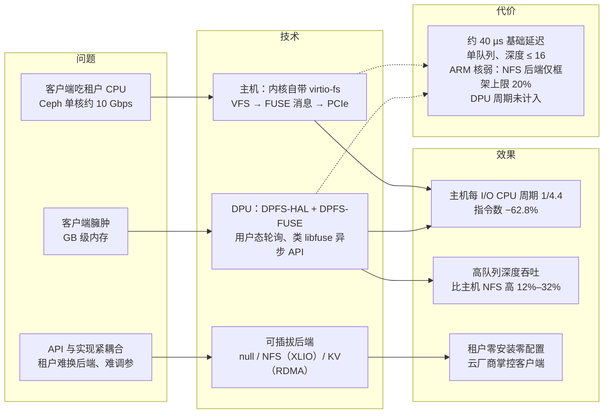

---

## 参考

- Peter-Jan Gootzen, Jonas Pfefferle, Radu Stoica, Animesh Trivedi. *DPFS: DPU-Powered File System Virtualization*. ACM SYSTOR 2023. <https://dl.acm.org/doi/10.1145/3579370.3594769> ；PDF：<https://animeshtrivedi.github.io/files/papers/2023-systor-dpfs.pdf>
- DPFS 开源代码：<https://github.com/IBM/DPFS>
- Peter-Jan Gootzen. *virtio-fs: add multi-queue support*（Linux 内核提交 529395d2）。补丁讨论：<https://spinics.net/lists/linux-virtualization/msg69542.html>
- Qiang Li et al. *Fisc: A Large-Scale Cloud-Native-Oriented File System*. USENIX FAST 2023. 本仓库精读：[fisc-fast2023.md](fisc-fast2023.md)
- Jongyul Kim et al. *LineFS: Efficient SmartNIC Offload of a Distributed File System with Pipeline Parallelism*. SOSP 2021.（见[新硬件综述](new-hardware.md)）
- John Ousterhout et al. *The RAMCloud Storage System*. ACM TOCS 2015.
- Rusty Russell. *virtio: Towards a De-Facto Standard for Virtual I/O Devices*. ACM SIGOPS OSR 2008.
- Rui Miao et al. *From Luna to Solar: The Evolutions of the Compute-to-Storage Networks in Alibaba Cloud*. SIGCOMM 2022.（200 Gbps 需 12 核的出处）
- libnfs：<https://github.com/sahlberg/libnfs> ；NVIDIA XLIO 文档：<https://docs.nvidia.com/networking/display/XLIOv214>
- 本仓库相关：[3FS / Fire-Flyer 精读](3fs-fireflyer-sc2024.md)（USRBIO 绕开 FUSE 的另一条路）、[客户端与通用技术](client-and-general-techniques.md)（FUSE 优化、DPC 等）
