# EBS Glory 精读：阿里云块存储十年三代的演进与教训（FAST 2024）

> 论文：Weidong Zhang, Erci Xu*, Qiuping Wang, Xiaolu Zhang, Yuesheng Gu, …, Jiaji Zhu, Jiesheng Wu（共 27 位作者，*为通讯作者）. *What's the Story in EBS Glory: Evolutions and Lessons in Building Cloud Block Store*. USENIX FAST 2024，Santa Clara，2024-02。
>
> 机构：阿里巴巴集团。
>
> 链接：<https://www.usenix.org/conference/fast24/presentation/zhang-weidong>；PDF <https://www.usenix.org/system/files/fast24-zhang-weidong.pdf>
>
> 篇幅：正文 13 页 + 参考文献，共 15 页（论文集第 277–291 页）；13 张图，无表格。
>
> 精读日期：2026-11-24。**数字和机制描述都摘自论文**，用"论文 §x / 图 x"标注出处。标"解读"的段落是本文作者的分析和推论，不是原文。论文图 8–12 大多没有数据标签，相关读数是本文从图上估读的，标注"约"，误差约 ±5%。
>
> 相关文档：
> - [盘古 2.0（FAST 2023）精读](pangu-fast2023.md)：EBS2 起的存储底座；盘古论文中的流量放大、FPGA 压缩、RDMA 等是 EBS 的"下半身"。
> - [Fisc（FAST 2023）精读](fisc-fast2023.md)：同样建在盘古之上的云原生文件存储接入层。
> - [DisCoGC（FAST 2026）精读](discogc-fast2026.md)：字节跳动架构几乎相同的块存储 ByteDrive，在 GC 环节用 discard 代替搬数据，可与本文的前台 EC/压缩路线对照。
> - 综述：[客户端与通用技术中的 EBS 小节](client-and-general-techniques.md#42-whats-the-story-in-ebs-glory-evolutions-and-lessons-in-building-cloud-block-store)、[工业界生产系统](industry-production-systems.md)。

## 目录

- [0. 一页速览](#0-一页速览)
- [1. 云块存储与存算分离](#1-云块存储与存算分离)
- [2. EBS1：简单直接的第一代](#2-ebs1简单直接的第一代)
- [3. EBS2：日志结构 + 分段，空间效率优先](#3-ebs2日志结构--分段空间效率优先)
- [4. EBS3：前台 EC 与压缩，压低流量放大](#4-ebs3前台-ec-与压缩压低流量放大)
- [5. 三代对比与评估](#5-三代对比与评估)
- [6. 弹性一：延迟](#6-弹性一延迟)
- [7. 弹性二：吞吐、IOPS 与容量](#7-弹性二吞吐iops-与容量)
- [8. 可用性：控制爆炸半径](#8-可用性控制爆炸半径)
- [9. 硬件卸载：FPGA 之后去哪里](#9-硬件卸载fpga-之后去哪里)
- [10. What If：三个反事实问题](#10-what-if三个反事实问题)
- [11. 论文中的不一致与可疑之处](#11-论文中的不一致与可疑之处)
- [12. 与相关系统的对比](#12-与相关系统的对比)
- [13. 整体总结](#13-整体总结)
- [参考](#参考)

---

## 0. 一页速览

**一句话**：阿里云的弹性块存储（EBS）从 2012 年到 2024 年经历了三代：**EBS1** 把虚拟盘直接映射成存储节点上的 64 MiB Ext4 文件、原地更新、三副本，简单但空间放大 3 倍、性能受单台 BlockServer 限制；**EBS2** 改为建在盘古之上的**日志结构**设计，并把虚拟盘切成 32 GiB 的**段**分散到多台 BlockServer，后台 GC 时做 EC + 压缩，空间放大降到 1.29，单盘 100 万 IOPS、100 µs 级延迟，但网络流量放大升到 4.69；**EBS3** 用 **Fusion Write Engine** 把不同虚拟盘的小写合并成 16 KiB 块、用 FPGA 压缩，**在前台直接写 EC + 压缩数据**，空间放大降到 0.77、流量放大降到 1.59。论文还从弹性、可用性、硬件卸载、反事实四个角度总结了十年经验。

| 维度 | EBS1（2012） | EBS2（2015） | EBS3（2019） |
|------|-------------|-------------|-------------|
| 存储布局 | 64 MiB chunk = 一个 Ext4 文件，原地更新 | 日志结构，追加写入盘古文件 | 日志结构 + 前台合并写 |
| 冗余 | 三副本 | 前台三副本，后台 GC 时转 EC(8,3) + LZ4 | 前台 EC(4,2) + 压缩的 JournalFile，后台转 EC(8,3) + 压缩的 DataFile |
| 虚拟盘到服务器 | 整盘由一台 BlockServer 独占 | 32 GiB 段，一盘多台 BlockServer | 同 EBS2 |
| 底座 | 自带 ChunkServer + Paxos | 盘古 | 盘古 |
| 介质与网络 | HDD，10 Gbps 内核 TCP | SSD，前端 Luna（用户态 TCP）+ 后端 RDMA，2 × 25 Gbps | SSD（QLC），Solar + RDMA，2 × 100 Gbps |
| 空间放大（每份数据的副本数） | 3 | 1.29 | **0.77** |
| 流量放大 | 3 | 4.69 | **1.59** |
| 单盘性能 | — | 1 M IOPS、4,000 MiB/s、平均 100 µs | 与 EBS2 相当 |
| 规模 | 数百集群、100 万+ 虚拟盘、数百 PB | 500+ 集群、200 万虚拟盘 | 100+ 集群、50 万+ 虚拟盘 |

| 经验主题 | 要点 |
|---------|------|
| 弹性（§3） | 平均延迟由硬件决定（EBSX 用 PMem 跳过第二跳到 30 µs 级），尾延迟由软件决定（IO 与后台任务分线程，P99.999 写 1 ms、读 2.5 ms）；吞吐上限在客户端，后端靠并行度扩展；Base+Burst 分配；1 GiB–64 TiB、1 分钟克隆 1 万块盘 |
| 可用性（§4） | 按影响范围分个体、区域、全局三级事件；分段迁移让个体故障可能级联成全局故障；控制面用 Federated BlockManager 分区，数据面用"逻辑故障域"限制可疑段的迁移范围 |
| 硬件卸载（§5） | BlockClient：FPGA → ASIC（FPGA 导致 37% 的数据损坏事件、22% 的停机）；BlockServer：FPGA → 多核 ARM CPU（算子常变、无裸金属约束） |
| 反事实（§6） | 不做日志结构行不行；能否用开源软件搭；EBS 与盘古不分离会怎样 |

**解读**：

- 三代 EBS 的主线是**放大率**：EBS1 → EBS2 用日志结构换来空间放大从 3 降到 1.29，却把流量放大从 3 推到 4.69；EBS3 再用前台合并写把两者同时压下来。每一代都是在上一代的副作用上做文章。
- 这篇论文与 [盘古 2.0](pangu-fast2023.md) 是一对：盘古讲"文件系统层如何吃满硬件"，EBS 讲"块服务层如何在盘古之上做出弹性、可用和低成本"。盘古论文的流量放大例子（EBS 写入 6.375 倍）和这里的 4.69 是同一个问题的两种统计口径。
- 论文后半部分的经验比架构演进更有价值，尤其是"**尾延迟主要来自软件**"、"**迁移机制会把个体故障放大成集群故障**"、"**FPGA 适合原型、不适合大规模长期运行**"三条。

---

## 1. 云块存储与存算分离

EBS 以**虚拟块设备**（虚拟盘，VD）的形式提供存储，要求高性能、高可用和弹性。EBS 架构最突出的特征是**存算分离**：虚拟机（计算端）和磁盘（存储端）不在同一台物理机上，而是通过数据中心网络互联（论文 §1）。Azure、Google 等厂商也采用这一理念。

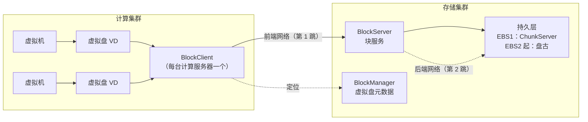

### 1.1 时间线（论文图 1）

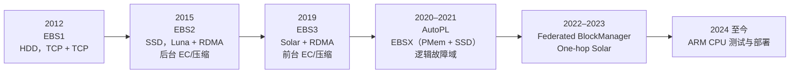

> 时间线按论文图 1 的标注整理，图中部分事件只标在年份区间上，具体年份以原图为准。

---

## 2. EBS1：简单直接的第一代

### 2.1 架构（论文 §2.1，图 2）

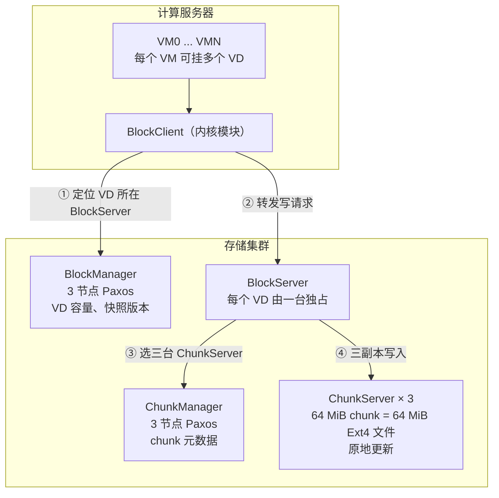

| 组成 | 说明 |
|------|------|
| BlockManager | 三节点 Paxos，维护 VD 元数据（容量、快照版本）；故障时把 VD 重新分配给其他 BlockServer |
| BlockServer | 处理分配给它的多个 VD 的 IO 请求；**一个 VD 只由一台 BlockServer 服务（N 对 1）** |
| chunk | VD 的逻辑块地址空间切成 64 MiB 的 chunk |
| ChunkManager | 三节点 Paxos，管理 chunk 元数据 |
| ChunkServer | 每个 chunk 存成一个 64 MiB 的 Ext4 文件（DataFile），**原地更新**；每个 chunk 在三台 ChunkServer 上三副本 |
| 精简配置 | 用户写入时才分配空间 |
| 网络 | 前端（计算到存储）与后端（存储集群内）两张 Clos 网络，均为 10 Gbps 内核 TCP/IP |

实际中 BlockClient 缓存 VD 到 BlockServer 的映射，BlockServer 缓存 chunk 到 ChunkServer 的映射，步骤 ① 和 ③ 通常可以跳过。

### 2.2 局限（论文 §2.1）

EBS1 于 2012 年发布，服务了超过 100 万块虚拟盘、在数百个集群中存储了数百 PB 数据。它简单成熟的设计加快了开发和部署，但限制了性能和效率：

| 局限 | 原因 |
|------|------|
| 无法做压缩 | 压缩会不确定地改变数据大小，破坏原地更新的直接映射 |
| EC 写放大大 | EC 有最小写入要求（条带单元 4 KiB 时，EC(4,2) 至少需要 16 KiB），小写会产生严重写放大 |
| 单盘性能受限 | N 对 1 映射下，VD 的性能最终受限于对应的那台 BlockServer，突发负载下易成热点 |
| SLO 难保证 | HDD + 内核 TCP/IP 难以量化和保证 SLO |

**解读**：EBS1 的问题根子在"**原地更新**"。原地更新要求逻辑地址到物理位置的映射固定，于是压缩（大小可变）和 EC（要凑够条带）都做不了，空间效率只能停在三副本。这也是 §10 Q1 论证"日志结构不可或缺"的出发点。

---

## 3. EBS2：日志结构 + 分段，空间效率优先

### 3.1 两大改动（论文 §2.2，图 3）

1. **建在盘古之上**：EBS2 不再自己处理数据持久化和一致性协议，而是使用盘古提供的**只追加文件语义**和**分布式锁服务**（基于定制的 Raft）。BlockServer 采用**日志结构**设计，把 VD 的写请求转换成盘古的追加写，从而能在后台 GC 时做压缩和 EC。
2. **虚拟盘分段**：把 VD 地址空间切成固定大小的段，一个 VD 由多台 BlockServer 服务；故障切换的粒度从整个 VD 变成一个段。BlockManager 直接用盘古的分布式锁做选主，不再用 Paxos。

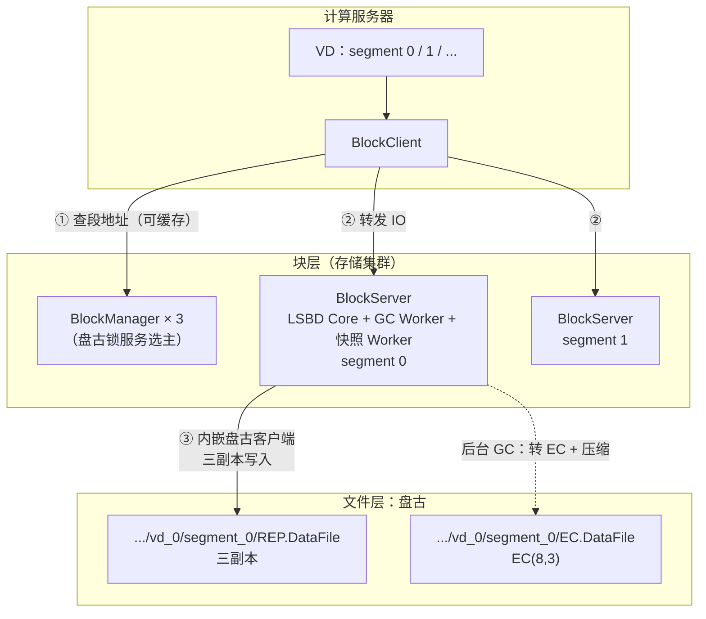

> 自 EBS2 起，BlockServer 与盘古 ChunkServer 虽然部署在同一台物理机上，但是逻辑上独立的进程，通过后端网络传数据，**不强制本地性**。

### 3.2 三级分段（论文 §2.2，图 4）

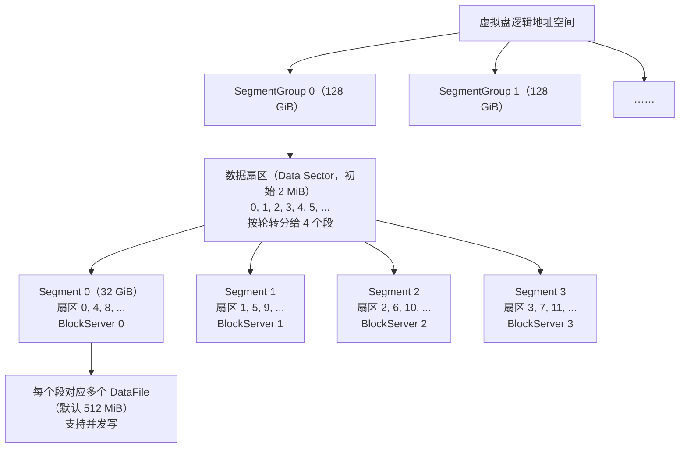

| 层级 | 大小 | 作用 |
|------|------|------|
| SegmentGroup | 128 GiB | VD 地址空间的第一级划分 |
| Segment | 32 GiB | BlockServer 调度和故障切换的单位；一个 SegmentGroup 含 4 个段 |
| Data Sector | 初始 2 MiB，生产中降到 128 KiB | 在 SegmentGroup 内**轮转**分配给各段，把连续地址打散到多台 BlockServer |
| DataFile | 默认 512 MiB | 一个盘古文件，保存段的一部分数据；一个段对应多个 DataFile 以支持并发写 |

**解读**：轮转分配类似 RAID-0 条带化：顺序访问一段连续地址时，请求会依次落到 4 个段、4 台 BlockServer 上，单盘的并行度因此提高。这就是 EBS2 单盘能到 100 万 IOPS 的根本原因（§7.1）。

### 3.3 日志结构块设备 LSBD（论文 §2.2，图 5）

LSBD Core 支持底层盘古的只追加语义，把流量分为**前台**（客户端 IO）和**后台**（GC 和压缩）。前台写流程：

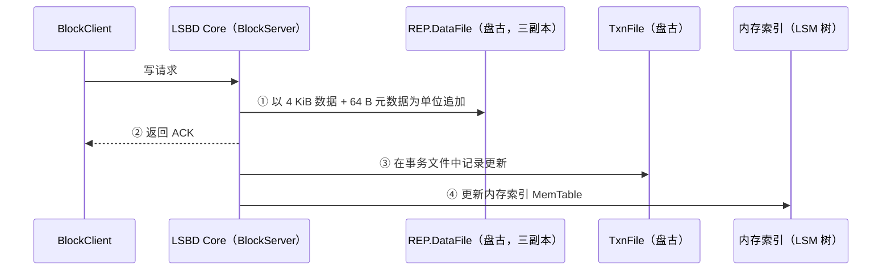

| 组件 | 内容 |
|------|------|
| DataFile | 每个 4 KiB 数据块配一个 64 B 头部，追加写入 |
| 内存索引 | LSM 树，映射 VD 的 LBA → (DataFile ID, 偏移, 长度)；SSTable 也是盘古文件 |
| TxnFile | 记录最近 IO 的 LBA 到 DataFile 映射。段迁移时，新 BlockServer 读 TxnFile 即可重建内存索引，无需扫描 DataFile 尾部 |

**解读**：注意图 5 的顺序是先返回 ACK、再写 TxnFile 和更新索引。这意味着恢复时 TxnFile 可能缺少最后几条记录，而 DataFile 中每个 4 KiB 块都带 64 B 头部，应当就是为了在这种情况下仍能从数据本身找回映射。论文没有展开这一点。

### 3.4 GC 时做 EC 与压缩（论文 §2.2，图 6）

- GC 以 DataFile 为粒度：某个段下 DataFile 中的过期数据达到阈值时，从**最脏**的 DataFile 中收集有效数据，合并成新的 DataFile，然后更新 TxnFile 和内存索引。
- GC 期间把三副本的 "REP.DataFile" 转成 **EC(8,3) + LZ4 压缩**的 "EC.DataFile"。
- 必要时可调度特殊 GC 任务，优先选择 REP.DataFile 以腾出更多空间。
- 触发阈值随集群容量使用率和负载变化；还采用了基于推断块失效时间的数据放置等优化（FAST 2022 的工作）。在压力最大的集群中，GC 导致的写放大（BlockServer 与 GCWorker 写入字节之和 / BlockServer 写入字节）**小于 1.5**。

**压缩后的 EC.DataFile 格式**：

读取压缩数据时，先查 Offset Table 定位，再读取并解压。

### 3.5 其他改进（论文 §2.2）

| 方面 | EBS1 | EBS2 |
|------|------|------|
| 控制面可用性 | VD 元数据存在本地盘，丢失会导致长时间修复 | 通过盘古锁服务，3 个节点挂 2 个仍可服务；VD 元数据存为盘古文件中的持久化、多副本 KV |
| 前端网络 | 10 Gbps 内核 TCP | 2 × 25 Gbps 用户态 TCP **Luna**（run-to-completion + 零拷贝，吞吐最高 3.5 倍，延迟降 53%） |
| 后端网络 | 10 Gbps 内核 TCP | 2 × 25 Gbps **RDMA** |
| 控制路径 | 内核 TCP | 仍用内核 TCP |
| 快照 | 阻塞前台；平均 33 分钟 | 异地更新不阻塞前台：BlockManager 记录时间戳，快照 Worker 上传两次快照之间的更新；20 GB 新数据约 30 秒 |
| 后台校验 | — | 数据巡检（scrubbing）与 GC 分开，限速 **10 MiB/s**（15 天扫完所有 DataFile），用心跳监控进度，检测磁盘损坏和 CPU 静默错误 |

### 3.6 部署与问题（论文 §2.2）

| 指标 | 数值 |
|------|------|
| 发布 | 2015 年 |
| 规模 | 500+ 集群、200 万块虚拟盘 |
| 平均写延迟 | 100 µs（比 EBS1 降低 12 倍） |
| 最大 IOPS | 100 万（提高 50 倍） |
| 最大吞吐 | 4,000 MiB/s（提高 13 倍） |
| LZ4 压缩率 | 43.3%–54.7%，平均 50.1% |
| 压缩 + EC 后的副本数 | 0.69（= 1.375 × 0.501） |
| 现场平均副本数 | **1.29**（未经 GC 的 DataFile 仍是三副本） |
| 集群规模 | 从 EBS1 的 700 台降到约 100 台 |

**流量放大问题**：相对 EBS1，EBS2 的总流量从 3（三副本）升到 **4.69** = 3（前台三副本写）+ 1（后台 GC 读）+ 0.69（后台 EC + 压缩写）。论文称这使得只有 15.5% 的网络带宽用于服务 VD 请求。

**解读**：EBS2 用流量换空间。这与 [盘古论文 §8.2](pangu-fast2023.md#82-流量放大ec--压缩论文-412图-9) 的 6.375 倍是同一件事的两种算法：盘古把业务客户端到盘古客户端的 1 倍也算进去，GC 后写 EC(8,3) 不压缩记为 1.375；EBS 论文不计第一跳，EC 写记为压缩后的 0.69。

---

## 4. EBS3：前台 EC 与压缩，压低流量放大

### 4.1 为什么前台 EC 难（论文 §2.2）

| 难点 | 数据 |
|------|------|
| 小写占多数 | 生产中近 **70%** 的写请求小于 16 KiB，而 EC 和压缩需要至少 16 KiB 的原始数据块 |
| 低延迟目标 | EBS 目标是 100 µs 写延迟；要在每 100 µs 内为一个段攒够 16 KiB，段的写吞吐需超过 160 MiB/s，**超过 90% 的段达不到** |
| 补零不可行 | 简单补零会造成更高的流量和空间放大 |
| 压缩开销 | 即使用延迟优化的 LZ4，CPU 压缩一个 16 KiB 块也要 **25 µs**，块越大开销越高 |

**解读**：单个段攒不够数据，那就**跨段、跨虚拟盘攒**。这正是日志结构设计能做到、原地更新做不到的事（§10 Q1）。

### 4.2 架构与写流程（论文 §2.3，图 7）

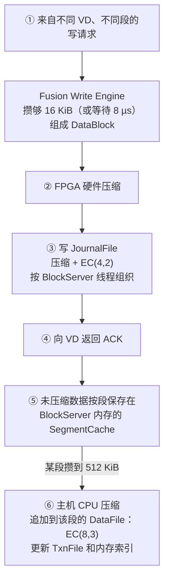

| 组件 | 说明 |
|------|------|
| **Fusion Write Engine（FWE）** | 收到一批小写后，等待总量达到阈值（默认 16 KiB）再组成 DataBlock 送 FPGA 压缩。等待超时设为 **8 µs**（网卡轮询间隔）。坚持合并更小的写（如 4 KiB）会让 P99 尾延迟升高 **220%**，因此对小写不频繁的集群（例如 4 KiB 写平均只占 3.72%），4 KiB 写不合并，直接走三副本 |
| **JournalFile** | 压缩后的混合数据以 EC(4,2) 写入，按 BlockServer 线程组织（如 `.../bs_0/thread_0/JournalFile`）。它混合了不同 VD 的段，直接读需要大量扫描和解压，因此**运行时只写不读**，只在故障切换时用于恢复尚未转存的数据 |
| **SegmentCache** | ACK 之后在 BlockServer 内存中按段保存未压缩数据；读请求先查 SegmentCache（最新数据），未命中再查 LSM 索引 |
| **DataFile 转存** | 段的缓存达到 512 KiB 后，用主机 CPU 压缩并以 EC(8,3) 追加到该段的 DataFile |

**解读**：EBS3 实际上是一个**两级日志**：第一级 JournalFile 解决"快速持久化"（跨盘合并、EC(4,2)、只写不读），第二级 DataFile 解决"按段组织、便于读和 GC"（EC(8,3)、按段聚合）。内存中的 SegmentCache 把两级连接起来。代价是 BlockServer 内存要缓存所有尚未转存的数据，故障时必须从 JournalFile 回放。

### 4.3 FPGA 压缩卸载（论文 §2.3，图 8）

- 定制 FPGA 包含提交队列（缓冲新形成的 DataBlock）和完成队列（轮询硬件压缩结果）；FPGA 内部调度器把 DataBlock 切成固定大小（如 4 KiB）的分片，多个执行单元并行压缩/解压。
- **端到端 CRC**：FPGA 返回压缩数据后，EBS3 立即解压并做 CRC 校验。这是必要的开销，因为故障切换时 JournalFile 是唯一的数据来源。

**图 8：FPGA 与 8 核 CPU 压缩对比（Silesia 语料）**

| 数据块大小 | CPU 吞吐（估读） | FPGA 吞吐（估读） | CPU 延迟（估读） | FPGA 延迟（估读） |
|-----------|---------------:|----------------:|---------------:|----------------:|
| 8 KiB | 约 2.0 GiB/s | 约 6.8 GiB/s | 约 10 µs | 约 5 µs |
| 16 KiB | 约 2.1 GiB/s | 约 7.0 GiB/s | 约 23 µs | 约 6 µs |
| 32 KiB | 约 2.6 GiB/s | 约 7.1 GiB/s | 约 47 µs | 约 7 µs |
| 64 KiB | 约 3.3 GiB/s | 约 7.3 GiB/s | 约 97 µs | 约 8 µs |
| 128 KiB | 约 3.5 GiB/s | 约 7.3 GiB/s | 约 200 µs | 约 12 µs |

论文正文：16 KiB 时 FPGA 延迟比 CPU 低 **78%**；FPGA 最大吞吐 **7.3 GiB/s**，CPU 只有 **3.5 GiB/s**；块越大，FPGA 的优势越大。正文还称 FPGA 卸载的延迟分布为 **29–65 µs**，与图中读数不一致，见 §11。

### 4.4 网络与部署（论文 §2.3）

- 前端和后端都升级到 **2 × 100 Gbps**。
- 开发了 **Solar**：基于 UDP 的传输协议，利用 DPU 硬件卸载，把每个存储数据块打包成一个网络包，实现 CPU/PCIe 旁路、简单的接收端缓冲管理和快速多路径恢复。
- EBS3 于 2019 年发布，部署在 **100+ 存储集群**，服务 **50 万+ 虚拟盘**，性能与 EBS2 相当。
- 前台 EC/压缩使所有数据（少数边角情况除外）立即以高效格式存储：现场空间放大从 1.29 降到 **0.77**；总流量放大从 4.69 降到 **1.59**（基于现场统计，因负载压缩率不同略有波动）。

**解读（流量放大推算）**：按论文"不计第一跳"的口径，EBS3 的主要后端流量是 JournalFile 写 1.5 × 0.5 ≈ 0.75 和 DataFile 写 1.375 × 0.5 ≈ 0.69，合计约 1.44；剩余约 0.15 应来自不合并而直接三副本写的 4 KiB 小写、GC 等。与论文的 1.59 量级一致。注意 EBS3 不再需要"GC 读回三副本数据再写 EC"这一步，因为 DataFile 的数据来自内存中的 SegmentCache。

---

## 5. 三代对比与评估

### 5.1 三代数据路径对比

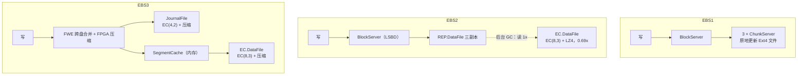

| 放大率 | EBS1 | EBS2 | EBS3 |
|--------|-----:|-----:|-----:|
| 空间（副本/数据） | 3 | 1.29 | 0.77 |
| 流量 | 3 | 4.69 | 1.59 |

### 5.2 微基准（论文 §2.4，图 9）

FIO 随机 4 KiB 读写，线程数 1–16，每线程独占一个核：

- EBS2 和 EBS3 的吞吐几乎线性增长，**8 线程**时达到峰值：每块 VD **4,000 MiB/s（约 100 万 IOPS）**，吞吐和 IOPS 分别是 EBS1 的 13 倍和 50 倍。
- EBS2 和 EBS3 的延迟相近，1–8 线程基本不变，16 线程时因达到吞吐瓶颈后的线程竞争略有上升。
- 估读：EBS1 的吞吐始终只有约 300 MiB/s，延迟从约 2,000 µs 涨到约 13,000 µs；EBS2/EBS3 在 16 线程时延迟约 500–1,000 µs。

### 5.3 应用基准（论文 §2.4，图 10）

RocksDB 6.2 + YCSB（默认配置），MySQL 8.0 + Sysbench（InnoDB，缓冲池 1 GiB，页 16 KiB，直接 IO，预热 180 秒，运行 20 分钟）。相对 EBS1 归一化：

| 负载 | 论文正文 | 图中读数（相对 EBS1，估读） |
|------|---------|-------------------------|
| YCSB insert | 提升 550% | 约 5.5 倍 |
| YCSB update | 提升 573% | 约 5.7 倍 |
| YCSB read | 约提升 470% | 约 4.8 倍 |
| YCSB scan | — | 约 4.5 倍 |
| Sysbench oltp_insert | 提升 389% | 约 3.9 倍 |
| Sysbench 其余 | 平均提升 350% | 约 3.5–3.8 倍 |

**解读**：正文的"提升 X%"实际对应的是图中"X/100 倍"，例如 insert 图中约 5.5 倍，即提升约 450%，而不是 550%。这是论文中"gain"与"ratio"混用的问题，见 §11。EBS2 与 EBS3 在所有应用负载上几乎相同，说明前台 EC/压缩没有带来可见的性能代价。

---

## 6. 弹性一：延迟

论文 §3 用"四个指标的故事"讨论弹性：延迟、吞吐、IOPS、容量。延迟由架构（请求经过的路径）决定，因此延迟的弹性是**粗粒度**的：不同架构（EBS2、EBS3、EBSX）对应不同的延迟档位。

### 6.1 平均延迟由硬件决定（论文 §3.1，图 11a）

8 KiB 随机读写，各代 EBS 最繁忙的 10% 生产集群（不含已下线的 EBS1）。延迟分解为 BlockClient、第 1 跳网络、BlockServer、第 2 跳网络、盘古、磁盘 IO：

| 架构 | 写平均延迟（估读） | 读平均延迟（估读） |
|------|-----------------:|-----------------:|
| EBS2（TLC SSD） | 约 85 µs | 约 165 µs |
| EBS3（QLC SSD） | 约 85 µs | 约 180 µs |
| EBSX（PMem） | 约 30 µs | 约 30 µs |

- 硬件处理（第 1、2 跳网络和磁盘 IO）占总延迟的大部分。
- EBS3 前台 EC/压缩多花了处理时间，但数据量变小，第 2 跳网络时间也变少，总延迟与 EBS2 相近。
- 读写的主要差别在磁盘 IO 延迟。EBS2 用 TLC SSD，EBS3 用 QLC SSD。

**EBSX**：改进平均延迟的关键是减少硬件开销。EBSX 面向延迟敏感场景，在 BlockServer 中安装**持久内存（PMem）**，直接以三副本把数据存在 PMem 中，**跳过第 2 跳**并大幅加快磁盘 IO，读写都达到 **30 µs 级**。为了空间效率，PMem 中的数据最终会刷到盘古；图中的读延迟是缓存命中（数据在 PMem 中）时的结果。

### 6.2 尾延迟由软件决定（论文 §3.1，图 11b）

分析 EBS3 集群中 **P99.999** 延迟（常用的尾延迟阈值），收集了数百万个慢请求并计算各环节的平均延迟：

- **BlockServer 处理**（IO 线程中的非 IO RPC 析构、后台周期性巡检、索引压实等）占尾延迟的大部分：写 **75.4%**，读 **64.6%**。
- 这有违直觉，因为通常认为硬件问题是罪魁祸首。但 EBS2/EBS3 已经用简单技术改善了硬件处理的服务质量：网络多路径传输在网络异常时自动切到其他路径；超过 P99.9 延迟的 IO 触发备份读写，重试到另一位置。
- 根因是 BlockServer 中 **IO 与后台任务（段状态统计、索引压实等）的争用**：两者在同一线程中执行，后台任务触发时 IO 被挂起。
- 解决：把 IO 流与其他任务分开，在独立线程中执行。优化后 EBS3 的 P99.999 写延迟降到 **1 ms**，读延迟降到 **2.5 ms**（图中 OptWrite/OptRead；优化前估读约 6,000–6,800 µs）。

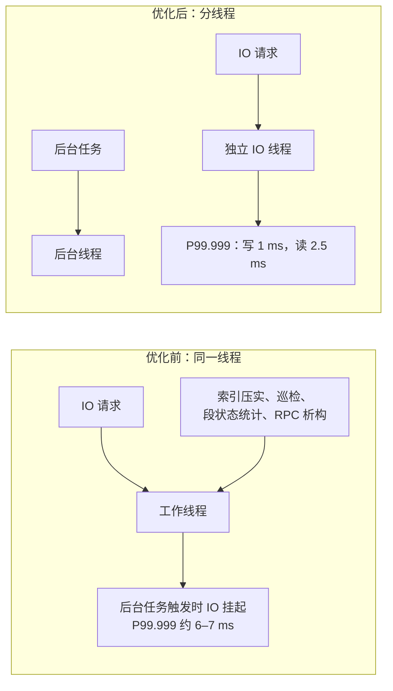

**小结（论文）**：① 延迟的弹性是粗粒度的，由架构和硬件决定；② 优化硬件导致的延迟往往很直接：缩短路径、用更快的设备、用多路径或重试抵消风险；③ 软件栈造成的尾延迟没有得到足够重视，常被当作噪声，但在高速网络和快速 SSD 下，**软件导致的尾延迟可能是主导因素**。

**解读**：这与 [盘古论文 §4.2](pangu-fast2023.md#42-用户态调度论文-322) 中"超时任务移到后台线程"是同一个问题在不同层的体现。run-to-completion 模型带来低平均延迟，但只要有一个慢任务混进 IO 线程，尾延迟就会被拖垮。

---

## 7. 弹性二：吞吐、IOPS 与容量

### 7.1 吞吐与 IOPS（论文 §3.2）

吞吐和 IOPS 常受同一组机制约束，EBS 通过优化数据路径上的 BlockClient 和 BlockServer 来实现弹性。

**BlockClient：上限所在**

| 代 | BlockClient 实现 |
|----|-----------------|
| EBS1 | 内核模块，所有 IO 由 CPU 处理 |
| EBS2 | 用户态 TCP（Luna）处理 IO |
| EBS3 | 卸载到通用 FPGA，完全旁路 CPU，负责从 VM 直接搬数据、计算块 CRC、发包 |

**图 12：BlockClient 最大吞吐与 IOPS 随超线程数的变化（估读）**

| 配置 | 饱和吞吐 | 饱和点 | 瓶颈 |
|------|---------|-------|------|
| EBS2 + Luna，2 × 25 Gbps | 约 5.6 GiB/s | 约 6 个超线程 | 网卡（2 × 25 Gbps ≈ 5.8 GiB/s） |
| EBS3 + Solar，2 × 100 Gbps | 约 12 GiB/s | 约 6 个超线程 | **PCIe** |
| IOPS | 约 180 万（12 个超线程） | — | 只要网络带宽够，IOPS 随超线程数增长 |

**BlockServer：靠并行度扩展**

请求到达 BlockServer 后，吞吐和 IOPS 受并行度约束。EBS2 起引入了 SegmentGroup、Segment、Data Sector 三级并行。减小 Data Sector 可以让一个 SegmentGroup 分散到更多 BlockServer：生产中从 2 MiB 降到 **128 KiB**，EBS2/EBS3 可以为每订阅 1 GiB 提供 **1,000 IOPS**。再小会适得其反：写请求过于碎片化，即使小写也会拆成大量子 IO，给第一跳网络带来过高压力。

**Base+Burst 分配**

用户可以在不改变容量的情况下按需订阅吞吐和 IOPS（AutoPL）。但实际中用户常为了应对偶发突发而过度订阅。为提高资源效率，提出 Base+Burst 策略：

| 技术 | 做法 |
|------|------|
| 基于优先级的拥塞控制 | IO 分为 baseIO（创建 VD 时预定义）和 burstIO（按可用能力分配、不保证）；BlockServer 无法满足所有需求时优先处理 baseIO，保证延迟稳定。目前单 VD 最大 baseIO 为 **5 万 IOPS**，最大 burstIO 为 **100 万 IOPS** |
| 服务器级动态资源分配 | 突发负载下，BlockServer 可以从 GCWorker 等后台任务抢占带宽、CPU 核和内存 |
| 集群级热点缓解 | 为保证突发余量，BlockManager 更积极地检查流量，更频繁地在 BlockServer 之间迁移段 |

**小结（论文）**：VD 吞吐/IOPS 的上限由**客户端**的处理和转发能力决定，后端可以通过并行轻松扩展；高吞吐/IOPS 常被需要但并非一直需要，Base+Burst 对用户和厂商都更经济。

**解读**：图 12 很直观地展示了瓶颈转移：网卡升级到 2 × 100 Gbps 后，BlockClient 的瓶颈从网卡移到了 PCIe。这与盘古论文中"升级网络后瓶颈移到内存、再移到 CPU"的叙事相同。

### 7.2 容量（论文 §3.3）

| 特性 | 做法 | 数字 |
|------|------|------|
| 灵活扩缩容 | 分段设计支持增减 SegmentGroup | VD 容量 **1 GiB–64 TiB** |
| 快速克隆 | 利用盘古文件的**硬链接**，下载一份快照即可在集群内克隆多块盘，满足 serverless 应用短时间内大量申请资源的需求 | EBS2 可在 **1 分钟内创建 1 万块** 40 GiB 的虚拟盘 |

---

## 8. 可用性：控制爆炸半径

### 8.1 三级故障事件（论文 §4）

EBS 特别关注**爆炸半径**：故障时不可用的 VD 数量。

| 级别 | 定义 | 例子 |
|------|------|------|
| 全局 | 整个集群的服务受影响 | BlockManager 异常（如错误配置导致网络拥塞和重试风暴） |
| 区域 | 某些组件拒绝为若干 VD 服务 | BlockServer 崩溃，其上的 VD 在段迁移或请求转发完成前不可用 |
| 个体 | 只影响一块 VD | 磁盘内不可纠正错误（及随后的读重试）、导致写失败并重定向的软件 bug |

> EBS 以集群为单位运行，论文不讨论数据中心级故障。

**两个使区域事件更严重的趋势**：

1. **单台 BlockServer 承载更多 VD**：EBS2 把 VD 切成 32 GiB 段，一块 VD 由多台 BlockServer 支撑；而 VD 平均容量只从 197 GiB 增加到 220 GiB。因此 EBS2/EBS3 中每台 BlockServer 承载的 VD 远多于 EBS1，一台崩溃影响的 VD 更多。
2. **个体事件可能级联**：自 EBS2 起段可以迁移。一次内部事故中，某个有问题的段因代码 bug 让它所在的 BlockServer 崩溃（个体事件）；控制面把段迁到其他 BlockServer，客户端不断重试失败的请求，每台加载该段的 BlockServer 都崩溃（区域事件）；若不人工干预，很快会演变成集群级故障。数十台 BlockServer 反复崩溃重启，数千块 VD 的 IO 质量下降。HBase 也有类似案例。

最直接的办法是缩小集群：EBS2/EBS3 把集群从 700 台降到约 100 台，全局事件影响的 VD 少得多。但这对区域和个体事件无效。论文分别在控制面和数据面提出改进。

### 8.2 控制面：Federated BlockManager（论文 §4.1，图 13）

**原设计的两个问题**：每个集群的控制面是三节点 BlockManager，用盘古锁服务选主，主节点服务集群内所有控制请求，并把 VD 状态变更持久化到盘古中的**单张元数据表**。

1. 单个主节点服务全集群的 VD，VD 密度越高，服务中断的概率和规模越大。自首次部署 100 节点 EBS2 集群以来，每个集群的平均 VD 数从 2 万增加到 **10 万**，CPU 和内存消耗分别增加了 **4.1 倍和 4.5 倍**。
2. 单张元数据表存放全集群 VD 的元数据，表的一部分损坏就可能导致 BlockManager 无法加载元数据，修复前所有 VD 都无法服务。

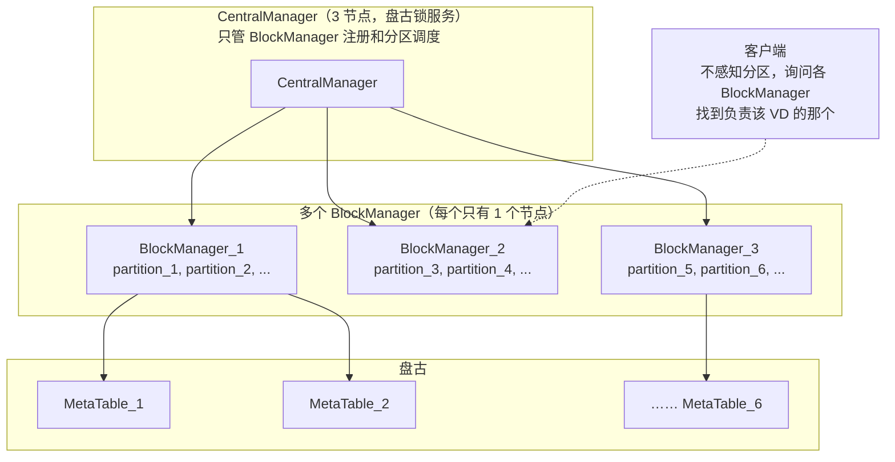

| 设计点 | 内容 |
|--------|------|
| 两级管理 | 每个集群有多个 BlockManager，由 CentralManager 管理；每个 BlockManager 管理**数百个**VD 分区，每个分区对应一张只存少量 VD 元数据的表 |
| 分区映射 | VD 到分区的映射是静态的，由哈希算出；客户端不感知分区，询问集群内所有 BlockManager 找到负责的那个，之后控制请求都发给它 |
| 无备节点 | 每个 BlockManager 只有一个节点（不再是一主两备）。故障时 CentralManager 把它的分区重新分配给其他 BlockManager，后者从盘古加载这些分区的元数据表即可服务。分区内 VD 少，加载只需**几百毫秒**，不需要备节点持续同步元数据 |
| 为什么要分区而不是多建 BlockManager | 10 万块 VD 的集群，要把单表故障的爆炸半径控制在 100 块以内需要 1,000 张表，而在 100 节点集群里建 1,000 个 BlockManager 不划算；多个 BlockManager 主要是为了把负载分散到多台服务器，减少 CPU 和内存不足导致的中断 |

**与业界设计对比**：HDFS Federation 与之类似，但没有考虑元数据表故障：每组 NameNode 把元数据存在本地盘，本地盘数据损坏时该组的所有请求都不可用。AWS Physalia 部署由 7 个节点组成、运行 Paxos 的小单元（cell），每个服务一组 VD。Federated BlockManager 采用两级 VD 管理，两级分别针对单节点故障和单表故障的爆炸半径。

### 8.3 数据面：逻辑故障域（论文 §4.2）

**三个观察**：

1. 故障通常源于**单块 VD 或单个段**的请求，因此应该监控段的状态而不是 BlockServer 的状态。
2. 故障的根因多是**软件错误**（bug 或错误配置），硬件或机械故障不会随段迁移。软件故障的定位很耗时，更别说构建自动恢复工具；更实际的做法是**主动减小影响**。
3. 不加干预的级联故障会迅速蔓延到整个集群。作为分布式服务，几台 BlockServer 宕机可以接受，集群级中断不行。

**设计**：把可疑的段隔离到一小组 BlockServer 中。

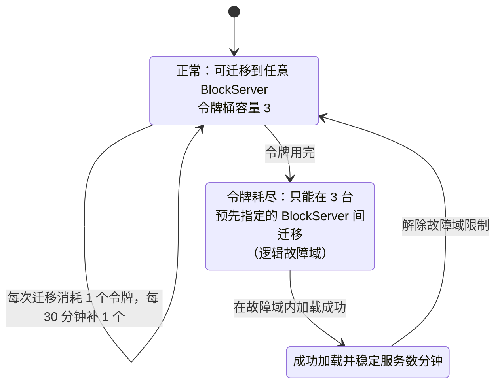

| 机制 | 内容 |
|------|------|
| 段级令牌桶 | 每个段一个容量为 3 的令牌桶；每迁移到一台新 BlockServer 消耗 1 个令牌，每 30 分钟补充 1 个 |
| 段级故障域 | 令牌桶为空时，该段之后的迁移只能在 3 台预先指定的 BlockServer 中选择。令牌桶**不限制迁移次数，只限制迁移范围** |
| 解除 | 段在某台 BlockServer 成功加载并稳定服务几分钟后，解除限制 |
| 全局故障域 | 若有多个出错的段（例如来自同一块 VD）或多块 VD，段级故障域不足以阻止多个级联同时发生。做法是**合并故障域**：把第一个故障域作为全局故障域，之后任何令牌耗尽的段都共享它，确保最多只有 3 台 BlockServer 被隔离，不降低集群容量 |
| 误伤概率 | 每个段有 3 个令牌，正常段在 100 节点集群中恰好与出错段共享迁移路径的概率很小 |

部署逻辑故障域后，成功防住了数次因迁移引发级联故障而可能导致的中断。HBase 社区报告过多个症状相似的 bug，其处理方式是修 bug 并用物理隔离缩小爆炸半径（与 EBS 最初的尝试类似），而逻辑故障域可以一劳永逸地防止级联故障演变成集群级中断。

### 8.4 经验（论文 §4.3）

1. 随着更高密度 SSD（如 QLC）普及、CPU 和 DPU 等硬件处理能力提升，可以预见分布式存储系统中一个节点崩溃会影响越来越多用户，区域事件会更频繁或更严重。Federated Manager 的关键好处是**在不失去大集群灵活性的前提下获得更小的爆炸半径**。
2. 在用户和底层服务之间设一层转发层，在分布式 KV、云存储中很常见，但这也意味着请求或数据结构在故障时会被重定向，使个体事件（bug、错误配置）变成区域甚至全局事件。由于 bug 和人为错误不可预测，EBS 不追求主动恢复或避免这类故障；逻辑故障域以**被动方式**把嫌疑对象限制在少数受控服务器上，不依赖人工干预。

**解读**：逻辑故障域是这篇论文中最有通用价值的设计之一。它承认"我们无法预知哪个 bug 会触发"，于是不去识别 bug，而是**限制故障的传播路径**：一个反复让服务器崩溃的段，最多只能祸害 3 台机器。这个思路与"毒丸消息"（poison message）隔离、熔断器同源，对任何带自动迁移/重试的系统都适用。

---

## 9. 硬件卸载：FPGA 之后去哪里

论文 §5 讨论了 BlockClient 和 BlockServer 两条卸载路线：两者都先用 FPGA，最后都放弃了 FPGA，但去向不同。

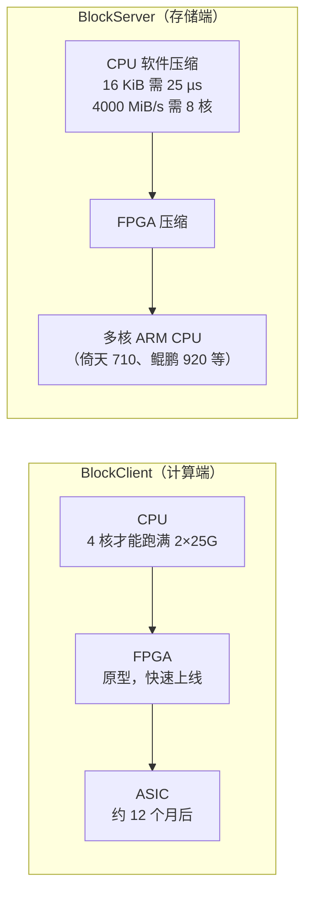

### 9.1 BlockClient：FPGA → ASIC（论文 §5.1）

**为什么必须卸载**：自 EBS2 起，后端 BlockServer 可以通过分段获得高吞吐/IOPS，前端 BlockClient 成为瓶颈。它被计算 CRC、加密、每 IO 查表等 CPU 密集任务拖累：压测显示要 **4 个 CPU 核**才能跑满 2 × 25 Gbps 网卡，更高速的网络需要两倍或四倍的核数。更重要的是，与 BlockClient 同机的 ECS（虚拟机服务）要求服务器支持**裸金属**（所有 CPU 核都分给用户）。因此卸载不只是推荐，而是必须。

**先用 FPGA 的原因**：当时直接做 ASIC 开发周期长得多；ASIC 方案在当时也因功耗更高、系统更复杂而不理想（论文原文如此，与后文矛盾，见 §11）。

**FPGA 的问题**：

| 问题 | 数据 |
|------|------|
| 数据损坏 | 由 CRC 不匹配发现的数据损坏事件中，**37%** 直接由 FPGA 引起（过热、信号干扰、时序问题）；FPGA 对温度波动、电气噪声等环境因素敏感 |
| 停机 | FPGA 相关问题占 BlockClient 运行停机时间的 **22%**（硬件故障、FPGA 逻辑 bug、与更新后的系统组件不兼容） |
| 频率 | 约 200–500 MHz，限制了适配高速网络的潜力 |

**转向 ASIC**：FPGA 版本的先行部署为转向 ASIC 节省了大量时间（FPGA 与 ASIC 方案发布相隔约 **12 个月**）。与 FPGA 相比，ASIC 卸载约为 **5% 的 CapEx**、约 **1/3 的功耗**，针对特定任务在硬件层面优化，时钟更高。另一个关键前提是 BlockClient 的主要功能（数据搬移、CRC 与加密等计算、网络包处理）通常**稳定**，不需要定期重新设计芯片。部署后现场统计显示，ASIC 的故障率比 FPGA **低一个数量级**。

### 9.2 BlockServer：FPGA → ARM CPU（论文 §5.2）

**卸载目标是在保持性能的同时降低成本**。EBS3 前台压缩即使用 LZ4，16 KiB 块的软件压缩延迟仍高达 **25 µs（占总写延迟的 25.6%）**；要达到 4,000 MiB/s 吞吐至少需要 **8 个 CPU 核**，加剧资源争用。

**FPGA 的问题**：

| 问题 | 内容 |
|------|------|
| 稳定性 | 过去一年中，每 1 万台生产 BlockServer 平均记录约 **150 次**由 FPGA 异常导致的压缩卸载失败 |
| 灵活性 | 正在探索针对不同冷热的数据块使用不同压缩算法，例如对分离出的冷数据块用 ZSTD 可再节省平均 **17%** 空间；FPGA 的资源限制使其无法动态适配多种压缩算法 |
| 规模 | 与 BlockClient 相比，BlockServer 的规模不足以摊薄 FPGA 不断上升的开发成本 |

**转向服务器 CPU**：多核 CPU 及其内置的专用计算单元（如鲲鹏 920、倚天 710 ARM CPU，都带压缩加速单元）在保持相近性能的同时成本效益更高。测试显示，倚天 710 的平均 LZ4 压缩延迟只比 FPGA 卸载高 **1.3 µs**，**16 个 ARM 核**可达到同等压缩吞吐。

**为什么 BlockServer 不用 ASIC**：① 没有裸金属要求，BlockServer 可以随便用 CPU 核；② BlockServer 的功能（算子）不断变化，例如引入新的压缩和 GC 算法，用 ASIC 可能需要时不时彻底重做，即使对云规模也代价过高。

### 9.3 经验（论文 §5.3）

| 对比 | 计算端 BlockClient | 存储端 BlockServer |
|------|------------------|------------------|
| 规模 | 极大（每台计算服务器一个），成本敏感 | 相对较小 |
| 算子 | 稳定：加密、转发等 | 常变：GC 算法、ZNS SSD 的主机 FTL 等 |
| 约束 | 裸金属，CPU 核全给用户 | 无裸金属约束，重视任务间低干扰 |
| 最终选择 | **ASIC** | **多核 ARM CPU** |

FPGA 因灵活性高、性能有竞争力，无疑是很多卸载场景的首选，EBS 在两端都用 FPGA 做了概念验证；但频繁出错和高 CapEx 说明 FPGA 可能不是大规模存储系统的理想加速选项。

**解读**：

- 这一节给出了一个很实用的决策框架：**算子稳定 + 规模大 + 不能占 CPU → ASIC；算子常变 + 能用 CPU → 带加速单元的多核 CPU；FPGA 只适合原型和过渡**。
- 有意思的是，[盘古论文](pangu-fast2023.md#103-软硬件协同卸载压缩和-crc论文-433)（FAST 2023）还在把 FPGA 硬件压缩当作成功经验（"20 人两年、服务能力提升约 50%、2022 年起 200 Gbps 集群默认开启"），一年后 EBS 论文就说 BlockServer 端的 FPGA 压缩要换成 ARM CPU。两篇论文合读，可以看到同一项技术在不同层、不同时间点的评价差异。

---

## 10. What If：三个反事实问题

### Q1：如果从未采用日志结构会怎样？（论文 §6）

开发 EBS2 时，团队最初尝试在 EBS1 基础上加分段（原地更新 + 分段），后因工程量太大放弃。这个方案如果做出来，可以满足 EBS2 的需求（高性能和空间效率）。

但它满足不了 EBS3：前台 EC/压缩要求在持久化前聚合足够数据（例如 4 KiB 条带单元的 EC(8,3) 一个条带需要 32 KiB，16 KiB 压缩单元的压缩率更高），而小写占主导加上低延迟要求，使单个段无法攒够 16 KiB。日志结构设计可以把**不同 VD 的段合并起来刷到日志**，轻松解决这个问题。

论文认为 **Ceph** 因缺少类似 BlockServer 的日志结构层而面临同样的问题：在 Ceph 块设备和 CephFS 上用 EC，FileStore 需要在 EC 池前配置回写模式的缓存层；BlueStore 对已有条带做部分写（读-改-写），不聚合数据，带来额外网络开销，而 EBS3 总是向盘古写**完整的 EC 条带**。

### Q2：如果用开源软件搭 EBS 会怎样？（论文 §6）

乍看可以用 HBase（日志结构分布式 KV）替代块层（BlockServer 和 BlockManager）、用 HDFS 替代文件层（盘古）。但两种设计差异很大，EBS 是**块接口、软件和硬件的协同设计**：

| 层 | EBS 的专门设计 |
|----|--------------|
| 块层 | 索引专为块服务定制：每个段是 32 GiB、由 4 KiB 块组成的地址空间，键空间只有 **800 万**个确定的数字，可以高效分配索引内存；硬件卸载压缩（FPGA、ARM CPU）、定制网络协议；把非 IO 活动移出关键路径（独立的 GCWorker、后台线程做索引压实） |
| 文件层 | 盘古为 NVMe SSD 构建专用用户态文件系统、部署 RDMA、集成多种硬件卸载 |

### Q3：如果盘古和 EBS 从未分离会怎样？（论文 §6）

简短回答：会严重阻碍 EBS 的发展。EBS1 中块层（BlockManager、BlockServer）与持久层（ChunkServer、ChunkManager）集成在一起，随着工程团队扩大越来越不可接受：

- 块层与 chunk 层之间的接口变得极其复杂，一度有近 **10 套**持久化 API。
- 当时 EBS 发布一次大版本升级可能需要 **10 个月**，原因是软件 bug 或组件间不兼容。

分离持久层并采用统一的日志结构接口后，开发和沟通都更顺畅；独立的块层可以不受数据块位置影响，在多个存储节点间快速创建和迁移段；分离架构把单点故障的影响限制在各自层内；还便于引入 FPGA 加速器等新技术，并把盘古扩展为对象存储、文件存储等服务的通用分布式文件系统。

**解读**：Q3 的答案与 [盘古论文](pangu-fast2023.md#31-统一只追加持久层-flatlogfile论文-311图-2) 中"统一 FlatLogFile 接口、上层服务各自实现映射和 GC"是同一件事的两面：盘古说"统一接口让底层简化"，EBS 说"统一接口让上层能独立演进"。Q1 和 Q3 合起来说明，EBS2 的"日志结构 + 建在盘古之上"不只是一次性能优化，而是为 EBS3 及之后的所有演进铺了路。

---

## 11. 论文中的不一致与可疑之处

| 位置 | 问题 | 本文的处理 |
|------|------|-----------|
| §2.3 正文 vs 图 8 | 正文称 FPGA 卸载延迟分布为 **29–65 µs**，且 16 KiB 时比 CPU 低 78%；而图 8 中 FPGA 延迟约 5–12 µs，CPU 在 16 KiB 时约 23 µs（与 §5.2 的 25 µs 一致），78% 的降幅对应约 5 µs。29–65 µs 可能是包含排队、校验等的端到端开销，论文未说明 | 两者都照录，标注口径不明 |
| §2.4 正文 vs 图 10 | 正文"insert 提升 550%、update 提升 573%、oltp_insert 提升 389%"，图中对应约 5.5 倍、5.7 倍、3.9 倍。"提升 X%"实际是"X/100 倍"，真实提升应为约 450%、473%、289% | 以图中倍数为准，见 §5.3 |
| §2.2 | 称 EBS2 的流量放大使"只有 15.5% 的网络带宽用于服务 VD 请求"；按 4.69 计算，1 / 4.69 ≈ 21.3%，1 / (1 + 4.69) ≈ 17.6%，都推不出 15.5% | 照录，标注无法复算 |
| §1、§2.2 | 引言说"把空间效率从 3 降到 1.29"，"空间效率"降低实为改善，措辞是"空间放大"的意思 | 本文统一称"空间放大" |
| §5.1 | 先说当时 ASIC 方案"功耗更高、系统更复杂"而不理想，后文又说 ASIC 功耗约为 FPGA 的 1/3；"约 5% 的 CapEx"未说明是相对 FPGA 的 5% 还是增加 5% | 照录两种说法，提示矛盾 |
| §2.3 | 流量放大 1.59 只给出结果，没有给出分解 | 本文按 JournalFile 与 DataFile 写入推算约 1.44，加上未合并的三副本小写，量级一致（§4.4） |
| §3.1 | 引用 [43]（FPGA 加速 LSM 压实）、[44]（高密度裸金属云）作为"硬件故障"的例证，[42]（FlashShare）、[45]（Octopus+）作为"硬件问题常被归咎"的例证，引用与论述内容关系不大 | 引用错位，不影响结论 |
| §2.2 | 图 5 中先 ACK 后写 TxnFile，故障时 TxnFile 可能缺最后几条记录，论文未说明如何从 DataFile 块头补全 | 见 §3.3 解读 |
| 全文 | 多数性能数字来自生产统计或微基准，没有给出各项优化（FWE、分线程、逻辑故障域）的独立消融实验 | 按经验报告阅读 |

---

## 12. 与相关系统的对比

| 维度 | EBS3（本文） | Azure 块存储（WAS / Managed Disks） | Ceph RBD | Ursa（EuroSys 2019） | AWS Physalia（NSDI 2020） |
|------|------------|----------------------------------|---------|--------------------|--------------------------|
| 架构 | 块层（BlockServer）+ 通用 DFS（盘古） | 构建在 Windows Azure Storage 的流层之上 | 块映射到 RADOS 对象 | SSD 主副本 + HDD 备份的混合块存储 | EBS 的配置/控制面数据库 |
| 写路径 | 日志结构，跨盘合并后前台 EC + 压缩 | 追加写的流（stream） | 对象原地写；EC 池需读-改-写 | 主副本 SSD 写日志 | — |
| 空间冗余 | 现场 0.77 副本/数据 | — | 副本或 EC | 1 份 SSD + 多份 HDD | — |
| 控制面 | Federated BlockManager：多个单节点管理者 + 数百分区表 | — | Monitor（Paxos） | — | 7 节点 Paxos cell，每个服务一组卷 |
| 爆炸半径 | 小集群 + 分区表 + 逻辑故障域 | — | — | — | cell 化 |

> 对比表中他人系统的特征只是概括，细节以各自论文为准；"—"表示论文未涉及或本文不展开。

**解读**：EBS 的特点是"**块层 + 通用分布式文件系统**"的两层架构。这与 Azure 建在 WAS 流层之上的思路相同，与 Ceph 直接把块映射到对象存储不同。两层架构的好处在 §10 Q3 中已经说明；代价是每次 IO 多一跳网络（BlockServer 到盘古），这也是 EBSX 要"跳过第二跳"的原因。

---

## 13. 整体总结

### 13.1 核心贡献

1. **十年三代的完整演进记录**：从原地更新 + 三副本（EBS1），到日志结构 + 分段 + 后台 EC/压缩（EBS2），再到跨盘合并 + 前台 EC/压缩（EBS3），空间放大 3 → 1.29 → 0.77，流量放大 3 → 4.69 → 1.59。
2. **弹性的四个维度**：平均延迟由硬件决定（EBSX 30 µs），尾延迟由软件决定（分线程后 P99.999 写 1 ms）；吞吐上限在客户端，后端靠三级分段扩展；Base+Burst 分配；1 GiB–64 TiB 与硬链接快速克隆。
3. **爆炸半径控制**：Federated BlockManager（多个单节点管理者 + 数百张分区元数据表）和逻辑故障域（令牌桶限制可疑段的迁移范围）。
4. **硬件卸载的选型框架**：计算端算子稳定、规模大、需裸金属 → ASIC；存储端算子常变、可用 CPU → 多核 ARM；FPGA 只适合原型。
5. **反事实分析**：日志结构是前台 EC/压缩的前提；开源组合不等于协同设计；块层与持久层分离使双方都能独立演进。

### 13.2 设计哲学

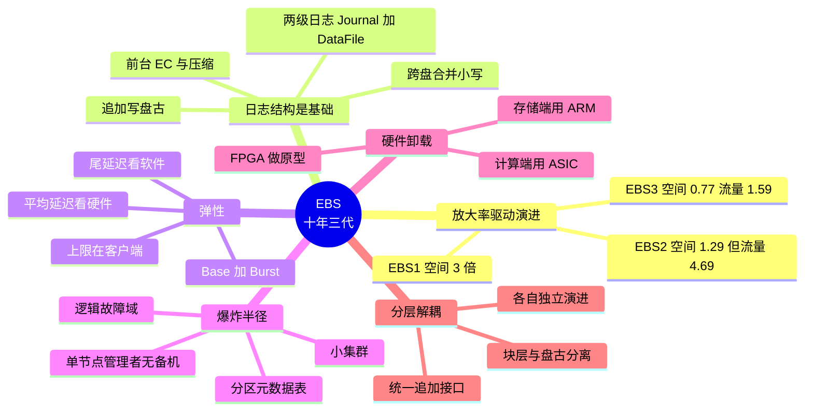

### 13.3 优点与局限

| 优点 | 局限 |
|------|------|
| 时间跨度长、数据真实：三代架构、放大率、规模、故障比例都有生产数字 | 多数优化没有消融实验，单项机制的贡献难以量化 |
| 失败经验写得很坦诚：FPGA 导致 37% 的数据损坏事件、迁移导致的级联故障、EBS1 的 10 个月发布周期 | 若干数字前后不一致（FPGA 延迟、"提升 X%"口径、15.5%、ASIC 功耗），引用时需核对 |
| 逻辑故障域、Federated BlockManager 等设计简单、通用，可直接借鉴 | 一致性模型、故障恢复的具体流程（如 JournalFile 回放、TxnFile 不完整时的处理）着墨很少 |
| "尾延迟主要来自软件"的结论有数百万慢请求的分解数据支撑 | 与 Azure、AWS 等同类系统缺少量化对比；EBSX 的 PMem 路线在 Optane 停产后的去向没有交代 |
| 与盘古论文互补，可以看到块层与文件层分工的全貌 | 平台与硬件高度定制（Luna、Solar、自研 DPU、倚天），学术环境难以复现 |

### 13.4 启示

**对存储系统设计者**：

- **日志结构是空间效率的前提**：只有不原地更新，才能做压缩、做 EC、做跨对象的写合并。原地更新省事，但会锁死后续所有优化空间。
- **同时盯住空间放大和流量放大**：后台 EC/压缩省空间却费流量，前台 EC/压缩两者兼得但需要跨对象合并写。评估冗余方案时，两个放大率都要算。
- **尾延迟先查软件**：在高速网络和 SSD 下，IO 线程中混入的后台任务（压实、统计、巡检、RPC 析构）往往比硬件更致命。把 IO 和后台任务分到不同线程，是成本最低的尾延迟优化。
- **自动迁移要有"刹车"**：任何会在故障时自动迁移、重试、重定向的系统，都要限制可疑对象的迁移范围，否则一个 bug 就能放倒整个集群。令牌桶 + 固定小故障域是简单有效的做法。
- **控制面也要分区**：元数据表和管理节点都应按分区组织，既缩小单表损坏的影响，又能在故障时以几百毫秒的代价把分区转给其他节点，省掉热备。

**对硬件卸载决策**：

- 先问三个问题：**算子是否稳定？规模是否足够大？是否允许占用 CPU？** 稳定 + 大规模 + 不能占 CPU 选 ASIC；常变 + 能占 CPU 选带加速单元的多核 CPU；FPGA 适合验证和过渡。
- 卸载路径一定要有**端到端校验**：EBS 的 FPGA 压缩后立即解压做 CRC，正是因为硬件出错会直接变成数据损坏。

### 13.5 一张图看懂 EBS 的十年

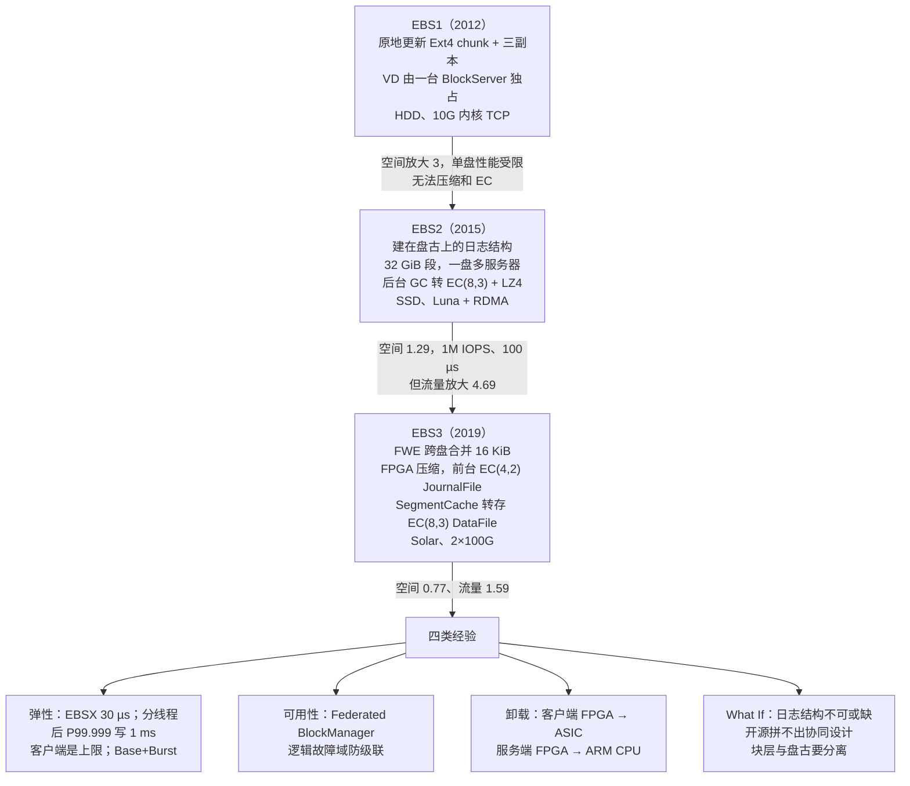

---

## 参考

- Weidong Zhang, Erci Xu, et al. *What's the Story in EBS Glory: Evolutions and Lessons in Building Cloud Block Store*. USENIX FAST 2024. <https://www.usenix.org/conference/fast24/presentation/zhang-weidong>
- Qiang Li et al. *More Than Capacity: Performance-oriented Evolution of Pangu in Alibaba*. USENIX FAST 2023.（本仓库精读：[pangu-fast2023.md](pangu-fast2023.md)）
- Rui Miao et al. *From Luna to Solar: The Evolutions of the Compute-to-Storage Networks in Alibaba Cloud*. ACM SIGCOMM 2022.
- Lingjun Zhu et al. *Deploying User-space TCP at Cloud Scale with LUNA*. USENIX ATC 2023.
- Qiuping Wang et al. *Separating Data via Block Invalidation Time Inference for Write Amplification Reduction in Log-Structured Storage*. USENIX FAST 2022.
- Marc Brooker, Tao Chen, Fan Ping. *Millions of Tiny Databases*（Physalia）. USENIX NSDI 2020.
- Brad Calder et al. *Windows Azure Storage: A Highly Available Cloud Storage Service with Strong Consistency*. ACM SOSP 2011.
- Huiba Li et al. *Ursa: Hybrid Block Storage for Cloud-Scale Virtual Disks*. ACM EuroSys 2019.
- Mendel Rosenblum, John K. Ousterhout. *The Design and Implementation of a Log-Structured File System*. ACM SOSP 1991.
- Ceph Documentation. *Erasure Code*. <https://docs.ceph.com/en/latest/rados/operations/erasure-code>
- 本仓库相关：[盘古 2.0 精读](pangu-fast2023.md)、[Fisc 精读](fisc-fast2023.md)、[客户端与通用技术](client-and-general-techniques.md)、[工业界生产系统](industry-production-systems.md)
