# FalconFS 论文精读：Distributed File System for Large-Scale Deep Learning Pipeline（NSDI 2026）

> 论文：Jingwei Xu, Junbin Kang, Mingkai Dong, Mingyu Liu, Lu Zhang, Shaohong Guo, Ziyan Qiu, Mingzhen You, Ziyi Tian, Anqi Yu, Tianhong Ding, Xinwei Hu, Haibo Chen. *FalconFS: Distributed File System for Large-Scale Deep Learning Pipeline*. USENIX NSDI 2026.
>
> 机构：上海交通大学并行与分布式系统研究所（IPADS）、华为。第一作者 Jingwei Xu 与 Haibo Chen（陈海波）同属两家机构；Mingkai Dong（董明凯，上交）与 Junbin Kang（华为）为通讯作者。
>
> 链接：<https://www.usenix.org/conference/nsdi26/presentation/xu> ；arXiv：<https://arxiv.org/abs/2507.10367>（本文依据 v4，2026-01-08）；代码：<https://github.com/falcon-infra/falconfs>、<https://gitee.com/openeuler/FalconFS>
>
> 精读日期：2026-11-22。文中**数字、表格与机制描述均摘自论文原文**（标注所在章节）；标注"解读"的段落是本文作者的分析与推论，不是论文原话。
>
> 相关文档：[元数据扩展性综述中的 FalconFS 小节](metadata-scalability.md#29-falconfs-distributed-file-system-for-large-scale-deep-learning-pipelinensdi-2026)、[工业界生产系统中的 FalconFS 小节](industry-production-systems.md#8-huawei-falconfsnsdi-2026)、[HPC 与 AI 训练存储中的 FalconFS 小节](hpc-ai-storage.md#32-falconfs-distributed-file-system-for-large-scale-deep-learning-pipeline)、[InfiniFS（FAST 2022）精读](infinifs-fast2022.md)、[CFS（EuroSys 2023）精读](cfs-eurosys2023.md)、[SingularFS（ATC 2023）精读](singularfs-atc2023.md)。

## 目录

- [0. 一页速览](#0-一页速览)
- [1. 背景：深度学习流水线与它的 IO 特征](#1-背景深度学习流水线与它的-io-特征)
- [2. 两大挑战：查找税与瞬时倾斜](#2-两大挑战查找税与瞬时倾斜)
- [3. 提案：无状态客户端](#3-提案无状态客户端)
- [4. 总体架构](#4-总体架构)
- [5. 混合元数据索引](#5-混合元数据索引)
- [6. 惰性命名空间复制](#6-惰性命名空间复制)
- [7. 并发请求合并](#7-并发请求合并)
- [8. 可靠性与集群重配置](#8-可靠性与集群重配置)
- [9. VFS shortcut：在不改内核的前提下绕过客户端路径解析](#9-vfs-shortcut在不改内核的前提下绕过客户端路径解析)
- [10. 评估](#10-评估)
- [11. 与相关工作的对比](#11-与相关工作的对比)
- [12. 整体总结](#12-整体总结)
- [参考](#参考)

---

## 0. 一页速览

**一句话**：分布式文件系统几十年来默认"客户端缓存元数据、在客户端做路径解析"，FalconFS 指出这在深度学习训练里是错的：数据集目录树有数十亿目录、每个 epoch 随机遍历一次，客户端缓存要么吃掉几十 GiB 内存，要么频繁 miss 导致一次 open 变成多次 RPC。FalconFS 于是让客户端**不保存元数据状态**，把完整路径一次发给元数据服务器；服务端用"**文件名哈希定位 inode + 全量复制目录树**"让绝大多数操作一跳完成，再用**批量合并并发请求**把服务端吞吐压上去，最后用 **VFS shortcut** 在标准 Linux VFS 下实现这一切。

| 维度 | 要点 |
|------|------|
| 目标负载 | 华为自动驾驶 DL 流水线：在线数据集数百 PB、**3000 亿以上**小文件（多数 ≤256 KiB）、**数十亿目录**；训练每 epoch 随机遍历全部文件；标注阶段按目录成批读写（§2.2） |
| 挑战 1：查找税（lookup tax） | 客户端缓存只能容纳 10% 目录时，随机遍历吞吐比全缓存低 32.5%，lookup 请求增至 1.50×；即使能缓存 90% 目录，每次 open 平均仍需 1.70 跳；1000 节点 × 10 亿目录 × 10% 缓存 = 每节点 80 GiB、总计 80 TiB 内存（§1、§2.3） |
| 挑战 2：瞬时倾斜（transient skewness） | 同目录文件的元数据常集中在同一 MDS，按目录成批访问时单个 MDS 被打满（§2.4） |
| 架构主张 | **无状态客户端**：客户端不缓存目录、不做路径解析，带完整路径直接发给目标元数据节点（§3） |
| 技术 1：混合元数据索引 | 常态按**文件名哈希**放置 inode（客户端无需知道父目录即可定位）；热点文件名用**路径遍历重定向**（哈希 `pid+name`），哈希方差用**覆盖重定向**（指定节点）；例外表只需 O(n log n) 项（§4.2、附录 A.1） |
| 技术 2：惰性命名空间复制 | 每个 MNode 都持有整棵目录树的副本以便本地解析；mkdir 不广播，缺失时按需拉取；rmdir / chmod / rename 走协调者并**广播失效**代替两阶段加锁（§4.3） |
| 技术 3：并发请求合并 | 同类请求排队后在一个数据库事务里批量执行：共享路径前缀的锁只拿一次，多个 WAL 小写合并为一次大写（§4.4） |
| 技术 4：VFS shortcut | 借助内核 5.7+ 的 `LOOKUP_PARENT` 标志，对中间目录返回 0777 的假属性骗过 VFS 检查，最后一个分量才发完整路径给服务端；用 `d_revalidate()` 防止假属性外泄（§5） |
| 实现 | MNode 是带定制扩展的 **PostgreSQL**（表、事务、B-link 树、WAL、主备复制全部复用）；文件数据存在基于 SSD 的分布式块存储 File Store 中（§4.1） |
| 主要结果 | 大目录树随机遍历吞吐为 CephFS 的 3.92–5.72×、Lustre 的 3.08–4.34×；MLPerf ResNet-50 训练在 90% 加速器利用率下支撑 80 卡（Lustre 32 卡）；标注任务回放耗时减少 23.8%–86.4%（§6.4、§6.8） |
| 生产 | 在华为自动驾驶 **10,000 NPU** 集群运行一年，用于数据标注和模型训练（摘要、§1） |

**解读**：

- FalconFS 与 InfiniFS、CFS 一样关心"路径解析要几跳"，但给出的答案方向相反。InfiniFS 让**客户端**更聪明（推测式并行解析 + 客户端缓存）；FalconFS 让**客户端完全不管**，把整棵目录树复制到每台元数据服务器上。这个选择成立的前提是 DL 集群的两个事实：客户端与元数据服务器之比超过 40:1，且所有客户端读的是同一个数据集——一份服务端副本能服务 40 个以上客户端，而 40 份客户端缓存只能各自服务自己。
- 论文的核心洞见可以归结为一句话：**缓存放在哪一侧，应该由"多少个消费者共享这份缓存"决定**。DL 集群里客户端多、数据集共享、计算节点内存紧张，于是缓存应该上移到服务端。
- "无状态"不是绝对的：客户端仍持有一份很小的**例外表**（exception table，最多 O(n log n) 项，n 为 MNode 数），且允许其过期，由服务端校验转发。

---

## 1. 背景：深度学习流水线与它的 IO 特征

### 1.1 自动驾驶 DL 流水线（§2.1，图 3）

四个阶段中，**标注**和**训练**都在 DFS 上进行，数据以单个小文件形式存放（`*.jpg`、标签文件等）。论文指出 NetApp、Meta 等公开的 DL 数据流水线有类似结构（§2.1）。

### 1.2 四个负载特征（§2.2）

| 特征 | 具体描述 | 对 DFS 的压力 |
|------|---------|---------------|
| 大目录里的海量小对象 | 文件从几 KiB 到几 MiB，多数 ≤256 KiB；在线数据集数百 PB、**超过 3000 亿**文件；按时间戳、车辆 ID、相机 ID 等分组成目录，目录数达**数十亿**，单目录很大 | 元数据规模与元数据性能 |
| 随机遍历 | 训练阶段每个 epoch 每个文件恰好访问一次，顺序随机 | 客户端缓存局部性差（§2.3） |
| 突发访问 | 标注阶段为喂满 GPU 按批处理，同一目录内的文件被集中访问 | MDS 间瞬时负载不均（§2.4） |
| 资源预算紧 | 计算节点 CPU 要做数据增强，内存还要缓存中间结果；生产中数据增强的 CPU 常是瓶颈 | 留给 DFS 客户端的 CPU 和内存很少 |

**解读**：这四个特征恰好与通用文件系统负载的假设相反。通用负载有强局部性（同一目录反复访问、近期访问的文件会再访问），所以客户端缓存效果好；DL 训练是"大工作集 + 均匀随机 + 只读一次"，任何基于 LRU 的缓存都只能得到与容量成正比的命中率。

---

## 2. 两大挑战：查找税与瞬时倾斜

### 2.1 路径解析为什么会放大请求（§1，图 1）

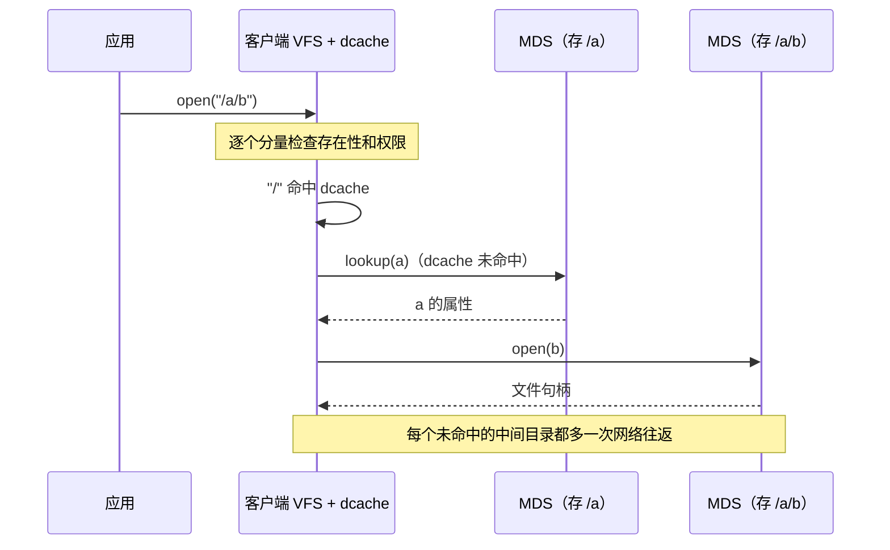

现代 DFS 把目录元数据分散在多个元数据服务器上，客户端要先逐级查找路径上每个目录才能定位目标 inode，一次文件操作可能变成多次 RPC，即**请求放大**。现有 DFS 普遍用客户端元数据缓存来缓解，论文称这类客户端为**有状态客户端**（stateful client）（§1）。

### 2.2 挑战 1：查找税（§2.3，图 2）

实验设置：在 4 个 MDS + 12 个 OSD 的 CephFS 上回放 ResNet-50 训练 trace，数据集为 100 万个 7 层目录中的 1000 万个 64 KiB 文件，512 个 IO 线程以随机顺序遍历，改变客户端元数据缓存的容量。

| 观察 | 数字 |
|------|------|
| 缓存只能容纳 10% 目录 vs 全部目录 | 吞吐下降 32.5%（反过来说全缓存高 1.46×），lookup 请求增至 1.50× |
| 缓存可容纳 90% 目录 | 每次 open 平均仍需 **1.70** 跳 |
| 吞吐随缓存容量变化 | 从 10% 到 100% 持续显著上升，说明要拿到好性能必须缓存**全部**目录 |

**为什么对缓存这么敏感**：每个 epoch 随机访问每个文件一次。全部目录都在缓存里时，一次 open 只剩一次元数据请求；缓存小时，LRU 会优先保留靠近根的目录，而**最后一级目录**（实验中占 90% 的访问）的命中率与缓存容量成正比。

**为什么生产里缓存不起**：Linux VFS 里一个目录的缓存约 **800 字节**（inode 608 B + dentry 192 B）。华为的一个生产集群可超过 1000 个客户端节点，典型数据集有数十亿目录；即使只在每个节点缓存 10 亿目录的 10%，也需要每节点 80 GiB、全集群 80 TiB 内存（§2.3）。

> **挑战 1**：DL 训练的大工作集让客户端陷入两难：要么因请求放大而性能下降，要么为缓存目录元数据消耗过多内存。

### 2.3 挑战 2：瞬时倾斜（§2.4，图 4）

标注阶段的推理任务按目录扫描和读写：读完一个目录的全部文件再读下一个。在 4 MDS + 12 OSD 的 CephFS 上，当"突发大小"（连续访问同一目录的文件数）超过任务的 IO 并行度时吞吐下降；突发大小为 100 时，四个 MDS 的 CPU 使用率严重不均。原因是 CephFS 倾向于把同一目录下文件的元数据放在一起，同目录的突发操作压到同一个 MDS。论文认为 BeeGFS、InfiniFS、Tectonic、IndexFS、CFS 等也有类似模式（§2.4）。

> **挑战 2**：同一目录内文件的并发操作造成 MDS 拥塞，限制了性能扩展。

**解读**：这是"按父目录分区"的固有代价。InfiniFS、CFS、Tectonic 都把同一目录的子项放在同一分片上，以便 readdir 和保持目录局部性；这在通用负载下是优点，在"按目录成批访问"的标注负载下成了热点来源。FalconFS 用文件名哈希把同目录文件打散，正好解决这个问题，但代价是 readdir 必须访问所有节点（论文未单独评估 readdir）。

---

## 3. 提案：无状态客户端

### 3.1 三个观察（§3）

1. **客户端远多于服务器**：华为部署中客户端与元数据服务器之比超过 **40:1**；DL 流水线中所有客户端共享同一数据集，因此服务端的一条目录项比客户端缓存能服务更多客户端。
2. **服务端存储更紧凑**：有状态客户端通常用 VFS dcache 和 inode cache 缓存目录属性，每个目录约 800 字节；服务端可以用定制格式，每个目录项**不到 100 字节**。
3. **服务端内存更充裕**：计算节点资源预算紧，服务器内存相对富余。

### 3.2 要解决的两个问题（§3）

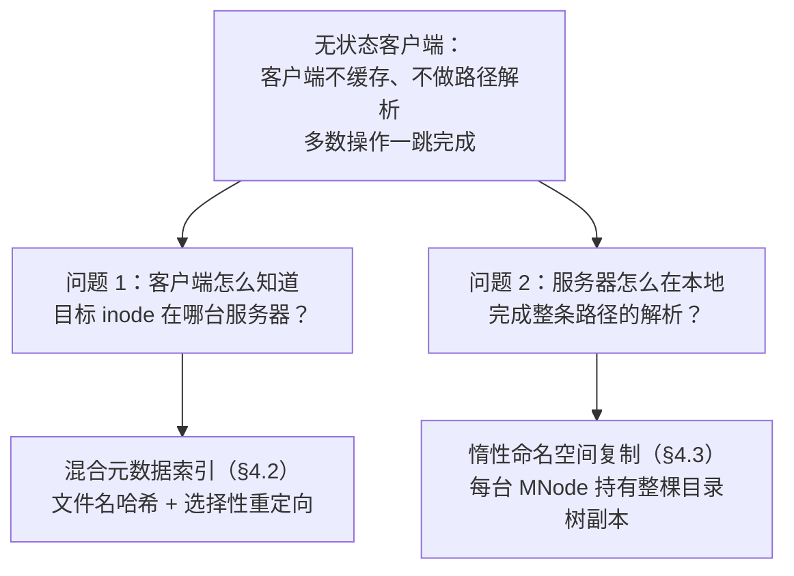

**问题 1：找对服务器**。论文把现有索引方式分两类：

| 方式 | 代表 | 问题 |
|------|------|------|
| 路径遍历索引（path-walk） | 以父目录 ID 作为哈希键的一部分（LocoFS、InfiniFS、Tectonic、CFS、BeeGFS 等），或不同目录用不同哈希规则（Lustre、Gluster、IndexFS） | 必须逐级解析出父目录 ID，要靠客户端缓存才快，陷入 §2.3 的两难 |
| 全路径哈希 | Giraffa、CalvinFS | 不需要缓存，但目录 rename 要迁移整棵子树的 inode，代价极高 |

两者都不能同时满足"无客户端缓存、无额外网络跳、实际可用的目录 rename"，FalconFS 因而把两者结合为混合索引（§3）。

**问题 2：本地解析**。目录项分散在多台服务器上时，服务端解析也要跨服务器通信。结合 DL 负载（随机遍历）和 DL 集群（客户端/服务器比高、服务器内存多）的特点，FalconFS 把**整棵目录树复制到所有元数据服务器**（§3）。

---

## 4. 总体架构

### 4.1 四个组件（§4.1，图 5）

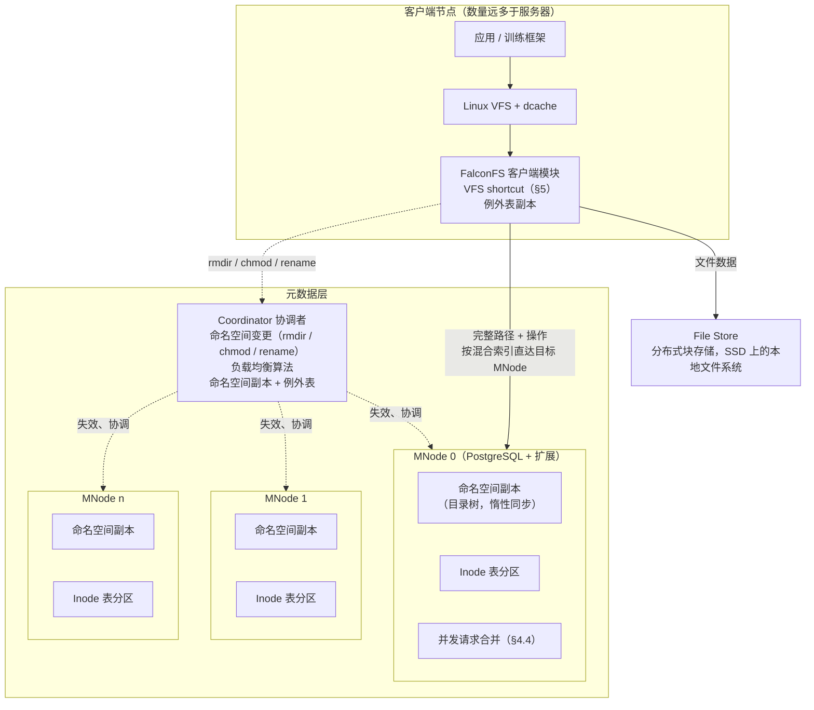

| 组件 | 职责 |
|------|------|
| 客户端模块 | 内核侧模块，通过 Linux VFS 提供 POSIX 接口；不做路径解析，绕过 VFS 路径遍历，把带完整路径的请求按混合索引发给 MNode |
| MNode | 带定制扩展的 **PostgreSQL** 数据库，复用其表与事务管理、B-link 树索引、xlog（WAL）、主备复制；每个 MNode 维护一份**惰性同步的目录树**（命名空间副本）和一部分**文件 inode** |
| Coordinator | 管理命名空间变更（§4.3），运行负载均衡算法（§4.2） |
| File Store | 分布式块存储，文件被切块分布到多个存储节点，节点用 SSD 上的本地文件系统存数据 |

**解读**：§4.1 说客户端模块是"内核模块"，但 §6.1 的实验实现是**修改过的 FUSE 内核模块与库**，元数据扩展性实验还使用了用户态 LibFS 接口。两者向服务端发出的请求相同，差别在客户端侧的开销。

### 4.2 元数据模式（表 1）

| 记录 | 键 | 值 | 放置方式 |
|------|-----|-----|---------|
| dentry（目录项，仅目录） | `pid, name` | `id, perm` | **复制**到所有 MNode |
| inode（文件与目录） | `pid, name` | `id, attr` | 按混合元数据索引**分区**（§4.2） |

- **复制的目录命名空间**：副本只包含路径解析所需的目录属性（即表 1 的 dentry），不含文件属性。10 亿目录时，每个 MNode 上副本占用**不到 100 GiB**（§4.1）。
- **分片的文件元数据**：所有 inode 按混合元数据索引分布到各 MNode，以扩展容量与吞吐（§4.1）。

**解读**：注意目录同时有两条记录：一条 dentry（权限 + ID，全复制，用于路径解析），一条 inode（完整属性，只在一个"属主 MNode"上）。属主由目录自身的名字经混合索引算出。这让"创建目录"可以只写属主一处，其他 MNode 的 dentry 副本在需要时再从属主拉取（§6）。

---

## 5. 混合元数据索引

### 5.1 常态：文件名哈希（§4.2.1，图 6）

所有文件按**文件名**（不含父目录）的哈希值放置。这种方式不需要客户端状态，也支持高效 rename，但不能保证均匀分布。

为什么在 DL 负载下可行：DL 数据集的目录通常很大，远多于 MNode 数。论文分析了华为生产数据集和多个超过一万文件的开源数据集（ImageNet、KITTI、Cityscapes、CelebA、CUB-200-2011），单目录大小从几百到几十万不等。由大数定律，每个目录内的文件在 MNode 间近似均匀分布，整个命名空间作为各目录分布的叠加也就统计均匀（§4.2.1）。

**解读**：文件名哈希的关键好处是客户端**不需要知道父目录 ID** 就能算出 inode 所在节点——客户端手里只有路径字符串，取最后一个分量哈希即可。代价是同名文件（如每个目录都有 `map.json`）会全部落到同一节点，这就是下面两种重定向要处理的情况。

### 5.2 角落情况：选择性重定向（§4.2.1）

两类会导致不均匀的情况：

- **热点文件名**：应用的命名习惯让某些文件名特别常见（如每个目录都有的 `map.json`、`Makefile`）。
- **哈希方差**：不同文件名的数量并不远多于 MNode 数，哈希本身的方差就会导致不均。

FalconFS 维护一张共享的**例外表**（exception table），记录哪些文件名要重定向、如何重定向：

| 重定向方式 | 针对 | 放置规则 | 客户端行为 | 跳数 |
|-----------|------|---------|-----------|------|
| 路径遍历重定向（path-walk redirection） | 热点文件名 | 哈希 `(父目录 ID, 文件名)`，同名文件按目录散开 | 发给**随机**一个 MNode；该节点用本地命名空间副本解析出父目录 ID，再转发给目标节点 | 2 |
| 覆盖重定向（overriding redirection） | 哈希方差 | 把指定文件名整体指派到指定节点 | 直接发给指定 MNode | 1 |

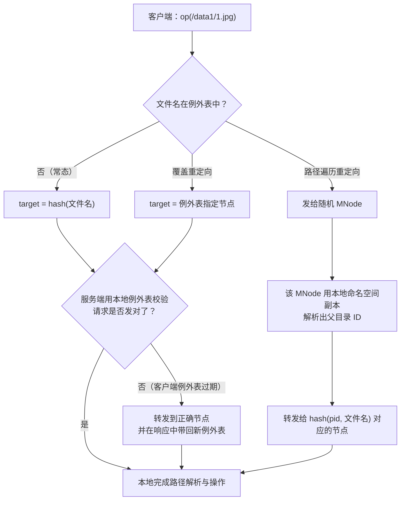

**例外表的同步**：MNode、客户端、协调者各持一份。协调者按 §5.3 的策略更新后，**主动推送**给所有 MNode；客户端在收到操作响应时**惰性获取**更新。客户端可能在一段时间内用过期的例外表发错请求，但 MNode 会用本地例外表校验每个请求，把发错的请求转发到正确节点（§4.2.1）。

### 5.3 统计负载均衡（§4.2.2）

**统计信息**：每个 MNode 周期性上报本地 inode 数，以及本地出现最频繁的 O(n log n) 个文件名及其次数（n 为 MNode 数）。

**目标**：让每个节点的 inode 数不超过总数的 `1/n + ε`，同时让例外表尽量小。ε 由用户指定，控制均衡力度。

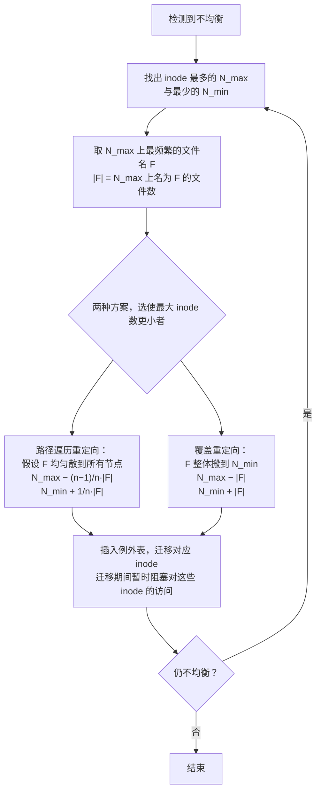

**收缩例外表**：协调者还会周期性地以随机顺序遍历路径遍历重定向项，若删掉某项不会导致不均衡就删除；然后对覆盖重定向项做同样检查（§4.2.2）。附录 A.2 说明实际算法**优先选择覆盖重定向**，只在必要时才用路径遍历重定向，因为后者多一跳。

### 5.4 理论保证：O(n log n) 项例外表就够（附录 A.1）

论文给出一个逐步放宽假设的论证：

1. **文件名很多、频率相同**：文件名哈希由大数定律保证统计均匀。
2. **文件名很多、频率不同**：借用缓存负载均衡文献中的定理（Fan 等 SoCC'11 "Small cache, big effect"、NetCache SOSP'17）——m 个对象随机分到 n 个节点、总查询负载 n·t 时，若有缓存吸收最热的 O(n log n) 个对象的全部查询，则高概率没有节点负载超过 t，**与查询分布无关**。把"文件名"当作对象、"同名文件数"当作查询负载，就得到：除最热的 O(n log n) 个文件名外，其余文件已均匀分布；再对这 O(n log n) 个文件名做路径遍历重定向使其均匀，整体即均匀。
3. **只有 O(n) 个不同文件名**：最简单的做法是对全部文件名做路径遍历重定向，例外表至多 O(n) 项。

**解读**：这个证明把"热点缓存"的经典结论巧妙地转移到"数据放置"上，保证了例外表大小只与 MNode 数有关、与文件数无关——这是客户端可以持有一份完整例外表、仍称"无状态"的理论基础。不过证明给的是"高概率"和渐近界，ε 和常数因子要靠 §10.6 的实测来说明。

---

## 6. 惰性命名空间复制

### 6.1 两条设计原则（§4.3）

每个 MNode 和协调者都维护一份"**一致但不一定完整**"的命名空间副本。受缓存一致性协议和 Hermes（ASPLOS'20）启发，同步遵循两条原则：

1. **把同步推迟到访问时**：目录创建对 DL 数据集初始化很关键。若每次 mkdir 都立即复制到所有 MNode，需要昂贵且不可扩展的两阶段提交（2PC）；FalconFS 改为访问时按需同步。
2. **用失效充当轻量锁**：修改目录结构或权限时，要阻塞该目录子树下的并发操作。FalconFS 不用传统的两阶段加锁，而是在所有节点上**使对应副本项失效**，省掉一轮广播。

### 6.2 创建目录与按需拉取（§4.3，图 7(a)(b)）

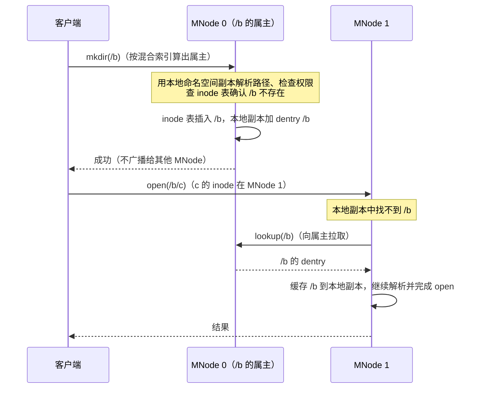

mkdir 保持单跳：属主 MNode 只更新自己的 inode 表和本地副本，不主动广播。其他 MNode 在路径解析遇到缺失 dentry 时，按混合索引算出属主并拉取（§4.3）。

**解读**：为什么"不完整"不影响正确性？因为副本只会**缺**，不会**错**：缺失时去属主拉取的是权威数据；而会让已有副本项变错的操作（rmdir、chmod、rename）都先广播失效（§6.3）。这和 CPU 缓存一致性里"写时失效、读时缺失拉取"的 MSI 思路一致。

### 6.3 删除目录、修改权限、rename（§4.3，图 7(c)）

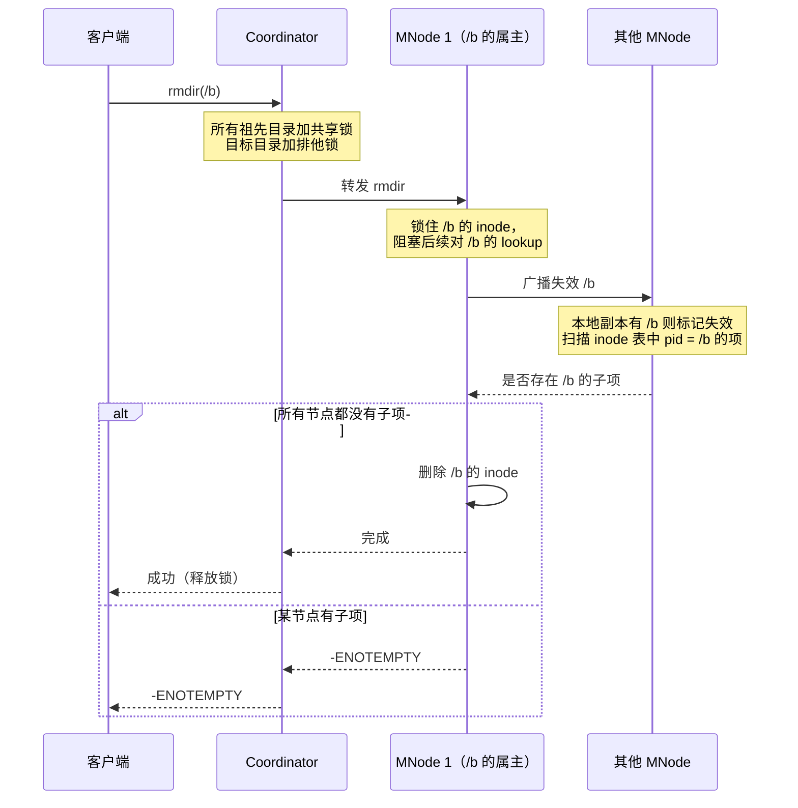

| 操作 | 处理者 | 机制 |
|------|--------|------|
| rmdir | 协调者 → 属主 MNode | 协调者加锁，属主锁 inode 并广播失效；各节点同时报告是否存在以该目录为父的 inode；全部为空才删除 |
| chmod 等改权限 | 协调者 → 属主 MNode | 与 rmdir 类似，属主广播失效并修改 inode 表中的权限 |
| rename(A, B) | 协调者 | **传统两阶段加锁 + 2PC**：协调者加锁并检查，通过后广播失效 A 路径的 dentry，把 A 的 inode 迁到 B 对应的属主 MNode |

**解读**：rename 一个目录时，只需迁移**目录自身那一条** inode。因为子项的键是 `(pid, name)`，目录 ID 不变；子文件按文件名哈希放置（或热点文件名按 `pid + name` 哈希），都与父目录的名字和位置无关，所以子树中所有 inode 原地不动。这正是混合索引相对全路径哈希（Giraffa、CalvinFS）的优势。

### 6.4 加锁与冲突处理（§4.3）

服务端（协调者或 MNode）处理请求时，在本地副本上逐分量解析路径并获取 dentry 锁：

- 协调者：中间目录加**共享锁**，最后一个分量加**排他锁**；
- MNode：所有 dentry 加**共享锁**；
- 遇到缺失 dentry，从属主取回后再加锁。

于是同一服务器上的并发请求由这些锁串行化；两个不同 MNode 上的请求之间没有数据竞争，可并行。需要论证的只剩"协调者上的请求 ReqC"与"MNode 上的请求 ReqM"之间的冲突。

以 ReqC = 删除 `/a/b`（inode 在 MNode_C 上）、ReqM = 在 MNode_M 上 open `/a/b/c` 为例：

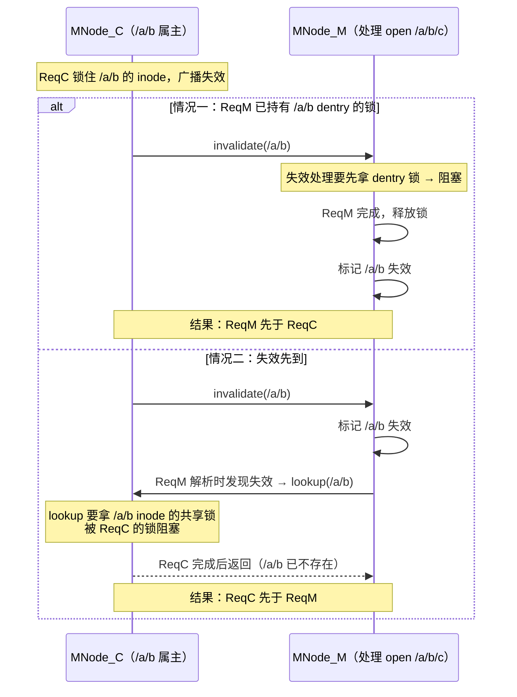

此外，MNode_M 处理失效请求时会**丢弃所有在失效到达之前发出的 lookup 响应**，避免拉回过期数据（§4.3）。

**讨论**：惰性复制让访问**不存在的路径**多一次远程 lookup（本地缺失时无法区分"不存在"和"还没拉过来"）。论文认为 DL 负载中这种负向访问很少（§4.3）。

**解读**：

- 这套协议的串行化点是**属主 MNode 上的 inode 锁**：失效广播与缺失拉取都要经过属主，所以属主的锁把两类冲突都排了序。协调者只负责会"改变已有 dentry"的少数操作，而 DL 负载里 rmdir/chmod/rename 罕见。
- 代价是这些操作要**广播到所有 MNode 并等待最慢的应答**，开销随集群规模增长（§10.2 的 rmdir 结果印证了这一点），协调者也是这些操作的单点瓶颈。

---

## 7. 并发请求合并

### 7.1 机制（§4.4，图 8）

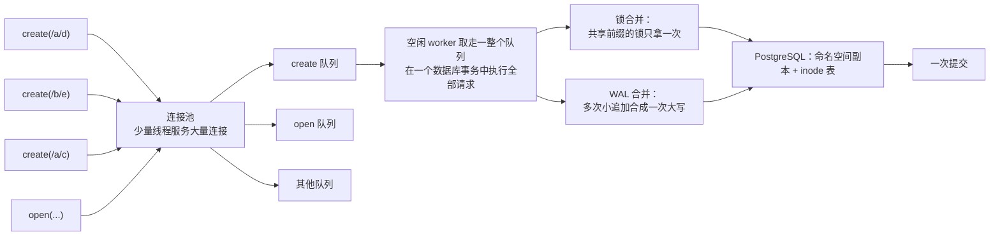

每个 MNode 启动固定数量的数据库 worker 线程，前面是连接池。连接池按请求类型把请求放进不同队列；空闲 worker 取走一个队列，在单个数据库事务中执行队列中的全部请求（§4.4）。

**锁合并**：路径解析时要对路径上所有目录加共享锁。已有研究（CFS）表明，即使没有真正阻塞，加锁开销也很可观。由于文件系统是树形结构，同批请求往往共享近根前缀，worker 合并共享前缀，消除冗余加锁。图 8 中三个 create 各遍历两级目录和一个文件，本来要拿 9 把锁，合并后只需 6 把（§4.4）。

**WAL 合并**：mkdir、create、close 等会修改 inode 表。传统 DFS 把每个操作包成独立事务，每次提交都同步追加一小段 WAL，对存储不友好；FalconFS 一批请求一个事务，worker 把小日志追加合成大写（§4.4）。

**解读**：

- 这就是数据库里的 **group commit**，再加上路径前缀上的"锁批量化"。它之所以能落地，前提是**无状态客户端**：所有路径解析都集中在服务端，才有机会看到并合并大量请求的共同前缀；有状态客户端在本地解析完路径，服务端看不到这层共享。
- 代价是单请求延迟变高（要等批次），§10.2 中 FalconFS 的延迟高于 Lustre 就源于此。
- 一个批次在一个事务里，意味着批内某个请求失败需要处理部分回滚（如子事务/保存点），论文未展开这一实现细节。

---

## 8. 可靠性与集群重配置

### 8.1 崩溃一致性（§4.5）

所有对 MNode 的持久更新先写 WAL 再应用。MNode 在路径解析、更新或迁移中崩溃时，未提交操作回滚、已提交操作从日志恢复。单节点事务直接用 PostgreSQL 的 WAL；跨 MNode 的操作在此基础上实现了**定制的 2PC**。协调者故障按 MNode 故障同样处理。

### 8.2 高可用（§4.5）

MNode 和协调者都支持**多数派复制**：每个都有一个主副本服务请求、若干从副本，用 PostgreSQL 的**物理流复制**持续把主的 WAL 发给从。主不可用时，选 WAL 最长的从副本为新主。只要每个 MNode 的多数副本可用，FalconFS 就可用。这种多数派复制与惰性命名空间复制是正交的两层复制。

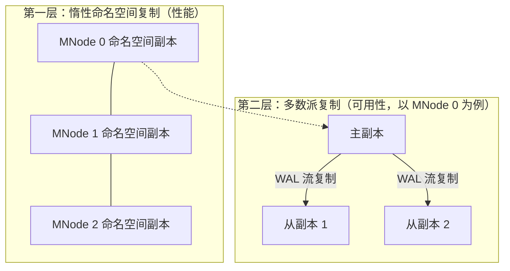

### 8.3 集群重配置（§4.5）

用**一致性哈希**计算 inode 位置，支持 MNode 加入和离开。扩缩容时迁移涉及的 inode，**迁移期间停止服务**。不支持在线迁移，因为那需要在 inode 访问的关键路径上检查迁移状态，引入额外开销。

**解读**：

- "停服迁移"在通用云存储里难以接受，但在华为的 DL 集群里，元数据服务器数量相对稳定，扩容可以安排在窗口期。
- 负载均衡迁移（§5.3）同样会"暂时阻塞"相关 inode 的访问，但范围只限于被重定向的文件名。
- PostgreSQL 主从切换"选 WAL 最长者"需要一个外部的选主与成员管理组件来保证多数派语义，论文没有说明由谁承担。

---

## 9. VFS shortcut：在不改内核的前提下绕过客户端路径解析

### 9.1 问题（§5）

Linux VFS 把路径解析和元数据缓存逻辑嵌在内核里，它会对每个分量调用文件系统的 `lookup()`。要实现无状态客户端又不侵入式修改内核，需要：

1. **区分中间目录的 lookup 和最后一个分量的 lookup**：前者返回假属性以跳过检查，后者返回真实属性；
2. **避免假属性暴露给用户**：之前返回的假属性可能留在 dcache 里，在后续操作中被用户看到。

### 9.2 两个内核机制

| 机制 | 用途 |
|------|------|
| `LOOKUP_PARENT` 标志（Linux 5.7 起，原为审计子系统设计） | VFS 在路径遍历中、尚未到达最后一个分量时设置此标志并传给 `lookup()`。客户端模块据此判断是中间目录，返回假属性：`mode = 0777`，以及一对**保留的 uid/gid** 作为标记 |
| `d_revalidate()` | dcache 命中时 VFS 调用它验证缓存项。客户端模块检查：命中项是不是假属性（看保留 uid/gid），以及这次是不是在解析**最后一个分量**（`LOOKUP_PARENT` 未设置）。两者都成立就从 MNode 取真实属性并更新 dcache 项 |

### 9.3 示例（图 9）

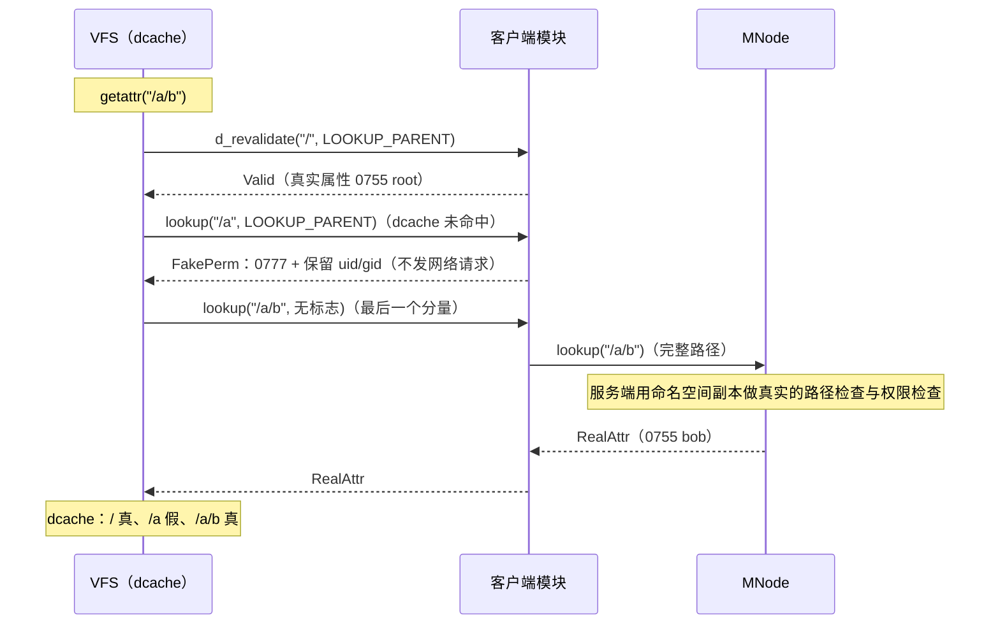

### 9.4 正确性与局限（§5）

- **正确性**：MNode 会重新执行所有被绕过的检查，并防止假属性暴露给用户。
- **局限 1**：不支持**符号链接**，因为客户端不跟随链接。
- **局限 2**：FalconFS 内部的**嵌套挂载点**需要特殊处理（穿过挂载点时重新检查目录权限），尚未支持。

**解读**：

- VFS shortcut 是工程上最巧妙的一环：它把"客户端不做路径解析"变成了一个不需要改内核、只靠 `lookup()` 与 `d_revalidate()` 两个标准钩子就能实现的方案，可以直接部署在现有发行版上（要求内核 ≥5.7）。
- 假目录项仍然会进入 dcache，只是内容是假的。它们占的内存远小于缓存全部真实目录（不需要真实 inode 属性、也不会因 miss 触发网络请求），但 dcache 并没有完全消失。
- 服务端要"重新执行权限检查"，就必须拿到发起进程的真实凭据（uid/gid/附加组）。论文没有说明凭据如何随请求传递，以及 ACL、capability 等更复杂权限模型是否支持。

---

## 10. 评估

### 10.1 实验环境（§6.1，表 2）

| 项 | 配置 |
|----|------|
| 集群 | 13 台双路服务器，每台拆成两个节点（各绑定一个 socket、一块 SSD、一块网卡），共 **26 个节点** |
| 单机硬件 | 2 × Intel Xeon 3.00 GHz 12 核；16 × 16 GB DDR4-2933；2 × 960 GB NVMe SSD；2 × 100 GbE |
| 服务端资源 | 每个服务端节点限制为 **4 核**，以保证客户端能压满服务端 |
| 对比系统 | CephFS 12.2.13（通过 libcephfs 访问，因 VFS 挂载性能不稳定）；JuiceFS 1.2.1（TiKV 1.16.1 作元数据引擎与数据存储）；Lustre 2.15.6 |
| 访问方式 | JuiceFS、Lustre 走 VFS 挂载点；FalconFS 默认走**修改过的 FUSE 内核模块与库**（含 §5 优化），部分实验用 LibFS |
| 复制 | **所有系统关闭元数据与数据复制** |

**读数口径说明（解读）**：论文在不同位置混用两种倍数表述。摘要写"最高 5.72× 吞吐""12.81× 训练吞吐"，引言和 §6 写"提升 4.72×""提升 11.81×"——两者差 1，说明正文中的"提升 X×"或"X× speedup"指 `(新/旧 − 1)`。§6.2 中"getattr 相对 Lustre 0.52–0.93× speedup"而又说 FalconFS 更快，也只能按这个口径理解（即 1.52–1.93 倍）。下文引用论文数字时保留原文措辞，并在需要时注明换算后的倍数。

### 10.2 元数据性能（§6.2，图 10、11、12）

**场景**：最佳情况——每个客户端访问自己的私有目录，所有目录 lookup 都命中客户端缓存。元数据服务器从 4 台扩到 16 台，逐步加客户端线程直到吞吐不再上升。13 个 FUSE 客户端节点压不满 FalconFS（瓶颈在 FUSE），因此这组实验用 LibFS 客户端。

| 操作 | 结果（原文措辞） | 原因（论文解释） |
|------|-----------------|------------------|
| create、unlink | 相对 Lustre 提升 0.82–2.26×，相对 CephFS、JuiceFS 更高 | (a) FalconFS **不维护目录的 atime/mtime**，无需更新目录元数据；(b) 请求合并把多次 WAL 合并持久化。JuiceFS、Lustre 要用分布式事务同时更新文件和目录元数据；CephFS 不用分布式事务，但把写日志到远端 OSD |
| getattr | 相对 Lustre 提升 0.52–0.93× | (a) 请求合并提高服务端并发、减少请求分发开销；(b) 无状态客户端**不需要缓存一致性锁**（CephFS 的 capability、Lustre 的 intent lock） |
| mkdir | 随服务器数扩展 | 基于失效的惰性同步 |
| rmdir | 随服务器数增加**反而下降** | 需要向所有服务器广播失效并查询子项，开销与集群规模成正比；其他三个系统的 rmdir 开销是常数，因此可扩展 |
| JuiceFS | 扩展性差 | 元数据引擎各节点 CPU 利用率不均 |

**延迟**（4 台元数据服务器、单客户端线程，图 11）：FalconFS 的延迟**高于 Lustre**，因为请求合并以延迟换吞吐；rmdir 的 p99 延迟很高（要广播并等最慢的节点）。除 rmdir 外，延迟与 CephFS 相当、优于 JuiceFS。

**客户端并发扩展**（4 台元数据服务器，图 12，仅展示 create 与 getattr）：客户端数 ≤256 时 FalconFS 吞吐低于 Lustre（延迟更高）；客户端继续增加后 Lustre 饱和，FalconFS 反超。原因是连接池让少量线程服务大量连接，请求合并高效批处理。

**解读**：

- "不维护目录 atime/mtime" 是一项实打实的 POSIX 放宽，也是 create/unlink 快的重要原因之一。CFS 用 delta apply 合并、SingularFS 用 16 字节 CAS 取 max，都是在**保留**父目录时间戳的前提下降低冲突；FalconFS 直接不更新。这符合论文自称"POSIX-like"的定位，对依赖目录 mtime 判断变化的工具（如增量同步、构建系统）不友好。
- 元数据扩展性实验是"最佳情况"（私有目录、全部命中缓存），对有状态客户端最有利；FalconFS 在这里仍然领先，主要靠服务端的合并与精简（没有目录时间戳、没有一致性锁），与无状态客户端本身关系不大。真正体现无状态客户端价值的是 §10.4。

### 10.3 小文件数据性能（§6.3，图 13）

4 台元数据服务器 + 12 个数据节点（每个一块 NVMe），10 个客户端节点共 2560 线程，每线程在私有目录中访问 1024 个预建文件：`O_DIRECT` open → 读或写全部数据 → close。文件大小 4 KiB 到 1 MiB。

| 文件大小 | FalconFS 读吞吐 | FalconFS 写吞吐 |
|---------|----------------|----------------|
| 4 KiB | 1.50 GiB/s | 1.33 GiB/s |
| 16 KiB | 5.87 GiB/s | 5.21 GiB/s |
| 64 KiB | 21.66 GiB/s | 16.44 GiB/s |
| 256 KiB | 41.84 GiB/s | 16.53 GiB/s |
| 1 MiB | 43.61 GiB/s | 16.93 GiB/s |

（文件大小档位由图 13 的横轴与正文"小于 256 KiB 时吞吐与文件大小成正比"推断。）

- 小于 256 KiB 时吞吐与文件大小成正比，说明瓶颈是**元数据 IOPS**；大于 256 KiB 时 CephFS、Lustre、FalconFS 都触及 SSD 带宽上限（读约 43 GiB/s、写约 16 GiB/s）。
- 文件 ≤64 KiB 时，FalconFS 相对 CephFS 7.35–21.23×、相对 JuiceFS 2.94–23.53×、相对 Lustre 1.12–1.85×（原文 "speedup"）。JuiceFS 的小文件差主要因为数据存储低效。

### 10.4 客户端内存预算的影响（§6.4，图 14）——无状态客户端的核心证据

**场景**：典型 DL 训练负载——大目录树随机遍历。8 层目录树，每个中间目录 10 个子目录，每个末级目录 10 个 64 KiB 文件，共 **1110 万目录、1 亿文件**。4 台元数据服务器 + 12 个数据节点；10 个客户端节点各运行 256 线程，各自以独立随机顺序读全部文件。按"全部目录 inode + dentry 总大小"的比例限制每个客户端的元数据缓存：CephFS 用 `client_cache_size`，其他系统用 cgroup v2 限制内存（超限时回收内核 dentry/inode）。

对比项增加 **FalconFS-NoBypass**：关掉 VFS shortcut，依赖 VFS dentry/inode 缓存做客户端路径解析。JuiceFS 在目录树初始化完成前吞吐就降为零，未列入。

| 观察 | 数字 |
|------|------|
| 有状态客户端（CephFS、Lustre、FalconFS-NoBypass）对内存预算敏感 | 10% 与 100% 缓存之间有 **1.4–1.5×** 的性能差 |
| FalconFS 发往元数据服务器的请求数 | 不随缓存大小变化，保持恒定 |
| FalconFS vs FalconFS-NoBypass | 元数据请求减少 **22.7%–45.9%**，吞吐提升 0.24–0.94×（即 1.24–1.94 倍） |
| FalconFS vs CephFS / Lustre | 吞吐提升 **2.92–4.72×** / **2.08–3.34×**（即 3.92–5.72 倍 / 3.08–4.34 倍） |
| 100% 缓存下 FalconFS-NoBypass | 仍比 FalconFS 慢 **19.4%**：缓存虽能装下全部目录 inode，但文件 inode 也在争用缓存，目录 lookup 仍频繁 miss |

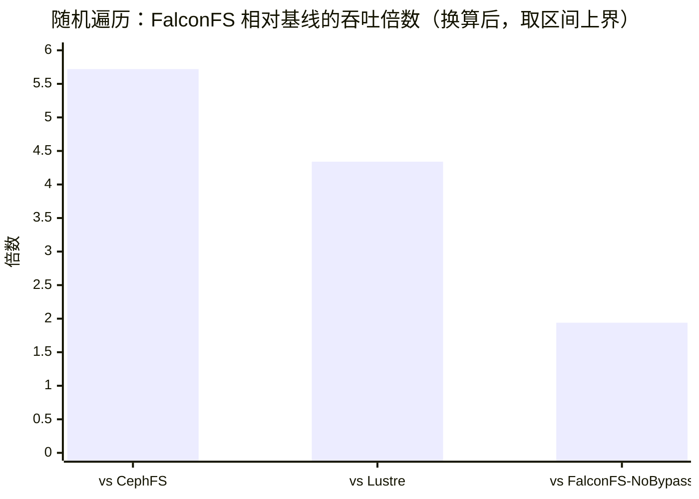

**解读**：FalconFS 与 FalconFS-NoBypass 是同一套服务端，唯一差别是客户端是否做路径解析，因此这组对比**干净地隔离了无状态客户端本身的收益**（1.24–1.94 倍）。与 CephFS/Lustre 的 3–5 倍差距里，其余部分来自服务端设计（合并、精简元数据、无一致性锁等）。另一个容易忽视的发现是"100% 缓存仍慢 19.4%"：现实中客户端缓存的不只是目录，文件 inode 会把目录挤出去，所以"缓存所有目录"在实践中比算术估计更难。

### 10.5 瞬时倾斜的影响（§6.5，图 15）

4 台元数据服务器 + 12 个数据节点，单客户端节点 256 线程，以"突发"方式访问预建的 64 KiB 文件：一个突发是同一目录内文件的连续访问，相邻突发访问不同目录。

- CephFS、Lustre 的读写性能随突发大小增大而下降——大突发造成元数据服务器间的瞬时负载不均。
- FalconFS 不受影响，因为同一目录内文件的元数据被文件名哈希均匀打散。
- JuiceFS 也不随突发大小下降，但原因是它的元数据引擎节点之间本来就**持续**不均衡。

### 10.6 真实负载下的负载均衡（§6.6，表 3）

16 台元数据服务器，统计各数据集 inode 在服务器间的分布（理想均值为 1/16 = 6.25%）。

| 数据集 | inode 数 | 最大占比 | 最小占比 | 路径遍历重定向项 | 覆盖重定向项 |
|--------|---------:|--------:|--------:|:---:|:---:|
| 华为标注任务 | 33,320 | 6.99% | 5.30% | 0 | 0 |
| ImageNet | 2,027,728 | 6.29% | 6.21% | 0 | 0 |
| KITTI | 15,003 | 7.01% | 5.47% | 0 | 0 |
| Cityscapes | 20,022 | 6.30% | 6.22% | 0 | 0 |
| CelebA | 202,599 | 6.54% | 6.95% | 0 | 0 |
| SVHN | 33,404 | 6.77% | 5.76% | 0 | 0 |
| CUB-200-2011 | 12,003 | 6.68% | 5.95% | 0 | 0 |
| Linux 6.8 源码树 | 88,936 | 6.49% | 5.96% | 2 | 0 |
| FSL home 快照 | 655,177 | 6.83% | 5.45% | 1 | 0 |

- 七个 DL 数据集**一项例外都不需要**，仅靠文件名哈希就足够均衡，原因是数据集目录大。
- Linux 源码树有大量同名文件，对最频繁的两个文件名 `Makefile`（2,945 次）和 `Kconfig`（1,690 次）做路径遍历重定向即可均衡，二者占全部文件的 5.55%。
- FSL home（大学共享 NFS 上学生家目录的快照）对最频繁的一个文件名（8,112 次，占 1.24%）做路径遍历重定向即可。

**读表注意（解读）**：

- CelebA 一行的"最小占比 6.95%"大于"最大占比 6.54%"，应是原文两列数字颠倒或笔误。
- 正文说"三个工作负载需要例外项"，但表中只有 Linux 源码树和 FSL home 两行非零。
- 表中数据集规模最大约 200 万文件，远小于生产中 3000 亿文件的规模；对超大规模的均衡效果依赖附录的渐近论证。

### 10.7 设计贡献与角落情况（§6.7，图 16）

**设计贡献**（4 MNode、LibFS 客户端、私有目录，测 mkdir 峰值吞吐）：

| 配置 | 改动 | 相对上一档的吞吐变化 |
|------|------|---------------------|
| FalconFS（完整） | — | — |
| no inv | 关闭基于失效的惰性同步，mkdir 改为分布式事务，原子地在所有 MNode 创建 dentry 副本 | **−86.9%** |
| no merge | 在 no inv 基础上再关闭请求合并，worker 一次取一个请求 | 再 **−91.8%** |

（无状态客户端本身的贡献见 §10.4 的 FalconFS vs NoBypass。）

**角落情况**：混合索引在绝大多数情况下单跳，以下三种需要两跳：(a) 访问不存在的路径；(b) 访问被路径遍历重定向的文件名；(c) 客户端例外表过期。相对单跳常态，这些情况的 getattr 性能下降 **36.8%–49.6%**。

### 10.8 端到端（§6.8，图 17、18）

各系统均为 4 台元数据服务器 + 12 个数据节点。

**标注任务**：回放华为标注集群的 trace——读原始图像、写回分割后的图像。不回放计算，但计算与 IO 重叠且 IO 是瓶颈，因此回放耗时近似端到端耗时。归一化耗时（FalconFS = 1.00）：

| 系统 | 归一化耗时 |
|------|-----------:|
| CephFS | 5.39 |
| JuiceFS | 7.38 |
| Lustre | 1.31 |
| FalconFS | 1.00 |

即 FalconFS 把耗时减少 **23.8%–86.4%**。

**训练任务**：MLPerf Storage Benchmark 模拟 ResNet-50 训练，100 万目录中 1000 万个 112 KiB 文件，共 1,064 GiB，直接 IO 读取。

- 以 **90% 加速器利用率（AU）**为门槛：FalconFS 最多支撑 **80** 个 GPU，Lustre 只有 **32** 个，CephFS 达不到门槛；JuiceFS 在数据集初始化阶段吞吐降为零，未列入。
- 80–128 GPU 时，训练吞吐相对 CephFS 提升 11.09–11.81×、相对 Lustre 提升 0.99–1.23×（按 §10.1 的口径即 12.09–12.81 倍、1.99–2.23 倍）。
- 耗时分解显示：FalconFS 的 IO 与计算重叠，等待 IO 的时间显著少于其他系统。

### 10.9 评估小结（解读）

| 论文声称 | 证据强度 | 需要注意 |
|---------|---------|---------|
| 无状态客户端消除请求放大 | **强**：FalconFS vs NoBypass 同服务端对照，请求数恒定 | 实验目录树 1110 万目录，比生产小两个数量级 |
| 元数据吞吐领先 | 中：服务端仅 4 核，所有系统关复制 | 部分收益来自不维护目录 atime/mtime；FalconFS 用 LibFS 而 Lustre 用 VFS 挂载；单请求延迟高于 Lustre |
| 解决瞬时倾斜 | 强：机制直接，图 15 清晰 | — |
| 负载均衡只需极少例外项 | 中：9 个数据集 | 表 3 有笔误；规模最大约 200 万文件 |
| 端到端训练 12.81× | 中：MLPerf Storage 是公认基准 | 对比主要是 CephFS 12.2.13（Luminous 系列，12.x 于 2017 年发布）；相对 Lustre 为约 2 倍 |
| 万卡生产一年 | 声明性 | 论文未给生产监控数据或故障案例 |

摘要里"小文件读写最高 5.72×"实际对应 §6.4 的随机遍历实验（3.92–5.72 倍）；§6.3 中 ≤64 KiB 小文件相对 CephFS 的数字（7.35–21.23×）反而更大。引用论文时应注明对应的实验。

---

## 11. 与相关工作的对比

### 11.1 论文自述（§7）

| 方向 | 工作 | 论文的评价 |
|------|------|-----------|
| 本地文件系统路径解析 | FlatFS、全路径索引、VFS 改造等 | 优化本地数据结构，不能直接用于 DFS |
| 客户端元数据缓存 | Lustre、BeeGFS、LocoFS、InfiniFS、IndexFS、NFSv4、CephFS | InfiniFS 并行解析多个路径分量以降低 miss 代价，但无法消除请求放大 |
| 全路径哈希 | Giraffa、CalvinFS | 目录 rename 难以实现 |
| 集中式解析 | HDFS NameNode | 扩展性受限 |
| 代理层解析 | HopsFS | 从分布式数据库并行查所有分量，仍有常数级请求放大 |
| 并发工作 | Mantle（SOSP'25） | 同样对对象存储采用无状态客户端的元数据服务，但每个命名空间在**单个节点**上解析路径，有扩展性问题；FalconFS 把路径解析扩展到所有 MNode |
| DL 数据加载 | Quiver、SiloD、数据复用等 | 面向任务的优化，可部署在 FalconFS 之上 |
| DL 专用 DFS | DIESEL | 假设数据集目录树小到能缓存在每个客户端，与 FalconFS 假设相反 |
| AI 存储 | 3FS | 面向大数据访问、优化数据路径；FalconFS 优化元数据架构以服务小文件 |

附录 A.2 还指出，Quiver、DIESEL 等通过"分区内打乱 + 分区间打乱"缩小随机访问范围的任务级优化与 FalconFS 正交：它们需要在训练框架层改造并限制打乱方式，而 FalconFS 在文件系统层透明地满足需求。

### 11.2 与本仓库精读系统的对照（解读）

| 维度 | InfiniFS（FAST'22） | CFS（EuroSys'23） | SingularFS（ATC'23） | FalconFS（NSDI'26） |
|------|---------------------|-------------------|---------------------|---------------------|
| 目标负载 | 通用数据中心，千亿文件 | 百度通用 POSIX 生产负载 | 通用，十亿级 | **DL 流水线**，3000 亿小文件 |
| 路径解析位置 | 客户端（推测式并行） | 客户端逐级 | 客户端逐级 + 缓存 | **服务端**（每台 MNode 本地） |
| 客户端状态 | 访问元数据缓存 + 惰性失效 | 元数据缓存 | 目录元数据缓存 | 仅例外表（O(n log n) 项） |
| 文件 inode 放置 | 按父目录分组（内容元数据跟随父目录） | 按父 ID 范围分区（TafDB） | 单机，按目录组分到 NUMA | **按文件名哈希**，同目录打散 |
| 目录元数据 | 访问元数据按出生三元组哈希 | 属性记录与 id 记录分层 | 单机 | dentry **全量复制**到每台 MNode |
| 父目录时间戳 | 本地事务更新 | delta apply 合并 | cmpxchg16b 无锁取 max | **不维护** atime/mtime |
| rename | 协调者 + 2PC | 快路径原语 / Renamer + 2PC | 日志 + 严格 2PL | 协调者 2PL + 2PC + 广播失效 |
| 同目录突发访问 | 集中到一台 | 集中到一个分片 | 集中到一个 NUMA 节点 | **均匀打散** |
| readdir | 单服务器 | 单分片范围扫描 | 单 NUMA 节点 | 需查询所有 MNode（论文未评估） |
| 存储引擎 | RocksDB / RAMdisk | TafDB（RocksDB） | P-Masstree on Optane | **PostgreSQL** |

**解读**：

- 前三篇的主线是"如何让父目录更新不成为瓶颈"，FalconFS 的主线是"如何让路径解析不成为瓶颈"。它对父目录更新的回答最激进：干脆不更新时间戳。
- 四个系统中只有 FalconFS 把**同目录文件打散**，这直接来自"按目录成批访问"的标注负载；其代价是 readdir 与 rmdir 需要扫所有节点。在通用负载下，这个取舍未必划算；在 DL 负载下，readdir 一般只在数据集初始化或 shuffle 列表生成时发生。
- FalconFS 与 Mantle（百度，SOSP'25）几乎同时提出"服务端解析"：Mantle 把每个命名空间的目录骨架放在一台 IndexNode 上，FalconFS 把整棵目录树复制到所有 MNode。前者写目录简单、读解析受限于单点；后者读解析可扩展、写目录要靠惰性复制和失效。

---

## 12. 整体总结

### 12.1 核心贡献

1. **负载刻画**：用华为自动驾驶流水线说明 DL 负载的四个特征（海量小文件与大目录、随机遍历、突发访问、资源预算紧），并量化了有状态客户端的"查找税"（10% 缓存损失 32.5% 吞吐，每节点要 80 GiB 才能缓存 10% 目录）与按目录分区的瞬时倾斜。
2. **无状态客户端架构**：把路径解析整体移到服务端，客户端只持有一张很小、可过期的例外表。
3. **混合元数据索引**：常态文件名哈希实现一跳定位与同目录打散；热点文件名用路径遍历重定向，哈希方差用覆盖重定向；证明 O(n log n) 项例外表足以对任意目录结构保持均衡。
4. **惰性命名空间复制**：每台 MNode 持有整棵目录树副本；mkdir 单跳不广播、缺失按需拉取；修改型目录操作经协调者并以广播失效代替两阶段加锁，借属主 inode 锁完成串行化。
5. **并发请求合并**：在服务端集中执行路径解析的前提下，批量合并共享前缀的锁和 WAL 写入。
6. **VFS shortcut**：利用 `LOOKUP_PARENT` 和 `d_revalidate()`，在标准 Linux VFS 下实现无状态客户端。
7. **工程落地**：MNode 基于 PostgreSQL 扩展，WAL、主从流复制、B-link 树全部复用；万卡 NPU 生产运行一年并开源。

### 12.2 设计哲学

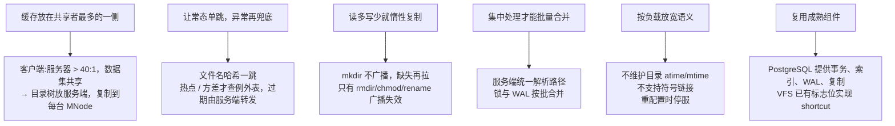

**解读**：FalconFS 的方法论是"**先刻画负载，再按负载把职责重新划分**"。它没有发明新的一致性协议或存储结构，而是把已知技术（哈希放置、缓存一致性的失效协议、group commit、热点缓存的负载均衡定理）按 DL 负载的特点重新组合。其中最关键的判断是：在 DL 集群里，目录树是**读多写少、全体共享**的数据，因此适合"全量复制 + 写时失效"；而文件 inode 是**海量、均匀访问**的数据，适合"哈希分区 + 一跳直达"。

### 12.3 优点与局限

| 优点 | 局限 / 未回答的问题 |
|------|---------------------|
| 无状态客户端从根上消除请求放大，性能不再依赖客户端内存预算 | **语义放宽**：不维护目录 atime/mtime，不支持符号链接和嵌套挂载点，论文自称"POSIX-like" |
| 文件名哈希把同目录文件打散，天然消除瞬时倾斜 | **rmdir 不可扩展**：要广播到所有 MNode 并等最慢者，吞吐随 MNode 数增加而下降，p99 延迟高 |
| 目录 rename 只迁移一条 inode，子树不动 | **readdir** 必须查询所有 MNode，论文未评估 |
| 例外表大小有理论上界，实测 DL 数据集一项都不需要 | **重配置停服**：扩缩容迁移期间停止服务；负载均衡迁移时阻塞相关 inode |
| 复用 PostgreSQL，工程风险低；有多数派复制的高可用 | 单请求延迟高于 Lustre（批处理代价）；低并发时吞吐也低于 Lustre |
| VFS shortcut 不改内核即可部署 | 命名空间副本每台 MNode 存一份：10 亿目录 <100 GiB，但对目录数与文件数接近的通用负载并不划算 |
| 生产验证规模大（万卡 NPU、一年） | 访问不存在的路径、热点文件名、过期例外表都要两跳（性能降 36.8%–49.6%） |
| — | 评估中所有系统关复制、服务端仅 4 核、CephFS 版本老（12.2.13）；数字口径不统一，表 3 有笔误 |
| — | 服务端权限检查所需的调用者凭据如何传递、协调者是否成为 rmdir/rename 热点、主从选主由谁负责，论文未说明 |

### 12.4 对分布式文件系统设计者的启示

1. **先算"缓存共享比"**：客户端数远多于元数据服务器、且客户端访问同一数据集时，服务端的一份缓存比客户端的 N 份更值钱。这个比值应当成为决定"客户端缓存 vs 服务端解析"的首要指标。
2. **为 AI 负载提供"带完整路径的单 RPC 操作"**：即使不全盘采用无状态客户端，也可以在元数据服务上增加一个服务端路径解析的快速路径（open/stat 一次 RPC），让训练框架或 SDK 选择性使用。
3. **数据放置不必跟着父目录走**：文件 inode 按文件名哈希（或 `文件名 + 父 ID` 的组合）放置，可以同时获得一跳定位、同目录打散和廉价的目录 rename；用一张有界的例外表处理热点名，并让服务端容忍客户端持有过期的放置表。
4. **读多写少的全局结构用"惰性复制 + 写时失效"**：目录树就是这样的结构。创建不广播、缺失再拉；只对会让既有副本变错的操作广播失效，并找一个天然的串行化点（属主 inode 锁）来排序冲突。
5. **集中执行才有合并机会**：group commit 和前缀锁合并要求请求在服务端汇聚；架构上把路径解析放到服务端，会顺带打开这类批处理优化的空间。代价是延迟，需要按负载（吞吐优先还是延迟优先）选择。
6. **明确哪些 POSIX 语义可以放弃**：目录时间戳、符号链接、在线重配置……FalconFS 证明在 DL 场景下这些都可以让步。新系统应当把这些放宽列为显式的、可配置的选项，而不是默认全部支持再想办法优化。
7. **用内核已有的钩子而不是改内核**：`LOOKUP_PARENT` + `d_revalidate()` 的组合可以复用到其他想绕过 VFS 路径遍历的文件系统（包括 FUSE 文件系统）。

### 12.5 一张图看懂 FalconFS

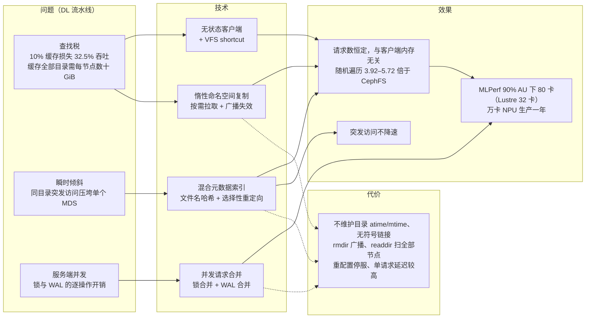

---

## 参考

- Jingwei Xu et al. *FalconFS: Distributed File System for Large-Scale Deep Learning Pipeline*. USENIX NSDI 2026. <https://www.usenix.org/conference/nsdi26/presentation/xu> ；arXiv:2507.10367 <https://arxiv.org/abs/2507.10367>
- FalconFS 开源代码：<https://github.com/falcon-infra/falconfs> ；<https://gitee.com/openeuler/FalconFS>
- Wenhao Lv et al. *InfiniFS: An Efficient Metadata Service for Large-Scale Distributed Filesystems*. USENIX FAST 2022. 本仓库精读：[infinifs-fast2022.md](infinifs-fast2022.md)
- Yiduo Wang et al. *CFS: Scaling Metadata Service for Distributed File System via Pruned Scope of Critical Sections*. EuroSys 2023. 本仓库精读：[cfs-eurosys2023.md](cfs-eurosys2023.md)
- Hao Guo et al. *SingularFS: A Billion-Scale Distributed File System Using a Single Metadata Server*. USENIX ATC 2023. 本仓库精读：[singularfs-atc2023.md](singularfs-atc2023.md)
- Jiahao Li et al. *Mantle: Efficient Hierarchical Metadata Management for Cloud Object Storage Services*. SOSP 2025.（并发的服务端解析工作，本仓库精读：[mantle-sosp2025.md](mantle-sosp2025.md)）
- Jingwei Xu et al. *SwitchFS: Asynchronous Metadata Updates for Distributed Filesystems with In-Network Coordination*. EuroSys 2026.（同一第一作者的同期工作，用可编程交换机协调异步目录更新，本仓库精读：[switchfs-eurosys2026.md](switchfs-eurosys2026.md)）
- Salman Niazi et al. *HopsFS: Scaling Hierarchical File System Metadata Using NewSQL Databases*. USENIX FAST 2017.
- Antonios Katsarakis et al. *Hermes: A Fast, Fault-Tolerant and Linearizable Replication Protocol*. ASPLOS 2020.（失效式复制的灵感来源）
- Bin Fan, Hyeontaek Lim, David G. Andersen, Michael Kaminsky. *Small Cache, Big Effect: Provable Load Balancing for Randomly Partitioned Cluster Services*. SoCC 2011.（例外表规模证明所依赖的定理）
- Lipeng Wang et al. *DIESEL: A Dataset-Based Distributed Storage and Caching System for Large-Scale Deep Learning Training*. ICPP 2020.
- MLCommons. *MLPerf Storage Benchmark Suite*. <https://github.com/mlcommons/storage>
- Linux 内核文档 *Pathname lookup*：<https://docs.kernel.org/filesystems/path-lookup.html>（`LOOKUP_PARENT` 等标志）
- 3FS / Fire-Flyer 与 AI 训练存储的整体图景：见 [HPC 与 AI 训练存储](hpc-ai-storage.md)
