# FileScale 精读：小规模像单机、大规模线性扩展的三层元数据架构（SoCC 2023）

> 论文：Gang Liao, Daniel J. Abadi. *FileScale: Fast and Elastic Metadata Management for Distributed File Systems*. ACM SoCC '23，Santa Cruz，2023-11-07～09，论文集第 459–474 页。
>
> 机构：Gang Liao 署名为 ByteDance Infrastructure System Lab，工作完成于其在 University of Maryland 读博期间；Daniel J. Abadi 为 University of Maryland。
>
> 链接：ACM <https://dl.acm.org/doi/10.1145/3620678.3624784>；PDF <http://www.cs.umd.edu/~abadi/papers/filescale.pdf>；代码 <https://github.com/umd-dslam/FileScale>
>
> 篇幅：正文 14 页 + 参考文献 2 页，共 16 页；17 张图、2 张表、2 段代码清单。
>
> 精读日期：2026-11-24。**数字和机制描述都摘自论文**，用"论文 §x / 图 x / 表 x"标注出处。标"解读"的段落是本文作者的分析和推论，不是原文。多数图带数据标签，直接引用；没有标签的读数为本文估读，标注"约"，误差约 ±5%。标"示例"的是为说明机制构造的例子。
>
> 相关文档：
> - [元数据扩展性综述 §2.6](metadata-scalability.md#26-filescale-fast-and-elastic-metadata-management-for-distributed-file-systemssocc-2023)：本文的简述版。
> - [λFS（ASPLOS '23）精读](lambdafs-asplos2023.md)：同年、同样以 HopsFS 为主要对手、同样在数据库之上加一层缓存；λFS 用 serverless 函数做弹性读缓存，FileScale 用分区独占的写回缓存。
> - [CFS（EuroSys 2023）精读](cfs-eurosys2023.md)：同样批评 HopsFS 的效率，但走"去代理层 + 裁剪临界区"的路线。
> - [Tectonic（FAST 2021）精读](tectonic-fast2021/deep-read.md)：FileScale 在相关工作中点名"不支持跨分区 move"的对象。

## 目录

- [0. 一页速览](#0-一页速览)
- [1. 问题：元数据扩展的三条路都有缺口](#1-问题元数据扩展的三条路都有缺口)
- [2. HDFS 背景](#2-hdfs-背景)
- [3. 总体架构：路由、缓存、存储三层](#3-总体架构路由缓存存储三层)
- [4. 数据库层：以完整路径为主键的关系模式](#4-数据库层以完整路径为主键的关系模式)
- [5. 缓存层：写回缓存与远程 WAL](#5-缓存层写回缓存与远程-wal)
- [6. 代理层：挂载表路由与跨分区请求](#6-代理层挂载表路由与跨分区请求)
- [7. 评估](#7-评估)
- [8. 相关工作](#8-相关工作)
- [9. 论文中的不一致与可疑之处](#9-论文中的不一致与可疑之处)
- [10. 与本仓库中其他系统的对照](#10-与本仓库中其他系统的对照)
- [11. 整体总结](#11-整体总结)
- [参考](#参考)

---

## 0. 一页速览

**一句话**：把 HDFS 元数据放进分布式数据库（DDBMS）的系统（HopsFS、CalvinFS、ADLS）能扩展到很大规模，也能做跨分区的原子操作，但每个请求都要和数据库同步往返，小规模时比单机内存 NameNode 慢一个数量级。FileScale 在 HDFS 内部实现了三层架构：**代理层**按路径前缀把请求路由到 NameNode；每个 NameNode 独占一段命名空间，是那段元数据的**写回缓存**，更新只写远程 WAL 就返回，再异步批量刷进数据库；**数据库层**（VoltDB 或 Apache Ignite）保存全部元数据，执行跨分区事务。于是数据放得进缓存时，FileScale 的性能与原版 HDFS 持平；加 NameNode 时吞吐近似线性增长。

| 维度 | 要点 |
|------|------|
| 目标 | 一个元数据架构同时满足：单节点时与内存 NameNode 一样快；规模增长时线性扩展；支持跨分区的原子操作；可直接替换 HDFS（论文 §1） |
| 代理层 | 挂载表（路径前缀 → NameNode）存于 ZooKeeper；**proxy 模式**由路由器转发，**watch 模式**由客户端缓存挂载表、少一跳；路由过期时旧 NameNode 用带 TTL 的"最近迁出路径"表转发（论文 §6.1） |
| 缓存层 | 每个 NameNode 独占若干路径前缀，在内存中缓存这些元数据；对象用全局 ID 引用，路径解析按各级前缀**并行哈希查找**；更新先写远程日志服务（类似 HDFS EditLog），日志确认后才释放锁、对外可见，再**异步批量**刷进数据库（论文 §5） |
| 数据库层 | 14 张表；inodes 表以**完整路径 (pname, name)** 为主键；与 inode 一对多的表按 inode 分区，小表全复制；递归操作用前缀匹配（`STARTS WITH` / `LIKE`）一条 SQL 完成（论文 §4） |
| 跨分区请求 | 先把涉及的脏数据写回数据库并逐出缓存、禁止再缓存，再由数据库执行分布式事务；目标 NameNode 惰性加载（论文 §6.2，图 4） |
| 实现 | 在 HDFS 3.3.0 内实现，约 4 万行代码；数据库层先用 VoltDB 社区版，后加 Apache Ignite（论文 §7、§7.6） |
| 单节点结果 | create/open/delete/rename/mkdir 吞吐与 HDFS 相当；HopsFS 的 create、rename 约为其 1/10，其他约 1/5；16 线程 10 万次 create：HopsFS 479、HDFS 6,803、FileScale 6,865 ops/s（论文 §7.2，图 5、图 8） |
| 多节点结果 | 1→32 个 NameNode、3 个数据库节点，吞吐近似线性增长；HopsFS 用 3 个 NDB 节点时在 16 个 NameNode 处到顶（论文 §7.3.1，图 10） |
| 代价 | 跨分区 move/chmod 要先刷脏数据，10⁵ 个文件全脏时 move 约 98.6 s；目录 rename 要改写整棵子树的主键；数据库落后于缓存，恢复要重放日志（论文 §7.3.2、§7.5） |

**解读**：

- FileScale 的核心主张是"**不为扩展性交税**"：大多数部署从小规模起步，元数据完全放得进一台机器，这时不该为分布式事务付出 10 倍代价。它的做法是把数据库挪出关键路径：常规操作只碰本地内存和一份远程日志，数据库只在缓存未命中、跨分区事务和后台刷新时才参与。
- 这和 HDFS 原有的持久化方式几乎一样（内存 + EditLog），只是 FSImage 检查点被换成了"可分区、可执行事务的数据库"。所以单节点性能接近 HDFS 并不意外，真正的设计点在于**分区所有权 + 写回缓存 + 数据库兜底跨分区事务**这套组合。
- 用完整路径做主键是一个大胆的取舍：路径解析和递归 chmod/delete 很简单，代价是目录 rename 要改写子树中每一行的主键，而主键又是分区键，相当于删除再插入整棵子树。论文的评估也显示 move 是最慢的操作。

---

## 1. 问题：元数据扩展的三条路都有缺口

论文 §1 把已有做法分为三类：

| 路线 | 代表 | 优点 | 问题 |
|------|------|------|------|
| 单机内存 | GFS、HDFS、Lustre、Ursa Minor、Farsite、XtreemFS | 快 | 用大块（MB 到 GB 级）和限制文件数把元数据塞进一台机器的内存；小文件负载吃不消，大块负载也越来越频繁地碰到上限；NameNode 要处理大量客户端请求和 DataNode 心跳，成为瓶颈和单点；给元数据节点挂快速外存的方案（Alluxio、BabuDB、DeltaFS 等）长期看也不够 |
| 静态分区（联邦） | HDFS Federation、ViewFs、Router-based Federation、字节跳动 NNProxy | 可扩展 | 只保证单分区内的原子性和隔离性。Facebook 每个数据中心要"几十个 HDFS 集群"，"运维上很低效"，单个数仓数据集就可能超出一个集群的元数据容量；字节跳动也因为缺少跨命名空间的原子事务而放弃了 HDFS Federation（引 DanceNN 介绍） |
| 存进分布式数据库 | HopsFS、CalvinFS、ADLS | 扩展所有方面，支持跨分区事务 | 文件系统逻辑在数据库外，每个请求要多次往返，延迟高、资源效率低。HopsFS 论文报告要 3 个 NameNode + 2 台数据库服务器才能追平一个单机 HDFS NameNode |

另一种做法是把文件系统逻辑整个塞进数据库内部，但需要推倒重来，也还没被证明普遍适用（论文 §1）。论文脚注还指出，Colossus（BigTable）和 Giraffa（HBase）虽然用了可扩展存储，但没有强一致的分布式事务，不支持跨分区请求。

**FileScale 的目标**：可以直接替换 HDFS，内外接口都不变；单节点性能与原版 HDFS 几乎相同；元数据增长时把它分到 shared-nothing 集群上，相对单节点线性扩展（论文 §1）。

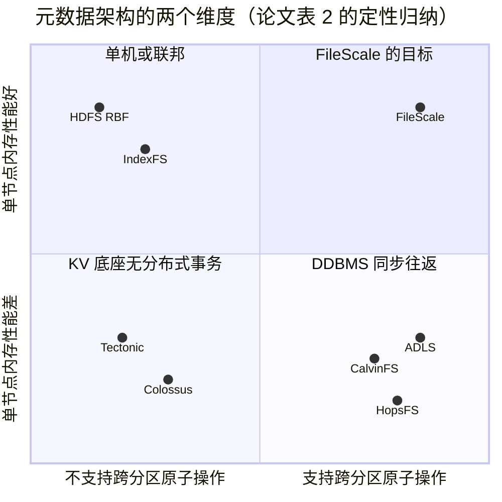

---

## 2. HDFS 背景

论文 §2：

- HDFS 是机器学习和数据分析领域部署最广的分布式文件系统之一，采用 leader/follower 架构：NameNode 管理全部元数据、代客户端控制数据访问；文件被切成块，在 DataNode 上多副本存放。
- 持久化靠写前日志 **EditLog**；恢复时加载检查点 **FSImage** 并重放 EditLog，比较耗时。
- 为了高可用，可以部署热备 NameNode，持续异步地把 EditLog 合并进 FSImage，主节点故障时很快接管。日志可以写到 Quorum Journal Manager（JournalNode）或 NFS。

---

## 3. 总体架构：路由、缓存、存储三层

论文 §3，图 1：FileScale 保持 HDFS 客户端 API 不变，拦截发往 NameNode 的通信，转给自己可扩展的分布式 NameNode 实现。

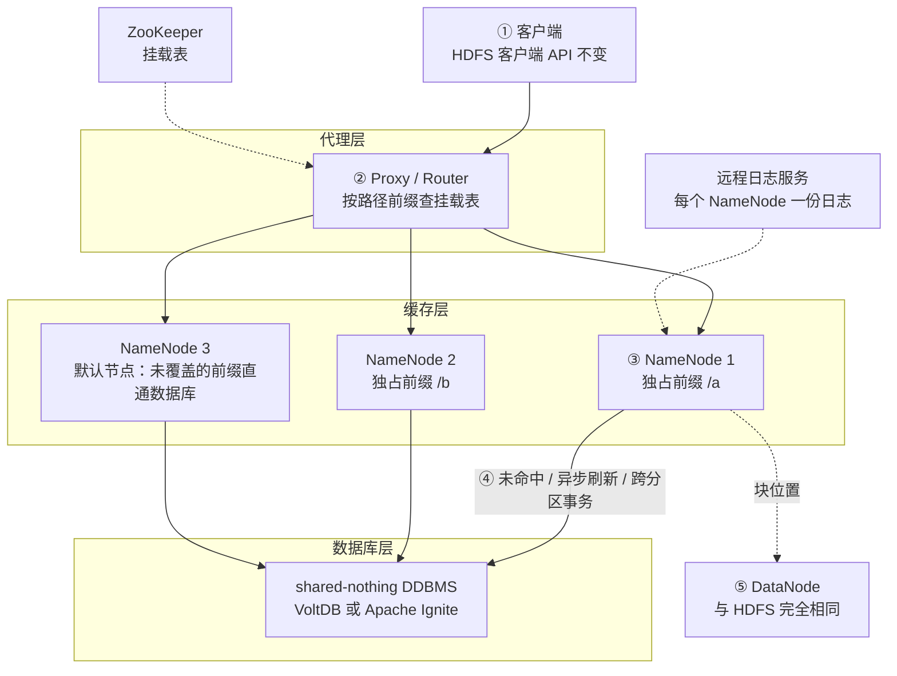

一次请求（论文 §3）：

1. 客户端发请求；
2. 代理服务器按请求中的文件路径把它路由到某个 NameNode；
3. NameNode 缓存了一部分元数据，命中就立即返回；
4. 未命中时，要么把数据调入缓存，要么把请求转成数据库层的事务；
5. 结果（通常包括数据所在的 DataNode）返回给客户端。DataNode 代码与 HDFS 完全相同。

---

## 4. 数据库层：以完整路径为主键的关系模式

### 4.1 模块化（论文 §4）

- 任何支持 ACID、可用 SQL 提交事务的分布式数据库都可以接入；大多数元数据命令可以转成一串简单的 INSERT、UPDATE、SELECT。
- **递归操作**比较麻烦：数据库要么直接支持递归，要么支持通用存储过程，让递归在数据库内部执行，避免每一步递归都往返一次。
- 已支持 VoltDB 和 Apache Ignite。

### 4.2 关系模式（论文 §4，表 1）

FileScale 把 inode 树转换成 **14 张表**：两个主实体 inodes、datablocks，加上 inode → 块、块 → 存储位置（DataNode）等关系表。表 1 是简化版：

| 表 | 主要列 |
|----|--------|
| inodes | id, pid, **pname, name**, access-time, update-time, header, permission |
| inode2block | block-id, id（inode）, index（块序号） |
| datablocks | block-id, kbytes, stamp, replica |
| block2storage | block-id, idx, storage-id（DataNode 存储） |

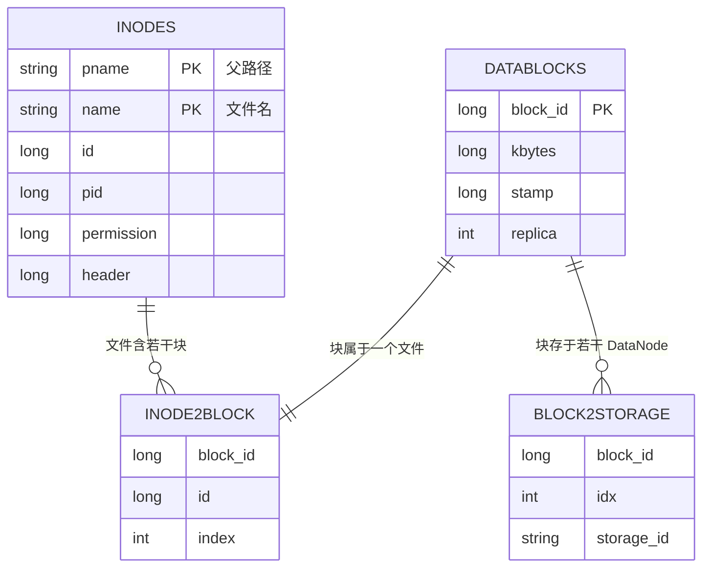

**完整路径做主键**（论文 §4）：

- 近年的系统（HopsFS、TableFS、IndexFS、DeltaFS）都**不**在 inode 元组中存完整路径，父子关系用唯一 inode ID 表示。好处是：省空间；rename 只需改子树根。
- FileScale 反其道而行：每个 inode 元组存完整路径，并以 **(pname, name)** 作为主键。好处是：
  1. **模块化更好**：对数据库的递归支持要求更低，`WHERE` 子句中的前缀匹配就能直接找到某个分支下的所有节点，不必递归遍历 inode 树；
  2. 路径本身就是 ID，不需要在内存中维护 inode ID 与路径之间的映射。
- 多存的空间由水平扩展来承担。rename 也通过 `WHERE` 子句中的前缀匹配实现。
- 与 inodes 表一对多的表（如 datablocks）按与 inode 的关联分区，以获得局部性；其余小表在整个集群复制。

**示例**（基于论文清单 1 的写法）：递归 chmod `/logs` 只需两条语句：

```sql
-- 1. 更新子树中的所有后代
UPDATE inodes SET permission = ? WHERE parent_name STARTS WITH '/logs';
-- 2. 更新子树根本身
UPDATE inodes SET permission = ? WHERE parent_name = '/' AND inode_name = 'logs';
```

**解读**：前缀匹配写起来简洁，但它的效率完全取决于数据库能不能用索引做前缀扫描。论文 §7.6.2 自己就发现，Ignite 不支持 `STARTS WITH`，只能写成 `LIKE ?%`，编译器无法确定参数里有没有通配符，只能全表顺序扫描。另外，move 要改主键，而主键就是分区键，数据库只能把整棵子树删掉再重新插入（论文 §7.6.2），代价与子树大小成正比。inode ID 方案的 rename 是 O(1)，路径主键方案的 rename 是 O(子树)，这是 FileScale 为"简单、模块化"付出的最大代价。

---

## 5. 缓存层：写回缓存与远程 WAL

### 5.1 为什么要缓存层（论文 §5）

- 专门为某个应用打造的数据库短期性能最好，但跟不上技术进步；跨分区事务尤其难以同时做到高性能和强隔离，这方面研究也很活跃。所以 FileScale 选择用**现成**的分布式数据库，可以随时换成更新的。
- 代价是每次调用外部系统都有构造、发送、解析请求和响应的开销，所以必须避免频繁访问数据库。办法是在每个 NameNode 的内存中加一层缓存。
- 缓存中元数据的修改**不会立即传播**到数据库，要等到过期、定期刷新或分布式事务时才写下去。所以**数据库层落后于缓存层**，要读到最新的数据库记录，可能需要先与缓存层同步。

### 5.2 对象缓存：ID 引用与并行路径解析（论文 §5.1）

| | HDFS | FileScale |
|---|------|-----------|
| 文件 → 块、块 → DataNode 映射 | 轻量哈希表，优化内存占用，保证全部元数据放得进内存 | 对象缓存，不假设全部放得进内存 |
| 目录的子节点 | 指向子 inode 内存位置的**直接指针**列表 | 全局唯一 ID；要再查一次 ID 的当前内存位置（对象可能被逐出） |
| 路径解析 | 从根出发，在每一级子节点列表中**二分查找**下一级，本质上是串行的 | 子节点引用可直接由路径名得到，各级前缀**并行做哈希查找** |

例如解析 `/tmp/logs/data`，FileScale 并行查找 `/`、`/tmp`、`/tmp/logs`、`/tmp/logs/data` 四个键，不必逐级遍历。对长路径（可以并行）和大目录（不用二分查找）都更快（论文 §5.1）。

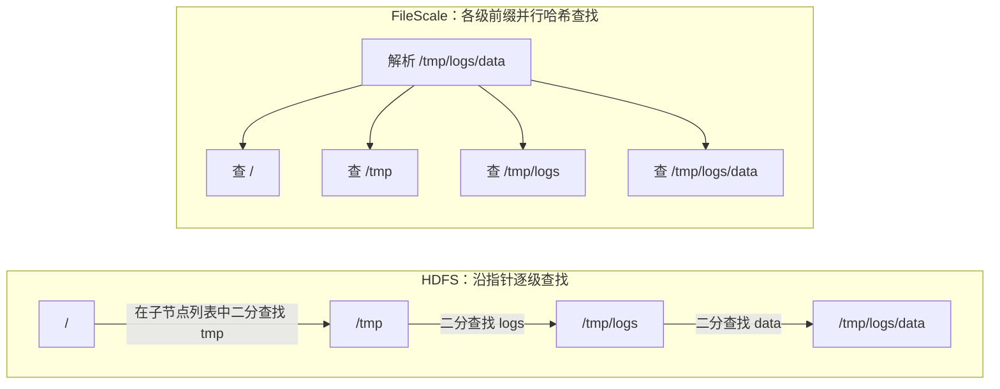

**解读**：用 ID 代替直接指针，好处是对象可以被逐出；代价是需要遍历目录结构的操作（如递归删除）要额外做哈希查找。图 6 显示，在 10⁶ 个文件的递归删除中，FileScale 约 2.6–2.7 s，HDFS 约 1.4–1.6 s。所谓"并行哈希查找"在单个 JVM 内部的收益也有限：每级查找只是一次内存哈希访问，并行化的线程调度开销可能与之相当，论文没有单独测量这项优化的收益。

### 5.3 持久化（论文 §5.2，图 2）

- 缓存层扩展了 HDFS 的 EditLog，实现写前日志：每个 NameNode 把自己的所有修改记到一份**单独的日志**里，日志放在远程网络文件系统上（类似 HDFS 把 EditLog 放在 Quorum Journal 或 NFS 上）。
- **日志服务确认写入之前不释放锁。**
- 后台进程定期把最近的修改**批量异步**刷进数据库，限制数据库状态的陈旧程度。
- 数据库后台定期对事务一致的快照做持久检查点。
- 恢复：从最近的检查点开始，重放日志服务中尚未并入数据库的日志记录，并与数据库自身日志中的记录合并。
- 已被任一数据库检查点包含的日志记录可以从日志服务中安全删除。
- 数据库在刷新或跨分区操作期间故障时，NameNode 按指数退避重试，等待数据库恢复。

创建一个文件（ID = 7）的流程（图 2）：

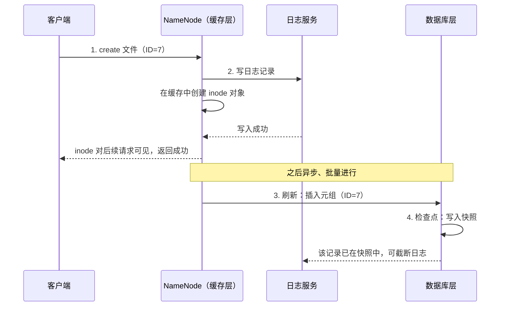

**解读**：这个流程与 HDFS 的"内存 + EditLog + FSImage 检查点"一一对应，只是检查点换成了数据库。因此 FileScale 的 create 关键路径与 HDFS 相同：**一次内存修改 + 一次远程日志写**。图 9 中 FileScale 单 NameNode 与"日志写到 EBS 的 HDFS"性能几乎相同，正是这个原因。

---

## 6. 代理层：挂载表路由与跨分区请求

### 6.1 分区与路由（论文 §6、§6.1，图 3）

- 缓存层有多个独立的 NameNode，**每个 NameNode 管理命名空间中一个互不相交的分区**。所有分区的并集不必覆盖整个命名空间：没被任何 NameNode 覆盖的请求交给一个**默认 NameNode**，它直接把请求转给数据库层。
- 分区信息存在 ZooKeeper 的**挂载表**里：特定路径前缀分配给特定 NameNode，**只有它能缓存这些前缀下的元数据**。增删 NameNode、为负载均衡合并或拆分分区时更新挂载表。新增路径通过拆分已有的根路径实现。
- 挂载表读多写少，可以缓存在代理层各服务器上。代价是代理层偶尔会把请求发错 NameNode，由后者转发。

两种路由模式：

| 模式 | 做法 | 特点 |
|------|------|------|
| proxy 模式 | 代理层由多个路由器组成，使用与 HDFS 相同的通信协议；路由器维护各客户端的会话，拦截并改写请求和响应；提取请求中的路径，对挂载表做**最长前缀匹配**；单个 NameNode 管理的请求直接转发，否则走 §6.2 的跨分区流程。路由器可以与 NameNode 部署在同一台机器上 | 客户端无需修改 |
| watch 模式 | 与 proxy 模式相同，只是**客户端**监听 ZooKeeper，在本地缓存挂载表 | 少一跳网络（图 10 中性能更好） |

**过期路由的处理**：

- 两种模式下挂载表都在本地缓存，并有监听器接收变更通知。分区被迁移、拆分或合并时，缓存会短暂过期，请求可能被发错。
- 每个 NameNode 记住**最近迁出的路径**，每条记录有一个较短的 TTL（图 3 中示例为 90 s），收到发错的请求时立即转给接管该分区的 NameNode。
- 极少数情况下，TTL 已过期、找不到记录，NameNode 就去 ZooKeeper 查正确的路由再转发。

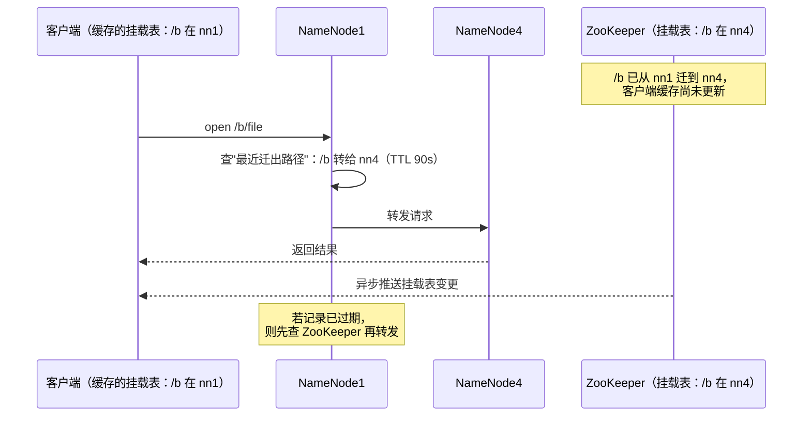

### 6.2 跨分区请求（论文 §6.2，图 4）

按路径前缀分区能减少跨分区事务，但无法消除。主要来源：

- move 或 copy：要从源分区读取（copy）或删除（move），再插入目标分区；
- 从目录树高处（靠近根）开始的递归操作，如 chmod、rm，可能跨越多个分区。

**FileScale 的规则：所有跨分区请求都由数据库执行**。执行前，事务涉及的所有数据先从缓存中移除（脏数据先写回数据库），事务进行期间禁止这些数据再被调入缓存。

把 inode ID 为 3 的目录（及其子节点）移到另一个 NameNode 管理的分区（图 4）：

1. 源 NameNode 把相关的脏 inode **分批写回**数据库，并把该子树**逐出缓存**；
2. 数据库通过一个（分布式）事务**同步**更新所有受影响 inode 的名字和父路径，通常可以用 SQL 的 `LIKE` 或 `STARTS WITH` 实现；
3. 目标 NameNode 可以一次加载整棵新子树，也可以按需**惰性加载**。

跨分区事务完成后，缓存层日志只追加该事务在数据库日志中的偏移量，仅用于记账，恢复时用不到：因为跨分区事务之前已经做过一次刷新，恢复时只可能需要重放事务之后的缓存层日志记录。

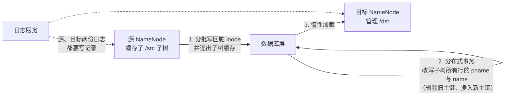

**解读**：

- 这套设计的正确性依赖一个不变式：**任一路径前缀在任一时刻只有一个 NameNode 能缓存它**。单分区请求在本地串行化，跨分区请求通过"先刷新、逐出、禁止缓存"把所有权临时交还给数据库，从而由数据库事务保证原子性和隔离性。
- 论文没有细说**分区迁移**（图 13 的再平衡）时的交接协议：旧 NameNode 必须先刷完该前缀的脏数据并停止服务，新 NameNode 才能开始缓存；期间到达的请求如何处理、挂载表的更新与刷新谁先谁后，都影响正确性。"最近迁出路径 + TTL 转发"只解决了路由，没有说明数据交接。
- 论文也没有讨论 **NameNode 故障时的可用性**。缓存层没有热备，脏数据只存在于故障 NameNode 的内存和远程日志中；接管者要先重放该 NameNode 的日志（或等数据库追上）才能服务这段前缀。图 14b 显示 10⁶ 条记录的恢复需要数分钟。与 HDFS HA 的热备秒级接管相比，这是一个退步。

---

## 7. 评估

### 7.1 实验环境（论文 §7、§7.1）

| 项目 | 配置 |
|------|------|
| 实现 | HDFS 3.3.0 内约 4 万行代码；数据库层默认 VoltDB（内存数据库，异步检查点 + 同步命令日志，可确定性重放），§7.6 换成 Apache Ignite |
| 对比 | HDFS 3.3.0；HopsFS（MySQL NDB） |
| 机器 | AWS EC2 t3a.2xlarge（8 vCPU、AMD EPYC 7000 2.5 GHz、32 GiB 内存、5 Gbps 突发网络），NameNode 和数据库服务器都用这种机型 |
| 存储 | 每台挂 128 GiB 的 io1 EBS SSD，最高 64,000 IOPS |
| 堆内存 | 16 GB（为了尽快碰到 NameNode 内存瓶颈） |
| 负载 | HDFS 自带的 NNThroughputBenchmark，作者扩展为可在大规模环境下运行（原版只在单机上跑，没有端到端网络延迟） |

### 7.2 单节点实验（论文 §7.2）

所有系统用一个 NameNode；FileScale 的 VoltDB 和 HopsFS 的 NDB 与 NameNode 运行在同一台机器上。

#### 基本操作（论文 §7.2.1，图 5）

改变操作总数（100 到 10⁶）和客户端线程数（1 到 64），测 create、open、delete、rename、mkdir 的吞吐。

- NNThroughputBenchmark 每次运行有固定的端到端开销，会被该次运行的所有操作分摊，所以操作越多吞吐越高。
- **FileScale 与 HDFS 在所有操作上性能相近**：数据放得进单节点内存时，两者都把全部元数据放在内存中，各自的内存数据结构性能也相近。图 5 中两者的 create、rename、mkdir 峰值约 8,000–9,000 ops/s，open 约 9,000–10,000 ops/s（约）。
- **HopsFS** 在操作数超过 10 万后内存不足（标准的 HopsFS 部署会把元数据分到多台机器上）。在更小的规模下，HopsFS 的 create、rename 吞吐约为 HDFS 和 FileScale 的 **1/10**，其他操作约 **1/5**。这与 HopsFS 论文"5 台服务器才追平一个 NameNode"一致。
- 差距的主要原因：数据放得进缓存时，FileScale 关键路径上**没有数据库往返**，只写自己的 WAL（性能与 HDFS 写 EditLog 相近），再异步批量刷新；HopsFS 的每个请求都至少要与数据库同步往返一次。

#### 递归删除（论文 §7.2.2，图 6）

删除根目录下的所有文件，改变文件数（100 到 10⁶）和树高。

| 文件数 | HopsFS（s） | HDFS（s） | FileScale（s） |
|--------|------------|-----------|----------------|
| 100 | 1.2–1.4 | 约 0.02 | 约 0.02 |
| 1,000 | 2.1–2.6 | 约 0.03 | 约 0.04 |
| 10,000 | **90.8 / 40.4 / 14.9**（树越高越快） | 约 0.06–0.07 | 约 0.09–0.10 |
| 100,000 | 超时（疑似死锁） | 约 0.24–0.35 | 约 0.32–0.40 |
| 1,000,000 | 超时 | 约 1.38–1.58 | 约 2.59–2.74 |

图中每组三根柱子对应三种树高，标签数字来自图 6；表中范围为三种树高的最小值到最大值。

- 主要瓶颈是逐个删除文件，所以文件越多延迟越高；树高影响很小。
- HDFS 在内存中删除文件并写一条日志；FileScale 使缓存中的节点失效、写日志、再异步删除数据库中的相关元组。HDFS 整体上略快，因为 FileScale 的缓存层用 ID 而不是直接指针引用子节点（子 inode 可能已被逐出），需要额外的哈希查找。
- HopsFS 慢一到两个数量级，原因是递归删除被拆成许多小的事务批次执行（HopsFS 论文 §7.4.1 也有说明）。出人意料的是，树越高 HopsFS 越快：每个目录下的文件少了，目录锁的竞争也就少了。

#### 大目录（论文 §7.2.3，图 7）

64 个线程在单个目录内执行 open 和 rename，目录大小从 10 增加到 10⁶ 个文件。

- 大多数规模下 HDFS 和 FileScale 相近。
- 目录含 **10⁶ 个文件时，HDFS 的 rename 吞吐大幅下降**（图 7 中约从 7,000 降到约 2,500 ops/s，约）：HDFS 用 `ArrayList` 存放子节点并保持有序，rename 要删除再插入元素；时间一长要把整个 `ArrayList` 复制到新位置，复制含 100 万个元素的列表会明显增加延迟。
- FileScale 不需要保持子节点有序，因为路径验证不在每一级做二分查找。

#### 缓存未命中（论文 §7.2.4，图 8）

FileScale 把内存当作数据库的缓存，所有节点的总内存放不下全部元数据时仍然可用。把缓存未命中率从 0% 提高到 30%（论文脚注说接近 30% 的未命中率在实践中极少见），16 个线程并发操作 10 万个文件：

| 系统 / 未命中率 | create 吞吐（ops/s） | create 完成时间（s） | open 吞吐（ops/s） | open 完成时间（s） |
|----------------|---------------------|---------------------|-------------------|-------------------|
| HopsFS | 479 | 209 | 2,703 | 37 |
| HDFS | 6,803 | 15 | 8,849 | 11 |
| FileScale 0% | 6,865 | 15 | 8,720 | 11 |
| FileScale 1% | 6,746 | 15 | 8,128 | 约 12 |
| FileScale 5% | 5,742 | 17 | 5,359 | 约 19 |
| FileScale 10% | 4,242 | 24 | 3,679 | 约 27 |
| FileScale 30% | 2,265 | 44 | 1,802 | 55 |

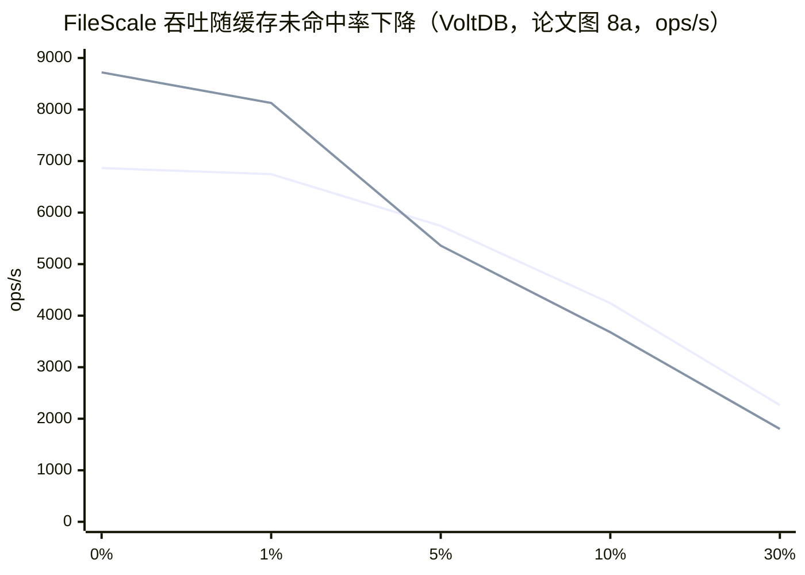

（第一条折线为 create，第二条为 open；xychart 不显示图例。open 起点更高，但在 5% 处已跌到 create 之下。）

- 吞吐和延迟随未命中率**平滑下降**。open 比 create 降得快：open 命中时完全在内存中完成，未命中的相对代价大；create 无论是否命中都要先把日志写到稳定存储，未命中的相对代价小。
- 实践中可以监控未命中数，由代理层借助 Hadoop 已有的监控组件立即重新平衡挂载表（论文 §7.2.4）。

**解读**：图 8b 纵轴标为 "Latency (seconds)"，但数值等于 **100,000 次操作 / 吞吐**，例如 100,000 / 479 ≈ 209 s，100,000 / 1,802 ≈ 55 s。所以它是**完成 10 万次操作的总耗时**，不是单次操作的延迟。上表据此改称"完成时间"。图 9、图 15 也是同样的情况。

### 7.3 多节点实验（论文 §7.3）

#### 五节点部署（论文 §7.3，图 9）

| 配置 | 说明 |
|------|------|
| HDFS-HA^jns | 2 个 NameNode（主备）+ 3 个 JournalNode，日志写到多数 JournalNode 才算持久 |
| HDFS-HA^ebs | 为公平起见，日志改写到 EBS |
| HopsFS^1nn / ^2nn | 1 或 2 个 NameNode + 3 个 NDB 节点；日志写 EBS |
| FileScale^1nn / ^2nn | 1 或 2 个 NameNode（元数据可在两者间分区）+ 3 个 VoltDB 节点；日志写 EBS |

吞吐（ops/s，图 9 数据标签）：

| 负载 | HopsFS^1nn | HopsFS^2nn | HDFS-HA^jns | HDFS-HA^ebs | FileScale^1nn | FileScale^2nn |
|------|-----------|-----------|-------------|-------------|---------------|---------------|
| create 10⁵ | 218 | 405 | 4,516 | 7,118 | 7,016 | **13,957** |
| create 10⁶ | 308 | 581 | 4,433 | 8,163 | 8,290 | **16,309** |
| open 10⁵ | 4,262 | 8,359 | 9,125 | 9,258 | 9,277 | **18,648** |
| open 10⁶ | 4,528 | 8,914 | 9,376 | 9,382 | 9,371 | **18,790** |

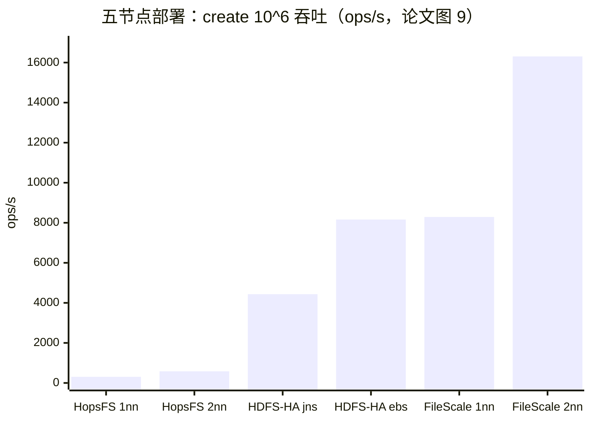

- HopsFS 的 create 比 FileScale 慢得多（论文说"几乎两个数量级"），与图 5 的效率差距一致。HopsFS 从 1 个 NameNode 加到 2 个时性能约翻倍，FileScale 也翻倍。
- open 不需要写数据库，HopsFS"必须同步写数据库"的劣势不存在，差距缩小。
- 日志写到 EBS 能提升 HDFS 的 create 性能，对不写日志的 open 没有影响。日志都写 EBS 时，HDFS 与单 NameNode 的 FileScale 相当（与图 5 一致）；但 FileScale 加一个 NameNode 性能翻倍（可分区），HDFS 加 NameNode 只用于主备，性能不变。

#### 扩展到 32 个 NameNode（论文 §7.3.1，图 10）

NameNode 从 1 增加到 32，数据库节点数不变；负载为 50% create + 50% open，均匀分布在命名空间上。

| 系统 | 说明 | 32 个 NameNode 时吞吐（约） |
|------|------|---------------------------|
| FileScale-Client（watch 模式） | 3 个 VoltDB 节点 | 约 23 万 ops/s |
| FileScale-Proxy（proxy 模式，路由器与 NameNode 同机） | 3 个 VoltDB 节点 | 约 16 万 ops/s |
| HDFS-RBF | 每个 NameNode 都需要一个热备，实际有效 NameNode 只有一半；命名空间必须静态分区，不支持跨分区 rename | 约 10 万 ops/s |
| HopsFS-8 NDB | 8 个 NDB 节点 | 约 6 万 ops/s |
| HopsFS-3 NDB | 3 个 NDB 节点，在 16 个 NameNode 处碰到数据库瓶颈 | 约 2.5 万 ops/s |
| HDFS-1NN | 默认架构，所有元数据在一个 NameNode 上，无法扩展 | 约 1 万 ops/s |

- HopsFS-8 NDB、HDFS-RBF 和两种 FileScale 都**线性扩展**，NameNode 翻倍吞吐也翻倍，因此单节点时的相对差距在扩展后依然存在。
- FileScale 只需要 3 个数据库节点：它异步批量写数据库，不必每创建一个文件就同步写一次；HopsFS 每个请求开始时都要批量查询路径上所有 inode，而 FileScale 在缓存命中时可以省掉。
- watch 模式比 proxy 模式好：少一跳网络，也省去代理层（与缓存层共用机器）处理和转发消息的开销。

**解读**：按 1 个 NameNode 约 8,500 ops/s（约）计算，32 个理想值约 27 万，FileScale-Client 实测约 23 万，扩展效率约 85%（约）。需要注意，负载"均匀分布在命名空间上"、没有跨分区请求，这是分区架构的最佳情况。

#### 跨分区事务（论文 §7.3.2，图 11、图 12）

**move 一个目录**（图 11，延迟 ms，dist_x% 表示需要写回数据库的脏数据比例；论文脚注说不比较 HopsFS，因为它也用数据库执行跨分区事务，差异主要来自数据库本身）：

| 目录文件数 | local（单分区） | dist 0% | dist 50% | dist 100% |
|-----------|----------------|---------|----------|-----------|
| 10 | 27 | 36 | 47 | 66 |
| 1,000 | 53 | 92 | 504 | 757 |
| 10,000 | 135 | 2,825 | 7,236 | 9,420 |
| 100,000 | 536 | 6,342 | 38,379 | **98,628** |

- 单分区 move 的延迟受限于生成并写日志记录的时间。
- 跨分区 move 要往源和目标 NameNode **两份**日志写记录；还要更新主键（文件的完整路径），而数据库按主键分区，代价很高。
- 需要写回大量脏数据时，**写回本身成为瓶颈**。

**递归 chmod 一个含 10⁴ 个文件的目录**（图 12a，ms）：local 14；dist 0% 86；5% 233；10% 322；20% 598；40% 1,339；80% 2,311；100% 2,970。chmod 不改主键，数据库执行起来快得多，但写回脏数据仍然主导延迟。

**混合负载吞吐**（图 12b，chmod 10⁴ 个文件的目录，横轴为（跨分区 % , 单分区 %, 纯缓存 %））：

| 负载组成 | 吞吐（ops/s） |
|---------|--------------|
| (100, 0, 0) 全部跨分区 | 9 |
| (1, 99, 0) | 238 |
| (0, 100, 0) 全部单分区事务 | 754 |
| (1, 49, 50) | 2,933 |
| (1, 19, 80) | 4,681 |
| (1, 9, 90) | 5,236 |
| (0, 0, 100) 全部纯缓存操作 | 5,795 |

- 纯缓存操作比纯单分区事务快约 **7 倍**（5,795 / 754 ≈ 7.7）。
- 只要负载里有**任何**跨分区事务，访问相同数据的单分区事务也必须交给数据库执行。所以 0% 到 1% 跨分区之间的性能下降"超过 1%"（论文原话）；实际从 754 降到 238，约 **3.2 倍**。

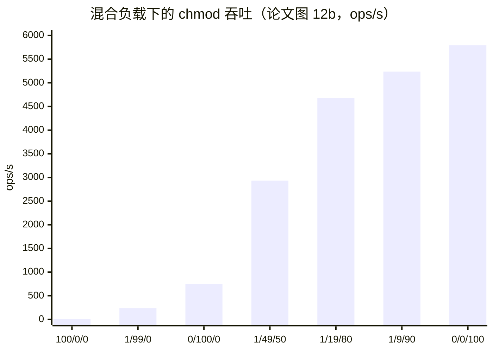

**解读**：图 12b 揭示了 FileScale 的一个敏感点：**1% 的跨分区事务就能让单分区事务的吞吐掉到约三分之一**。原因是跨分区事务要求涉及的数据先刷回、逐出并在事务期间禁止缓存，访问同一数据的单分区请求只能走数据库。对于有频繁跨目录 rename 的负载（例如 Hive/Spark 作业"写临时目录再 rename 到正式目录"的提交模式），分区边界的划分会直接决定性能。

### 7.4 热点缓解（论文 §7.4，图 13）

用基准工具创建 4 个子目录，最初都挂在 NameNode 0 上。代理层每 60 秒修改一次挂载表，把一个子目录分配给新的 NameNode。总吞吐随热点被分散而**线性上升**：约 7.5k → 14k → 21k → 28.5k ops/s（约，分别在 60、120、180 s 处跳升）。

### 7.5 刷新间隔与恢复（论文 §7.5，图 14）

- **刷新间隔不影响吞吐**（图 14a）：把缓存同步到数据库的周期从约 10 ms 改到约 2×10⁴ ms，吞吐保持不变，因为写数据库是异步的。这部分开销实际上被推迟到了恢复时。
- **恢复时间**（图 14b，与图 5 相同的实验环境）：
  - 从快照恢复 10⁶ 条记录，FileScale 与 HDFS 相当；
  - HDFS 只需在内存中重放 EditLog；FileScale 在缓存中重放日志后，还要更新数据库。同步更新会大幅增加恢复时间，异步更新则与正常运行时"数据库落后于缓存"的方式相同。图 14b 中 10⁶ 条日志记录时，HDFS 约 177 s，FileScale 在缓存中重放约 183 s，若同步刷进数据库则约 374 s（约，柱上标签与图例对应关系不完全清楚）。
  - NameNode 从 1 个增加到 8 个、元数据分布更均匀时，FileScale 的恢复时间**线性下降**：重放 10⁶ 条日志约从 185 s 降到约 28 s，恢复快照约从 140 s 降到约 20 s（约）。

### 7.6 数据库选择的影响（论文 §7.6）

**背景**：大多数元数据操作与数据库是异步交互，数据库选型对运行时性能通常没有影响；但缓存未命中频繁时，以及跨分区事务（总是同步）时，数据库性能就很重要。FileScale 最初基于 VoltDB 开源社区版，因无法获得企业版而在**几周内**加上了 Apache Ignite 支持；FileScale 其余代码花了研究生两年时间。Ignite 默认把数据放在内存中，也有可选的磁盘层（实验中启用），提供 KV API、类 MapReduce 计算、ANSI-99 SQL 和 ACID 事务。

#### 缓存未命中（论文 §7.6.1，图 15）

16 线程，10 万次 create：

| 未命中率 | Ignite 吞吐 | VoltDB 吞吐 | Ignite 完成时间（s） | VoltDB 完成时间（s） |
|---------|------------|------------|--------------------|--------------------|
| 0% | 6,759 | 6,865 | 15 | 15 |
| 1% | 6,472 | 6,746 | 15 | 15 |
| 5% | 5,648 | 5,742 | 18 | 17 |
| 10% | 5,373 | 4,242 | 19 | 24 |
| 20% | 4,705 | 3,214 | 21 | 32 |
| 30% | 3,964 | 2,265 | 25 | 44 |

未命中率超过 10% 后 VoltDB 下降更快：Ignite 用 KV API 的 `get()` 直接取数，VoltDB 走标准 SQL 语句，即便预编译成存储过程，也比 Ignite 的轻量 KV 访问慢。

#### 跨分区请求（论文 §7.6.2，图 16、图 17）

FileScale 用**广度优先搜索**找出缓存层中相关的脏 inode，批量写入数据库，然后在数据库中执行整个跨分区事务。

**写回脏 inode 的耗时**（图 16，s；Ignite 用 `putAll()` 批量写，VoltDB 用批量 INSERT）：

| 脏 inode 数 | 10 | 100 | 1,000 | 10,000 | 100,000 |
|------------|----|-----|-------|--------|---------|
| Ignite | 0.02 | 0.06 | 0.27 | 2.78 | 21.82 |
| VoltDB | 0.03 | 0.10 | 0.67 | 7.10 | 70.51 |

**跨分区 chmod 和 move**（图 17，10⁴ 个文件，s）：

| 脏数据比例 | chmod Ignite | chmod VoltDB | move Ignite | move VoltDB |
|-----------|-------------|-------------|------------|------------|
| 0% | 0.09 | **0.06** | 1.5 | 2.9 |
| 50% | 2.02 | 3.69 | 3.0 | 7.3 |
| 100% | 2.87 | 7.16 | 4.4 | 9.5 |

- chmod：VoltDB 用 `STARTS WITH`，能利用索引；Ignite 没有 `STARTS WITH`，只能用 `LIKE ?%`，编译器不知道替换文本是否以 `%` 结尾，只能做顺序扫描。所以没有脏数据时 VoltDB 略快；脏数据增多后，写回主导耗时，Ignite 更快。
- move 分三步：① 按公共祖先路径匹配得到子树中的所有后代；② 对每个后代修改文件路径（父路径）、inode 名和 inode ID，因为要改的是主键（也是分区键），两个数据库都要求**重新插入**更新后的 inode；③ 用旧主键删除旧子树并提交。第 ② 步是批量插入，Ignite 更快，所以所有数据点上 Ignite 都优于 VoltDB。

---

## 8. 相关工作

论文 §8 的表 2：

| 系统 | 元数据存储 | 跨分区操作 | 单节点内存性能 |
|------|-----------|-----------|---------------|
| DeltaFS、TableFS、IndexFS、ShardFS | LevelDB | 否 | 是 |
| GiraffaFS | HBase | 否 | 否 |
| Colossus | BigTable | 否 | 否 |
| Tectonic | ZippyDB | 否 | 否 |
| ADLS | Hekaton | 是 | 否 |
| HopsFS | MySQL NDB | 是 | 否 |
| CalvinFS | Calvin | 是 | 否 |
| ViewFS | 内存 | 否 | 是 |
| Giga+ | LevelDB | 是 | 否 |
| HDFS RBF | 内存 | 否 | 是 |
| **FileScale** | Ignite、VoltDB | **是** | **是** |

论文的定位：已有系统要么支持单节点高效内存性能，要么支持跨分区原子请求（或都不支持），没有两者兼顾的。各类工作的要点：

- **文件系统与数据库融合**：DeltaFS、TableFS、IndexFS、ShardFS 用本地 LevelDB，靠划分命名空间扩展，不支持多节点原子事务。CalvinFS 用确定性数据库 Calvin，支持高吞吐分布式事务；HopsFS 用 MySQL NDB，同样以替换 HDFS 为目标；GiraffaFS 用 HBase。它们在缩到单节点时都因频繁往返而效率低。
- **工业系统**：Tectonic 用 ZippyDB，只有单分片强一致、没有跨分片事务，所以不能跨分区 move 目录；ADLS 用 Paxos 维护复制的 Hekaton 表和索引，与 HopsFS 一样是为超大规模设计的，无法高效缩到单节点；Colossus 用 BigTable，不支持分布式事务；WinFS 把文件系统数据放进 DBMS，目的是增强搜索能力，而不是扩展性。
- **联邦**：Giga+ 把每个目录分成多个分区分布到服务器上（与 FileScale 的代理层类似），但要自己实现跨分区原子事务和高可用，FileScale 则直接从数据库层获得；ViewFs 用客户端挂载点，每次增改挂载点都要修改客户端配置，很难不影响生产；HDFS RBF 和字节跳动 NNProxy 用路由器转发，但都不支持跨分区原子请求。

**解读**：表 2 把 Tectonic 归为"不支持跨分区操作"略显简化。[Tectonic](tectonic-fast2021/deep-read.md#45-一致性保证与跨分片操作) 能做跨目录 move，只是**不是原子的**：先在新父目录建链接、再删旧链接，用 backpointer 防止并发 move，最后一步放在单分片事务里校验，中间态交给 GC 清理。

---

## 9. 论文中的不一致与可疑之处

| 位置 | 问题 | 判断 |
|------|------|------|
| 表 1 | inode 16388（graph.ckpt.pbtxt）和 16389（model.ckpt.data0）的 pid 是 **16386**（event_data），pname 却写 **/dnn_model**（id 16387）。从 header 列看，/ 和 dnn_model 的 header 为 0（目录），event_data 的 header 与两个文件相同（文件）；inode2block 中 event_data 还拥有 3 个块 | event_data 应是文件，两个子文件的 pid 应为 16387，pid 列有误；datablocks 的 kbytes 列出现 6.6、1628.2 这样的小数，与其他整数值也不一致 |
| 图 8b、图 9、图 15 | 纵轴标为 "Latency (seconds)"，数值恰好等于 10 万（或 10⁶）次操作 / 吞吐 | 实为完成全部操作的总耗时，不是单次操作延迟 |
| 图 12a 与图 17 | 同一个操作（VoltDB，跨分区 chmod 含 10⁴ 个文件的目录）：图 12a 中 dist 0% 为 86 ms、dist 100% 为 **2,970 ms**；图 17 中分别为 0.06 s 和 **7.16 s**。而图 16 中仅写回 10⁴ 个脏 inode 就要 7.10 s，与图 17 一致，与图 12a 矛盾 | 两图对应的实验配置可能不同，但论文没有说明；按图 16，图 12a 的 100% 脏数据结果偏低。move 的两组数（图 11 与图 17）则一致 |
| §7.3 | "HopsFS 的 create 比 FileScale 慢**几乎两个数量级**"。图 9 中同节点数对比为 7,016/218 ≈ 32×、13,957/405 ≈ 34×、16,309/581 ≈ 28× | 约 1.5 个数量级，"几乎两个数量级"有所夸大 |
| §7.2.2 | 递归删除"HDFS 整体**略**快"。10⁶ 个文件时 HDFS 约 1.4–1.6 s，FileScale 约 2.6–2.7 s | 约 1.8 倍，不算"略" |
| §7.3.2 | "0% 与 1% 跨分区之间的性能下降**超过 1%**"。实测 754 → 238 ops/s | 下降约 68%，原文措辞严重轻描淡写 |
| 图 8 与正文 | 正文说未命中率"从 0% 到 30%"，图 8 只有 0/1/5/10/30%，图 15 多出 20% | 不影响结论 |
| 摘要与正文 | 结论称 FileScale"比其他扩展元数据的方法好**多个数量级**"。正文中最大的差距是单节点 create 对 HopsFS 约 14 倍（6,865/479）、递归删除 10⁴ 文件约 2 个数量级 | 只在个别操作上成立 |
| 评估范围 | 多节点扩展实验只有 create + open，且均匀分布、无跨分区请求；没有测 NameNode 故障接管、分区迁移过程中的一致性 | 是分区架构的最佳情况，见 [§6.2](#62-跨分区请求论文-62图-4) 解读 |

---

## 10. 与本仓库中其他系统的对照

| 系统 | 元数据层 | 关键路径上的数据库交互 | 跨分区操作 | 弹性方式 |
|------|---------|----------------------|-----------|---------|
| HopsFS（FAST 2017） | 无状态 NameNode | 每个请求同步往返 NDB | NDB 分布式事务 | 静态 |
| **FileScale**（SoCC 2023） | **按前缀独占的写回缓存** | 命中时无；只写远程 WAL | 先刷脏、逐出，再交给 DDBMS 事务 | 改挂载表迁移前缀 |
| [λFS](lambdafs-asplos2023.md)（ASPLOS '23） | 按父目录哈希的 serverless 读缓存，同一分区可有多个实例 | 读命中时无；写同步提交 NDB | NDB 事务 + INV/ACK 缓存失效 | FaaS 自动扩缩实例 |
| [CFS](cfs-eurosys2023.md)（EuroSys 2023） | 去掉代理层，客户端直接访问 TafDB | 每次都访问 TafDB，但多为单分片原语 | 独立 Renamer + 单分片原语 | 依赖底层 KV |
| [InfiniFS](infinifs-fast2022.md)（FAST 2022） | 有状态 MDS（访问 / 内容元数据分离） | 本地 KV | 2PC | 静态 |
| [Tectonic](tectonic-fast2021/deep-read.md)（FAST 2021） | 无状态元数据服务 | 每次访问 ZippyDB | 非原子，多步 + backpointer + GC | 改路由 |
| [SingularFS](singularfs-atc2023.md)（ATC 2023） | 单台元数据服务器 | 本地 PM | 不需要 | 无 |

**解读**：

- **FileScale 与 λFS 是一对很好的对照**。两者都在 HopsFS 式的"数据库 + NameNode"之上加缓存，但缓存的性质完全不同：
  - λFS 是**读缓存**，同一分区可有多个副本实例，写操作要失效所有副本并同步提交数据库，所以写比 HopsFS 还慢；
  - FileScale 是**写回缓存**，同一前缀只有一个所有者，写只需本地内存 + 远程日志，所以写和读都接近单机 HDFS，代价是热点前缀只能靠迁移而不能靠复制分担，故障接管也更慢。
- **FileScale 与 HDFS 的关系**：它基本是"把 HDFS NameNode 按前缀切成多份，用数据库替代 FSImage，并用数据库执行跨分区事务"。论文引用的字节跳动 DanceNN、NNProxy 说明，工业界的 HDFS 演进也在面对同样的问题：联邦不支持跨命名空间原子操作。
- 在[元数据扩展性综述](metadata-scalability.md)的路线划分中，FileScale 不是"无状态化"的：它的 NameNode 恰恰是**有状态的分区所有者**，只是把持久状态和跨分区事务交给了数据库。

---

## 11. 整体总结

### 11.1 核心贡献

1. **问题定位**：指出基于分布式数据库的元数据方案（HopsFS、CalvinFS、ADLS）在小规模时比单机内存 NameNode 慢一个数量级，只适用于超大规模，限制了它们的实际影响（论文摘要、§1）。
2. **三层架构**：代理层按前缀路由、缓存层做分区独占的写回缓存、数据库层存全部元数据并执行跨分区事务；数据放得进缓存时，关键路径上没有数据库往返（论文 §3–§6）。
3. **以完整路径为主键的关系模式**：用前缀匹配实现递归操作，降低对数据库递归能力的要求，可插拔不同 DDBMS（论文 §4）。
4. **工程实现**：在 HDFS 3.3.0 内约 4 万行代码，可直接替换 HDFS；支持 VoltDB 和 Apache Ignite（论文 §7、§7.6）。
5. **评估**：单节点与 HDFS 相当，比 HopsFS 快约 3–14 倍（open 约 3.2 倍，create 约 14 倍）；32 个 NameNode 时近似线性扩展；量化了缓存未命中、跨分区事务、数据库选择的代价（论文 §7）。

### 11.2 设计哲学

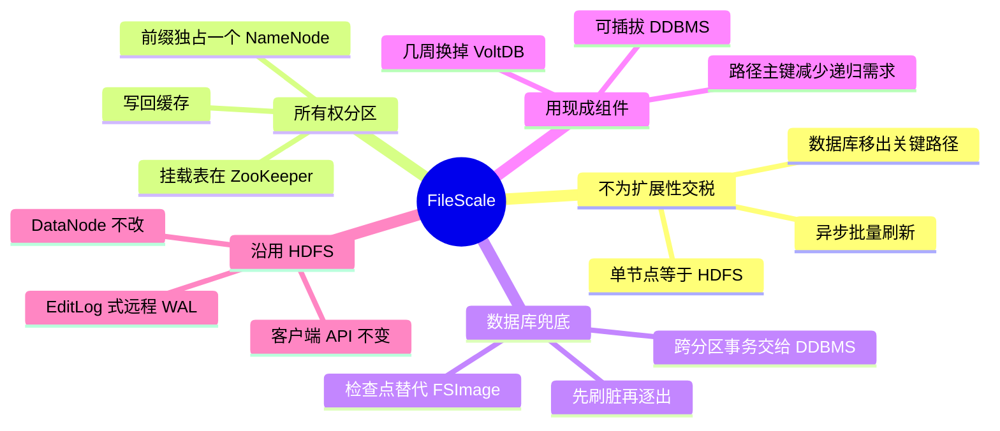

### 11.3 优点与局限

| 优点 | 局限 |
|------|------|
| 单节点性能与 HDFS 相当，小规模部署也能用 | 1% 跨分区事务就让单分区吞吐降到约三分之一；跨分区 move 10⁵ 文件全脏时约 98.6 s |
| 支持跨分区原子操作，克服了 HDFS 联邦的根本缺陷 | 路径做主键，目录 rename 是 O(子树) 的删除再插入 |
| 按前缀迁移即可缓解热点、扩容，吞吐线性增长 | 热点只能迁移不能复制，单个极热前缀仍受一个 NameNode 限制 |
| 数据库可插拔，换数据库只需几周 | 数据库落后于缓存，NameNode 故障时要重放日志才能接管，没有热备；分区迁移的交接协议没有说明 |
| 对 HDFS 改动集中在 NameNode，生态兼容 | 多节点评估只有均匀分布的 create/open，没有故障、迁移、真实 trace 实验；多处图表数值和措辞不一致 |

### 11.4 启示

1. **把"规模下限"当作一等设计目标**。大多数元数据服务一开始都很小，如果架构在小规模时比单机慢 10 倍，就很难被采用。FileScale 的做法是让分布式组件只在需要时出现：常规路径与单机相同，扩展靠增加分区所有者，跨分区才动用分布式事务。
2. **写回缓存 + 远程日志 = 单机级延迟 + 外部持久化**。这和 HDFS EditLog、数据库的"日志即数据库"是同一思路。代价是恢复时间与日志长度成正比，需要靠刷新频率和分区数控制。
3. **所有权比一致性协议简单**。FileScale 用"一个前缀只有一个所有者"回避了缓存一致性问题；λFS 允许多副本，就必须引入 INV/ACK。设计缓存层时先问：热点是读还是写？需要靠复制分担读，还是靠所有权加速写？
4. **主键选择决定 rename 的代价**。路径主键让递归 chmod/delete 和路径解析很简单，让 rename 很贵；inode ID 主键正好相反。应该根据负载中 rename 和递归操作的比例来选。
5. **跨分区操作的比例决定分区架构的成败**。图 12b 说明，分区边界一旦被频繁跨越，性能会断崖式下降。部署时应结合业务的目录使用模式（例如"临时目录 rename 到正式目录"）规划挂载表，让常见的 rename 落在同一分区内。

### 11.5 一张图看懂 FileScale

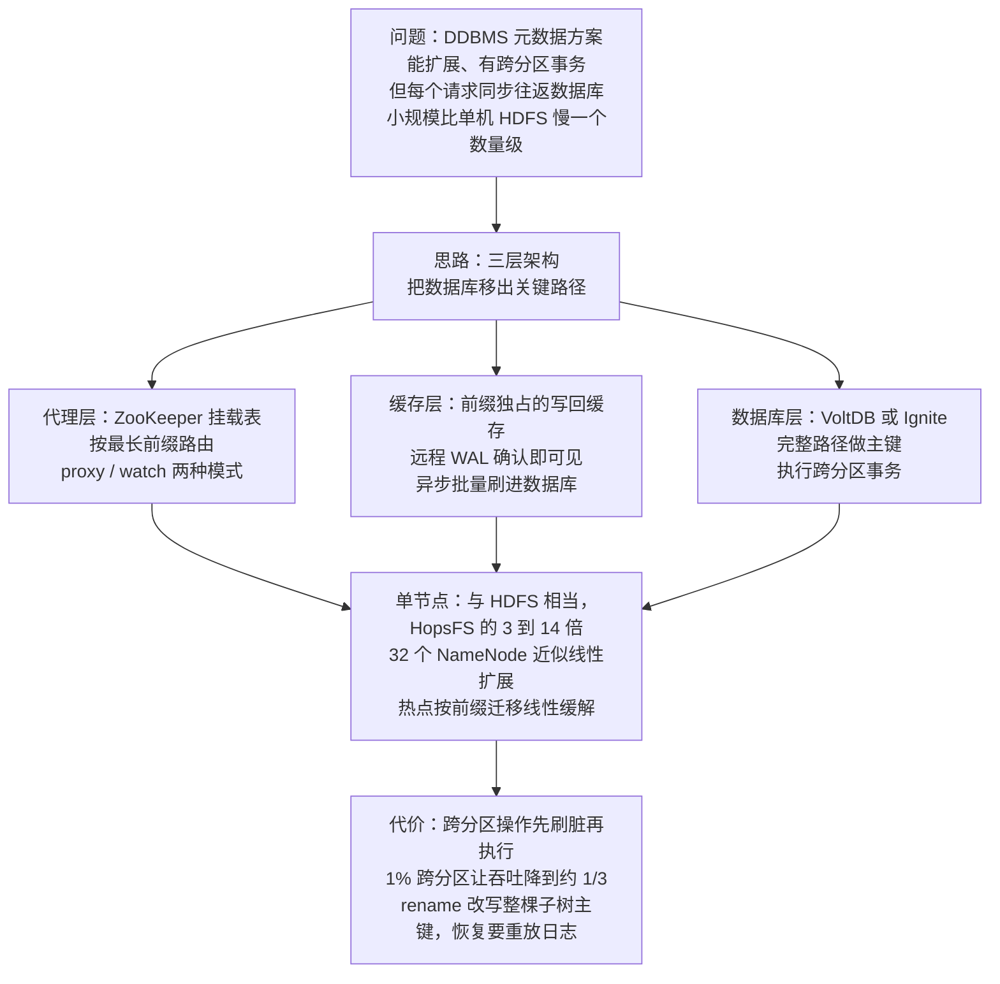

---

## 参考

- Gang Liao, Daniel J. Abadi. *FileScale: Fast and Elastic Metadata Management for Distributed File Systems*. ACM SoCC 2023. <https://dl.acm.org/doi/10.1145/3620678.3624784>；PDF <http://www.cs.umd.edu/~abadi/papers/filescale.pdf>；代码 <https://github.com/umd-dslam/FileScale>
- Salman Niazi et al. *HopsFS: Scaling Hierarchical File System Metadata Using NewSQL Databases*. USENIX FAST 2017.
- Alexander Thomson, Daniel J. Abadi. *CalvinFS: Consistent WAN Replication and Scalable Metadata Management for Distributed File Systems*. USENIX FAST 2015.
- Alexander Thomson et al. *Calvin: Fast Distributed Transactions for Partitioned Database Systems*. ACM SIGMOD 2012.
- Raghu Ramakrishnan et al. *Azure Data Lake Store: A Hyperscale Distributed File Service for Big Data Analytics*. ACM SIGMOD 2017.
- Satadru Pan et al. *Facebook's Tectonic Filesystem: Efficiency from Exascale*. USENIX FAST 2021.（本仓库精读：[tectonic-fast2021/deep-read.md](tectonic-fast2021/deep-read.md)）
- Kai Ren et al. *IndexFS: Scaling File System Metadata Performance with Stateless Caching and Bulk Insertion*. SC 2014.
- Swapnil Patil, Garth Gibson. *Scale and Concurrency of GIGA+: File System Directories with Millions of Files*. USENIX FAST 2011.
- Pulkit A. Misra et al. *Scaling Distributed File Systems in Resource-Harvesting Datacenters*. USENIX ATC 2017.（HDFS Router-based Federation 的来源之一）
- Apache Hadoop. *HDFS Router-based Federation*；*HDFS ViewFs Guide*；*NNThroughputBenchmark*.
- VoltDB <https://www.voltdb.com>；Apache Ignite <https://ignite.apache.org>
- 本仓库相关：[元数据扩展性综述](metadata-scalability.md)、[λFS 精读](lambdafs-asplos2023.md)、[CFS 精读](cfs-eurosys2023.md)、[InfiniFS 精读](infinifs-fast2022.md)、[Tectonic 精读](tectonic-fast2021/deep-read.md)、[SingularFS 精读](singularfs-atc2023.md)
