# Fire-Flyer AI-HPC 精读：万卡 PCIe A100 集群的软硬协同（SC 2024）

> 论文：Wei An, Xiao Bi, Guanting Chen, …, Liyue Zhang*, …, Yuheng Zou（共 52 位作者，按姓氏字母排序）. *Fire-Flyer AI-HPC: A Cost-Effective Software-Hardware Co-Design for Deep Learning*. SC 2024（International Conference for High Performance Computing, Networking, Storage and Analysis），Atlanta，2024-11。
>
> 机构：DeepSeek-AI（北京）；致谢中说明项目由 DeepSeek-AI 与幻方量化（High-Flyer Quant）共同完成，设计、建设与运维历时四年。
>
> 链接：arXiv <https://arxiv.org/abs/2408.14158>（本文依据 v2，2024-08-31）；IEEE/ACM DL <https://dl.acm.org/doi/10.1109/SC41406.2024.00089>；HAI 平台开源仓库 <https://github.com/HFAiLab/hai-platform>
>
> 篇幅：正文 10 页 + 参考文献 + 附录（3 张原始故障数据表），共 18 页 PDF；正文 12 张图、5 张表、2 个算法。
>
> 精读日期：2026-11-23。**数字、表格和机制描述都摘自论文**，用"论文 §x / 图 x / 表 x"标注出处。标"解读"的段落是本文作者的分析和推论，不是原文。论文图中的数值都带数据标签，本文直接引用，不是从图上估读的。
>
> 相关文档：
> - [3FS / Fire-Flyer 精读](3fs-fireflyer-sc2024.md)：同一篇论文和 3FS 开源设计说明合读，重点在 3FS。本文是**整篇论文**的精读，重点在计算、网络、平台与稳定性，3FS 只做概述。
> - 综述小节：[工业界生产系统中的 Fire-Flyer 小节](industry-production-systems.md#7-deepseek-fire-flyer-ai-hpc-与-3fs)、[HPC 与 AI 训练存储中的 3FS 小节](hpc-ai-storage.md#31-3fsfire-flyer-file-system-deepseek)。

## 目录

- [0. 一页速览](#0-一页速览)
- [1. 论文定位与结构](#1-论文定位与结构)
- [2. 背景：算力需求与集群形态](#2-背景算力需求与集群形态)
- [3. Fire-Flyer 2 硬件：PCIe 节点与双区 Fat-Tree](#3-fire-flyer-2-硬件pcie-节点与双区-fat-tree)
- [4. HFReduce：把 allreduce 搬到 CPU](#4-hfreduce把-allreduce-搬到-cpu)
- [5. HaiScale：面向 PCIe 架构的并行训练](#5-haiscale面向-pcie-架构的并行训练)
- [6. 存算一体网络的防拥塞](#6-存算一体网络的防拥塞)
- [7. 3FS 与 3FS-KV](#7-3fs-与-3fs-kv)
- [8. HAI 平台、checkpoint 与验证器](#8-hai-平台checkpoint-与验证器)
- [9. 一年的硬件故障数据](#9-一年的硬件故障数据)
- [10. 讨论：拥塞控制、NVLink、成本与稳定性](#10-讨论拥塞控制nvlink成本与稳定性)
- [11. 未来工作：每卡一网卡与多平面网络](#11-未来工作每卡一网卡与多平面网络)
- [12. 论文中的不一致与可疑之处](#12-论文中的不一致与可疑之处)
- [13. 与同期 AI 集群的对比](#13-与同期-ai-集群的对比)
- [14. 整体总结](#14-整体总结)
- [参考](#参考)

---

## 0. 一页速览

**一句话**：DeepSeek 没有买 DGX，而是把 8 张 **PCIe A100** 和 **1 块** 200 Gbps IB 网卡直接插在双路 EPYC 上，再用两个 800 端口的两层 Fat-Tree 把约 1,250 个计算节点和约 180 台存储节点连在**同一张网**上。这样搭出的 1 万卡集群 Fire-Flyer 2，总造价约为 DGX-A100 方案的一半，功耗低 40%，GEMM 性能约为 83%。硬件省下的钱用软件补回来：HFReduce 用 CPU 做 allreduce 绕开 PCIe 瓶颈，HaiScale 针对单网卡调整并行策略，3FS 提供 8 TB/s 的共享存储，HAI 平台用分时调度和 5 分钟一次的 checkpoint 吸收硬件故障。

| 维度 | 要点 |
|------|------|
| 规模 | 1 万张 PCIe A100-40GB，约 1,250 个计算节点，180 台（另一处说"近 200 台"）存储节点，122 台 QM8700 交换机（论文 §III） |
| 节点 | 2 × EPYC Rome/Milan 32 核，512 GB DDR4，8 × PCIe A100，**1** × CX6 200 Gbps IB；无 PCIe Switch；后来给成对 GPU 加了 NVLink Bridge（论文表 I） |
| 网络 | 两个 Zone，每个 Zone 20 spine + 40 leaf，800 端口；存储节点双网卡跨接两个 Zone；Zone 间少量链路，调度器保证最多一个跨区任务（论文 §III-B） |
| 成本 | 相对 DGX-A100：性能 83%，节点价格 60%，功耗 2500 W vs 4200 W；总价 11600 vs 23000，网络 350 vs 4000（相对单位）（论文表 II、III） |
| HFReduce | GPU→CPU 拷贝 + CPU SIMD 节点内归约 + RDMA 双二叉树节点间 allreduce + CPU→GPU；186 MiB 时 6.31–8.10 GB/s，NCCL 只有 1.63–4.83 GB/s（论文 §IV，图 7a） |
| HaiScale | DDP、FSDP、PP、TP、EP 的 PCIe 专用优化；LLaMA-13B 64→512 卡、DeepSeekMoE-16B 40→640 卡的强扩展；FSDP 16→128 卡弱扩展效率 95%（论文 §V） |
| 网络共存 | 四类流量用 IB SL→VL 隔离；关掉自适应路由改用静态路由；NCCL 走同 NUMA 网卡；3FS 用 request-to-send 控制 incast；**关闭 DCQCN**（论文 §VI-A、§VIII-A） |
| 存储 | 3FS：180 节点 × 16 块 15.36 TB NVMe + 2 × 200 Gbps，理论 9 TB/s，实测读 8 TB/s；CRAQ 链复制；3FS-KV 支撑磁盘 KV Cache（论文 §VI-B） |
| 平台 | HAI 分时调度，任务须可中断；checkpoint 每 5 分钟一次，批量写 >10 GiB/s/节点；验证器每周巡检（论文 §VI-C、§VII） |
| 故障 | 一年 12,970 次 GPU Xid，其中 NVLink（Xid 74）42.57%，非法内存访问（Xid 43）33.48%；六个月 89 次 IB 闪断；遇到过 ECC 漏检的静默错误（论文 §VII-C，附录表 VI–VIII） |
| 下一代 | 面向 MoE：GPU 与网卡 1:1，多平面两层 Fat-Tree，考虑 RoCE；128 口 400 Gbps 交换机做 4 平面可接 32,768 卡（论文 §IX） |

**解读**：

- 这篇论文更像一份**工程经验报告**，不是提出单一新机制的研究论文。它的价值在于把"省钱"这个目标一路贯彻到节点、网络、通信库、训练框架、文件系统、调度和运维，并给出大量真实数字（成本、带宽、故障次数）。
- 全文的主线是一个取舍：**硬件选择性能更低、更便宜的 PCIe + 单网卡方案，再在软件层逐一补回 PCIe 带来的瓶颈**。HFReduce 补 PCIe P2P 带宽，PP 错峰补单网卡带宽，NVLink Bridge 补 TP 带宽，SL/VL 和 request-to-send 补存算共网的干扰，checkpoint 和验证器补大规模集群的故障率。
- 对存储方向的读者，这篇论文提供了 3FS 的**运行环境**：存储与训练通信共享一张没有拥塞控制的 IB 网络，客户端只有一块 200 Gbps 网卡，checkpoint 每 5 分钟写一次，网络闪断六个月 89 次。3FS 的很多设计要放在这个环境下理解，详见 [3FS 精读](3fs-fireflyer-sc2024.md)。

---

## 1. 论文定位与结构

### 1.1 论文结构

| 章节 | 内容 | 本文对应 |
|------|------|---------|
| §I 引言 | 列出贡献：网络协同、HFReduce、HaiScale、3FS、HAI 平台、稳定性 | §0 |
| §II 背景 | 算力需求增长、训练的效率和稳定性挑战、各类 AI 集群 | §2 |
| §III Fire-Flyer 2 | 节点架构、两层 Fat-Tree 双区、成本对比 | §3 |
| §IV HFReduce | 算法、相对 NCCL 的优势、NVLink 版本、瓶颈分析 | §4 |
| §V HaiScale | DDP、LLM 并行优化、FSDP | §5 |
| §VI 进阶优化 | A. 网络防拥塞；B. 3FS；C. HAI 平台 | §6、§7、§8 |
| §VII 稳定性 | A. checkpoint 管理器；B. 验证器；C. 硬件故障统计 | §8、§9 |
| §VIII 讨论 | 拥塞控制、NVLink 取舍、维护成本、与其他架构的稳定性对比 | §10 |
| §IX 未来工作 | 下一代 PCIe 节点与多平面网络 | §11 |
| 附录 | Xid 原始数据、内存与网络故障月度数据、IB 闪断逐日数据 | §9 |

### 1.2 与 [3FS 精读](3fs-fireflyer-sc2024.md) 的分工

| 内容 | 本文 | 3FS 精读 |
|------|------|---------|
| 节点、网络、成本 | 详细，包括交换机数量推导 | 概述 |
| HFReduce | 详细：两个算法、内存访问次数、PCIe 瓶颈、全部图 7 数据 | 概述 |
| HaiScale | 详细：全部图 8、图 9 数据和并行效率复算 | 一张汇总表 |
| 网络防拥塞 | 详细 | 详细，侧重存储视角 |
| 3FS | 只概述论文 §VI-B，不展开 | 详细，结合开源设计说明 |
| HAI 平台、checkpoint、验证器 | 详细 | 概述 |
| 故障数据 | 详细，包括附录数据的复算和交叉核对 | Xid 表与月度合计 |

**解读**：论文的章节编号有错位。PDF 中 §V 的 "C. Summary" 和 §VI 的 "B. High-Throughput Distributed File System: 3FS" 在同一页左右栏相邻，§VII 的 "A. Checkpoint Manager" 也排在 "B. Validator" 之后。按内容，3FS 属于 §VI-B，HAI 平台属于 §VI-C。阅读 PDF 时需按编号而不是版面顺序理解。

---

## 2. 背景：算力需求与集群形态

### 2.1 需求增长远快于硬件（论文 §II-A，图 1–3）

论文引用 *AI and Memory Wall*（Gholami 等，2024）的数据（图 2）：

| 指标 | 20 年增长 | 折合每两年 |
|------|----------:|----------:|
| AI 训练算力需求 | — | 每年约 10 倍 |
| 硬件峰值 FLOPS | 60,000 倍 | 3.0 倍 |
| DRAM 带宽 | 100 倍 | 1.6 倍 |
| 互联带宽 | 30 倍 | 1.4 倍 |

图 3 对比了模型参数量（Transformer 规模每两年约 410 倍）与加速器显存（每两年约 2 倍）。论文据此指出：ResNet、Mask-RCNN、BERT、MAE 等主流模型参数都不到 10 亿，显存需求不高；只有 LLM 才真正需要大显存和高速互联。

**解读**：互联带宽增长最慢（每两年 1.4 倍），这是论文后面所有"通信优化"工作的出发点。在 PCIe 架构上这个问题更突出，因为 GPU 之间、GPU 与网卡之间的带宽都受 PCIe 和 CPU 内部总线限制。

### 2.2 训练的两大挑战（论文 §II-B）

1. **效率**：用 MFU（Model FLOPs Utilization，实测吞吐与理论峰值之比）衡量。影响因素包括通信、算子优化、数据预处理和显存占用。论文简述了 DP（含 ZeRO）、PP（GPipe、1F1B、Zero Bubble）、TP、EP、FSDP 五种并行方式。
2. **稳定性**：万亿 token 的训练可能持续数周，掉队节点（straggler）和硬件故障是常态而非例外，因此任务恢复时间很重要。

### 2.3 各类 AI 集群（论文 §II-C）

| 类型 | 代表 | 论文的评价 |
|------|------|-----------|
| 传统超算 | 天河-2A、Stampede 2、神威·太湖之光、富岳 | 侧重双精度，不支持 FP16 或张量 GEMM 加速，不适合深度学习训练；但网络和大规模建设经验值得借鉴 |
| GPU 超算 | Frontier、Aurora、Summit、Perlmutter | 训练性能好；Perlmutter 用全闪存储，峰值 5 TB/s |
| 大公司 GPU 集群 | Meta（IB 与 RoCE 两套）、字节（早期 CPU + PCIe GPU 混合，后转向类 DGX 的万卡集群 MegaScale）、阿里 HPN（H800）、NVIDIA Eos（576 台 DGX H100） | DGX 成本高，经济性存疑 |
| AI 专用芯片集群 | Google TPU（光交换可重构网络）、Intel Gaudi、Tesla Dojo、华为昇腾 | 软件生态仍需追赶 |
| 云服务 | Azure 等 | 方便，但两年左右的长期项目，租金接近自建一个集群 |

**解读**：论文在这里给出的论证是"**自建、并且不买 DGX**"。云的问题是长期成本，DGX 的问题是单价，AI 专用芯片的问题是生态。剩下的选项就是用通用 PCIe 卡自建，再靠软件补性能。

---

## 3. Fire-Flyer 2 硬件：PCIe 节点与双区 Fat-Tree

### 3.1 为什么选 PCIe A100（论文 §III）

论文给出的理由是 2021 年建设时的负载：大部分模型参数不到 10 亿，而 Fire-Flyer 1 的经验表明 PCIe A100 够用。设计时**预留了 NVLink Bridge 的安装位置**，LLM 时代到来后确实给成对 GPU 加装了 NVLink Bridge。

### 3.2 节点架构（论文 §III-A，图 4，表 I）

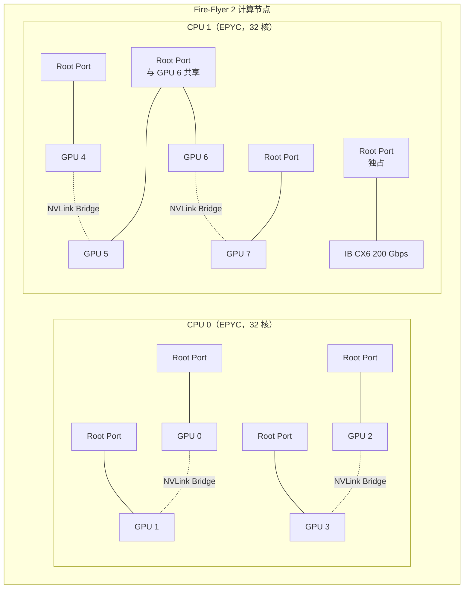

> 示意图按论文图 4 的文字说明绘制：8 块 GPU 和 1 块网卡都**直连 CPU**，不经过 PCIe Switch；GPU5 与 GPU6 共享一个 Root Port；IB 网卡独占一个 Root Port，以免与 GPU 互相干扰。各 Root Port 与 CPU 的具体对应关系以原图为准。

| 项 | Fire-Flyer 2 节点 | DGX-A100 |
|----|------------------|----------|
| CPU | 2 × AMD EPYC Rome/Milan 32 核 | 2 × AMD EPYC 7742 64 核 |
| 内存 | 512 GB，16 通道 DDR4-3200 | 2048 GB，16 通道 DDR4-3200 |
| GPU | 8 × PCIe A100-40GB | 8 × SXM A100-40GB |
| 网卡 | **1** × CX6 200 Gbps IB | **9** × CX6 200 Gbps IB |
| NVLink | 成对 GPU 之间 600 GB/s（Bridge） | 8 卡全互联 600 GB/s |

论文认为，在他们的训练负载下，一块 200 Gbps 网卡足以同时满足 8 卡的存储 IO 和计算通信（论文 §III-A）。

**解读**：

- "1 块网卡对 8 块 GPU"是整套设计里最激进的一步，也是后续大部分软件工作的根源。DGX-A100 是 8 块计算网卡加 1 块存储网卡，每块 GPU 独享 200 Gbps；Fire-Flyer 2 每块 GPU 平均只有 25 Gbps 的网络带宽，存储流量还要共用这一块网卡。
- 不用 PCIe Switch 有两面性：省了交换芯片的成本，而且 GPU→CPU 内存路径最短，有利于 HFReduce；代价是 GPU↔网卡的 P2P 必须穿过 CPU，受 Rome 不支持 chained write 的限制（§4.4）。

### 3.3 网络拓扑：双区两层 Fat-Tree（论文 §III-B，图 5）

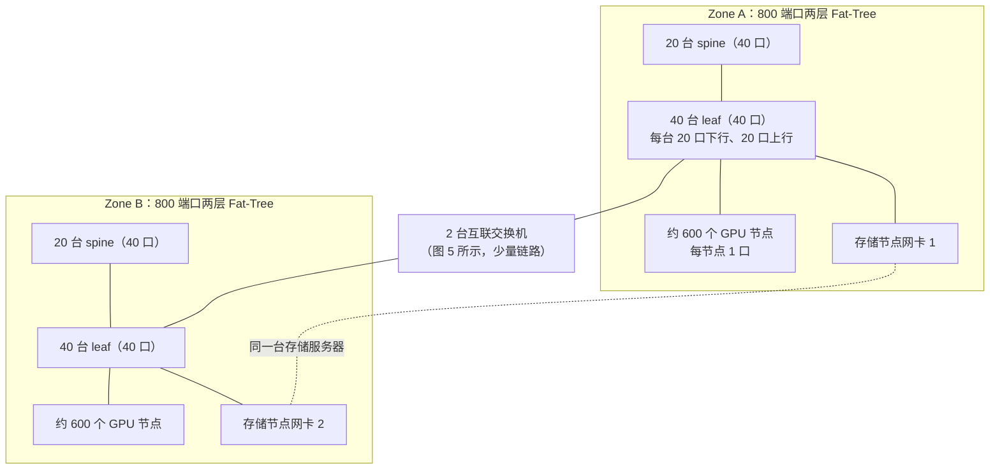

- 交换机：Mellanox QM8700，40 口 × 200 Gbps。论文称当时 RoCE 技术不够成熟，因此选 IB。
- 不选 Dragonfly：成本和性能相当，但对分带宽不足以支撑存算一体网络。
- 一个两层 Fat-Tree 最多接 800 个节点（20 spine + 40 leaf）。1 万卡需要约 1,250 个计算节点加近 200 台存储服务器，所以不上三层，而是做**两个区**。
- 每台存储服务器有两块 IB 网卡，**分别接两个区**，所有计算节点共享同一套存储。
- 两个区之间只有少量链路。HAI 平台保证**跨区任务最多一个**；NCCL 和 HFReduce 跨区时都用双二叉树算法，调度器保证**只有一对节点跨区通信**，因此全集群任务也能高效运行。

**解读（交换机数量推导）**：

| 部分 | 数量 | 说明 |
|------|-----:|------|
| 每个 Zone 的 leaf | 40 | 40 × 20 下行口 = 800 个接入端口 |
| 每个 Zone 的 spine | 20 | 20 × 40 口 = 800，正好接住 40 × 20 个 leaf 上行口 |
| 两个 Zone 合计 | 120 | |
| Zone 间互联交换机 | 2 | 图 5 中画在两区之间的两台 40 口交换机 |
| 合计 | **122** | 与表 III 一致 |

每个 Zone 的 800 个接入端口，约 600 个给 GPU 节点，其余给存储节点（180 台 × 1 口）和管理节点。存储节点的双网卡因此在两个 Zone 各占约 180 个端口，正好补满 800 口。

### 3.4 成本账（论文 §III-C，表 II、表 III）

| 指标 | Fire-Flyer 2 | DGX-A100 | 比值 |
|------|-------------:|---------:|-----:|
| TF32 GEMM（TFLOPS/GPU） | 107 | 131 | 81.7% |
| FP16 GEMM（TFLOPS/GPU） | 220 | 263 | 83.7% |
| 相对性能 | 83% | 100% | |
| 节点相对价格 | 60% | 100% | |
| 性价比 | 1.38 | 1 | = 0.83 / 0.60 |
| 单节点功耗（W，ResNet 训练平均） | 2500 | 4200 | 59.5% |

| 相对成本 | Fire-Flyer 2（双区两层） | PCIe 架构 + 三层 Fat-Tree | DGX 架构 |
|---------|------:|------:|------:|
| 交换机数 | 122 | 200 | 1320 |
| 网络价格 | 350 | 600 | 4000 |
| 服务器价格 | 11250 | 11250 | 19000 |
| 总价 | 11600 | 11850 | 23000 |

- DGX 方案需要 1 万个接入点（1,250 节点 × 8 块计算网卡）的三层 Fat-Tree：320 core + 500 spine + 500 leaf = 1,320 台交换机。
- 同规模（1,600 个接入点）的 PCIe 三层 Fat-Tree：40 core + 160 spine/leaf = 200 台。双区方案比它省约 40% 网络成本（350 vs 600）。
- 使用 800 口框式交换机进一步减少了光模块和线缆的成本。

**解读**：

- **"成本减半"和"60% 的成本"是两个口径**：前者是总价（11600 / 23000 ≈ 50.4%），后者是节点价格（表 II）。网络在 DGX 方案里占总价约 17%（4000 / 23000），在 Fire-Flyer 2 里只占约 3%（350 / 11600）。省下的钱有相当一部分来自网络。
- 1,600 个接入点约等于 1,250 个 GPU 口 + 360 个存储口，说明对比方案假设的是同样的存算一体网络。
- 1,250 个节点 × 2,500 W ≈ 3.1 MW，与论文"全集群不超过 4 MW、约 3 MW 出头"一致（论文 §VIII-C）；同样数量的 DGX 节点约 5.25 MW。

---

## 4. HFReduce：把 allreduce 搬到 CPU

### 4.1 核心思路（论文 §IV，图 6）

allreduce 是数据并行训练聚合梯度的关键操作。HFReduce 的做法是：**先在节点内把 8 块 GPU 的数据归约到 CPU 内存，再用 CPU 在节点间做 allreduce，最后把结果写回 GPU**。

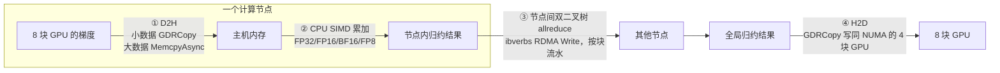

HFReduce 可用于任何需要 allreduce 的场景，也支持一般的 reduce 和 broadcast。

### 4.2 两个算法（论文算法 1、2）

**算法 1：节点内归约**

1. 把要归约的数据按 chunk 切分。
2. 对每个 chunk，从每块 GPU 异步拷贝到 CPU 内存。
3. 等某个 chunk 在所有 GPU 上都拷完，就用 CPU 把 8 份累加，然后立刻对这个 chunk 发起节点间归约。

**算法 2：节点间归约**（每个 chunk 由独立线程处理）

- 第一轮（reduce）：从上一个节点收数据，与本地数据累加。根节点把结果往回发，其他节点继续往下一个节点发。
- 第二轮（gather）：收到最终结果后，用 MemcpyAsync 拷贝到每块 GPU，再转发给上一个节点。

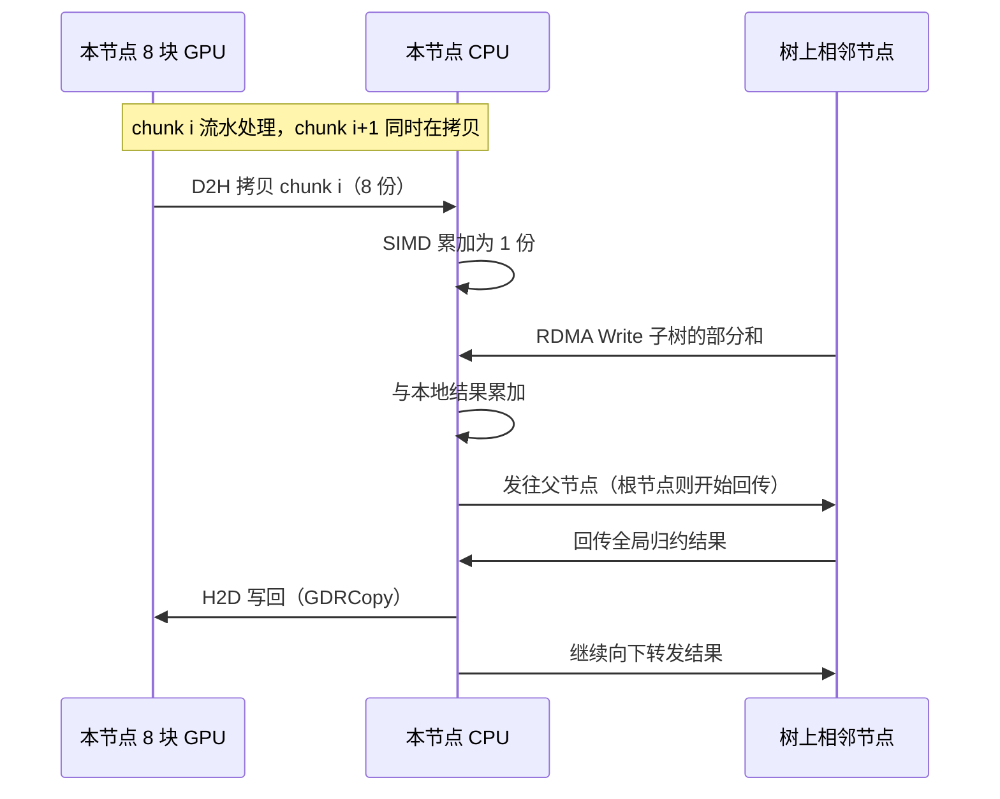

**解读**：

- 论文的伪代码写得比较粗，比如算法 2 用 "prev/next node" 描述树上的父子关系。从"IB 发送 2 次读、接收 2 次写"（§4.5）可以推断，每个节点在两棵互补的二叉树里各承担一部分数据，这正是双二叉树算法（Sanders 等，2009；NCCL 2.4 起也采用）的特点：两棵树各传一半数据，每个节点在一棵树里是叶子、在另一棵里是内部节点，带宽得到充分利用，延迟是 log 级。
- 按 chunk 流水是性能关键：D2H、CPU 归约、网络传输、H2D 四个阶段可以同时处理不同 chunk。

### 4.3 相对 NCCL 的两个优势（论文 §IV-B）

| 对比点 | NCCL ring allreduce | HFReduce |
|--------|--------------------|----------|
| 每单位数据消耗的 PCIe 双向带宽 | (2n−1)/n 单位（论文写法） | 1 单位：一次 D2H + 一次 H2D |
| GPU 计算资源 | 需要 GPU kernel，占用 SM，影响其他计算 kernel | 只用 Copy Engine 做异步拷贝，归约在 CPU 上，不占 SM |
| 适用前提 | GPU↔网卡 P2P 带宽充足 | CPU 内存带宽充足 |

在 Fire-Flyer 2 上，NCCL 主要受限于 PCIe 带宽，所以 HFReduce 更快。

### 4.4 实测带宽（论文图 7）

**图 7a：186 MiB allreduce，节点间带宽（GB/s）**

| GPU 数 | 16 | 32 | 64 | 128 | 256 | 512 | 1024 | 1440 |
|-------|---:|---:|---:|----:|----:|----:|-----:|-----:|
| HFReduce | 8.10 | 8.03 | 7.95 | 7.78 | 7.12 | 7.33 | 6.31 | 6.99 |
| NCCL | 4.01 | 4.41 | 4.29 | 3.73 | 4.83 | 4.62 | 1.63 | 1.65 |
| HFReduce / NCCL | 2.0× | 1.8× | 1.9× | 2.1× | 1.5× | 1.6× | 3.9× | 4.2× |

**图 7b：HFReduce with NVLink（GB/s）**

| GPU 数 | 16 | 32 | 64 | 128 | 256 | 512 | 1024 |
|-------|---:|---:|---:|----:|----:|----:|-----:|
| 单区 | 19.18 | 13 | 12.07 | 10.3 | 9.66 | 8.56 | 7.99 |
| 跨 Fat-Tree 区 | — | — | — | 9.27 | 8.63 | 8.06 | 7.75 |
| 跨区损失 | | | | −10% | −11% | −6% | −3% |

不到 128 卡的任务不需要跨区节点，平台默认也不允许，所以跨区曲线从 128 卡开始（论文图 7 图注）。

**HFReduce with NVLink（论文 §IV-C）**：先在 NVLink 连接的 GPU 对内归约，再交给 CPU；CPU 返回结果时把数据拆成两半分别写给这对 GPU，GPU 之间再通过 NVLink 做 allgather。这样每对 GPU 只有一份数据经过 PCIe，缓解了原版 HFReduce 的内存带宽瓶颈。

**解读**：

- NCCL 在 1,024 卡及以上骤降到约 1.6 GB/s，HFReduce 仍保持 6–7 GB/s。论文没有解释原因，也没有说明图 7a 的测试是否跨区。1,024 卡只有 128 个节点，一个 Zone（约 600 个计算节点）放得下，因此骤降不一定是跨区造成的，也可能与 NCCL 在该规模下的算法选择有关。
- 论文说 NVLink 版本"超过 10 GB/s"，但图 7b 只有 **≤128 卡**时成立；512 卡时 8.56 GB/s，1,024 卡时 7.99 GB/s，比无 NVLink 版本在 1,024 卡时的 6.31 GB/s 高约 27%，但已低于 10 GB/s。
- 论文没有说明"inter-node bandwidth"是算法带宽（数据量 / 时间）还是总线带宽，也没有给出不同消息大小下的曲线。186 MiB 是一个较大的消息，小消息下 CPU 路径的额外延迟可能更明显。

### 4.5 深度分析：瓶颈在哪里（论文 §IV-D）

**实现要点**：

- D2H：小数据用 GDRCopy；H2D：用 GDRCopy 写同一 NUMA 的 4 块 GPU，数据从主机内存读一次后留在 CPU 缓存里，相比 MemcpyAsync 减少三倍主机内存读取。
- CPU 用 SIMD 指令做累加，支持 FP32、FP16、BF16、FP8。
- NUMA 感知：D2H 目标内存跨两个 NUMA 节点交错分配以获得最大带宽；累加结果和网络接收缓冲区绑定到网卡所在 NUMA 节点。
- 节点间用 ibverbs RDMA Write 实现双二叉树。

**为什么 NCCL 只有约 4 GB/s**：论文咨询了 AMD 和 NVIDIA 工程师，原因是 **EPYC Rome 不支持 chained write**，这个特性能显著加速 GPU 与 IB 网卡之间的 PCIe P2P 传输。实测 Rome 上 GPU↔网卡最大约 9 GiB/s，所以 NCCL 约 4 GB/s 的 allreduce 带宽可以理解。HFReduce 用 CPU 归约、经主机内存和 IB 传输，绕开了这一限制。

**HFReduce 的理论上限**：单节点内存访问量统计如下（单位：GPU 上原始数据大小）：

| 阶段 | 读 | 写 | 合计 |
|------|---:|---:|----:|
| D2H（8 块 GPU 写入主机内存） | 0 | 8 | 8 |
| 节点内累加 | 8 | 1 | 9 |
| 节点间 allreduce：IB 发送 2 次、接收 2 次、累加 1 次读 | 3 | 2 | 5 |
| H2D（GDRCopy，每 NUMA 读 1 次；MemcpyAsync 需 8 次） | 2 | 0 | 2 |
| 合计 | | | **24** |

16 通道 DDR4-3200 的实际访存速度约 320 GB/s，320 / 24 ≈ **13.3 GB/s**；考虑 allreduce 算法带宽和网络带宽后约 **12 GB/s**。实测只有略高于 **8 GB/s**。

**差距的原因**：GPU5 和 GPU6 共享同一个 Root Port。在 EPYC Rome 和 Milan 上，Root Port 到 CPU 内部总线的最大带宽约 **37.5 GB/s**。单个 PCIe 4.0 x16 口 GPU→CPU 能超过 27 GB/s，但两块 GPU 同时传输时合计只有约 37 GB/s，双向同时传输时更低。论文指出下一代 EPYC Genoa 的 PCIe Host Bridge 仍然无法同时支撑两个满速 PCIe 口，希望 AMD 改进。

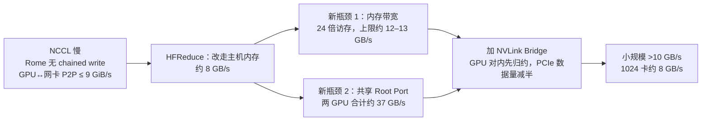

**解读**：

- 这一节是全文技术密度最高的部分，展示了"**每解决一个瓶颈，就暴露下一个瓶颈**"的完整过程。HFReduce 本质上是用 CPU 内存带宽换 PCIe P2P 带宽，NVLink 版本又用 NVLink 带宽换内存和 PCIe 带宽。
- 这套方案严重依赖具体硬件的特性：Rome 不支持 chained write、Root Port 共享、DDR4 通道数。换一代 CPU 或改用 PCIe Switch 方案，最优解可能完全不同。
- 24 倍访存的统计说明 HFReduce 对 CPU 内存带宽消耗很大，但论文没有讨论它与同节点其他使用内存带宽的任务（数据加载、3FS 客户端）之间的干扰。

---

## 5. HaiScale：面向 PCIe 架构的并行训练

### 5.1 HaiScale DDP（论文 §V-A，图 8a）

HaiScale DDP 用 HFReduce 作通信后端，替代 PyTorch DDP 的 NCCL 后端。反向传播时对已算出的梯度**异步** allreduce，与后续层的反向计算重叠。因为 HFReduce 不占 GPU SM，重叠不会拖慢计算。

**图 8a：VGG16 弱扩展，每步时间（秒）**

| GPU 数 | 32 | 64 | 128 | 256 | 512 | 32→512 效率 |
|-------|---:|---:|----:|----:|----:|-----------:|
| HFReduce（HaiScale DDP） | 0.13 | 0.133 | 0.139 | 0.149 | 0.15 | 0.13 / 0.15 ≈ 86.7% |
| Torch DDP（NCCL） | 0.27 | 0.271 | 0.279 | 0.287 | 0.288 | 0.27 / 0.288 ≈ 93.8% |

论文称训练时间约为 NCCL 的一半，32→512 卡并行效率接近 88%。

**解读**：从每步时间看，HFReduce 确实快约一倍（0.13 vs 0.27）。但按弱扩展效率算，Torch DDP（93.8%）反而比 HFReduce（86.7%）高，因为 NCCL 版本的计算时间占比更大，通信开销增长被稀释了。论文只报告了 HFReduce 的效率，没有比较两者的效率。

### 5.2 LLM 训练优化（论文 §V-B）

HaiScale 支持类似 Megatron 和 DeepSpeed 的多种并行策略，并针对 PCIe 架构做了三项优化：

| 并行方式 | PCIe 架构的问题 | HaiScale 的做法 |
|---------|---------------|----------------|
| TP | 张量并行通信量大，PCIe 带宽不够 | 加装 NVLink Bridge，成对 GPU 之间 600 GB/s，TP 限定在 GPU 对内 |
| PP | 8 块 GPU 共用 1 块网卡，同时做 PP 通信会争抢带宽 | 让同节点 8 块 GPU 属于**不同的 DP rank**，各 DP rank 的 PP 通信时间错开 |
| FSDP | 显存碎片、通信与计算重叠不充分 | 优化显存管理减少碎片；allgather / reduce-scatter 与前向和反向计算重叠；把优化器 step 拆到反向过程中以增加重叠 |

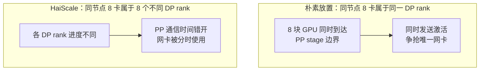

**图 9：强扩展，每步时间（秒）**

| 模型与配置 | GPU 数 | 每步时间 | 相对起点加速 | 并行效率（本文复算） |
|-----------|------:|--------:|------------:|------------------:|
| LLaMA-13B（序列 2048，batch 4096，PP=4） | 64 | 64.118 | 1.00× | 100% |
| | 128 | 32.508 | 1.97× | 98.6% |
| | 256 | 17.448 | 3.67× | 91.9% |
| | 512 | 9.717 | 6.60× | **82.5%** |
| DeepSeekMoE-16B（序列 4096，batch 4608，PP=10） | 40 | 79.615 | 1.00× | 100% |
| | 80 | 40.352 | 1.97× | 98.7% |
| | 160 | 20.784 | 3.83× | 95.8% |
| | 320 | 10.71 | 7.43× | 92.9% |
| | 640 | 6.535 | 12.18× | 76.1% |

论文写道：LLaMA-13B 从 64 卡扩到 512 卡，"并行效率 91%"；DeepSeekMoE-16B 从 40 卡扩到 640 卡，并行效率 76.14%，320 卡时 92.92%。

**解读**：

- DeepSeekMoE 的两个数字与复算一致。**LLaMA-13B 的 91% 与图中数据不符**：64→512 卡是 8 倍，每步时间从 64.118 s 降到 9.717 s 只快了 6.60 倍，效率约 82.5%；91% 实际上对应的是 256 卡（91.9%）。
- MoE 模型在 640 卡时效率降到 76%，说明 all-to-all 通信在单网卡架构下开始成为瓶颈。这正是 §IX 下一代架构改成 1:1 网卡的动机。
- 两组实验都是固定全局 batch 的强扩展。论文没有给出 MFU，无法直接与其他集群的 LLM 训练效率比较。

### 5.3 HaiScale FSDP（论文 §V-B3，图 8b）

**图 8b：GPT2-medium 弱扩展，每步时间（秒）**

| GPU 数 | 16 | 32 | 64 | 128 | 16→128 效率 |
|-------|---:|---:|---:|----:|-----------:|
| HaiScale FSDP | 0.57 | 0.58 | 0.598 | 0.595 | 95.8% |
| Torch FSDP | 0.84 | 0.985 | 0.875 | 0.99 | 84.8% |
| HaiScale / Torch | 68% | 59% | 68% | 60% | |

论文称 16→128 卡并行效率 95%，相比 PyTorch FSDP"训练时间减少近一半"。

**解读**：按图中数据，HaiScale 的每步时间是 Torch 的 59%–68%，即减少约 32%–41%，"近一半"有些夸大。

### 5.4 小结（论文 §V-C）

论文的结论是：Fire-Flyer 2 满足深度学习需求，加装 NVLink Bridge 后能满足早期 LLM 训练需求，并达到 PCIe GPU 的利用上限。由于 PCIe 与 SXM 的规格差异，性能有一定差距；综合性能、建设成本和能耗，**以一半的成本达到 80% 的性能**。

---

## 6. 存算一体网络的防拥塞

计算通信和存储流量共用一张网（§3.3）。为了拿到最大带宽，必须隔离不同流量之间的干扰并控制拥塞。论文给出了四项措施（论文 §VI-A），并在 §VIII-A 说明了关闭 DCQCN 的决定。存储视角的详细讨论见 [3FS 精读 §5](3fs-fireflyer-sc2024.md#5-让存储流量与训练流量共存防拥塞措施)。

### 6.1 四项措施

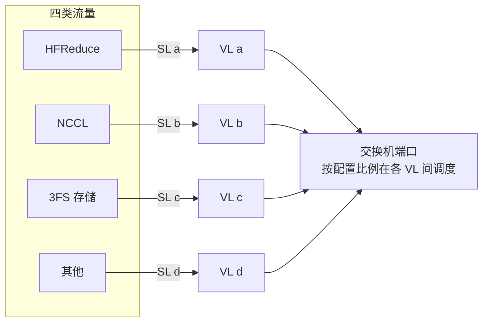

| 措施 | 做法 | 解决的问题 |
|------|------|-----------|
| 流量分离 | 建连时为四类流量设置不同的 IB Service Level，映射到不同的 Virtual Lane，并配置各 VL 的比例 | 不同 VL 互不干扰，避免队头阻塞和不同流量的碰撞 |
| 拓扑与路由 | 存储场景天然有大量 incast，**开启自适应路由会让拥塞扩散得更严重**，因此改用静态路由；把存储、计算、管理节点均匀分布，让存储流量均匀分散到 leaf→spine 链路 | 控制 incast 拥塞的扩散范围 |
| NCCL 调整 | NCCL 拓扑只走同一 NUMA 的网卡和 GPU；启用 PCIe Relaxed Ordering | 减少 CPU chiplet 互联引起的 PCIe 拥塞 |
| 3FS request-to-send | 存储服务读完数据后先向客户端申请发送许可，客户端限制同时发送者数量（§7） | 控制客户端侧 incast |

### 6.2 关闭 DCQCN（论文 §VIII-A）

无损 RDMA 网络有链路级流控（RoCE 的 PFC、IB 的基于信用的流控），路由层有静态路由、ECMP 和自适应路由，但多对一发送仍会造成拥塞并可能阻塞整个网络。IB 网卡默认用 DCQCN 做拥塞控制；DPU（如 BlueField 系列）允许自定义 HPCC、TIMELY 等算法，但会增加成本和运维复杂度。

论文的做法是**直接关闭 DCQCN**：找不到一组参数能同时适配 HFReduce 流量和 3FS 存储流量，于是改为依靠 §6.1 的调优，让网络在没有拥塞控制的情况下保持无拥塞。

**解读**：

- 这是典型的 HPC 思路：**由调度器和应用把流量"排好队"，而不是依赖通用的端到端拥塞控制**。它在单一租户、全栈自研的集群里可行，在多租户云环境里很难复制。
- 关闭自适应路由这一点与很多 AI 集群的经验相反（多数集群依赖自适应路由提升 allreduce 带宽）。论文的理由是存储 incast 场景下自适应路由会把拥塞扩散开。这说明**存算一体网络的最优配置与纯计算网络不同**。
- 论文没有给出关闭 DCQCN 前后的对比数据，也没有给出 SL/VL 的具体比例。

---

## 7. 3FS 与 3FS-KV

论文 §VI-B 用约一栏介绍 3FS，本节只做概述，详细内容（FoundationDB 键设计、CRAQ 改造、目标状态机、在线恢复、chunk 引擎、USRBIO 等）见 [3FS 精读](3fs-fireflyer-sc2024.md)。

### 7.1 论文给出的要点

| 项 | 内容 |
|----|------|
| 定位 | 自研高性能分布式文件系统，与 WekaFS、DAOS、BeeGFS 同类，重点是充分利用 NVMe SSD 的 IOPS 和吞吐以及 RDMA 网络 |
| 存储节点 | 1 × EPYC 7742 64 核，512 GB 8 通道 DDR4-3200，2 × CX6 200 Gbps，16 × 15.36 TB PCIe 4.0 x4 NVMe（论文表 IV） |
| 规模与性能 | 180 节点，360 个 200 Gbps 口，理论出口 9 TB/s，**实测总读吞吐 8 TB/s**；2,880 块 NVMe，镜像冗余下超过 20 PiB |
| 组件 | cluster manager（多实例选主）、meta service、storage service、client；meta 和 storage 向 manager 发心跳，所有服务和客户端从 manager 拉取配置 |
| 元数据 | 存在分布式 KV 中：inode 表存 inode ID → 文件大小、数据位置等；目录项表存（父目录 inode ID，名字）→（子 inode ID，…），用于遍历目录和路径解析；meta service 无状态，可多实例并发 |
| 数据 | 文件切成 chunk，在由多个 storage target 组成的链上复制；用 CRAQ 提供强一致，写全部副本、读任一副本；meta 为每个文件在 chain table 里选一个起点和条带宽度 k，chunk 依次分配到后续 k 条链；每块 SSD 承载多条链的 target，使读写均匀分散 |
| incast 控制 | request-to-send：存储服务从 SSD 读出数据后先请求客户端许可；客户端限制并发发送者数量；获准后用 RDMA WRITE 写数据、再用 RDMA SEND 通知。**会增加端到端延迟，但是维持持续高吞吐所必需的** |
| 3FS-KV | 构建在 3FS 之上的共享存储分布式数据处理系统，支持 KV、消息队列和对象存储三种模型，支持读写分离和按需启动；支撑 DeepSeek 的**磁盘 KV Context Caching**，使 LLM 服务成本降低一个数量级 |

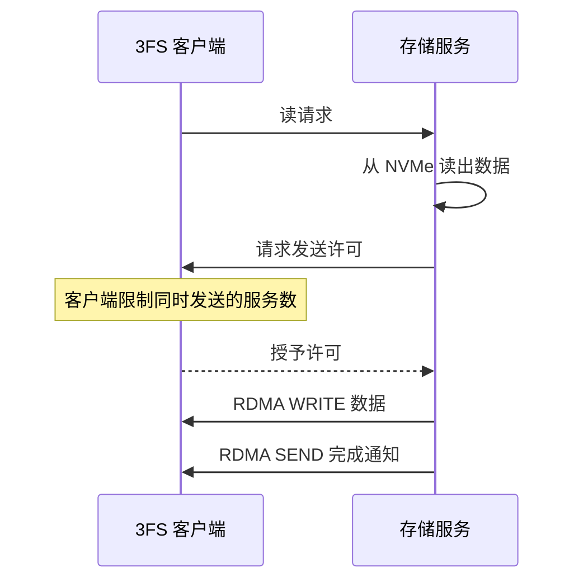

**解读**：

- request-to-send 在论文中引用的是 **Flat Datacenter Storage（FDS，OSDI 2012）**。FDS 同样用接收端授权来避免全对分带宽网络中的 incast，3FS 继承了这一思路。它与 Homa、NDP 等接收端驱动的数据中心传输协议思路一致：拥塞点在接收端网卡，就让接收端决定谁可以发。
- 容量核对：2,880 × 15.36 TB ≈ 44.2 PB ≈ 39.3 PiB 裸容量。两副本约 19.6 PiB，三副本约 13.1 PiB。"超过 20 PiB、镜像冗余"最接近两副本，但仍略不足。详见 [3FS 精读 §6.2](3fs-fireflyer-sc2024.md#6-3fs-总体架构与硬件)。
- 8 TB/s 约为理论出口 9 TB/s 的 89%，论文没有给出测试条件（客户端数、IO 大小、是否有背景流量）。3FS 开源 README 给出的是带训练背景流量下 6.6 TiB/s，两者口径不同，见 [3FS 精读 §16](3fs-fireflyer-sc2024.md#16-性能数字汇总与口径核对)。

---

## 8. HAI 平台、checkpoint 与验证器

### 8.1 HAI 平台：分时调度（论文 §VI-C）

HAI 平台把分时调度的思想用到集群资源管理上。用户提交任务（运行 Python/bash 代码、启动开发容器等），平台根据资源需求和集群繁忙程度**中断和加载**任务。任务代码必须遵守平台的编程规范，能从断点继续：

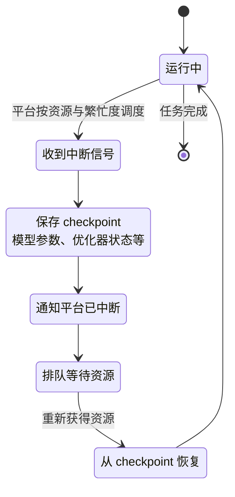

- 部署 HAI 平台的集群**不对 GPU 做池化**，而是以计算节点为基本单位，按资源类型、网络区域等分类打标。
- 平台鼓励用户同时用多块 GPU 做并行训练，论文称利用率可达 **99%**。
- 平台已开源：<https://github.com/HFAiLab/hai-platform>。

**解读**：

- "任务必须可中断"是整个稳定性设计的基石。它把**调度抢占和故障恢复统一成同一条路径**：无论是平台为了腾资源主动中断，还是硬件故障被动中断，任务都从最近的 checkpoint 恢复。这条路径因为被频繁走到而得到充分验证。
- 以节点为单位调度、不池化 GPU，与 §3.3 "跨区任务最多一个"的约束配合，保证了网络拓扑上的局部性。
- 99% 利用率没有给出定义（GPU 分配率还是 GPU 计算时间占比）和统计周期，不宜与其他集群的 MFU 或利用率直接比较。

### 8.2 checkpoint 管理器（论文 §VII-A）

LLM 训练可能持续数月，硬件故障不可避免。为了缩短恢复时间并支持 HAI 平台的中断和恢复，论文开发了 checkpoint 管理器，利用 3FS 的高吞吐：

| 环节 | 做法 |
|------|------|
| 写 | 参数和优化器状态切成 chunk，用 3FS **批量写 API** 写入，比普通写快得多，**每节点超过 10 GiB/s**，几秒内完成 |
| 异步 | 参数和优化器状态先从 GPU 异步拷贝到主机内存，再周期性保存，**通常每 5 分钟一次**，不影响训练 |
| 索引 | 保存时记录每个 tensor 的索引和在 checkpoint 中的偏移，加载时便于定位 |
| 读 | 用 3FS 批量读 API，加载几秒内完成 |

硬件故障中断训练时，最多损失最近 5 分钟的进度。论文认为对于数千节点的集群，这样的容灾开销很小。

**解读**：

- 每节点 10 GiB/s 约占单块 200 Gbps 网卡（约 23.3 GiB/s）的 43%。checkpoint 写入时会与训练通信争抢唯一的网卡，SL/VL 隔离（§6.1）在这里很重要。
- 5 分钟的间隔是"故障频率 × 损失时间"与"checkpoint 开销"之间的折中。按 §9 的数据，全集群一年约 1.3 万次 Xid（大部分不致命），对一个数百卡的任务而言，几小时一次中断并不罕见，5 分钟间隔使每次故障的损失可控。
- 论文没有给出 checkpoint 大小、全集群并发写入时的总带宽、恢复时间的分布等数字。

### 8.3 验证器（论文 §VII-B）

"提升设备稳定性的最好办法是在问题发生前发现它。"平台的自动运维系统**每周**在节点上运行验证器，把有问题的节点从调度平台摘除，保证被调度的节点都是正常的。也集成了 hostping 等诊断工具，但论文坦言，**找到硬件故障的根因对运维团队来说仍然很难**。

| 检查项 | 目的 |
|-------|------|
| 硬件频率、链路速率和链路状态 | 发现降频、降速、链路异常 |
| CPU 压力测试、内存带宽 | 发现 CPU 和内存问题（HFReduce 依赖内存带宽） |
| GPU 显存逐字节检查 | 发现显存数据损坏 |
| 满显存 GEMM | 同时检查 GPU 计算逻辑是否有错 |
| 节点内 allreduce | 通过上层应用检查 NVLink 带宽 |
| 存储带宽压力测试 | 确认存储正常 |

**解读**：满显存 GEMM 和逐字节显存检查都是针对**静默数据损坏**（SDC）的，这类错误 ECC 可能检测不到（§9.3）。验证器每周一次，意味着两次检查之间出现的问题只能靠训练过程中的异常（loss 尖峰等）来发现。

---

## 9. 一年的硬件故障数据

### 9.1 GPU Xid 错误（论文 §VII-C1，表 V、表 VI）

Xid 是 NVIDIA 驱动记录到内核日志或系统事件日志中的 GPU 错误消息。

| 类别 | Xid | 次数 | 占比 | 论文的说明（表 V） |
|------|-----|-----:|-----:|------------------|
| NVLink 错误 | 74 | 5,521 | **42.57%** | 在 PCIe A100 上主要出现在两卡之间的 NVLink Bridge；除了压测剔除反复出错的部件，没有好办法避免 |
| 软件原因 | 13 | 45 | 0.35% | 由应用程序触发，可能意味着 GPU 显存异常影响了代码段和数据段，需结合其他信息判断硬件是否正常 |
| | 31 | 2,487 | 19.18% | |
| | 43 | 4,342 | **33.48%** | 非法内存访问 |
| | 45 | 240 | 1.85% | |
| GPU 显存 ECC | 63 | 245 | 1.89% | A100 引入行重映射，大多数情况重置 GPU 即可恢复 |
| | 64 | 2 | 0.02% | |
| | 94 | 13 | 0.10% | |
| | 95 | 17 | 0.13% | |
| 不可纠正故障 | 44 | 1 | 0.01% | 需重置 GPU 或重启节点 |
| | 48 | 2 | 0.02% | |
| | 61 | 13 | 0.10% | |
| | 62 | 3 | 0.02% | |
| | 69 | 1 | 0.01% | |
| | 79 | 37 | 0.29% | |
| GSP 故障 | 119 | 1 | 0.01% | 需 fieldiag 测试，多数需返修（RMA） |
| 合计 | | **12,970** | 100% | |

本文复算各项之和为 12,970，与表中合计一致；显存 ECC 合计 277 次（2.14%），与论文"约 2%"一致。

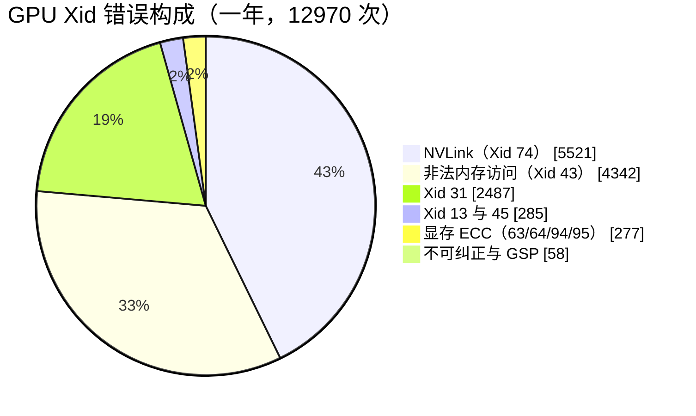

**解读**：

- NVLink Bridge 是**后加的**（§3.1），它带来了 TP 性能，也带来了最大的单项故障源。这是 PCIe + Bridge 方案特有的代价：SXM 版本的 NVLink 走主板，不需要外接桥接件。
- 非法内存访问占三分之一。论文提醒这类错误也可能由显存数据损坏引起，软件 bug 排除后应考虑硬件。这对运维意味着**软件错误和硬件错误难以区分**。

### 9.2 内存与网络故障（论文 §VII-C2，图 10，表 VII）

**表 VII：2023-10 至 2024-03 月度故障**

| 月份 | CPU 内存 ECC | 网络闪断 | Xid 63 | Xid 64 | Xid 79 | Xid 94 | Xid 95 | 合计 |
|------|----:|----:|----:|---:|---:|---:|---:|----:|
| 2023-10 | 4 | 29 | 21 | 0 | 0 | 0 | 0 | 54 |
| 2023-11 | 14 | 8 | 22 | 0 | 0 | 4 | 0 | 48 |
| 2023-12 | 8 | 17 | 21 | 0 | 4 | 2 | 2 | 54 |
| 2024-01 | 11 | 9 | 16 | 1 | 3 | 1 | 1 | 42 |
| 2024-02 | 8 | 12 | 18 | 0 | 2 | 0 | 3 | 43 |
| 2024-03 | 9 | 14 | 22 | 0 | 6 | 0 | 0 | 51 |
| 合计 | 54 | **89** | 120 | 1 | 15 | 7 | 6 | 292 |

本文复算各行各列之和均与表中一致。

- GPU 显存相关错误（149 次）远多于 CPU 内存 ECC（54 次），因此需要及时处理 GPU ECC 故障。
- 除 Xid 74 外的硬件故障中，**IB 链路故障约占 30%**（89 / 292 ≈ 30.5%）。

### 9.3 IB 网络闪断（论文图 11，表 VIII）

表 VIII 列出了 2023-04-19 至 2024-03-31 的逐日 IB 闪断次数。本文按月汇总如下：

| 月份 | 次数 | | 月份 | 次数 |
|------|----:|--|------|----:|
| 2023-04（19 日起） | 8 | | 2023-10 | 13 |
| 2023-05 | 30 | | 2023-11 | 8 |
| 2023-06 | 13 | | 2023-12 | 17 |
| 2023-07 | **39** | | 2024-01 | 9 |
| 2023-08 | 30 | | 2024-02 | 12 |
| 2023-09 | 20 | | 2024-03 | 14 |

全年共 101 个有记录的日期、**213 次**闪断，单日最多 10 次（2023-05-28、2023-07-07、2023-07-12）。论文的结论是这类问题在集群运行期间**随机出现**。网络闪断会导致通信中断甚至任务失败；由于大多数任务跨多个节点，一个节点出问题会波及很多节点，进一步降低集群利用率。

**解读**：

- 2023-10 的网络闪断在表 VII 中是 **29 次**，但表 VIII 当月逐日记录合计只有 **13 次**；其余五个月两表一致。可能两表统计口径不同（例如表 VII 计入了非 IB 链路的网络故障），论文没有说明。
- 表 VIII 中 2023-06-16 一行的次数为 0，作为故障日记录有些奇怪。
- 对存储系统而言，"平均每月十几次、偶尔一天十次"的闪断频率意味着：客户端重试、链复制的成员变更、心跳超时阈值都要能容忍短暂中断，否则会频繁触发大范围数据恢复。

### 9.4 静默数据损坏（论文 §VII-C）

论文引用已有研究指出，硬件故障和芯片错误可能导致训练出现浮点溢出、不收敛或收敛变慢，数据中心处理器中存在大量**静默数据损坏**。在 Fire-Flyer 2 上，他们确实遇到过**ECC 没有检测到的计算错误和显存错误**，导致梯度范数尖峰、loss 爆炸甚至不收敛。论文认为，如何及时发现并分类这些故障，是提高节点在线率和集群利用率的关键。

**解读**：这是论文中最值得关注的一句经验。它意味着"**硬件没有报错**"不等于"**结果是对的**"。验证器里的满显存 GEMM 和逐字节显存检查（§8.3）就是为此设计的；对存储层而言，端到端校验也同样必要。

---

## 10. 讨论：拥塞控制、NVLink、成本与稳定性

### 10.1 拥塞控制（论文 §VIII-A）

见 §6.2。

### 10.2 NVLink 的取舍（论文 §VIII-B）

最初没有装 NVLink，一是避免额外成本，二是保持稳定性，当时 HFReduce 已能满足训练需求。随着 LLM 需求增加，才专门为 LLM 训练加装了 NVLink。论文建议**按实际需求决定是否安装 NVLink**，因为它有潜在缺点。

**解读**：结合 §9.1，"潜在缺点"指的主要就是 NVLink Bridge 的故障率（Xid 74 占 42.57%）。这是一个少见的、承认自己的硬件升级带来稳定性代价的表述。

### 10.3 维护成本（论文 §VIII-C）

| 项 | 内容 |
|----|------|
| 建设成本 | 硬件相对成本见表 II、III；软件由几十名内部开发者完成，只占数千台 GPU 服务器成本的一小部分 |
| 功耗 | 含 IB 交换机和其他节点，全集群**不超过 4 MW，约 3 MW 出头** |
| 运营成本 | 可按功耗和机柜租金估算，再乘以节点数和 PUE |

### 10.4 与其他架构的稳定性对比（论文 §VIII-D）

论文引用一篇 LLM 数据中心的研究（Hu 等，NSDI 2024）：其中 NVLink 相关故障约占全部故障的 52.42%（103 次中的 54 次；其余为 CUDA 错误 21、节点故障 16、ECC 错误 12、网络错误 12）。Fire-Flyer 2 的 NVLink 相关问题（主要是 Xid 74）约占 GPU 故障的 42.57%。

**解读**：这个对比的口径不一致。对方的 52.42% 是"**导致任务失败的故障**"中的占比，样本只有 103 次；Fire-Flyer 2 的 42.57% 是"**所有 Xid 消息**"中的占比，分母包含了大量软件原因的 Xid（13/31/43/45 合计 54.9%）。如果只看硬件类 Xid，Xid 74 的占比会远高于 42.57%。所以这个对比不能说明 PCIe + Bridge 方案比 SXM 方案更稳定。

---

## 11. 未来工作：每卡一网卡与多平面网络

论文 §IX 提出了面向 **MoE LLM 训练**的下一代 PCIe 架构。MoE 训练中 all-to-all 性能至关重要，因此：

- 下一代节点采用 **GPU 与网卡 1:1** 的配比，与 DGX-H100/B100 相当（图 12）。
- 考虑采用**多平面网络**以在保持性能的同时降低成本。
- 考虑用 **RoCE 交换机替代 IB 交换机**，显著降低网络开销。使用 128 口 400 Gbps 的 RoCE 交换机，4 平面两层 Fat-Tree 最多可支撑 **32,768 张 GPU**。

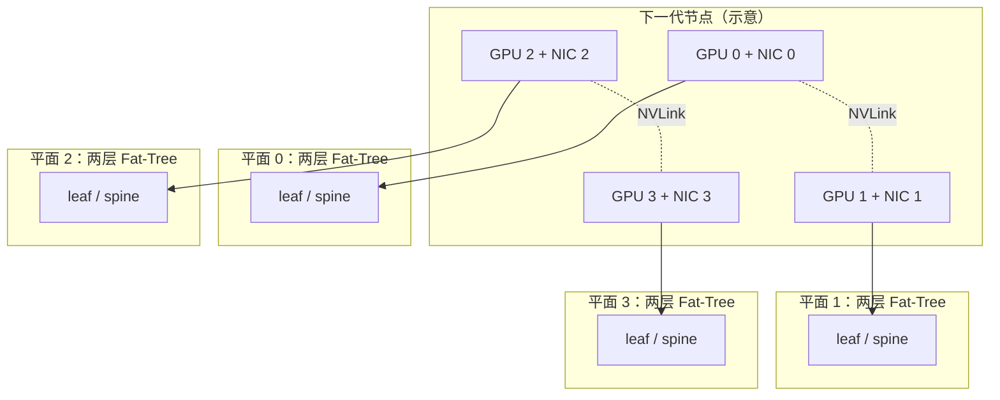

**解读**：

- 32,768 的推导：128 口交换机组成的两层 Fat-Tree 最多 128 × 64 = 8,192 个接入端口；4 个平面就是 4 × 8,192 = 32,768 个网卡，1:1 配比下即 32,768 张 GPU。多平面的好处是用两层网络达到三层网络的规模，跳数少、交换机少；代价是不同平面的网卡之间不能直接通信，跨平面流量需要经节点内转发（NVLink 或 PCIe）。
- 这一节与 Fire-Flyer 2 的设计哲学一脉相承：**继续用两层 Fat-Tree，避免三层**。从"双区"到"多平面"，思路都是把大网切成若干个两层网。
- MoE 在 640 卡时效率降到 76%（§5.2），是这一转变的直接证据。DeepSeek 后续在 ISCA 2025 发表的 *Insights into DeepSeek-V3*（[arXiv:2505.09343](https://arxiv.org/abs/2505.09343)）描述了在 H800 集群上部署的多平面两层 Fat-Tree，可视为这一规划的落地；具体配置以该论文为准，本文未展开核对。

---

## 12. 论文中的不一致与可疑之处

| 位置 | 问题 | 本文的处理 |
|------|------|-----------|
| §V-B2 LLaMA-13B | 称 64→512 卡并行效率 91%，按图 9a 数据（64.118 s → 9.717 s，8 倍卡数加速 6.60 倍）实际约 **82.5%**；91% 对应 256 卡 | 按图中数据复算，见 §5.2 |
| §V-B3 FSDP | 称比 PyTorch FSDP"训练时间减少近一半"，按图 8b 只减少 32%–41% | 见 §5.3 |
| §V-A DDP | 只报告 HFReduce 的弱扩展效率（约 88%，复算 86.7%），未提 Torch DDP 的效率（93.8%）更高 | 见 §5.1 |
| §IV-C | 称 HFReduce with NVLink"超过 10 GB/s"，图 7b 中只有 ≤128 卡时成立，1,024 卡为 7.99 GB/s | 见 §4.4 |
| §IV-B1 | NCCL ring 每单位数据"经过 2n−1 次传输"；标准 ring allreduce 每个 GPU 发送约 2(n−1)/n 份数据，论文写法不够严谨，但"约为 HFReduce 两倍"的结论不受影响 | 保留论文写法并标注 |
| 表 VII vs 表 VIII | 2023-10 网络闪断：表 VII 为 29 次，表 VIII 逐日合计 13 次；其余月份一致 | 见 §9.3 |
| 表 VIII | 2023-06-16 记录的故障次数为 0 | 见 §9.3 |
| 表 V vs 图 10 | 表 V 把 Xid 79 归为"不可纠正故障"，图 10 和表 VII 却把它算作"GPU 显存 ECC 相关" | 照录，提示口径差异 |
| §VII-C1 表 V | 称 Xid 74 发生率"比其他硬件故障高几个数量级"，实际 5,521 次 vs 第二多的硬件类 Xid 63 的 245 次，约 22 倍，略高于一个数量级 | 照录，提示夸张 |
| §VIII-D | NVLink 故障占比对比口径不一致（对方是导致任务失败的故障，本文是全部 Xid 消息） | 见 §10.4 |
| §III-B vs §VI-B2 | 存储节点"近 200 台"与"180 台" | 以 180 台为准 |
| §VI-B2 | 2,880 × 15.36 TB 镜像后约 19.6 PiB，与"超过 20 PiB"略有出入 | 见 §7.1 |
| 摘要 vs §III-C | "成本减半"是总价口径，"60% 的成本"是节点价格口径 | 见 §3.4 |
| 版面 | §V-C 与 §VI-B、§VII-A 与 §VII-B 的版面顺序与编号不一致；引言称稳定性在 §VII，而 checkpoint 管理器标为 §VII-A，HAI 平台标为 §VI-C | 按编号阅读 |
| 若干拼写 | "Leaning"（Learning）、"Techinical"、"Atchitecture"、"Maintaince"、图 7a 标题 "HFRudce"、表 VII "Ddecember"、引言 "cost-effective strategies" 重复 | 不影响理解 |

**解读**：这些问题大多是**数字表述偏乐观**或**口径不统一**，不影响论文的主要结论（PCIe 方案以约一半成本达到约 80% 性能）。但引用具体数字时，应以图表原始数据为准，而不是正文的概括。

---

## 13. 与同期 AI 集群的对比

| 维度 | Fire-Flyer 2（本文） | DGX-A100 SuperPOD 式参考架构 | 字节 MegaScale（NSDI 2024） | 阿里 HPN（SIGCOMM 2024） | Meta RoCE 集群（SIGCOMM 2024） |
|------|------------------|--------------------------|---------------------------|------------------------|-----------------------------|
| GPU 形态 | PCIe A100，成对 NVLink Bridge | SXM A100，8 卡 NVSwitch | SXM（类 DGX） | H800 SXM | SXM（A100/H100） |
| GPU : 计算网卡 | **8 : 1** | 1 : 1 | 1 : 1 | 1 : 1（双口） | 1 : 1 |
| 网络 | IB，双区两层 Fat-Tree，存算共网 | IB，三层 Fat-Tree，计算与存储分网 | RoCE，多层 CLOS | RoCE，双平面两层，双上联 | RoCE，专用 AI 网络 |
| 核心思路 | 降低硬件规格，用软件补 | 买最好的硬件 | 训练框架与网络的全栈优化 | 网络架构创新，避免哈希冲突 | 以以太网替代 IB |
| allreduce | 自研 HFReduce（CPU 归约） | NCCL | NCCL 改进 | NCCL | NCCL |
| 存储 | 自研 3FS，与计算共网 | 通常独立存储网络 | 未详述 | 未详述 | 独立存储 |

> 对比表中他人系统的特征只是概括，细节以各自论文为准。

**解读**：Fire-Flyer 2 是这些集群中**唯一选择降低 GPU 与网卡规格**的，其他集群都在 1:1 网卡配比的前提下做网络优化。这让它在 2021 年的深度学习负载下取得了很好的性价比，但到了 MoE 时代，单网卡的 all-to-all 带宽成为硬瓶颈，论文自己的下一代规划（§11）也回到了 1:1。所以 Fire-Flyer 2 的经验更适合理解为"**负载特征决定硬件配比**"，而不是"PCIe 永远比 SXM 划算"。

---

## 14. 整体总结

### 14.1 核心贡献

1. **一份带真实数字的低成本万卡集群方案**：PCIe A100 + 单网卡 + 双区两层 Fat-Tree，总价约为 DGX 方案的一半，功耗低 40%，性能约 80%，并给出了节点、交换机、价格、功耗的完整对照。
2. **HFReduce**：针对"无 chained write 的 CPU + 无 PCIe Switch + 单网卡"这一特定硬件，把 allreduce 搬到 CPU，带宽约为 NCCL 的 2–4 倍，并给出了从内存访问次数到 Root Port 带宽的完整瓶颈分析。
3. **HaiScale**：针对单网卡的 PP 错峰、针对 PCIe 的 NVLink Bridge TP、优化过的 FSDP，使 LLaMA-13B 和 DeepSeekMoE-16B 在数百卡上保持较好的扩展性。
4. **存算一体网络的运行经验**：SL/VL 流量隔离、关闭自适应路由、关闭 DCQCN、存储层 request-to-send，说明计算和存储可以共用一张没有拥塞控制的 IB 网络。
5. **以可中断任务为中心的稳定性体系**：HAI 分时调度 + 5 分钟 checkpoint + 每周验证器，以及一年的 Xid、内存、网络故障原始数据。

### 14.2 设计哲学

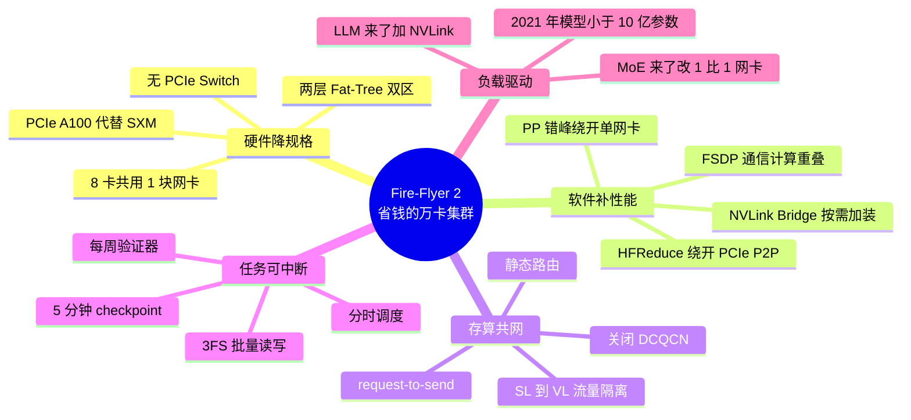

### 14.3 优点与局限

| 优点 | 局限 |
|------|------|
| 成本、功耗、交换机数量、故障次数等数字非常具体，在工业界论文中少见 | 几乎所有性能数据都是自报，没有在同一硬件上与 DGX 做端到端训练对比；"83% 性能"只是 GEMM 微基准 |
| HFReduce 的瓶颈分析从原理到实测完整闭环，可复用到其他 CPU 中心的通信设计 | HFReduce 与 Rome/Milan 的硬件特性强绑定，换平台需重新评估；对 CPU 内存带宽的占用及其与其他任务的干扰未讨论 |
| 公开了一年的 GPU、内存、网络故障原始数据，对容错设计有参考价值 | 故障数据存在口径不一致（§12）；没有给出故障导致的任务中断次数和恢复时间 |
| 存算一体、关闭 DCQCN 等"反常规"选择给出了原因 | 没有给出关闭 DCQCN、改静态路由前后的对比数据，也没有 SL/VL 比例等配置细节 |
| 坦诚承认 NVLink Bridge 带来的故障代价和 PCIe 方案在 MoE 时代的瓶颈 | 正文中若干效率数字偏乐观（LLaMA 91%、FSDP"近一半"、NVLink">10 GB/s"） |
| HAI 平台开源，3FS 后续也开源，可验证 | HFReduce 和 HaiScale 本身没有开源（截至论文发表） |

### 14.4 启示

**对集群设计者**：

- **先看负载，再定硬件配比**。2021 年小模型为主时，8:1 的网卡配比是合理的；MoE 时代 all-to-all 成为主要通信模式，就必须回到 1:1。不存在脱离负载的最优架构。
- **能用两层网就不用三层**。双区和多平面都是在交换机端口数的约束下，把大网切成若干个两层网，用调度约束（跨区任务最多一个）换取拓扑简化。
- 软件补硬件是可行的，但**每补一个瓶颈就会暴露下一个**（PCIe P2P → 内存带宽 → Root Port → NVLink 故障率），需要准备持续投入。

**对存储设计者**：

- 存储是训练集群里的"**公共设施**"：双网卡跨接两区、与训练通信共用网卡，存储系统必须对网络友好（request-to-send、独立 VL），而不只是追求自身吞吐。
- checkpoint 是存储写路径上最重要的负载之一：每 5 分钟、每节点 10 GiB/s、要求几秒内完成，这决定了存储系统要优先优化**大块批量写**和**可预测的尾延迟**。
- 硬件故障数据给出了真实的故障环境：网络闪断每月十几次、存在 ECC 漏检的静默错误。存储系统需要容忍短暂断连而不过度触发恢复，也需要端到端校验。详见 [3FS 精读](3fs-fireflyer-sc2024.md) 中 3FS 对这些问题的处理。

**对读论文的人**：工业界经验报告的价值在于真实数据，但要**以图表原始数据为准**，正文中的概括性数字常常偏乐观或口径不一。

### 14.5 一张图看懂 Fire-Flyer AI-HPC

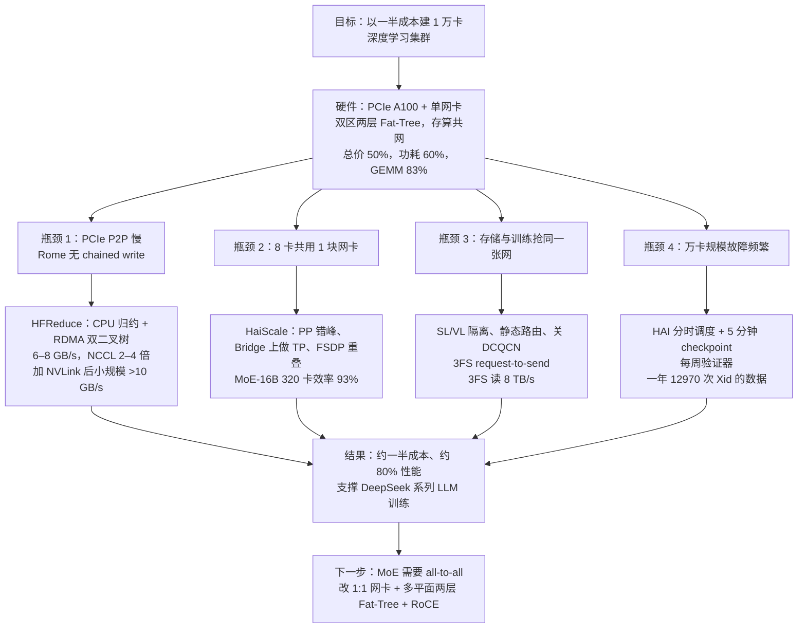

---

## 参考

- Wei An et al. *Fire-Flyer AI-HPC: A Cost-Effective Software-Hardware Co-Design for Deep Learning*. SC 2024. arXiv:2408.14158 <https://arxiv.org/abs/2408.14158>
- HFAiLab. *HAI Platform*. <https://github.com/HFAiLab/hai-platform>
- DeepSeek-AI. *3FS*. <https://github.com/deepseek-ai/3FS>
- P. Sanders, J. Speck, J. L. Träff. *Two-tree algorithms for full bandwidth broadcast, reduction and scan*. Parallel Computing, 2009.（HFReduce 与 NCCL 使用的双二叉树算法）
- E. B. Nightingale et al. *Flat Datacenter Storage*. OSDI 2012.（3FS request-to-send 引用的来源）
- J. Terrace, M. J. Freedman. *Object Storage on CRAQ*. USENIX ATC 2009.
- A. Gholami et al. *AI and Memory Wall*. arXiv:2403.14123, 2024.（论文图 2 数据来源）
- Z. Jiang et al. *MegaScale: Scaling Large Language Model Training to More Than 10,000 GPUs*. NSDI 2024. arXiv:2402.15627
- K. Qian et al. *Alibaba HPN: A Data Center Network for Large Language Model Training*. SIGCOMM 2024.
- A. Gangidi et al. *RDMA over Ethernet for Distributed Training at Meta Scale*. SIGCOMM 2024.
- Q. Hu et al. *Characterization of Large Language Model Development in the Datacenter*. NSDI 2024.（§VIII-D 稳定性对比的来源）
- S. Wang et al. *Understanding Silent Data Corruptions in a Large Production CPU Population*. SOSP 2023.
- DeepSeek-AI. *Insights into DeepSeek-V3: Scaling Challenges and Reflections on Hardware for AI Architectures*. ISCA 2025. arXiv:2505.09343
- 本仓库相关：[3FS / Fire-Flyer 精读](3fs-fireflyer-sc2024.md)（3FS 设计细节）、[工业界生产系统](industry-production-systems.md)、[HPC 与 AI 训练存储](hpc-ai-storage.md)、[DAOS 精读](daos-scfa2020.md)（论文把 3FS 与 DAOS 归为同类）
