# Fisc 论文精读：A Large-scale Cloud-native-oriented File System（FAST 2023）

> 论文：Qiang Li, Lulu Chen, Xiaoliang Wang, Shuo Huang, Qiao Xiang, Yuanyuan Dong, Wenhui Yao, Minfei Huang, Puyuan Yang, Shanyang Liu, Zhaosheng Zhu, Huayong Wang, Haonan Qiu, Derui Liu, Shaozong Liu, Yujie Zhou, Yaohui Wu, Zhiwu Wu, Shang Gao, Chao Han, Zicheng Luo, Yuchao Shao, Gexiao Tian, Zhongjie Wu, Zheng Cao, Jinbo Wu, Jiwu Shu, Jie Wu, Jiesheng Wu. *Fisc: A Large-scale Cloud-native-oriented File System*. USENIX FAST 2023, pp. 231–246.
>
> 机构：阿里巴巴集团（主体）、复旦大学、南京大学、厦门大学
>
> 链接：<https://www.usenix.org/conference/fast23/presentation/li-qiang-fisc> ；PDF：<https://www.usenix.org/system/files/fast23-li-qiang.pdf>
>
> 精读日期：2026-11-22。文中**数字、表格与机制描述均摘自论文原文**（标注所在章节）；标注"解读"的段落是本文作者的分析与推论，不是论文原话。
>
> 相关文档：[工业界生产系统中的 Fisc 小节](industry-production-systems.md#4-alibaba-fiscfast-2023)、[新硬件综述中的 Fisc 小节](new-hardware.md#6-fisc-a-large-scale-cloud-native-oriented-file-system)、[客户端与通用技术中的 Fisc 小节](client-and-general-techniques.md#14-fisc-a-large-scale-cloud-native-oriented-file-system)、[Tectonic（FAST 2021）精读](tectonic-fast2021/deep-read.md)（论文批评的"重客户端"代表之一）、[盘古 2.0（FAST 2023）精读](pangu-fast2023.md)（Fisc 的后端，同样是重客户端）。

## 目录

- [0. 一页速览](#0-一页速览)
- [1. 背景：从虚拟机到容器](#1-背景从虚拟机到容器)
- [2. 动机：重客户端与网络网关](#2-动机重客户端与网络网关)
- [3. 设计思路与总体架构](#3-设计思路与总体架构)
- [4. 轻量客户端：两层功能聚合](#4-轻量客户端两层功能聚合)
- [5. 存储感知分布式网关 SaDGW](#5-存储感知分布式网关-sadgw)
- [6. 基于 DPU 的软硬件协同](#6-基于-dpu-的软硬件协同)
- [7. 大规模部署：vRPC、负载均衡与 QoS](#7-大规模部署vrpc负载均衡与-qos)
- [8. 评估](#8-评估)
- [9. 讨论](#9-讨论)
- [10. 与相关工作的对比](#10-与相关工作的对比)
- [11. 整体总结](#11-整体总结)

---

## 0. 一页速览

**一句话**：Fisc 是阿里巴巴面向云原生（容器、多租户）应用的分布式文件系统**接入层**，后端仍是盘古（Pangu）。它把传统"重客户端"里用户不关心的功能拆出来：网络与安全功能聚合到计算服务器 **DPU 上的 Fisc agent**，存储协议（副本、纠删码、故障处理）聚合到**存储节点上的 Fisc proxy**，容器里只剩一个用 RPC 桩实现的轻量客户端；再用 agent 与 proxy 之间的**直连高速路**和**按文件粒度的路由表**代替集中式网络网关，从而在路由层利用文件语义做故障重试、就近读和负载均衡。

| 维度 | 要点 |
|------|------|
| 目标场景 | 云原生容器：单台计算服务器可超过 **1000** 个容器，约是虚拟机的 **10 倍**；租户在虚拟域，文件系统在云厂商物理域（§2.2） |
| 问题 1：重客户端 | HDFS 客户端以 200 MB/s 写入就要 **1.1 个 CPU 核**，2 核容器有一半以上 CPU 花在 I/O 上（§2.3，图 1） |
| 问题 2：网络网关 | 多跳导致毫秒甚至秒级延迟；不懂文件语义，故障恢复只能到秒级、负载按连接而非文件均衡；1 万存储节点要配约 **5000 台**网关机（§2.3） |
| 技术 1：轻量客户端 | 网络与安全功能 → DPU 上的 Fisc agent；存储协议 → 存储节点上的 Fisc proxy；客户端 API 全部用 RPC 桩实现，数据类 API 用定制结构、元数据类 API 用 Protocol Buffers 保证版本兼容（§4.1） |
| 技术 2：SaDGW | agent 与 proxy 直连（Luna/Solar 高性能网络栈）；agent 维护**文件粒度路由表**；基于路由表做重试、黑名单、重新打开；**就近读**把读请求发给持有数据的存储节点上的 proxy（§4.2） |
| 技术 3：DPU 软硬件协同 | 基于神龙（X-Dragon）DPU 的 virtio-Fisc 设备；FPGA 缓存路由表形成快路径；针对 DPU 稀缺资源做 CPU、内存、网络优化（§4.3） |
| 部署配套 | 抽象出 vRPC 供 FaaS 等其他云原生服务复用；文件粒度调度 + proxy master 集中重调度；软硬件端到端 QoS（§4.4） |
| 结果 | 客户端 CPU、内存比传统客户端少 **69%**、**20%**；延迟比网络网关方案低 61%–76%，P999 低 **92%**；生产在线搜索平均写延迟约 **500 µs**；7 天内存储节点读 IOPS 变异系数 **小于 5%**（§5） |
| 生产 | 部署超过 **3 年**，服务阿里超过 **300 万 CPU 核**上的应用；故障恢复从秒级降到 100 ms 级（§1） |

---

## 1. 背景：从虚拟机到容器

### 1.1 大规模分布式文件系统的一般结构（§2.1）

Tectonic、Colossus、盘古等大规模分布式文件系统一般由三部分组成：

- **master**：管理数据服务器，维护整个系统的元数据（命名空间、文件 chunk 到数据服务器的映射）；
- **数据服务器**：管理 chunk 并存到 HDD、SSD 等介质；
- **客户端**：向 master 要元数据、向数据服务器读写数据。

论文特别指出，Tectonic、Colossus 等系统的客户端都是**重客户端**：不仅实现数据持久化和故障处理的存储协议，还负责与 master、数据服务器的通信以及授权等安全功能。

**盘古**是阿里巴巴的大规模分布式存储系统，提供类似 HDFS 的**只追加（append-only）文件语义**，是阿里云的统一存储底座，块存储 EBS、对象存储 OSS、文件存储 NAS、MaxCompute 都构建在它之上：它们用盘古客户端做持久化追加写，用类 KV 的索引映射实现更新，并用垃圾回收压缩历史数据。

### 1.2 云原生的两个特征（§2.2）

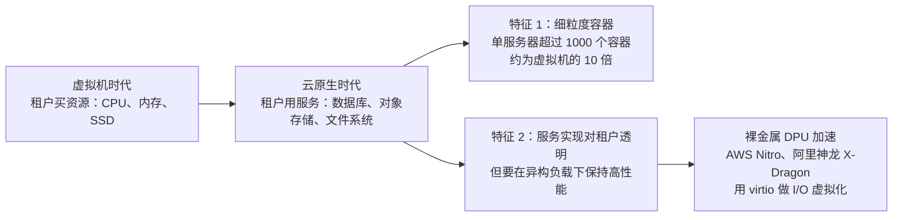

2020 年，阿里巴巴已经把淘宝、天猫等全部核心业务迁移到云原生容器上（§2.2）。

---

## 2. 动机：重客户端与网络网关

### 2.1 隔离的重客户端导致资源利用率低（§2.3）

传统客户端要负责存储协议（可靠性、一致性）、故障处理、网络和授权。因此应用通常要为它**预分配 I/O 线程、预留内存和网络连接**。容器之间的客户端资源相互隔离、无法共享，单台服务器难以做到 1000 个以上容器的高密度。

论文用一个 Hadoop 2.10.2 集群（3 台 Intel Xeon Gold 5218 服务器）测了 HDFS 客户端的 CPU 消耗（图 1）：即使只以 **200 MB/s** 写文件，客户端也要消耗 **1.1 个 CPU 核**。按一个容器分配 2 核计算，**超过 50% 的 CPU 花在 I/O 上**。图 1 还把消耗拆成"存储相关"和"网络相关"两部分，二者都随带宽增长。

**关键观察**：不同客户端的大量公共功能（存储协议、网络栈）可以**聚合**起来共享，从而给租户提供轻量接口，并简化客户端的维护和升级。

### 2.2 网络网关成为瓶颈（§2.3）

客户端在租户的**虚拟域**，文件系统在云厂商的**物理域**。出于安全原因，客户端不能直接访问文件系统，必须经过**网络网关**（即网络负载均衡器）。这种架构在四个方面不满足云原生需求：

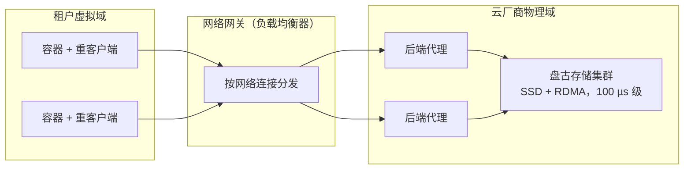

| 维度 | 问题（§2.3） |
|------|-------------|
| **性能** | 交互式等性能敏感应用要求 100 µs 级存储访问。盘古后端本身有 SSD 和 RDMA，能做到 100 µs 级，但请求经过网关要走多跳，延迟变成毫秒级甚至秒级 |
| **可用性** | 云原生应用要求故障（网络抖动、服务器宕机）后毫秒级恢复。网关的 SLA 基于网络连接，文件系统的 SLA 基于文件，二者有语义鸿沟，网关下只能做到秒级故障处理，也难以利用存储协议提升可用性 |
| **负载均衡** | 网关按连接数分发，各 proxy 上的文件数可能严重不均：阿里云 NAS 服务中 proxy 之间负载可相差 **10 倍**。网关还可能把读请求发到没有数据的存储服务器，再被转发一次，放大流量 |
| **成本** | 要匹配存储集群的总吞吐需要大量网关硬件。例如 1 万个存储节点、每节点 25×2 Gbps 网卡，总吞吐 500 Tbps；网关机按每台 100 Gbps 计，需要 **5000 台**网关机 |

论文还提到，阿里此前为 EBS 设计的 Luna、Solar 网络栈只优化了**物理域内部**的性能，无法覆盖从虚拟域客户端到物理域存储集群的全路径（§1）。

**解读**：Fisc 要解决的不是存储引擎本身的问题，而是**"计算在租户侧、存储在云厂商侧"之间的接入问题**。这和 Tectonic、Colossus 所在的"内部数据中心、客户端可信"场景完全不同。在内部场景中，重客户端直连存储节点是最快的；但在公有云多租户场景中，客户端不可信、资源按容器隔离，重客户端的每一项"优势"都变成了成本。

---

## 3. 设计思路与总体架构

### 3.1 三条设计原则（§3.1）

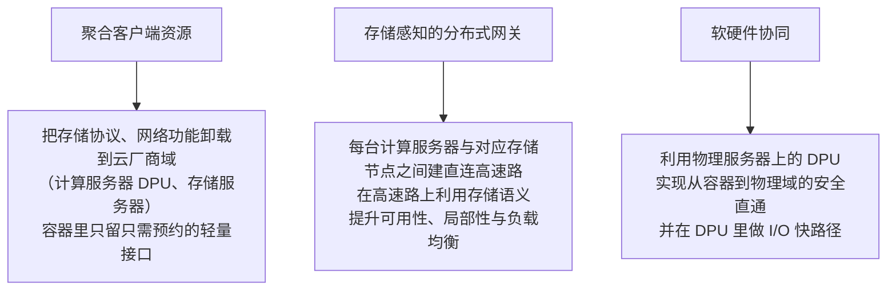

### 3.2 架构（§3.2，图 2）

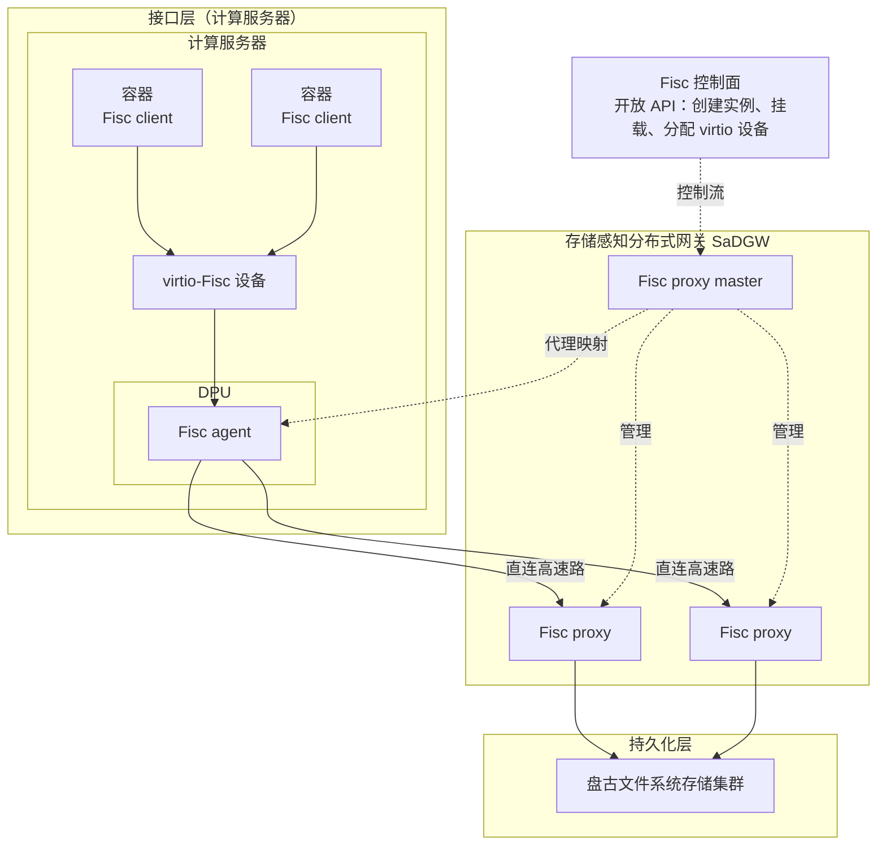

Fisc 由控制面和数据面组成。数据面分三层（§3.2）：

| 层 | 组成 | 职责 |
|----|------|------|
| 接口层 | 容器中的轻量 **Fisc client** | 给应用提供文件系统接口 |
| SaDGW（中间层） | 计算服务器 DPU 上的 **Fisc agent**、每个存储节点上的 **Fisc proxy**、存储集群中的一组 **Fisc proxy master** | agent 与 proxy 之间直连；proxy master 管理 proxy 和 agent |
| 持久化层 | **盘古** | 处理请求、把数据持久化到介质 |

**解读**：注意 SaDGW 不是一个独立的"网关集群"，它是**分散在两端的**：agent 在每台计算服务器的 DPU 上，proxy 在每台存储服务器上（与盘古 chunkserver 同机部署），二者之间直连。所以严格说 Fisc 把"网关"拆没了，网关功能被吸收进了两端的聚合层。

### 3.3 工作流程（§3.3）

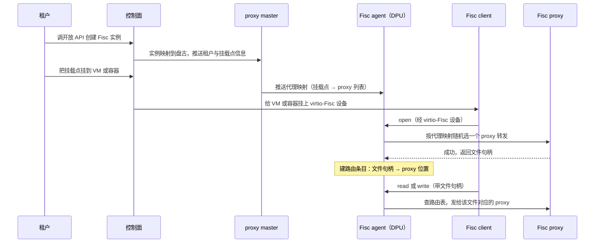

---

## 4. 轻量客户端：两层功能聚合

### 4.1 功能拆分与卸载位置（§4.1.1）

论文把典型重客户端的功能分成四类，观察到云原生用户只关心第一类，其余三类可以移出客户端：

| 功能类别 | 例子 | 卸载到哪里 | 理由（§4.1.1） |
|----------|------|------------|----------------|
| ① 文件接口与结构 | API、文件句柄 | **保留在 Fisc client** | 用户唯一关心的部分 |
| ② 存储协议 | 副本可靠性、数据一致性、故障处理 | **存储节点上的 Fisc proxy** | 见下文三点 |
| ③ 安全与认证 | 授权检查 | **DPU 上的 Fisc agent** | **提前检查**：在 agent 收到请求时就做认证和授权，恶意流量到不了后端存储集群；网关方案只能在 proxy 处理恶意流量 |
| ④ 网络协议 | 与数据节点、元数据节点的 RPC | **DPU 上的 Fisc agent** | 借鉴 Luna/Solar、Nitro SRD 等 DPU 网络栈的成功；agent 扩展 Luna/Solar，聚合同一服务器上多个客户端的连接 |

存储协议为什么不放在 DPU，而是放到存储侧？论文给出三点理由：

1. **DPU 资源有限**：网络、安全和 virtio-Fisc 裸金属虚拟化已经占用了 DPU 资源，没有余量实现复杂的存储协议；
2. **把存储流量留在存储集群的后端网络里**：例如三副本写入时，计算服务器只发一份数据给 proxy，复制流量在存储集群内部完成，节省存算分离架构中稀缺的前端网络；
3. **存储侧可以做面向存储的优化和硬件加速**，提升性能、降低成本（§6 举例：纠删码和 CRC 可以在存储集群用硬件加速）。

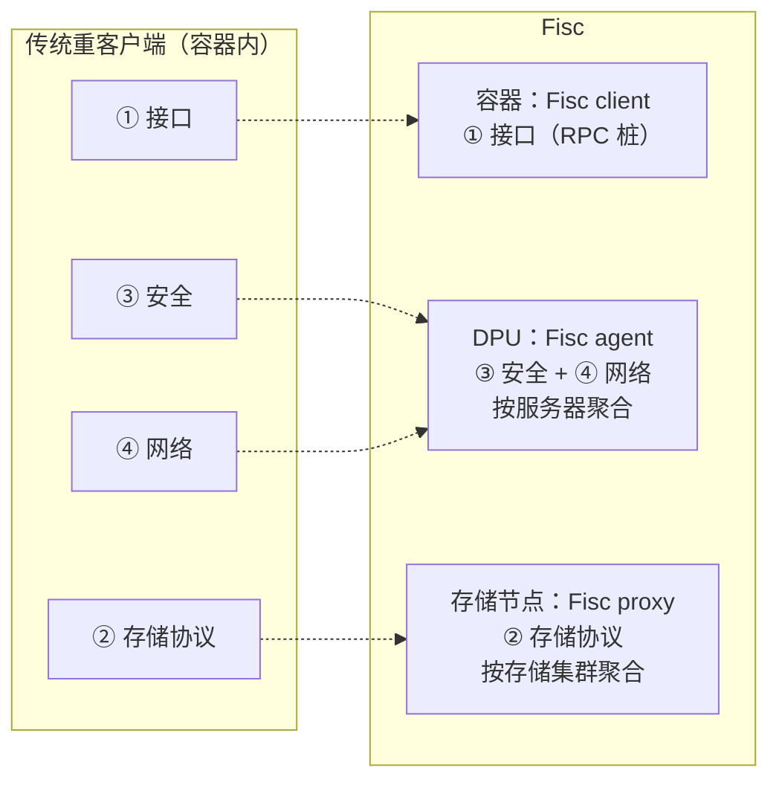

**解读**："两层聚合"的含义是：第一层在**计算服务器**上把同机所有容器的网络连接和安全检查合并（每台服务器一个 agent），第二层在**存储集群**里把所有租户的存储协议处理合并（每个存储节点一个 proxy）。这和 Tectonic 把策略放在客户端以便"按租户定制"的思路正好相反：Fisc 牺牲了客户端的灵活性，换来资源复用和集中升级。

### 4.2 用 RPC 简化客户端实现（§4.1.2）

典型文件系统客户端 API 很多（HDFS 客户端超过 100 个 API），实现和跨版本兼容都很难。Fisc 的客户端 API **全部用 RPC 桩实现**：

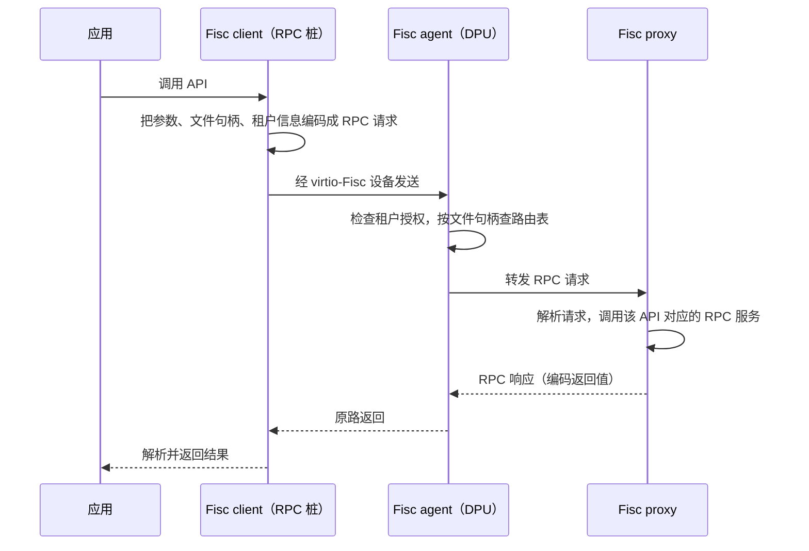

这样新增或修改 API 只需要加 RPC 桩和服务端实现。

### 4.3 基于 PB 的版本兼容（§4.1.2）

直接全用 Protocol Buffers 会带来序列化/反序列化的"数据中心税"，浪费 DPU 的有限资源。Fisc 把 API 分成两类区别对待：

| API 类别 | 例子 | 特点 | 兼容方式 |
|----------|------|------|----------|
| 数据类 | read、append | API 少但调用频繁 | 精心设计的高效数据结构 |
| 元数据类 | create、delete、open、close | API 多但调用不频繁 | 直接用 PB |

**解读**：API 列表里出现的是 **append** 而不是随机写，说明 Fisc 暴露的是盘古的**只追加文件语义**（论文 §6 也说通过 JNI 兼容 HDFS 生态），而不是 POSIX。Fisc 的"文件系统"是一个面向云原生服务的存储接入层，元数据语义完全由后端盘古决定，论文也没有讨论元数据扩展问题。读这篇论文时不要把它和 InfiniFS、CFS 这类元数据服务论文放在同一维度比较。

---

## 5. 存储感知分布式网关 SaDGW

### 5.1 直连高速路（§4.2.1）

借助 DPU，Fisc 在 agent 与 proxy 之间建立**不经过任何网络网关**的直连"高速路"。对数千节点的存储集群，这省下了大量网关机成本。高速路上：

- 用 **Luna/Solar 高性能网络栈**代替 TCP/IP，对云原生应用透明；
- agent 与 proxy 之间用**原始数据结构**传输，消除序列化开销。

### 5.2 文件粒度路由表（§4.2.1，图 3）

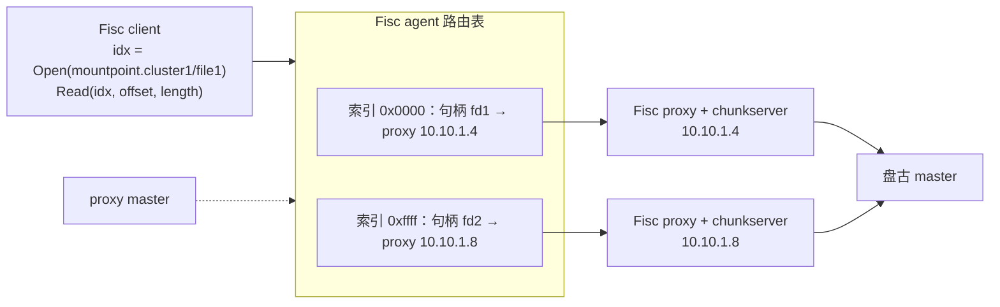

- **建表**：文件第一次被 open 时，agent 从代理映射中随机选一个 proxy 转发；open 成功返回后，插入一条路由条目，包含返回的文件句柄、所选 proxy 的位置，以及下文的 SLA 相关属性；
- **查表**：之后该文件的 I/O 请求到达 agent，按文件句柄查表，发给对应 proxy；
- **容量**：DPU 内存稀缺，路由表用 **LRU** 控制大小。

### 5.3 存储感知的故障处理（§4.2.2）

**增强的路由条目**：故障处理考虑三个因素：重试超时（与用户设置的请求超时和高速路质量有关）、重试目的地（超时后换成新 proxy）、高速路质量（用平均延迟估计到该 proxy 的网络质量）。因此每个条目在文件句柄和 proxy 位置之外，又增加三项：**重试次数、重试超时、平均延迟**。

| 路由条目字段 | 用途 |
|-------------|------|
| 文件句柄 | 查表键 |
| proxy 位置 | 重试目的地；必要时被替换 |
| 重试次数 | 记录何时重置连接 |
| 重试超时 | 记录何时放弃 |
| 平均延迟 | 估计高速路质量 |
| 读提示（read hint） | 指向范围表条目的索引（见 5.4 节） |

**三个故障处理机制**：

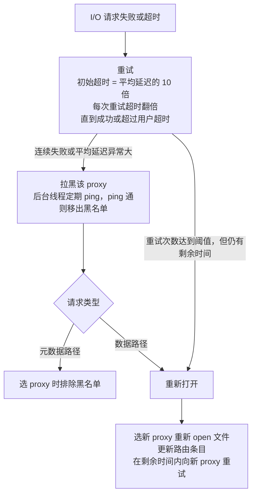

- **重试**：用户通常设置较大的超时，agent 先用一个较小的经验超时（**平均延迟的 10 倍**）来发现失败请求，发现后**超时翻倍**再重试。用于处理网络抖动、proxy 瞬时高负载等临时故障；
- **黑名单**：连续失败或到某 proxy 的平均延迟异常大时，将其拉黑；后台线程定期 ping 黑名单中的 proxy，ping 通就移出。元数据请求选 proxy 时排除黑名单，数据请求走重新打开；
- **重新打开**：目的 proxy 在黑名单中时，agent 选一个新 proxy 重新 open 文件并更新路由条目。否则对失败请求设置一个**重试次数阈值**，保证重试后仍有剩余时间，然后在剩余时间内向新 proxy 重新打开并重试，尽量避免请求失败。

这些机制对应用透明，云厂商可以随时升级故障处理策略，客户端保持轻量（§4.2.2）。

**解读**：这就是"存储感知"的具体含义：网络网关只看得见连接，连接断了只能重连；agent 看得见"这个文件句柄在哪个 proxy 上被打开"，所以能做到**换一个 proxy 重新打开文件**这种文件级的故障转移。它依赖一个前提：proxy 本身是无状态的（或状态可通过 reopen 重建），文件真正的状态在盘古里。

### 5.4 就近读（§4.2.3，图 4）

**问题**：读请求先发到 proxy，proxy 再到持有数据的盘古 chunkserver 去读，数据沿原路返回。这造成**两倍的读流量放大**，额外占用带宽，使整个集群的读吞吐**减半**。

**思路**：每个存储节点都同时部署了 proxy 和 chunkserver，那么让 agent 记住 chunk 的位置，把读请求直接发给**与该 chunk 所在 chunkserver 同机的 proxy**。

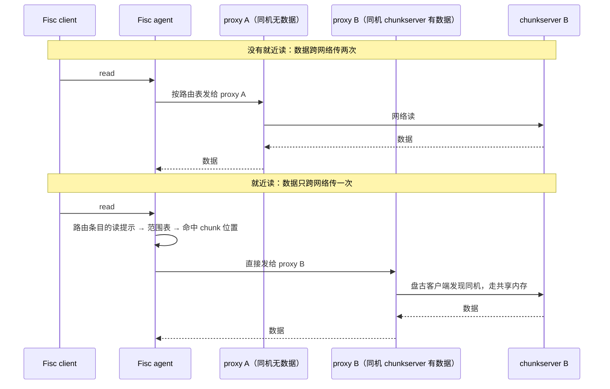

**预测位置与范围表**：

- open 或 read 的响应中**捎带**文件 chunk 的位置信息：proxy 借助盘古的读预测机制，返回**近期可能会读的 chunk**，数量经验地设为 **16** 个；
- 位置信息编码成"范围 → 位置"对，插入**范围表**。每个文件对应一个范围表条目，每个条目最多 **64** 个范围对（受 DPU 资源限制）。按 **64 MB** 的 chunk 大小，可覆盖 **4 GB** 的文件范围；
- 文件对应的范围表条目索引，作为**读提示**存在路由条目中。

| 范围表条目示例（图 4） | 副本 1 位置 | 副本 2 位置 | 副本 3 位置 |
|------------------------|------------|------------|------------|
| Range1 (offset, length) | 10.10.2.6 | 10.10.2.4 | 10.10.1.5 |
| Range2 (offset, length) | 10.10.1.8 | 10.10.1.5 | 10.10.2.6 |

**用共享内存代替跨节点通信**：读请求到达 agent，agent 用读提示找到范围表条目，若命中某个范围对，就把请求发到该位置。若读的范围（offset + length）超出命中的范围对，**不拆分请求**，以免在 DPU 里做分段、合并和故障处理这些复杂操作。目标 proxy 收到请求后调用盘古客户端，盘古客户端发现 chunkserver 与 proxy 在**同一物理节点**，就用**共享内存**通信代替网络。结果是数据只在网络上传一次，整个存储集群的读吞吐提高（§4.2.3；§3.2 称读吞吐**翻倍**）。

**解读**：就近读本质上是把"客户端知道 chunk 位置、直接找数据节点"这一重客户端的能力**以受控的方式**还给了 agent：位置信息由 proxy 主动推送、数量有上限、存在云厂商控制的 DPU 里。这在保持安全边界的同时找回了重客户端直连的性能优势。

---

## 6. 基于 DPU 的软硬件协同

Fisc 基于阿里神龙（X-Dragon）DPU 构建 virtio-Fisc 设备，实现从租户虚拟域到云厂商物理域的安全直通（§4.3）。

### 6.1 virtio-Fisc 设备（§4.3.1）

virtio-Fisc 是遵循 virtio 标准的 PCIe 设备，前端在 VM 或容器里，后端在 DPU 里：Fisc client 通过前端把请求放进 virtio 硬件队列，DPU 处理器上的 Fisc agent 处理队列中的请求、发给 proxy，再把响应放回硬件队列由前端取走。前后共有两代设备：

| 代际 | 设计 | 优点 | 限制 |
|------|------|------|------|
| 第一代：基于 virtio-block | 前端与标准 virtio-block 相同，客户端用一个轻量通信库通过块读写操作通信；后端不是传统 virtio-block 软件，而是 Fisc agent | 兼容主流操作系统，多数 VM、容器无需修改即可使用 | 多数操作系统中 virtio-block 队列深度限制为 **128**，对 Fisc 的非阻塞请求不够 |
| 第二代：定制设计 | 更像一个网卡设备，接口提升到 **RPC 层**，用 virtio 队列发送 RPC 命令、接收响应 | 突破队列深度限制，适合 FaaS 等云原生服务 | 需要专用驱动（已集成到阿里发布的操作系统中） |

### 6.2 FPGA 快路径（§4.3.2，图 5）

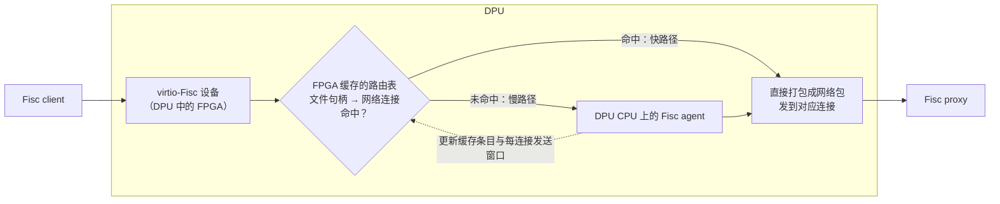

- FPGA 中缓存"文件句柄 → 网络连接"映射；请求到达时 FPGA 解析文件句柄查表，命中就直接打包成网络包发出，未命中则交给 agent 走慢路径；
- 缓存条目由 agent 在软件中控制和更新，降低 FPGA 实现的复杂度；
- 为了控制带宽，每个连接的**发送窗口**也写在缓存条目里，由 agent 设置和更新。

### 6.3 针对 DPU 稀缺资源的优化（§4.3.3）

| 资源 | 优化 | 细节 |
|------|------|------|
| **CPU** | 批处理 | 多个请求合并为一个，分摊 client 与 agent 之间 virtio 协议的处理开销 |
| | 手写 PB 序列化 | 针对 Fisc 特定数据类型手写，比编译器生成的更高效；单个 DPU 处理器核上，4 KB 请求的 IOPS 提升约 **1.5%** |
| **内存** | 压缩条目 | 存储节点少于 100 万个，位置 IP 用 **20 位**而不是 32 位表示；一个 chunk 的 3 副本位置共 **8 字节**；一个文件 64 个预测 chunk 占 **512 字节**；加上文件句柄和租户信息，每个文件在 agent 中不超过 **1 KB**，**1 GB 内存可容纳 100 万个文件** |
| | 把范围表交给客户端 | 把位置信息作为**提示**传给 Fisc client 保存，client 发请求时带上提示；agent 只用路由表检查文件句柄和租户信息，通过后按提示转发。提示编码成对用户无意义的索引，agent 和 proxy 都会校验；校验失败则在一段时间内禁止该租户使用就近读，退回 DPU 中位置较少的路由表 |
| **网络** | 共享连接 | agent 与 proxy 之间复用连接（沿用阿里云 NSDI 2021 论文 *When Cloud Storage Meets RDMA* 中的共享连接机制） |
| | 回收空闲连接 | 定期拆除空闲连接 |
| | 跨 region 只连部分 proxy | region 间带宽只有 Tbps 级，远小于 region 内；跨 region 可能有数千存储节点，agent 只连接其中一部分 proxy |

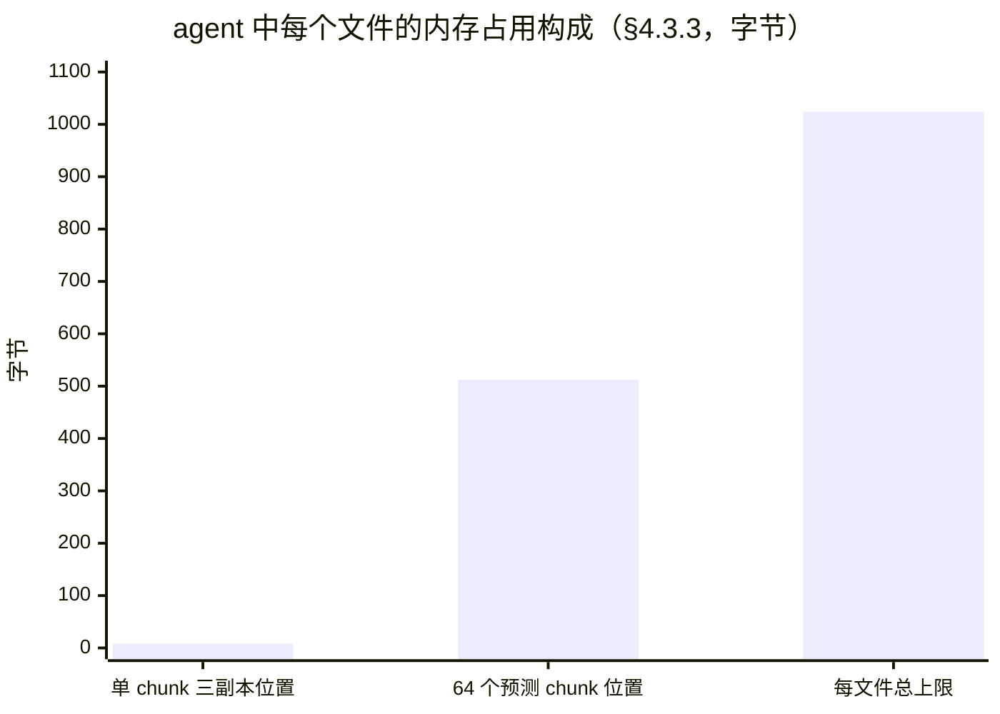

**解读**：DPU 资源稀缺是贯穿全文的约束，很多设计取舍都由它决定：存储协议放到存储侧、读请求不拆分、预测 chunk 数限 16、范围对限 64、路由表用 LRU、IP 压缩到 20 位、位置提示交给客户端保管。这提醒我们：**DPU 卸载不是"把软件搬过去"那么简单，而是要按 DPU 的资源预算重新设计数据结构和功能边界**。新硬件综述中提到的 LineFS 也有类似结论（DPU 上的 ARM 核比主机慢，需要流水线并行掩盖）。

---

## 7. 大规模部署：vRPC、负载均衡与 QoS

### 7.1 vRPC 抽象（§4.4.1，图 6）

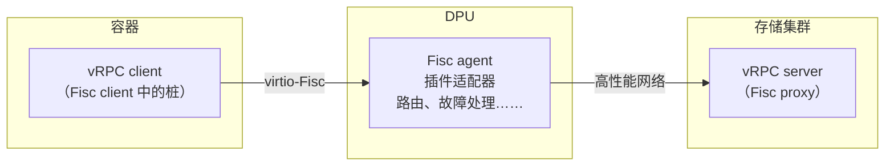

开发者只需要关心容器里的 RPC 桩和后端集群里的 RPC 服务；virtio 设备、SaDGW 等实现细节对两端透明。与传统 RPC 的三点区别：

1. 通过硬件辅助的 virtio 设备提供从虚拟域到物理域的**安全直通**；
2. RPC 请求可以在 agent 中**透明重试**，并透明地使用高性能网络栈；
3. 服务开发者可以写一个**适配器**集成到 agent 中，提升自己服务的可用性。

vRPC 不仅支撑 Fisc 文件系统，也可以用于其他云原生服务（如 FaaS）。

### 7.2 负载均衡（§4.4.2）

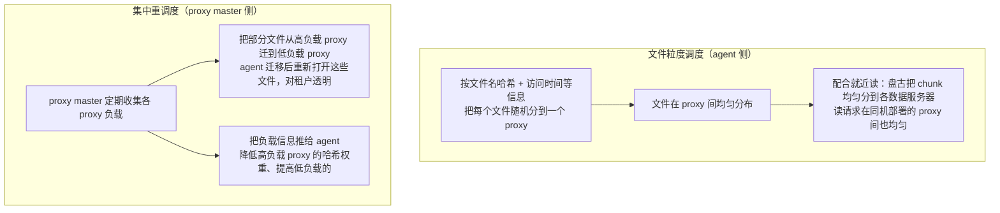

传统负载均衡依赖网关按连接调度，各 proxy 连接数均衡但文件数可能差很多。Fisc 按**文件**而不是连接调度，并辅以 proxy master 的集中重调度。

### 7.3 端到端 QoS（§4.4.3）

Fisc 同时承载**在线实时应用**（高优先级）和**离线批处理应用**（低优先级）：

| 层次 | 机制 |
|------|------|
| 硬件 QoS | virtio-Fisc 设备和网卡使用高、低优先级硬件队列；网络库在 IP 头设置 **DSCP** 值，利用交换机的优先级队列 |
| 软件 QoS | Fisc client、agent、proxy 采用**混合线程模型**：高、低优先级请求分别由独占线程处理 |
| 后端 | 盘古对 NVMe SSD 做软件 QoS（当前 SSD 缺乏硬件级 QoS） |

为什么高低优先级必须分线程？论文给出两点：

1. **队头阻塞**：为节省 DPU CPU，大的离线请求不拆成小请求；如果高低优先级在同一线程，高优先级请求会被大请求阻塞；
2. **网卡缺乏缓存隔离**（没有类似 Intel CAT 的能力）：如果基于 DPDK 的轮询线程停止轮询，网卡缓冲会被低优先级包占满；所以同一线程处理两类包时必须一直轮询低优先级队列，这又难以保证高优先级请求。

---

## 8. 评估

### 8.1 实验环境（§5.1）

测试床是一个存算分离集群：**1 台计算服务器**（配 DPU）+ **43 台商用存储服务器**组成的存储集群（运行盘古）。在计算服务器上用 FIO 生成负载，记录客户端的 CPU 和内存消耗。图中用 `njmd` 表示 num jobs = n、iodepth = m。

### 8.2 轻量客户端的资源消耗（§5.2，图 7、图 8）

对比对象：传统客户端 **TC**（集成三副本等存储协议和 RPC、TCP/IP 等网络栈）与 Fisc 轻量客户端 **LC**。

**微基准**：以 4 KB 粒度写、128 KB 粒度读：

- LC 的 CPU 和内存消耗在读写两个方向上都显著低于 TC；
- 例如 8j32d 写入时，LC 用 **0.3** 个核，TC 用 **0.46** 个核；
- 用一个 FIO 任务以 **1.75 GB/s** 固定速率写入时，LC 的 CPU 和内存消耗比 TC 分别少 **69%** 和 **20%**。

**生产环境**：数千台服务器上的 **Swift**（阿里内部类似 Kafka 的分布式流服务），观察一个月：前 17 天用 TC，**第 18 天切换到 LC**。切换后带宽保持不变，CPU 和内存分别少 **16%** 和 **57%**；如果**只把纠删码卸载到 proxy**，容器的 CPU 和内存也能分别减少 **9%** 和 **40%**。

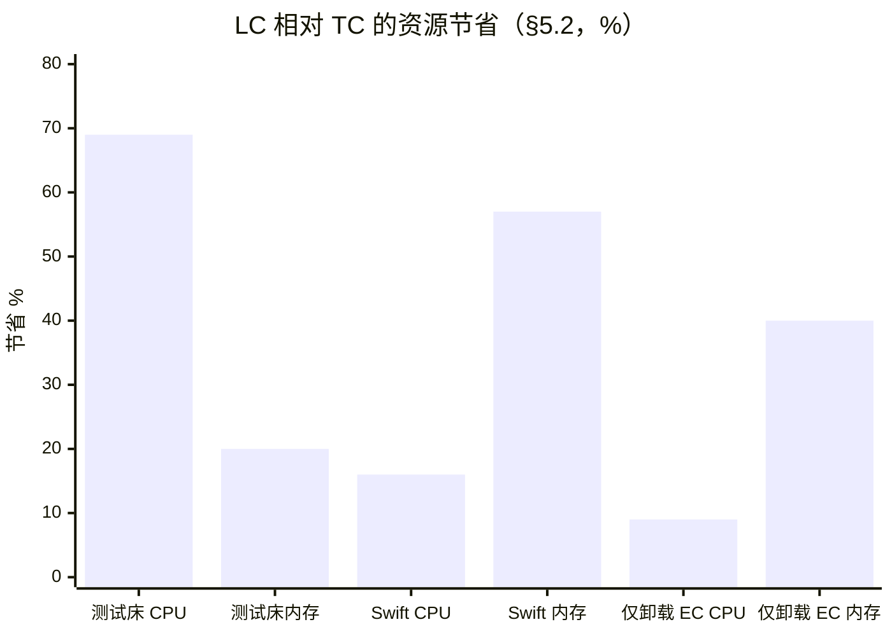

**解读**：

- 几组数字差异很大：测试床节省的主要是 CPU（69%），Swift 生产中节省的主要是内存（57%），而 8j32d 写入时的 CPU 节省只有约 35%（0.3 对 0.46）。这说明收益强烈依赖负载形态，"69%"只是一个特定工作点的结果。
- 摘要写的是"Fisc 客户端只消耗传统客户端 **69%** 的 CPU"，而引言和 §5.2 写的是"CPU **减少** 69%"，两种说法相差很大。按 §5.2 的实验描述，后者应是本意；引用时建议使用"减少 69%（1.75 GB/s 固定速率写入）"并注明条件。
- 这里测的是**容器内客户端**的消耗。agent 和 proxy 消耗的 DPU、存储节点资源没有计入，论文在 §6 用"聚合而非搬迁"来论证总量也下降，但没有给出总量数据。

### 8.3 延迟（§5.3，图 9、图 10、图 11）

对比对象 **LB**：基于网络网关的负载均衡方案（论文引用的是阿里云应用型负载均衡 ALB）。

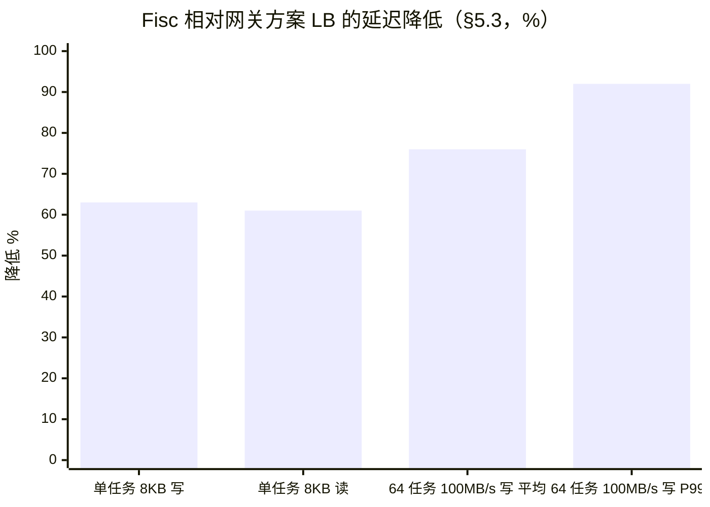

- 单个任务、8 KB 请求：写、读延迟分别比 LB 低 **63%**、**61%**；
- 64 个任务、8 KB、固定带宽 100 MB/s 写入：平均和 P999 延迟分别比 LB 低 **76%** 和 **92%**；
- 原因：SaDGW 是**一跳**通信，集中式网关是两跳；SaDGW 透明地用高性能网络栈替换了低效的 TCP/IP；
- **就近读**：16 KB 和 256 KB 的顺序读、随机读延迟都下降，例如 256 KB 随机读降低 **25%**（图 10）；
- **生产环境**：在线搜索负载 30 天内的平均写延迟稳定在约 **500 µs**，即使达到**百万级 IOPS** 也是如此；通过 LB 提供服务时延迟为数毫秒（图 11）。

### 8.4 可用性（§5.4，图 12、图 13）

用 P999 尾延迟衡量存储感知故障处理的效果：

- **微基准**：在 80 台存储服务器的集群中，t1 时刻杀掉 1 个 proxy 进程，t2 时刻再杀掉 5 个。尾延迟短暂升到 **40 ms 以内**，随后很快恢复，因为 agent 会重试失败的请求；
- **生产环境**：同一个 30 天窗口内，在线搜索的 P999 尾延迟**大部分时间在 30 ms 以下**。t1–t4 的尖峰来自文件系统升级时启停部分 proxy，其他尖峰来自网络抖动和存储节点故障，每次尖峰后都很快回落。

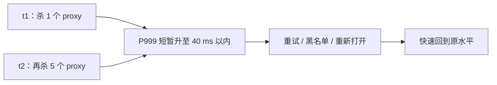

### 8.5 QoS（§5.5，图 14）

生产环境中，在线搜索任务（高优先级）与离线 AI 训练任务（低优先级）部署在同一计算集群、共享同一存储集群。一个月内，即使离线训练吞吐波动，在线搜索的延迟也保持稳定、几乎不受影响。

### 8.6 负载均衡（§5.6，图 15）

随机选 6 台存储服务器，观察 7 天内归一化的读 IOPS，用变异系数衡量均衡程度：变异系数 **小于 5%**。论文据此称 Fisc 达到了与 Google Maglev 负载均衡器相近的均衡质量，原因是 agent 按文件而不是按连接转发请求。

**解读**：论文写 Maglev 的变异系数是"**67%**"，同时又说 Fisc（小于 5%）与 Maglev "质量相近"，两者矛盾。更可能是排版问题（例如原意是 6%–7%）。引用时建议只引用 Fisc 自身的"小于 5%"，不要引用与 Maglev 的比较。

### 8.7 评估小结与局限（解读）

| 方面 | 观察 |
|------|------|
| 规模 | 测试床只有 **1 台计算服务器**，没有展示"单服务器 1000+ 容器"这一核心动机场景下的密度提升 |
| 基线 | 只与传统客户端（TC）和一个网关负载均衡方案（LB）比较，没有与 DPFS、virtio-fs 等 DPU 方案或直连式重客户端比较 |
| 数据形式 | 大部分结果以图和相对百分比给出，绝对值（如 IOPS、带宽上限）较少；生产图表经过归一化 |
| 缺失项 | 没有 DPU 自身的资源占用数据、FPGA 快路径的命中率与收益、vRPC 在其他服务上的效果、跨 region 场景 |
| 可信度 | 生产数据（Swift 切换、30 天在线搜索延迟、升级期间的尾延迟）是最有说服力的部分 |

---

## 9. 讨论

论文 §6 回应了三个问题：

**不只是搬迁资源**：有人会问两层聚合是不是只把资源消耗从租户容器搬到 DPU 和存储集群，总量没变？论文的回答是：Fisc 按租户、应用、负载维度**聚合**存储协议和网络栈的处理资源。例如容器中的应用通常要预分配 I/O 线程、预留内存和网络连接，这些不能与其他容器共享；在 Fisc 中这些资源被"迁移"并"聚合"到 agent 和 proxy 里，被多个应用高效共享。此外，卸载后可以利用硬件加速存储协议和网络栈，例如在存储集群用硬件加速纠删码和 CRC。

**生态**：

- 兼容 HDFS 生态：Fisc client 通过 **JNI** 调用 C 语言实现的轻量客户端，并做了许多 HDFS 与盘古之间的语义兼容优化；
- 兼容不同操作系统：把 virtio-Fisc 设备抽象成更通用的 **virtio-RPC** 设备，virtio-Fisc 驱动已集成进阿里发布的操作系统，并计划提交开源社区。

**DPU 资源**：DPU 资源稀缺，还要与虚拟网络、块存储等其他虚拟化服务共享。Intel IPU、NVIDIA DPU 等新一代 DPU 嵌入式处理器能力大幅提升，并集成了压缩等硬件加速，能让 agent 采用更复杂的故障处理和就近读策略；但网络从 25 Gbps 升到 100、200 Gbps 后，仍需要细致的资源优化。

---

## 10. 与相关工作的对比

### 10.1 论文自述的对比（§7）

| 方向 | 代表工作 | Fisc 的不同 |
|------|----------|-------------|
| 云原生基础设施 | 状态管理、运行时、数据存储、容错等；LogBook 为有状态 serverless 提供日志接口；Fluid 为云原生深度学习提供统一数据抽象 | Fisc 提供大规模、高性能的文件系统服务 |
| 高性能分布式文件系统 | pNFS、NAS、Tectonic、Colossus、盘古 | 它们用重客户端和集中式网络网关，不适合云原生；Fisc 用轻量客户端 + 存储感知网关 + 软硬件协同 |
| 存储层缓存 | OFC、FaaSCache、FLASHCUBE、Pocket 在持久化层前加缓存 | 资源复用程度仍然低 |
| 云中的裸金属 DPU | Nitro、BM-Hive、ELI、Splinter、Bluebird | — |
| 用 DPU 加速文件系统 | LineFS、Gimbal、LeapIO | 不是为租户与云厂商之间的**跨域**文件服务设计的；Fisc 用神龙 DPU 和新的 virtio 设备提供安全、高性能的跨域服务 |

### 10.2 与本仓库调研系统的对照（解读）

| 维度 | Tectonic（FAST 2021） | Fisc（FAST 2023） | DPFS（SYSTOR 2023） | LineFS（SOSP 2021） |
|------|----------------------|-------------------|---------------------|--------------------|
| 场景 | 内部数据中心，客户端可信 | 公有云多租户容器，客户端不可信 | 云租户通过 DPU 访问文件系统 | 分布式持久内存文件系统 |
| 客户端 | 重客户端，策略在客户端（便于按租户定制） | 极薄 RPC 桩 | 主机侧只剩 virtio-fs 标准接口 | 主机侧库文件系统 |
| DPU 承担 | 不涉及 | 网络栈、安全检查、路由、故障重试、就近读 | 文件系统客户端（virtio-fs 后端） | 复制、日志处理等后台任务 |
| 存储协议在哪 | 客户端 | 存储节点上的 proxy | 依后端实现 | DPU 流水线 |
| 网关 | 无（直连） | 分布式（agent + proxy），无集中网关 | 无 | 无 |
| 接口语义 | 只追加、单写者 | 盘古只追加 + HDFS 兼容 | POSIX（virtio-fs） | POSIX |

**解读**：

- Fisc 与 Tectonic 代表了"客户端逻辑放哪"的两个极端。Tectonic 的场景下，客户端越重越灵活、越快；Fisc 的场景下，客户端越轻越省、越好管。两者都正确，区别在于**谁拥有客户端所在的机器**。
- Fisc 和 DPFS 都利用 DPU 做跨域直通，但切分点不同：DPFS 用标准 virtio-fs 暴露 POSIX，追求通用性；Fisc 用定制的 virtio-Fisc/virtio-RPC 暴露 RPC 接口，追求性能和可扩展到其他服务。
- Fisc 的 proxy 位于存储节点上，与 chunkserver 同机部署，这一点和 3FS、JuiceFS 等"客户端直连存储节点"的系统不同：它多了一跳（agent → proxy → chunkserver），但用就近读 + 共享内存把这一跳的网络开销消掉了。

---

## 11. 整体总结

### 11.1 核心贡献

1. **问题刻画**：指出云原生场景下传统分布式文件系统的两个结构性问题：容器内**重客户端**导致资源无法复用（200 MB/s 写入要 1.1 核）；**集中式网络网关**在性能、可用性、负载均衡和成本上都不满足需求（1 万存储节点要约 5000 台网关机）。
2. **两层功能聚合的轻量客户端**：按"用户只关心接口"的原则拆分客户端功能，网络与安全聚合到计算服务器 DPU，存储协议聚合到存储节点；客户端只剩 RPC 桩，并用"数据类定制结构 + 元数据类 PB"保证版本兼容。
3. **存储感知分布式网关 SaDGW**：以 agent–proxy 直连代替集中网关，用文件粒度路由表承载故障重试、黑名单、重新打开和就近读，把网络层的连接语义升级为文件语义。
4. **DPU 软硬件协同**：两代 virtio-Fisc 设备、FPGA 路由缓存快路径，以及面向 DPU 稀缺资源的一整套 CPU、内存、网络优化。
5. **生产验证**：服务 300 万以上 CPU 核超过 3 年；客户端 CPU、内存少 69%、20%；在线搜索平均写延迟约 500 µs，故障恢复从秒级降到 100 ms 级。

### 11.2 设计哲学

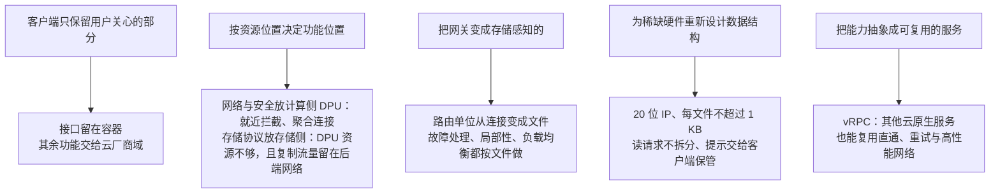

**解读**：Fisc 的核心思想可以概括为"**把存储系统的客户端变成云基础设施的一部分**"。传统上客户端是租户的软件，跑在租户的资源上；Fisc 把它拆成三段，只把最薄的一段留给租户，其余变成云厂商掌控、跨租户共享的基础设施。一旦客户端的大部分逻辑由云厂商掌控，云厂商就能在其中植入文件语义（路由、重试、就近读、QoS），这是网络网关做不到的。

### 11.3 优点与局限

| 优点 | 局限 / 未回答的问题 |
|------|---------------------|
| 抓住了公有云多租户场景的真实痛点，生产规模大（300 万核、3 年） | **强依赖阿里自研基础设施**：神龙 DPU、Luna/Solar 网络栈、盘古、定制操作系统驱动，外部难以复现 |
| 两层聚合的切分理由清楚（DPU 资源、后端网络、存储侧硬件加速） | 只评估了**容器内**客户端的节省，没有给出 DPU 与 proxy 侧的资源消耗，"总量下降"缺少数据支撑 |
| 文件粒度路由让故障处理、就近读、负载均衡有了统一载体 | 测试床只有 1 台计算服务器，没有验证高容器密度这一核心动机 |
| 就近读 + 共享内存消除了代理架构的读放大 | 写路径仍是 client → agent → proxy → 多副本 chunkserver，写延迟中 proxy 一跳的开销没有单独分析 |
| 端到端 QoS 覆盖设备、网卡、交换机、线程模型和 SSD | 接口是盘古只追加语义 + HDFS 兼容，**不是 POSIX**；论文未讨论元数据扩展与语义问题 |
| vRPC 抽象让基础设施可复用于其他云原生服务 | 摘要与正文的"69%"说法不一致，Maglev 变异系数"67%"与结论矛盾，部分图表缺少绝对值 |
| 生产数据（Swift 切换、升级期间尾延迟）说服力强 | 路由表 LRU 淘汰、proxy 迁移、跨 region 部分连接等机制下的边界情况（如大量文件同时 reopen）没有讨论 |

### 11.4 对分布式文件系统设计者的启示

1. **先明确"客户端在谁的机器上"**：内部可信环境可以用重客户端直连存储节点；公有云多租户环境应把客户端做薄，把协议和网络逻辑放到云厂商控制的组件里。两种形态最好在协议层面都支持。
2. **客户端功能按"用户是否关心"拆分**：接口留给用户；网络、安全、存储协议都可以下沉。下沉位置按资源和流量决定：靠近计算侧的适合做连接聚合和安全前置检查，靠近存储侧的适合做复制和纠删码。
3. **网关要懂文件语义**：如果必须有中间层，让它按文件（句柄）路由而不是按连接，并把重试超时、黑名单、重新打开这些故障处理策略放在里面，客户端无需升级就能获得更好的可用性。
4. **代理架构要专门处理读放大**：proxy 与数据节点同机部署，加上"预测 chunk 位置推送 + 同机共享内存"，可以把代理多出的一跳网络开销消掉。
5. **重试策略可参考**：初始超时取平均延迟的 10 倍、每次翻倍，并在用户超时内预留时间做换节点重试，这是兼顾快速发现故障和不放大负载的实用做法。
6. **在资源受限的卸载硬件上，数据结构要按字节预算设计**：先算清每个文件、每个连接要占多少字节，再决定缓存多少位置、是否拆分请求、哪些状态交给客户端保管（并做好校验）。
7. **混部 QoS 要端到端**：只在存储端做优先级不够，需要设备队列、网卡队列、交换机 DSCP、线程模型和 SSD 调度一起配合，并注意大请求不拆分时的队头阻塞问题。

### 11.5 一张图看懂 Fisc

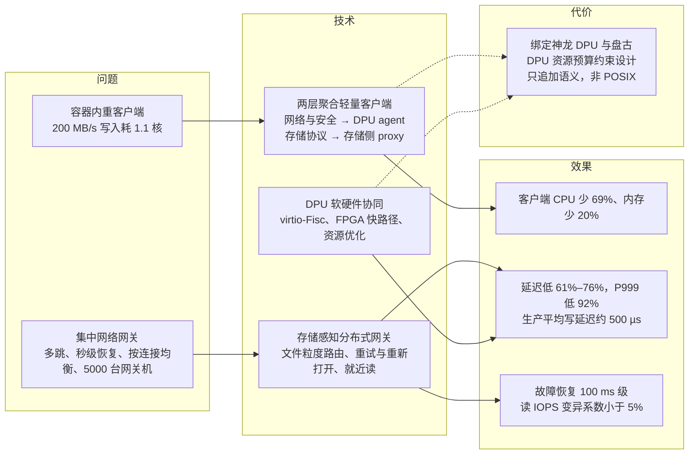

---

## 参考

- Qiang Li et al. *Fisc: A Large-scale Cloud-native-oriented File System*. USENIX FAST 2023. <https://www.usenix.org/conference/fast23/presentation/li-qiang-fisc>
- Rui Miao et al. *From Luna to Solar: The Evolutions of the Compute-to-Storage Networks in Alibaba Cloud*. SIGCOMM 2022.（Fisc 直连高速路使用的网络栈）
- Yixiao Gao et al. *When Cloud Storage Meets RDMA*. USENIX NSDI 2021.（Fisc 沿用的共享连接机制）
- Qiang Li et al. *More Than Capacity: Performance-oriented Evolution of Pangu in Alibaba*. USENIX FAST 2023. 见[工业界生产系统](industry-production-systems.md)
- Satadru Pan et al. *Facebook's Tectonic Filesystem: Efficiency from Exascale*. USENIX FAST 2021. 本仓库精读：[tectonic-fast2021/deep-read.md](tectonic-fast2021/deep-read.md)
- Daniel E. Eisenbud et al. *Maglev: A Fast and Reliable Software Network Load Balancer*. NSDI 2016.
- Jongyul Kim et al. *LineFS: Efficient SmartNIC Offload of a Distributed File System with Pipeline Parallelism*. SOSP 2021. 见[新硬件综述](new-hardware.md)
- Peter-Jan Gootzen et al. *DPFS: DPU-Powered File System Virtualization*. SYSTOR 2023. 本仓库精读：[dpfs-systor2023.md](dpfs-systor2023.md)
