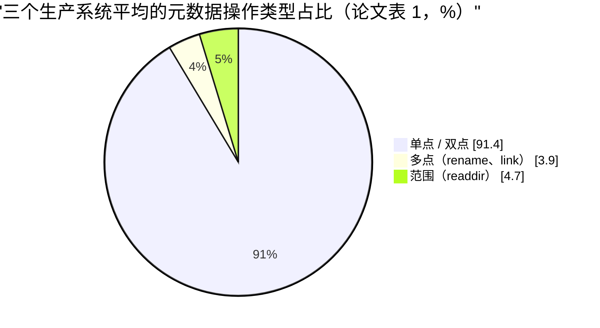
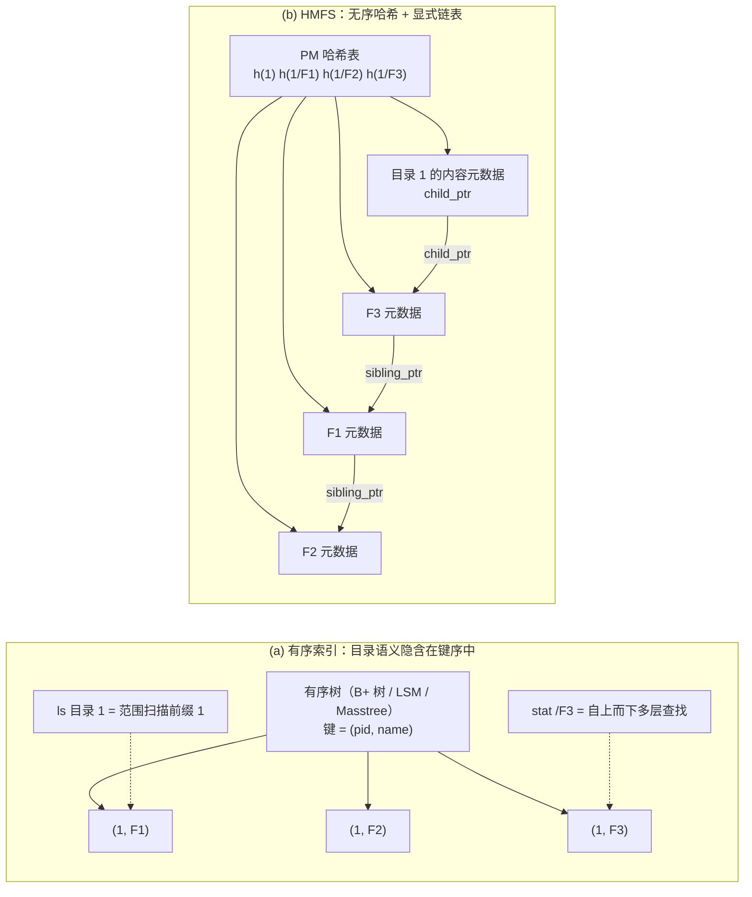
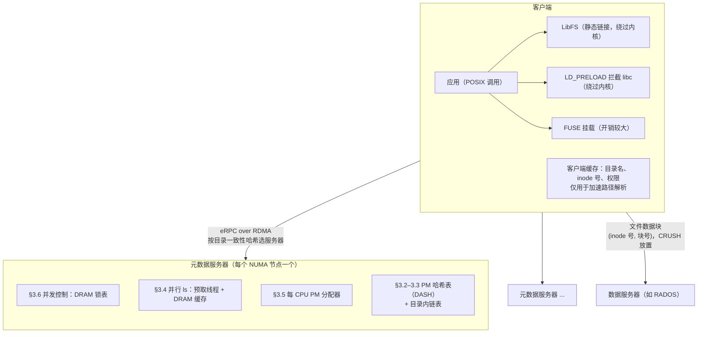
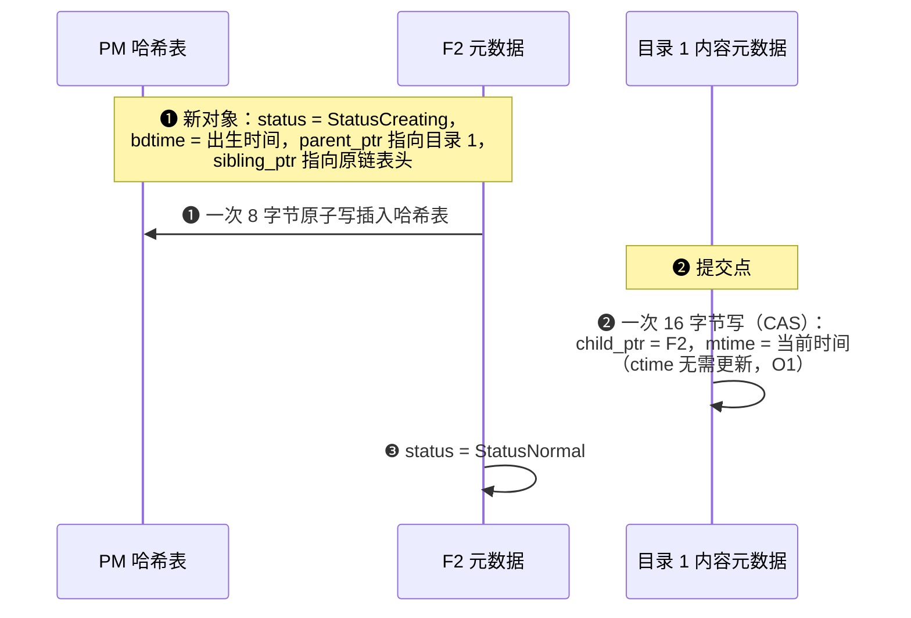
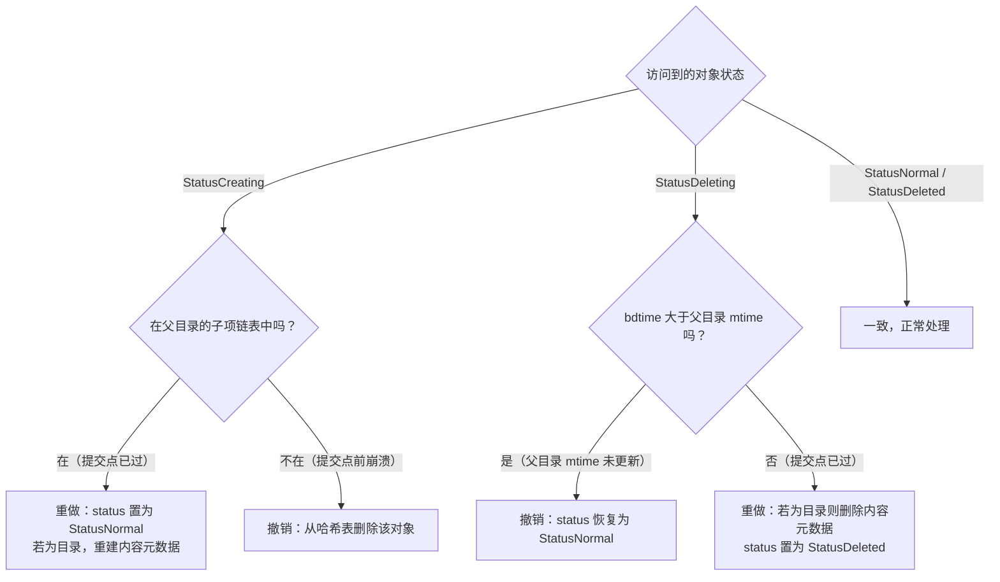
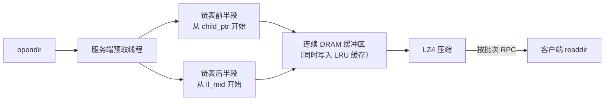
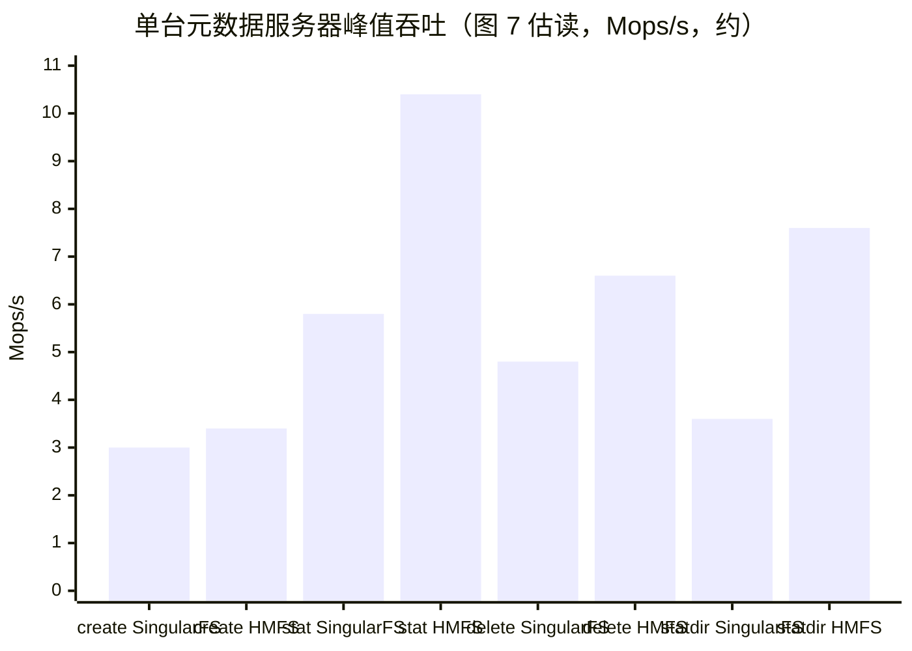
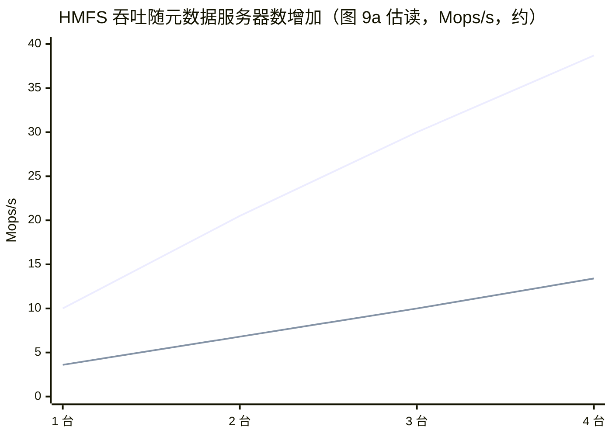
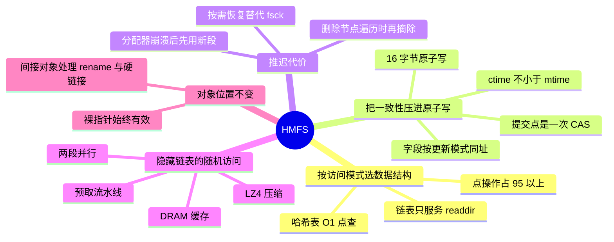
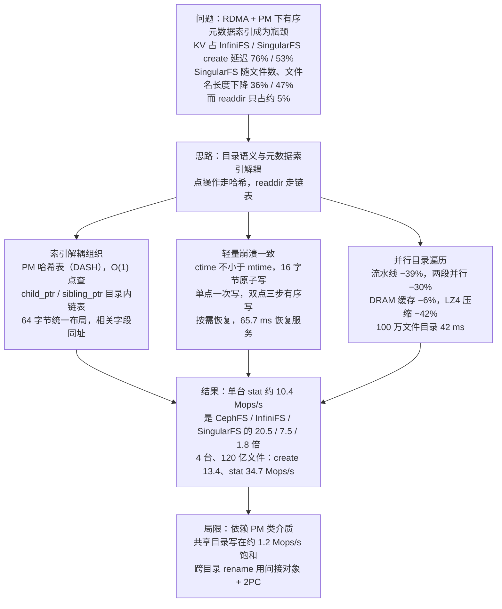

# HMFS 精读：把目录语义从元数据索引中解耦的分布式元数据服务（SoCC 2025）

> 论文：Wenhao Lv, Hao Guo, Qing Wang, Youyou Lu, Jiwu Shu*（* 通讯作者）. *Accelerating Distributed Filesystem Metadata Service via Decoupling Directory Semantics from Metadata Indexing*. ACM SoCC '25，线上，2025-11-19～21，论文集第 334–347 页。系统名为 **HMFS**。
>
> 机构：清华大学（全部 5 位作者）。
>
> 链接：ACM <https://dl.acm.org/doi/10.1145/3772052.3772237>（CC BY 4.0 开放获取）
>
> 篇幅：正文 12 页 + 参考文献 2 页，共 14 页；15 张图、5 张表。
>
> 精读日期：2026-11-24。依据用户提供的 ACM 正式版 PDF。**数字和机制描述都摘自论文**，用"论文 §x / 图 x / 表 x"标注出处。标"解读"的段落是本文作者的分析和推论，不是原文。多数图没有数据标签，图上读数为本文估读，标注"约"，误差约 ±5%。标"示例"的是为说明机制构造的例子。
>
> 相关文档：
> - [元数据扩展性综述 §2.8](metadata-scalability.md#28-hmfs-accelerating-distributed-filesystem-metadata-service-via-decoupling-directory-semantics-from-metadata-indexingsocc-2025)：本文的简述版。
> - [InfiniFS（FAST 2022）精读](infinifs-fast2022.md)：同一作者（Wenhao Lv）的前作，HMFS 沿用其按目录分区方案，并把它作为基线。
> - [SingularFS（ATC 2023）精读](singularfs-atc2023.md)：同组（Hao Guo）的前作，同样在 PM 上做无日志元数据更新，是 HMFS 最强的基线。
> - [MesaFS（EuroSys 2026）精读](mesafs-eurosys2026.md)：同组同期工作，把同样的思路用在 NVMe SSD 上（目录间哈希 + 目录内 WO-HTree，父目录延迟持久化）。
> - [Mantle（SOSP 2025）精读](mantle-sosp2025.md)、[CFS（EuroSys 2023）精读](cfs-eurosys2023.md)：同样讨论"目录语义 / 元数据拆分"，但关注点在分区与协调，而不是单机存储引擎。

## 目录

- [0. 一页速览](#0-一页速览)
- [1. 背景：元数据操作的类型与有序索引](#1-背景元数据操作的类型与有序索引)
- [2. 动机：快网络和 PM 下，有序索引成了瓶颈](#2-动机快网络和-pm-下有序索引成了瓶颈)
- [3. HMFS 总体架构](#3-hmfs-总体架构)
- [4. 索引解耦的元数据组织](#4-索引解耦的元数据组织)
- [5. 轻量崩溃一致更新](#5-轻量崩溃一致更新)
- [6. 并行目录遍历](#6-并行目录遍历)
- [7. 分配器、并发控制、硬链接与 rename](#7-分配器并发控制硬链接与-rename)
- [8. 讨论：硬件与共享大目录](#8-讨论硬件与共享大目录)
- [9. 评估](#9-评估)
- [10. 相关工作](#10-相关工作)
- [11. 论文中的不一致与可疑之处](#11-论文中的不一致与可疑之处)
- [12. 与本仓库中其他系统的对照](#12-与本仓库中其他系统的对照)
- [13. 整体总结](#13-整体总结)
- [参考](#参考)

---

## 0. 一页速览

**一句话**：几乎所有分布式文件系统都把元数据存在**有序** KV 中（RocksDB、B+ 树、Masstree），以便用范围查询实现 readdir。在 RDMA + 持久内存（PM）下，作者发现维护全序的索引本身成了瓶颈：InfiniFS 的 create 延迟中 76% 花在 KV 存储上，SingularFS 也有 53%；SingularFS 的吞吐还会随文件数增加和文件名变长而下降。而真实负载中 95% 以上是点操作，readdir 只占约 5%。HMFS 因此把**目录遍历语义与元数据索引解耦**：每台元数据服务器用 **PM 哈希表**（DASH）索引元数据，O(1) 访问；目录结构用嵌在元数据对象里的**目录内单链表**（child_ptr / sibling_ptr）维护。再配上利用"ctime ≥ mtime"与 16 字节原子写的**无日志崩溃一致更新**、**按需恢复**，以及流水线、两段并行、DRAM 缓存、LZ4 压缩组成的**并行目录遍历**。单台元数据服务器上，stat 吞吐是 CephFS、InfiniFS、SingularFS 的 20.5×、7.5×、1.8×，延迟低 92%、62%、39%；4 台服务器、120 亿文件时仍保持 create 13.4 Mops/s、stat 34.7 Mops/s。

| 维度 | 要点 |
|------|------|
| 负载依据 | 百度 CFS、阿里盘古、Spotify HDFS 三个生产系统的公开比例：单点/双点操作平均 91.4%，多点（rename、link）3.9%，范围操作（readdir）4.7%（论文表 1） |
| 动机实验 | 1.28 亿文件下 create：有序 KV 占 InfiniFS（Pmem-RocksDB）延迟 76%、SingularFS（P-Masstree）53%；InfiniFS 吞吐只有 SingularFS 的 18%；SingularFS 从 64K 到 1 亿文件吞吐降 36%，文件名从 16 B 到 128 B 降 47%（论文 §2.3，图 2） |
| 分区 | 沿用 InfiniFS 的按目录分区：目录拆成访问元数据（按 pID 分区）与内容元数据（按 ID 分区），文件元数据按 pID 分区，一个目录的内容元数据与所有子项落在同一台服务器（论文 §3.1，表 2） |
| 元数据组织 | 每台服务器一个 PM 哈希表（DASH）；目录内容元数据的 child_ptr 指向子项链表头，每个子项的 sibling_ptr 指向下一个兄弟；统一的 64 字节对齐布局，键与对象相邻存放（论文 §3.2，图 4） |
| 崩溃一致 | 单点操作一次 8 或 16 字节原子写；create/delete 等双点操作三步有序原子写，以更新父目录 child_ptr + mtime（或 mtime）为提交点；崩溃后按状态位与时间戳**按需**恢复，不做启动扫描（论文 §3.3，图 5） |
| 目录遍历 | 流水线预取（−39%）、链表两段并行（−30%）、DRAM LRU 缓存（−6%）、LZ4 压缩（−42%）；100 万文件目录 42 ms，是 CephFS 的 1%、InfiniFS 的 8%、SingularFS 的 15%（论文 §3.4、§5.5） |
| 其他 | 每 CPU 的定长 PM 分配器（1/3/6 个缓存行），崩溃后立即可用；DRAM 锁表 + 16 字节 CAS，共享目录内可并发 create/delete；跨目录 rename 用间接对象 + 日志 + 2PC（论文 §3.5–§3.7） |
| 结果 | 1 台服务器 stat 约 10.4 Mops/s；4 台近线性扩展；120 亿文件时 create 13.4、stat 34.7 Mops/s；三种生产比例负载下至少是 SingularFS 的 1.3×；1 亿文件崩溃后 65.7 ms 恢复服务（论文 §5） |

**解读**：

- HMFS 的核心观察非常朴素：**readdir 只占约 5%，却让 100% 的操作为维护全序付费**。把它换成哈希表 + 链表，点操作是 O(1)，与文件总数、文件名长度和前缀分布都无关；readdir 从"范围扫描"变成"链表遍历"，再用工程手段把链表遍历的随机 PM 访问藏起来。
- 这篇论文的贡献主要在**单台元数据服务器的存储引擎**，而不是分布式架构。分区方案直接沿用 InfiniFS，扩展性实验也只到 4 台服务器。可以把它看成 SingularFS 的"下一代引擎"：同样是 PM + 无日志，但把有序树换成了哈希表。
- 它与 Mantle、CFS 说的"解耦"不是一回事：Mantle 解耦的是"路径解析需要的目录骨架"和"其余元数据"，放到不同组件；HMFS 解耦的是"目录遍历顺序"和"索引结构"，在同一台服务器内用两种数据结构。

---

## 1. 背景：元数据操作的类型与有序索引

### 1.1 元数据操作分类（论文 §2.1）

| 类别 | 子类 | 典型操作 | 访问的 inode |
|------|------|---------|-------------|
| 点操作 | 单点 | stat、access、chown、chmod、read、write、truncate | 目标 inode |
| | 双点 | create、delete（论文中指链接数为 1 的 unlink）、mkdir、rmdir、symlink | 目标 + 父目录 |
| | 多点 | rename、link、unlink | 目标 + 源父目录 + 目标父目录 |
| 范围操作 | — | 只有目录遍历（readdir） | 一个目录下的所有子项 |

**真实负载比例**（论文表 1，取自三个生产系统已发表的统计）：

| 操作类型 | 百度 CFS | 阿里盘古 | Spotify HDFS | 平均 |
|---------|---------|---------|-------------|------|
| 单点 / 双点 | 97.8% | 86.8% | 89.7% | **91.4%** |
| 多点 | 1.2% | 9.3% | 1.3% | 3.9% |
| 范围 | 1.0% | 3.9% | 9.0% | 4.7% |

点操作（单点 + 双点 + 多点）合计占 **95.3%**，远多于范围操作（论文 §1、§2.1）。

### 1.2 主流做法：靠有序索引实现目录遍历（论文 §2.2，图 1a）

- 现代分布式文件系统普遍用有序 KV 存元数据（InfiniFS、IndexFS、DeltaFS、TableFS、ShardFS、Tectonic、CFS、3FS、JuiceFS、Alluxio 等）。每个文件或目录是一对 KV：键通常是 **(父目录 inode 号, 名字)**，值是元数据。
- 点操作（如 stat）用点查询，要穿过有序树的多层内部节点。
- readdir：本地文件系统（如 Ext4）把目录项显式存在目录的数据块里，直接读块即可；但在分布式场景下，元数据操作要频繁更新这些额外的目录项块，跨服务器协调开销大。所以分布式文件系统**不物化目录项**，而是用有序索引的范围查询，取出所有以目标目录 inode 号为前缀的键，在运行时拼出目录项。

---

## 2. 动机：快网络和 PM 下，有序索引成了瓶颈

论文 §2.3：RDMA 往返只需几微秒、带宽超过 100 Gbps；PM 字节可寻址、性能接近 DRAM。硬件不再是瓶颈后，软件开销凸显。作者用两个代表系统做实验（硬件同 §5.1）：

- **InfiniFS** 使用 **Pmem-RocksDB**（Intel 为 PM 优化的 RocksDB），代表"建在 RocksDB 上"的多数元数据服务；
- **SingularFS** 使用 **P-Masstree**，代表 PM 优化的有序 KV。

| 实验 | 结果 |
|------|------|
| 1.28 亿文件下 create 的延迟拆分（图 2a） | 有序 KV 存储占 InfiniFS 延迟的 **76%**、SingularFS 的 **53%**；其余为请求解析、RPC、并发控制（图中 InfiniFS 约 28 µs、SingularFS 约 15 µs，约） |
| create 吞吐随文件数增加（图 2b） | InfiniFS 在所有规模都很差（约 0.6 Mops/s，约），只有 SingularFS 的 **18%**，说明 LSM 树不适合 PM；SingularFS 从 64K 到 1 亿文件吞吐下降 **36%**（约 3.8 → 2.4 Mops/s，约），这是 B+ 树特性 |
| create 吞吐随文件名长度增加（图 2c，每 16 个文件共享一个前缀） | 文件名从 16 B 到 128 B，SingularFS 吞吐下降 **47%**，这是 Masstree"按键切片组织的 trie-of-trees"对前缀和长度敏感的特性 |

**根因**（论文 §2.3）：现有元数据服务依赖有序 KV，源自**目录语义与元数据索引的耦合**：目录遍历靠有序索引的范围查询，于是所有元数据操作（无论点还是范围）都要承担维护全序的开销，尽管点操作在真实负载中多得多。

**核心思路**：把元数据查找与目录遍历交给**相互独立**的两种数据结构。点操作用无序索引（哈希表），访问时间与元数据总量无关；借助 PM 的字节可寻址性，用同目录对象之间的**显式链接**保留目录遍历语义，不再依赖有序索引。

---

## 3. HMFS 总体架构

### 3.1 组件（论文 §3.1，图 3）

| 组件 | 说明 |
|------|------|
| 客户端 | 三种接入方式：用户态库 LibFS（编译时静态链接）、LD_PRELOAD 拦截 libc 调用（无需改应用）、FUSE 挂载。前两者绕过内核，性能最好；FUSE 开销较大。与 LocoFS、InfiniFS、IndexFS 等相同，客户端缓存目录的名字、inode 号和权限，**只用于加速路径解析** |
| 元数据分区 | 按目录分区（见 3.2） |
| 元数据服务器 | 键见表 2，值是元数据对象；PM 哈希表索引 + 目录内链表；轻量无日志更新协议（§3.3）、流水线与并行遍历（§3.4）、面向元数据的每 CPU 分配器（§3.5）、CAS + DRAM 锁表的细粒度并发控制（§3.6）、rename 与硬链接（§3.7） |
| 数据管理 | 文件数据交给现有对象存储（如 RADOS）：按块切分，以 `<inode 号, 块号>` 为键，用 CRUSH 放置。只保证**元数据一致性**（与 Ext4、CephFS 相同，符合 POSIX）：数据写入对象存储后再原子更新元数据 |

### 3.2 按目录分区（论文 §3.1，表 2）

每个目录的元数据拆成两个对象：

| 元数据对象 | 内容 | 分区键 | 哈希键 |
|-----------|------|-------|-------|
| 目录访问元数据（DirAM） | 除"与子项相关字段"外的所有字段（名字、权限等） | pID | (pID, name) |
| 目录内容元数据（DirCM） | 与子项相关的字段（child_ptr、mtime、链表长度等） | ID | ID |
| 文件元数据（FileM） | 文件的全部元数据 | pID | (pID, name) |

用一致性哈希按分区键分布。于是**一个目录的内容元数据、其子目录的访问元数据、其子文件的元数据都在同一台服务器上**，既可扩展，又有目录内局部性（论文 §3.1）。

**解读**：这正是 [InfiniFS 的访问 / 内容元数据拆分](infinifs-fast2022.md)。它保证了"列一个目录所需的所有对象都在本机"，所以链表只需是本地链表，不用跨服务器指针；也保证了 create/delete 这类双点操作只涉及一台服务器。代价与 InfiniFS 相同：一个大的共享目录的所有子项都在一台服务器上（论文 §4 承认这一点，见 [§8](#8-讨论硬件与共享大目录)）。

---

## 4. 索引解耦的元数据组织

### 4.1 哈希索引：常数时间访问（论文 §3.2）

- 每台服务器用 **PM 哈希表**而不是有序索引来索引元数据对象。表项的键是指向"对象标识"或"(父标识, 名字)"的指针，值是指向元数据对象的指针。
- 实现采用 **DASH**（PM 优化、支持并发、基于桶的哈希表，VLDB 2020）。
- 哈希表的插入和删除都由**一次原子写**完成。

### 4.2 链表维护目录结构（论文 §3.2）

- 目录内容元数据中的 **child_ptr** 指向子项链表的头；文件元数据或目录访问元数据中的 **sibling_ptr** 指向下一个兄弟。
- 由于按目录分区，列一个目录所需的元数据都在同一台服务器上，链表是**本地**的，readdir 就是遍历链表。

### 4.3 统一的缓存行对齐布局（论文 §3.2，图 4）

文件元数据与目录元数据使用同一种布局（64 字节，一个缓存行）；目录元数据把文件特有的字段换成目录特有的字段：

| 偏移 | 左 8 字节 | 右 8 字节（文件 / 目录内容元数据） |
|------|----------|-----------------------------------|
| 0 B | ID | mtime |
| 8 B | dev | size / **child_ptr** |
| 16 B | mode（2 B）、gid_l（2 B）、uid（4 B） | blksize / **ll_len**（链表长度） |
| 24 B | ctime | nlink / **ll_mid**（链表中点指针） |
| 32 B | gid_u（2 B）、status | rdev |
| 40 B | bdtime（出生 / 删除时间戳） | atime |
| 48 B | **sibling_ptr** | — |
| 56 B | **parent_ptr** | — |

- 左列属于文件元数据和目录访问元数据，右列的目录专有字段属于目录内容元数据。
- FileM / DirAM 的哈希键是 `<pID, name>`（含文件名，紧邻对象存放以提升局部性）；DirCM 的哈希键是 `<ID>`。
- 字段按访问模式排布：**mtime 与 child_ptr 相邻**（同一个 16 字节对齐块），因为频繁的 create、delete 会同时更新它们；**mtime 与 size 相邻**，append 同时更新它们；**mode、gid 低 16 位、uid 与 ctime 相邻**，chmod/chown 同时更新它们。这种布局既提升运行时性能，也是实现无日志一致更新的前提（论文 §3.2、§3.3）。

---

## 5. 轻量崩溃一致更新

### 5.1 两个观察（论文 §3.3，表 3）

**O1：时间戳顺序**。根据 POSIX 和作者的分析，**ctime 单调递增，且不小于对应的 mtime**。所以一个操作同时修改 mtime 和 ctime 时（写、创建、删除），只需显式更新 mtime，之后读取时用 **max(ctime, mtime)** 推出正确的 ctime。

| 操作 | 目标 mtime | 目标 ctime | 父目录 mtime | 父目录 ctime |
|------|-----------|-----------|-------------|-------------|
| create、mkdir | • | • | • | • |
| delete、rmdir | | | • | • |
| link、unlink | | • | • | • |
| rename | | • | • | • |
| write、truncate | • | • | | |
| chown、chmod | | • | | |

（论文表 3：各操作对目标与父目录 mtime、ctime 的影响。）

**O2：16 字节原子写**。现代 CPU 支持 16 字节对齐的原子存储（movdqa）和原子比较交换（cmpxchg16b）；PM 的持久化粒度是缓存行，所以对齐的 16 字节写同时具备原子性和持久性。

### 5.2 单点操作：一次原子写（论文 §3.3.1）

| 操作 | 要改的字段 | 做法 |
|------|-----------|------|
| write（覆盖写） | mtime（ctime 由 O1 推出） | 一次 8 字节原子写 |
| write（追加）、truncate | mtime、size | mtime 与 size 放在同一个 16 字节对齐块，一次 16 字节原子写 |
| read、readdir | atime | 一次 8 字节原子写 |
| chown、chmod | uid、gid、mode、ctime，共 18 字节（uid、gid 各 4 B，mode 2 B，ctime 8 B） | 把 gid 拆成高、低各 2 字节，低 2 字节与 mode、uid、ctime 放进同一个 16 字节块，一次 16 字节写；**gid ≥ 65536 时回退到日志**。新用户组的 gid 通常从 1000 开始顺序分配，回退应很少见 |

### 5.3 双点操作：有序原子写，无需日志（论文 §3.3.2，图 5）

**create / mkdir**（在目录 ID = 1 下创建 F2）：

- mkdir 在上面这些步骤处理目录访问元数据之外，还要在提交点之后（❷ 与 ❸ 之间）把目录内容元数据插入哈希表。**即使内容元数据在另一台服务器上，也不需要分布式事务**，因为内容元数据可以由访问元数据正确地重新生成。

**delete / rmdir**：

1. ❶ 一次 16 字节写：把目标的 status 置为 **StatusDeleting**，同时更新出生-删除时间戳 bdtime；
2. ❷ **提交点**：一次 8 字节原子写更新父目录内容元数据的 mtime；
3. ❸ status 置为 **StatusDeleted**。

被删除的节点之后在目录遍历或删除操作时才从链表中物理摘除（更新前驱的 sibling_ptr）。rmdir 先检查子项链表头确认目录为空，并在提交点之后（❷ 与 ❸ 之间）从哈希表删除内容元数据。

### 5.4 按需崩溃恢复（论文 §3.3.2）

崩溃只会让目标元数据处于**可容忍、可检测**的不一致状态。恢复由之后访问该对象的操作**按需触发**（例如客户端重试失败的 create），不需要启动时扫描（如 fsck）。

**解读**：

- 这套协议与 [SingularFS 的有序更新](singularfs-atc2023.md#43-有序更新322图-4)一脉相承，都把"父目录 mtime（或时间戳）的更新"作为提交点，用时间戳比较判断是否已提交。HMFS 的进一步改进在于：把 child_ptr 与 mtime 放在同一个 16 字节块里，链表插入与提交合成**一次** CAS；SingularFS 的锁状态存在 PM 上，每次还要额外持久化锁（论文 §5.2、§5.6）。
- delete 的恢复判据"bdtime 是否大于父目录 mtime"有一个微妙之处：若同一目录下另一个并发操作在崩溃前提交并把父目录 mtime 推到更晚，未完成的 delete 也会被判为"已提交"而重做。由于该 delete 请求本身已发出、客户端未收到应答，"完成它"在语义上是允许的结果，所以不违反正确性；但它要求所有服务器线程的时间戳单调（同一服务器内的时钟），论文没有讨论时钟回拨。
- create 的恢复要遍历父目录链表确认是否在其中，代价与目录大小成正比：10 万文件目录中一次不一致 stat 需要 23.4 ms（论文表 4）。按需恢复把这个代价摊到了"第一次访问"上，而不是启动时间。

---

## 6. 并行目录遍历

链表遍历要逐个解引用指针，造成随机 PM 访问和高延迟。HMFS 逐步加入四项优化（论文 §3.4，图 6）：

| 优化 | 做法 | 1M 文件目录的效果（论文 §5.5） |
|------|------|------------------------------|
| Basic | 客户端 opendir → 循环 readdir（内部按批次向服务器取目录项）→ closedir；服务端沿 sibling_ptr 读 PM | 已比 SingularFS 快 |
| +Pipeline | opendir 后，服务端工作线程持续把分散在 PM 中的目录项**预取**到连续的 DRAM 缓冲区，与网络请求重叠，隐藏 PM 读延迟 | 延迟再降 **39%** |
| +Parallel | 大目录的子项链表分成多段**并发**预取；目前用**两段**，足以让 PM 读与网络请求重叠。为此目录维护链表长度 **ll_len** 和中点指针 **ll_mid**；二者只是负载划分的提示，不影响正确性，**不需要崩溃一致** | 再降 **30%** |
| +Cache | 服务端用 DRAM 缓存最近预取的目录项（LRU），同一目录的后续遍历直接从 DRAM 服务，节省 PM 带宽；create/delete 完成时更新缓存 | 只再降 **6%**，说明两段并行已把瓶颈从存储转移到网络 |
| +Compress | 目录项在文件名、类型、inode 号上有冗余，发送前用 **LZ4** 压缩，减少网络传输和 RPC 次数 | 再降 **42%** |

- 小目录（16 个文件）上这些优化收益很小，所以运行时根据 ll_len 决定是否走优化路径。
- **POSIX 合规**：POSIX 明确规定目录遍历不要求保证目录项的顺序，也不要求返回原子快照（论文 §3.4）。

**解读**：两段并行之所以够用，是因为 PM 随机读带宽在单线程下已接近网络发送速率；再往下优化的是网络（压缩）。值得注意的是 ll_mid 在头插法下会"漂移"：每插入两个新子项，真正的中点就向前移动一个，长期看两段会越来越不均衡。论文说它只是提示，但没说明何时重新计算 ll_mid。

---

## 7. 分配器、并发控制、硬链接与 rename

### 7.1 面向元数据的 PM 分配器（论文 §3.5）

- **观察**：文件系统元数据的大小变化有限：inode 都是定长字段，POSIX 规定文件名不超过 255 字节。
- **只支持三种定长分配**：
  - 1 个缓存行：目录内容元数据；
  - 3 个缓存行：文件名 ≤ 64 B 的文件元数据，以及文件名 ≤ 128 B 的目录访问元数据；
  - 6 个缓存行：其他所有情况。
- **每 CPU 分配**：每个 CPU 先用 PMDK（保证原子性）申请大内存段，再在段内分配上述三种大小；每段有一个 PM 上的位图记录分配情况；DRAM 中的空闲链表用于快速定位空闲对象。
- **崩溃后立即可用**：传统做法要在崩溃后同步扫描文件系统重建分配器的 DRAM 状态，推迟服务。HMFS 崩溃后每个 CPU 直接从全局 PM 池申请**新段**，立即可以分配和释放；同时后台异步扫描已分配段的位图，回收空闲空间、重建空闲链表。

### 7.2 细粒度并发控制（论文 §3.6）

- 读写锁放在 **DRAM 锁表**中：按对象的索引键（表 2）哈希到锁表项再加锁。需要同时锁多个对象时，按**服务器 ID、再按锁表位置**升序加锁，避免死锁。
- 单点操作只需目标对象的**读锁**（防止并发删除），因为更新本身是一次原子写。
- 双点操作需要目标对象的**写锁**，但对父目录内容元数据只需**读锁**；父目录的 child_ptr 与 mtime 用 **16 字节 CAS** 原子更新。于是**同一共享目录内的 create、delete 可以并发**。
- 范围操作（readdir）只需目标目录内容元数据的读锁（符合 POSIX）。
- 16 字节原子更新与非原子的读并发时可能读到不一致的数据，采用 SingularFS 已有的**乐观并发控制**：stat 读取完整 inode 前后各比较一次时间戳，不一致就重试。

### 7.3 硬链接与 rename（论文 §3.7）

**不变式**：链接数 nlink > 1 的元数据对象既不会被释放，也不会在内存中移动。

| 操作 | 做法 |
|------|------|
| 创建硬链接 | 在哈希表和新父目录链表中插入一个**间接元数据对象**，内含指向原对象的引用（服务器 ID + 内存地址），访问时透明重定向；删除硬链接只删间接对象，原对象留在原 PM 位置 |
| 跨目录 rename 文件 | 先从哈希表删除旧 KV 并标记原对象保留在 PM 中，再创建指向原对象的间接对象，插入哈希表和目标目录链表 |
| 同目录 rename | 只需在哈希表中用新 KV 替换旧 KV，不创建间接对象。真实负载中**近 99%** 的 rename 发生在同一目录内（引 CFS） |
| 一致性 | rename 与 link 可能更新单台或两台服务器上的多个对象；由于它们在真实负载中不频繁，采用**标准日志与两阶段提交** |
| 目录 rename 成环 | 并发目录 rename 可能产生孤儿环，沿用 InfiniFS 的方法解决 |

**解读**：间接对象的设计让"对象位置永不改变"，从而让 sibling_ptr、parent_ptr 等裸 PM 指针在 rename 后依然有效，这是用指针代替有序键的必然代价。但它也带来两个问题：

1. 文件被跨目录 rename 到另一台服务器管理的目录后，它的元数据仍留在**原服务器**，此后每次 stat 都要经间接对象跨服务器访问，破坏了按目录分区的局部性；
2. 原服务器上的对象被"永久钉住"，若原父目录之后被删除，这些对象的 parent_ptr 指向何处、如何回收，论文没有说明。

对 Spark 那种"临时目录 rename 到输出目录"的模式（Mantle 论文中的主要场景），这一点值得关注。

---

## 8. 讨论：硬件与共享大目录

### 8.1 PM 硬件（论文 §4）

HMFS 依赖的是"字节可寻址的持久内存"这一通用能力，不限于评估中使用的 Intel Optane：

- 基于 CXL 的内存语义 SSD（如三星 Memory-Semantic SSD）借助 CXL 互连和内置 DRAM 缓存，可以充当 PM；
- 云数据中心中，UPS 保护的 DRAM 是现成的替代品。容量较小，但 HMFS 空间效率高，**管理 10 亿文件只需约 300 GB**，且可横向扩展；还可以把冷元数据分层到 SSD。

**解读**：Intel 已于 2022 年宣布停产 Optane，这一节实际上是在回答"没有 Optane 怎么办"。UPS + DRAM 方案在云厂商中确实常见（论文引用了 FaRM）；按 300 B/文件估算，百亿文件需要约 3 TB，需要多台服务器分摊。

### 8.2 共享大目录（论文 §4）

论文的重点是元数据存储引擎，分区沿用简单的按目录粒度（同 InfiniFS）。这种方式常被认为在"大量客户端在同一目录下并发创建文件"时表现差，但 HMFS 仍有优势：

1. 引擎对目录元数据只需**共享锁**，临界区缩小到**一条 CAS 指令**；
2. 可以**批量**处理待处理请求，把多个目录修改合并成一次更新（评估中的 HMFS-Batch）；
3. 也可以集成 GIGA+ 或 CephFS 目录分片等现有技术，把大目录动态分到多台服务器。

---

## 9. 评估

### 9.1 实验环境（论文 §5.1）

| 项目 | 配置 |
|------|------|
| 集群 | 6 台相同机器；每台 2 个 NUMA 节点，每节点 1 颗 Intel Xeon Gold 6240M（18 核 36 超线程）、3 条 256 GB Optane DIMM（768 GB）、3 条 32 GB DDR4（96 GB）、1 块 100 Gbps ConnectX-5 RNIC；100 Gbps InfiniBand 交换机；Ubuntu 20.04，内核 5.4.0，PMDK 1.7 |
| 对比系统 | **Ext4-DAX**（本地 PM 文件系统，同 NUMA 节点内运行，无网络）；**CephFS**（传统分布式文件系统，PM 作为裸块设备）；**InfiniFS**（KV 存储上的元数据服务，后端换成 Pmem-RocksDB）；**SingularFS**（PM 优化的元数据服务）。HMFS、InfiniFS、SingularFS 使用同一 RPC 框架 **eRPC** |
| 部署 | 除扩展性实验外，分布式文件系统都只用**一台**元数据服务器（一个 NUMA 节点，36 个工作线程）；扩展性实验中每台元数据服务器占一个 NUMA 节点 |
| 负载 | IOR mdtest 3.3.0，OpenMPI 4.1.2；默认每个客户端占一个超线程、保持 1 个在途请求、在自己的工作目录中操作 100 万个文件；stat 随机访问；每项测 3 次取平均。§5.8 使用改造过的 mdtest 生成不同长度和命名模式的文件名 |

**解读**：InfiniFS 和 SingularFS 分别是第一作者和第二作者此前的工作，由同一团队移植到同一 RPC 框架，基线实现质量较有保证；但 CephFS 只把 PM 当块设备、走内核协议栈，这一基线与其他系统不在同一量级，"215.7×"之类的倍数主要反映的是这一点。

### 9.2 吞吐（论文 §5.2，图 7）

客户端逐步增加到最多 360 个（5 台机器 × 72 超线程），报告峰值。

| 操作 | CephFS | InfiniFS | SingularFS | Ext4-DAX | HMFS |
|------|--------|----------|-----------|----------|------|
| create | 约 0.02 | 约 0.7 | 约 3.0 | 约 0.45 | 约 3.4 |
| stat | 约 0.5 | 约 1.4 | 约 5.8 | 约 1.4 | **约 10.4** |
| delete | 约 0.05 | 约 0.6 | 约 4.8 | 约 0.3 | 约 6.6 |
| mkdir | 约 0.02 | 约 0.4 | 约 1.5 | 约 0.2 | 约 2.3 |
| statdir | 约 0.3 | 约 0.4 | 约 3.6 | 约 0.6 | 约 7.6 |
| rmdir | 约 0.02 | 约 0.3 | 约 2.1 | 约 0.2 | 约 3.6 |

（Mops/s，图 7 估读，约。）

- **stat**：HMFS 是 CephFS 的 **20.5×**、InfiniFS 的 **7.5×**、SingularFS 的 **1.8×**、Ext4-DAX 的 **7.4×**。原因是哈希索引让点查询为常数时间；SingularFS、InfiniFS 依赖树形有序 KV，点操作都是对数复杂度。
- **create**：HMFS 是 CephFS 的 **215.7×**、InfiniFS 的 **5.0×**、SingularFS 的 **1.1×**（高 12%）、Ext4-DAX 的 **7.4×**。两者都是无日志创建，HMFS 仍快，原因有三：HMFS 用轻量原子写**就地**更新，SingularFS 依赖原子 KV 操作、内部用写时复制**异地**更新；HMFS 的分配器针对元数据优化；HMFS 的读写锁在 DRAM 哈希表中，SingularFS 把锁直接存在 PM 上的 inode 里，为了崩溃后检测还要同步持久化锁状态。
- **CephFS 与 InfiniFS 差得多**：CephFS 有内核协议栈开销、昂贵的日志事务，并且把 PM 当裸块设备、不利用字节可寻址；InfiniFS 一是大量依赖事务更新元数据，二是 RocksDB 本为 SSD 设计，即便是 Pmem-RocksDB，其 memtable、WAL、软件缓存、基于文件的管理对 PM 都不够高效。

### 9.3 延迟（论文 §5.3，图 8）

单个 mdtest 客户端，测各操作平均延迟（µs，图 8 估读，约；CephFS 超出纵轴 30 µs）：

| 操作 | CephFS | InfiniFS | SingularFS | Ext4-DAX（本地） | HMFS |
|------|--------|----------|-----------|-----------------|------|
| create | > 30 | 约 26 | 约 10 | 约 11 | 约 8 |
| stat | > 30 | 约 14.5 | 约 8 | 约 5 | 约 5.5 |
| delete | > 30 | 约 22 | 约 8 | 约 9 | 约 6 |
| mkdir | > 30 | 约 30 | 约 16 | 约 24 | 约 10 |

- 对分布式文件系统，HMFS 平均延迟最低。**stat** 延迟比 CephFS、InfiniFS、SingularFS 分别低 **92%、62%、39%**。按 39% 反推，SingularFS 的 stat 约 9 µs，略高于上表的图上估读，以正文为准。
- 对本地的 Ext4-DAX，HMFS 在 create、delete、mkdir、rmdir 上延迟更低（轻量一致更新）；stat 和 statdir 上，尽管 Ext4-DAX 没有网络开销，HMFS 也与之相当。

### 9.4 扩展性（论文 §5.4，图 9）

- **服务器扩展**：1–4 台元数据服务器，最多 288 个 mdtest 客户端（4 台机器 × 72 超线程），每个客户端用协程保持 8 个在途请求，共 2,304 个并发请求。4 台服务器时 stat 约 **38.7 Mops/s**、create 约 **13.4 Mops/s**，分别是单台的 **3.9×、3.7×**，近线性（论文正文把两个数字对应的操作写反了，见 [§11](#11-论文中的不一致与可疑之处)）。
- **元数据规模**：4 台服务器（共 3 TB PM），反复各 create、stat 2 亿个新文件，直到总数达到数百亿。**120 亿**文件时 create 仍有 **13.4 Mops/s**、stat **34.7 Mops/s**，曲线基本平稳。

（第一条折线为 stat，第二条为 create；xychart 不显示图例。）

### 9.5 目录遍历（论文 §5.5，图 10）

一次遍历包括 opendir、遍历全部 readdir、closedir。HMFS-basic 是去掉目录遍历优化的 HMFS。

| 目录大小 | CephFS | InfiniFS | SingularFS | Ext4-DAX | HMFS（全部优化） |
|---------|--------|----------|-----------|----------|-----------------|
| 16 个文件 | 223 µs | 60 µs | 约 28 µs | 约 18 µs | 约 12 µs |
| 4K 个文件 | 12.2 ms | 2.1 ms | 约 0.95 ms | 约 0.95 ms | 约 0.2 ms |
| 100 万个文件 | **4,430 ms** | **514 ms** | 约 280 ms | 约 280 ms | **42 ms** |

（CephFS、InfiniFS 为图中数据标签；HMFS 1M 为正文数字；其余为估读，约。）

- 100 万文件目录：HMFS 42 ms，是 CephFS 的 **1%**、InfiniFS 的 **8%**、SingularFS 的 **15%**、Ext4-DAX 的 **15%**。
- **HMFS-basic 也比 SingularFS 快**，尽管后者用 P-Masstree 的范围查询：SingularFS 遍历 P-Masstree 链接的叶节点后，还要沿指针读元数据对象（取 inode 号和文件类型）；而且键（含文件名）被切成 8 字节片段，非连续地存放在内部树节点中，需要额外随机访问。HMFS-basic 直接沿子对象间的链接遍历，文件名与元数据在连续缓存行中，对遍历友好。
- 加上客户端按 GNU ls 方式排序文件名，100 万文件目录的端到端时间为 **67 ms**，仍明显快于 SingularFS 和 InfiniFS。

**解读**：链表遍历比有序树范围扫描更快，这个结论有点反直觉。关键在于 HMFS 的"链表节点"就是元数据对象本身，一次指针跳转拿到全部需要的信息；而有序索引的叶节点只存键和指针，还得再跳一次去读元数据，而且键被切片存放。也就是说，HMFS 的优势来自"**目录项与元数据同址**"，而不仅仅是"链表"。

### 9.6 共享目录（论文 §5.6，图 11）

逐步增加客户端，所有客户端在**同一目录**下各操作 100 万个不同文件；HMFS-Batch 为启用批处理的变体，批大小 4（每个工作线程一次最多取 4 个待处理请求一起处理）。

| 操作 | SingularFS | InfiniFS | HMFS | HMFS-Batch |
|------|-----------|----------|------|-----------|
| create（Mops/s） | 约 0.75 | 约 0.5 | 约 **1.2**（饱和） | 约 2.0 |
| delete（Mops/s） | 约 0.8 | 约 0.2 | 约 **2.3**（饱和） | 约 4.6 |
| stat（Mops/s） | 约 4.7 | 约 1.5 | 约 8（仍在上升） | 约 9.5 |

（图 11 估读，约；HMFS 的 1.2、2.3 为正文数字。）

- stat 扩展良好，接近峰值：每次 stat 只是无竞争的常数时间 PM 读。create、delete 在约 **1.2、2.3 Mops/s** 饱和：共享目录元数据的更新与持久化竞争激烈；论文引用的研究指出，对同一 PM 地址反复持久化写会因同一缓存行被反复失效而严重降速。
- HMFS 对 SingularFS 的 create、delete、stat 分别高 **1.6×、2.9×、1.7×**：HMFS 对目录元数据只需**一次 CAS + 一次 flush**（同时更新 mtime 与 child_ptr）；SingularFS 至少要**两次 flush**：一次获取读锁（锁含本地 restartCnt，必须先持久化，崩溃后靠它检测不一致），一次更新 mtime 和 ctime。InfiniFS 受事务更新限制；Ext4-DAX 和 CephFS 的每目录互斥锁把并发修改完全串行化。
- **HMFS-Batch** 的 create、delete 分别再提升 **1.7×、2.0×**：多个文件的创建/删除合并成一次 CAS 和一次 flush，摊薄串行化和持久化开销。

### 9.7 rename（论文 §5.7，图 12）

72 个客户端，各在自己的目录中 rename 100 万个文件；延迟用单客户端测。

| 指标 | CephFS | InfiniFS | SingularFS | Ext4-DAX | HMFS |
|------|--------|----------|-----------|----------|------|
| 同目录吞吐（Mops/s，约） | 约 0.02 | 约 0.35 | 约 1.05 | 约 0.5 | 约 2.35 |
| 跨目录吞吐（Mops/s，约） | 约 0.02 | 约 0.35 | 约 1.0 | 约 0.05 | 约 1.75 |
| 同目录延迟（µs，约） | 约 95 | 约 38 | 约 17 | 约 12 | 约 12 |

- 同目录 rename：HMFS 延迟与本地 Ext4-DAX 相当，吞吐是 CephFS 的 **134.2×**、InfiniFS 的 **6.7×**、SingularFS 的 **2.2×**、Ext4-DAX 的 **4.6×**。InfiniFS、SingularFS 依靠 KV 层事务，至少要持久化两个完整的元数据对象；HMFS 的日志只持久化必要字段。Ext4-DAX 受全局 rename 锁（rename_lock 上的 write_seqlock()）限制。
- 跨目录 rename：HMFS 延迟更高、吞吐更低，因为要生成新的间接对象、更新目标目录链表；源和目标目录在不同服务器上时还需 2PC。

### 9.8 敏感性分析（论文 §5.8，图 13、图 14）

144 个客户端。

- **元数据规模**（图 13，文件名固定 16 字节随机）：从 64K 到 1 亿文件，HMFS create 吞吐稳定在约 3.4 Mops/s、延迟约 9 µs（约）；SingularFS 吞吐下降 **36%**、延迟上升 **27%**；InfiniFS 一直很差（LSM 树式的 Pmem-RocksDB 不适合 PM）。
- **命名模式与长度**（图 14）：命名模式为每 4、16、64 个文件共享一个前缀；长度从 16 B 到 128 B（固定每 16 个文件共享前缀）。
  - HMFS 对命名模式不敏感（哈希表不受键的字符串模式影响）；文件名超过 64 B 后吞吐开始下降，因为需要更多缓存行（分配器的 3 行 / 6 行分界）：16 B → 128 B 时 create、stat 分别下降 **10%、15%**。
  - SingularFS 对命名模式高度敏感：相同长度下，不同命名模式的 create 吞吐最多相差 **65.3%**；对长度也敏感：16 B → 128 B 时 create、stat 分别下降 **47%、64%**。原因是 trie-of-trees 让树更深、节点分裂合并更频繁，增加随机 PM 访问和分配开销。

### 9.9 恢复开销（论文 §5.9，表 4）

1 亿文件规模：

| 场景 | 启动时间 | 一致对象的 stat | 不一致对象的 stat（触发按需恢复） |
|------|---------|----------------|-------------------------------|
| 正常关机 | **53.5 ms** | 5.7 µs | — |
| 崩溃（100 文件目录） | **65.7 ms** | 5.7 µs | 30.5 µs |
| 崩溃（10 万文件目录） | **65.7 ms** | 5.7 µs | **23.4 ms** |

- 正常关机后的 53.5 ms 包括打开 PM 池、并发从 PM 检查点加载空闲链表、初始化锁表、启动 RPC 服务；其中通过 PMDK **打开 720 GB 的 PM 池就要 38.2 ms**，是主要开销。
- 崩溃后 65.7 ms 恢复服务，与正常关机相当，得益于按需恢复和分配器崩溃后立即可用。
- 不一致对象的恢复延迟与父目录大小成正比（要遍历子项链表）；小目录中只有正常 stat 的 **5.35 倍**。

### 9.10 生产负载比例（论文 §5.10，图 15、表 5）

没有公开的大规模生产 trace，作者按三家已发表的元数据操作比例生成合成负载（论文脚注 2）：

| 负载 | 操作比例（论文表 5） |
|------|-------------------|
| 百度 CFS | 93.05% stat、1.44% create、1.14% delete、0.08% mkdir、0.04% rmdir、0.12% rename、0.92% list、3.21% 其他 |
| 阿里盘古 | 64.95% stat、0.28% statdir、9.58% create、11.88% delete、0.01% mkdir、9.29% rename、3.92% list、0.09% 其他 |
| Spotify HDFS | 81.91% stat、3.96% statdir、2.70% create、0.75% delete、0.02% mkdir、1.30% rename、9.01% list、0.35% 其他 |

1 台元数据服务器、144 个客户端，每个客户端按比例操作 100 万个文件（图 15，Mops/s，估读）：

| 负载 | CephFS | InfiniFS | SingularFS | Ext4-DAX | HMFS |
|------|--------|----------|-----------|----------|------|
| 百度 | 约 0.1 | 约 0.75 | 约 3.5 | 约 0.7 | 约 4.6 |
| 阿里 | 约 0.05 | 约 0.5 | 约 1.2 | 约 0.3 | 约 4.1 |
| Spotify | 约 0.05 | 约 0.7 | 约 0.8 | 约 0.6 | 约 4.2 |

HMFS 在三种负载下都最高，至少是 SingularFS、InfiniFS、Ext4-DAX、CephFS 的 **1.3×、5.9×、6.4×、41.6×**。

**解读**：SingularFS 在阿里（rename 9.29%）和 Spotify（list 9.01%）负载下明显掉队，HMFS 几乎不受影响。这说明 HMFS 的优势在 rename、list 比例高时更大，对应 §9.5 与 §9.7 中"链表遍历快于树扫描""同目录 rename 只换哈希键"两点。

---

## 10. 相关工作

论文 §6：

| 类别 | 代表 | 论文的定位 |
|------|------|-----------|
| 有序 KV 组织元数据 | InfiniFS、IndexFS、DeltaFS、TableFS、ShardFS（RocksDB）；Tectonic（ZippyDB，内部为 RocksDB） | 依赖范围查询重建目录项 |
| 建在分布式数据库上 | HopsFS、CalvinFS | 依赖有序索引扫描实现目录遍历 |
| 数据库 + RocksDB | CFS、3FS | 目录语义用数据库维护，文件元数据单独存 RocksDB |
| 集中式 | GFS、HDFS、MooseFS | 整个命名空间在一台服务器 DRAM 中，扩展受限 |
| 对象存储之上 | CephFS、DAOS | 把同一目录下所有文件元数据封装进一个对象；CephFS 用元数据服务器 DRAM 缓存，DAOS 用 PM 存这些对象，但缺少硬链接支持、查找路径长 |
| 本地 PM 文件系统 | Ext4-DAX、BPFS、PMFS、NOVA | 把目录项显式存在目录数据块中；分布式场景下需频繁跨节点修改 |
| 崩溃一致 | InfiniFS、IndexFS（RocksDB 事务）；HopsFS、CFS（数据库事务）；SingularFS（有序 KV 操作，内部写时复制）；NOVA（日志结构）、BPFS（写时复制）、PMFS（写前日志）、ByteFS（日志） | 需要额外写和多次 flush；HMFS 降到一次 8/16 字节原子写或少量有序原子写 |

HMFS 的定位：无序索引 + 每目录链表，同时获得 O(1) 查找和快速目录遍历。

---

## 11. 论文中的不一致与可疑之处

| 位置 | 问题 | 判断 |
|------|------|------|
| §5.4 | "4 台服务器时 **create 38.7 Mops/s、stat 13.4 Mops/s**"。图 9a 中 stat 曲线到 38.7、create 到 13.4；摘要也说 120 亿文件时 create 13.4、stat 34.7；单服务器 stat 约 10.4、create 约 3.4 Mops/s，乘以 3.9、3.7 也对得上 | 正文把两个操作写反了，应为 stat 38.7、create 13.4 |
| 摘要、§1 | "吞吐最高提升 **20.5×、7.5×、1.8×**（对 CephFS、InfiniFS、SingularFS）"。这是 stat 的数字；§5.2 中 create 对 CephFS 是 **215.7×**，所以"最高"并不成立。延迟"降低 92%、62%、39%"也只是 stat 的数字 | 摘要只取了一种操作的结果，"up to"措辞不准确 |
| 表 1 与表 5 | 百度负载的多点操作：表 1 为 **1.2%**，表 5 中 rename 只有 **0.12%**（且无 link）。阿里（9.3% 对 9.29%）、Spotify（1.3% 对 1.30%）两边一致 | 表 1 的百度数字疑似小数点错位；按表 5，点操作应约 98.96%，而不是 97.8% |
| 表 1 | 范围操作平均写作 4.7%；(1.0 + 3.9 + 9.0) / 3 = **4.63%** | 应为 4.6%，小误差 |
| §4 与 §5.4 | §4 说管理 10 亿文件"约需 **300 GB**"，即约 300 B/文件；§5.4 在 4 台服务器、共 **3 TB** PM 上放了 **120 亿**文件，按 300 B/文件需要约 3.6 TB | 两处空间估算对不上；可能 300 GB 是保守值（3 行 = 192 B 的对象加哈希表开销），论文没有给出 120 亿文件时的实际 PM 用量 |
| §1、§5.4 | 称规模增加时性能"稳定""常数时间"。4 台服务器的 stat 峰值约 38.7 Mops/s，120 亿文件时为 34.7 Mops/s，下降约 10% | 基本稳定，但并非完全不变；两组实验的客户端配置也可能不同 |
| §2.3 与图 13 | 正文说"从 **64K** 到 1 亿文件"，图 13 横轴从 100k 开始标注 | 小问题 |
| §5.1 | 分布式文件系统只用一台元数据服务器；CephFS 把 PM 当裸块设备、走内核栈 | 对 CephFS 的倍数（215.7×、134.2×）主要反映基线配置，不宜直接引用 |
| §3.4 | ll_mid 是"中点指针"，但新子项从链表头插入，每插入两个，真实中点就前移一个；论文没说明何时重新计算 | 长期运行后两段并行可能失衡；论文称其只是提示，不影响正确性 |
| §3.7 | 跨服务器 rename 后元数据仍留在原服务器，通过间接对象访问；原对象被永久钉住 | 论文没有评估多次跨目录 rename 后的 stat 性能和空间回收 |
| §3.3 | 恢复判据依赖时间戳单调（bdtime 与父目录 mtime 比较） | 论文没有讨论时钟来源与回拨；多工作线程是否共用单调时钟也未说明 |

---

## 12. 与本仓库中其他系统的对照

| 系统 | 元数据索引 | 目录遍历如何实现 | 崩溃一致 | 分区 / 部署 | 关注层面 |
|------|-----------|----------------|---------|-----------|---------|
| **HMFS** | PM 哈希表（DASH） | 目录内链表（child_ptr / sibling_ptr） | 8/16 字节原子写 + 有序写，按需恢复 | 按目录，多台服务器 | 单机存储引擎 |
| [SingularFS](singularfs-atc2023.md) | PM 有序树（P-Masstree） | 有序范围扫描 | 无日志有序更新 + 时间戳，锁持久化在 PM | 单台服务器，NUMA 间/内混合分区 | 单机存储引擎 + NUMA |
| [InfiniFS](infinifs-fast2022.md) | RocksDB（有序 LSM） | 范围查询 | RocksDB 事务 + 跨服务器 2PC | 按目录（访问 / 内容元数据分离） | 分区与路径解析 |
| [CFS](cfs-eurosys2023.md) | TafDB（有序，范围分区）+ FileStore（RocksDB） | 范围查询 | 单分片原语，跨层不做 2PC | 范围 + 哈希两种存储 | 临界区裁剪 |
| [Mantle](mantle-sosp2025.md) | TafDB + IndexNode 内存表 | TafDB 范围查询 | 数据库事务 + delta 记录 | 共享 TafDB + 每命名空间 IndexNode | 对象存储的路径解析与目录竞争 |
| [FalconFS](falconfs-nsdi2026.md) | PostgreSQL（B-link 树） | 数据库查询 | 数据库事务 + 请求合并 | 文件名哈希 + 全量复制目录树 | AI 负载的无状态客户端 |
| [3FS](3fs-fireflyer-sc2024.md) | FoundationDB（有序 KV） | 范围查询 | FoundationDB 事务 | 无状态元数据服务 | 工业实现 |

**解读**：

- **清华存储组的一条连续演进线**：[InfiniFS](infinifs-fast2022.md)（2022，分区 + 路径解析，存储用 RocksDB）→ [SingularFS](singularfs-atc2023.md)（2023，单机 PM，无日志，存储用 P-Masstree）→ HMFS（2025，多机 PM，把有序树换成哈希 + 链表）。每一步都把上一步的瓶颈搬走：InfiniFS 的瓶颈在 RocksDB，SingularFS 解决了日志和单机可扩展性，HMFS 再去掉有序索引。
- 除 HMFS 外，本仓库的所有元数据系统都把目录遍历建在**有序索引**上。HMFS 证明在 PM 上可以不这么做；但如果底层是 SSD（RocksDB），链表遍历的随机读代价会很高，这个结论不能直接迁移。它的适用前提是**字节可寻址的持久介质**（PM、CXL 内存语义 SSD、UPS 保护的 DRAM）。
- 对工业系统的启发：大多数系统把点查和遍历都压在同一个有序 KV 上。即使不用 PM，也可以借鉴"按访问模式选结构"：点查走哈希（或带哈希前缀的键），目录遍历单独维护一份按目录聚簇的结构，而不是让所有操作都承担全序成本。

---

## 13. 整体总结

### 13.1 核心贡献

1. **问题定位**：在 RDMA + PM 下，有序元数据索引成为新的瓶颈：有序 KV 占 InfiniFS、SingularFS create 延迟的 76%、53%；SingularFS 吞吐随文件数（−36%）和文件名长度（−47%）下降；根因是目录语义与元数据索引耦合（论文 §2.3）。
2. **索引解耦的元数据组织**：PM 哈希表做 O(1) 点查，目录内链表保留遍历语义，统一的缓存行对齐布局（论文 §3.2）。
3. **轻量崩溃一致更新**：利用"ctime ≥ mtime"和 16 字节原子写，单点操作一次原子写，双点操作三次有序原子写，崩溃后按需检测与恢复（论文 §3.3）。
4. **并行目录遍历**：流水线、两段并行、DRAM 缓存、LZ4 压缩，100 万文件目录 42 ms（论文 §3.4、§5.5）。
5. **配套机制与评估**：定长每 CPU 分配器（崩溃后立即可用）、DRAM 锁表 + CAS、间接对象实现硬链接与 rename；单服务器 stat 是 SingularFS 的 1.8 倍，4 台 120 亿文件仍保持 13.4 / 34.7 Mops/s，崩溃后 65.7 ms 恢复服务（论文 §3.5–§3.7、§5）。

### 13.2 设计哲学

### 13.3 优点与局限

| 优点 | 局限 |
|------|------|
| 点操作 O(1)，与文件总数、文件名长度和命名模式基本无关 | 依赖字节可寻址持久介质；Optane 已停产，CXL 内存语义 SSD 与 UPS-DRAM 方案未实测 |
| 无日志一致更新，共享目录内 create/delete 只需一次 CAS + 一次 flush | 共享目录的 create/delete 仍在约 1.2、2.3 Mops/s 饱和，按目录分区让大目录集中在一台服务器 |
| 链表 + 同址元数据让 readdir 比有序树范围扫描还快 | 跨目录 rename 走日志 + 2PC，并留下间接对象，元数据永久留在原服务器 |
| 崩溃后 65.7 ms 恢复服务，按需修复不一致对象 | 大目录中首次访问不一致对象要遍历链表（10 万文件目录 23.4 ms） |
| 同一团队移植的基线，RPC 框架一致，对比较公平 | 扩展性只测到 4 台服务器；多处数字有误（4 台服务器的 create/stat 写反、表 1 与表 5 的百度比例不一致） |

### 13.4 启示

1. **先统计操作类型，再选索引**。如果 95% 是点操作，就不该让它们为 5% 的范围操作支付全序成本。设计元数据存储前，把负载按"点 / 范围"分开统计，是一个便宜但常被忽略的步骤。
2. **目录项与元数据同址**。HMFS 的遍历比有序树快，关键是遍历时每一跳就拿到全部需要的信息。即使用有序 KV，也可以考虑把 readdir 需要的字段（名字、类型、inode 号）与目录项放在一起，避免二次查找。
3. **用字段布局换一致性协议**。把需要一起更新的字段放进同一个 16 字节对齐块，许多原本需要日志的操作变成一次原子写。这在任何字节可寻址介质上都适用，也适用于 DRAM 中的无锁数据结构。
4. **恢复可以按需**。把"是否已提交"编码进对象本身（状态位 + 时间戳 + 是否在父链表中），就能让服务在崩溃后几十毫秒内恢复，把修复代价推迟到第一次访问。
5. **对象位置不变是用指针的代价**。一旦用裸指针维护结构，rename 和硬链接就要通过间接层解决。设计前要评估负载中跨目录 rename 的比例，以及间接层对局部性的长期影响。

### 13.5 一张图看懂 HMFS

---

## 参考

- Wenhao Lv, Hao Guo, Qing Wang, Youyou Lu, Jiwu Shu. *Accelerating Distributed Filesystem Metadata Service via Decoupling Directory Semantics from Metadata Indexing*. ACM SoCC 2025. <https://dl.acm.org/doi/10.1145/3772052.3772237>
- Wenhao Lv, Youyou Lu, Yiming Zhang, Peile Duan, Jiwu Shu. *InfiniFS: An Efficient Metadata Service for Large-Scale Distributed Filesystems*. USENIX FAST 2022.（本仓库精读：[infinifs-fast2022.md](infinifs-fast2022.md)）
- Hao Guo, Youyou Lu, Wenhao Lv, et al. *SingularFS: A Billion-Scale Distributed File System Using a Single Metadata Server*. USENIX ATC 2023.（本仓库精读：[singularfs-atc2023.md](singularfs-atc2023.md)）
- Baotong Lu, Xiangpeng Hao, Tianzheng Wang, Eric Lo. *Dash: Scalable Hashing on Persistent Memory*. PVLDB 13(8), 2020.
- Se Kwon Lee et al. *RECIPE: Converting Concurrent DRAM Indexes to Persistent-Memory Indexes*（P-Masstree）. ACM SOSP 2019.
- Anuj Kalia, Michael Kaminsky, David G. Andersen. *Datacenter RPCs Can Be General and Fast*（eRPC）. USENIX NSDI 2019.
- Anuj Kalia, David Andersen, Michael Kaminsky. *Challenges and Solutions for Fast Remote Persistent Memory Access*. ACM SoCC 2020.
- Yiduo Wang et al. *CFS: Scaling Metadata Service for Distributed File System via Pruned Scope of Critical Sections*. ACM EuroSys 2023.（本仓库精读：[cfs-eurosys2023.md](cfs-eurosys2023.md)）
- Jian Xu, Steven Swanson. *NOVA: A Log-Structured File System for Hybrid Volatile/Non-Volatile Main Memories*. USENIX FAST 2016.
- Swapnil Patil, Garth Gibson. *Scale and Concurrency of GIGA+: File System Directories with Millions of Files*. USENIX FAST 2011.
- 本仓库相关：[元数据扩展性综述](metadata-scalability.md)、[InfiniFS 精读](infinifs-fast2022.md)、[SingularFS 精读](singularfs-atc2023.md)、[CFS 精读](cfs-eurosys2023.md)、[Mantle 精读](mantle-sosp2025.md)、[FalconFS 精读](falconfs-nsdi2026.md)、[3FS 精读](3fs-fireflyer-sc2024.md)
