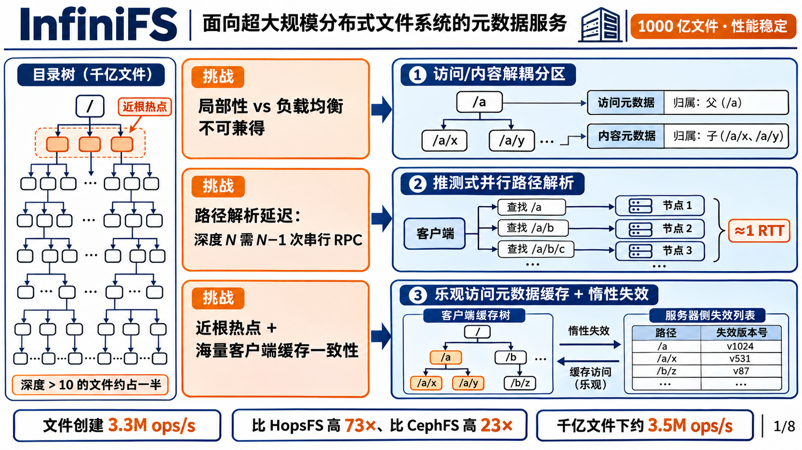
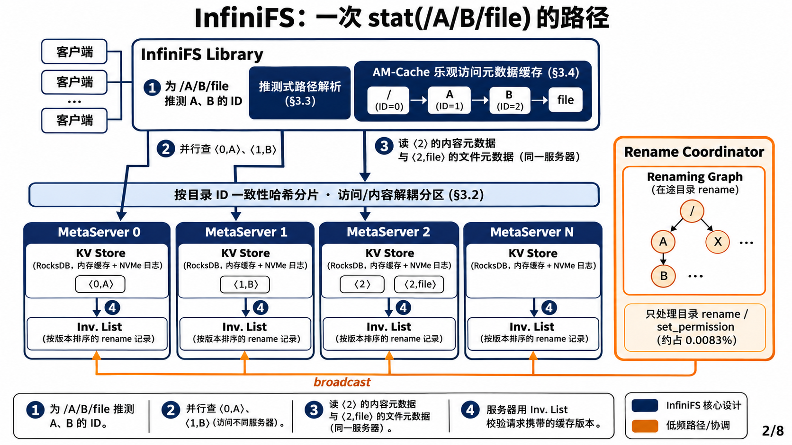
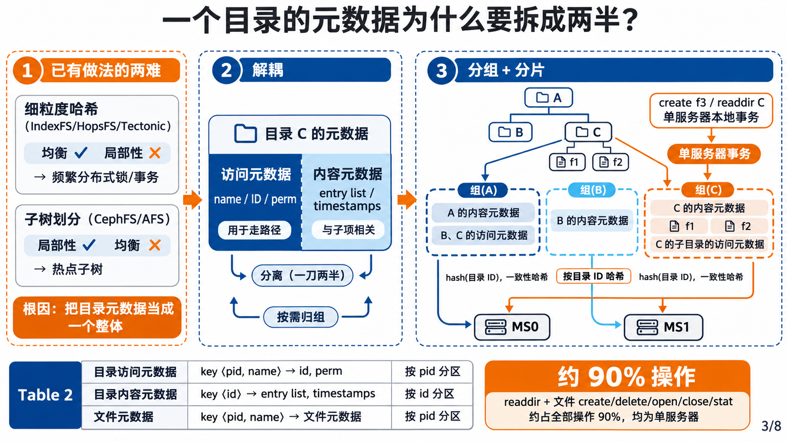
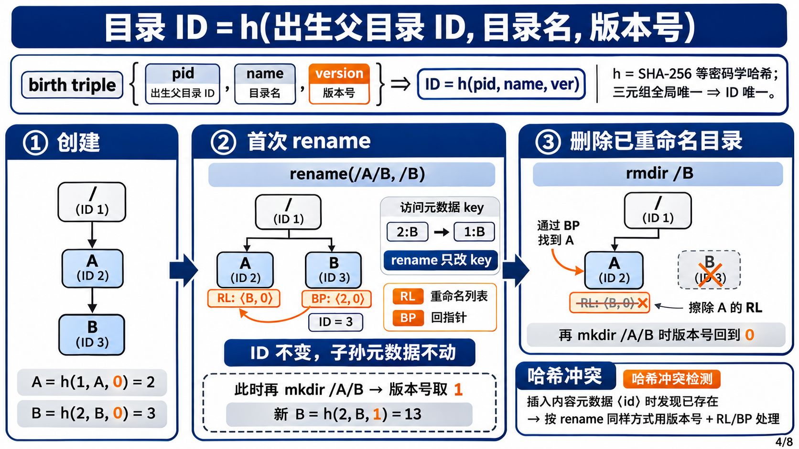
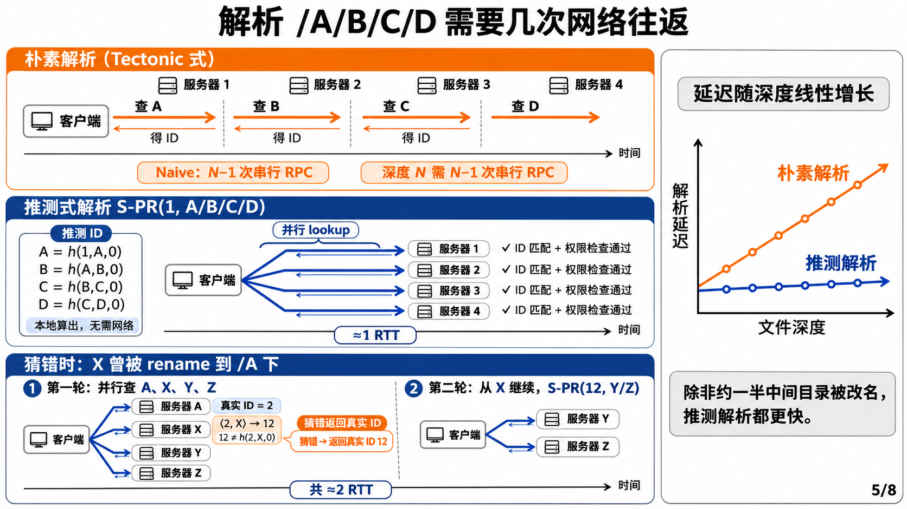
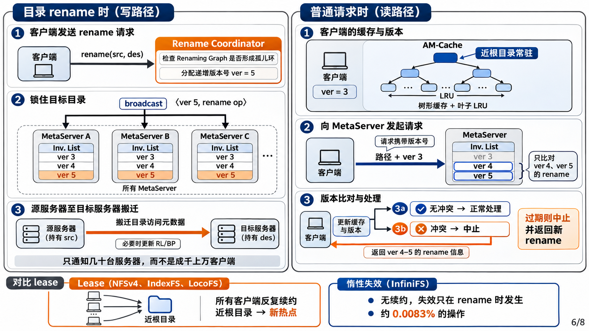
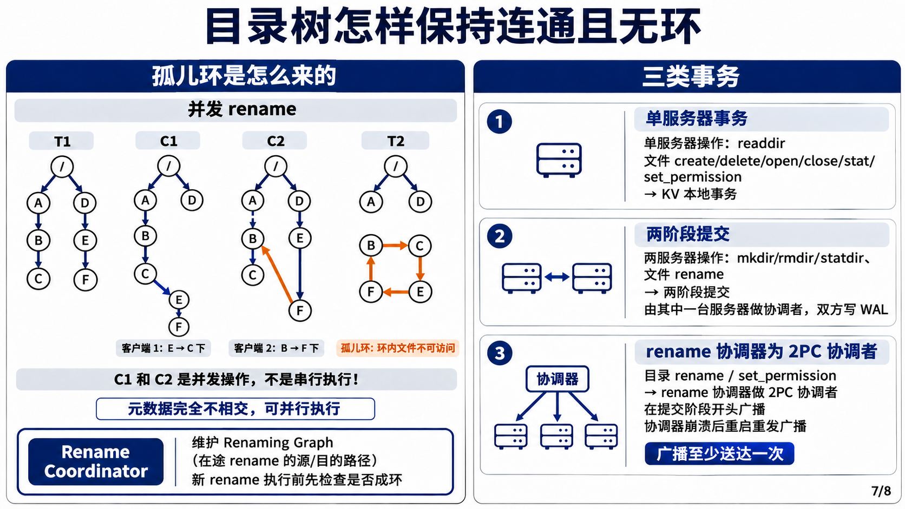
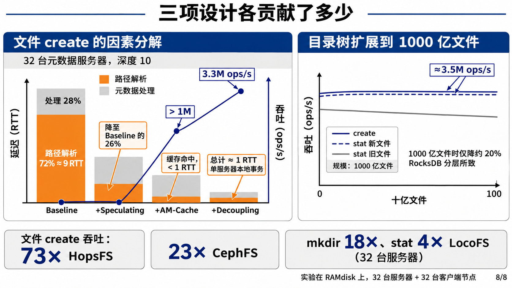

# InfiniFS: An Efficient Metadata Service for Large-Scale Distributed Filesystems — 图解

## 论文信息

- 论文：Wenhao Lv, Youyou Lu, Yiming Zhang, Peile Duan, Jiwu Shu. *InfiniFS: An Efficient Metadata Service for Large-Scale Distributed Filesystems*, FAST 2022 — <https://www.usenix.org/conference/fast22/presentation/lv>（[PDF](https://www.usenix.org/system/files/fast22-lv.pdf)，本地副本：[fast22-lv.pdf](fast22-lv.pdf)）
- 精读文档：[deep-read.md](deep-read.md)（逐章精读，相关图解已嵌入对应章节）
- 风格：paper-figure · 中文 · 16:9 · 用于论文阅读笔记
- 页数：8（封面 + 7 页架构 / 机制 / 结果）
- 生成方式：`prompts/*.json` 为每页作图规格；图片由 Codex CLI 内置 imagegen 生成。图为重新绘制的示意图，非论文原图。

## 封面

**一句话**：当一个分布式文件系统要覆盖整个数据中心、容纳上百亿乃至千亿文件时，元数据服务会同时遇到三个问题：分区无法兼顾局部性与负载均衡、目录变深导致路径解析延迟线性增长、近根目录成为热点。InfiniFS 用访问/内容解耦分区、推测式并行路径解析、乐观访问元数据缓存三项技术逐一解决，在 1000 亿文件规模下保持约 3.5M ops/s 的稳定吞吐。

## 第1页：架构总览

**讲解**：InfiniFS 由三部分组成。客户端库负责推测式路径解析，并在本地缓存目录的访问元数据（AM-Cache）。元数据服务器按目录 ID 一致性哈希分片，每台用 RocksDB 存元数据，另有一张按版本排序的失效列表（Inv. List）。中心 rename 协调器只处理目录 rename 与 set_permission，这类操作在阿里云盘古的真实负载中只占约 0.0083%。以 stat(/A/B/file) 为例：客户端先算出 A、B 的 ID，并行查 ⟨0,A⟩、⟨1,B⟩，再在同一台服务器上读 B 的内容元数据 ⟨2⟩ 与文件元数据 ⟨2,file⟩；服务器用失效列表校验请求携带的缓存版本。

## 第2页：访问/内容解耦分区

**讲解**：已有方案在两种极端之间二选一。细粒度哈希（IndexFS、HopsFS、Tectonic）负载均衡好，但创建文件要同时改父目录的 entry list 和时间戳，常常跨服务器加锁、做分布式事务；子树划分（CephFS、AFS）局部性好，但热点子树会压垮单台服务器。论文认为根因是"把目录元数据当成一个整体"。InfiniFS 把它拆成两半：访问元数据（name、ID、权限）用于走路径，和父目录放在一起；内容元数据（entry list、时间戳）与子项相关，和该目录下的文件、子目录访问元数据放在一起。这样每个目录形成一个独立的组，再按目录 ID 哈希分到各服务器。readdir 和文件 create/delete/open/close/stat 约占全部操作的 90%，都只需一台服务器的本地事务。

## 第3页：可预测的目录 ID

**讲解**：目录 ID 等于其"出生三元组"（出生父目录 ID、目录名、版本号）的密码学哈希，所以只要知道路径，客户端就能在本地算出每一级目录的 ID。rename 只改访问元数据的 key，ID 不变，子孙的元数据一个都不用动。难点在于 rename 之后原位置可以再建同名目录：首次 rename 时在出生父目录记一条重命名列表（RL）、在目录自身记回指针（BP），新建同名目录时版本号加 1；删除已改名的目录时经 BP 擦掉 RL，版本号回到 0。哈希冲突在插入内容元数据时就能发现，按同样方式用版本号处理。

## 第4页：推测式并行路径解析

**讲解**：按目录 ID 分片后，解析深度为 N 的路径需要 N−1 次串行 RPC，而盘古负载中约一半被访问的文件深度超过 10。InfiniFS 让客户端先按版本号 0 推测所有中间目录的 ID，再一次性并行发出全部查找请求；每台服务器检查权限并比对 ID，猜对时整条路径约 1 个 RTT 解析完。若某级目录曾被改名，服务器用正确的 key 找到它并返回真实 ID，客户端从这一级继续下一轮，约 2 个 RTT。论文实验显示，除非约一半中间目录都被改过名，推测式解析都比朴素解析快；配合缓存，改过名的目录真实 ID 也会被记住。

## 第5页：乐观访问元数据缓存与惰性失效

**讲解**：即使负载均匀，每次路径解析都要读根附近的目录，这些目录所在的服务器会成为瓶颈。InfiniFS 在客户端只缓存目录访问元数据，组织成树，叶子挂在 LRU 链上，保证近根目录常驻。一致性不靠 lease：目录 rename 先经协调器分配递增版本号，再广播到所有元数据服务器的失效列表，只通知几十台服务器而不是成千上万个客户端。客户端照常使用缓存，请求时带上本地版本号；服务器只把路径与更新版本的 rename 比对，无冲突就处理，冲突就中止并把新的 rename 记录返回给客户端更新。lease 的问题是所有客户端都要反复续约近根目录，反而制造新的热点。

## 第6页：孤儿环与三类事务

**讲解**：两个并发的目录 rename 即使涉及的元数据完全不相交，也可能把目录树破坏：把 E 移到 C 下、同时把 B 移到 F 下，结果 B→C→E→F→B 形成一个与根断开的环，环里的文件再也访问不到。InfiniFS 用中心 rename 协调器维护在途 rename 的源与目的路径（renaming graph），新 rename 执行前先检查是否会成环。事务按涉及的服务器数分三类：单服务器操作用 KV 本地事务；mkdir/rmdir/statdir 和文件 rename 涉及两台服务器，用两阶段提交，由其中一台做协调者、双方写 WAL；目录 rename 由 rename 协调器做 2PC 协调者，并在提交阶段开头广播，协调器崩溃后重启重发，保证广播至少送达一次。

## 第7页：关键结果

**讲解**：因素分析（论文图 11）在 32 台元数据服务器、深度 10 的目录树上逐项叠加设计。Baseline 中路径解析占 72% 的延迟（约 9 个 RTT），元数据处理约 3 个 RTT；加入推测式解析后路径解析降到 Baseline 的 26%，但吞吐仍被近根热点卡住；加入 AM-Cache 后吞吐超过 1M ops/s，路径解析低于 1 个 RTT；加入解耦分区后文件创建变成单服务器本地事务，总延迟约 1 个 RTT，吞吐 3.3M ops/s。目录树扩展到 1000 亿文件时 create 与 stat 新文件稳定在约 3.5M ops/s，stat 旧文件因 RocksDB 分层仅下降约 20%。与其他系统相比，文件创建吞吐是 HopsFS 的 73 倍、CephFS 的 23 倍。实验在 RAMdisk 上进行，32 台服务器加 32 台客户端节点。

## 总结：3 个核心要点

1. **解耦而不是取舍**：把目录元数据拆成访问与内容两半，分别随父、子归组，再按目录 ID 哈希分片，同时得到局部性和负载均衡。
2. **让 ID 可计算**：出生三元组哈希让客户端在本地推算整条路径的目录 ID，把 N−1 次串行 RPC 变成约 1 次并行往返；rename 靠版本号、RL 和 BP 维持唯一性。
3. **失效通知发给服务器而非客户端**：客户端乐观使用缓存，罕见的目录 rename 广播给几十台元数据服务器，由服务器在处理请求时惰性校验，避免了 lease 续约在近根目录上制造的新热点。
