# InfiniFS 论文精读：An Efficient Metadata Service for Large-Scale Distributed Filesystems（FAST 2022）

> 论文：Wenhao Lv, Youyou Lu, Yiming Zhang, Peile Duan, Jiwu Shu. *InfiniFS: An Efficient Metadata Service for Large-Scale Distributed Filesystems*. USENIX FAST 2022, pp. 313–328.
>
> 机构：清华大学计算机系（BNRist）、厦门大学信息学院、阿里巴巴集团
>
> 链接：<https://www.usenix.org/conference/fast22/presentation/lv> ；PDF：<https://www.usenix.org/system/files/fast22-lv.pdf>（本地副本：[fast22-lv.pdf](fast22-lv.pdf)）
>
> 精读日期：2026-11-21。文中**数字、表格与机制描述均摘自论文原文**（标注所在章节）；标注"解读"的段落是本文作者的分析与推论，不是论文原话。
>
> 图解：文中 8 张 paper-figure 风格图解由 Codex CLI 内置 imagegen 依据 `prompts/*.json` 生成，放在对应章节；总索引见[附录：图解索引](#附录图解索引)，只看图的快速版见[图解](README.md)。
>
> 相关文档：[元数据扩展性综述中的 InfiniFS 小节](../metadata-scalability.md#22-infinifs-an-efficient-metadata-service-for-large-scale-distributed-filesystemsfast-2022)、[Tectonic（FAST 2021）精读](../tectonic-fast2021/deep-read.md)（InfiniFS 的主要对照对象之一）、[论文清单](../essential-papers-2000-2026.md)。

## 目录

- [0. 一页速览](#0-一页速览)
- [1. 背景：为什么要"一个数据中心一个文件系统"](#1-背景为什么要一个数据中心一个文件系统)
- [2. 三大挑战](#2-三大挑战)
- [3. 真实负载特征](#3-真实负载特征)
- [4. 总体架构](#4-总体架构)
- [5. 访问-内容解耦分区](#5-访问-内容解耦分区)
- [6. 推测式路径解析](#6-推测式路径解析)
- [7. 乐观访问元数据缓存与惰性失效](#7-乐观访问元数据缓存与惰性失效)
- [8. 一致性：孤儿环与事务](#8-一致性孤儿环与事务)
- [9. 评估](#9-评估)
- [10. 与相关工作的对比](#10-与相关工作的对比)
- [11. 整体总结](#11-整体总结)
- [附录：图解索引](#附录图解索引)

---

## 0. 一页速览

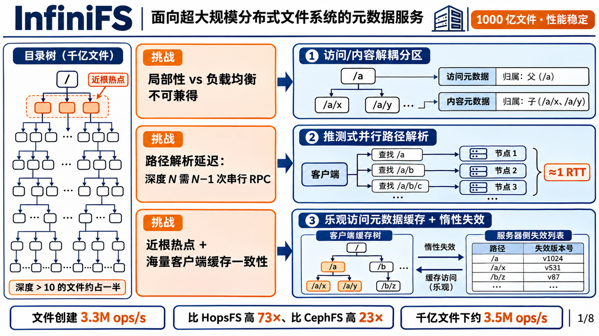

> **图解**：三大挑战（局部性与均衡不可兼得、深路径解析慢、近根热点）各对应一项技术；千亿文件下性能稳定。

**一句话**：InfiniFS 是面向"单实例覆盖整个数据中心、百亿到千亿文件"场景的分布式文件系统元数据服务。它把目录元数据拆成**访问元数据**（名字、ID、权限）和**内容元数据**（目录项列表、时间戳），前者跟父目录放一起、后者跟子项放一起，再按目录 ID 一致性哈希分区，同时得到局部性和负载均衡；用**可预测的目录 ID** 让客户端并行解析整条路径；用**客户端乐观缓存 + 服务端惰性失效**消除近根热点。

| 维度 | 要点 |
|------|------|
| 目标场景 | 单个文件系统实例覆盖整个数据中心，支持数百亿文件、大量并发客户端（§1、§2.1） |
| 三大挑战 | 分区难以兼顾局部性与均衡；目录层次变深导致路径解析延迟高；海量客户端下客户端缓存一致性维护代价过大（§2.2） |
| 负载依据 | 阿里云盘古三类服务的生产 trace：文件操作占 95.8%；目录 rename 与目录 set_permission 合计仅约 **0.0083%**；近一半被访问文件深度超过 10（§2.2、§2.3） |
| 技术 1 | **访问-内容解耦分区**：目录访问元数据按 `(pid, name)` 存、随父目录分区；内容元数据按 `id` 存、与子项同分区；约 90% 的操作单服务器完成（§3.2） |
| 技术 2 | **推测式路径解析**：目录 ID = 哈希(父 ID, 名字, 名字版本)，客户端推算所有中间目录 ID 并行查询，猜对时约 1 个 RTT（§3.3） |
| 技术 3 | **乐观访问元数据缓存**：客户端只缓存目录访问元数据，不管是否过期直接用；目录 rename / set_permission 只广播给元数据服务器，由服务器在处理请求时惰性校验（§3.4） |
| 一致性 | 中心 rename 协调者维护"重命名图"防止孤儿环；单服务器操作用 KV 本地事务；跨两台服务器的操作用 2PC（§4） |
| 实现 | Thrift RPC（Linux TCP，RTT 约 60 µs）+ RocksDB；客户端支持用户态库或 FUSE（§3.1、§5.1） |
| 结果 | 32 台元数据服务器下文件 create 吞吐是 HopsFS 的 **73 倍**、CephFS 的 **23 倍**；mkdir、stat 分别是 LocoFS 的 18 倍、4 倍；1000 亿文件时 create/stat 稳定在约 **3.5M ops/s**（§5） |

---

## 1. 背景：为什么要"一个数据中心一个文件系统"

### 1.1 现状：文件系统"星座"

论文指出，当前数据中心通常由许多较小的文件系统集群组成（§2.1）：

- **阿里云**维护着近**数千个**盘古（Pangu）文件系统实例，合计支撑数据中心内数百亿文件；
- **Facebook** 在单个数据中心需要很多个 HDFS 集群，因为受元数据限制，每个 HDFS 集群最多支持约 **1 亿**文件；后来用 Tectonic 把小集群整合成单一实例（见 [Tectonic 精读](../tectonic-fast2021/deep-read.md)）。

### 1.2 单一大文件系统的好处（§2.1）

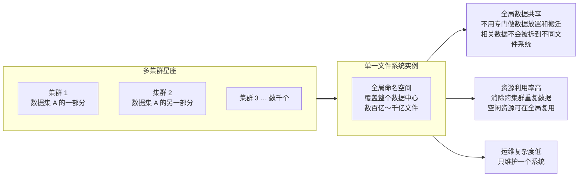

代价是元数据服务成为整个文件系统的扩展性瓶颈。一次元数据操作分两步（§2.1）：

1. **路径解析**（path resolution）：定位目标文件，并检查用户对路径上各级目录的权限；
2. **元数据处理**（metadata processing）：原子地更新相关元数据对象。

InfiniFS 的三项技术分别作用在这两步上：解耦分区优化"元数据处理"的局部性；推测解析和乐观缓存优化"路径解析"的延迟和吞吐。

---

## 2. 三大挑战

### 2.1 挑战 1：分区难以兼顾局部性与负载均衡（§2.2）

**局部性为什么重要**：一次操作往往涉及多个元数据对象。以文件创建为例，要先锁父目录（与 readdir 串行化），再原子地更新三个对象：**文件元数据、父目录的目录项列表、父目录的时间戳**。如果这些对象都在一台服务器上，就能避免分布式锁和分布式事务。

**均衡为什么重要**：真实负载中相关文件往往聚在同一子树里，同一子树的文件和目录可能在短时间内被密集访问，存放该子树的服务器就会成为瓶颈。

| 分区策略 | 代表系统 | 优点 | 缺点 |
|----------|----------|------|------|
| 细粒度（直接把元数据对象哈希到服务器） | Giraffa 类、IndexFS、HopsFS、Tectonic（按目录粒度） | 负载均衡 | 牺牲局部性，频繁分布式锁/事务，延迟高、吞吐低 |
| 粗粒度（连续子树放同一服务器） | CephFS 子树分区、AFS Volume、HDFS Federation | 局部性好，避免跨服务器操作 | 对倾斜负载敏感，负载不均 |

整个数据中心的文件都放进来以后，目录树在深度和广度上都迅速膨胀，负载又极其多样（它要支撑数据中心的所有服务），两类方法都不够用。

### 2.2 挑战 2：目录变深，路径解析延迟高（§2.2）

以往文件系统通常假设大部分文件深度小于 10。但论文分析真实负载发现，把所有服务合并到一个文件系统后，**近一半被访问的文件深度超过 10**（图 1a）。

论文按 Tectonic 的设计实现了一个朴素的路径解析：目录按 ID 分区到不同服务器，解析深度为 N 的路径需要依次解析 N−1 个中间目录，也就是 **N−1 次串行网络请求**，延迟随深度**线性增长**（图 1b）。

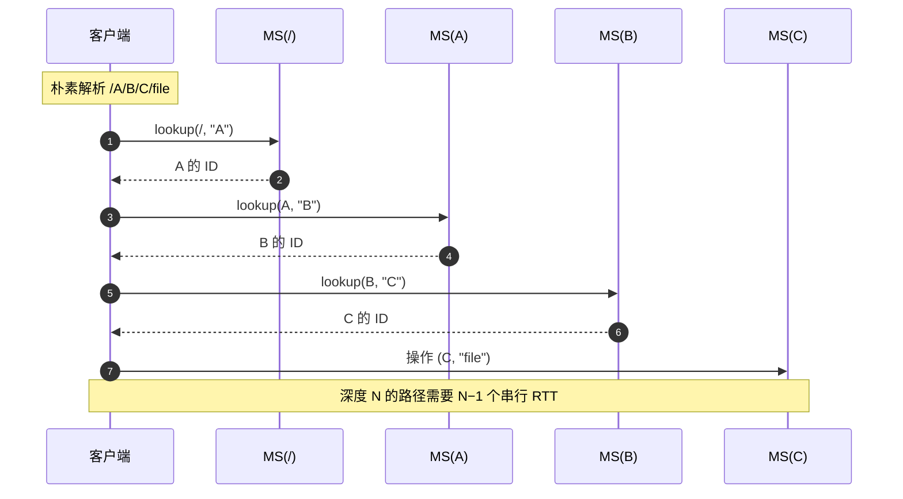

### 2.3 挑战 3：近根热点与客户端缓存一致性（§2.2）

路径解析必须从根开始逐级检查权限，所以**近根目录被读得极其频繁**，即使元数据操作本身是均衡的，吞吐也会被存放近根目录的那台服务器卡住。论文称之为**近根热点**（near-root hotspot）。

很多系统靠客户端元数据缓存缓解这个问题，常用的是**租约**（lease）：每个缓存项有固定有效期，到期自动失效（NFS v4、PVFS、LocoFS、IndexFS 都这样做）。问题在于：所有客户端都要**反复续约**近根目录的缓存项，客户端越多，续约请求越集中到近根目录所在的服务器，最终又变成新的瓶颈。

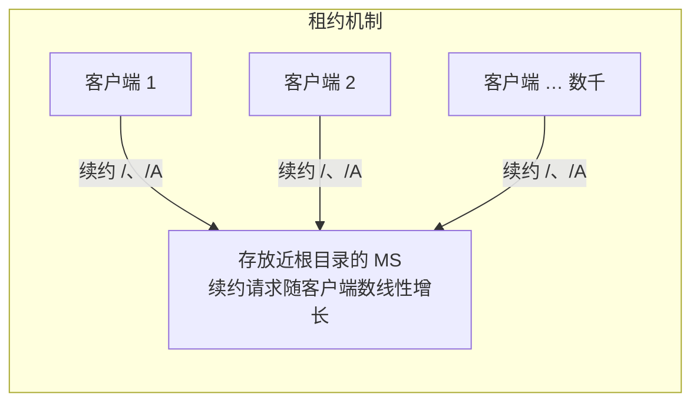

---

## 3. 真实负载特征

论文采集了阿里云三个盘古实例的生产元数据 trace，分别支撑**数据处理与分析、对象存储、块存储**三类服务，合并起来代表"覆盖整个数据中心的大文件系统"的负载（§2.3）。

### 3.1 操作比例（论文表 1）

| 文件操作（占全部 95.8%） | 比例 | 目录操作（占全部 4.2%） | 比例 |
|--------------------------|-----:|--------------------------|-----:|
| open / close | 54.9% | readdir | 93.3% |
| stat | 12.9% | statdir | 6.6% |
| create | 10.0% | mkdir | 0.1% |
| delete | 12.4% | rmdir | 0.1% |
| rename | 9.7% | rename | 0.0% |
| set_permission | 0.1% | set_permission | 0.0% |

*表中比例是文件操作、目录操作各自内部的相对比例。*

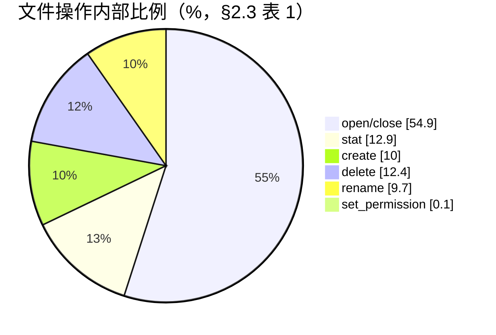

### 3.2 三条结论（§2.3）

1. 文件操作约占全部操作的 **95.8%**；
2. readdir 是最频繁的目录操作，约占目录操作的 **93.3%**；
3. 目录 rename 和目录 set_permission 极少发生，合计只占全部元数据操作的约 **0.0083%**。

**解读**：第 3 条是整篇论文最重要的"许可证"。InfiniFS 的两个关键设计都把代价转移到了这两类操作上：推测解析要求目录 ID 在 rename 后保持不变（rename 要维护额外的 RL/BP），乐观缓存要求目录 rename 广播到所有元数据服务器、并经过单点协调者。只有在它们极其罕见时，这样的取舍才划算。

---

## 4. 总体架构

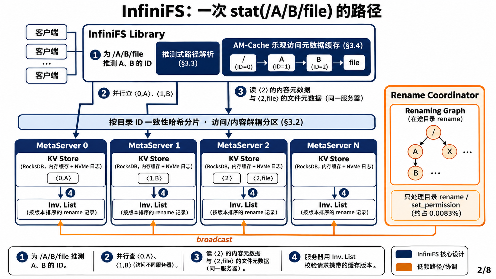

> **图解**：客户端库做推测式路径解析并缓存访问元数据；元数据服务器按目录 ID 一致性哈希分片，KV 存储 + 失效列表；中心 rename 协调器只处理罕见的目录 rename。图中以 stat(/A/B/file) 为例标出四步路径。

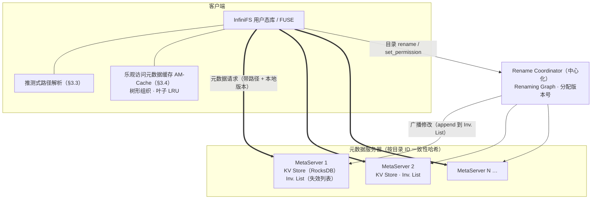

*图 1：InfiniFS 架构（对应论文图 2）。*

三类组件（§3.1）：

| 组件 | 职责 |
|------|------|
| 客户端 | 通过用户态库或 FUSE 访问全局目录树；用推测解析并行遍历路径；用乐观缓存吸收近根目录的读负载 |
| 元数据服务器 | 按访问-内容解耦分区存放目录树；每台用本地 KV 存储管理元数据对象（通常在内存缓存、更新记日志到 NVMe SSD）；用失效列表（Inv. List）惰性校验客户端请求 |
| Rename 协调者 | 中心化处理目录 rename 和目录 set_permission：用重命名图检测并发 rename 是否会产生孤儿环，并把修改信息广播到所有元数据服务器的失效列表 |

---

## 5. 访问-内容解耦分区

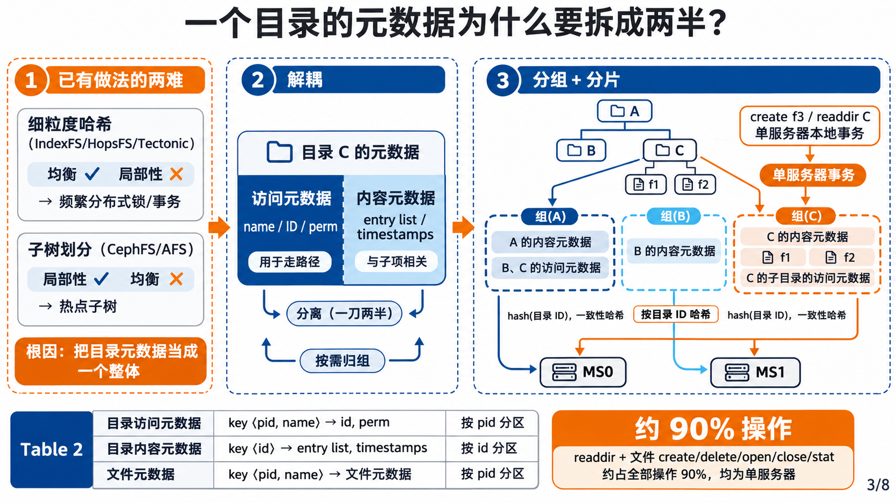

> **图解**：目录元数据拆成访问元数据（name/ID/perm，随父目录）与内容元数据（entry list/timestamps，随子项），以目录为单位成组后按目录 ID 哈希分片；下方为论文表 2 的 KV 模式。

### 5.1 根本原因：把目录元数据当成一个整体（§3.2）

论文认为，以往细粒度和粗粒度分区都做不到两全，**根本原因是它们把目录元数据当作一个整体**。分区时只能把目录要么和父目录分开，要么和子项分开，总会破坏一部分相关元数据的局部性。

实际上目录元数据由两个**彼此独立**的部分组成：

| 部分 | 内容 | 用途 |
|------|------|------|
| **访问元数据**（access） | 目录名、ID、权限 | 用于"访问"目录树，也就是路径解析 |
| **内容元数据**（content） | 目录项列表（dirent）、时间戳等 | 与子项相关，create/delete/readdir 时要修改或读取 |

### 5.2 按操作需求分组（§3.2）

论文把元数据操作分成三类：

1. **只处理目标自身元数据**：open、close、stat。如文件 stat 只读目标文件的元数据；
2. **处理目标及其父目录**：create、delete、readdir。如文件创建要插入文件元数据，再锁定并更新父目录的目录项列表和时间戳；
3. **rename**：特殊，涉及两个文件/目录及其各自的父目录。

大部分操作（第 1、2 类）只需要"目标 + 父目录"的元数据。于是 InfiniFS 把**每个目录的内容元数据**与**其子目录的访问元数据**、**其下文件的元数据**放在同一组：

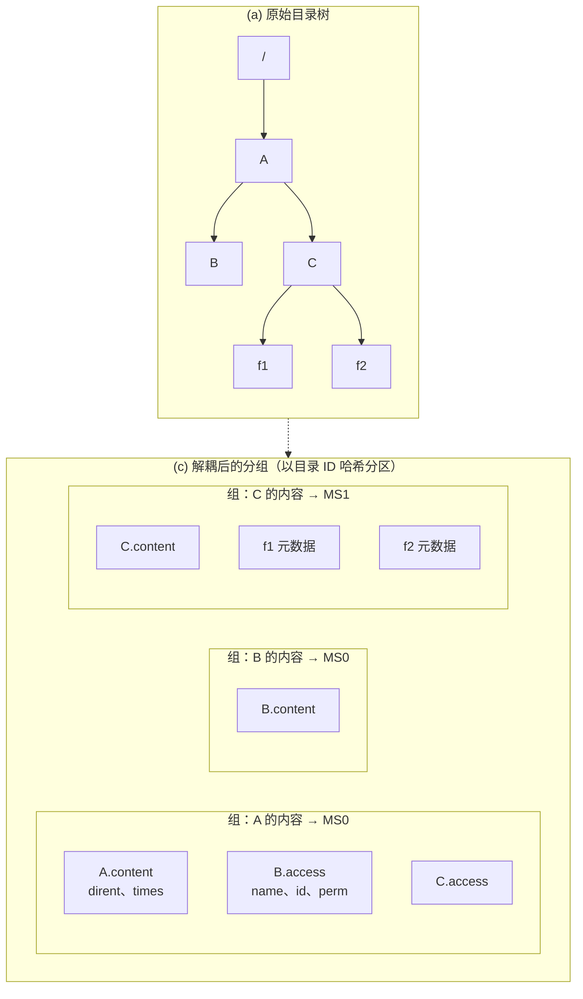

*图 2：访问-内容解耦分组（对应论文图 3）。每个目录的"内容"和它的直接子项（子目录的"访问"部分 + 文件）组成一组，组按目录 ID 哈希到服务器。*

效果（§3.2）：

- 目录树被切成一个个**独立的"每目录分组"**；
- 目录 readdir、文件 create / delete / open / close / stat / set_permission 都能在**单台服务器**内完成，按表 1 这些操作约占全部操作的 **90%**；
- 例：在 C 下创建文件，只需在 MS1 上执行一个本地事务，插入文件元数据并更新 C 的目录项列表和时间戳；readdir C 也只涉及 MS1。

### 5.3 按目录 ID 哈希分区（§3.2）

在局部性分组的基础上，再把这些细粒度分组**按目录 ID 哈希**到不同元数据服务器，从而实现负载均衡；并使用**一致性哈希**，减少集群扩缩容时的数据迁移。

### 5.4 KV 存储模式（论文表 2）

| 元数据对象 | Key | Value | 分区依据 |
|------------|-----|-------|----------|
| 目录访问元数据 | `(pid, name)` | id, permission | pid |
| 目录内容元数据 | `id` | entry list, timestamps 等 | id |
| 文件元数据 | `(pid, name)` | 文件元数据 | pid |

*pid：父目录 ID；id：目录自身 ID。*

以解析 `/A/B/file` 为例（设 `/`、A、B 的 ID 分别为 0、1、2）：

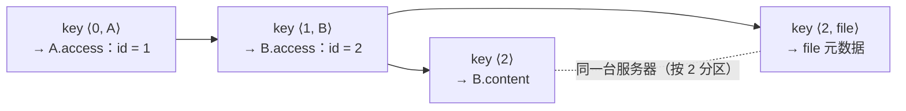

### 5.5 操作的服务器跨度

| 类型（§4.2） | 操作 | 涉及服务器 | 原因 |
|--------------|------|-----------|------|
| 单服务器 | 目录 readdir；文件 create / delete / open / close / stat / set_permission | 1 | 目标与父目录内容同组 |
| 双服务器 | 目录 mkdir / rmdir / statdir；文件 rename | 2 | 目录的访问元数据（随父）和内容元数据（随自身 ID）在不同组；文件 rename 涉及两个父目录 |
| 协调者参与 | 目录 rename、目录 set_permission | 协调者 + 2 + 广播 | 要防孤儿环、要让所有缓存失效 |

**解读**：解耦的本质是把"目录"这个对象沿着它的两种用途劈开：**作为孩子**被父目录列出、被路径解析访问（访问元数据），**作为父亲**容纳子项（内容元数据）。劈开后，每个文件操作需要的东西都落在"父目录的内容组"里。代价被转移到了目录操作上：mkdir、rmdir、statdir 都要跨两台服务器。负载里文件操作占 95.8%，而目录写操作极少，所以划算。

**解读（与 Tectonic 的关系）**：对照 [Tectonic 精读](../tectonic-fast2021/deep-read.md#42-三层元数据-schema论文表-1) 可以发现，Tectonic 的 Name 层用 `(dir_id, subdirname) → subdir_info, subdir_id`、按 `dir_id` 分片，在"子目录项跟着父目录分片"这一点上已经与 InfiniFS 的访问元数据布局相似。InfiniFS 的差别在于：把目录时间戳等内容元数据也明确地组织进来，并把这种分组作为系统化的设计原则提出；更重要的增量是后面两项——推测解析和乐观缓存。论文在实验中把"按目录粒度分区但没有三项特性"的系统作为 Baseline，并说明它类似 IndexFS、HopsFS 和 Tectonic（§5.3）。

---

## 6. 推测式路径解析

### 6.1 可预测的目录 ID（§3.3.1）

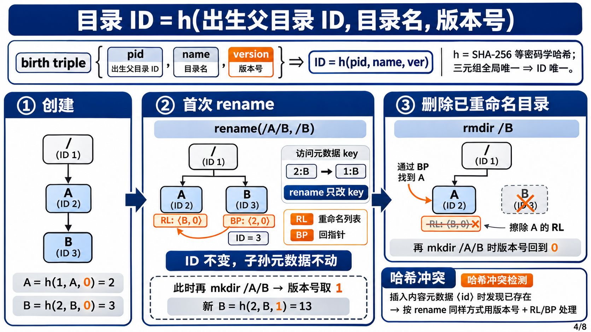

> **图解**：ID = h(出生父目录 ID, 名字, 版本号)；rename 只改访问元数据的 key、ID 不变；首次 rename 记录 RL 与 BP，删除时经 BP 擦除 RL（对应论文图 4）。

关键思想：让客户端**只凭路径字符串就能算出**每个中间目录的 ID，于是可以同时发出所有 lookup。

#### 创建

新建目录时，用其**出生三元组**（birth triple）的密码学哈希（如 SHA-256）生成 ID：

```
id = hash(父目录 ID, 目录名, 名字版本)
```

目录被创建时所在的父目录称为它的**出生父目录**（birth parent）。名字版本（name version）用于保证出生三元组全局唯一，默认是 0。

#### 重命名

目录 rename 到别处时，**只更新访问元数据的 key**（因为 key 是 `(pid, name)`），内容元数据和 ID 都不变，所以它下面所有后代的元数据都不需要动。

目录**第一次**被 rename 离开出生父目录时：

- 出生父目录记录一条 **rename-list（RL）**：`⟨目录名, 名字版本⟩`，表示"在这里出生、已经搬走的子目录"；
- 被移走的目录记录一个 **back-pointer（BP）**：`⟨出生父目录 ID, 名字版本⟩`。

之后在出生父目录下再创建同名目录时，要根据 RL 选择新的名字版本，以免出生三元组重复。再次 rename 时只改访问元数据的 key，RL 和 BP 不变。出生父目录被删除时，它的访问和内容元数据被删除，但 **RL 保留**；RL 只能通过 BP 在被移走的目录被删除时清除。

#### 删除

删除一个被 rename 过的目录时，通过它的 BP 找到并删除出生父目录上的 RL。之后再在出生父目录下创建同名目录，名字版本回到默认的 0。

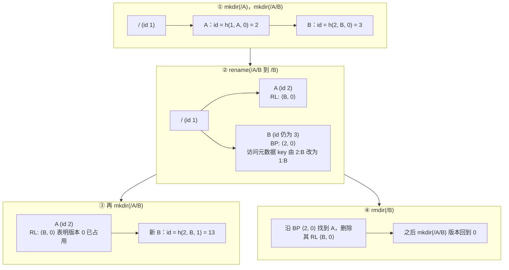

*图 3：目录 ID 的创建、重命名与删除（对应论文图 4，ID 数值沿用论文示例）。*

#### ID 唯一性与哈希冲突（§3.3.1）

- 文件系统语义要求同一父目录下任意时刻不存在两个同名目录。没有 rename 时，`⟨出生父 ID, 目录名⟩` 已经全局唯一；有 rename 时，用名字版本解决"搬走后又在原处建了同名目录"的问题，所以出生三元组全局唯一，ID 也唯一（除非哈希冲突）；
- 使用密码学哈希，冲突概率极低；目录 ID 是内容元数据的 key，创建目录插入内容元数据时就能**检测到冲突**；
- 冲突的处理方式**与 rename 相同**：用名字版本、RL 和 BP。两种情况对后续创建的影响一样，可通过 RL 条目格式区分。

### 6.2 并行解析（§3.3.2）

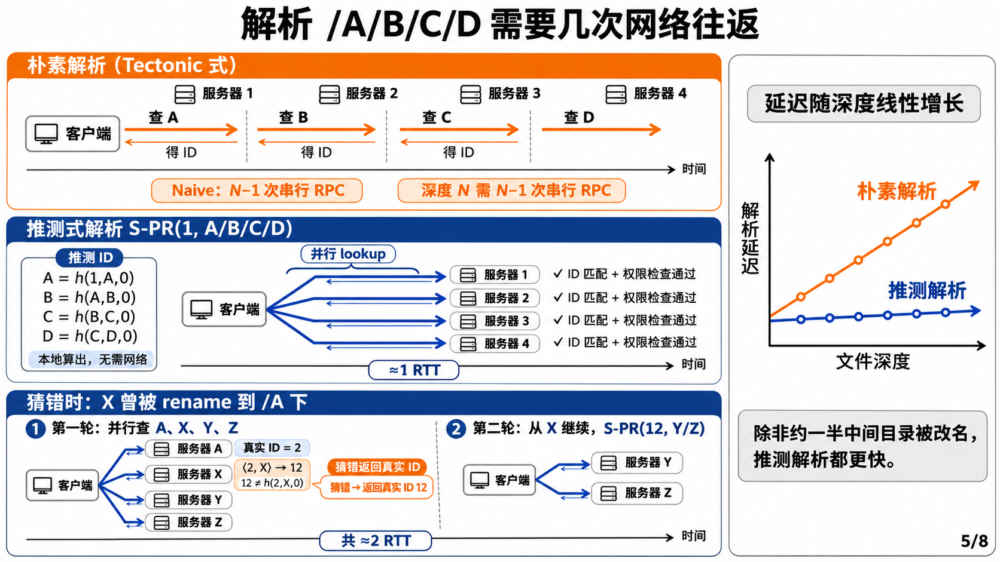

> **图解**：朴素解析需 N−1 次串行 RPC；推测式解析本地算出全部中间 ID 后并行查找，约 1 RTT；猜错时服务器返回真实 ID，下一轮从该目录继续，约 2 RTT（对应论文图 5、图 15）。

1. **预测 ID**：客户端从路径（或子路径）的根 ID 出发，以版本号 0 重建出生三元组并计算哈希，推出所有中间目录的 ID，再拼出每个路径分量的 key；
2. **并行查询**：同时向各中间目录所在服务器发 lookup。每个请求检查访问权限，并把推测的 ID 与服务器上存储的 ID 比较；不一致时**返回真实 ID**；
3. 重复 1、2，直到解析完成。

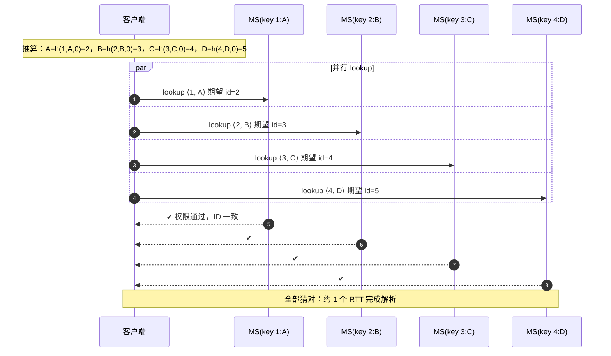

*图 4：推测解析 S-PR(1, A/B/C/D)（对应论文图 5a）。*

**预测失败的情况**：只有**目录 rename** 和**哈希冲突**会导致预测错误（§5.7）。例如把 `/X`（ID 12）rename 到 A 下面成为 `/A/X`，客户端按 `h(2, X, 0)` 推算会得到错误 ID（≠ 12）。但对 `/A/X` 的 lookup 用的是正确的 key `2:X`（父 ID 2 和名字 X 都是对的），服务器能找到 X 的访问元数据并返回真实 ID 12；客户端再从 12 开始推测解析剩下的子路径 `Y/Z`。整体需要**两轮**，约 2 个 RTT（图 5b）。

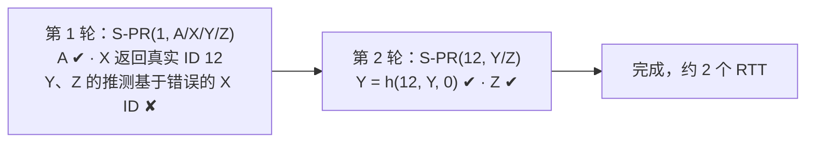

**解读**：这个设计的巧妙之处在于"**key 用 (pid, name)，ID 用出生信息**"。lookup 的 key 只依赖父 ID 和名字，父 ID 推对了，这一级就一定能查到，哪怕自己的 ID 推错了；而 ID 一旦生成就不随 rename 改变，所以后代的 key 都不用动。rename 只影响"被搬过的那一级之后"的推测，代价是多一轮 RTT。RL/BP 机制则是为了在允许 rename 的前提下保持"出生三元组唯一 ⇒ ID 唯一"这条不变式。

---

## 7. 乐观访问元数据缓存与惰性失效

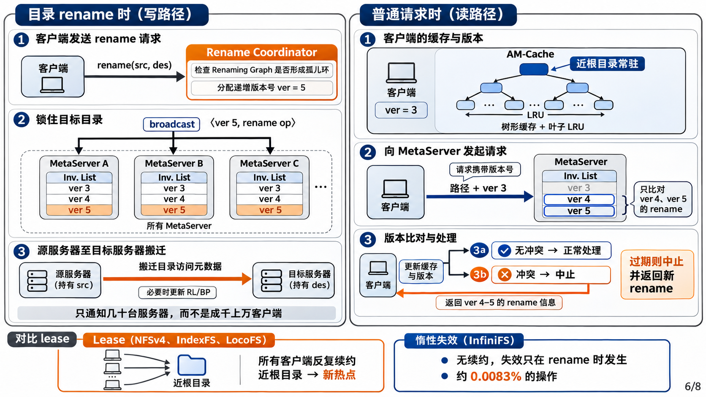

> **图解**：左：目录 rename 经协调器分配版本号并广播到各服务器的 Inv. List；右：客户端带版本号发请求，服务器只比对更新的 rename，冲突则中止并返回新记录；底部与 lease 对比（对应论文图 7）。

### 7.1 缓存组织（§3.4）

- 客户端**只缓存目录访问元数据**（名字、ID、权限）。命中时就不需要向近根目录发 lookup，从而消除近根热点；
- 缓存项按文件系统层次组织成**树**，只有**叶子项**挂在 LRU 链表上。替换时淘汰最久未使用的叶子，保证**近根目录始终留在缓存中**。

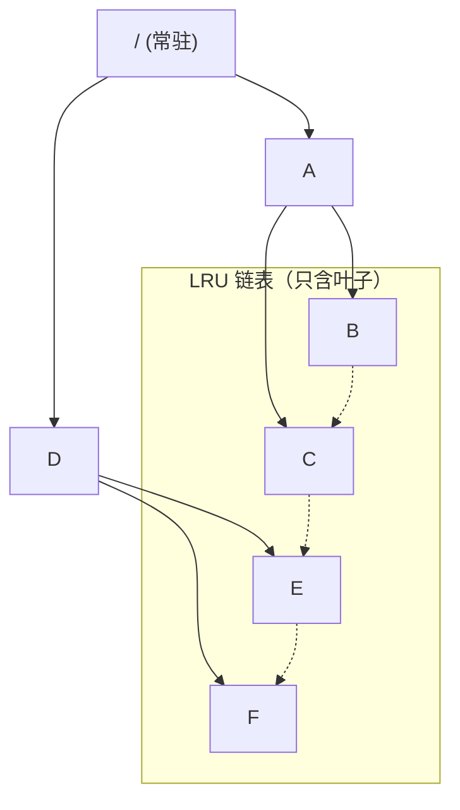

*图 5：客户端访问元数据缓存（对应论文图 6）。内部节点只有在其所有子节点都被淘汰、自己成为叶子后才可能被淘汰。*

### 7.2 惰性失效（§3.4）

目录 rename 或目录 set_permission 后，大量客户端的缓存项会过期。逐个通知客户端不现实：客户端成员难以管理，而且数量远多于元数据服务器。InfiniFS 的做法是**只把失效信息广播给元数据服务器**（数量少得多），由服务器在处理客户端请求时惰性地校验。由于目录 rename 极少（约 0.0083%），一台协调服务器足以处理。

**目录 rename 的处理流程**（图 7a）：

1. 把目录 rename 发给 rename 协调者，检查它是否会与正在进行的 rename 形成孤儿环（§8.1）；协调者为每个目录 rename 分配一个**递增版本号**；
2. 锁住目标目录，把 rename 与其他操作串行化（在 rename 完成前阻塞对该子树的新访问）；然后把 rename 信息连同版本号**并行广播**给所有元数据服务器并等待确认。服务器把它按版本号排序存入**失效列表**；
3. 把目录的访问元数据从源服务器移到目标服务器；如果是第一次 rename，同时更新 RL 和 BP。

**请求时的惰性校验**（图 7b）：

1. 客户端不知道缓存是否过期，**乐观地**用本地缓存做路径解析。每个客户端有一个**本地版本号**，表示它的缓存已包含该版本之前的所有 rename。请求带上路径和版本号；
2. 服务器把请求路径与失效列表中**介于请求版本号和最新版本号之间**的 rename 操作逐一比对；如果路径仍然有效，正常处理并返回；
3. 如果路径已失效，服务器**中止请求**，并把这些新的 rename 操作返回给客户端；客户端更新缓存和版本号后重试。

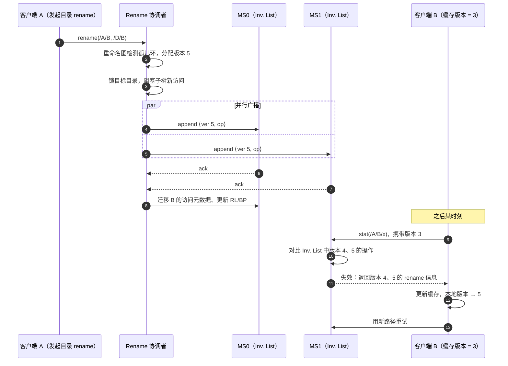

*图 6：目录 rename 的广播与请求时的惰性校验（对应论文图 7）。*

**解读**：这是把"写放大到所有客户端"变成"写放大到所有服务器 + 读时检查"。租约是**时间驱动**的失效，不管有没有修改都要定期续约，近根目录的续约压力与客户端数成正比；InfiniFS 是**事件驱动**的失效，没有 rename 就零开销，有 rename 时的代价是 O(服务器数) 的广播和每个请求的一次版本比对。由于失效信息按版本排序、请求只需比对增量部分，在 rename 罕见时这一检查非常便宜。论文没有讨论失效列表如何截断回收（长期运行后列表会增长），这是实现上需要补的细节。

---

## 8. 一致性：孤儿环与事务

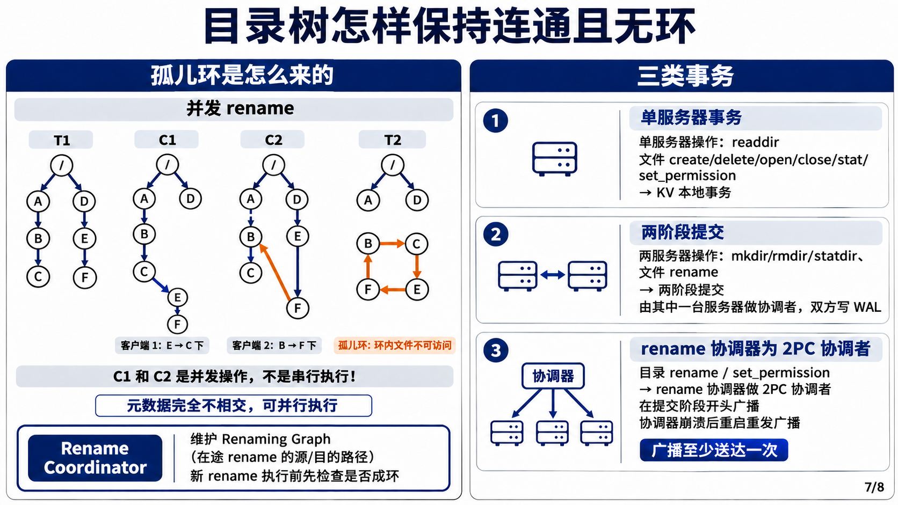

> **图解**：两个元数据不相交的并发 rename 形成 B→C→E→F→B 的孤儿环，由 rename 协调器的 renaming graph 预先检测；右侧为单服务器事务、两服务器 2PC、目录 rename 三类事务（对应论文图 8、§4.2）。

### 8.1 孤儿环（§4.1）

并发的目录 rename 可能产生**孤儿环**（orphaned loop），导致数据"丢失"。例子（图 8）：目录树里有 `/A/B/C` 和 `/D/E/F` 两条链；

- 客户端 1 把 E rename 成 C 的子目录；
- 客户端 2 同时把 B rename 成 F 的子目录。

两个 rename 涉及的元数据对象**完全不相交**，单看各自都合法、可以并行执行，但合起来就形成 `B → C → E → F → B` 的环，与根断开，环内的文件谁也访问不到。

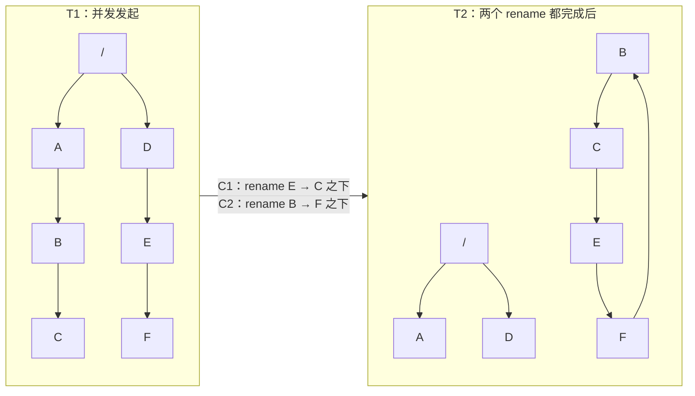

*图 7：并发目录 rename 造成孤儿环（对应论文图 8）。*

**解决办法**：中心化的 rename 协调者维护一张**重命名图**（renaming graph），记录当前所有进行中目录 rename 的源路径和目标路径。新的目录 rename 开始前先检查是否会与进行中的 rename 形成孤儿环；源和目标路径在整个 rename 期间都保留在图中，完成后删除。由于目录 rename 极少，单个协调者就够用。

### 8.2 事务（§4.2）

| 类型 | 操作 | 实现 |
|------|------|------|
| 单服务器操作 | 目录 readdir；文件 create / delete / open / close / stat / set_permission（最频繁） | 使用后端 KV 的本地事务保证原子性。服务器崩溃重启后恢复事务，并向 rename 协调者查询以更新失效列表 |
| 双服务器操作 | 目录 mkdir / rmdir / statdir；文件 rename | **两阶段提交（2PC）**。客户端不可靠、难以追踪，所以选两台元数据服务器之一做事务协调者；协调者和参与者都写 **WAL** 记录事务的中间状态以便故障恢复 |
| 目录 rename、目录 set_permission | 交给 rename 协调者 | 与双服务器操作类似的分布式事务，区别是由 rename 协调者担任事务协调者，并在**提交阶段开始时**广播修改。协调者在广播过程中崩溃时，重启后重新开始广播，保证修改**至少一次**送达所有服务器 |

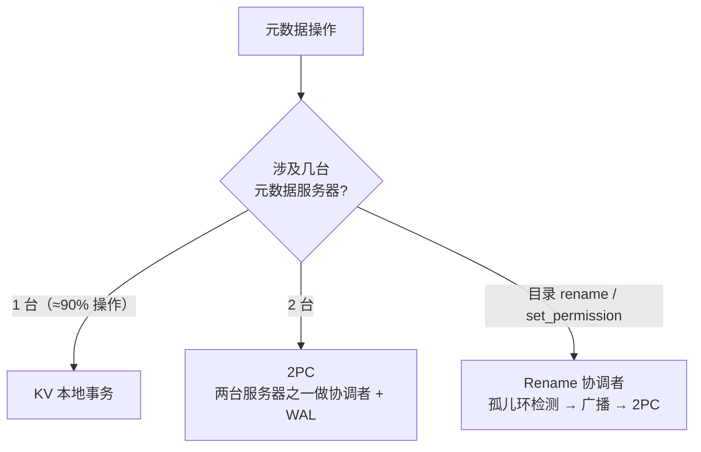

**解读**：InfiniFS 没有发明新的事务协议，而是靠分区设计让绝大多数操作**根本不需要**分布式事务。这与后续 CFS（EuroSys 2023）的思路一脉相承：CFS 进一步把 mkdir 这类操作的临界区也剪小，攻击的正是 InfiniFS 留下的"双服务器操作仍需 2PC"这一块。

---

## 9. 评估

### 9.1 实验设置（§5.1）

| 项目 | 配置 |
|------|------|
| 节点 | 32 台客户端节点 + 32 台服务器节点，硬件相同；两级交换机拓扑 |
| CPU / 内存 | Intel Xeon Platinum 2.50 GHz，96 核；DDR4 2666 MHz 32 GB × 16 |
| 存储 | RAMdisk（排除磁盘速度影响；论文指出生产中元数据通常在 DRAM、用独立日志写 NVMe，延迟主要由数百微秒的网络 RPC 决定） |
| 网络 | ConnectX-4 Lx 双口 25 Gbps，双口绑定 |
| 客户端规模 | 最多 2048 个客户端进程，足以压满被测系统 |
| InfiniFS 实现 | Thrift RPC（Linux TCP/IP，RTT 约 60 µs）+ RocksDB；8 个工作线程，元数据缓存 8 MB，KV 异步写 |
| 对比系统 | LocoFS、IndexFS（服务器持续出错退出，吞吐数据缺失）、CephFS 12.2.13（多活 MDS，与 OSD 共部署在 32 台服务器）、HopsFS 3.2.0.0（MySQL NDB 7.5.3 无盘模式，12 台服务器）。Tectonic 闭源，未比较 |
| 基准 | mdtest（改为调用各系统的客户端库），OpenMPI 3.0.6；文件长度为 0，只测元数据 |

### 9.2 吞吐扩展性（§5.2.1，图 9）

负载：共享目录树深度 10，每个客户端处理各自的 10 万目录和 10 万文件，四阶段依次测 mkdir、create、stat、delete；元数据服务器数从 1 扩到 32，逐渐增加客户端直到吞吐不再增长，2048 个客户端时共约 **5 亿**文件。

| 观察 | 数据与原因 |
|------|-----------|
| InfiniFS 四种操作都**近线性**扩展 | 路径解析靠客户端缓存吸收近根负载、按目录 ID 哈希分区均衡负载；元数据处理中 create / stat / delete 只访问单台服务器，mkdir 只需两台 |
| mkdir 吞吐远低于 create | create 是本地事务；mkdir 需要两阶段锁 + 2PC |
| 单服务器时 create 吞吐 **180K ops/s**，略低于 LocoFS（200K） | LocoFS 用不支持 scan 的哈希 KV（比 RocksDB 快），并把文件元数据拆成两个更细的 KV 对 |
| 32 台服务器时 mkdir、stat 分别是 LocoFS 的 **18 倍**、**4 倍** | LocoFS 所有目录元数据都在一台目录元数据服务器上，客户端增多、目录树变大后成为瓶颈 |
| create 吞吐是 HopsFS 的 **73 倍**、CephFS 的 **23 倍** | 推测式并行解析降低了延迟，基础吞吐更高 |

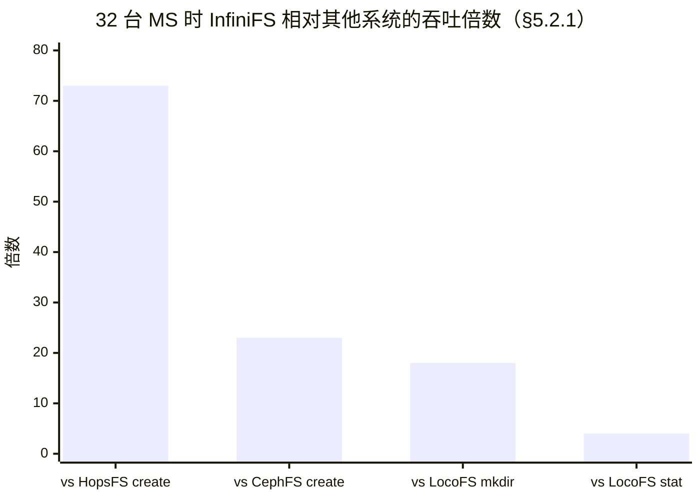

### 9.3 延迟（§5.2.2，图 10）

32 台元数据服务器下：

- **create / stat / delete**：InfiniFS 与 LocoFS 相当，都很低。推测解析和乐观缓存降低了解析延迟，元数据处理又只在单台服务器上完成；
- **mkdir**：InfiniFS 高于 LocoFS。InfiniFS 把目录元数据分散到多台服务器，mkdir 是分布式事务；LocoFS 所有目录元数据在一台服务器上，目录操作约 1 个 RTT 完成；
- InfiniFS 延迟低于 IndexFS、CephFS、HopsFS：IndexFS 和 HopsFS 缓存未命中时要递归 RPC 解析路径；CephFS 和 HopsFS 分别通过外部分布式对象存储和 MySQL NDB 存元数据，软件栈更深。

### 9.4 因素分析（§5.3，图 11）

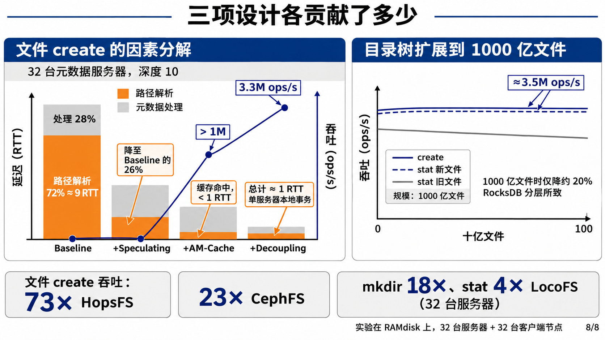

> **图解**：左：逐项叠加设计后文件 create 的延迟与吞吐（路径解析从 72% ≈ 9 RTT 降至 < 1 RTT，吞吐升至 3.3M ops/s）；右：1000 亿文件下约 3.5M ops/s；底部为与 HopsFS、CephFS、LocoFS 的对比。

Baseline 基于 InfiniFS 框架实现，**按目录粒度分区**（类似 IndexFS、HopsFS、Tectonic），但不带三项特性；在 32 台服务器上逐个叠加特性。延迟测试用 1 个客户端在深度 10 处建空文件；吞吐测试用 1024 个客户端。

| 阶段 | 延迟变化 | 吞吐变化 |
|------|----------|----------|
| Baseline | 路径解析占 **72%**（约 9 个 RTT，逐级串行检查权限）；元数据处理占 **28%**（约 3 个 RTT，create/mkdir 都要跨服务器修改父目录的时间戳和目录项） | 很低：所有操作在解析时都访问近根目录，吞吐被存放近根目录的服务器卡住 |
| +Speculating（推测解析） | 解析延迟降到 Baseline 的 **26%**；因为 Linux TCP/IP 协议栈的请求处理开销会累积，并行化后仍略多于 1 个 RTT | 几乎不变：近根热点仍在 |
| +AM-Cache（乐观缓存） | 缓存命中进一步加速解析，解析延迟**低于 1 个 RTT** | create 和 mkdir 都提升到 **100 万 ops/s 以上** |
| +Decoupling（解耦） | create 延迟降到**约 1 个 RTT**；mkdir 不变（仍跨两台服务器） | create 提升到 **3.3M ops/s**；mkdir 不变 |

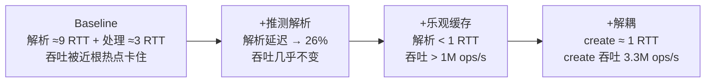

**解读**：这组实验把三项技术各自解决的问题分得很清楚：推测解析只降延迟、不提吞吐（热点还在）；乐观缓存才是提吞吐的关键（消除热点）；解耦把 create 的元数据处理从跨服务器变成单服务器，延迟和吞吐都再上一个台阶。三者缺一不可。

### 9.5 千亿文件规模（§5.4，图 12）

32 台元数据服务器、1024 个客户端。每次先插入 10 亿文件，再测 create、stat 新文件、stat 最早创建的旧文件三种吞吐，一直增长到 **1000 亿文件**：

- create 和 stat 吞吐**稳定在约 3.5M ops/s**；论文对比：Facebook Tectonic 管理 107 亿文件，阿里云数据中心有数百亿文件，InfiniFS 能以稳定性能支撑 1000 亿文件；
- stat 旧文件比 stat 新文件慢：RocksDB 把旧 KV 逐步下沉到更低层的 SSTable，层越低容量越大，性能下降逐渐放缓，在 1000 亿文件时下降**约 20%**。

### 9.6 缓存效率：惰性失效 vs 租约（§5.5，图 13）

为了公平对比，论文实现了一个用租约维护缓存一致性的 InfiniFS 版本，租约有效期设为 1 s、5 s、10 s；32 台服务器、2048 个客户端做 stat，缓存大小从 64 KB 到 4096 KB：

1. **惰性失效优于租约**：租约下缓存项不管缓存多大都会周期性过期；加长有效期能提高吞吐，但会增加所有修改操作的延迟（修改要等租约过期）；
2. **缓存越大，惰性失效的提升越明显**：租约机制受近根目录续约的负载不均拖累，客户端很多时成为瓶颈。

### 9.7 Rename 性能（§5.6，图 14）

| 指标 | 文件 rename | 目录 rename |
|------|-------------|-------------|
| 延迟 | 低，随服务器数增加保持稳定 | 高，随服务器数缓慢增长（广播是并行的） |
| 延迟构成 | 路径解析 + 元数据处理 | 路径解析 + 孤儿环检测 + 缓存一致性广播 + 跨两台服务器的元数据处理 |
| 吞吐 | 随服务器数扩展（只需源、目标两台服务器协调） | **不扩展**，停留在约 **10K ops/s**（受中心协调者限制） |

论文的立场是：目录 rename 只占约 0.0083%，单个协调者足够。

### 9.8 预测失败的开销（§5.7，图 15）

在深度 **24** 的路径中逐步增加被 rename 过的目录（均匀分布），单客户端在该路径下创建 1 万个文件，比较三种解析方式：朴素解析（Naive-PR）、推测解析（Speculative-PR）、推测解析 + 缓存。

- **延迟**：预测失败会增加推测解析的延迟（朴素解析不受影响），但**除非接近一半的中间目录都被 rename 过**（很罕见），推测解析仍然更快。加上缓存后，客户端会缓存被 rename 目录的真实 ID，之后不再预测失败；
- **网络开销**：预测失败会增加网络包数量（图中最多约 6 倍）。但网络带宽不是瓶颈：25 Gbps CX4 网卡每秒可处理 1230 万个包，32 台服务器合计 **3.936 亿包/秒**，远高于约 400 万 ops/s 的元数据峰值吞吐；而且缓存能消除未来的预测失败。

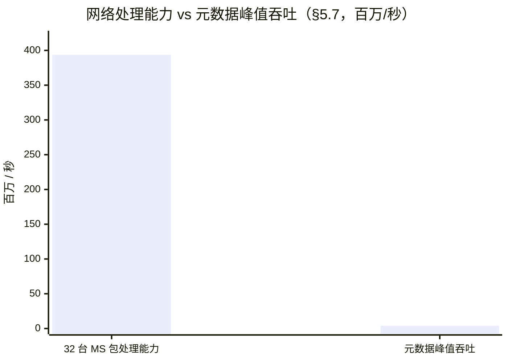

**解读**：推测解析本质上是用"多发包"换"少等待"。这在 RTT 远大于单包处理开销、带宽有富余的数据中心网络里很划算。但它对负载有假设：如果某类业务频繁 rename 深层目录（例如某些按时间滚动重命名的流水线），推测命中率会下降，需要依靠缓存兜底。

---

## 10. 与相关工作的对比

### 10.1 论文自述的对比（§6）

| 类别 | 代表系统 | 做法 | 问题（论文观点） |
|------|----------|------|------------------|
| 单元数据服务器 | GFS、HDFS、Farsite、QFS | 数据分散，元数据集中在一台服务器 | 数十亿文件时容量和吞吐都超出单机 |
| 子树分区 | AFS Volume、Sprite Domain、HDFS Federation | 按子树切分 | 局部性好，但负载不均、迁移代价大；用户可见的静态分区在目录树膨胀后难以维护，还禁止跨分区 rename |
| 动态子树迁移 | CephFS（及可编程负载均衡 Mantle） | 发现不均时迁移热子树 | 负载多变时迁移频繁、开销大 |
| 目录粒度哈希 | IndexFS、HopsFS、Tectonic | 每个目录独立分区 | 负载均衡、可扩展，但牺牲局部性，分布式锁/事务频繁 |
| 集中目录元数据 | LocoFS | 所有目录元数据放一台服务器以降低解析延迟 | 单节点瓶颈 |
| 全路径索引 | BetrFS、Giraffa、CalvinFS | 用全路径或其哈希索引文件 | 层次语义难实现：目录 rename 改变所有后代的全路径，要迁移所有后代元数据 |
| 服务端位置缓存 | HopsFS | 在服务端缓存元数据位置以并行解析 | 仍有近根热点 |
| 客户端租约缓存 | LocoFS、IndexFS、NFS v4 | 客户端缓存目录项与权限，租约维护一致性 | 近根目录续约带来负载不均，客户端增多后成为瓶颈 |

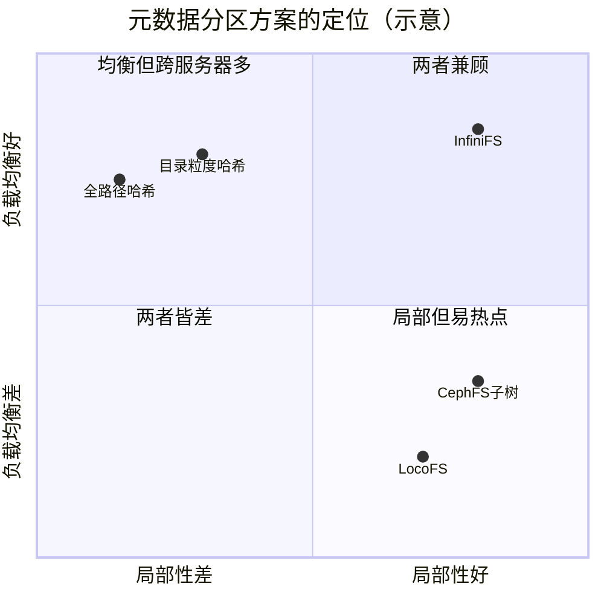

*注：图中"目录粒度哈希"指 IndexFS、HopsFS、Tectonic。象限位置是本文根据论文的定性论述所作的示意，不是测量结果。*

### 10.2 与本仓库调研系统的对照（解读）

| 系统 | 与 InfiniFS 的关系 |
|------|--------------------|
| [Tectonic（FAST 2021）](../tectonic-fast2021/deep-read.md) | 同为"一个数据中心一个文件系统"的动机；Tectonic 按层（Name / File / Block）和 ID 哈希分片，路径解析逐级串行，不提供跨目录原子 rename。InfiniFS 的 Baseline 即类似这种按目录粒度分区的设计 |
| CFS（EuroSys 2023，百度） | 后继工作：在类似的元数据拆分基础上，用"裁剪临界区"让更多操作避免分布式事务，论文报告吞吐比 InfiniFS 高 1.22–4.10 倍（见 [元数据扩展性综述](../metadata-scalability.md)） |
| SingularFS（ATC 2023，清华） | 同一团队的另一条路线：单台元数据服务器 + PM + 精细并发控制，把"分布式协调"整个避开；访问/时间戳拆分与元数据分组沿用了 InfiniFS 的思路，只是分到 NUMA 节点而非服务器（精读：[singularfs-atc2023.md](../singularfs-atc2023.md)） |
| Mantle（SOSP 2025）、HMFS（SoCC 2025） | Mantle 用集中式轻量索引（IndexNode）加速路径解析；HMFS 沿用本文的按目录分区，把存储引擎换成 PM 哈希表 + 目录内链表（见 [Mantle 精读](../mantle-sosp2025.md)、[HMFS 精读](../hmfs-socc2025.md)） |
| FalconFS（NSDI 2026） | 面向 AI 负载，同样关注深路径解析和近根热点，采用无状态客户端 + 服务端路径解析的不同取舍（精读：[falconfs-nsdi2026.md](../falconfs-nsdi2026.md)） |

---

## 11. 整体总结

### 11.1 核心贡献

1. **问题刻画**：明确指出单实例覆盖整个数据中心后元数据服务的三个新挑战（分区两难、深路径、海量客户端下的缓存一致性），并用阿里云盘古的生产 trace 量化了操作比例和文件深度。
2. **访问-内容解耦分区**：把目录元数据按"作为孩子"和"作为父亲"两种角色拆开分组，再按目录 ID 一致性哈希，使约 90% 的操作单服务器完成，同时保持细粒度均衡。
3. **推测式路径解析**：基于出生三元组哈希的可预测目录 ID，配合 rename-list / back-pointer 维持 ID 唯一性，把 N 级路径解析从 N−1 个串行 RTT 降到约 1 个 RTT。
4. **乐观访问元数据缓存 + 惰性失效**：客户端只缓存访问元数据、树形 LRU 保住近根目录；失效信息只广播给服务器并在请求时按版本增量比对，替代租约。
5. **系统实现与评估**：32 台元数据服务器下 create 吞吐是 HopsFS 的 73 倍、CephFS 的 23 倍；1000 亿文件规模下 create/stat 稳定在约 3.5M ops/s。

### 11.2 设计哲学

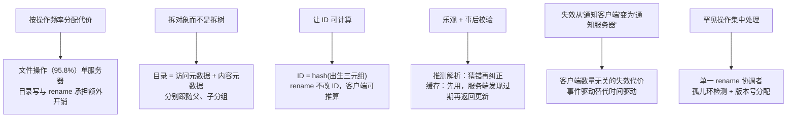

**解读**：InfiniFS 的三项技术背后是同一个思路——**利用"目录结构变化极少"这一负载事实，把常见路径做成乐观、无协调的快路径，把罕见的结构变更做成昂贵但集中的慢路径**。解耦分区让常见操作免于分布式事务；可预测 ID 让解析免于串行等待；惰性失效让缓存免于续约风暴。三者的成本最终都落到目录 rename 上，而目录 rename 只占约万分之一。

### 11.3 优点与局限

| 优点 | 局限 / 未回答的问题 |
|------|---------------------|
| 三项技术相互独立又互补，因素分析清楚地展示了各自贡献 | **目录 rename 不可扩展**：吞吐约 10K ops/s，且需要锁住子树、广播所有服务器；负载中目录 rename 比例一旦上升（如某些按目录滚动的流水线、用户大量整理目录），代价会很明显 |
| 不需要新的分布式事务协议，约 90% 操作用本地事务 | **中心协调者**是单点，论文只说明崩溃后重新广播，没有讨论协调者的高可用与性能隔离 |
| 可预测 ID 让 rename 不需要搬移后代元数据，避免了全路径索引方案的致命缺陷 | mkdir / rmdir / statdir 仍需跨两台服务器（statdir 也是双服务器），目录密集型负载（如 AI 预处理大量建目录）吞吐受限，这正是 CFS 等后续工作的切入点 |
| 惰性失效的开销与客户端数量无关 | 失效列表的增长与截断回收、长时间离线客户端的版本追赶，论文未讨论 |
| 1000 亿文件规模下性能稳定 | 实验在 RAMdisk 上进行，且文件长度为 0，只体现元数据路径；Thrift + 内核 TCP 的 RTT（约 60 µs）也影响绝对值 |
| 基于生产 trace 选择设计权衡 | 负载取自阿里云三类服务的合并 trace，代表性有限；也没有与 Tectonic 直接对比（闭源） |
| — | 客户端缓存只缓存访问元数据，文件属性的缓存一致性（如 stat 的结果）不在讨论范围 |

### 11.4 对分布式文件系统设计者的启示

1. **先做负载统计，再决定把代价放在哪里**：InfiniFS 所有关键权衡都依赖"目录 rename 约 0.0083%"这一个数字。设计元数据服务前，应先拿到自己业务的操作比例和路径深度分布。
2. **元数据表结构按角色拆分**：目录可以拆成 `dentry(pid, name) → {id, perm}` 和 `dir_content(id) → {entries, times}` 两张 KV 表，分别按 pid 和 id 分区，文件 dentry 跟随父目录内容分区。这是性价比很高的模式，也被 CFS、Mantle 等后续系统沿用或演化。
3. **让 ID 可推导**：如果 ID 由出生信息哈希得来并在 rename 后保持不变，客户端就能并行解析路径；但必须处理"搬走后原处重建同名目录"和哈希冲突，RL/BP 机制是一种完整的解法。
4. **客户端缓存优先保近根**：树形缓存 + 只淘汰叶子，可以用很小的缓存（论文实验 64 KB 起）挡住近根热点。
5. **失效通知发给服务器而不是客户端**：当客户端数量远大于服务器数量、且修改极少时，"服务器端版本化失效列表 + 请求时校验"比租约和回调都更可扩展。
6. **罕见的全局结构变更可以集中化**：用单协调者 + 重命名图解决孤儿环比分布式检测简单得多；但要配套考虑高可用和限流。
7. **评估时做因素分析**：逐项叠加设计特性并分别报告延迟和吞吐，可以说清楚哪项技术解决了哪个瓶颈，避免"一揽子收益"的模糊结论。

### 11.5 一张图看懂 InfiniFS

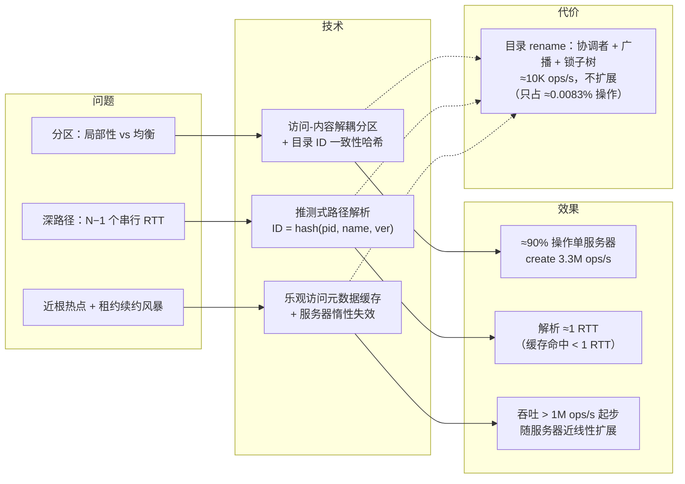

---

## 附录：图解索引

| # | 图 | 所在章节 |
|---|----|----------|
| 00 | [封面](00-cover.png) | 0. 一页速览 |
| 01 | [架构总览](01-architecture.png) | 4. 总体架构 |
| 02 | [访问/内容解耦分区](02-decoupled-partitioning.png) | 5. 访问-内容解耦分区 |
| 03 | [可预测的目录 ID](03-predictable-id.png) | 6.1 可预测的目录 ID（§3.3.1） |
| 04 | [推测式并行路径解析](04-speculative-resolution.png) | 6.2 并行解析（§3.3.2） |
| 05 | [乐观缓存与惰性失效](05-optimistic-cache.png) | 7. 乐观访问元数据缓存与惰性失效 |
| 06 | [孤儿环与三类事务](06-consistency.png) | 8. 一致性：孤儿环与事务 |
| 07 | [关键结果](07-results.png) | 9.4 因素分析（§5.3，图 11） |

- 风格：paper-figure · 中文 · 16:9；作图规格见 `prompts/*.json`（每页的布局、必须标签、禁止项）。图为本仓库重新绘制的示意图，非论文原图。
- 生成：Codex CLI 内置 imagegen。07 图首版把各阶段"元数据处理"时间画成逐步缩短并误写"100 亿"，已按论文图 11、图 12 修正提示词重新生成。
- 已知小瑕疵：02 图中组 (C) 的连线同时指向 MS0 与 MS1，实际一个组只落在一台服务器上；07 图左半为示意比例，非论文图 11 的精确数值。

---

## 参考

- Wenhao Lv, Youyou Lu, Yiming Zhang, Peile Duan, Jiwu Shu. *InfiniFS: An Efficient Metadata Service for Large-Scale Distributed Filesystems*. USENIX FAST 2022. <https://www.usenix.org/conference/fast22/presentation/lv>
- Satadru Pan et al. *Facebook's Tectonic Filesystem: Efficiency from Exascale*. USENIX FAST 2021. 本仓库精读：[tectonic-fast2021/deep-read.md](../tectonic-fast2021/deep-read.md)
- Siyang Li et al. *LocoFS: A Loosely-Coupled Metadata Service for Distributed File Systems*. SC 2017.
- Kai Ren et al. *IndexFS: Scaling File System Metadata Performance with Stateless Caching and Bulk Insertion*. SC 2014.
- Salman Niazi et al. *HopsFS: Scaling Hierarchical File System Metadata Using NewSQL Databases*. USENIX FAST 2017.
- Sage A. Weil et al. *Ceph: A Scalable, High-Performance Distributed File System*. OSDI 2006.
- Yiduo Wang et al. *CFS: Scaling Metadata Service for Distributed File System via Pruned Scope of Critical Sections*. EuroSys 2023.（后续工作，本仓库精读：[cfs-eurosys2023.md](../cfs-eurosys2023.md)）
