# λFS 精读：用 serverless 函数构建弹性的分布式文件系统元数据服务（ASPLOS '23）

> 论文：Benjamin Carver, Runzhou Han, Jingyuan Zhang, Mai Zheng, Yue Cheng*（* 通讯作者）. *λFS: A Scalable and Elastic Distributed File System Metadata Service using Serverless Functions*. ACM ASPLOS '23 第 4 卷（2024 年 4 月在 La Jolla 的 ASPLOS '24 会上报告；arXiv 版首页写作 "will be published at ACM ASPLOS'24"）。
>
> 机构：George Mason University（Carver、Zhang）；Iowa State University（Han、Zheng）；University of Virginia（Cheng）。
>
> 链接：ACM <https://dl.acm.org/doi/10.1145/3623278.3624765>；arXiv <https://arxiv.org/abs/2306.11877>；代码 <https://github.com/ds2-lab/LambdaFS>；负载驱动 <https://github.com/ds2-lab/LambdaFS-Benchmark-Utility>
>
> 篇幅：arXiv v1（2023-06-20）共 17 页，其中正文 13 页、参考文献 2 页、附录 A–C 2 页；17 张图、3 张表、1 个算法。
>
> 精读日期：2026-11-24。本文依据 arXiv v1，ACM 终稿可能有措辞或数字上的修订。**数字和机制描述都摘自论文**，用"论文 §x / 图 x / 表 x"标注出处。标"解读"的段落是本文作者的分析和推论，不是原文。论文多数图没有数据标签，图上读数为本文估读，标注"约"，误差约 ±5%。标"示例"的是为说明机制构造的例子。
>
> 相关文档：
> - [元数据扩展性综述 §2.5](metadata-scalability.md#25-λfs-a-scalable-and-elastic-distributed-file-system-metadata-service-using-serverless-functionsasplos-2023)：本文的简述版。
> - [CFS（EuroSys 2023）精读](cfs-eurosys2023.md)：同样以 HopsFS 为基线，但路线相反，CFS 去掉代理层，λFS 把代理层做成弹性缓存。
> - [InfiniFS（FAST 2022）精读](infinifs-fast2022.md)：λFS 论文中的对比对象之一，固定规模的元数据集群。
> - [Tectonic（FAST 2021）精读](tectonic-fast2021/deep-read.md)：同属"无状态元数据层 + 分片事务存储"的分离式架构。
> - [FileScale（SoCC 2023）精读](filescale-socc2023.md)：同样在数据库之上加缓存，但用前缀独占的写回缓存，写也能接近单机 HDFS。

## 目录

- [0. 一页速览](#0-一页速览)
- [1. 背景：从 HDFS 到 HopsFS](#1-背景从-hdfs-到-hopsfs)
- [2. 为什么用 FaaS，难在哪里](#2-为什么用-faas难在哪里)
- [3. 总体架构](#3-总体架构)
- [4. 混合 HTTP-TCP RPC](#4-混合-http-tcp-rpc)
- [5. serverless 元数据缓存与命名空间划分](#5-serverless-元数据缓存与命名空间划分)
- [6. 敏捷自动伸缩](#6-敏捷自动伸缩)
- [7. 一致性协议](#7-一致性协议)
- [8. 容错](#8-容错)
- [9. 实现与移植](#9-实现与移植)
- [10. 评估](#10-评估)
- [11. 经验与教训](#11-经验与教训)
- [12. 论文中的不一致与可疑之处](#12-论文中的不一致与可疑之处)
- [13. 与相关工作的对比](#13-与相关工作的对比)
- [14. 整体总结](#14-整体总结)
- [参考](#参考)

---

## 0. 一页速览

**一句话**：HopsFS 把 HDFS 的 NameNode 拆成"一组无状态 NameNode + MySQL NDB 分布式数据库"，解决了单点内存瓶颈，但它的 NameNode 不缓存，每次操作都要访问 NDB；而且元数据集群规模是静态配置的，按峰值配置就浪费，按均值配置就扛不住突发。λFS 把 NameNode 改写成 **serverless 函数**：函数实例的内存组成一个**弹性的元数据缓存层**，借助 FaaS 平台的自动扩缩容随负载伸缩，按使用量计费。为了让 FaaS 跑得动对延迟敏感的有状态服务，λFS 组合了几项技术：**HTTP 与 TCP 混合的 RPC**（TCP 快，HTTP 能触发扩容）、**按父目录哈希的命名空间划分**、**按概率把 TCP 换成 HTTP 的扩缩容策略**，以及基于 INV/ACK 的**缓存一致性协议**。在 Spotify 风格的突发负载下，λFS 相对 HopsFS 平均延迟降低 90.40%，成本降低 85.99%。

| 维度 | 要点 |
|------|------|
| 基础系统 | HopsFS 3.2.0.3 的分支：保留 HopsFS 的数据访问层（DAL）、事务模型和 MySQL NDB 8.0.26 持久化存储，只替换 NameNode 层（论文 §4） |
| 核心思路 | NameNode = Java serverless 函数；n 个函数 deployment 分担命名空间，每个 deployment 可自动扩出任意多个实例；实例内存缓存元数据（论文 §3.1） |
| RPC | 首次通过 FaaS API 网关发 HTTP 调用（8–20 ms），函数实例随后主动 TCP 连回客户端，此后走 TCP（1–2 ms）（论文 §3.2） |
| 分区 | 按父目录一致性哈希到 n 个 deployment；同一目录下的文件元数据落在同一 deployment（论文 §3.1、§3.3） |
| 伸缩 | 每个 TCP 请求以 ≤1% 的概率改走 HTTP，让 FaaS 平台"看到"负载并扩容；另用函数级并发度做粗调（论文 §3.4，图 6） |
| 一致性 | 写操作的发起者（leader）经 ZooKeeper 向所有缓存了相关 INode 的 deployment 发 INV，收齐 ACK 后再写 NDB；NDB 排他锁保证写串行化（论文 §3.5，算法 1） |
| 关键结果（Spotify 负载，基准 25k ops/s） | 平均延迟 1.02 ms，HopsFS 10.58 ms（−90.40%）；平均吞吐 45.7k 对 38.1k ops/s；成本 $0.35 对 $2.50（−85.99%）（论文 §5.2） |
| 扩展性 | 512 vCPU 下读类操作（read/stat/ls）吞吐是 HopsFS 的 28.91× / 8.22× / 20.53×（随客户端数平均）；写操作受限于 NDB，create 只高 1.49×，mkdir 持平（论文 §5.3） |
| 代价 | 写延迟比 HopsFS 高 1.5–5.55×（一致性协议开销）；依赖自建 OpenWhisk 的扩展功能；成本模型按 Lambda 计价但实验跑在自建 OpenWhisk 上（论文 §5.2.2、§5.2.5） |

**解读**：

- λFS 的本质是**给 HopsFS 加一层可伸缩的、强一致的、分区的缓存**。缓存带来延迟收益，伸缩带来资源和成本收益，两者叠加。论文自己的对照实验说明了这一点：带缓存但固定规模的 HopsFS+Cache 平均吞吐已与 λFS 持平，平均延迟比 HopsFS 低约 3.2 倍（10.58 对 3.348 ms）；λFS 在此基础上再低 3.28 倍（1.02 ms），合计约 10.4 倍（论文 §5.2.2）。
- 真正的新意在于**把 FaaS 的弹性和 RPC 路径的低延迟调和起来**。FaaS 平台只能通过 HTTP 调用数量感知负载，而 HTTP 太慢；全走 TCP 又会"饿死"自动扩容。按概率抽样一部分请求走 HTTP，相当于给平台发心跳式的负载信号，这是全文最巧妙的一点。
- 写路径没有受益，甚至变慢了。λFS 适合 Spotify 这类读占 95% 的负载；写多的场景瓶颈仍在 NDB。

---

## 1. 背景：从 HDFS 到 HopsFS

### 1.1 HDFS（论文 §2，图 1a）

- 元数据存放在一个 Java 进程（Active NameNode）的内存里，复制到 Standby NameNode 做检查点和故障恢复；JournalNode 同步主备状态，ZooKeeper 负责自动故障切换。
- Active NameNode 原子地执行所有文件系统操作，提供强一致；为支持流式访问放宽了 POSIX 语义。
- DataNode 存数据块，定期向 NameNode 发送块报告（block report），用于核对块映射。

### 1.2 HopsFS（论文 §2，图 1b）

- 把 NameNode 的状态外置到 **MySQL NDB Cluster**（分布式、分片、内存数据库），NameNode 变成**无状态**，可以部署多个，共同处理客户端请求。
- 每个 NameNode 通过**数据访问层（DAL）**访问持久化存储；所有操作都要逐级解析路径以检查权限和合法性。HopsFS 用客户端的 **INode Hint Cache** 缓存路径前缀，把长度为 N 的路径解析从 N 次往返降为一次批量查询。
- NameNode 选出 leader 执行管理任务（如处理 DataNode 失效）。

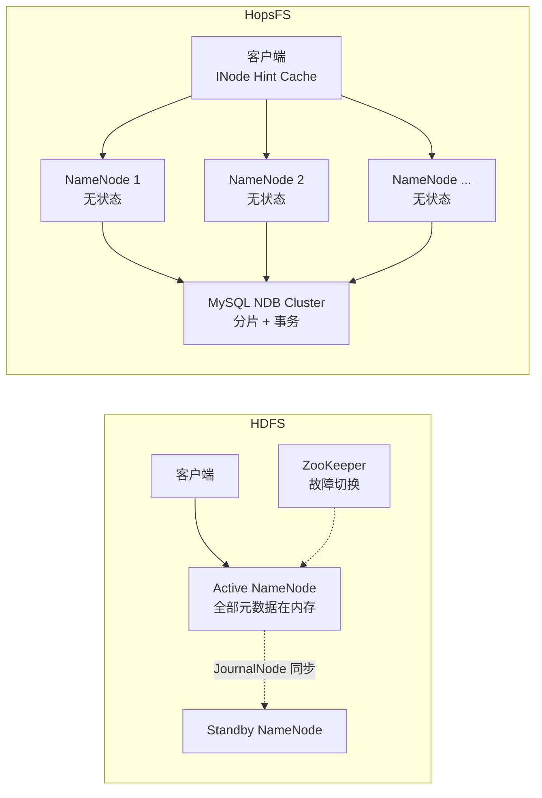

### 1.3 现有横向扩展 MDS 的两个问题（论文 §1、§2）

1. **无状态 NameNode 意味着每个操作都要访问 NDB**。HopsFS 的性能上限就是 NDB 的能力；计算层（NameNode）和存储层（NDB）物理上分离，逻辑上却必须一起配置，任何一层成为瓶颈都会拖垮整体。HopsFS 论文报告需要多达 60 个 NameNode 和 12 台 NDB 服务器才能显著超过原版 HDFS（论文 §1 引 [51]）。
2. **缺乏弹性**。IndexFS、InfiniFS、HopsFS 都要管理员凭经验静态配置集群规模：按峰值配置，低负载时资源闲置；按平均需求配置，负载超出时性能下降。真实 MDS 负载是突发的（论文引 [35, 55, 60]），离线也很难确定合适的规模（引 [27, 58]）。

**解读**：λFS 明确声明"不解决 HopsFS 已经解决的问题"（论文 §2），沿用同样的计算存储分离架构和 DAL。它针对的是第二层问题：计算层如何既缓存又弹性。这与 [CFS](cfs-eurosys2023.md) 针对 HopsFS 的锁开销正好是两个正交方向。

---

## 2. 为什么用 FaaS，难在哪里

### 2.1 FaaS 的吸引力（论文 §1）

| 优势 | 对 MDS 的意义 |
|------|---------------|
| 函数的 CPU、内存随函数实例弹性伸缩 | MDS 资源量随负载动态调整 |
| 按使用付费 | 低负载时几乎不花钱，资源利用率高 |
| 自动扩缩容 | 无需管理员运维服务器，规避"过度配置还是配置不足"的两难 |

### 2.2 两组挑战（论文 §1）

**FaaS 平台自身的限制**：

1. 单个函数的 CPU、内存、网络资源有限；
2. 偶发的长冷启动和执行超时；
3. 函数通常只能通过 HTTP 调用，较慢。

因此把有状态的 MDS 直接搬上 FaaS 性能很差。

**要真正利用弹性，需要整体重新设计**：

1. 性能敏感的 MDS 要在性能与自动伸缩之间权衡；
2. 在一组动态变化的函数上划分命名空间，会带来新的权衡；
3. 函数**不可寻址**，同一份元数据可能被多个函数实例缓存，引出一致性问题。

### 2.3 术语（论文 §2）

| 术语 | 含义 |
|------|------|
| deployment（函数部署） | 在 FaaS 平台以唯一名字注册的函数：代码 + 配置 + 元数据。λFS 注册 n 个函数体完全相同、只有名字不同的 NameNode deployment |
| function instance（函数实例） | 平台按 deployment 配置拉起的、正在运行的函数 |
| NameNode | 函数实例里运行的 Java 程序。一个实例只跑一个 NameNode，两词混用 |

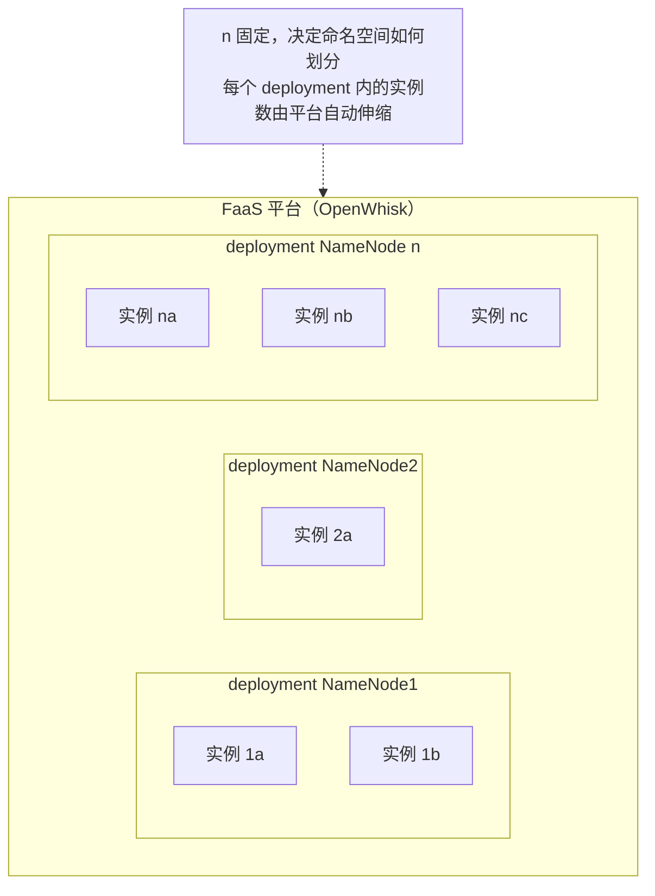

---

## 3. 总体架构

### 3.1 组件（论文 §3.1，图 2）

| 组件 | 作用 |
|------|------|
| λFS 客户端库 | 计算目标 deployment，选择 TCP 或 HTTP 发出 RPC，负责重试、退避、落后者缓解 |
| serverless 缓存层 | n 个 NameNode deployment 的所有实例；实例内存是元数据缓存 |
| 持久化元数据存储 | MySQL NDB Cluster，提供 ACID 事务、行锁 |
| 协调服务（Coordinator） | 可插拔，支持 ZooKeeper 和 NDB 两种实现；跟踪 NameNode 存活，转发一致性协议的 INV/ACK |
| DataNode | 存文件块；块报告、DataNode 发现等维护功能改为**定期写入持久化存储**，以适配无法寻址的函数（论文 §1） |

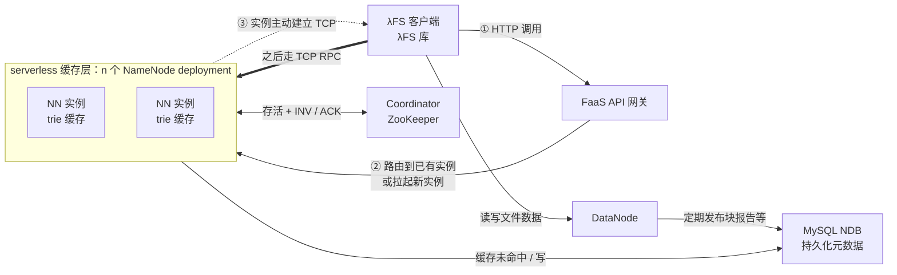

### 3.2 与 HopsFS 的关键区别（论文 §3.1）

λFS 的 NameNode：

1. **不是无状态的**：保留上次调用留下的元数据，组成缓存；
2. **是弹性的**：实例数量随负载自动伸缩。

一次请求的路径（论文 §3.1 的例子）：客户端把 `/dir/note.pdf` 按父目录哈希到 deployment `NameNode5`，如果已有到该 deployment 某个实例的 TCP 连接就走 TCP，否则向 `NameNode5` 发 HTTP 调用。命中缓存的实例无需访问 NDB，直接返回。

**解读**：从架构上看，λFS 把 HopsFS 的"无状态代理层"变成了"有状态但可丢弃的缓存层"。缓存实例随时可能被平台回收，但回收只损失缓存，不损失持久状态，所以正确性仍由 NDB 兜底。这是 FaaS 可以承载"有状态"服务的前提：**状态只是软状态**。

---

## 4. 混合 HTTP-TCP RPC

### 4.1 两条路径（论文 §3.2，图 3）

| 路径 | 步骤 | 实测读延迟 | 作用 |
|------|------|-----------|------|
| HTTP RPC | 客户端 → API 网关 → invoker → NameNode 实例（没有空闲实例时新建） | 8–20 ms，方差大 | 让 FaaS 平台感知负载并扩容 |
| TCP RPC | 客户端 ↔ NameNode 实例直连，一跳 | 1–2 ms，方差小 | 低延迟的主路径 |

NameNode 处理一个 HTTP 请求后，如果与发起该请求的客户端之间还没有 TCP 连接，就**主动反向建立 TCP 连接**。此后客户端优先走 TCP。

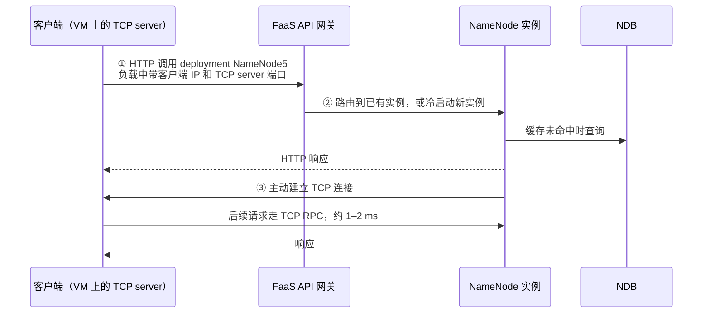

### 4.2 连接共享（论文 §3.2，图 4）

- 默认同一台 VM 上的所有客户端共用一个 TCP server；也可配置为每个 TCP server 最多服务 n 个客户端，按需新建 TCP server。
- 客户端在 HTTP 负载中附带本 VM 的 IP 和**所有** TCP server 的端口，NameNode 可以主动连接。
- **临时借用连接**：客户端 a 要访问 deployment D2，但自己的 TCP server 没有到 D2 实例的连接时，先询问同 VM 的其他 TCP server；若 TCP server 2 有到 D2 的连接，就借用它发请求。请求完成后，NameNode 2a 再与 a 所属的 TCP server 建立连接。

### 4.3 重试与幂等（论文 §3.2）

- **HTTP 超时**：客户端按**指数退避 + 随机抖动**等待后再重提交，避免请求风暴压垮 FaaS 平台并导致 NameNode 过度配置。
- **TCP 断开**：未完成的请求透明重提交。顺序为：同 deployment 的其他 TCP 连接 → 同 VM 其他 TCP server 的连接 → 回落到 HTTP。
- **结果缓存**：NameNode 临时缓存返回给客户端的结果；收到重提交的请求时先尝试返回缓存的结果，而不是再执行一遍。

**解读**：结果缓存实际上起到了"至多一次执行"的作用，对 create、mv 这类非幂等操作很关键。但它只在同一个 NameNode 实例内有效：如果原实例已被回收，请求被转到另一个实例，就要靠 HopsFS 的事务模型来判断操作是否已经生效。论文没有展开这个边界情况。

---

## 5. serverless 元数据缓存与命名空间划分

### 5.1 分区（论文 §3.1、§3.3）

- 命名空间按**父目录**一致性哈希到 n 个 deployment（§3.1 说哈希父目录路径，§3.3 说哈希父 INode ID，见 [§12](#12-论文中的不一致与可疑之处)）。
- 同一目录下的所有条目落在同一个 deployment，`ls` 这类目录操作不必跨 deployment。
- deployment 数 n 固定，因此划分是**确定性的**，不随实例扩缩而变化；deployment 内的实例可以扩展到任意多个，用来扛热点目录的突发请求。

**解读**：这是 λFS 一个很聪明的取舍。传统 MDS 扩容要重新分区、迁移元数据；λFS 用"固定的 deployment 数做分区 + deployment 内部做副本式扩容"把这两件事分开。代价是同一 deployment 的多个实例会缓存**相同**的元数据，需要一致性协议；而且热点目录不能被拆分，只能靠复制更多缓存实例来分担读，写依然集中。

### 5.2 缓存结构（论文 §3.3，图 5）

- NameNode 不只缓存路径末端的 INode，而是缓存**路径上所有 INode**，存放在内存中的 **trie** 中。
- 读操作命中缓存时完全不访问 NDB；未命中时从 NDB 读取并写入本地缓存。
- trie 结构也便于后面的**前缀失效**（见 [§7.3](#73-子树操作的一致性附录-c)）。

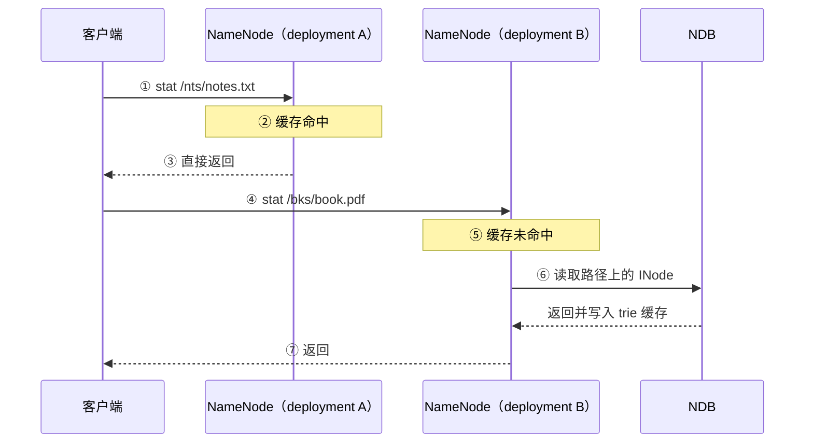

路径解析仍沿用 HopsFS 的客户端 INode Hint Cache（论文 §6）。

---

## 6. 敏捷自动伸缩

### 6.1 性能与弹性的矛盾（论文 §3.4）

客户端只要有到目标 deployment 的 TCP 连接就走 TCP。但 **TCP RPC 对 FaaS 平台不可见**，只有 HTTP 调用经过平台，平台才能据此判断需要更多容器。如果全部走 TCP，平台看不到负载上升，不会扩容，实例过载、性能下降。这是性能（低延迟、高吞吐）与弹性之间的权衡。

### 6.2 随机替换策略（论文 §3.4，图 6）

每个 TCP RPC 以一个可配置的概率被**随机替换成 HTTP RPC**。负载越高，HTTP 调用的绝对数量越多，平台就会按需拉起更多容器。这样大多数请求仍走 TCP，同时自动伸缩继续生效。

论文把期望的 NameNode 数建模为（图 6）：

```text
DesiredScale = NumDeployments + (TcpHttpReplace% × α) / ConcurrencyLevel
上限：DesiredScale ≤ MIN(ClusterCPU / PerNameNodeCPU, ClusterRAM / PerNameNodeRAM)
```

| 参数 | 含义 | 控制粒度 |
|------|------|---------|
| NumDeployments | deployment 数 n，必须 ≥ 1，决定命名空间划分 | 下限 |
| TcpHttpReplace% | TCP 换成 HTTP 的概率，经验上 **≤ 1%** 最好 | 细粒度 |
| α | 负载水平（每秒请求数和并发度） | 输入 |
| ConcurrencyLevel | 单个 NameNode 实例可同时处理的 HTTP 请求数；作者**扩展了 OpenWhisk** 以支持此参数，越接近 1 扩得越多 | 粗粒度：小改动影响大 |
| 上限 | 平台 CPU 或内存能容纳的 NameNode 数 | 资源上限 |

**示例**：n = 20，替换概率 1%，负载 α = 100,000 次请求/秒，ConcurrencyLevel = 4。每秒约 1,000 个 HTTP 调用，按模型期望扩到约 20 + 1,000/4 = 270 个实例，再被集群资源上限截断（如 512 vCPU / 6.25 vCPU ≈ 81 个）。这里只是演示公式各项如何起作用，α 的具体量纲论文没有精确定义。

**设计选择**：不用 Kubernetes HPA 这类基于反馈的策略，因为反馈环延迟长，扛不住突发（论文 §3.4）。λFS 直接复用平台已有的"按 HTTP 调用扩容"的能力。

**解读**：这本质上是一种**带内采样的负载信令**。概率替换让 HTTP 调用数与总请求率成正比，于是平台原有的"按调用数扩容"逻辑间接按总负载扩容。代价是这 1% 的请求要付出 8–20 ms 的 HTTP 延迟，并可能触发冷启动，这也是尾延迟的一个来源。

### 6.3 防抖动模式（论文附录 B）

在资源受限的私有云里（或为了与 HopsFS 公平比较而限定 vCPU），平台在 CPU 利用率接近 100% 时要新建容器就得先删掉已有容器。频繁"删一个建一个"会带来大量冷启动，吞吐骤降，即**抖动**（thrashing）。

- 客户端维护各操作延迟的滑动平均（窗口可配）。
- 某个请求的延迟超过平均值的 **T 倍**时，客户端进入**防抖动模式**：所有请求都走 TCP，即使目标 deployment 没有现成连接，也复用到已有容器的连接，不发 HTTP，于是平台不再新建容器。
- 这会限制扩容、让性能停在平台期，但避免了抖动造成的剧烈下降。经验上 **T 取 2–3** 最好。

**解读**："没有到目标 deployment 的连接也走 TCP"意味着请求会被发给**不负责该分区**的 NameNode。这在正确性上可行（任何 NameNode 都能从 NDB 读取），但会破坏缓存亲和性，并且该 NameNode 缓存了不属于自己分区的元数据后，一致性协议要能把 INV 发给它。论文没有说明协议如何覆盖这种"跨区缓存"，见 [§12](#12-论文中的不一致与可疑之处)。

### 6.4 落后者缓解（论文附录 A）

客户端维护滑动平均延迟；某请求的延迟超过平均值的阈值倍数时取消并重发到另一个 NameNode。TCP RPC 平均延迟约 1–5 ms，默认阈值 10，即 **≥ 50 ms** 的 TCP 请求会被重发。

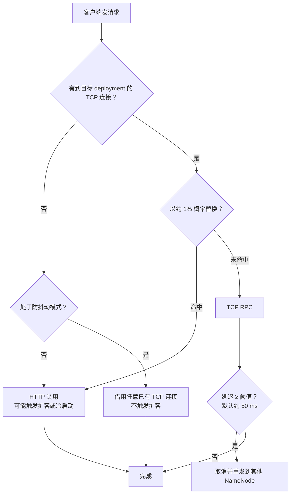

---

## 7. 一致性协议

### 7.1 问题（论文 §3.5）

同一 deployment 的多个实例可能缓存同一份元数据。λFS 和 HDFS 一样把操作分两类：

- **单 INode 操作**：作用于单个文件或目录，例如读、创建文件；
- **子树操作**：作用于一个或多个目录、跨越大量 INode，例如递归 mv、delete。

### 7.2 单 INode 的 INV/ACK 协议（论文 §3.5，算法 1）

受缓存一致性和共享虚拟内存一致性算法（引 [43, 47]）启发。记 D 为在写操作目标路径上**至少缓存了一份元数据**的 deployment 集合，N_L 为执行写操作的 leader NameNode：

1. 对每个 d ∈ D，N_L 先经 Coordinator **订阅该 deployment 的存活和 ACK 通知**，再向它发出 INV（负载中包含要失效的元数据）。中途终止的 NameNode 不需要 ACK。
2. d 中的 NameNode 收到 INV 后，**先让自己的缓存失效**，再回复 ACK。
3. N_L 收齐所需的 ACK 后继续执行写操作，把修改持久化到 NDB。

协议结束后还有一小段清理步骤，论文省略。

**正确性论证**（论文 §3.5）：

- N_L 收齐 ACK 时，其他 NameNode 必然都已失效了相关缓存；
- N_L 已在 NDB 中对元数据加了**排他写锁**，其他 NameNode 无法在更新完成之前读取并缓存这份元数据；
- 因此写操作与同一数据上的并发写串行化，保证强一致。

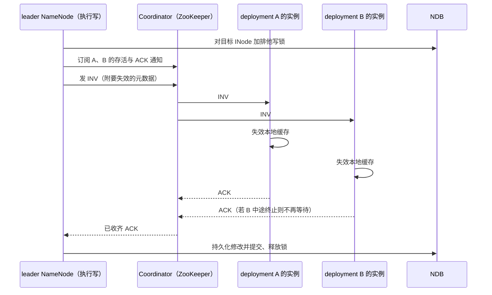

**解读**：

- 加锁顺序很关键。论文说"N_L 已经取得排他锁"，意味着加锁在 INV 之前或至少在提交之前。如果先 INV 再加锁，另一个实例就可能在失效之后、加锁之前重新读入旧值并缓存。终稿的伪代码没有写清楚加锁步骤的位置，复现时要注意。
- 正确性依赖一个**隐含的租约假设**：Coordinator 判定为"已终止"的 NameNode 确实不再响应客户端。如果某个实例与 ZooKeeper 断开、会话超时被判定死亡，但与客户端的 TCP 连接仍在，它就可能用旧缓存回答读请求。HDFS/HopsFS 的读也有类似问题，但在 λFS 中，读请求直接命中缓存、不碰 NDB，风险更直接。合理的补救是让实例在 ZooKeeper 会话失效时立即清空缓存并拒绝服务（自我隔离）。论文没有讨论这个情况。
- 这类"失效—确认—加锁—提交"的交错正是前面讨论过的 TLA+ 最擅长检查的东西：变量包括各实例的缓存、NDB 的锁与值、Coordinator 的成员视图，性质是"任何实例返回给客户端的值都不早于最后一次已提交写"。

### 7.3 子树操作的一致性（附录 C）

HopsFS 用应用层分布式锁实现子树操作，分三个阶段（附录 C，图 17）：

| 阶段 | HopsFS 原有步骤 | λFS 增加的步骤 |
|------|----------------|---------------|
| 1 | 对子树根加排他锁，把子树锁标志持久化到 NDB；活跃子树操作记在一张表里，新操作开始前先查表，保证子树之间不重叠（子树隔离） | — |
| 2 | 按预定义全序遍历子树，对每个 INode 加再释放写锁，使子树静止（quiesce），同时在内存中建立树结构；全序避免死锁 | 遍历时顺便计算**缓存了该子树任何元数据的 deployment 集合** |
| 3 | 把整个操作拆成可并行的子操作，每个事务批量修改一批 INode | 只跑**一次**一致性协议，发**前缀失效**（以子树根路径为前缀），NameNode 用 trie 一次失效整个子树；再把批量子操作**卸载**到其他 deployment 的 NameNode 并行执行 |

- **前缀失效**：如果对 `/foo/` 下的数千个 INode 逐个运行算法 1，就要数千次失效；改为一个前缀为 `/foo/` 的子树失效即可。收齐 ACK 后，整个子树操作不再运行一致性协议。
- **serverless 卸载**：serverless NameNode 的 CPU 少，在本机并行执行成百上千个子操作很慢。λFS 把**批量**子操作卸载到其他 NameNode，利用 FaaS 的弹性增加并行度。批大小默认 **512**，越大越好，因为并行度与卸载的网络开销之间有权衡。
- 例子（图 17）：客户端向 N₁¹（deployment 1 的第 1 个 NameNode）发 `rm -rf /foo/bar`，N₁¹ 缓存了该子树的全部元数据，于是把第 2、3 层卸载给 deployment 2、3 的辅助 NameNode N₁²、N₁³。辅助 NameNode 只是替 N₁¹ 分担负载，不引入一致性问题（论文附录 C）。

---

## 8. 容错

### 8.1 机制（论文 §3.6）

- 默认情况下，单 INode 操作和子树操作都不跨多个 NameNode；启用多节点子树批处理（附录 C）时才会跨节点。
- λFS 沿用 HopsFS 的事务模型，请求级和 NameNode 级故障的处理方式与 HopsFS 完全一致。
- NameNode 崩溃时，客户端把子树操作透明地重提交到其他 NameNode。多节点情况下，任何一个节点失败都视为整个操作失败，客户端重提交。
- 持久化存储提供 ACID 事务，加上一致性协议，故障不会让命名空间处于不一致状态。
- Coordinator 保证崩溃能被检测到，崩溃 NameNode 持有的锁可以被清除。

### 8.2 实验（论文 §5.6，图 15）

- 运行 25k ops/s 的 Spotify 负载，**每 30 秒手动终止一个活跃 NameNode**，按 deployment 轮流选择。开始时 36 个活跃 NameNode（225/512 vCPU）。
- λFS 完整跑完了负载，包括 163,996 ops/s 的突发。
- 每次终止后吞吐略降：发往被终止实例的请求要等超时后才被客户端自动重提交。随后吞吐短暂上升，客户端临时提高请求速率追赶。

---

## 9. 实现与移植

### 9.1 λFS 实现（论文 §4，表 1）

- 基于 **HopsFS 3.2.0.3** 分支开发，客户端 API 是 HopsFS API 的超集，可直接替换 HopsFS。
- FaaS 平台：**Apache OpenWhisk**；也支持 **Nuclio**，增加 Nuclio 支持只用了 108 行 Java。
- 持久化存储：MySQL Cluster NDB 8.0.26；Coordinator：ZooKeeper。
- 代码量（表 1）：

| 组件 | 代码行数 |
|------|---------|
| λFS | 36,685 |
| 基准驱动（Benchmark drivers） | 15,000 |
| λIndexFS | 4,472 |
| hammer-bench | 3,160 |
| Docker 镜像 | 2,100 |
| Python 脚本 | 1,200 |
| 表中"Total" | 63,624（逐项相加为 62,617，见 [§12](#12-论文中的不一致与可疑之处)） |

总投入超过两个人年。

### 9.2 移植到 IndexFS（论文 §4，图 7）

IndexFS 是建在 BeeGFS、PVFS 等 DFS 之上的元数据中间件，原本把元数据通过 LevelDB 打包成 SSTable。移植后的版本称为 **λIndexFS**：

1. 把内存中的元数据处理逻辑从 LevelDB 中剥离出来放进 serverless 函数，LevelDB 只作为持久化元数据存储；
2. IndexFS 原本使用改编自 GIGA+ 的复杂分区算法。与 IndexFS 作者讨论后，改用按目录名哈希、把目录分到不同 LevelDB SSTable 的简单方案，更容易集成；
3. 解决 C++ 的 IndexFS 与 Java 函数之间的跨语言问题，例如 Java 的 KryoNet 没有 C++ 版本。

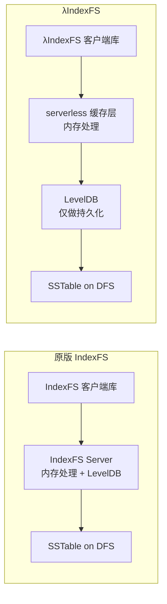

### 9.3 移植到商用 FaaS 平台（论文 §4）

论文认为移植到 AWS Lambda 很直接：核心技术不依赖特定平台；已有工作在商用 FaaS 上用过类似 TCP-RPC 的机制（引 [37]，ExCamera）；只要平台支持自定义容器部署就能运行（Alibaba Function Compute、Google Cloud Run、Lambda 容器镜像）。未解决的问题是如何减小**暖实例被回收**对性能的影响，留作未来工作。

**解读**：这里比论文说的难。商用 Lambda 的执行模型是"一次调用对应一次执行"，函数返回后实例被冻结，在两次调用之间**不能继续处理 TCP 请求**。λFS 依赖实例在 HTTP 调用返回后继续通过 TCP 服务请求，在 Lambda 上只能让函数调用一直保持运行（并为此持续付费），这样"只在服务请求时计费"的成本模型就不成立了。论文的"简化计价模型"（实例存活就计费）更接近这种情况下的真实成本，见 [§10.4](#104-成本论文-525图-9)。

---

## 10. 评估

### 10.1 实验环境（论文 §5.1）

| 项目 | 配置 |
|------|------|
| 对比系统 | HopsFS；**HopsFS+Cache**（给 HopsFS NameNode 加上与 λFS 类似的内存缓存，作为 serverful 有缓存基线）；IndexFS；CephFS；**InfiniCache**（建在 FaaS 上的内存对象缓存，固定规模，每次操作都调用函数，近似"没有自动伸缩、没有长连接 TCP 的 λFS"） |
| 平台 | 全部实验在 AWS 上进行，结果在 GCP 上验证过一致性；OpenWhisk 部署在 AWS EKS，其余在 EC2 |
| VM | r5.4xlarge（16 vCPU、128 GB 内存） |
| NDB | MySQL Cluster NDB 8.0.26，1 个管理节点 + 4 个数据节点，按 HopsFS 提供的示例配置 |
| λFS NameNode | 默认 6.25 vCPU、30 GB 内存 |
| HopsFS NameNode | 16 vCPU、64 GB 内存、200 个 RPC 处理线程 |
| 公平性 | 两者的 NameNode 集群分配相同的总 vCPU 和内存（除非另有说明）。λFS 的伸缩被"调低"以免超用资源导致抖动，实际**最多用到 92.77%** 的可用 vCPU |

**解读**：为了公平而给 λFS 设定总 vCPU 上限，其实削弱了 λFS（FaaS 的卖点是近乎无限的资源）。但反过来，λFS 跑在自建 OpenWhisk 上，"按使用计费"只是把 Lambda 的单价套到自建集群的资源使用上，这又对 λFS 有利。两个方向的偏差都要记住。

### 10.2 Spotify 工业负载（论文 §5.2）

**负载构成**（表 2，来自 Spotify 1,600 节点 HDFS 集群 trace 的统计，与 HopsFS 论文评估所用相同）：

| 操作 | 占比 | 操作 | 占比 |
|------|------|------|------|
| read file | 69.22% | create file | 2.7% |
| stat file/dir | 17% | mv file/dir | 1.3% |
| ls file/dir | 9.01% | delete file/dir | 0.75% |
| **读操作合计** | **95.23%** | mkdirs | 0.02% |

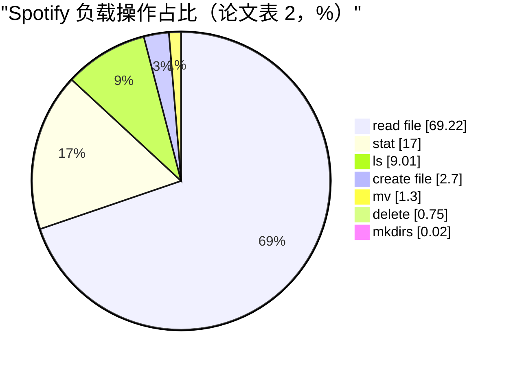

**负载生成**（论文 §5.2.1）：

- 修改 HopsFS 评估用的 hammer-bench，运行 5 分钟；每 15 秒从**形状参数 α = 2 的 Pareto 分布**抽一个吞吐目标 Δ；随机产生最高为基础吞吐 **7 倍**的突发。
- 两个版本：Pareto 的尺度参数 x_t = 25,000 和 50,000，x_t 决定基础吞吐。
- 1,024 个客户端分布在 8 台 VM 上；没完成的操作顺延到下一秒。
- HopsFS 分配 512 vCPU 以发挥最好性能。λFS 每个 NameNode 5 vCPU；25k 负载下 λFS 的 NameNode 集群总共只分配了 HopsFS 的 **50%** vCPU。

**解读**：Pareto 分布的尺度参数是最小值，α = 2 时期望值是 α·x_t/(α−1) = **2·x_t**。所以"基础 25k"负载的平均目标约为 50k ops/s，"基础 50k"约 100k ops/s。这就能理解为什么 λFS 在 25k 负载下平均吞吐 45.7k、在 50k 负载下 90.9k，都接近（略低于）期望值；而 HopsFS 卡在 38k 和 45k，一直在"追赶"。

#### 吞吐与延迟（论文 §5.2.2，图 8a、8b）

| 指标 | λFS | HopsFS | HopsFS+Cache |
|------|-----|--------|--------------|
| 25k：平均吞吐（ops/s） | 45,690.34 | 38,134.35 | 45,945.10 |
| 25k：平均延迟（ms） | **1.02** | 10.58 | 3.348 |
| 25k：突发峰值 | 完整撑住 15 秒、163,996 ops/s 的突发 | 难以维持 38,000 ops/s 以上，突发到来时还在处理约一分钟前生成的操作 | — |
| 50k：平均吞吐（ops/s） | 90,875.60 | 44,956.28 | — |
| 50k：平均延迟（ms） | **4.31** | 22.40 | — |
| 50k：突发峰值 | 约 250,000 ops/s（t ≈ 200 s） | 达不到 50,000 的基础吞吐 | — |
| 50k：vCPU 使用 | 最多 180/512（35.15%） | 512 | — |

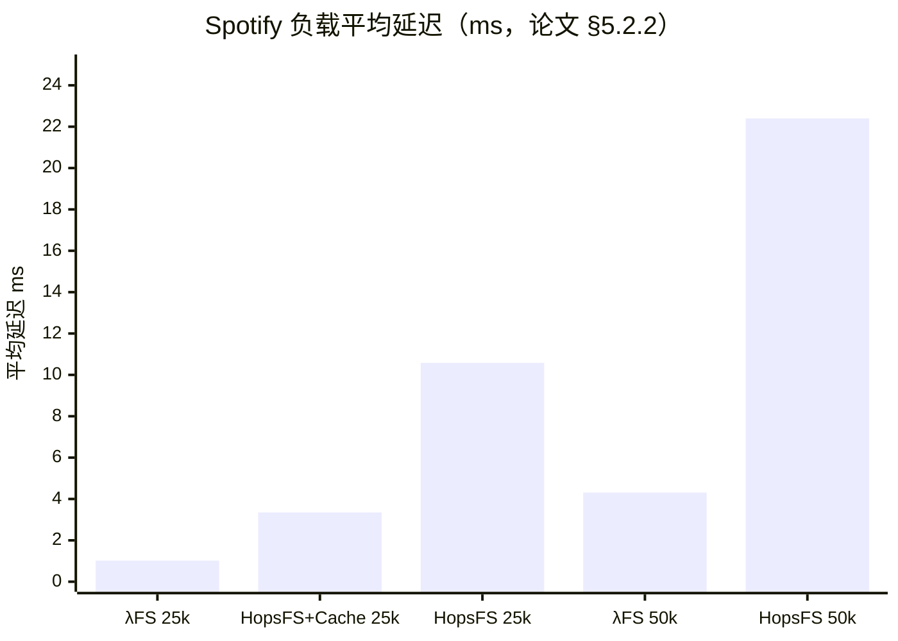

论文给出的相对值：

| 对比 | 论文数字 | 按原始数据复算 |
|------|---------|---------------|
| 25k：λFS 对 HopsFS 延迟 | −90.40%（10.41×） | 10.58/1.02 = 10.37×，−90.36%，基本一致 |
| 25k：λFS 对 HopsFS 吞吐 | +16.53%（1.19×） | 45,690/38,134 = **1.198×，即 +19.8%**；16.53% 是以 λFS 为分母算出的 |
| 25k：λFS 对 HopsFS+Cache 延迟 | −69.53%（3.28×） | 3.348/1.02 = 3.28×，一致 |
| 25k：峰值 | 4.3× | 163,996/38,000 ≈ 4.32×，一致 |
| 50k：平均吞吐 | +102.14%（2.02×） | 一致 |
| 50k：平均延迟 | −80.76%（5.19×） | 一致 |
| 50k：峰值 | +456.09%（5.56×） | 250,000/44,956 ≈ 5.56×，一致 |

**读写分开看**（图 10）：λFS 的读延迟比 HopsFS 低 **6.93–20.13 倍**；但写操作由于一致性协议的开销，HopsFS 的写延迟反而比 λFS **短 1.5–5.55 倍**。

**InfiniCache 两个负载都没能跑完**：大量高延迟 HTTP 调用压垮了 FaaS 平台，固定规模的部署也扛不住基础负载和突发（论文 §5.2.2）。

**成本归一化的 HopsFS+Cache（CN HopsFS+Cache）**：为了公平比较 FaaS 的省钱效果，另配了与 λFS 花费相同的 HopsFS+Cache：25k 负载 72 vCPU、50k 负载 144 vCPU。两个负载下它都在约 200 秒处的突发时扛不住，吞吐低于 λFS（论文 §5.2.2，图 8）。

**解读**：72 vCPU 恰好是 512 × 0.35/2.50 ≈ 72，说明 CN 配置就是按图 9 的成本比例算出来的，前后一致。这个对比比"同 vCPU"更有说服力：**花同样的钱**，固定规模的有缓存集群扛不住 7 倍突发，λFS 能扛住。这才是弹性的价值。

#### 缓存的作用（论文 §5.2.3）

把 NameNode 缓存容量降到工作集大小的一半以下（"reduced-cache λFS"）重跑 25k 负载：它仍好于 HopsFS，最大突发期间维持在 **70,000–80,000 ops/s**；没能撑住 163,996 ops/s 的峰值，但很快追上并完成了剩余负载。

#### 弹性伸缩（论文 §5.2.4）

图 8a、8b 显示：负载开始时 λFS 立即扩出更多 NameNode；在约 200 秒的 7 倍突发处再次快速扩容。图 8a 的右轴显示 NameNode 数在约 22–32 之间变化（约），图 8b 在约 26–36 之间（约）。

### 10.3 性价比（论文 §5.2.5，图 8c）

论文定义**性价比**（performance-per-cost）：瞬时吞吐 / 瞬时成本，或平均吞吐 / 总成本，单位是 ops/(s·$)。

- HopsFS+Cache 的成本按 32 台 NameNode VM 运行一秒计算；λFS 按 FaaS 的按使用计费：某个 NameNode 只有在那一秒服务过请求才计费。
- 整个负载期间 λFS 的吞吐都不低于 HopsFS+Cache，而 vCPU 用量少得多（最多 165 或 180 vCPU，对方 512），因此性价比显著更高。图 8c 中 λFS 曲线大部分时间约在 20M–100M 之间，HopsFS+Cache 约在 10M–30M（约）。
- 摘要中的"性价比高 3.33 倍"在正文中没有给出对应的计算，见 [§12](#12-论文中的不一致与可疑之处)。

### 10.4 成本（论文 §5.2.5，图 9）

| 系统 | 25k 负载总成本 | 计算方式 |
|------|---------------|---------|
| HopsFS、HopsFS+Cache | **$2.50** | 每 1 ms 按整个 512 vCPU 集群计费 |
| λFS（按使用计费） | **$0.35** | 每 1 ms 只对正在服务 HTTP 或 TCP 请求的 NameNode 计费，用 AWS Lambda 单价：$0.0000166667 / GB·s（1 ms 粒度）+ $0.20 / 百万次请求 |
| λFS（简化模型） | 约 $0.70（约） | 实例被配置期间一直计费，类似 VM，或 Lambda 的预置并发；成本**翻倍** |

λFS 相对 HopsFS 成本降低 **85.99%（7.14×）**：1 − 0.35/2.50 = 86%，2.50/0.35 = 7.14，一致。

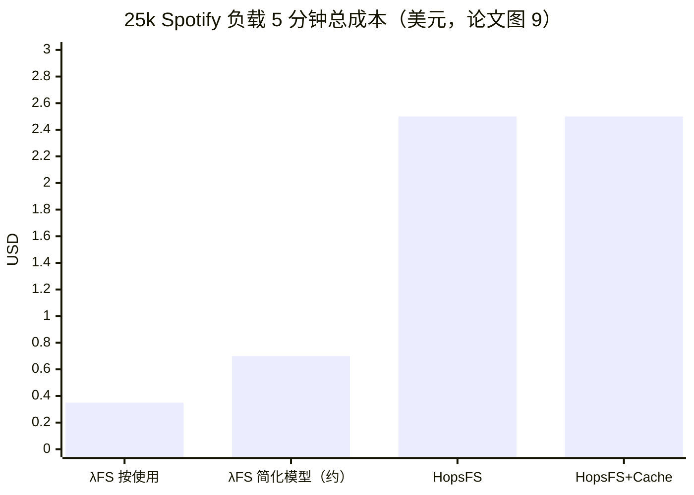

**解读**：

- 成本比较只算了 NameNode 层，**NDB 和 OpenWhisk 控制面的成本两边都没算**。NDB 在两个系统中相同，可以抵消；但 OpenWhisk 控制器、invoker、Kafka、EKS 本身的开销只有 λFS 才有，没有计入。
- 即使按简化模型（约 $0.70），λFS 仍比 HopsFS 便宜约 3.6 倍，而且性能更好。考虑到 [§9.3](#93-移植到商用-faas-平台论文-4) 提到 Lambda 难以在调用之间服务 TCP 请求，简化模型可能更接近在商用平台上部署的真实成本，这仍是一个相当可观的优势。
- 更本质的比较是：λFS 最多用了 165–180 vCPU，HopsFS 配了 512。如果 HopsFS 按约 180 vCPU 配置，成本也会接近，但扛不住突发（CN HopsFS+Cache 的实验已经说明）。所以省钱的核心是"**按需扩缩**"，而不是"FaaS 计价更便宜"。

### 10.5 扩展性（论文 §5.3）

两个微基准，覆盖 read、stat、ls、mkdir、create，操作对象是已有目录树中的随机文件和目录。所有系统最多 512 vCPU；λFS 最多 76 个 NameNode × 6.25 vCPU = 475 vCPU（92.77%）。

#### 客户端驱动扩展（论文 §5.3.1，图 11）

总 vCPU 固定为 512，每个客户端执行 3,072 次操作，客户端数从 8 增加到 1,024。

| 操作 | λFS 相对 HopsFS（各规模平均） | 其他观察 |
|------|------------------------------|---------|
| read | **28.91×** | λFS 优于 HopsFS+Cache；1,024 客户端时约 800k ops/s（约） |
| stat | **8.22×** | 与 HopsFS+Cache 相当 |
| ls | **20.53×** | λFS 优于 HopsFS+Cache |
| create | **1.49×** | 两者都受 NDB 限制，吞吐远低于读；CephFS 最高 |
| mkdir | 约 1× | 同上 |

- read 测试中，λFS 从 8 个客户端时的 **20 个**活跃 NameNode 扩到 1,024 个客户端时的 **74 个**。read、ls、stat 分别最多用了 462.5、425、475 vCPU。
- **CephFS** 在前 4–5 个规模下的 read、ls、stat 吞吐最高，之后扩展不佳，只比 HopsFS 和 InfiniCache 好。写操作上 CephFS 最好，论文推测是 CephFS 的 capabilities 机制比 HopsFS/λFS 的权限系统更高效。
- **HopsFS+Cache** 的写吞吐也低，因为客户端使用的一致性哈希会被热点目录卡住。
- **HopsFS 的 NameNode CPU 利用率一直只有约 70%**：无状态 NameNode 本质上是转发请求的代理，200 个 RPC 线程也用不满分配的资源；增加 NameNode 可能有用，但很难预先确定合适的数量。

**解读**："HopsFS+Cache 被热点目录卡住"这一点也适用于 λFS 的写：热点目录的所有写都集中在一个 deployment，并且每次写都要失效该 deployment 的所有实例。λFS 扩出的实例越多，写一次要等的 ACK 就越多。读扩展与写放大在这里是此消彼长的，这也解释了图 10 中 λFS 写延迟更高。

#### 资源驱动扩展（论文 §5.3.2，图 12）

总 vCPU 从 16 增加到 512，每个规模下各系统客户端数相同，每客户端 3,072 次操作，报告最大吞吐。

| 操作 | 最大规模下 λFS 相对 HopsFS | λFS 从 16 到 512 vCPU 的吞吐增长 |
|------|---------------------------|-------------------------------|
| read | **30.67×** | **34.60×** |
| stat | **9.30×** | **34.80×** |
| ls | **20.69×** | **72.08×** |

- vCPU 增加了 32 倍，λFS 的读吞吐增长了 34.6–72.1 倍，**超线性**。论文解释为：资源越多，自动伸缩的空间越大；资源少时伸缩受限，λFS 无法适应负载。
- 写操作趋势不明显，因为 NDB 是瓶颈。
- λFS 在所有操作上都等于或优于 HopsFS+Cache。

**解读**：超线性增长说明小规模时 λFS 处在"效率很差"的区域，而不是大规模时特别好。16 vCPU 只能放下 2 个 6.25 vCPU 的 NameNode，比 deployment 数还少，实例不断被换入换出（即 [§6.3](#63-防抖动模式论文附录-b) 的抖动），缓存几乎没有效果。所以"34× 增长"更多反映了 λFS 在资源紧张时的劣势。

#### 成本效率（论文 §5.3.3，图 13）

客户端驱动测试下的性价比，λFS 按**简化模型**计价（可能高估成本，但由于所有活跃 NameNode 几乎一直在忙，应接近真实成本）：

- read、ls：λFS 在所有规模下都更高；ls 上 λFS 用更少资源获得了高出 **32.74%** 的吞吐。
- stat：8 个规模更高，其余大致持平。
- 最后几个规模 λFS 的性价比下降：λFS 用掉了 512 vCPU 中越来越大的比例。增加平台资源可以避免。

### 10.6 自动伸缩的作用（论文 §5.4，图 14）

三种配置：

- **AS**：deployment 自由扩容；
- **Limited AS**：每个 deployment 最多 2–3 个实例；
- **No AS**：每个 deployment 只有一个实例。

| 操作 | AS 相对 Limited AS | AS 相对 No AS |
|------|-------------------|---------------|
| read、stat | 2.85–3.17× | 3.53–3.80× |
| ls | 3.07× | **14.37×** |
| create、mkdir | 差异小（瓶颈在 NDB） | 差异小 |

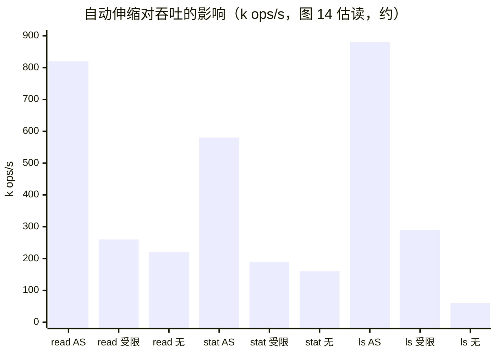

**解读**：ls 在关闭伸缩时下降最严重（14.37×），因为 ls 按父目录路由，同一目录的所有 ls 都落到同一个 deployment，单实例时完全串行化。这正是"固定 deployment 分区 + deployment 内扩容"设计的意义所在：**热点目录靠增加副本实例来分担**。

### 10.7 子树操作（论文 §5.5，表 3）

目录规模 2¹⁸ 到 2²⁰ 个文件时，子树 `mv` 的平均端到端延迟（ms）：

| 目录规模 | HopsFS | λFS | λFS 相对 HopsFS |
|---------|--------|-----|----------------|
| 262k（2¹⁸） | 7,511.60 | 6,455.80 | 论文：快 16.35%；复算：**少用 14.06% 的时间** |
| 524k（2¹⁹） | 14,184.80 | 12,509.20 | 论文：快 13.39%；复算：**少用 11.81% 的时间** |
| 1.04M（2²⁰） | 25,137.00 | 25,220.80 | 大致相同（λFS 慢 0.33%） |

大子树操作中 NDB 成为瓶颈，每次写都要更新数据库里的持久状态。

**解读**：子树操作的收益有限，原因是瓶颈在 NDB 的批量写。λFS 的前缀失效和卸载只是避免了一致性协议本身成为额外开销；在 2²⁰ 规模下这两点也被 NDB 写入完全淹没。

### 10.8 λIndexFS 与 IndexFS（论文 §5.7，图 16）

| 项目 | 配置 |
|------|------|
| 集群 | 7 台 VM 的 BeeGFS：1 管理、1 元数据、1 存储、4 客户端；共 112 vCPU、448 GB 内存 |
| IndexFS | 部署在 4 台 BeeGFS 客户端 VM 上（遵循 IndexFS 的同置原则） |
| λIndexFS | 每台客户端 VM 跑 1 个 LevelDB；另有 64 vCPU、256 GB 的 OpenWhisk 集群运行函数 |
| 基准 | IndexFS 自带的 tree-test；客户端数 2–256 |
| 变长负载 | 每个客户端 10,000 次 mknod 写，再 10,000 次随机 getattr 读 |
| 定长负载 | 总共 100 万次写，再 100 万次随机读 |

结果：

- 读：λIndexFS 一直高于 IndexFS，大部分元数据都缓存在函数里。
- 写：两种负载下 λIndexFS 都**显著高于** IndexFS，主要得益于自动伸缩。
- 超过 2⁶ = 64 个客户端后，λIndexFS 的写吞吐下降，原因是 OpenWhisk 只有 64 vCPU；即便如此仍优于 IndexFS。
- 图 16b（变长负载）中 λIndexFS 的读吞吐在约 2⁵ 个客户端时达到约 600k ops/s 的峰值后下降（约）。

**解读**：注意 λIndexFS 比 IndexFS 多了一个 64 vCPU 的 OpenWhisk 集群，资源并不对等（112 + 64 对 112）。论文的结论"λFS 可移植"成立，但"λIndexFS 更快"的幅度有一部分来自额外资源。

---

## 11. 经验与教训

论文 §7 总结的三条经验，对其他想在 FaaS 上构建延迟敏感服务的系统也适用：

1. **只靠 HTTP 调用达不到高吞吐低延迟**。必须像 λFS 的 TCP-RPC 那样绕开调用开销。
2. **绕开 HTTP 会削弱自动伸缩**。这是"性能—并行度"权衡的又一个实例，作者在 Wukong（引 [31, 32]）等 FaaS 系统中也观察到过。设计时必须小心权衡。
3. **FaaS 带来复杂的错误状态**：
   - 函数随时可能被平台回收；TCP 连接意外断开后重建并不简单，因为函数不可寻址；
   - 用 HTTP 简单重提交失败请求可能造成请求风暴，压垮平台、导致资源严重过度配置；新拉起的 NameNode 一拥而上建立数据库连接，也会让持久化存储暂时变慢；
   - 数千个客户端同时发 HTTP 调用时，平台可能扩得过快，并行度超过所需，带来更高成本和类似抖动的行为，系统对流量变化过度矫正。

---

## 12. 论文中的不一致与可疑之处

| 位置 | 问题 | 判断 |
|------|------|------|
| 摘要、§1 贡献 | "吞吐最高提升 **4.13×**"。正文给出的峰值提升是 25k 负载 **4.3×**、50k 负载 **5.56×**，平均吞吐最高 2.02×，客户端驱动测试中 read 平均 28.91×；**没有任何地方得到 4.13×** | 摘要数字来源不明，可能来自旧版实验 |
| 摘要 | "性价比高 **3.33×**"（相对 HopsFS+Cache）。正文 §5.2.5、§5.3.3 只有定性描述和图 8c、图 13，没有给出 3.33 的计算 | 无法从正文复核 |
| §5.2.2 | "吞吐高 **16.53%（1.19×）**"。45,690.34 / 38,134.35 = 1.198，应为 **+19.8%**；16.53% 是 (45,690 − 38,134) / 45,690，即以 λFS 为分母 | 百分比算错分母 |
| §5.5 | 子树 mv "少用 **16.35%、13.39%** 的时间"。复算 1 − 6,455.8/7,511.6 = **14.06%**，1 − 12,509.2/14,184.8 = **11.81%**；16.35% 和 13.39% 是 HopsFS/λFS − 1，即"HopsFS 多用的时间" | 与上一条方向相反的分母错误 |
| §5.2.2 | "使用的资源少 **39.45%**"。同节说 λFS 在 25k 负载下的 vCPU 只有 HopsFS 的 50%；§5.2.5 说最多用到 165/512 vCPU（少 67.8%）。三个数字互相对不上 | 39.45% 的口径不明 |
| §5.1 与 §5.2.1、§5.2.2 | NameNode 配置前后不同：§5.1 说默认 6.25 vCPU、30 GB；§5.2.1 说 Spotify 负载下每个 NameNode 5 vCPU；§5.2.2 又说 25k 负载下每个 NameNode 6 GB 内存 | 可能是不同实验各自的配置，但没有说明 |
| §5.2.1 | "每台客户端 VM 尝试维持 δ = nΔ ops/s，n 为客户端 VM 总数"。若每台都维持 nΔ，总负载就是 n²Δ，与"系统吞吐 Δ"矛盾 | 应为 δ = Δ/n，疑似笔误 |
| 表 1 | 各项相加为 **62,617** 行，表中 Total 为 **63,624**，相差 1,007。分项小计"基准 18,160、λFS + λIndexFS 41,157"与表内数字一致 | 总数有误或漏列一项 |
| §3.1 与 §3.3 | 分区依据：§3.1 说按"父目录路径"一致性哈希，§3.3 说按"父 INode ID"，附录 B 又说"父目录的路径" | 两种哈希键在 rename 目录时行为不同：按路径哈希时，目录改名会让其所有子项换 deployment；按 INode ID 则不会。论文没有讨论 rename 对分区的影响 |
| §3.2 与附录 A | TCP RPC 平均延迟：§3.2 为 1–2 ms，附录 A 为 1–5 ms | 可能统计口径不同，影响不大 |
| §5.3.2 | 资源扩 32 倍，读吞吐增长 34.6–72.1 倍。论文把它当成 λFS 扩展性好的证据 | 更可能说明小资源下 λFS 效率很差（见 [§10.5](#105-扩展性论文-53) 解读） |
| 附录 B 与 §3.5 | 防抖动模式会把请求发给不负责该分区的 NameNode，这些实例会缓存非本分区的元数据。一致性协议的 D 是"缓存了目标路径上元数据的 deployment 集合"，论文没说明 leader 如何知道其他 deployment 也缓存了这份数据 | 可能存在陈旧读窗口，至少需要额外机制（例如在防抖动模式下不缓存跨区数据） |
| §5.2.5、§4 | 成本按 AWS Lambda 单价计算，但实验跑在自建 OpenWhisk（扩展了 ConcurrencyLevel）上，且 Lambda 的执行模型不允许调用之间继续服务 TCP 请求 | 成本优势的数值在商用平台上难以原样复现；简化模型更保守 |

---

## 13. 与相关工作的对比

### 13.1 论文中的相关工作（论文 §6）

| 类别 | 代表 | λFS 的差异 |
|------|------|-----------|
| 路径解析优化 | InfiniFS：投机路径解析 + 客户端目录缓存 | λFS 沿用 HopsFS 的 INode Hint Cache，缓存放在函数侧而不是客户端 |
| 中间件 MDS | IndexFS：建在 PVFS/BeeGFS 之上，客户端无状态缓存 | λFS 提供 MDS 级的弹性，以及建在函数上的一致的分布式缓存 |
| 目录同置 | LocoFS：同一目录的元数据放在同一台服务器，可能出现单点热点 | λFS 同样按目录同置，但用 FaaS 自动扩容热点 deployment |
| 哈希策略 | Lustre 按文件名；CalvinFS 按完整路径；Giraffa 用完整路径做主键；BetrFS 用路径索引；Lazy Hybrid 结合子树管理与哈希 | λFS 按父目录哈希 |
| FaaS 存储 | InfiniCache（Lambda 内存缓存大的只读对象）；InfiniStore（加分层与持久化）；Faa$T（与 FaaS 应用同置的 KV 缓存）；Pocket、Jiffy（serverful 的临时存储） | DFS 元数据负载与这些应用差别很大，需要新设计 |

### 13.2 与本仓库中其他系统的对照

| 系统 | 元数据层是否有状态 | 弹性 | 一致性 | 与 λFS 的关系 |
|------|-------------------|------|--------|--------------|
| HopsFS（FAST 2017） | 无状态代理 | 静态 | NDB 行锁 + 事务 | λFS 的基础系统 |
| [CFS](cfs-eurosys2023.md)（EuroSys 2023） | **去掉代理层**，客户端直接访问 TafDB | 依赖底层 KV | 单分片原语 + 裁剪临界区 | 同样以 HopsFS 为基线；CFS 攻锁开销，λFS 攻弹性和缓存，正交 |
| [InfiniFS](infinifs-fast2022.md)（FAST 2022） | 有状态 MDS | 静态 | 本地事务 + 跨服务器 2PC | λFS 论文点名的"固定集群"代表 |
| [Tectonic](tectonic-fast2021/deep-read.md)（FAST 2021） | 无状态元数据服务 | 改路由即可扩缩 | ZippyDB 单分片事务 | 同属"计算无状态 + 状态下沉到 KV"的分离式架构 |
| [SingularFS](singularfs-atc2023.md)（ATC 2023） | 单台元数据服务器 | 无 | 无日志操作 + 层级并发控制 | 路线相反：单机做到极致，不需要弹性 |
| [3FS](3fs-fireflyer-sc2024.md) | 无状态元数据服务 | 可随意增减 | FoundationDB 事务 | 工业界同类做法，没有缓存层 |
| [FalconFS](falconfs-nsdi2026.md)（NSDI 2026） | 有状态 MDS（PostgreSQL 扩展），每个节点复制整棵目录树 | 静态 | 广播失效代替两阶段加锁 | 同样把缓存从客户端挪到服务端，且同样用"失效广播"维护服务端副本一致；但服务端规模固定 |

**解读**：在"元数据下沉到事务存储"这条路线上（见[元数据扩展性综述](metadata-scalability.md)），λFS 回答的问题是"中间那层要不要有状态"。HopsFS、Tectonic、3FS 都选择无状态，简单但性能上限就是数据库；λFS 加一层软状态缓存，读性能大幅提升，代价是写路径要付一致性协议的成本。CFS 则选择干脆去掉这一层。三条路线对应三种负载假设：读多写少（λFS）、写竞争激烈（CFS）、两者都不极端（Tectonic、3FS）。

---

## 14. 整体总结

### 14.1 核心贡献

1. **问题定位**：指出 HopsFS 这类横向扩展 MDS 的两个缺陷：无状态 NameNode 让性能被数据库封顶；静态规模带来"配置不足还是浪费"的两难（论文 §2）。
2. **第一个基于 serverless 函数的 DFS 元数据服务**：把 NameNode 变成函数，函数内存组成弹性元数据缓存（论文 §3.1）。
3. **在 FaaS 上实现低延迟有状态服务的一组技术**：HTTP-TCP 混合 RPC 与连接共享；按父目录划分的固定 deployment 分区；随机 HTTP 替换的扩缩容策略；防抖动与落后者缓解；INV/ACK 一致性协议及子树前缀失效和卸载（论文 §3、附录）。
4. **通用性**：移植到 HopsFS 和 IndexFS（BeeGFS）两种架构，增加 Nuclio 支持只需 108 行代码（论文 §4）。
5. **评估**：在突发的 Spotify 负载下延迟 −90.40%、成本 −85.99%；读类操作吞吐是 HopsFS 的 8–31 倍（论文 §5）。

### 14.2 设计哲学

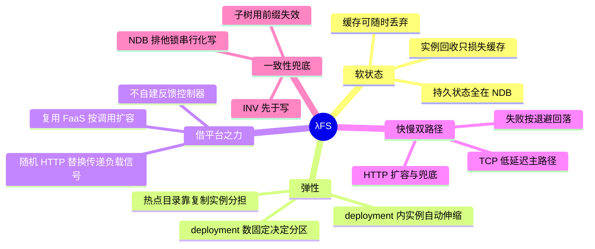

### 14.3 优点与局限

| 优点 | 局限 |
|------|------|
| 读延迟和读吞吐大幅提升，Spotify 负载下平均延迟约 1 ms | 写延迟比 HopsFS 高 1.5–5.55 倍；写吞吐仍受 NDB 限制 |
| 突发负载下自动扩容，同成本的固定集群扛不住 7 倍突发 | 依赖对 OpenWhisk 的修改（ConcurrencyLevel）；在商用 Lambda 上，TCP 长连接与计费模型存在根本冲突 |
| 按使用付费，低负载时成本极低 | 成本只计 NameNode 层，未计 FaaS 控制面；"按使用计费"在自建平台上是模拟的 |
| 固定 deployment 分区，扩缩容不需要迁移元数据 | 热点目录的写集中在一个 deployment，实例越多，每次写要等的 ACK 越多 |
| 模块化，可移植到不同 DFS 和 FaaS 平台 | 一致性依赖 ZooKeeper 存活判断，没有讨论"被判死但仍在服务"的实例；防抖动模式下的跨区缓存未被协议覆盖 |
| 开源，可复现 | 论文多个百分比的分母前后不一致，摘要的 4.13×、3.33× 无法在正文中找到出处 |

### 14.4 启示

1. **"有状态"可以拆成"软状态 + 硬状态"**。只要计算层的状态是可丢弃的缓存，就可以放在任何弹性但不可靠的资源上（FaaS、Spot 实例、可抢占容器），正确性由下层的持久存储保证。这对任何元数据服务都适用，不一定非要用 FaaS。
2. **分区与扩容解耦**。用固定数量的逻辑分区（deployment）做数据划分，用分区内的副本数应对负载，避免了扩缩容时的数据迁移。代价是要维护分区内副本的一致性。类似思路在 Kafka 分区、Redis Cluster 的固定 16384 个槽中都能看到。
3. **把负载信号"喂"给已有的控制器**。λFS 没有自己写扩缩容控制器，而是通过概率性地走慢路径，让平台已有的机制看到负载。在任何"快路径对控制面不可见"的系统中都值得借鉴，比如内核旁路网络中的流量统计、RDMA 单边操作的负载感知。
4. **读写分开评估**。λFS 的总体数字很亮眼，但只针对 95% 是读的负载。设计元数据服务时，一定要分开看读写的延迟分布（图 10 正是如此）。
5. **一致性协议值得形式化检查**。INV/ACK、加锁顺序、成员变化、实例被回收这几件事交织在一起，很容易出现只在极少数交错下才暴露的陈旧读。对这类协议，用 TLA+ 在 2 个 deployment、各 2 个实例的小规模上穷举一遍，成本很低。

### 14.5 一张图看懂 λFS

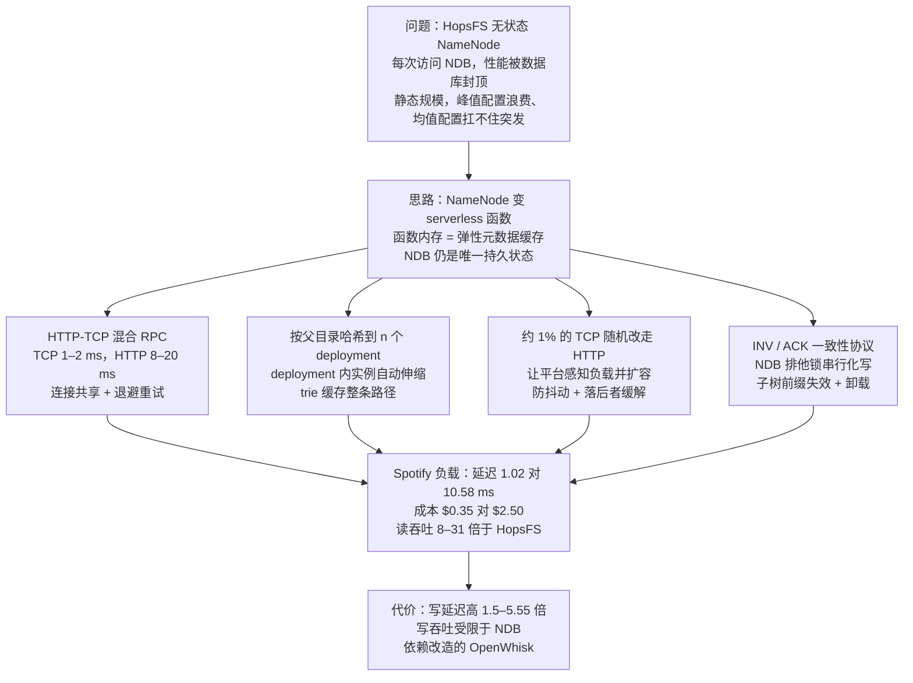

---

## 参考

- Benjamin Carver, Runzhou Han, Jingyuan Zhang, Mai Zheng, Yue Cheng. *λFS: A Scalable and Elastic Distributed File System Metadata Service using Serverless Functions*. ACM ASPLOS '23 Vol. 4. <https://dl.acm.org/doi/10.1145/3623278.3624765>；arXiv:2306.11877 <https://arxiv.org/abs/2306.11877>
- λFS 源代码：<https://github.com/ds2-lab/LambdaFS>；负载驱动：<https://github.com/ds2-lab/LambdaFS-Benchmark-Utility>
- Salman Niazi et al. *HopsFS: Scaling Hierarchical File System Metadata Using NewSQL Databases*. USENIX FAST 2017.
- Kai Ren, Qing Zheng, Swapnil Patil, Garth Gibson. *IndexFS: Scaling File System Metadata Performance with Stateless Caching and Bulk Insertion*. SC 2014.
- Wenhao Lv et al. *InfiniFS: An Efficient Metadata Service for Large-Scale Distributed Filesystems*. USENIX FAST 2022.（本仓库精读：[infinifs-fast2022.md](infinifs-fast2022.md)）
- Ao Wang et al. *InfiniCache: Exploiting Ephemeral Serverless Functions to Build a Cost-Effective Memory Cache*. USENIX FAST 2020.
- Jingyuan Zhang et al. *InfiniStore: Elastic Serverless Cloud Storage*. PVLDB 16(7), 2023.
- Liang Wang et al. *Peeking Behind the Curtains of Serverless Platforms*. USENIX ATC 2018.
- Sadjad Fouladi et al. *Encoding, Fast and Slow: Low-Latency Video Processing Using Thousands of Tiny Threads*. USENIX NSDI 2017.
- Kai Li, Paul Hudak. *Memory Coherence in Shared Virtual Memory Systems*. ACM TOCS 7(4), 1989.
- 本仓库相关：[元数据扩展性综述](metadata-scalability.md)、[CFS 精读](cfs-eurosys2023.md)、[InfiniFS 精读](infinifs-fast2022.md)、[SingularFS 精读](singularfs-atc2023.md)、[Tectonic 精读](tectonic-fast2021/deep-read.md)、[3FS 精读](3fs-fireflyer-sc2024.md)、[FalconFS 精读](falconfs-nsdi2026.md)
