# LineFS 论文精读：Efficient SmartNIC Offload of a Distributed File System with Pipeline Parallelism（SOSP 2021）

> 论文：Jongyul Kim, Insu Jang, Waleed Reda, Jaeseong Im, Marco Canini, Dejan Kostić, Youngjin Kwon, Simon Peter, Emmett Witchel. *LineFS: Efficient SmartNIC Offload of a Distributed File System with Pipeline Parallelism*. ACM SOSP 2021（28th Symposium on Operating Systems Principles），2021-10-26 至 10-29，线上举办（德国）。SOSP 2021 最佳论文之一。
>
> 机构：Jongyul Kim、Jaeseong Im、Youngjin Kwon（KAIST）；Insu Jang（University of Michigan，工作完成于 KAIST）；Waleed Reda（KTH 与 Université catholique de Louvain）；Marco Canini（KAUST）；Dejan Kostić（KTH）；Simon Peter（UT Austin）；Emmett Witchel（UT Austin 与 Katana Graph）。Shepherd 为 Manya Ghobadi。
>
> 链接：<https://doi.org/10.1145/3477132.3483565> ；PDF（作者主页）：<https://www.cs.utexas.edu/users/witchel/pubs/kim21sosp-linefs.pdf> ；代码：<https://github.com/casys-kaist/LineFS>
>
> 篇幅：16 页（含 3 张表、10 张图）。
>
> 精读日期：2026-11-23。文中**数字、表格与机制描述均摘自论文原文**（标注所在章节）；标注"解读"的段落是本文作者的分析与推论，不是论文原话。图 4、图 6、图 7、图 8 中没有数值标注的柱和折线，文中给出的是**读图估计**，误差约 ±5%。
>
> 相关文档：[Assise（OSDI 2020）精读](assise-osdi2020.md)（LineFS 的基础系统）、[新硬件综述中的 LineFS 小节](new-hardware.md#4-linefs-efficient-smartnic-offload-of-a-distributed-file-system-with-pipeline-parallelism)、[DPFS（SYSTOR 2023）精读](dpfs-systor2023.md)、[Fisc（FAST 2023）精读](fisc-fast2023.md)（另两条 DPU 文件系统路线）、[DAOS（SCFA 2020）精读](daos-scfa2020.md)（同为 Optane 持久内存时代的系统）。

## 目录

- [0. 一页速览](#0-一页速览)
- [1. 背景：客户端本地持久内存 DFS 的 CPU 账单](#1-背景客户端本地持久内存-dfs-的-cpu-账单)
- [2. 为什么卸载到 SmartNIC 很难](#2-为什么卸载到-smartnic-很难)
- [3. 总体架构：LibFS、NICFS 与内核工作线程](#3-总体架构libfsnicfs-与内核工作线程)
- [4. 两条设计原则：先持久后发布、流水线并行](#4-两条设计原则先持久后发布流水线并行)
- [5. 发布流水线](#5-发布流水线)
- [6. 复制流水线](#6-复制流水线)
- [7. 共享文件、访问控制、故障与恢复](#7-共享文件访问控制故障与恢复)
- [8. 实现细节](#8-实现细节)
- [9. 评估](#9-评估)
- [10. 论文的不一致与留白](#10-论文的不一致与留白)
- [11. 与相关工作的对比](#11-与相关工作的对比)
- [12. 整体总结](#12-整体总结)
- [参考](#参考)

---

## 0. 一页速览

**一句话**：Assise 这类"客户端本地持久内存"分布式文件系统把数据放在应用所在机器的 Optane 上，延迟极低，但日志发布、建索引、复制这些后台工作要吃掉好几个主机核，和应用抢 CPU。LineFS 把这些工作搬到 BlueField SmartNIC 的 ARM 核上。SmartNIC 核弱、隔着 PCIe，直接搬会慢 30 倍以上，所以 LineFS 做了两件事：一是**先持久后发布**，应用只在主机上把操作日志写进本地 PM 就返回，其余全部异步；二是把发布与复制拆成**多级流水线**，以 4 MB 的日志块为单位并行推进，把 PCIe 延迟和弱核的计算时间重叠起来。

| 维度 | 要点 |
|------|------|
| 要解决的问题 | 客户端本地 PM DFS 的后台任务（数据搬移与建索引、复制、远程请求、一致性协调）和应用争抢 CPU 与内存带宽，导致应用变慢、文件系统尾延迟飙升、吞吐下降（§2.1） |
| 动机数据 | 8 个进程各写 24 GB 文件时，Assise 在 100GbE 上占用 **5.09 个主机核**，Ceph 只占 2.11 个（§2.1，表 1） |
| 卸载的难点 | SmartNIC 经 PCIe 访问主机 PM 要几 µs，主机经 DDR 约 100 ns；BlueField 是 16 核 800 MHz 的 ARM A72，功耗约 25 W。直接卸载 Assise 的 SharedFS 吞吐**下降超过 30 倍**（§2.2、§3） |
| 架构 | 主机：LibFS（链接进应用，写私有 PM 日志、读路径全在主机）、内核工作线程（用 I/OAT DMA 做发布拷贝）；SmartNIC：NICFS（发布、复制、校验、租约、压缩）（§3，图 1） |
| 原则一 | **先持久后发布**：LibFS 用快的主机核把数据和元数据写进私有 PM 日志即完成持久化，NICFS 在后台把日志发布到公共 PM 区并复制到远端（§3.1） |
| 原则二 | **流水线并行**：日志按 4 MB 切成 LineFS chunk；发布流水线是取回→校验→发布→确认，复制流水线是取回→校验→（压缩）→传输→确认，两者共享前两级；按客户端日志顺序处理，保证线性一致和前缀崩溃一致（§3.1、§3.3） |
| 主动复制 | 不等 `fsync()`，日志每攒满一个 chunk 就在后台链式复制；`fsync()` 时只同步复制剩余部分，走专用的低延迟 RDMA 连接（§3.3.2，图 3） |
| 额外能力 | 利用 SmartNIC 空闲算力做语义合并（coalescing）和复制前压缩；主机 OS 崩溃时，作为副本的 NICFS 继续经 PCIe 完成发布与复制（§3.3、§3.5） |
| 关键结果 | 写吞吐比 Assise 高 133%（单客户端，副本空闲）；副本繁忙时比所有 Assise 变体高 33%；副本繁忙时 `fsync` 写延迟 99.9 分位比 Assise 低 41 倍；LevelDB 顺序插入延迟"好 80%"（即 Assise 延迟约为 LineFS 的 1.8 倍）；Fileserver 吞吐高 79%；压缩省 72% 网络带宽（§5） |
| 代价 | 空闲时单次写 + `fsync` 平均延迟 149 µs，约为 Assise 76 µs 的 2 倍；Varmail（小文件 + 频繁 `fsync` + 频繁 `open`）比 Assise 慢 21%（§5.2.5、§5.3） |

**解读**：

- LineFS 的核心洞察是：**卸载慢核上的工作，不能逐个请求地做，必须批量、异步、流水化**。持久化这一步（真正决定延迟和崩溃语义的部分）留在快的主机核上，SmartNIC 只接手"已经持久、只需要往后推进"的工作。这样 SmartNIC 的慢只影响后台吞吐，不影响前台延迟，而流水线又把后台吞吐拉回到网络上限。
- 它是在 Assise 上改出来的，不是一个全新的 DFS：LibFS、更新日志、租约、链式复制都继承自 Assise。论文的贡献集中在"**如何把一个已有的 DFS 拆开放到 SmartNIC 上**"，这也是它对 Optane 停产后仍有参考价值的原因：流水线卸载方法论与 PM 无关。
- 评估的主线是**多租户干扰**：副本空闲时 LineFS 只比"后台复制版 Assise"好 4%，真正拉开差距的是副本主机被 CPU 密集作业占满的场景。读这篇论文要抓住这一点，否则会高估它在独占机器上的收益。

---

## 1. 背景：客户端本地持久内存 DFS 的 CPU 账单

### 1.1 CPU 停滞，I/O 设备在变快（§1、§2）

网络和存储设备越来越快，而 CPU 无论单核性能还是核数都已停滞，CPU 周期和内存带宽成了稀缺资源。运营方希望尽可能把客户端 CPU 留给应用。但持久内存的引入加剧了 CPU 争用：为了降低 PM 访问延迟，新一代 PM 优化的 DFS 会把文件系统管理工作放在客户端本地。例如 Assise 在每个进程的缓存满时做并行数据回收，Orion 定期为日志结构的文件数据建基数树索引、做日志垃圾回收、在数据共享时运行客户端仲裁协议。这些工作在 I/O 密集的客户端上会消耗好几个核（§1）。

### 1.2 客户端本地 vs 客户端-服务器（§2.1，表 1）

所谓**客户端本地**（client-local），是把 PM 存储放在运行应用的同一台机器上，可以把 PM 文件访问延迟降低几个数量级。代价是文件系统管理任务也要在客户端本地执行，与应用争抢内存和计算资源。

论文测了每个客户端写一个 24 GB 文件、I/O 大小 4 KB 时，Assise（客户端本地）与 Ceph（客户端-服务器）的客户端 CPU 占用（100% = 1 核）：

| 进程数 | 吞吐 25GbE（GB/s）Assise / Ceph | 吞吐 100GbE（GB/s）Assise / Ceph | CPU 25GbE Assise / Ceph | CPU 100GbE Assise / Ceph |
|------:|------:|------:|------:|------:|
| 1 | 0.38 / 1.23 | 0.63 / 1.26 | 62% / 95% | 101% / 96% |
| 2 | 0.74 / 1.34 | 1.12 / 1.51 | 119% / 126% | 201% / 146% |
| 4 | 1.30 / 1.40 | 1.98 / 1.56 | 225% / 141% | 380% / 211% |
| 8 | 1.32 / 1.41 | 2.22 / 1.60 | 224% / 176% | **509%** / 211% |

论文的结论：两种 DFS 都需要大量客户端 CPU，但 Assise 在 25GbE 和 100GbE 上分别比 Ceph 多用最多 60% 和 2.4 倍的周期，而且网络越快，Assise 需要的 CPU 越多（§2.1）。

**解读**：

- 表 1 里 Assise 的吞吐在多进程时也更高（100GbE、8 进程 2.22 vs 1.60 GB/s），所以"多用 2.4 倍 CPU"里有一部分是在做更多的事。按每 GB/s 吞吐折算，100GbE、8 进程时 Assise 约 229%·s/GB，Ceph 约 132%·s/GB，Assise 每字节的 CPU 开销约为 Ceph 的 1.7 倍，差距仍然明显，但比 2.4 倍小。
- 1–2 个进程时 Ceph 的吞吐反而更高（25GbE 单进程 1.23 vs 0.38 GB/s）。这与 Assise 在 `fsync` 时才在调用者线程里同步复制有关（见 [§9.2](#92-写吞吐扩展性521图-4)），说明这张表测的是"Assise 默认悲观模式"的开销，不是客户端本地模型的理论下限。

### 1.3 四类后台任务与三类危害（§2.1）

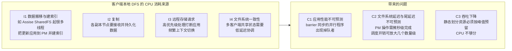

C3 说明了为什么"给文件系统固定分几个核"不是好办法：分区必须按峰值来预留才能支撑高吞吐，而 CPU 恰恰是最稀缺的资源，预留不足又会拉低文件系统或应用中的一方（§2.1）。

---

## 2. 为什么卸载到 SmartNIC 很难

### 2.1 两个硬约束（§2.2）

| 约束 | 数字 | 含义 |
|------|------|------|
| **访问主机内存的延迟高** | 主机 CPU 经 DDR 访问 PM 约 100 ns；SmartNIC 经 PCIe 访问 PM 要几 µs，相差一个数量级 | 必须尽量少访问主机上的 PM 和文件系统状态，或者把延迟藏起来 |
| **执行环境弱** | 典型 SmartNIC 功耗约 25 W，比主机 CPU 低一个数量级；多个低频核、小缓存 | 没有空间放强大的内存和处理单元 |

### 2.2 BlueField 的配置（§2.2、§5.1）

| 项目 | 规格 |
|------|------|
| 型号 | Mellanox BlueField **MBF1M332A**（第一代 BlueField），2×25GbE |
| 处理器 | 16 核 ARMv8 Cortex-A72，**800 MHz** |
| 缓存 | 每核 32 KB L1D；每两核共享 1 MB L2；全部共享 6 MB L3 |
| 内存 | 16 GB，可为 DRAM 或 NVDIMM-N |
| 实测 | 内存带宽 10 GB/s；文件基准测得的网络有效吞吐（goodput）**2.2 GB/s** |
| 软件 | ARM 上跑 Linux |

### 2.3 off-path SmartNIC，当作一台独立主机用（§2.2）

BlueField 是 **off-path** SmartNIC：网卡上有一个 RDMA 交换单元，既能直接访问 SmartNIC 内存，也能直接访问主机内存，可按规则转发 RDMA 请求。LineFS 把 ARM 处理器配置成一台**独立主机**，有自己的 MAC 和 IP。这样文件系统可以从任何机器完全控制数据发往哪里、和 SmartNIC 还是主机交互。

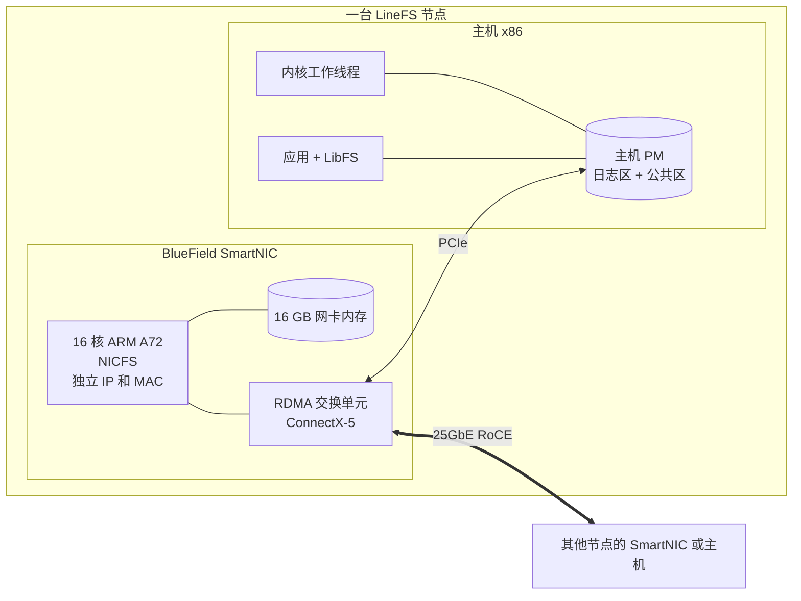

作者解释了为什么选这种 CPU 型 SmartNIC，而不是 NPU 或 FPGA 型的 in-path 网卡：文件系统是复杂软件，处理高度结构化的数据，有复杂的一致性和持久性协议，能跑完整 OS 的 ARMv8 很适合执行文件系统；为逐包处理优化的 in-path 架构只会让卸载设计不必要地复杂。这是有意为之，使工作聚焦在互连和弱执行环境这两个问题上，而不是底层加速（§2.2）。

### 2.4 直接卸载的结果：慢 30 倍以上（§3）

作者最初尝试把 Assise 每节点的 SharedFS 组件直接卸载到 SmartNIC，结果在不采用本文设计原则的情况下，**吞吐比主机版本下降了 30 倍以上**，原因是 SmartNIC 上的执行效率太低（§3）。

**解读**：这个"30 倍"是全文最重要的反面论据，也解释了论文标题为什么强调"Pipeline Parallelism"。可惜论文没有给出这次失败实验的配置和分解，读者无法判断 30 倍里有多少来自 PCIe 往返、多少来自 ARM 核计算。

---

## 3. 总体架构：LibFS、NICFS 与内核工作线程

### 3.1 四条设计目标（§3）

1. **尽量减少对主机的干扰**：CPU 是现代云服务器最受约束的资源之一，LineFS 必须减少应用与 DFS 对 CPU 的争抢，因此把 DFS 功能卸载到 SmartNIC。
2. **尽量减少卸载带来的减速**：重新设计文件系统数据路径以利用细粒度数据并行，在后台执行数据路径，让前台主机计算不受影响。
3. **利用数据路径上的处理机会**：用 SmartNIC 的空闲算力做语义感知的数据变换，例如压缩，节省复制占用的网络带宽。
4. **提高可用性**：SmartNIC 与主机共享电源，但执行环境独立，主机操作系统崩溃后仍可继续运行。

### 3.2 节点组成（§3，图 1）

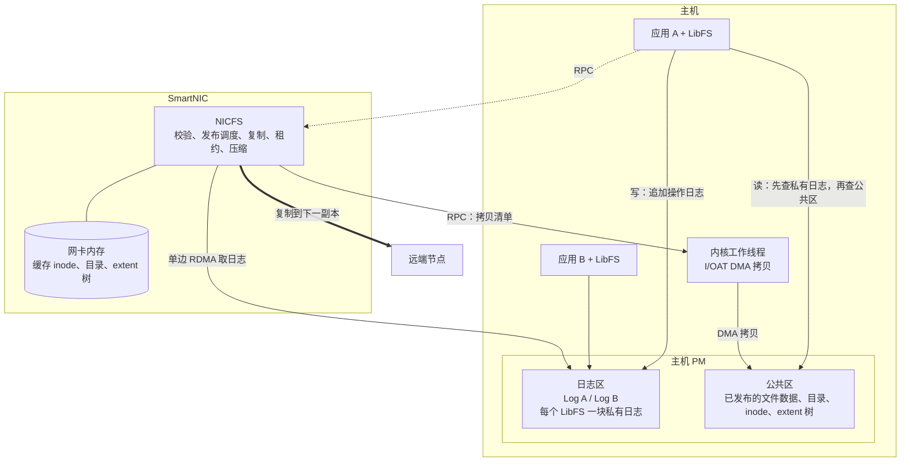

- **LibFS**：链接进应用进程，运行在主机核上，拦截 POSIX 调用。
- **NICFS**：运行在 SmartNIC 的 Linux 上的一个进程。
- **内核工作线程**（kernel worker）：主机内核模块，按 NICFS 给出的拷贝清单，用主机 DMA 引擎把日志内容发布到公共区。

除每节点的卸载以外，LineFS 紧密沿用 Assise 的设计：带每进程 LibFS 和更新日志的用户态 PM I/O、作为一致性机制的租约（lease）、基于 RDMA 的链式复制都继承自 Assise；集群管理用 ZooKeeper，负责节点成员、故障检测和根租约仲裁（§3）。

### 3.3 LibFS：低延迟 PM I/O（§3.2）

- **写**：LineFS 给每个 LibFS 分一块 PM 作为持久写日志。LibFS 拦截 POSIX 调用，把文件数据和元数据写进 PM 日志。例如 `create()` 时，LibFS 把更新后的 inode 和目录写进日志。日志对 PM 很高效，因为 PM 的顺序性能高，日志追加是顺序写。写路径只需与 NICFS **异步**通信，以发布和复制私有日志。
- **读**：两步：先在客户端私有日志里找（数据尚未发布），找不到再去公共 PM 区找。读路径完全在主机 CPU 上执行，**不涉及 NICFS**。

**解读**：读写路径的这一划分是整个设计的地基。读延迟和写持久化延迟都只由主机核和本地 PM 决定，SmartNIC 慢多少都不影响它们；SmartNIC 只决定"日志多快能被清空"，也就是持续写吞吐和复制时延。

---

## 4. 两条设计原则：先持久后发布、流水线并行

### 4.1 先持久后发布（persist-and-publish）（§3.1）

LibFS 把数据和元数据更新持久化到主机上各自的私有 PM 日志里；NICFS 再异步地把日志**发布**到本机的公共 PM 区，并**复制**到远端 PM。这个设计受 Strata 的"logging + digesting"启发，把**对 PM 延迟敏感的关键路径操作**与**可以推迟的操作**清楚地分开：LibFS 用快的主机核让数据和元数据在主机 PM 日志中持久化，NICFS 用 SmartNIC 核在后台完成发布和复制，主机核从文件系统管理任务中解放出来（§3.1）。

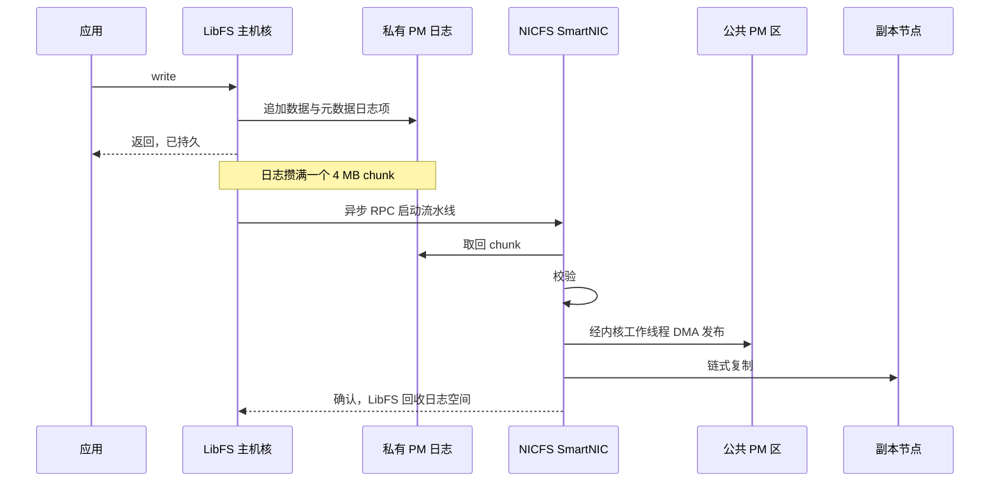

### 4.2 流水线并行（§3.1）

LineFS 把 DFS 操作组织成不同的执行阶段，构成一条执行流水线。一组日志项称为一个 **LineFS chunk**，每个 chunk 在流水线中并行处理。利用了两种并行：

- **客户端内并行**：用流水线发布和复制单个客户端的私有日志，同时**保持日志顺序**；
- **客户端间并行**：每个客户端各有一条流水线，多个客户端日志并行处理；对共享更新，LineFS 协调各流水线将其线性化（§3.4）。

线程管理：NICFS 在启动时创建一个线程池，为每个阶段分配线程。LibFS 日志长到一个 chunk 大小（例如 **4 MB**）时，向 NICFS 发 RPC 启动流水线。NICFS 监测各阶段耗时，若某阶段成为瓶颈（例如等待队列超过 **5 项**），就动态给它分配更多线程（§3.1）。

一致性：客户端日志天然按序持久化文件系统更新；发布和复制时，流水线并行允许 LineFS 按客户端日志顺序处理数据，从而提供**线性一致性**和**前缀崩溃一致性**（§3.1）。

**解读**：

- "前缀崩溃一致"的意思是崩溃后看到的状态，一定是日志中某个前缀全部生效后的状态，不会出现后面的更新已生效、前面的还没生效。流水线可以并行处理不同 chunk，但"发布"这一步必须按 chunk 顺序提交（图 2 中"等待排序"），这是并行与一致性兼得的关键。
- 4 MB 的 chunk 是一个吞吐与延迟的折中：越大，PCIe 和 RDMA 的批量效率越高；越小，未发布、未复制的数据越少，`fsync` 时要同步处理的剩余部分也越少。论文没有给出 chunk 大小的敏感性实验。

---

## 5. 发布流水线

### 5.1 为什么卸载发布（§3.3.1）

NICFS 在后台把客户端私有日志项发布到公共 PM；发布后 LibFS 回收这些日志项，为后续更新腾出空间。发布涉及从私有日志到公共 PM 的大量内存搬移。卸载发布的四个理由：

1. 减少主机 CPU 做数据搬移的占用和负载；
2. 减少 DFS 服务带来的调度与上下文切换开销；
3. 减少主机 CPU 紧张、日志写满时的**队头阻塞**；
4. 让压缩等附加任务可以在不争抢 CPU 的情况下进行。

难点有两个：PCIe 延迟高；权限检查和校验（例如防止 DFS 命名空间中出现目录环）消耗的计算量足以让弱的 SmartNIC 处理器饱和。通信延迟和计算负载这两个挑战都说明，**让二者重叠**可以减轻它们对端到端性能的影响（§3.3.1）。

### 5.2 四级流水线（§3.3.1，图 2）

| 阶段 | 主要资源 | 做什么 |
|------|---------|-------|
| 1 取回 Fetching | PCIe | 把一个 LineFS chunk 取到 SmartNIC 内存 |
| 2 校验 Validation | 计算 | 权限与租约检查、命名空间合法性检查（如防目录环）；可与 coalescing 合并 |
| 3 发布 Publication | PCIe + 计算 | 生成拷贝清单，交给主机内核工作线程用 DMA 拷贝到公共区 |
| 4 确认 ACK | PCIe 延迟 | 通知 LibFS 可以回收日志 |

| 时间槽 | t1 | t2 | t3 | t4 | t5 |
|-------|----|----|----|----|----|
| Chk1 | 取回 | 校验 | 发布 | 确认 | |
| Chk2 | | 取回 | 校验 | 发布（等 Chk1 发布完） | 确认 |
| Chk3 | | | 取回 | 校验 | 发布（等 Chk2 发布完） |

（示意图 2 的重叠关系：同一时刻不同 chunk 处在不同阶段；"发布"必须按 chunk 顺序进行，实际各阶段耗时见 [§9.4](#94-流水线阶段分解523图-5)。）

**为什么发布要用主机的 DMA 引擎**：如果由 SmartNIC 经 PCIe 直接把 chunk 写到公共区，延迟过高，会让流水线停顿。LineFS 改用主机 OS 中的内核工作线程，发起**异步主机 DMA**（Intel I/OAT）来发布 chunk。与用主机核拷贝 PM 相比，DMA 拷贝仍然避免了 CPU 占用（§3.3.1）。

### 5.3 数据路径上的附加阶段：合并（coalescing）（§3.3.1）

NICFS 可以加入额外阶段，利用 SmartNIC 空闲的处理周期。例如加入一个做**语义感知压缩**的阶段，称为 coalescing：扫描取回的 chunk，找出"临时持久"的写模式（例如创建后又删除同一个文件），删掉冗余日志项，再为内核工作线程生成拷贝清单。这减少了发布的数据量，降低写放大，延长 PM 寿命。找合并机会需要扫描日志项，而校验也要扫描，所以校验和合并放在同一个核上执行，以利用 CPU 缓存局部性（§3.3.1）。

**解读**：

- 发布这一步其实是一个"**主机 DMA 引擎 + SmartNIC 调度**"的混合方案：数据不经过 SmartNIC 落盘，SmartNIC 只决定"拷什么、按什么顺序拷"。这避开了 PCIe 写回的高延迟，代价是主机上仍有一个内核线程参与（后面评估会看到，这个内核线程是 LineFS 剩余干扰的主要来源）。
- 论文没有单独评估 coalescing 的收益（省了多少写入、对哪些负载有效）。

---

## 6. 复制流水线

### 6.1 为什么卸载复制（§3.3.2）

LineFS 用 RDMA 把客户端私有日志**链式复制**到若干副本，提供可用性和副本间强一致。与其他 DFS 一样，`fsync()` 保证文件数据和元数据的持久与复制：沿复制链，每个副本把 primary 的客户端私有日志持久化到本地日志；primary 收到所有副本的 ACK 后，`fsync()` 返回，此时 primary 和所有副本对更新的视图一致（§3.3.2）。

强一致下复制延迟直接影响写性能，而复制延迟主要受两个因素影响：RDMA 请求处理的延迟，以及 DFS 复制操作与共存应用之间的 CPU 争抢。主机上的常规做法是预先在 RDMA QP 上投递请求、忙轮询完成事件；为保证稳定，投递和轮询都不能被延迟，所以必须跑在隔离的 CPU 上（§3.3.2）。

但在多租户系统里，主机忙轮询不现实，因为要为复制专门预留很多主机核；改成阻塞等待又会引入上下文切换和调度开销，共存应用还可能通过调度策略和缓存效应进一步拖慢复制。PM 优化的 DFS 对小的复制更新延迟不到 10 µs，任何干扰的影响都会被放大。卸载到 SmartNIC 可以兼得：在 SmartNIC 上忙轮询网络事件、低延迟处理复制，而不干扰主机上的应用（§3.3.2）。

### 6.2 RDMA 连接的扩展性：低延迟与高吞吐分开（§3.3.2）

朴素卸载会给每个 RDMA 连接一个独立轮询线程，压垮 SmartNIC CPU，也无法扩展到很多连接。NICFS 把 DFS 请求分成两类，使用**不同网络端口**：

| 连接类型 | 线程模型 | 用途 |
|---------|---------|------|
| 低延迟连接 | 一个绑定在 SmartNIC 核上的专用忙轮询线程 | `fsync()` 通知、租约操作等延迟敏感操作 |
| 高吞吐连接 | 事件触发的工作线程池（例如收到复制 ACK 时唤醒） | 复制、发布等数据密集操作 |

此外，NICFS 把多个 LineFS 客户端的 RDMA 操作**复用**到少量 QP 上：QP 少才能避免网卡缓存抖动，也进一步减少了忙轮询线程的数量（§3.3.2）。

### 6.3 主动、流水化的链式复制（§3.3.2，图 3）

为进一步降低复制延迟，LineFS 让 SmartNIC 在 LibFS 调用 `fsync()` **之前**就以 chunk 为粒度异步、主动地复制日志项；`fsync()` 时只同步复制剩下的日志项。复制流水线有四个阶段：取回、校验、传输、确认，前两个阶段与发布流水线**共享**。

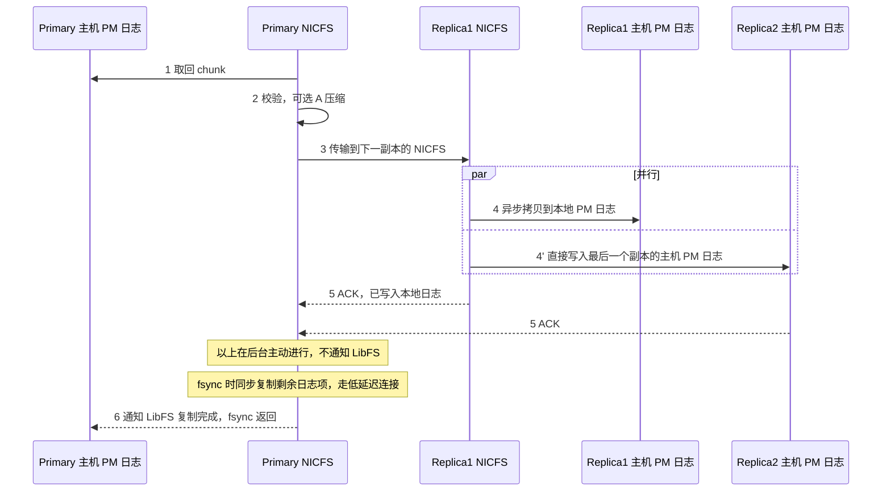

几个细节（§3.3.2）：

- 副本收到 chunk 后，**一边**异步拷到本地 PM 日志（④），**一边**转发给下一个副本（④'），两者重叠，拷贝的代价被隐藏。
- 最后一个副本不需要再往下复制，所以倒数第二个副本可以把 chunk **直接写进最后一个副本的主机 PM 日志**，省掉一次 SmartNIC 内存拷贝。
- 流水线在 primary 上同时进行：复制 Chk1（③）的同时校验 Chk2（②）、取回 Chk3（①）。
- 可选的**压缩阶段**（Ⓐ）在传输前进行以节省网络带宽。压缩很耗 SmartNIC CPU，NICFS 监测各阶段的等待队列长度，若压缩成为瓶颈就**自动关闭**这一阶段。

**解读**：

- 与 [DAOS](daos-scfa2020.md) 的副本写形成有趣对比：DAOS 让所有副本直接从**客户端**拉数据，省服务器之间的带宽；LineFS 走经典的**链式**复制，每一跳都由 SmartNIC 转发，主机完全不参与。两者面对的约束不同：DAOS 的客户端和服务器是不同机器，LineFS 的"客户端"本身就是 primary。
- "主动复制"让复制时延从 `fsync` 的关键路径上大部分移走，但只对"写了很多再 `fsync`"的负载有效。对"每次写都 `fsync`"的负载（如 Varmail、同步插入），主动复制来不及发生，所有开销都落在关键路径上，这正是评估中 LineFS 吃亏的场景。

---

## 7. 共享文件、访问控制、故障与恢复

### 7.1 租约卸载到 NICFS（§3.4）

LineFS 用**租约**（lease）把对共享状态的并发访问线性化，租约提供文件和目录的单写者、多读者访问。LineFS 沿用 Assise 的租约管理设计，只是把租约仲裁卸载到 NICFS：LibFS 从 SmartNIC 上的 NICFS 租约管理器获取租约，而不是从主机上的 SharedFS。与 Assise 一样，租约管理最初由集群管理器掌握，再按 LibFS 请求**委派**给 NICFS 实例。拿到租约后，LibFS 访问相应文件或目录无需进一步同步，直到租约过期或被撤销。NICFS 只接受持有正确租约的 LibFS 发布的日志项，这在**校验阶段**检查（§3.4）。

为了崩溃一致性，授予的租约需要持久化并复制，但这比仲裁本身慢得多。为缩短关键路径，NICFS 授予租约时只更新 SmartNIC 内存中的租约状态，然后在后台异步完成主机 PM 持久化和复制，应用同时就可以用这个租约继续操作。这不影响崩溃一致性，因为 `fsync()` 时 NICFS 会等待所有租约都持久化并复制完成（§3.4）。

### 7.2 访问控制（§3.6）

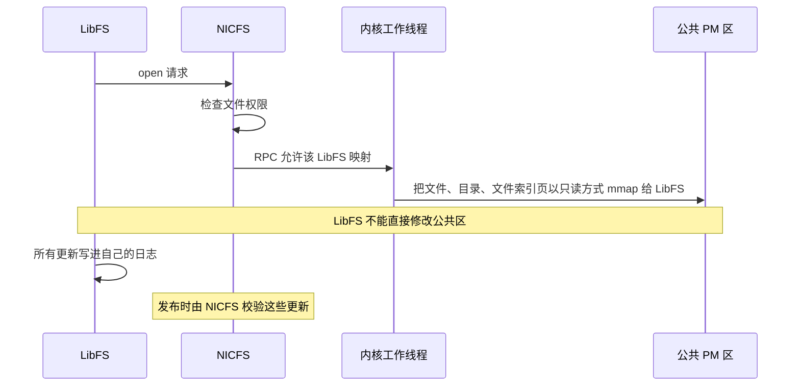

**解读**：这是一个"读直通、写代理"的安全模型。读路径为了性能直接 mmap 公共 PM，但只读；写路径的所有修改都必须经过日志，由 NICFS 在发布时校验租约和权限。代价是每次 `open()` 都要经 PCIe 找 NICFS 做权限检查，评估中 Varmail 就因此吃亏（见 [§9.5](#97-应用基准53图-8)）。

### 7.3 NICFS 故障（§3.6）

- 集群管理器每秒给每个存活的 NICFS 发心跳。检测到 NICFS 故障后，立即让分配给它的所有租约过期，并确保由一个存活的 NICFS 副本接管租约管理。
- 当前原型中 NICFS 故障时，集群管理器通知主机的内核工作线程，后者通过信号通知本机所有 LibFS，让它们在文件系统访问时返回错误码。
- 可选方案（未实现，留作未来工作）：如果主机另有一块冗余的（可以是普通的）RDMA 网卡，可以故障切换到副本 NICFS，由它成为该主机新的 primary NICFS，接管复制和租约管理；LibFS 从副本 NICFS 重新获取租约（租约状态是复制的），在本地 NICFS 恢复期间继续运行。

### 7.4 恢复（§3.6）

集群管理器维护一个**纪元号**（epoch），节点故障和恢复时递增，变化后通知所有存活的 NICFS，各 NICFS 把它持久化到 PM。所有 NICFS 都有一个复制的**历史位图**，记录每个纪元中更新过哪些 inode。故障的 NICFS 重启后向集群管理器注册并开始恢复：读出持久化的纪元号，向一个在线副本请求历史位图，再从副本取回从该纪元到当前纪元之间被记录的所有 inode；本地更新日志中涉及这些 inode 的部分作废。论文说恢复过程未来可以做得更细粒度（§3.6）。

### 7.5 主机崩溃时的"独立 NICFS 模式"（§3.5）

软件崩溃是数据中心服务器最常见的故障之一，对 NICFS 来说最有意思的是**主机 OS 崩溃**。此时主机上的 DFS 客户端停止运行，主机不能再做 DFS primary；但如果这台主机同时是其他 primary 的**副本**，它的副本服务可以完全交给 NICFS 继续提供。

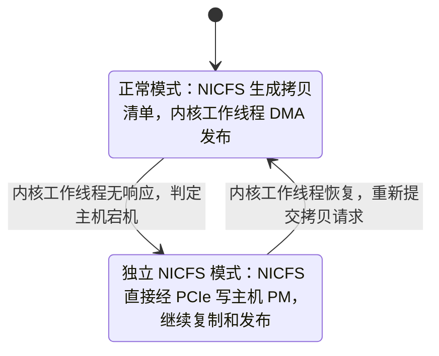

切换是无缝的：主机 PM 中的客户端日志区和公共区在主机 OS 崩溃后必须原地保留，这本来就是主机崩溃后 DFS 恢复的要求；被中断的内核工作线程发布操作由 NICFS 重新执行，由于发布是**幂等**的，不会丢数据（§3.5）。

**解读**：这个能力的边界要说清楚：它只能让崩溃主机继续充当**副本**，不能让它继续充当 **primary**，因为应用和 LibFS 都随主机一起停了。它缩短的是"副本缺席导致复制链降级"的时间窗口，对崩溃主机上运行的应用没有帮助。

---

## 8. 实现细节

| 项目 | 内容（§4） |
|------|-----------|
| 代码量 | C 语言；LibFS **25,827** 行，NICFS **22,538** 行 |
| PM | Intel Optane DC PMM，App-Direct 模式，经 PMDK 直接持久化，不经过 OS |
| LibFS | 动态链接的共享库，应用无需修改；目前支持 **21 个**系统调用；客户端私有日志默认 **512 MB**，mmap 到连续虚拟内存，并注册为 RDMA 区域供 NICFS 访问 |
| NICFS | SmartNIC Linux 上的进程；RDMA 通信层与文件系统层相互独立；用**单边 RDMA** 取客户端日志头和日志项；在 SmartNIC DRAM 中缓存 inode、目录和文件索引（如 extent 树），避免频繁经 PCIe 访问主机 PM |
| 内核工作线程 | Linux 内核模块，用 Intel I/OAT DMA 引擎把私有日志发布到公共区；NICFS 按顺序构建内存拷贝清单再发 RPC，内核线程按清单顺序发起 DMA，然后**睡眠**等待 I/OAT 驱动的完成通知 |
| 快速读 | LibFS 用一个不需持久化的内存哈希表定位日志中的文件数据；公共 PM 中用每文件 extent 树查找；**不**在 DRAM 中缓存 extent 树，因为直接用 PM 性能更好，且免去 PM 与 DRAM 缓存的一致性维护 |
| 复制流控 | SmartNIC 内存只有 16 GB，同时复制多个日志可能耗尽内存。占用超过高水位（例如 **70%**）时暂停新的日志复制、排空当前流水线；降到低水位（例如 **30%**）以下再恢复 |

**解读**：用单边 RDMA 从 SmartNIC 读主机 PM，是 BlueField 这种 off-path 网卡的典型用法：ARM 核发起的 RDMA 读经网卡内部交换单元走 PCIe 到主机内存，不经过主机 CPU。这也是为什么作者坚持把 ARM 当成"独立主机"：同一套 RDMA 代码，既能访问本机主机内存，也能访问远端节点。

---

## 9. 评估

### 9.1 实验环境（§5.1）

| 项目 | 配置 |
|------|------|
| 服务器 | 3 台双路 Intel Xeon Gold 5220R，2.2 GHz，共 48 核（关闭超线程），96 GB DDR4-2666，768 GB PM（6 × 128 GB Optane DC PMM）；Ubuntu 18.04，Linux 5.3 |
| SmartNIC | 每台 1 块 BlueField MBF1M332A，接 100GbE 交换机，RoCE；网卡 25 Gbps；实测 goodput 2.2 GB/s |
| 拓扑 | 3 节点：primary、replica-1、replica-2；两种 DFS 的 PM 日志都是 512 MB |
| 干扰负载 | PARSEC 3.0 的 `streamcluster`，线程数等于主机核数，模拟 CPU 密集作业 |
| 正确性测试 | 通过全部 75 个通用 xfstests 用例和全部 CrashMonkey 测试；通过 LevelDB 全部 201 个单元测试；能运行所有 Filebench 配置 |

**对比对象**：

| 配置 | 说明 |
|------|------|
| Assise | 原版 Assise，"悲观"模式，`fsync()` 时保证持久，与 LineFS 语义相同 |
| Assise-BgRepl | Assise 在 `fsync()` 前于后台复制，类似 LineFS 的复制方式；3 个后台复制线程（已确认性能最优），同样用 4 MB chunk，但**没有流水线并行** |
| Assise+Hyperloop | 移植 Hyperloop 的复制协议（把复制卸载到 RDMA 网卡）。Hyperloop 代码未开源，作者自行实现，经 Hyperloop 作者确认并复现了原文结果；因 ConnectX-4 及以后的网卡出于安全原因禁用了"远程修改 RDMA 请求目的地址"的功能，只能用事先生成的 I/O trace 运行，因此**只用于微基准** |
| LineFS-NotParallel | 去掉流水线并行的 LineFS，后台顺序复制私有日志 |

作者不与 Ceph 等客户端-服务器 DFS 比较，理由是 Assise 已经证明自己比它们快一个数量级；Orion 也支持客户端本地模型，但没有开源代码（§5.1）。

### 9.2 写吞吐扩展性（§5.2.1，图 4）

测试：每个客户端以 16 KB I/O 顺序写一个 12 GB 文件（每个客户端各一个文件），最后调用 `fsync`。副本分"空闲"和"繁忙"（在两个副本上跑 `streamcluster`，DFS 优先级更高）两种情况。

图 4 读图估计值（GB/s，±5%）：

| 客户端数 | Assise | Assise-BgRepl | Assise+Hyperloop | LineFS-NotParallel | LineFS |
|---------|------:|------:|------:|------:|------:|
| **副本空闲** 1 | 0.65（原文 645 MB/s） | ≈1.43 | ≈0.62 | ≈0.88 | ≈1.50 |
| 2 | ≈1.20 | ≈1.97 | ≈1.20 | ≈0.88 | ≈2.07 |
| 4 | ≈2.02 | ≈1.93 | ≈2.00 | ≈0.88 | ≈2.13 |
| 8 | ≈1.95 | ≈1.95 | ≈1.93 | ≈0.88 | ≈2.17 |
| **副本繁忙** 1 | ≈0.63 | ≈1.37 | ≈0.62 | ≈0.83 | ≈1.48 |
| 2 | ≈1.15 | ≈1.33 | ≈1.15 | ≈0.83 | ≈1.67 |
| 4 | ≈1.28 | ≈1.28 | ≈1.28 | ≈0.83 | ≈1.70 |
| 8 | ≈1.28 | ≈1.28 | ≈1.25 | ≈0.83 | ≈1.68 |

论文的结论（§5.2.1）：

- **副本空闲**：Assise 单客户端最差（645 MB/s），因为它只在 `fsync()` 时、在调用者线程里同步复制，吞吐高度依赖客户端数。Assise-BgRepl 靠后台复制最多提升 124%。LineFS 比 Assise 最多高 **133%**，比 Assise-BgRepl 最多高 **4%**：流水线并行隐藏了 PM 持久化和复制的延迟，即使数据路径更复杂，也能达到与 Assise-BgRepl 相近的吞吐。LineFS 只用 2 个客户端就跑满了 2.2 GB/s 的最大 goodput，Assise 需要 4 个。LineFS-NotParallel 比 LineFS 至少差 60%。
- **副本繁忙**：单客户端时各系统都接近空闲情况（DFS 优先级更高、争抢不严重）；客户端增加后，所有系统都受主机争抢影响，都跑不满网络。LineFS 受影响最小，规模上去后比其他系统高 **33%**。Assise+Hyperloop 仍需主机定期参与发布和投递 RDMA verbs，性能下降；LineFS 也仍需要内核工作线程做发布，比空闲时下降。§5.2.4 进一步说明，副本上跳过内核工作线程发布，LineFS 就能跑满网络。
- **流水线并行的必要性**：LineFS-NotParallel 平均只用 4.1 个 ARM 核，LineFS 用 5.8 个，前者在所有情况下都无法扩展。

**解读**：

- 空闲时 LineFS 与 Assise-BgRepl 几乎打平（4%），说明在**主机核充足**时，"卸载到 SmartNIC"本身并不带来吞吐收益，收益来自"后台复制"这一思路，Assise 自己也能做到。LineFS 证明的是：卸载到弱得多的 ARM 核上之后，借助流水线**不丢**这个收益。
- 副本繁忙时 LineFS 约 1.7 GB/s，其他系统约 1.28 GB/s，差距来自副本主机上的争抢。这里 DFS 被赋予了**更高的调度优先级**，所以测的是"即使优先级更高，仍受争抢影响多少"。
- LineFS-NotParallel 在所有客户端数下都停在约 0.85 GB/s，这条水平线比任何文字都更直观地说明了单线程卸载的天花板。

### 9.3 读吞吐（§5.2.2，表 2）

单客户端以 16 KB I/O 本地读 12 GB 文件：

| | 顺序读 Assise | 顺序读 LineFS | 随机读 Assise | 随机读 LineFS |
|--|------:|------:|------:|------:|
| MB/s | 3,147 | 3,134 | 2,960 | 2,946 |

LineFS 读路径不卸载任何操作，全部在主机 CPU 上执行，所以两者性能相近（§5.2.2）。

### 9.4 流水线阶段分解（§5.2.3，图 5）

发布和复制一个 4 MB chunk 时各阶段的耗时（µs）：

| 流水线 | 取回 | 校验 | 发布 / 传输 | 确认 | 合计 |
|-------|----:|----:|----:|----:|----:|
| 发布 | 1,025 | 65 | 1,502 | 7 | 2,599 |
| 复制 | 1,025 | 65 | 1,505 | 7 | 2,602 |

两条流水线共享取回和校验，所以这两项相同。取回和发布/传输占了大部分时间，因为要跨越高延迟的互连。由于各阶段重叠执行，这里显示的是被流水线并行**隐藏**的每阶段延迟（§5.2.3）。

**解读**：用这张表可以粗算流水线的效果。

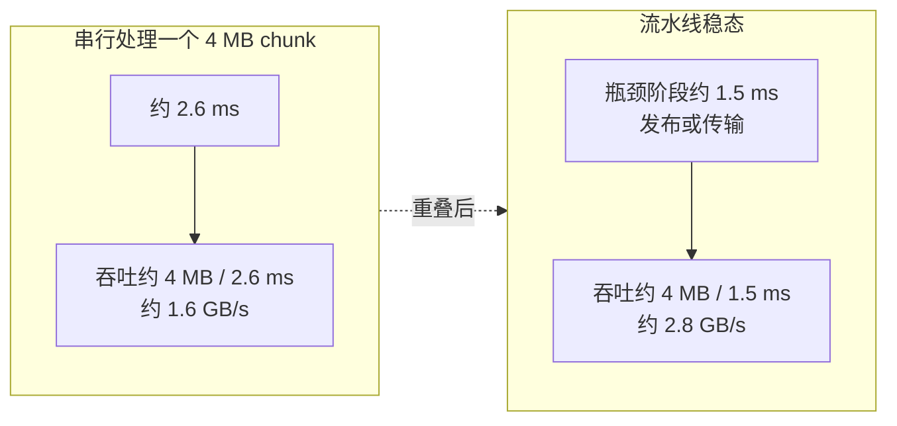

- 传输阶段 4 MB / 1.5 ms ≈ 2.8 GB/s，已接近 25 Gbps 网卡的线速（约 3.1 GB/s），所以复制流水线的瓶颈就是网络本身。
- 取回 4 MB 用 1,025 µs，约 4 GB/s，说明 SmartNIC 经 PCIe 单边 RDMA 读主机 PM 的带宽在这个量级。
- 校验只有 65 µs，说明论文强调的"计算负载会让 ARM 核饱和"在单流水线下并不明显，计算压力主要出现在多客户端并发和压缩时。

### 9.5 性能干扰（§5.2.4，图 6、图 7）

**图 6：所有节点都跑 `streamcluster`（48 线程占满全部核），同时跑两个 DFS 客户端的吞吐微基准，二者优先级相同。**

| 配置 | `streamcluster` 执行时间变化（primary / replica） | DFS 吞吐 |
|------|------|------|
| `streamcluster` 单独运行 | 基准（约 24 s，读图） | — |
| 与 Assise 共存 | 慢 **72%** / **66%** | 基准（约 1,200 MB/s，读图） |
| 与 Assise-BgRepl 共存 | 读图与 Assise 相近 | 比 Assise 高 18% |
| 与 LineFS 共存 | 慢 **49%** / **19%** | 比 Assise 高 **46%** |

primary 上跑着 DFS 客户端，用的主机 CPU 和内存更多，所以 `streamcluster` 在 primary 上减速更严重（§5.2.4）。

**图 7：内核工作线程的干扰。** 四个 LineFS 客户端跑吞吐微基准，`streamcluster` 与之同优先级，比较几种发布方式：

| 发布方式 | 说明 | `streamcluster` 相对"不拷贝"的减速 | LineFS 吞吐 |
|---------|------|------|------|
| CPU memcpy | 主机核拷贝 | **+61.5%** | 最低 |
| DMA polling | 内核线程发 DMA 后忙轮询完成（SPDK 标准做法） | 读图约 +40% | 中 |
| DMA polling + batch | 再由 NICFS 批量提交拷贝请求 | 读图约 +30% | 较高 |
| **DMA interrupt + batch** | 内核线程阻塞等待 DMA 完成中断 | **+23%** | 比 CPU memcpy 高 **40.3%**，比 DMA polling + batch 高 **5.9%** |
| No copy | 完全跳过发布 | 0（与单独运行相同） | 最高 |

所以其他所有实验（包括 §5.2.1）都用 DMA interrupt + batch（§5.2.4）。

**解读**：

- 图 7 的意义在于**量化了 LineFS 卸载不彻底的部分**：即使用最好的 DMA 中断方案，主机上的内核工作线程仍让共存应用慢了 23%。"No copy"那一列是"如果发布也能完全卸载"的上限。这也说明 LineFS 的"零主机干扰"是相对的：复制和校验确实不占主机核了，发布仍有残余。
- 这里有一个容易被忽略的反直觉点：对**共存应用**而言，中断比轮询好；对 SPDK 这类**独占核**的系统，轮询更好。选哪个取决于这个核是不是你独占的。

### 9.6 延迟（§5.2.5，表 3）

测试：在 12 GB 文件上写 16 KB 并紧接着 `fsync()`，每次写都要复制。这对 LineFS 不利，因为复制无法在后台进行。

| 系统 | 副本空闲 平均 | 99 分位 | 99.9 分位 | 副本繁忙 平均 | 99 分位 | 99.9 分位 |
|------|------:|------:|------:|------:|------:|------:|
| Assise | **76** | 101 | 126 | 323 | 7,115 | 8,331 |
| Assise+Hyperloop | 60 | 68 | 4,716 | 61 | 78 | 4,125 |
| LineFS | 149 | 187 | 205 | 149 | 188 | **204** |

单位 µs。

- **副本空闲**时 LineFS 比 Assise 慢，原因有二：① LineFS 的硬件数据路径有多个高延迟步骤：先经 RDMA 把 I/O 数据从主机 PM 取到 SmartNIC 内存，跑完流水线后再经 SoC 内部 PCIe 向 ConnectX 发 RDMA 请求；② SmartNIC CPU 主频低，实测其 L3 缓存和 DRAM 访问延迟比主机慢 2 倍以上。而 Assise 可以从快的主机 CPU 直接发 RDMA 请求（§5.2.5）。
- **副本繁忙**时 LineFS 的延迟与空闲时几乎一样，比 Assise 最多好 **41 倍**。Assise+Hyperloop 的平均和 99 分位在两种情况下都不错，但 Hyperloop 需要主机 CPU 定期投递 RDMA verbs，投递一旦被延迟（例如因争抢），延迟就会上升，所以其 99.9 分位比 LineFS 差 **23 倍**（§5.2.5）。

**解读**：

- "41 倍"是 **99.9 分位**的比值（8,331 / 204 ≈ 41），平均延迟只好 2.2 倍（323 / 149）。
- "23 倍"与副本空闲时的 99.9 分位吻合（4,716 / 205 ≈ 23）；副本繁忙时是 4,125 / 204 ≈ 20 倍。
- 这张表最好地概括了 LineFS 的取舍：**用约 2 倍的空闲平均延迟，换取不受主机负载影响的稳定尾延迟**。如果你的环境是独占机器，LineFS 的同步写延迟是更差的；如果是多租户混部，它的尾延迟好得多。

### 9.7 应用基准（§5.3，图 8）

两个应用基准都在**副本繁忙**时运行。

**LevelDB**（`db_bench`，key 16 B、value 1 KB）。图 8a（对数坐标）读图估计（µs）：

| 操作 | Assise | LineFS | 论文结论 |
|------|------:|------:|------|
| 顺序读 | ≈2 | ≈2 | 读操作两者相近 |
| 随机读 | ≈10 | ≈10 | |
| 倾斜读（1% 热点） | ≈3 | ≈3 | |
| 顺序插入 | ≈32 | ≈17 | "好 **80%**"，即 Assise 约为 LineFS 的 1.8 倍（口径见 [§10](#10-论文的不一致与留白)） |
| 随机插入 | ≈150 | ≈120 | "好 **27%**" |
| 同步插入（每次插入后 `fsync`） | ≈160 | ≈125 | "好 **27%**"，因频繁 `fsync` 收益较小 |

**Filebench**（工作集 1 万个文件）。图 8b 读图估计（kops/s）：

| 负载 | 特点 | Assise | LineFS | 结论 |
|------|------|------:|------:|------|
| Fileserver | 平均 128 KB 文件，写读比 2:1，**不调用** `fsync` | ≈41 | ≈73 | LineFS 高 **79%**，所有流水线阶段都可以在后台跑 |
| Varmail | 平均 16 KB 文件，写读比 1:1，**频繁** `fsync`（模拟写前日志） | ≈32 | ≈26 | LineFS 慢 **21%** |

Varmail 慢的两个原因：一是小文件创建和更新后紧跟 `fsync()`，无法有效利用流水线并行；二是每次打开文件，LibFS 都要经 PCIe 向 NICFS 请求权限检查，而 Assise 在主机上做。`open()` 占 Varmail 全部文件系统调用的 9.1%（§5.3）。

### 9.8 数据路径处理：压缩（§5.4，图 9）

场景：分布式批处理把中间数据写进 DFS 并复制，占用大量网络带宽。LineFS 在 primary 上压缩数据再复制。

- 基准：Tencent Sort，在 primary 上跑 4 个分区进程和 4 个排序进程，8000 万条记录，归并排序阶段用快速排序，范围分区基于基数。
- 通过调整输入中零值的比例，构造压缩率 40%、60%、80% 的三组输入。
- 压缩算法：Lempel-Ziv-Welch（见 [§10](#10-论文的不一致与留白)）。**单个 SmartNIC 核的压缩吞吐约 200 MB/s**，远低于网络带宽，所以压缩阶段跑 **16 个线程**并行压缩，避免成为流水线瓶颈。
- 同时用 `iperf3` 在后台抢占网络带宽。

| 配置 | 网络带宽相对 Assise 的节省 | Tencent Sort 执行时间（图 9 图例） |
|------|------:|------:|
| Assise | — | 18.72 s |
| LineFS-40% | 29% | 18.85 s |
| LineFS-60% | 49% | 18.60 s |
| LineFS-80% | **72%** | 16.92 s（正文写 16.69 s） |

压缩率低时 LineFS 与 Assise 相当；压缩率 80% 时 LineFS 快 10.6%，同时节省 72% 网络带宽（§5.4）。

**解读**：这是 SmartNIC "顺手做点别的"的好例子，但它的前提是 SmartNIC 有空闲核。压缩阶段用满 16 个 ARM 核，在这个实验里没问题，因为只有一个 primary 在写；在多个客户端同时写的场景下，压缩会和复制、校验抢 ARM 核，这时 NICFS 会自动关掉压缩（§3.3.2）。论文没有评估这种"自动关闭"的触发情况。

### 9.9 可用性（§5.5，图 10）

3 节点（1 个 primary、2 个副本），primary 上跑 Varmail，每秒报告一次吞吐（每秒打印会降低吞吐，所以数值低于 §5.3）。在第 8 秒注入故障让 replica-1 的主机（运行在虚拟机里）重启：

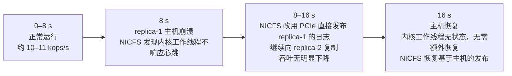

Varmail 的复制速率只有每秒几百 MB，所以故障窗口内用 PCIe 拷贝没有造成可观察的性能下降（§5.5）。

**解读**：这个实验证明了"独立 NICFS 模式"能工作，但负载很轻（几百 MB/s），而且崩溃的是副本。它没有回答两个问题：高吞吐负载下 PCIe 直拷能否跟上；Assise 在同样场景下会怎样（论文没有给出 Assise 的对照曲线）。

---

## 10. 论文的不一致与留白

### 10.1 数字前后不一致

1. **引言与评估的数字对不上**（§1 vs §5）：
   - 引言说"在吞吐基准中 LineFS 比所有 Assise 变体至少高 **41%**"，但 §5.2.1 给出的是：副本空闲时只比 Assise-BgRepl 高 **4%**，副本繁忙时比其他系统高 **33%**。正文中找不到 41% 的出处。
   - 引言说共存时 `streamcluster` 因 Assise 最多慢 **43%**，此时 LineFS 性能比 Assise 好 **227%**；但 §5.2.4 给出的是 Assise 让 `streamcluster` 慢 **72%**（primary）和 **66%**（replica），LineFS 吞吐比 Assise 高 **46%**。两组数字差距很大，引言可能沿用了早期版本的实验结果。
2. **Tencent Sort 执行时间**（§5.4）：正文写 LineFS-80% 用时 **16.69 s**，图 9 图例写 **16.92 s**。"快 10.6%"与图例吻合（18.72 / 16.92 ≈ 1.106），与正文数字不符（18.72 / 16.69 ≈ 1.12）。
3. **压缩算法**（§5.4）：正文说 NICFS 运行 **Lempel-Ziv-Welch** 算法，引用的文献 [7] 却是 **LZ4** 的维基百科页面。LZW 和 LZ4 是不同的算法，论文没有说明实际用的是哪个。
4. **"好 X%"的口径**：论文通篇用"X% better"表示"较差一方的数值是较好一方的 (1+X%) 倍"。例如单客户端写吞吐"高 133%"＝1.50 / 0.645 ≈ 2.33；LevelDB 随机插入"延迟好 27%"与图 8a 读数（约 150 vs 120 µs，比值约 1.25）吻合；顺序插入"好 80%"按图 8a 读数（对数坐标，约 32 vs 17 µs）也是比值约 1.8–1.9，**延迟实际降低约 45%**。摘要里"improves latency in LevelDB up to 80%"不能理解为"延迟降低 80%"。
5. **"41 倍"和"23 倍"的口径**：41 倍是副本繁忙时的 99.9 分位，23 倍对应的是副本**空闲**时的 99.9 分位（见 [§9.6](#96-延迟525表-3)），论文正文都在"副本繁忙"的段落里提到，容易误读。

### 10.2 设计中没有回答的问题

- **SmartNIC 本身是单点**：NICFS 故障时本机所有 LibFS 只能返回错误码，故障切换到副本 NICFS 留作未来工作（§3.6）。把文件系统核心逻辑放在网卡上，网卡就成了新的故障域。
- **直接卸载慢 30 倍**的实验没有细节，无法判断瓶颈分布。
- **coalescing** 没有任何评估。
- **chunk 大小**（4 MB）、阶段扩容阈值（队列 > 5）、流控水位（70%/30%）都没有敏感性分析。
- **规模**：只有 3 个节点，一条复制链；多个 primary 交叉复制、SmartNIC 同时服务很多客户端时的表现未知。
- **网络**：BlueField 只有 25 Gbps，实测 goodput 2.2 GB/s，大部分吞吐实验在 2 个客户端时就碰到了网络上限。在 100/200 Gbps 网卡上，SmartNIC 的 ARM 核能否跟上，是论文无法回答的问题。

### 10.3 本仓库原有描述中需要修正的地方

对照原文，[新硬件综述 §4](new-hardware.md#4-linefs-efficient-smartnic-offload-of-a-distributed-file-system-with-pipeline-parallelism) 中有几处与论文不符（已一并修正）：

| 原描述 | 原文实际情况 |
|-------|-------------|
| stage 如"取日志 → 压缩 → 复制 → 确认" | 发布流水线：取回 → 校验 → 发布 → 确认；复制流水线：取回 → 校验 →（可选压缩）→ 传输 → 确认，两者共享前两级。原描述漏了核心的**校验**阶段 |
| host↔NIC 之间通过 DMA + 轮询通道通信 | NICFS 用**单边 RDMA** 读主机 PM 日志；发布由主机内核工作线程用 I/OAT DMA 完成，且最终选的是**中断**而非轮询（轮询干扰更大，§5.2.4） |
| 依赖特定代 BlueField（BlueField-1/2） | 论文只用了第一代 BlueField（MBF1M332A）；BlueField-2 是 DPFS 等后续工作使用的 |
| 主机故障时 NIC 上的 DFS 仍可继续提供部分服务 | 准确地说，只有作为**副本**的节点在主机 OS 崩溃后能继续复制和发布；崩溃主机不能继续当 primary |

---

## 11. 与相关工作的对比

### 11.1 论文自述（§6）

| 方向 | 代表 | 与 LineFS 的关系 |
|------|------|----------------|
| 基于磁盘的客户端-服务器 DFS | Ceph、Lustre、GPFS、GFS、HDFS | 侧重成千上万存储节点的扩展性和可用性；面对 PM 时因设计复杂和客户端-服务器架构而天然慢 |
| PM 优化的客户端-服务器 DFS | Octopus（collect-dispatch 事务，期刊版精读见 [octopus-plus-tos2021.md](octopus-plus-tos2021.md)）、Clover（RDMA 管理远端存储、元数据放在应用侧） | 优化了通信开销，但访问远端存储的网络代价仍高 |
| 客户端本地 DFS | Orion（数据放本地 PM，元数据更新仍要与远端元数据服务器通信）、Assise（数据和元数据都放客户端节点，RDMA 复制） | 性能优于客户端-服务器模型，但要与应用共享主机资源，正是 LineFS 要解决的问题 |
| SmartNIC 卸载 | Floem、ClickNP（网络功能）；AccelNet（TCP 与 SDN）；Tonic、hXDP（FPGA 网卡）；iPipe（actor 模型卸载 KV、分布式事务、实时分析）；E3、λ-NIC（微服务）；FairNIC、PANIC（网卡内的公平与隔离） | 同样想减轻主机 CPU 负担，但没有处理 DFS 特有的挑战：跨多个 SmartNIC 处理高度结构化的数据、复杂的一致性与持久性协议 |
| 复制卸载 | Hyperloop（用 RDMA WAIT verb 和远程修改 RDMA 请求，把链式复制卸载到 RDMA 网卡） | 能在副本 CPU 繁忙时保持稳定尾延迟，但只关注复制事务；完整 DFS 还要处理共享文件协调、元数据一致性、崩溃一致性和 SmartNIC 的有效利用 |

### 11.2 与本仓库其他 DPU/SmartNIC 文件系统的对照（解读）

| 维度 | LineFS（SOSP'21） | DPFS（SYSTOR'23） | Fisc（FAST'23） |
|------|-------------------|-------------------|-----------------|
| 目标 | 多租户下的**性能隔离**：后台任务不和应用抢 CPU | **虚拟化**：解耦接口与实现，省主机 CPU，租户零配置 | 云原生容器的**轻量客户端**与规模化 |
| SmartNIC/DPU | 第一代 BlueField（16 核 A72，800 MHz，25 GbE） | BlueField-2 | 阿里自研 DPU + FPGA 快路径 |
| 主机侧保留什么 | LibFS：写日志、读路径全部在主机 | 只剩内核自带的 virtio-fs | 容器内极薄的 RPC 客户端 |
| DPU 上跑什么 | 发布调度、校验、租约、复制、压缩 | 完整文件系统客户端（NFS / KV 后端） | 网络、安全、路由、故障重试 |
| 数据是否经过 DPU | 复制经过；发布由主机 DMA 引擎直拷，不经过 | 全部经过 | 全部经过 |
| 前台延迟 | 读和写持久化不受 DPU 影响；同步复制延迟约为 Assise 的 2 倍 | 比主机 NFS 高（单次 4 KiB 读 91.5 vs 71.2 µs） | 依赖 FPGA 快路径 |
| 核心技巧 | 先持久后发布 + 流水线并行 | 标准接口 + 可插拔后端 | 两层功能聚合 + 就近读 |

**解读**：三篇论文代表了 DPU 卸载文件系统的三种切法。LineFS 是"**把后台搬走，前台留下**"，前台延迟由主机决定，DPU 只决定后台吞吐；DPFS 和 Fisc 是"**把整个客户端搬走**"，前台每次请求都要过 DPU，延迟由 DPU 决定。前者适合延迟极敏感、主机核也够快的场景（如 PM），后者适合需要隔离租户、云厂商要控制客户端的场景。

---

## 12. 整体总结

### 12.1 核心贡献

1. **问题刻画**：用 Assise 与 Ceph 的 CPU 占用对比，说明客户端本地 PM DFS 的后台任务开销会随网络变快而增长，在多租户环境下造成应用变慢、尾延迟变差、吞吐下降。
2. **先持久后发布**：把 DFS 操作分成"关键路径上的持久化"（留在主机）和"可推迟的发布与复制"（卸载到 SmartNIC），使 SmartNIC 的慢不影响前台。
3. **流水线并行卸载**：以 4 MB chunk 为单位，把发布和复制拆成共享前两级的多级流水线，动态调整各阶段线程数，按日志顺序提交以保持线性一致和前缀崩溃一致，把卸载后的吞吐拉回网络上限（相比不并行版本提升至少 60%）。
4. **卸载完整的 DFS 功能**：复制（主动、链式、低延迟/高吞吐连接分离、QP 复用）、租约仲裁（先授予后持久化）、权限校验、语义合并、可选压缩，加上 SmartNIC 内存流控。
5. **SmartNIC 作为独立故障域**：主机 OS 崩溃时，副本节点的 NICFS 继续经 PCIe 发布和复制，主机恢复后无缝切回。

### 12.2 设计哲学

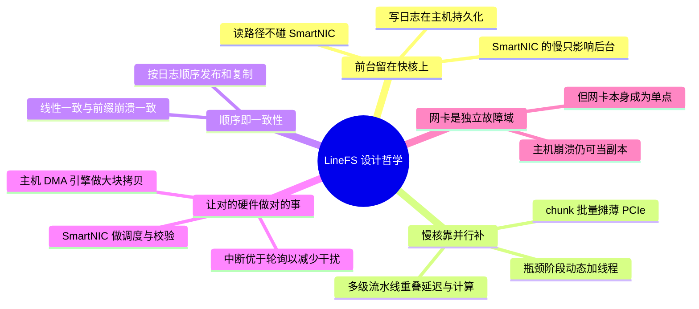

### 12.3 优点与局限

| 优点 | 局限 |
|------|------|
| 在多租户混部下显著降低 DFS 对应用的干扰（`streamcluster` 在副本上的减速从 66% 降到 19%） | 独占机器时收益有限：副本空闲时吞吐只比 Assise-BgRepl 高 4%，同步写平均延迟是 Assise 的 2 倍 |
| 尾延迟不受主机负载影响，副本繁忙时 99.9 分位比 Assise 低 41 倍 | 发布仍依赖主机内核工作线程，残余干扰约 23%，并非完全卸载 |
| 读路径和写持久化完全不受 SmartNIC 影响 | 每次 `open` 都要经 PCIe 做权限检查；小文件 + 频繁 `fsync` 的负载（Varmail）反而慢 21% |
| 流水线卸载方法论与 PM 无关，可迁移到其他介质和 DPU | 深度依赖 Optane PM 和客户端本地模型，两者如今都已式微 |
| 正确性测试较完整（xfstests、CrashMonkey、LevelDB 单测） | SmartNIC 是单点，NICFS 故障时本机文件系统不可用，故障切换未实现 |
| 开源，基于 Assise 改造，便于对照 | 只有 3 节点、25 GbE；引言与评估数字不一致；若干参数无敏感性分析 |

### 12.4 对分布式文件系统设计者的启示

1. **卸载之前先切分关键路径**。不是所有工作都适合放到慢核上。先找出"必须同步完成、决定延迟和崩溃语义"的那一小部分留在快核上，其余做成可异步推进的后台工作，再考虑卸载。这个切分即使不用 DPU 也有价值：Assise-BgRepl 就从中拿到了大部分吞吐收益。
2. **慢核卸载要按"吞吐"设计，不能按"延迟"设计**。单请求在 ARM 核上一定比在主机核上慢；只有批量（chunk）+ 流水线 + 多核并行，才能让总吞吐追上网络。LineFS-NotParallel 停在 0.85 GB/s 是最好的反例。
3. **按日志顺序推进是并行与一致性兼得的简单办法**。流水线前几级可以乱序并行，最后的提交按序进行，就能保证前缀一致。这与数据库的组提交、存储系统的有序 WAL 回放是同一思路。
4. **多租户场景下，衡量 DFS 要看对邻居的影响**。LineFS 的主要收益体现在"共存应用变慢多少"和"尾延迟"上，而非峰值吞吐。设计和评估存储系统时，应把"对共存应用的干扰"列为一等指标。
5. **轮询还是中断，取决于核是不是你独占的**。独占核时轮询最快（SPDK）；与应用共享核时，中断 + 批量对整体更好（图 7）。
6. **把网卡当新的故障域来设计**。SmartNIC 能在主机崩溃后继续服务，但它自己也会坏。把核心逻辑放到网卡之前，要先想好网卡故障时谁来接管。
7. **对 Optane 停产后的启示**：LineFS 依赖的 PM 和客户端本地模型已不再主流，但"主机持久化写日志 + DPU 流水线处理后台任务"的结构，可以对应到"主机写 NVMe/电容 DRAM 日志 + DPU 做 EC 编码、压缩、复制、校验"。DPU 越强（BlueField-3 起），这条路越可行。

### 12.5 一张图看懂 LineFS

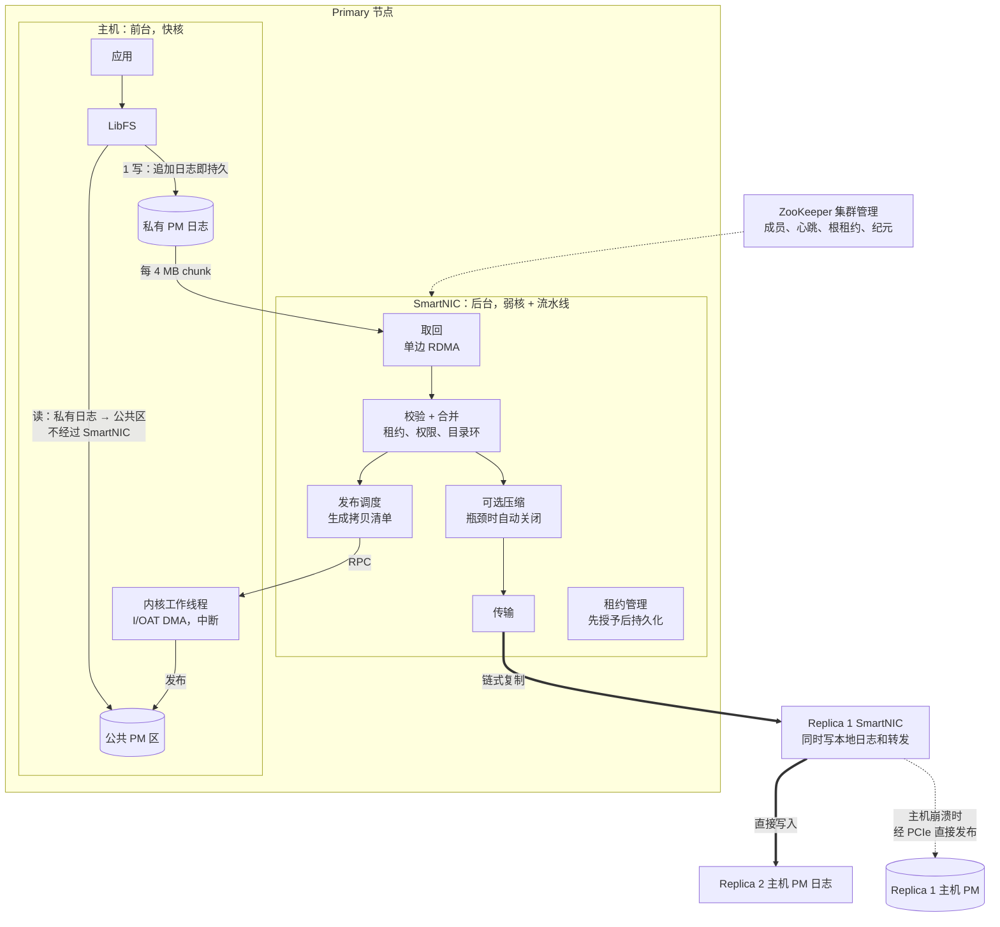

---

## 参考

- Jongyul Kim, Insu Jang, Waleed Reda, Jaeseong Im, Marco Canini, Dejan Kostić, Youngjin Kwon, Simon Peter, Emmett Witchel. *LineFS: Efficient SmartNIC Offload of a Distributed File System with Pipeline Parallelism*. ACM SOSP 2021. <https://doi.org/10.1145/3477132.3483565> ；PDF：<https://www.cs.utexas.edu/users/witchel/pubs/kim21sosp-linefs.pdf>
- LineFS 开源代码：<https://github.com/casys-kaist/LineFS>
- 最佳论文奖：KTH 团队公告 <https://www.kth.se/blogs/ultra/2021/11/best-paper-award-at-sosp-2021-for-our-paper-linefs-efficient-smartnic-offload-of-a-distributed-file-system-with-pipeline-parallelism/>
- Thomas E. Anderson et al. *Assise: Performance and Availability via Client-local NVM in a Distributed File System*. USENIX OSDI 2020.（LineFS 的基线与母体）
- Youngjin Kwon et al. *Strata: A Cross Media File System*. ACM SOSP 2017.（logging + digesting 思路来源）
- Daehyeok Kim et al. *Hyperloop: Group-Based NIC-Offloading to Accelerate Replicated Transactions in Multi-Tenant Storage Systems*. ACM SIGCOMM 2018.
- Jian Yang, Joseph Izraelevitz, Steven Swanson. *Orion: A Distributed File System for Non-Volatile Main Memory and RDMA-Capable Networks*. USENIX FAST 2019.
- Ming Liu et al. *Offloading Distributed Applications onto SmartNICs Using iPipe*. ACM SIGCOMM 2019.
- Robbert van Renesse, Fred B. Schneider. *Chain Replication for Supporting High Throughput and Availability*. USENIX OSDI 2004.
- C. Gray, D. Cheriton. *Leases: An Efficient Fault-tolerant Mechanism for Distributed File Cache Consistency*. ACM SOSP 1989.
- 本仓库相关：[新硬件综述](new-hardware.md)、[DPFS 精读](dpfs-systor2023.md)、[Fisc 精读](fisc-fast2023.md)、[DAOS 精读](daos-scfa2020.md)、[SingularFS 精读](singularfs-atc2023.md)（同为 Optane PM 时代的单机元数据路线）
