# Mantle 精读：云对象存储的层级元数据服务（SOSP 2025）

> 论文：Jiahao Li†§*, Biao Cao§*, Jielong Jian§, Cheng Li†¶, Sen Han†, Yiduo Wang†, Yufei Wu†, Kang Chen‡, Zhihui Yin§, Qiushi Chen§, Jiwei Xiong§, Jie Zhao§, Fengyuan Liu§, Yan Xing§, Liguo Duan§, Miao Yu§, Ran Zheng§, Feng Wu†¶, Xianjun Meng§（共 19 位作者；* 共同一作；Cheng Li、Biao Cao 为通讯作者）. *Mantle: Efficient Hierarchical Metadata Management for Cloud Object Storage Services*. ACM SOSP '25，首尔，2025-10-13～16，论文集第 928–943 页。
>
> 机构：† 中国科学技术大学；§ 百度；‡ 清华大学；¶ 合肥综合性国家科学中心人工智能研究院。
>
> 链接：ACM <https://dl.acm.org/doi/10.1145/3731569.3764824>；PDF <https://madsys.cs.tsinghua.edu.cn/publication/mantle-efficient-hierarchical-metadata-management-for-cloud-object-storage-services/SOSP25-Li.pdf>；项目页（论文称将开源代码和分析数据）<https://mantle-opensource.github.io/>
>
> 篇幅：正文 14 页 + 参考文献 2 页，共 16 页；20 张图、3 张表。
>
> 精读日期：2026-11-24。**数字和机制描述都摘自论文**，用"论文 §x / 图 x / 表 x"标注出处。标"解读"的段落是本文作者的分析和推论，不是原文。多数图带数据标签，直接引用；没有标签的读数为本文估读，标注"约"，误差约 ±5%。标"示例"的是为说明机制构造的例子。
>
> 相关文档：
> - [元数据扩展性综述 §2.7](metadata-scalability.md#27-mantle-efficient-hierarchical-metadata-management-for-cloud-object-storage-servicessosp-2025)：本文的简述版。
> - [CFS（EuroSys 2023）精读](cfs-eurosys2023.md)：同一团队（中科大 + 百度）的前作，同样建在 TafDB 上；Mantle 认为 CFS 的单分片化策略解决不了 dirrename。
> - [InfiniFS（FAST 2022）精读](infinifs-fast2022.md)：Mantle 的基线之一（并行路径解析）。
> - [FalconFS（NSDI 2026）精读](falconfs-nsdi2026.md)：几乎同期的"服务端路径解析"工作，把整棵目录树复制到所有元数据节点。
> - [Tectonic（FAST 2021）精读](tectonic-fast2021/deep-read.md)：百度原有的"数据库表式"元数据服务与之类似，是 Mantle 的基线之一。

## 目录

- [0. 一页速览](#0-一页速览)
- [1. 背景：云对象存储与表式元数据服务](#1-背景云对象存储与表式元数据服务)
- [2. 生产命名空间分析](#2-生产命名空间分析)
- [3. 为什么现有 DFS 优化用不上](#3-为什么现有-dfs-优化用不上)
- [4. Mantle 架构](#4-mantle-架构)
- [5. 扩展单 RPC 路径解析](#5-扩展单-rpc-路径解析)
- [6. 扩展目录修改](#6-扩展目录修改)
- [7. 容错](#7-容错)
- [8. 评估](#8-评估)
- [9. 生产部署与经验](#9-生产部署与经验)
- [10. 相关工作](#10-相关工作)
- [11. 论文中的不一致与可疑之处](#11-论文中的不一致与可疑之处)
- [12. 与本仓库中其他系统的对照](#12-与本仓库中其他系统的对照)
- [13. 整体总结](#13-整体总结)
- [参考](#参考)

---

## 0. 一页速览

**一句话**：百度对象存储（BOS）原先的层级命名空间是一张按父目录 ID 分片的大数据库表（与 Tectonic 类似），每解析一层路径都要一次 RPC，路径平均深约 11 层，lookup 占元数据延迟的 63%–91%；共享目录上的 mkdir、dirrename 又要跨分片 2PC，高竞争时吞吐下降 99% 以上。由于对象存储的代理层无状态、API 受限，DFS 常用的客户端缓存、投机并行解析都用不上。Mantle 采用**两层包含式架构**：所有命名空间共享的分片数据库 **TafDB** 保存全部元数据；每个命名空间一台 **IndexNode**（Raft 复制）只保存每个目录约 80 字节的"访问元数据"，在内存中**一次 RPC 完成整条路径解析**并做权限检查。为防止 IndexNode 成为瓶颈，它用只缓存"离叶子较远的前缀"的 **TopDirPathCache**、无锁失效器 **Invalidator** 和 follower/learner 读扩展 lookup；为消除目录竞争，它在 TafDB 中用 **delta 记录**把父目录属性的就地更新改成无冲突追加，并把跨目录 rename 的**防环检测**放到 IndexNode 本地完成。

| 维度 | 要点 |
|------|------|
| 场景 | 云对象存储（COSS）的层级命名空间：应用通过 HTTP GET/PUT 访问随机选中的无状态代理，代理查元数据服务再取数据（论文 §2.2，图 1） |
| 生产观察 | 5 个命名空间各超 20 亿条目，目录占 8.3%–18.0%；平均访问深度 10.6–11.9，最深 95；单命名空间需 15 万–30 万 ops/s；lookup 占 objstat/dirstat/delete 延迟的 89.9%/91.2%/63.1%；全冲突时 mkdir、dirrename 吞吐下降 99.7%、99.4%（论文 §3，图 3、图 4） |
| 架构 | TafDB（共享、分片、存全部元数据）+ 每命名空间一台 IndexNode（IndexTable：pid、name、id、permission、lock 位，约 80 B/目录）；IndexNode 负责 lookup 与权限检查，TafDB 负责对象元数据和 readdir/stat；mkdir、rename 两边协同（论文 §4，图 5、图 6） |
| lookup 扩展 | TopDirPathCache 只缓存截去最后 k 层（k = 3）的路径前缀 → (pid, 聚合权限)，内存只需全量缓存的 12%；Invalidator 用无锁 PrefixTree + RemovalList 异步失效；follower/learner 先取 leader 的 commitIndex 再本地解析（论文 §5.1） |
| 目录修改扩展 | delta 记录（pid, "/_ATTR", 事务时间戳）代替就地更新父目录属性，异步合并，仅在持续竞争时启用；dirrename 在 IndexNode 上一次 RPC 完成加锁与防环；Raft 日志批量提交减少 fsync（论文 §5.2） |
| 结果 | 单命名空间 100 亿条目；lookup 最高 1,894.5 Kop/s（2 follower + 2 learner）；高竞争下 mkdir 58.8 Kop/s、dirrename 38.0 Kop/s；对 Tectonic / InfiniFS / LocoFS 延迟降 17.5–95.2% / 9.5–99.1% / 6.6–98.8%，吞吐 1.20–20.90× / 1.16–116.00× / 1.07–80.78×（论文 §1、§6） |
| 应用 | Spark 交互分析作业完成时间缩短 63.3%–93.3%，AI 音频预处理缩短 38.5%–47.7%（论文 §6.2） |
| 生产 | 部署在百度对象存储（BOS），3 个集群、19 个内部命名空间及大量外部命名空间，日均元数据请求数百亿（论文 §7） |

**解读**：

- Mantle 本质上是把 [LocoFS](#10-相关工作) 的"目录元数据集中到一台节点"做成了**可在生产中用的版本**：只把路径解析需要的最小子集（约 80 B/目录）集中，其他属性和所有对象元数据留在可扩展的 TafDB；再用缓存、follower 读、Raft 批量提交把那台集中节点的天花板抬高。
- 它与 FalconFS 是同一问题的两种解法：Mantle"一个命名空间一台索引节点"，读解析受单个 Raft 组限制，但写目录简单；FalconFS"每个元数据节点都复制整棵目录树"，读解析可扩展，写目录要靠失效广播。
- 对象存储的约束（代理无状态、客户端不可控）是 Mantle 一切设计的出发点。在客户端可控的 DFS 中，客户端缓存能达到类似效果：论文自己的图 20 显示，给 InfiniFS 加上缓存后，音频任务完成时间与 Mantle 相同。

---

## 1. 背景：云对象存储与表式元数据服务

### 1.1 为什么关注对象存储（论文 §1、§2.1）

- 2023 年云基础设施投资预计占全球 IT 基础设施支出的 60% 以上。对 AWS 上 396 个应用和系统的研究发现，约 **68%** 使用 S3，分布式文件系统只占 **4%**（引 Cloudscape，FAST '25）。全球云对象存储市场 2020 年约 48.3 亿美元，预计 2028 年达 136.5 亿美元，年复合增长 13.6%。
- 同一研究显示，**分析和机器学习**两类负载主导云应用：60% 以上的应用使用其中之一，分析占 42%，机器学习占 18%。百度内部的观察与此一致。

### 1.2 对象存储的接口约束（论文 §2.2，图 1）

典型对象存储由三部分组成：

| 组件 | 作用 |
|------|------|
| 代理层 | 接收应用的 RESTful 请求（经云 SDK 发出 HTTP GET/PUT），随机选一台代理；代理查元数据服务解析路径，再到数据服务取数据。**代理是无状态的**，便于负载均衡 |
| 元数据服务 | 少量服务器，把对象路径映射到数据位置 |
| 数据服务 | 大量服务器存对象数据 |

多个应用共享一个对象存储服务，各自的命名空间都存放在内部的元数据和数据服务中。这种松耦合架构把内部组件与外部用户严格隔离，对扩展元数据和数据服务提出了新的挑战。

### 1.3 表式层级元数据服务（论文 §2.3，图 2）

S3、Azure Data Lake Storage、Google Cloud Storage 等陆续从扁平命名空间转向层级命名空间，并用数据库把层级命名空间作为表来管理，分片到多台服务器，元数据操作编排成数据库事务。百度原有的"DBtable"元数据服务也是如此，与 Meta 的 Tectonic 类似：

- 每个层级命名空间映射成一张大表，主键为 **(父目录 ID pid, 名字)**；
- 按 pid 分片，同一目录下的条目尽量在同一分片，兼顾负载均衡和局部性。

它有两个问题：

**多 RPC 路径解析**：每个目录存放在某台数据库服务器上，代理要从根开始逐级查找：每一级先取得当前目录的 inode ID，才能算出下一级在哪台服务器，并逐级检查权限。

**分布式元数据事务**：mkdir、dirrename 要修改不止一个目录的元数据；它们落在不同分片时就需要分布式事务。

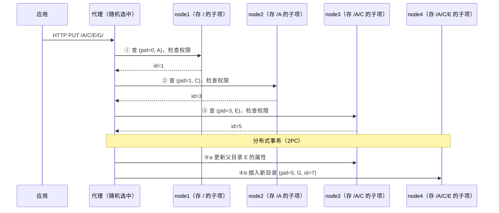

**解读**：这和 [Tectonic](tectonic-fast2021/deep-read.md) 的 Name 层、[CFS](cfs-eurosys2023.md) 的 TafDB 表本质相同，都是"(pid, name) 主键 + 按 pid 分片"。Tectonic 选择不做跨分片事务（非原子 move），CFS 用单分片原语加独立 Renamer；Mantle 则保留分布式事务，但用集中的 IndexNode 去掉大部分协调。

---

## 2. 生产命名空间分析

论文 §3 分析了百度内部 5 个主要承载大数据分析和机器学习负载的命名空间。

### 2.1 规模与负载（论文 §3，图 3）

| 指标 | 数据 |
|------|------|
| 规模 | 5 个命名空间都超过 **20 亿**条目；对象占 82.0%–91.7%，目录占 8.3%–18.0% |
| 吞吐需求 | 大量小对象操作，单命名空间需持续 **15 万–30 万 ops/s** |
| 平均访问深度 | 11.6、11.5、10.8、10.6、11.9；最大深度 **95** |
| ns4（最大之一） | 一半请求的路径深度超过 10 |

小对象的数据访问由 SSD 加速，只需一次 RPC 加几十微秒的设备访问，所以元数据访问成为端到端性能的关键。例子：自动驾驶模型数据预处理中，多个任务处理超过 **10 亿**个小对象（多数小于 512 KB），每个对象是一小段多模态传感器数据；流程扫描已有对象、创建新对象，元数据访问占总执行时间的 **70% 以上**（论文 §3）。

### 2.2 lookup 低效（论文 §3.1，图 4a）

用 mdtest、512 个应用线程测 DBtable 元数据服务：

| 操作 | 延迟中 lookup 占比 | 总延迟（图 4a，约） |
|------|------------------|-------------------|
| objstat | **89.9%** | 约 3.2 ms |
| dirstat | **91.2%** | 约 3.4 ms |
| delete | **63.1%** | 约 5.0 ms |

lookup 是所有元数据操作的第一步，这个结论适用于其他操作。

### 2.3 目录更新竞争（论文 §3.2，图 4b）

- mkdir、rmdir、dirrename 占比不高，但在某些应用中会在共享目录上造成严重竞争。
- **生产例子**：Spark 即席查询每天运行 1 万次以上，延迟要求严格。每个查询产生数百个子任务，各自的临时目录被原子地 rename 到同一个输出目录。在 DBtable 机制下，竞争导致频繁的事务重试，提交阶段成为主要瓶颈，极端情况下占任务总执行时间的 **99% 以上**。
- **mdtest 复现**（512 线程）："无冲突"指各线程写不同目录，"全冲突"模拟 Spark 场景写同一目录。全冲突时 mkdir、dirrename 吞吐分别下降 **99.7%、99.4%**（图 4b 中约从 11 万和 5.5 万降到约 300 ops/s，约）。原因是跨分片 2PC 在高竞争下中止率高或锁等待长。

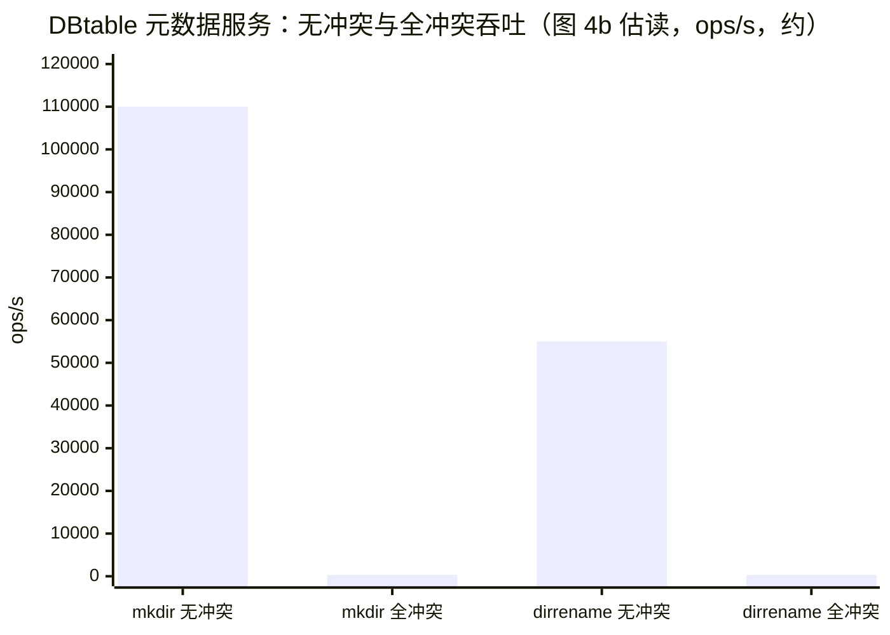

---

## 3. 为什么现有 DFS 优化用不上

论文 §3.3，表 1：

| 方法 | 类型 | lookup 的 RTT 数 | 是否缓解目录竞争 | 在 COSS 中的问题 |
|------|------|-----------------|----------------|----------------|
| 元数据缓存（Ceph、NFSv4、InfiniFS） | DFS | pathlen（未命中时） | 不涉及 | 依赖紧耦合架构；COSS 代理无状态、API 受限、跨层不可见，难以实现 |
| 并行解析（InfiniFS） | DFS | 1 到 pathlen | 不涉及 | 高并发下适得其反：延迟取决于最慢的请求，线程超额订阅更加剧；也不减少 RPC 数、不提升元数据服务吞吐。512 线程解析 10 层路径时，InfiniFS 平均需 **7.4 个 RTT**，接近逐级顺序解析 |
| 放宽隔离（CFS） | DFS | pathlen | 有限 | 用单分片原子原语把简单目录更新变成单分片事务，但对跨分片的 dirrename 无效，仍需昂贵的分布式事务 |
| 分层（LocoFS） | DFS | 1 | 不涉及 | 目录元数据集中在一台目录节点上，所有目录操作都经过它，成为瓶颈；创建对象还要到目录节点查重名、更新父目录，跨组件协调依旧存在 |
| **Mantle** | COSS | **1** | **全部** | — |

**论文的判断**：已有工作要么优化 lookup 延迟，要么略微降低更新开销，但都没有在 COSS 场景下同时解决两者。大多数工作还假设目录更新很少、影响可以忽略，这在现代 COSS 的高并发云负载下已不成立。

---

## 4. Mantle 架构

### 4.1 三个组件（论文 §4，图 5）

| 组件 | 职责 |
|------|------|
| 代理层 | 与 DBtable 方案相同：接收 HTTP 请求，协调各内部组件执行元数据和数据请求 |
| **TafDB** | 可扩展的分片数据库，**保存全部元数据**（访问元数据和属性元数据都在），被所有命名空间共享 |
| **IndexNode** | 每个命名空间一台专用的单节点索引，汇集该命名空间的目录访问元数据；用 Raft 复制到多个节点 |

设计目标：单个命名空间最多 100 亿个目录和对象，每秒 180 万次路径解析和 3 万次目录层级修改（论文 §4）。

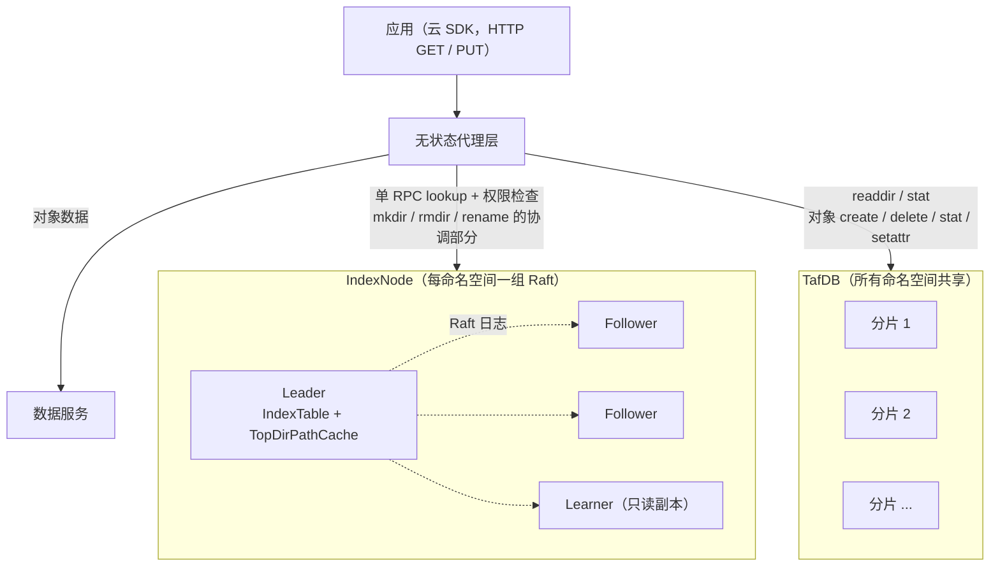

### 4.2 包含式两层与元数据划分（论文 §4，图 5、图 6）

与 LocoFS 那样"目录归目录节点、对象归数据库"的**分层**不同，Mantle 是**包含式**的：TafDB 保存**完整**元数据；IndexNode 只保存目录元数据中的一个关键子集，约 **80 字节/目录**，用于快速 lookup 和跨目录协调。

目录元数据分为两类：

- **访问元数据**（图 5 中红色顶部）：IndexNode 和 TafDB 都有；
- **属性元数据**（图 5 中蓝色底部）：只在 TafDB。

IndexNode 中的 **IndexTable**（图 6）：

| pid | name | id | permission | lock |
|-----|------|----|-----------|------|
| 0 | A | 1 | P_A | false |
| 1 | B | 2 | P_B | false |
| 1 | C | 3 | P_C | true |
| 3 | E | 5 | P_E | false |

（图 6 的示例；lock 位用于目录重命名时加锁。注意图 6 的 IndexTable 中 B 的 pid 为 1（即 A），而同图 TopDirPathCache 中 B 的路径是 /B（根的子目录），见 [§11](#11-论文中的不一致与可疑之处)。）

### 4.3 职责划分（论文 §4，图 5）

| 操作 | 由谁处理 |
|------|---------|
| lookup、权限检查 | IndexNode，单 RPC |
| 对象操作：create、delete、rename、stat、setattr | TafDB（先在 IndexNode 解析父路径） |
| 目录读：readdir、stat | TafDB（用其存储的属性元数据） |
| 目录修改：mkdir、rmdir、rename、setattr | 两者协同：TafDB 更新全部元数据（访问 + 属性），IndexNode 刷新访问元数据，二者保持强同步 |
| rename 防环检测 | IndexNode（目录跨分片时 TafDB 很难做） |

### 4.4 可用性（论文 §4）

引入 IndexNode 不改变 TafDB 中 MetaTable 的可用性保证（由数据库自身保证），所以重点是 IndexNode 自身的高可用：用 **Raft** 复制更新到多个节点，组内所有节点各自按 §5.1 的流程独立构建相同的内存数据结构。

**解读**：80 B/目录意味着什么？按评估的配置，100 亿条目、对象与目录 10:1，约 9 亿个目录，IndexTable 约 72 GB（示例估算，未计哈希表和索引开销），一台 128 GB 内存的服务器放得下。按生产的 C2 命名空间，1.94 亿个目录约 16 GB。目录数才是 IndexNode 的容量上限，对象数不影响它。这也是 Mantle 能"单机"做路径解析的根本原因：对象存储中目录只占 8%–18%。

---

## 5. 扩展单 RPC 路径解析

集中到 IndexNode 后，单 RPC lookup 在 IndexNode 内部仍要逐级访问 IndexTable，路径越深越耗 CPU，IndexNode 成为单节点瓶颈（论文 §5.1）。三项优化：

### 5.1 TopDirPathCache（论文 §5.1.1）

- **为什么不缓存全路径**：10 亿个目录条目的全路径缓存要超过 1 TB 内存；而且祖先目录的任何修改都要失效所有受影响的条目，CPU 开销不小。所以希望缓存的解析结果**高度稳定**。
- **观察**：生产 trace 表明，大多数目录 rename 发生在**靠近叶子**的位置。
- **做法**：只缓存路径**截去最后 k 层**后的前缀。TopDirPathCache 是内存哈希表，键为完整的路径前缀，值为该目录的 pid 和**聚合权限掩码**（按 Lazy Hybrid 的方法，把路径上各级权限求交，得到一个统一的路径权限）。没有运行时的升级、降级（promotion / demotion）。
- 解析深度为 N 的路径时，截去最后 k 层，用剩下的前缀查 TopDirPathCache；未命中就在 IndexTable 中解析后插入新条目。距离叶子 k 层以内的路径都不缓存。
- **示例**（论文）：k = 3 时解析 `/A/C/E/G/H`，查找前缀 `/A/C/`；命中后只需在 IndexTable 中逐级解析 E、G、H。
- **k = 3** 在性能和内存之间取得平衡：只需缓存全部结果所需内存的 **12%**，加速仍然显著（论文 §5.1.1、§6.5）。

### 5.2 Invalidator：缓解 lookup 与修改的冲突（论文 §5.1.2，图 7）

dirrename、setattr 等目录修改会让相关缓存条目过期：所有以被修改路径为前缀的条目都要失效。哈希表不支持范围扫描，还需要协调，防止新的 lookup 读到受影响的范围。Invalidator 用两个辅助结构：

| 结构 | 实现 | 内容 |
|------|------|------|
| **PrefixTree** | 无锁基数树 | 重建 TopDirPathCache 中所有已缓存路径构成的目录树，支持高效范围查询；新结果写入缓存时**同步**更新 |
| **RemovalList** | 无锁跳表 | 记录**正在被修改**的目录的完整路径；dirrename、setattr 时插入 |

- 后台线程定期轮询 RemovalList，用 PrefixTree 查出受影响路径的范围，从 TopDirPathCache 中删除对应条目。
- **rmdir 不需要**写 RemovalList：空目录不可能是任何现存目录的前缀，删除它不会与缓存冲突。
- 无锁、非阻塞的设计降低了维护一致性的 CPU 开销，也减少了对 lookup 的干扰。

**lookup 流程**（图 7）：

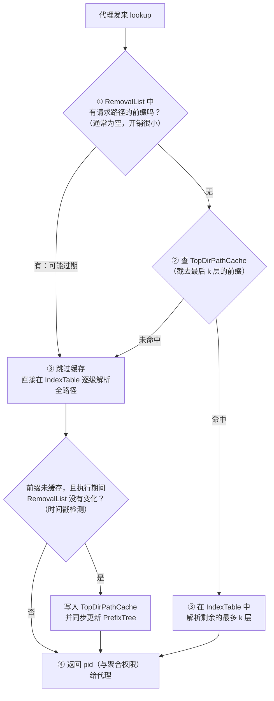

**解读**：这是一个很实用的"不追求完美一致、只追求不读到旧值"的缓存设计。正在修改的路径先进 RemovalList，lookup 遇到就绕过缓存；后台再慢慢清理。时间戳检测保证"解析期间有修改发生"时不把可能过期的结果写入缓存。代价是 RemovalList 的前缀检查要对每个 lookup 都做一次；RemovalList 通常为空，所以开销很小，但在 rename 风暴时会退化成全部走 IndexTable。

### 5.3 follower / learner 读（论文 §5.1.3）

- Raft 组中 follower 通常只做复制，CPU 闲置。leader 负载高时，把路径解析请求**卸载到 follower**。
- 防止读到旧数据：follower 先向 leader 查询最新的 **commitIndex**，等本地 **applyIndex** 超过它，再在本地解析（即 Raft 的 ReadIndex 读）。对 leader 的 commitIndex 查询会**批量**进行，减小 leader 的负担。
- 还可以加入 **learner**（只读副本，不参与投票）进一步提升吞吐。
- follower、learner 各自维护本地的 TopDirPathCache。为防止读到本地缓存中的旧条目，**缓存失效信息通过 Raft 日志同步**：需要失效的操作把受影响目录的完整路径追加到 Raft 日志，日志应用时用 Invalidator 失效对应条目。

---

## 6. 扩展目录修改

### 6.1 delta 记录与合并（论文 §5.2.1，图 8）

**问题**：同一目录上的并发目录操作（如 mkdir、rmdir）都要修改该目录的属性元数据（链接数、时间戳等），争用同一行，导致事务中止和重试，尾延迟升高。

**CFS 的做法为什么不能用**：CFS 把 mkdir、rmdir 拆成两个单分片事务（一个插入或删除属性元数据，另一个更新访问元数据和父目录属性）。这种两事务策略与 IndexNode 和 TafDB 之间的同步要求不兼容。

**Mantle 的做法**：用 **delta 记录**避免就地更新：

- 每条 delta 记录的复合键为 **(pid, 特殊名字 "/_ATTR", 事务时间戳 TS_txn)**；主属性记录的时间戳为 0。
- 每个操作只插入一条**独立的** delta 记录，不直接修改主属性记录。
- **示例**（图 8）：并发的 mkdir(/A/B) 和 rmdir(/A/C) 都要改 /A 的属性。没有 delta 时它们冲突在同一行；有了 delta，mkdir 插入 (TS1, links +1)，rmdir 插入 (TS2, links −1)，互不冲突。
- delta 记录之后**异步合并**进主属性记录；合并期间用一个**共享 latch** 保证该目录元数据不会被删除。

| pid | name | timestamp | links | 含义 |
|-----|------|-----------|-------|------|
| 12（/A 的 id） | /_ATTR | 0 | 3 | /A 的主属性记录 |
| 12 | /_ATTR | TS1 | +1 | mkdir(/A/B) 的 delta |
| 12 | /_ATTR | TS2 | −1 | rmdir(/A/C) 的 delta |

**代价**：dirstat 要扫描 delta 记录才能算出准确结果。所以 delta 记录是**选择性启用**的，只在某个目录出现**持续竞争**时才打开（论文 §5.2.1）。

**解读**：delta 记录与 [CFS 的 delta apply](cfs-eurosys2023.md#63-冲突合并把伪冲突移出临界区42) 思路一致，都是把"读改写"变成"可交换的追加"，把伪冲突移出临界区。区别在于 CFS 在单分片原语内部合并，Mantle 把 delta 作为独立的行插入，事后合并。论文没有给出"持续竞争"的判断阈值，也没有说明启用和关闭 delta 模式时如何与正在进行的事务协调。

### 6.2 跨目录 dirrename（论文 §5.2.2，图 9）

IndexNode 被指定为跨目录 dirrename 的**协调者**。IndexTable 中每个目录条目都有一个 lock 位，代理通过**一次 RPC** 就能锁住 dirrename 涉及的目录，不需要多次 RPC 获取分布式锁。

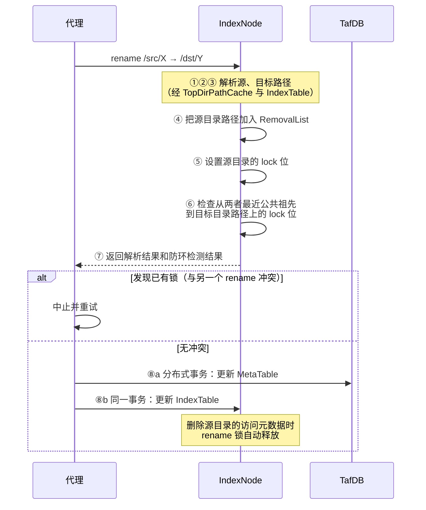

**为什么能防环**：把目录 X 移到目标目录 D 之下形成环，当且仅当 X 是 D 的祖先。Mantle 在 X 上加锁，然后检查从公共祖先到 D 的路径；如果 X 在这条路径上，就会看到 X 的锁。并发的两个 rename 若可能互相成环，必然有一方先看到另一方的锁而中止重试。

**解读**：这把 CFS 中由独立 Renamer 承担、在 InfiniFS 中由专门的 rename 协调者承担的工作，并入了本来就持有整棵目录骨架的 IndexNode，防环检查变成本地内存操作。但最终提交仍是 TafDB 与 IndexNode 之间的 **2PC**（⑧a / ⑧b），所以 dirrename 并没有摆脱分布式事务，只是去掉了"为了防环而做的分布式加锁和路径校验"。图 15 中 dirrename 的执行阶段仍是 Mantle 延迟的主要部分。

### 6.3 提升 IndexNode 的 Raft 写入（论文 §5.2.3）

目录修改变快后，IndexNode 的写入受单个 Raft 组的能力限制，主要开销是频繁的 fsync。Mantle 把多个操作**批量**成一次 Raft 提交，减少 fsync 次数。引言中还提到"follower 写卸载"（follower write offloading），但 §5 正文没有展开（见 [§11](#11-论文中的不一致与可疑之处)）。

---

## 7. 容错

论文 §5.3：

- **元数据服务器故障**：相应的 Raft 组自动重新选主，完整性和可用性由 Raft 保证。
- **代理故障**：客户端重连另一台代理并重提交未完成请求。每个元数据请求带有客户端生成的 **UUID** 以保证幂等。
  - 在 dirrename 的步骤 ①–⑦ 期间代理故障：IndexNode 重试这些步骤，借助 UUID 识别锁是否已被原请求持有，避免死锁；防环检测通过后，新代理照常执行 ⑧a / ⑧b，提交 2PC 并释放锁。
  - 在 ⑧a / ⑧b 期间故障：由标准的 2PC 恢复机制决定最终提交结果，保证系统进入一致状态。

**解读**：论文没有讨论"代理在 ⑦ 之后、⑧ 之前永久消失且客户端不重提交"的情况。此时源目录的 lock 位一直保持，后续涉及该子树的 rename 都会中止重试。合理的做法是给 lock 位加租约或由 IndexNode 定期清理孤儿锁；论文没有说明。

---

## 8. 评估

### 8.1 实验环境（论文 §6.1，表 2）

| 项目 | 配置 |
|------|------|
| 集群 | 53 台物理服务器，每台 128 GB DRAM，CentOS 6.3（内核 4.14.0）；21 台做元数据服务，32 台做客户端；Mellanox ConnectX-5 25 Gbps |
| 集中节点 | 3 台双路 Xeon Platinum 8350C（2.60 GHz，64 核）+ 1 TB NVMe，用作 Mantle 的 IndexNode、LocoFS 的目录元数据服务器、InfiniFS 的 rename 协调者 |
| 其余节点 | 双路 Xeon Silver 4314（2.40 GHz，32 核）+ 8 块 4 TB NVMe |
| 部署 | Tectonic：21 台元数据服务器；InfiniFS：3 台 rename 协调者 + 18 台元数据；LocoFS：3 台目录元数据 + 18 台对象元数据；Mantle：3 台 IndexNode + 18 台 TafDB。所有系统共用额外的数据服务器 |
| 基线 | 三者都没有开源，作者**自行复现**：Tectonic 放宽一致性、不用分布式事务；InfiniFS 的目录修改采用 CFS 的两事务策略，并实现了 AM-Cache 用于评估缓存效果。作者称复现性能与原论文一致 |
| 负载 | 真实应用 + 改造的 mdtest（create、delete、objstat、dirstat、mkdir、dirrename），平均路径深度 10；OpenMPI 5.0.2 启动 mdtest；预先填充到 **10 亿**条目，对象与目录 10:1。除 §6.2 的应用评估外只测元数据 |

### 8.2 真实应用（论文 §6.2，图 10、图 11）

- **Audio**：面向 AI 的音频预处理，把长音频切成数秒的片段，共 200 GB 数据；只有无冲突的元数据操作，突出路径解析性能。
- **Analytics**：Spark 交互式分析，10 GB 数据，大量元数据操作；所有目录修改都针对同一个临时目录的属性，冲突严重。

作业完成时间（s，图 10 数据标签）：

| 负载 | Tectonic | InfiniFS | LocoFS | Mantle |
|------|----------|----------|--------|--------|
| Analytics（无数据访问） | 17.8 | 71.3 | 12.7 | **3.9** |
| Audio（无数据访问） | 90 | 70 | 71 | **42** |
| Analytics（有数据访问） | 17.9 | 71.7 | 13.5 | **4.8** |
| Audio（有数据访问） | 132 | 115 | 112 | **69** |

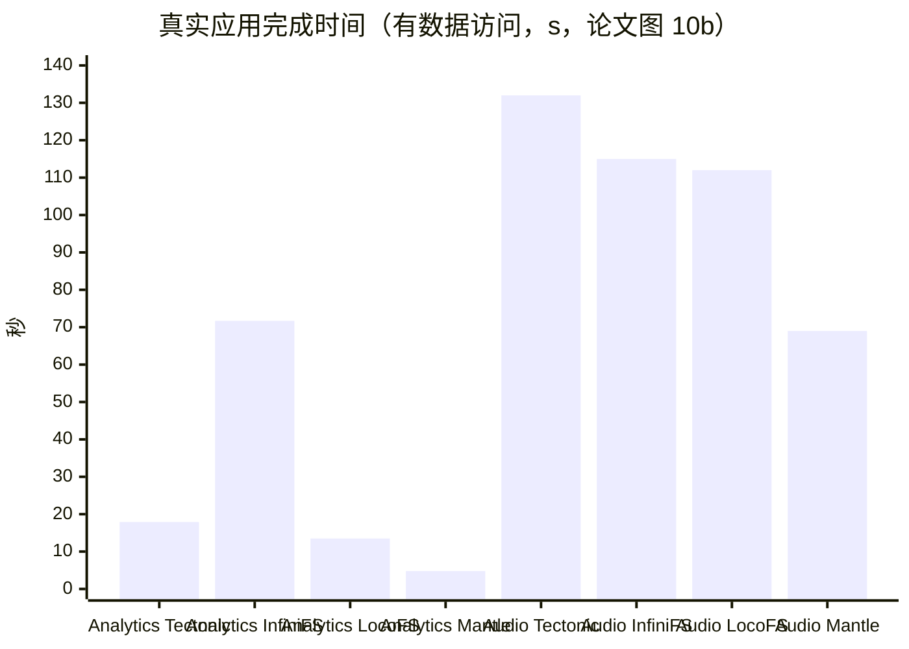

**Analytics**（无数据访问）：

- Tectonic 比 InfiniFS 快（17.8 对 71.3 s），因为复现的 Tectonic 目录修改**不保证一致性**。
- InfiniFS 用分布式事务保证一致性，但 dirrename 因竞争大量重试：**10.6%** 的 dirrename 延迟超过 5 s，最长 **52 s**（图 11b）。
- LocoFS 避免了分布式事务冲突，但对子目录列表中同一个键的修改被 latch 串行化；完成时间仍比 Mantle 长 225%。
- LocoFS 与 Tectonic 的 mkdir、dirrename 延迟 CDF 非常接近（图 11a、11b）。

**Audio**（无数据访问）：

- Tectonic 最差（逐级路径解析）；InfiniFS 略好，但投机解析产生的大量子线程使延迟波动很大，objstat 少量请求接近 Mantle，尾延迟很高（图 11c、11d）。
- LocoFS 的单节点路径解析没有扩展中心节点的优化，延迟与 InfiniFS 相当；Mantle 比 LocoFS 少用 **40.8%** 的时间。

**有数据访问**：Analytics 由元数据主导，与无数据访问时差别很小；Mantle 比 Tectonic、InfiniFS、LocoFS 分别缩短 **73.2%、93.3%、63.3%**。Audio 的完成时间显著增加，Mantle 的相对优势变小，但仍缩短 **47.7%、40.1%、38.5%**。

### 8.3 单项操作（论文 §6.3，图 12–图 15）

512 个客户端，延迟分为 lookup（路径解析，取得 pid）、loop-detect（仅 dirrename）、execution 三段。InfiniFS 的 objstat 在 lookup 阶段完成、无执行阶段；LocoFS 的目录操作在执行阶段解析路径；Mantle 的 dirrename 把 lookup 并入防环检测，lookup 记为 0。

**对象操作与目录读**（图 12，吞吐 Kop/s，约）：

| 操作 | Tectonic | InfiniFS | LocoFS | Mantle |
|------|----------|----------|--------|--------|
| dirstat | 约 140 | 约 180 | 约 260 | 约 610 |
| objstat | 约 150 | 约 190 | 约 250 | 约 600 |
| create | 约 60 | 约 80 | 约 120 | 约 125 |
| delete | 约 100 | 约 130 | 约 210 | 约 290 |

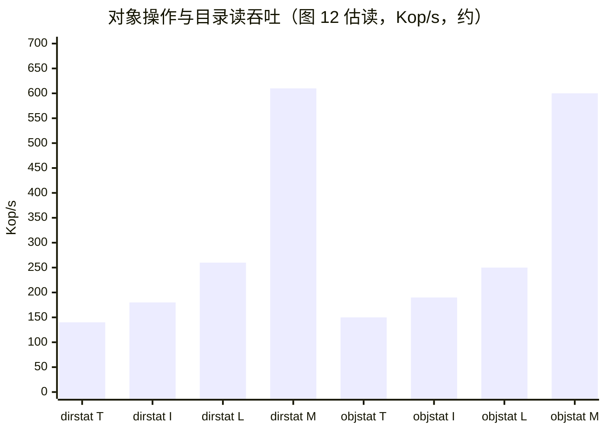

- 排序从差到好为 Tectonic、InfiniFS、LocoFS、Mantle。InfiniFS 比 Tectonic 只提升 0.19–0.37 倍（并行解析导致线程超额订阅）；LocoFS 比 InfiniFS 再提升 0.32–0.83 倍，但本地记录检索耗尽目录服务器 CPU。Mantle 借助 TopDirPathCache 和 follower 读，四种操作的路径解析延迟都最低。
- create 上 LocoFS 与 Mantle 相当：mdtest 的 create 带有额外的属性更新，减轻了路径解析的比重。
- **小结**：Mantle 的 lookup 延迟比 Tectonic、InfiniFS、LocoFS 分别低 **83.9–89.0%、80.0–84.2%、16.4–74.5%**，吞吐加速 **2.49–4.30×、1.96–3.44×、1.07–2.50×**。

**目录修改**（图 14，Kop/s；-e 为各线程独占目录，-s 为共享目录；rmdir 与 mkdir 相似，略去）：

| 操作 | Tectonic | InfiniFS | LocoFS | Mantle |
|------|----------|----------|--------|--------|
| mkdir-e | 约 110 | 约 110 | 约 47 | 约 135 |
| mkdir-s | **2.8** | 约 25（约） | **1.0** | 约 58 |
| dirrename-e | 约 47 | 约 49 | 约 15 | 约 59 |
| dirrename-s | **2.7** | **0.3** | **0.5** | 约 38 |

（粗体为图中数据标签，其余为估读。）

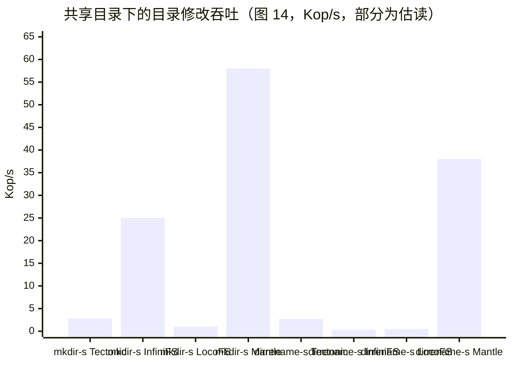

- **mkdir-e**：Tectonic 执行阶段略好，InfiniFS lookup 阶段略好，总体接近，两者都受元数据服务器上饱和的读（lookup）和写（rename）请求限制。LocoFS 受 Raft 吞吐限制，最差。Mantle 最高：lookup 更短，弥补了较长的执行阶段。但 Mantle 的吞吐受**单个 Raft 组**限制，进一步扩展需要更多优化；按生产经验，当前容量够用。
- **mkdir-s**：Tectonic、LocoFS 对父目录属性的修改被 latch 串行化；InfiniFS 用单分片原子原语避免重试，但仍不及无冲突场景。Mantle 用 delta 记录让目录属性完全并发更新，比 InfiniFS 高 **1.96 倍**。
- **dirrename-e**：趋势与 mkdir-e 相似，但 dirrename 要两轮路径解析，差距拉大；InfiniFS、LocoFS、Mantle 都有防环开销，中心节点压力更大，LocoFS 最差。Mantle 比 Tectonic 高 **26.2%**。
- **dirrename-s**：Tectonic、InfiniFS、LocoFS 都因冲突大幅下降；Mantle 用 delta 记录消除冲突，性能最高。图 15 中三个基线的延迟分别约 188、1,561、1,084 ms（数据标签），Mantle 约 13 ms（约）。
- **小结**：目录修改上 Mantle 对 Tectonic、InfiniFS、LocoFS 加速 **1.20–20.9×、1.16–116.00×、2.87–80.78×**。

### 8.4 各项优化的作用（论文 §6.4，图 16）

从 Mantle-base（关闭 TopDirPathCache）开始逐项打开，吞吐相对 Mantle-base 归一化：

| 负载 | +pathcache | +raftlogbatch | +delta record | +follower read |
|------|-----------|---------------|---------------|----------------|
| dirstat | 约 2.0× | 约 2.0× | 约 2.0× | 约 2.5× |
| mkdir-e | 约 1.0× | 约 3.8× | 约 3.8× | 约 3.9× |
| dirrename-s | 约 1.0× | 约 1.0× | **45.3×** | **45.3×** |

- pathcache 让 dirstat 吞吐翻倍，follower 读进一步提升；
- Mantle-base 的 mkdir-e 受 IndexNode Raft 日志提交速度限制，raftlogbatch 摊薄提交开销；
- Mantle-base 的 dirrename-s 冲突多、事务失败重试，delta record 消除冲突，吞吐提升到 45.3 倍。

### 8.5 其他因素（论文 §6.5，图 17–图 20）

**路径深度**（图 17，512 线程、32 台服务器）：

- Tectonic、InfiniFS 的解析延迟随深度上升：10 层路径分别是 1 层的 **6.82 倍、6.4 倍**。Tectonic 线性增长（顺序发同样多的 RPC）；InfiniFS 在深路径上因线程超额订阅遇到瓶颈。
- LocoFS 在深度 6 以内与 Mantle 相当，之后受 CPU 限制。
- Mantle 非常稳定：10 层路径只比 1 层高 **1.09 倍**（图中约 0.4–0.5 ms，约）。

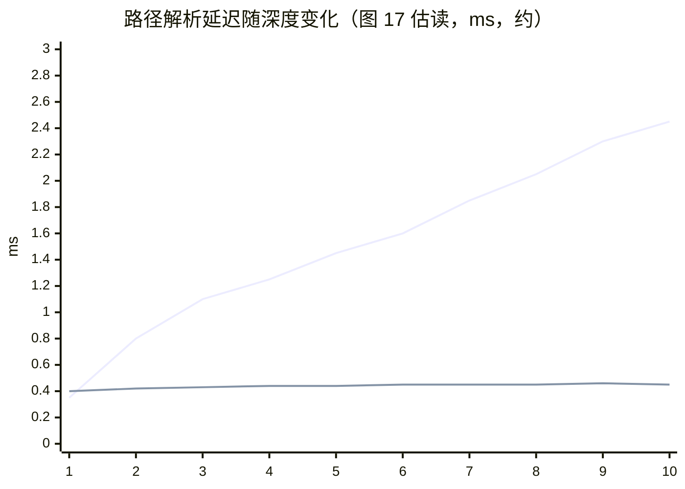

（第一条折线为 Tectonic，第二条为 Mantle；xychart 不显示图例。）

**k 的影响**（图 18，关闭 follower 读，512 线程；缓存比例按 ns4 计算）：

| k | 归一化延迟（相对 Mantle-base，约） | 可缓存的目录比例（约） |
|---|--------------------------------|---------------------|
| 1 | 约 0.24 | 100% |
| 2 | 约 0.29 | 约 37% |
| 3 | **0.32** | 约 12% |
| 4 | 约 0.38 | 约 3% |
| 5 | 约 0.41 | 约 0% |

k = 3 时延迟比 k = 1 慢 31.1%，但内存比 k = 1 少 **88%**。生产中取 k = 3。

**IndexNode 扩展性**（图 19）：

- 命名空间从 10 亿增加到 **100 亿**条目，objstat 和 create 吞吐保持不变（图 19a）。
- 100 亿条目、改变线程数（图 19b）：

| 负载 | 64 线程 | 256 线程 | 512 线程 | 1,024 线程 | 2,048 线程 |
|------|--------|---------|---------|-----------|-----------|
| create | 18.8 Kop/s | — | 133.5 Kop/s | +28.3%（TafDB 到达上限） | — |
| objstat（仅 leader） | 101.6 Kop/s | 376.5 Kop/s | 持平（单节点容量） | 不再增长 | — |
| objstat + 2 follower | — | — | 继续增长 | — | **1,288.0 Kop/s** |
| objstat + 2 follower + 2 learner | — | — | — | — | **1,894.5 Kop/s** |

**加上元数据缓存**（图 20）：给 InfiniFS 和 Mantle 都加上元数据缓存（虽然 Mantle 的设计不采用缓存，但评估其在别的场景下的潜力）：

| 负载 | InfiniFS 无缓存 | InfiniFS 有缓存 | Mantle 无缓存 | Mantle 有缓存 |
|------|----------------|----------------|--------------|--------------|
| Analytics（s） | 71.7 | 68.0 | 4.8 | 4.3 |
| Audio（s） | 115.1 | **63.0** | 68.9 | **63.0** |

Analytics 以目录修改为主，缓存收益有限；Audio 中 InfiniFS 从 115.1 s 降到 63.0 s，Mantle 从 68.9 s 降到 63.0 s，Mantle 已有高效的单 RPC 解析，提升空间小。

**解读**：图 20 很有意思：在 Audio 这类纯 lookup 负载上，只要允许客户端缓存，InfiniFS 能追平 Mantle。这印证了 Mantle 的价值前提是"**客户端不可控**"的对象存储场景。在可以部署客户端库的 DFS 中，客户端缓存加版本失效（InfiniFS）仍是更便宜的选择；而对竞争严重的 Analytics，缓存帮不上忙，Mantle 的 delta 记录和集中防环才是关键。

---

## 9. 生产部署与经验

### 9.1 部署概况（论文 §7.1）

- Mantle 已集成进原有的对象存储系统，替换了 DBtable 元数据管理；新系统**同时支持扁平和层级命名空间**，形成统一的存储底座。
- 部署在 A、B、C 三个集群，承载 **19 个内部命名空间**（分别 7、7、5 个）和大量外部命名空间；每个集群内所有命名空间共享一套 TafDB。
- 负载包括元数据密集型（AI 数据预处理、即席 SQL 查询）和 I/O 密集型（模型检查点、批量分析），日均元数据请求**数百亿**次。

### 9.2 集群 C 的 5 个内部命名空间（论文表 3）

| 命名空间 | 对象数 | 目录数 | 小对象（≤ 512 KB）占比 | 峰值 lookup（Kop/s） | 峰值 mkdir（Kop/s） | 业务 |
|---------|-------|-------|---------------------|--------------------|-------------------|------|
| C1 | 32 亿 | 2,700 万 | **62.0%** | 400 | 24 | AI 训练 |
| C2 | 21 亿 | 1.94 亿 | 29.2% | 300 | 12 | AI 训练、数仓、广告、搜索 |
| C3 | 12 亿 | 1.45 亿 | 33.7% | 350 | 18 | AI 训练、数仓、广告、金融、日志分析、搜索 |
| C4 | 8 亿 | 8,800 万 | 28.8% | 175 | 11 | 搜索 |
| C5 | 7,500 万 | 900 万 | 28.1% | 215 | 9 | AI 训练、日志分析 |

### 9.3 经验（论文 §7.2）

1. **小对象普遍**：小对象占约 30% 到 C1 的 60% 以上，说明许多负载天生元数据密集，受益于低延迟路径解析。生产峰值 lookup 175–400 Kop/s、mkdir 9–24 Kop/s，只是 Mantle 容量的一部分，留有充足余量。
2. **IndexNode 混部提高资源利用率**：维护一个共享物理服务器池承载所有命名空间的 IndexNode 副本；小命名空间（如 C4、C5）的 leader 可以共用一台节点，大而热的命名空间独占节点；用动态机制重新平衡 leader 分布，按需增加物理节点，避免热点。
3. **收益取决于负载画像**：元数据密集型应用受益最大，例如 §3 的数据预处理任务迁移后端到端完成时间缩短 **40% 以上**；I/O 密集型负载没有性能退化，也受益于更快的 lookup。Mantle 的高效率还**减少了所需的元数据服务器数量**。
4. **优化潜力**：当前扩展性受 IndexNode 的 **CPU** 限制。降低 CPU 的优化可以在不大改架构的情况下扩容；概念验证表明，RPC 框架改用 **RDMA** 可把单节点路径解析吞吐从 **50 万 ops/s 提到 100 万 ops/s**。

**解读**：生产数据很能说明问题。C1 有 32 亿对象却只有 2,700 万目录，IndexTable 约 2 GB；即使 C2 的 1.94 亿目录也只需约 16 GB。按每个 IndexNode 的解析能力 50 万 ops/s 计，生产峰值 400 Kop/s 已经用到相当比例，所以 follower 读和 RDMA 优化不是锦上添花，而是为增长留余量。

---

## 10. 相关工作

论文 §8：

| 类别 | 代表 | 论文的评价 |
|------|------|-----------|
| 集中式元数据 | GFS、HDFS、Lustre、MooseFS、QFS | 早期 DFS 把元数据与数据分离，放在集中服务器上 |
| 分布式元数据 | Farsite、Lustre DNE、SoMeta、Ceph、HBA 等 | 把元数据分到多台服务器以提升扩展性 |
| 基于分布式数据库 | CalvinFS、ADLS、HopsFS、λFS | 用分布式数据库管理元数据 |
| 子树分区 | HDFS、Lunule、Ceph | 容易负载不均 |
| 全路径索引 | Lustre、GIGA+ | 可细粒度负载均衡，但权限检查要逐级遍历，需要多次 RPC；缺乏局部性，协调开销高 |
| 范围分区 | HopsFS、Giraffa；Mantle 也采用 | 兼顾负载均衡与减少分布式协调，但评估显示目录修改仍有显著协调开销 |
| 客户端缓存 | LocoFS、InfiniFS、IndexFS、NFSv4 | 对 COSS 不可行 |
| 并行投机解析 | InfiniFS | 高并发下扩展性差 |
| 全量复制 | FalconFS | 惰性复制所有元数据到每台元数据服务器以便本地解析；COSS 命名空间太大，不实用 |
| 服务端缓存 | CephFS、FileScale | 在子树分区之上做服务端缓存改善 lookup，但做不到单 RPC；容易负载不均、迁移开销高 |
| 集中权限缓存 | Duplex | 在中心节点缓存路径权限，一致性开销高，故障后退回并行解析 |
| 其他 | 高写吞吐复制协议；PM、RDMA、SmartNIC 等新硬件（Assise、LineFS、Octopus、Orion、SingularFS） | 与 Mantle 正交，可以互补 |

---

## 11. 论文中的不一致与可疑之处

| 位置 | 问题 | 判断 |
|------|------|------|
| 摘要与 §1 | 生产部署时间：摘要说"**超过 2 年**"，引言说"**超过 1.5 年**" | 可能是投稿版与终稿时间差，未统一 |
| §6.2 | "Tectonic 的完成时间比 InfiniFS **长** 75.0%"。图 10a 中 Tectonic 17.8 s、InfiniFS 71.3 s，Tectonic 反而**短** 75.0%（1 − 17.8/71.3 = 75.0%），论文给的原因"Tectonic 不保证一致性"也对应"更快" | "longer"应为"shorter" |
| §6.2 | "LocoFS 进一步缩短 27.0%"。相对 Tectonic 为 1 − 12.7/17.8 = **28.7%** | 小误差 |
| §6.2 | Audio 中"InfiniFS 缩短 23.9%"。1 − 70/90 = **22.2%** | 小误差 |
| §6.2、摘要 | 有数据访问时 Mantle 比 LocoFS 缩短 "63.3%"，摘要的 "63.3–93.3%" 也用这个下限。按图 10b：1 − 4.8/13.5 = **64.4%** | 小误差，可能来自未四舍五入的原始数据 |
| §4 与摘要、§1 | §4 说 Mantle 支持每秒 "**3 万**次目录层级修改"；摘要说"最高 **5.8 万**次目录更新"，引言说 "58.8K mkdir、38.0K dirrename" | 3 万可能是早期目标，与实测不一致 |
| 摘要 | 吞吐提升"**0.07–115.00×**"，引言写作加速比 "1.07–116.00×" | 两者是"提升倍数"与"加速比"两种口径（差 1），容易误读为 Mantle 有时只有 0.07 倍性能 |
| §1 与 §5 | 引言说 Mantle 用"Raft 日志批量提交**和 follower 写卸载**"维持 IndexNode 写吞吐；§5.2.3 只描述了批量提交，没有 follower 写卸载的设计 | 疑似删减后未同步 |
| 图 6 | 树形图和 TopDirPathCache（条目 /B → id 2）都表明 B 是根的子目录；同图 IndexTable 中 B 的 pid 却是 1（即 A） | 示例数据前后不一致，pid 应为 0 |
| §5.1.1 | "缓存所有路径对 10 亿个目录条目需要**超过 1 TB** 内存"，即每条超过 1 KB；按平均深度约 11 层、每级名字十几字节估算，一条路径约 100–200 B，加哈希表开销也很难到 1 KB | 可能包含了对象路径或其他开销，论文没有说明口径 |
| §5.1.1 与 §6.5 | §5.1.1 说 k = 3 只需"缓存**全部**结果"内存的 12%；§6.5 说比 **k = 1** 少 88% | k = 1 已截去最后一层，与"全部结果"不同，两个基准混用 |
| §6.3 | 图 14 中 Mantle 的 mkdir-s 约 58 Kop/s，文中说比 InfiniFS 高 1.96 倍，则 InfiniFS 应约 30 Kop/s；图上 InfiniFS 柱约 20–25 Kop/s（约） | 估读误差范围内，但不完全吻合 |
| §6.1 | 三个基线均为作者自行复现，其中 Tectonic **放宽了一致性**、InfiniFS 改用 CFS 的两事务策略 | 基线并非原系统，复现质量只有"与原论文趋势一致"的声明 |
| §5.2.1 | delta 记录"只在持续竞争时启用"，但没有给出阈值、检测方法，以及模式切换时如何与进行中的事务协调 | 关键工程细节缺失 |

---

## 12. 与本仓库中其他系统的对照

| 系统 | 路径解析 | 目录竞争 | 跨目录 rename 防环 | 集中组件 | 适用前提 |
|------|---------|---------|------------------|---------|---------|
| **Mantle** | IndexNode 单 RPC，TopDirPathCache + follower 读 | TafDB delta 记录 | IndexNode 本地 lock 位 | 每命名空间一组 Raft | 客户端不可控的对象存储；目录少于约 10 亿 |
| [CFS](cfs-eurosys2023.md) | 客户端逐级查 TafDB | 单分片原语 + delta apply | 独立 Renamer | Renamer | 客户端库可控的 POSIX 文件系统 |
| [InfiniFS](infinifs-fast2022.md) | 客户端缓存 + 投机并行解析 | 本地事务 + 2PC | rename 协调者 | rename 协调者 | 客户端可控，低并发时并行解析有效 |
| [FalconFS](falconfs-nsdi2026.md) | 无状态客户端，服务端用复制的目录树本地解析 | 请求合并 | 协调者 + 广播失效 | 协调者 | DL 负载，目录树可复制到每个节点 |
| [Tectonic](tectonic-fast2021/deep-read.md) | 逐级查 ZippyDB | 分片内事务 | 非原子 move + backpointer | 无 | 可接受非原子 move 的数仓/Blob |
| [FileScale](filescale-socc2023.md) | 按前缀独占 NameNode 内的并行哈希查找 | NameNode 内存串行 | 刷脏后交给数据库事务 | ZooKeeper 挂载表 | HDFS 兼容，小规模即需高效 |
| [λFS](lambdafs-asplos2023.md) | serverless 实例 trie 缓存 + INode Hint Cache | NDB 行锁 | NDB 事务 | ZooKeeper 协调 | 读多的突发负载 |
| [SingularFS](singularfs-atc2023.md) | 单台服务器本地 | 无日志 + 层级并发控制 | 本地 | 整个元数据服务 | 十亿级、单机 PM + RDMA |

**解读**：

- **Mantle 与 CFS 是同一团队对同一底座（TafDB）的两次回答**。CFS 针对 POSIX 文件系统，假设有客户端库，于是去掉代理层、靠单分片原语消除锁；Mantle 针对对象存储，代理无状态、不能改客户端，于是在服务端加一台集中索引来解决 lookup 的 RTT 问题。两者共用 delta 思路处理目录属性竞争；在 dirrename 上，Mantle 明确指出 CFS 的单分片化无效，改由 IndexNode 做防环。
- **Mantle 与 FalconFS**：都把路径解析从客户端挪到服务端。Mantle 每命名空间一台索引，读扩展靠 Raft follower/learner（实测到约 190 万 ops/s）；FalconFS 每个节点都有完整目录树，读天然可扩展，代价是目录修改要广播失效。论文称 FalconFS 的全量复制"对 COSS 的超大命名空间不实用"；但按 80 B/目录计，Mantle 的 IndexNode 本身就是"单机放得下整棵目录骨架"的证明，FalconFS 复制的也只是目录树，两者容量约束其实相近。
- **集中化的回归**：SingularFS（单台服务器）、Mantle（每命名空间一台索引）、FalconFS（协调者）都说明，"目录骨架"体量很小，集中起来反而简单高效；真正需要分片扩展的是对象/文件元数据。这与[元数据扩展性综述](metadata-scalability.md)中"目录骨架集中 + inode 分片"的阶段二建议一致。

---

## 13. 整体总结

### 13.1 核心贡献

1. **生产负载研究**：百度对象存储的 5 个十亿级命名空间平均访问深度约 11 层、最深 95，lookup 占元数据延迟的 63%–91%；共享目录竞争让 mkdir/dirrename 吞吐下降 99% 以上（论文 §3）。
2. **包含式两层架构**：TafDB 存全部元数据、可扩展；每命名空间一台 Raft 复制的 IndexNode 只存约 80 B/目录的访问元数据，提供单 RPC 路径解析和权限检查（论文 §4）。
3. **避免集中节点成为瓶颈**：TopDirPathCache（k = 3，内存仅需 12%）、无锁 Invalidator、follower/learner 读，把 lookup 推到约 190 万 ops/s（论文 §5.1、§6.5）。
4. **消除目录修改的协调瓶颈**：TafDB 中的 delta 记录、IndexNode 上的单 RPC 加锁与防环、Raft 批量提交（论文 §5.2）。
5. **评估与生产**：对三个基线延迟降 6.6–99.1%，真实应用完成时间缩短 38.5–93.3%；部署于百度 BOS，19 个内部命名空间，日均数百亿次元数据请求（论文 §6、§7）。

### 13.2 设计哲学

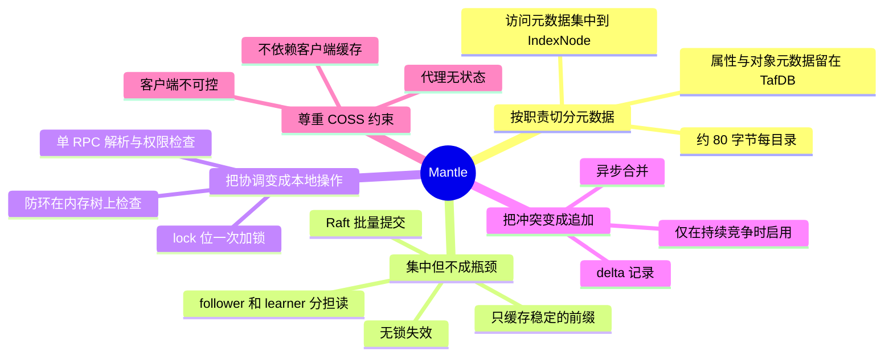

### 13.3 优点与局限

| 优点 | 局限 |
|------|------|
| lookup 与路径深度几乎无关（10 层只比 1 层慢 1.09 倍） | IndexNode 写入受单个 Raft 组限制，mkdir-e 等目录修改的扩展性有上限 |
| 不依赖客户端，适配对象存储的无状态代理 | 目录数受单机内存限制（约 80 B/目录），超大目录数的命名空间需要另想办法 |
| delta 记录让共享目录上的 mkdir、dirrename 吞吐提升一到两个数量级 | dirrename 仍需 TafDB 与 IndexNode 之间的 2PC；delta 启用阈值、孤儿锁清理等细节未说明 |
| 包含式设计：IndexNode 可从 TafDB 重建，不改变 TafDB 的可用性保证 | 三个基线都是作者复现，Tectonic 还放宽了一致性 |
| 生产验证充分，提供了真实命名空间数据和运维经验 | 多处数字与措辞不一致（部署时长、"longer"写反、3 万与 5.8 万等） |

### 13.4 启示

1. **先看目录占比，再决定能不能集中**。对象存储中目录只占 8%–18%，目录骨架又只需约 80 B/目录，十亿级命名空间的骨架也只有几十 GB。只要满足这个条件，"集中索引 + 分片存储"比全分布式路径解析简单得多。
2. **缓存最稳定的部分**。TopDirPathCache 不缓存全路径，只缓存离叶子 k 层以上的前缀，因为 rename 多发生在叶子附近。设计缓存时先看修改发生在哪里，再决定缓存哪里，可以同时省内存和省失效开销。
3. **把读改写变成追加**。delta 记录把父目录属性上的热点更新变成互不冲突的插入，这是处理"计数器类热点"的通用办法，代价是读要合并、要后台压缩，所以最好按需启用。
4. **用复制组的空闲副本扩读**。Raft 的 follower 平时只做复制，用 ReadIndex 读 + 通过日志同步缓存失效，就能把读能力扩展数倍，这比重新设计分区便宜得多。
5. **约束决定架构**。图 20 说明，在客户端可控时，客户端缓存能追平 Mantle 的 lookup 性能。选方案前先问：客户端能不能改？代理是不是无状态？目录修改是否集中在少数共享目录？

### 13.5 一张图看懂 Mantle

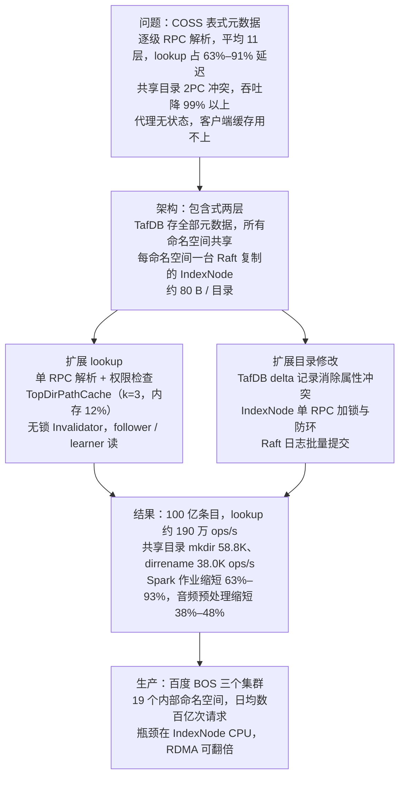

---

## 参考

- Jiahao Li, Biao Cao, et al. *Mantle: Efficient Hierarchical Metadata Management for Cloud Object Storage Services*. ACM SOSP 2025. <https://dl.acm.org/doi/10.1145/3731569.3764824>
- Yiduo Wang, Yufei Wu, Cheng Li, et al. *CFS: Scaling Metadata Service for Distributed File System via Pruned Scope of Critical Sections*. ACM EuroSys 2023.（本仓库精读：[cfs-eurosys2023.md](cfs-eurosys2023.md)）
- Wenhao Lv, Youyou Lu, et al. *InfiniFS: An Efficient Metadata Service for Large-Scale Distributed Filesystems*. USENIX FAST 2022.（本仓库精读：[infinifs-fast2022.md](infinifs-fast2022.md)）
- Siyang Li, Youyou Lu, et al. *LocoFS: A Loosely-Coupled Metadata Service for Distributed File Systems*. SC 2017.
- Satadru Pan et al. *Facebook's Tectonic Filesystem: Efficiency from Exascale*. USENIX FAST 2021.（本仓库精读：[tectonic-fast2021/deep-read.md](tectonic-fast2021/deep-read.md)）
- Jingwei Xu et al. *FalconFS: Distributed File System for Large-Scale Deep Learning Pipeline*. USENIX NSDI 2026.（本仓库精读：[falconfs-nsdi2026.md](falconfs-nsdi2026.md)）
- Gang Liao, Daniel J. Abadi. *FileScale: Fast and Elastic Metadata Management for Distributed File Systems*. ACM SoCC 2023.（本仓库精读：[filescale-socc2023.md](filescale-socc2023.md)）
- Sambhav Satija et al. *Cloudscape: A Study of Storage Services in Modern Cloud Architectures*. USENIX FAST 2025.
- Scott A. Brandt et al. *Efficient Metadata Management in Large Distributed Storage Systems*（Lazy Hybrid）. MSST 2003.
- Diego Ongaro, John Ousterhout. *In Search of an Understandable Consensus Algorithm*. USENIX ATC 2014.
- Chao Dong et al. *Low-Latency and Scalable Full-Path Indexing Metadata Service for Distributed File Systems*（Duplex）. ICCD 2023.
- 本仓库相关：[元数据扩展性综述](metadata-scalability.md)、[CFS 精读](cfs-eurosys2023.md)、[InfiniFS 精读](infinifs-fast2022.md)、[FalconFS 精读](falconfs-nsdi2026.md)、[Tectonic 精读](tectonic-fast2021/deep-read.md)、[FileScale 精读](filescale-socc2023.md)、[λFS 精读](lambdafs-asplos2023.md)、[SingularFS 精读](singularfs-atc2023.md)
