# MesaFS 精读：让大多数元数据更新只写一次 SSD（EuroSys 2026）

> 论文：Hao Guo, Jiwu Shu, Youyou Lu*（* 通讯作者）. *MesaFS: An I/O-Efficient Metadata Service for Distributed File Systems*. ACM EuroSys '26，爱丁堡，2026-04-27～30，论文集第 160–175 页。
>
> 机构：清华大学计算机科学与技术系；北京信息科学与技术国家研究中心（BNRist）。
>
> 链接：ACM <https://dl.acm.org/doi/10.1145/3767295.3803573>（CC BY 4.0 开放获取）
>
> 篇幅：正文 14 页 + 参考文献 2 页，共 16 页；13 张图、3 个算法。论文没有单独的"相关工作"章节，相关讨论散在 §1、§2.3。
>
> 精读日期：2026-11-24。依据用户提供的 ACM 正式版 PDF。**数字和机制描述都摘自论文**，用"论文 §x / 图 x / 算法 x"标注出处。标"解读"的段落是本文作者的分析和推论，不是原文。多数图没有数据标签，图上读数为本文估读，标注"约"，误差约 ±5%。标"示例"的是为说明机制构造的例子。
>
> 相关文档：
> - [元数据扩展性综述 §2.10](metadata-scalability.md#210-mesafs-an-io-efficient-metadata-service-for-distributed-file-systemseurosys-2026)：本文的简述版。
> - [HMFS（SoCC 2025）精读](hmfs-socc2025.md)：同组同期工作，面向 PM；MesaFS 面向 NVMe SSD，两者都放弃了全局有序索引。
> - [SingularFS（ATC 2023）精读](singularfs-atc2023.md)：同一第一作者的前作，同样用"有序写 + 时间戳"代替日志。
> - [InfiniFS（FAST 2022）精读](infinifs-fast2022/deep-read.md)：MesaFS 的主要基线（作者自行仿真的 InfiniFS-emu），分区方案也沿用它。

## 目录

- [0. 一页速览](#0-一页速览)
- [1. 问题：元数据更新与裸 SSD 之间的鸿沟](#1-问题元数据更新与裸-ssd-之间的鸿沟)
- [2. 性能拆解：额外写从哪里来](#2-性能拆解额外写从哪里来)
- [3. MesaFS 总体设计](#3-mesafs-总体设计)
- [4. 不变式感知的有序更新](#4-不变式感知的有序更新)
- [5. 半有序元数据布局与 MesaKV](#5-半有序元数据布局与-mesakv)
- [6. 端到端：每种操作写几次 SSD](#6-端到端每种操作写几次-ssd)
- [7. 并发控制、崩溃恢复与客户端缓存](#7-并发控制崩溃恢复与客户端缓存)
- [8. 评估](#8-评估)
- [9. 论文中的不一致与可疑之处](#9-论文中的不一致与可疑之处)
- [10. 与本仓库中其他系统的对照](#10-与本仓库中其他系统的对照)
- [11. 整体总结](#11-整体总结)
- [参考](#参考)

---

## 0. 一页速览

**一句话**：路径解析靠客户端缓存解决之后，分布式元数据服务的瓶颈转到了**元数据存储**（每台服务器上的 KV）。作者仿真 InfiniFS 后发现，在 3 台服务器上 mkdir、rmdir、rename 只达到裸 SSD 性能的 8%–14%，create 也只有 37%。差距来自两类**额外 SSD 写**：一是一个高层操作被拆成多次 KV 写（**拆分更新**，divided update），为保证崩溃一致要加日志；二是为支持 ls 而维护元数据在 SSD 上的物理顺序（**布局有序**，layout ordering），B+ 树要重平衡，LSM 树要合并。MesaFS 用两项设计让大多数更新**只写一次 SSD**：**不变式感知的有序更新**不再保证每次拆分更新的原子性，而是按"先写事实来源（子节点）、后写冗余状态（父目录）"的顺序持久化，父目录的更新缓冲在内存中合并写，崩溃后依据"父目录时间戳等于子项最大时间戳""元数据 ID 唯一"两条不变式修复；**半有序布局**按目录分组，目录之间用哈希表、目录内部用按哈希序排列、分裂代价 O(1) 的 **WO-HTree**。结果：MesaFS 达到裸 SSD 性能的 62.0%–95.1%，InfiniFS 仿真只有 8.4%–37.2%。

| 维度 | 要点 |
|------|------|
| 问题 | 3 台服务器上 InfiniFS-emu 与裸 SSD 的差距：create 63%，mkdir 89%，rmdir 86%，rename 92%（论文图 1） |
| 拆解 | 路径解析最多占 22.7%；事务占 mkdir/rename 延迟的 38.7%/34.2%，有序 KV 占 48.1%/43.1%；去掉日志吞吐 ×3.48/×5.77，再把每台服务器的 KV 写合并成一次 4 KB 同步写，再 ×2.53/×2.05（论文 §2.2，图 2） |
| 两条不变式 | ① 父子依赖：父目录的 ctime、mtime 等于子项 create/delete 时间的最大值，nlink 等于 2 加子目录数；② ID 唯一：每个文件或目录的元数据 ID 在目录树中唯一（论文 §3.2.1） |
| 有序更新 | 插入/删除：先同步写子项（带 create/delete 时间），父目录更新缓冲在内存、合并后再写，只需 **1 次同步 KV 写**；rename：先写新元数据（同 ID + 临时 backpointer），再把旧元数据标记失效，**2 次同步 KV 写**（论文 §3.2.2） |
| 半有序布局 | MesaKV：第一层是按 directory_ID 索引的哈希表（同时存目录内容元数据），第二层是每个目录一棵 WO-HTree（按名字哈希排序，扇出约 200–250）；页大小与 NVMe 的掉电原子写单位一致，一次更新通常就是一次原子页写（论文 §3.3） |
| WO-HTree | 利用哈希键随机分布、期望高度 O(log N) 的性质，叶子满时不递归分裂，直接把叶子替换为内部节点；80% 的更新只需 1 次 SSD 写，平均 1.4 次（论文 §3.3.3） |
| 结果 | 单服务器 create/delete 至少 1.75×/1.93×；3 台服务器 mkdir/rmdir/rename 至少 3.90×/4.67×/3.58×；create 达裸 SSD 的 95.1%；崩溃恢复 5.18M 文件/s（论文 §4） |

**解读**：

- MesaFS 与同组的 [HMFS](hmfs-socc2025.md) 可以看作同一思想在两种介质上的实现：都发现"维护全局有序"的代价落在每一次更新上，而 ls 只需要"同一目录内能遍历"；都用时间戳把"是否已提交"编码进对象本身，从而去掉日志。HMFS 面向 PM，用哈希表 + 链表、8/16 字节原子写；MesaFS 面向 NVMe SSD，用"目录哈希 + 目录内 HTree"、4 KB 原子页写。
- MesaFS 最有新意的一步是**父目录的延迟持久化**：父目录的 mtime、nlink 是由子项推导出来的冗余状态，可以缓冲在内存里，崩溃后从子项重算。这把 create/delete 的同步写从两次（子项 + 父目录）降到一次，在大目录中效果最明显（图 12 中 +Delay 再提升 1.71 倍以上）。
- 代价是**崩溃后要全盘扫描**才能修复不变式（5.18M 文件/s，1 亿文件约 19 秒），而 HMFS 是按需恢复（65.7 ms 恢复服务）。这是"运行时少写"与"恢复时多读"的取舍。

---

## 1. 问题：元数据更新与裸 SSD 之间的鸿沟

### 1.1 瓶颈从路径解析转到元数据存储（论文 §1、§2.1）

- 分布式文件系统普遍把元数据服务与数据管理分离，元数据操作在现代负载中占主导，提升元数据性能一直是研究热点。
- 它们通常依赖一个底层存储系统作为**元数据存储**（事务 KV 或本地文件系统），元数据（ID、名字、大小、权限、时间戳）组织为对象。
- 一次元数据更新分两步：**路径解析**（逐级用 (parent_ID, name) 查找子 ID 并检查权限）与**目标元数据处理**（在元数据存储中更新相关对象）。
- 过去的瓶颈是路径解析（开销随路径长度增长），所以已有工作集中在客户端元数据缓存（LocoFS、InfiniFS、IndexFS）和更好的并发控制（HopsFS）。路径解析开销被大幅降低或转移到客户端后，**瓶颈转到了元数据存储内部的目标元数据处理**。

KV 元数据存储的典型索引方式（InfiniFS、SingularFS、Tectonic）：

- 每个文件或目录的键是 **(parent_ID, name)**，值是其他属性；例如 ID 为 1 的目录 `/A` 的键是 (0, A)，文件 `/A/B` 的键是 (1, B)；
- **目录项不显式存储**，ls 时用目录 ID 做前缀匹配生成。

### 1.2 与裸 SSD 的差距（论文 §1，图 1）

3 台元数据服务器，InfiniFS 仿真（InfiniFS-emu）与裸 SSD 上限的对比。Raw-SSD 表示"同一服务器上的所有写合并成一次 SSD 写"的上限：

| 操作 | 元数据存储中的写次数 | Raw-SSD（约） | MesaFS（约） | InfiniFS-emu（约） | InfiniFS-emu 的差距 |
|------|-------------------|--------------|-------------|-------------------|-------------------|
| create | 2 | 约 1.3M | 约 1.24M | 约 0.48M | **63%** |
| mkdir | 2 | 约 0.65M | 约 0.40M | 约 0.07M | **89%** |
| rmdir | 2 | 约 0.65M | 约 0.40M | 约 0.09M | **86%** |
| rename | 4 | 约 0.65M | 约 0.45M | 约 0.05M | **92%** |

（ops/s，图 1 估读；差距百分比为图中标注。）

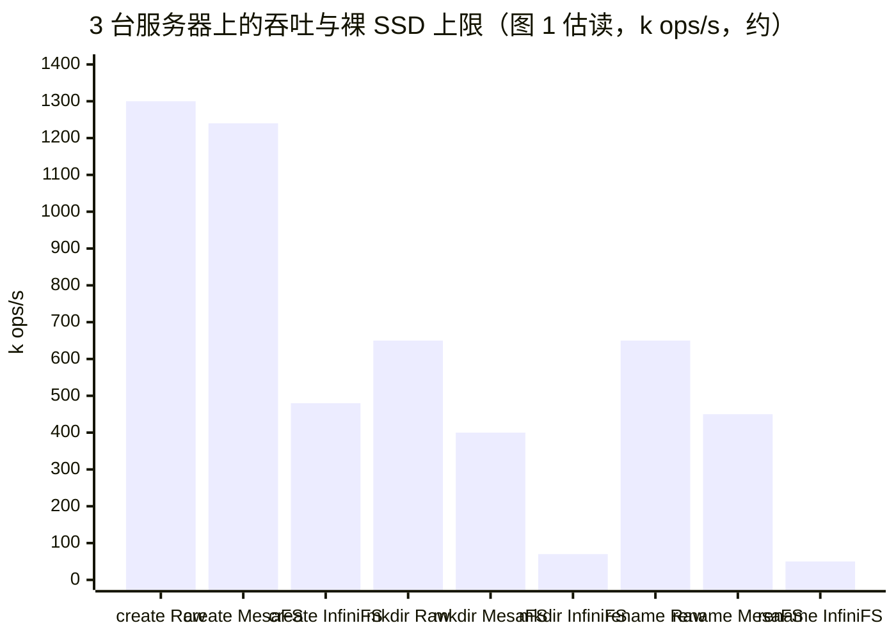

即使是经过大量优化、只涉及一台服务器的 create，也有 63% 的差距。

---

## 2. 性能拆解：额外写从哪里来

### 2.1 InfiniFS-emu 的延迟与吞吐拆解（论文 §2.2，图 2）

选择涉及多台服务器的目录 mkdir 和文件 rename（实验设置同 §4.3）：

| 指标 | mkdir | rename |
|------|-------|--------|
| 平均延迟 | 67.2 µs | 74.9 µs |
| 事务（日志、2PC）占比 | **38.7%** | **34.2%** |
| 有序 KV 存储占比 | **48.1%** | **43.1%** |
| 路径解析等其他 | 约 13.2% | **22.7%**（两者中的最大值） |
| 去掉日志（+NoJournal）后的吞吐提升 | **3.48×** | **5.77×** |
| 再把每台服务器的 KV 操作合并成一次同步 4 KB 写（Raw-SSD）的吞吐提升 | **2.53×** | **2.05×** |

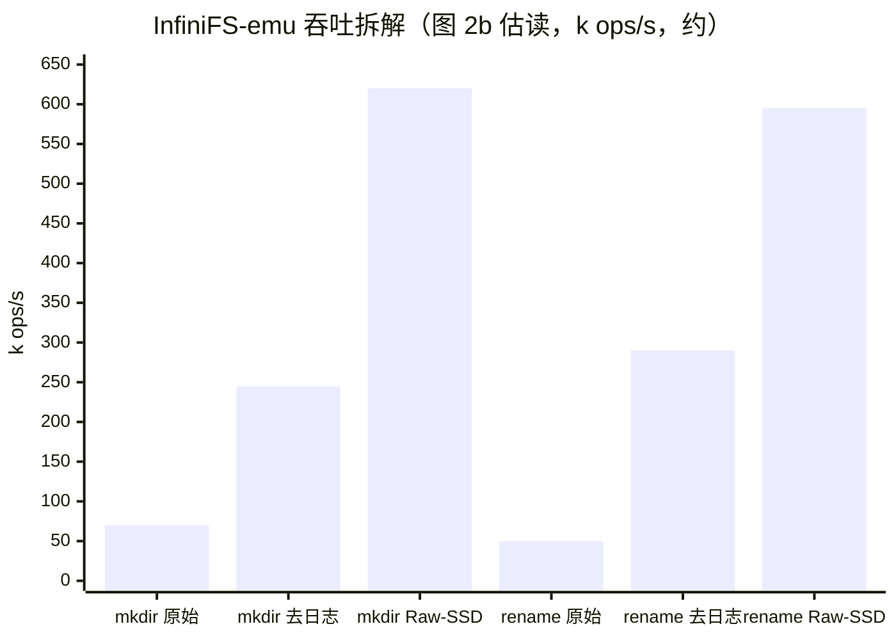

**两条结论**（论文 §2.2）：

1. **路径解析不是瓶颈**：即使目录树深 9 层，它最多只占 22.7%，因为大部分在客户端借助缓存完成；瓶颈是目标元数据处理，反映的是元数据存储的性能。
2. **分布式事务和有序布局带来额外的磁盘写**：尽管用了低延迟 InfiniBand 和高端 PCIe 4.0 SSD，持久化时日志仍有显著开销；有序 KV 为维护严格全序也有额外开销。

### 2.2 已有方案的局限（论文 §2.3）

| 问题 | 已有做法 | 局限 |
|------|---------|------|
| 拆分更新的崩溃一致 | 分布式事务 + 日志（Lustre、Octopus、InfiniFS、HopsFS、CFS、Ceph） | 日志与元数据**双写** |
| | 本地文件系统的 soft updates、backpointer（ReconFS 等） | 在分布式系统中不实用：soft updates 要按一致的顺序检查点，需要昂贵的跨服务器协调；backpointer 要跨服务器遍历才能验证一致性 |
| 布局有序 | 有序布局（B+ 树、LSM 树）：点查支持 create/stat，范围扫描支持 ls | 维护顺序有额外写：B+ 树重平衡、LSM 树合并 |
| | 无序布局（哈希表，如 F2FS、ext4） | 不支持范围扫描，要单独维护目录项（目录到子项的映射），一次更新要同时写元数据对象和目录项 |

---

## 3. MesaFS 总体设计

### 3.1 架构（论文 §3.1，图 3）

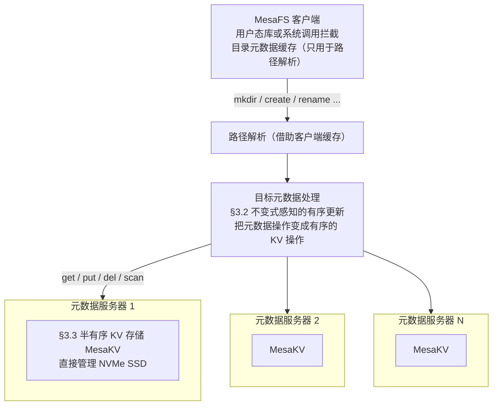

| 设计点 | 说明 |
|--------|------|
| 元数据与数据分离 | MesaFS 只做元数据服务（ID、名字、大小、权限、时间戳），可与对象存储或本地文件系统集成以管理文件内容和块映射 |
| 一致且持久的语义 | 与 InfiniFS、CFS 相同，**每个元数据更新返回客户端之前都已同步落盘**；不像 ext4 或 soft updates 那样缓冲后批量刷盘，因为分布式系统中按一致顺序检查点需要昂贵的跨服务器协调 |
| 元数据方案 | 每台服务器一个 KV 存储；文件元数据是一对 KV，键 (parent_ID, name)；ls 用 directory_ID 前缀扫描，从键中取文件名、从值中取 ID 和类型 |
| 目录元数据拆分 | 同 InfiniFS、CFS：**内容元数据**（与子项一起访问的字段：nlink、时间戳、子项数）以目录 ID 为键，与子文件元数据、子目录访问元数据放在一起；**访问元数据**（其余字段）以 (parent_ID, name) 为键。stat 目录要读两部分；路径解析或在父目录 ls 只读访问元数据 |
| 额外字段 | 每个文件和目录的访问元数据增加三个字段：**create time**、**delete time**、**backpointer**，用于崩溃恢复时修复不变式。backpointer 是**临时的**：只在 rename 期间为新元数据创建，完成后清除，只用于定位 rename 的旧源 |
| 扩展到多台服务器 | 同 InfiniFS、CFS：按键的前缀 ID 一致性哈希。一个目录的内容元数据、子文件元数据、子目录访问元数据键前缀相同（该目录的 ID），所以在同一台服务器上，文件元数据更新可在单台服务器内完成 |
| 并发控制 | 针对"无崩溃、低竞争"优化，采用简单的两阶段锁（§3.5），也可以换成更先进的协议 |

---

## 4. 不变式感知的有序更新

### 4.1 三类元数据更新（论文 §3.2.1）

| 类型 | 含义 | 操作 |
|------|------|------|
| Node Update | 更新单个已有节点 | truncate、utimens、chmod、chown、write |
| Node Insert / Delete | 插入或删除叶子节点，并更新其父节点 | mkdir、create、symlink、rmdir、unlink |
| Node Move | 把节点移到别处，并更新两个父节点 | rename |

### 4.2 两条不变式（论文 §3.2.1）

任何已提交的元数据更新最终都必须满足两条不变式（其他不变式，如目录树结构，由键编码的结构关系和锁机制隐式保证）：

**不变式 1：父子元数据依赖**。父目录的 **ctime 和 mtime 等于其所有子项 create time、delete time 的最大值**，父目录的链接数 **nlink 等于 2 加子目录数**。

- Node Insert / Delete 要更新目标和父目录两个对象；Node Move 还涉及新旧两个父目录。为维持这条不变式，它们要更新父目录的时间戳和子项数（POSIX 中的 ctime、mtime、nlink）。HDFS 中创建文件也要更新父目录的修改时间，语义相似。
- **挑战**：如果子项已持久化，而父目录的更新因崩溃丢失，父目录的 mtime、nlink 就过时了，违反不变式 1。传统系统用日志防止这种情况。

**不变式 2：ID 唯一**。每个目录或文件的元数据 ID 在目录树中唯一，元数据操作不会产生重复 ID。

- Node Insert 分配唯一 ID；Node Update、Node Delete 不产生新 ID；Node Move 不创建也不删除 ID。
- **挑战**：rename 把节点从源移到目标；如果创建目标后、删除源之前崩溃，两个有效的元数据对象会共享同一个 ID，违反不变式 2。

### 4.3 核心思路：先写事实来源，再写冗余状态（论文 §3.2.2）

不对每次拆分更新强制原子性，而是给涉及的元数据对象规定**持久化顺序**，保证：没有崩溃时不变式**最终**满足，崩溃后可以在恢复时**修复**。具体地，先持久化"事实来源"（如子项元数据），后持久化"冗余状态"（如父目录元数据）。这带来两点好处：

1. **去掉日志**：任何崩溃都只会以可检测、可修复的方式违反不变式；
2. **延迟持久化**：能由不变式恢复的更新可以安全地缓冲在内存中，减少同步 I/O。

前提：KV 存储中对**单个**元数据对象的更新是原子且崩溃一致的。正确性方面，内存缓存中始终强制满足不变式（论文 §1）。

### 4.4 各类更新的做法（论文 §3.2.2，图 4）

**Node Update**：直接原子地更新 KV 中的对象。

**Node Insert / Delete**（图 4a，以 mkdir(/A/C) 为例）：

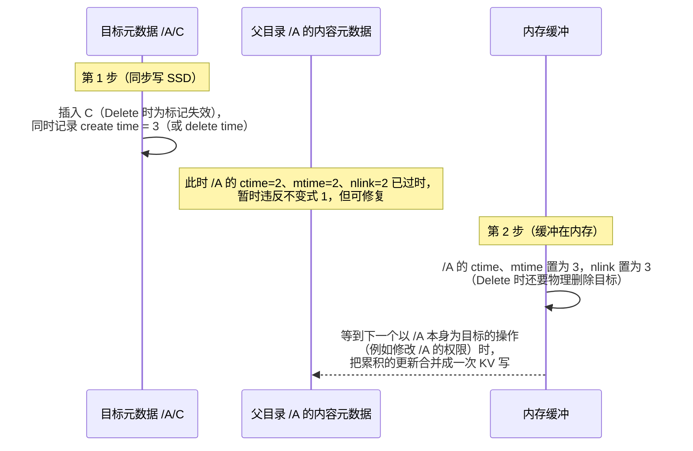

- 两步之间崩溃会暂时违反不变式 1，但可以修复：若 `/A` 的 ctime 小于其子项 create/delete time 的最大值，就把 `/A` 的 ctime、mtime 设为该值，并重新统计子项数和 nlink。更新 `/A` 是一次 KV 写，原子的。
- 第 2 步**延迟持久化**：缓冲期间，同一父目录上的多个更新（例如该目录下的多次 create、delete）在内存中**合并**；等到之后有以父目录本身为目标的操作时，把累积的状态合并成一次 KV 写。持久化之前崩溃，恢复程序用子项元数据修复父目录，并清除被标记为失效（之前已删除）的子项。
- 因为只有第 1 步需要立即同步持久化，**Node Insert / Delete 只需一次同步 KV 写**。

**Node Move（rename）**（图 4b，以 rename(/A/C, /B/D) 为例）：rename 期间允许**暂时违反不变式 2**，可检测、可修复。

1. 写入新元数据 D，**与旧元数据 C 使用同一个 ID**（图中 ID=4），记录 create time，并写入指向旧源的**临时 backpointer**；
2. 把旧元数据 C 标记为失效，记录 delete time；
3. 更新两个父目录。

| 崩溃时机 | 现象 | 修复 |
|---------|------|------|
| 第 1、2 步之间 | 两个有效对象共享同一 ID，违反不变式 2 | 恢复时只检查带 backpointer 的元数据；若被指向的旧元数据仍有效且 ID 相同，重做第 2、3 步 |
| 第 1–3 步期间 | 可能违反不变式 1 | 用与 Node Insert / Delete 相同的重算逻辑修复 |

- 第 1、2 步**按顺序同步持久化**；其余步骤（清除 backpointer、物理删除旧元数据、更新父目录）缓冲在内存中稍后持久化。所以 **Node Move 只需两次同步 KV 写**。
- **为什么第 2 步也要同步**：只同步第 1 步就足以保证正确，但会让恢复变复杂。例如连续执行 rename(/a,/b) 和 rename(/b,/c)，若第 2 步被缓冲，崩溃后 /a、/b、/c 在盘上都有效，形成 backpointer 链 /c → /b → /a，为保证幂等必须严格逆序恢复（先 /a 后 /b）。同步第 2 步后，一条 backpointer 链上最多只有两个有效对象，恢复只需单跳查找。

**硬链接**（图 5a）：沿用 TableFS 的做法，把硬链接文件变成两层：多个**索引节点**（H1、H2，键格式同普通元数据 (parent_ID, name)）和一个**元数据节点** D。为避免多个父目录造成的键歧义，元数据节点分配一个与路径无关的唯一键，存在索引节点中。解析 /A/D 需要两次查找：先用 (1, D) 取 H1，再用 H1 中 D 的唯一键取实际元数据。创建硬链接同样遵循有序更新：先为原元数据分配新的 KV，再把原元数据替换为索引节点；中间崩溃只会留下悬空元数据，由恢复时的垃圾回收处理。Node Update 直接操作元数据节点；Node Move 操作索引节点（图 5b），并为索引节点分配唯一 ID、create time 和 delete time。

**目录元数据拆分**：mkdir、rmdir 在访问元数据与内容元数据之间不是原子的。但内容元数据（时间戳、子项数）是冗余的，可以由访问元数据按不变式重算，所以 MesaFS 先更新访问元数据，再更新内容元数据。

**解读**：

- 这套方法与 [SingularFS](singularfs-atc2023.md) 的无日志有序更新、[HMFS](hmfs-socc2025.md) 的"状态位 + 时间戳 + 是否在父链表中"按需恢复同属一个家族，核心都是"**提交与否编码在对象本身**"。MesaFS 的新东西是"**父目录是可重算的冗余状态，可以缓冲**"，以及 rename 用"同 ID + 临时 backpointer"代替跨服务器 2PC。
- 不变式 1 把"父目录 mtime = 子项时间的最大值"当作定义，但 POSIX 允许用 utimens 把目录的 mtime 设成任意值（包括更早的时间）。若用户把目录 mtime 调早后又在其中创建文件并崩溃，恢复时 mtime 会被重算成子项时间。论文没有讨论这种情况；在实践中影响很小，但说明不变式 1 并不完全等同于 POSIX 语义。
- rename 的第 1、2 步可能在**两台不同的服务器**上（源目录和目标目录分属不同服务器），顺序写入而不做 2PC。崩溃恢复时检查 backpointer 要发起**跨服务器**查询（算法 3），论文认为 rename 很少，跨服务器流量低。

---

## 5. 半有序元数据布局与 MesaKV

### 5.1 设计原则（论文 §3.3.1）

POSIX 和 HDFS 的语义只在目录遍历（ls）时需要范围扫描，而 ls 只扫描**一个目录内**的元数据，不是任意范围。由此得到两条原则：

- **按目录分组**：元数据 KV 按目录分组，以高效支持 ls；
- **放宽顺序**：目录之间不强制全局顺序；目录内部保持一个**确定的**顺序，但不必是字母序。

### 5.2 MesaKV 两层结构（论文 §3.3.2，图 6）

MesaKV 建在块设备之上（裸 SSD，或用 O_DIRECT 打开的大文件），直接管理 SSD：

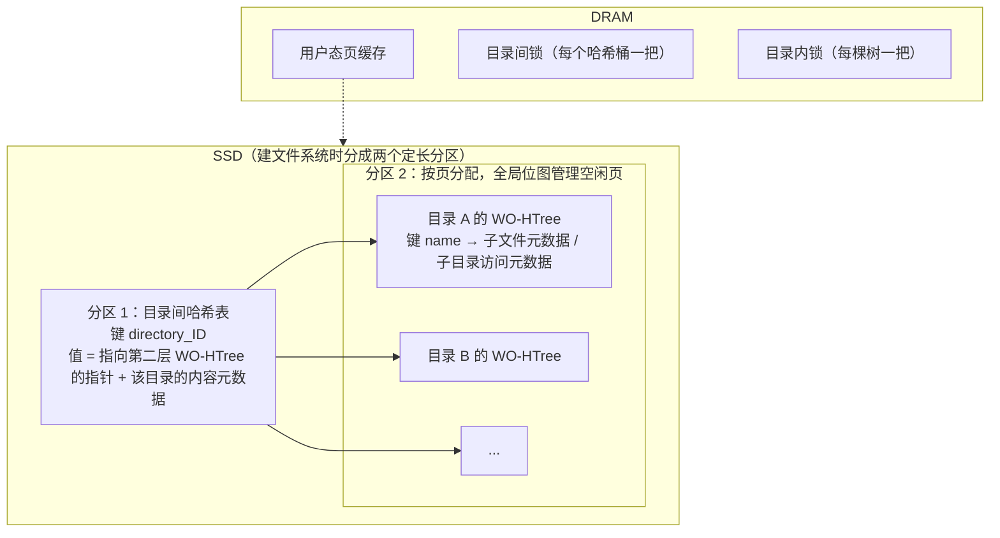

| 方面 | 说明 |
|------|------|
| 索引 | 文件元数据和目录访问元数据的键为 (parent_ID, name)，按 parent_ID 分片。查找时先用 parent_ID 在第一层哈希表中找到 WO-HTree，再用 name 在树中查找。目录内容元数据以 directory_ID 为键，直接存在第一层。硬链接文件使用特殊键，存放在目录树之外的一个**虚拟目录**中 |
| 点查与更新 | 找到 KV 后原地执行。键和值在同一页，大多数 KV 更新只需**一次磁盘写**；且是**原子的**，因为页大小通常等于 NVMe SSD 的掉电原子写单位（AWUPF）。节点分裂/合并的代价降为 O(1) 次磁盘写 |
| 目录扫描 | 在该目录的树中找到第一个键，然后依次遍历 KV，返回路径名等 |
| 并发 | 单个 KV 操作的并发安全由两阶段锁保证：目录间哈希表每个桶一把锁，目录内每棵树一把锁；先取桶锁再取树锁，保证活性 |

### 5.3 WO-HTree：O(1) 分裂（论文 §3.3.3，图 7）

**HTree 回顾**：HTree 是 ext3/ext4 目录索引使用的一种 B+ 树变体，用**哈希值**而不是完整键做索引，KV 按键的哈希序而非字母序排列，用哈希的最低位标记和处理冲突。叶子节点存若干有序 KV；内部节点存若干 (h, page_no)，h 是该页哈希值的下界（类似 B+ 树的 fence key）。查找时计算键的哈希 h，沿内部节点找到叶子，再与该哈希的所有条目逐一比较键。

**写优化**：标准 B+ 树和 HTree 在 put/delete 时要分裂、合并，最坏情况分裂一直传到根，写开销 O(log N)。作者观察到 HTree 的键是哈希值，**随机分布**；已有理论证明，键随机分布的二叉搜索树即使不做重平衡，期望高度也是 O(log N)，方差 O(1)，几乎不会退化成链表，多路搜索树同样如此。因此 WO-HTree **不做递归分裂**，最坏写开销从 O(log N) 降为 O(1)：

| 情况 | B+ 树 / HTree | WO-HTree |
|------|--------------|----------|
| (a) 父内部节点未满 | 叶子分裂为两个，父节点链接新叶子 | 相同 |
| (b) 父内部节点已满 | 父节点继续分裂，可能一直传到根，O(log N) 次写 | 叶子分裂为两个新叶子后，**直接把原叶子替换成一个新的内部节点**，两个新叶子挂在它下面；不动父节点，O(1) 次写 |

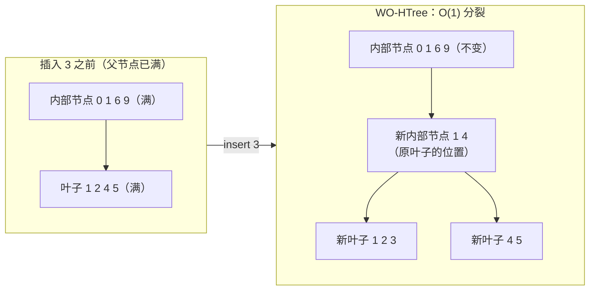

- **缓存**：WO-HTree 的写是 O(1)，但遍历仍是 O(log N)，用缓存很容易抵消。MesaKV 采用粗粒度的页缓存，也可以换成更细粒度的（如每 KV 缓存）。
- **SSD 写次数分析**：叶子未满时 1 次写；叶子满时 3 次（2 个新叶子 + 1 个新内部节点）。MesaFS 中一个叶子有 10 个条目，分裂后半满（5 个空位），所以每次分裂摊到后续 5 次插入：平均 **80% × 1 + 20% × 3 = 1.4 次**写，**80%** 的更新只需 1 次写。
- **合并**：原型中的合并比 B+ 树更"懒"：只有目标节点**完全变空**才合并，而 B+ 树在节点与兄弟都半空时就合并（这导致小目录时 delete 吞吐下降，见 §8.4）。

**解读**：WO-HTree 的关键在于"用哈希的随机性代替重平衡"。它和 [HMFS](hmfs-socc2025.md) 用哈希表代替有序树是同一个方向，区别在于 HMFS 是 PM 上的扁平哈希表加链表，MesaFS 在 SSD 上需要按页组织，所以保留了一棵"不需要平衡的 HTree"，让目录遍历仍是顺序读页。另一个值得注意的点是**一页一次原子写**：利用 NVMe 的 AWUPF，把"单对象原子更新"的前提从软件（日志）转交给硬件。若 SSD 的 AWUPF 小于 4 KB，这个前提就不成立，论文没有讨论这种情况。

---

## 6. 端到端：每种操作写几次 SSD

论文 §3.4（假设根目录 ID 为 0）：

| 操作 | 同步写入 SSD 的步骤 | 缓冲在内存的步骤 | 同步 SSD 写次数 |
|------|-------------------|----------------|----------------|
| write(/f1) | 查找键 (0, f1)，原地更新 size 和 mtime | — | **1** |
| create(/f1) | 插入键 (0, f1) | 更新父目录内容元数据（键 0）的 ctime、mtime | **1** |
| delete(/f1) | 把 (0, f1) 标记为失效并写入 delete time | 更新父目录的 ctime、mtime；物理删除 (0, f1) | **1** |
| rename(/f1, /f2) | ① 插入 (0, f2)，与 /f1 同 ID，带指向 /f1 的 backpointer；② 把 (0, f1) 标记失效并写 delete time | 更新父目录时间戳；物理删除 (0, f1) | **2** |
| mkdir(/A) | ① 插入 (0, A) 访问元数据；② 插入键 1（/A 的 ID）的内容元数据，实现中需 1 或 2 次写 | 更新父目录的 ctime、mtime，nlink 加 1 | **2 或 3** |
| rename(/A, /B) 目录 | 与文件 rename 相同：插入新访问元数据、标记旧的失效 | 更新父目录；新父目录 nlink 加 1，旧父目录减 1 | **2** |

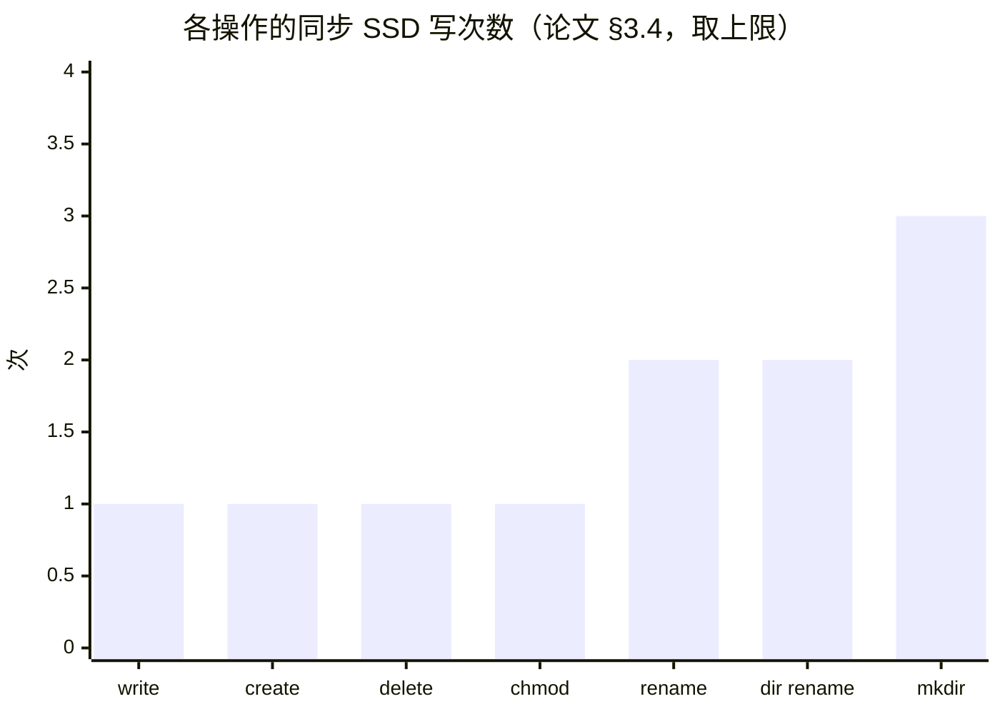

（chmod 属于 Node Update，一次写，见论文 §4.6。）

**解读**：create/delete 只写一次、rename 写两次，是"有序更新"与"半有序布局"相乘的结果：前者把操作变成最少次数的 KV 写，后者把每次 KV 写变成通常一次的页写。真实负载中超过 95% 的元数据更新是 create、delete、write 这类（论文引 InfiniFS、CFS），所以"大多数更新只写一次 SSD"的说法成立。

---

## 7. 并发控制、崩溃恢复与客户端缓存

### 7.1 并发控制（论文 §3.5）

- 用锁保证正常运行时其他线程**看不到**暂时被破坏的不变式。
- Node Insert / Delete（create、mkdir）锁住目标元数据和父目录内容元数据；二者在同一棵 WO-HTree 中，实现上为简单起见用**一把锁**。
- 文件 rename 在逻辑上等于创建一个文件再删除另一个，锁住新旧元数据及其父目录的内容元数据。为避免死锁，按**服务器 ID 和锁表索引**的确定顺序加锁。
- **目录 rename**：并发目录 rename 可能产生孤儿环（例如同时把 /A 移进 /C/D、把 /C 移进 /A/B），导致元数据不可达。MesaFS 像 CFS 一样**集中执行**：所有目录 rename 都发给**服务器 0**；执行前把涉及子树的前缀**广播**给所有元数据服务器加子树锁，冲突的并发目录 rename 被阻塞。这会限制冲突目录 rename 的并发度，但这类操作在真实负载中很少。

### 7.2 正常关机（论文 §3.5）

正常关机前，等所有在途操作完成，再按一致的顺序把内存中缓冲的元数据更新持久化。与 KVell 这类日志结构 KV 不同，MesaFS 的盘上布局是结构化的，重启时**不需要扫描磁盘**。

### 7.3 崩溃恢复（论文 §3.5，算法 1–3）

崩溃可能丢失未完成的更新（例如只插入了新元数据、尚未把旧元数据标记失效的 rename）和内存中缓冲的更新。MesaFS 扫描元数据 KV 修复两条不变式：

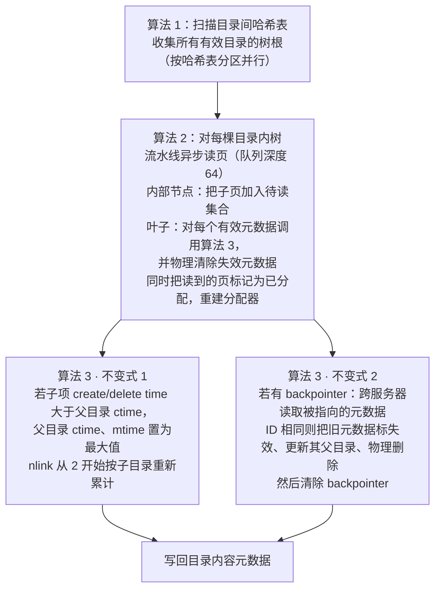

- 由于同一目录的元数据都在同一台服务器上，不变式 1 的检查是**本地**的，不需要网络；也不需要递归检查祖父目录，因为 MesaFS 总是先持久化子项更新，再缓冲父目录更新。
- 不变式 2 的检查要跨服务器通信，但 rename 很少，流量低。
- **恢复是幂等的**：恢复过程中再崩溃也能正确处理。不变式 1 的重算结果相同；不变式 2 的重做流程与正常 rename 一样，再次崩溃时的不一致也能同样检测出来。
- **理论速度**：先遍历目录间哈希表，再并行遍历目录内树。哈希表紧凑、内部节点扇出约 200，读开销可忽略；主要开销在叶子：每个 4 KB 页含 5（分裂后半满）到 10（满）个元数据项。在随机读 100 万 IOPS 的 SSD 上，可达 **500 万–1000 万文件/s**。实测 **518 万文件/s**（论文 §4.7）。

**SSD 块分配**：目录间哈希表定长，只有目录内树需要动态分配。MesaFS 用内存中的**伙伴分配器**，正常关机前检查点到 SSD；崩溃后在同一次全盘扫描中重建：扫描哈希表找到有效的树根，遍历每棵树把所有块标记为已分配。

**解读**：这里与 HMFS 的差别最大。HMFS 的不一致对象在**被访问时**才修复，服务 65.7 ms 内就恢复；MesaFS 必须在恢复时**扫描所有元数据**，因为父目录更新是批量缓冲的，崩溃后无法知道哪些目录的状态过时了。按 518 万文件/s 估算，1 亿文件约 19 秒，10 亿文件的服务器约 3 分钟。论文没有说明扫描期间服务是否可用；从算法看，修复完成前父目录元数据可能不正确，服务应在扫描完成后才开放。

### 7.4 客户端元数据缓存（论文 §3.6）

- 与 InfiniFS、IndexFS 相同，客户端只缓存**目录**元数据，用于加速查找；为保证一致性，客户端**总是**从服务器获取最终的目标元数据，不论是否命中缓存。
- **基于版本号的惰性失效**：元数据服务器维护一个全局版本号，只在目录 rename 和 set_permission 时递增；客户端维护本地版本号。获取目标元数据时客户端带上本地版本号，与服务器的不一致时请求被拒绝，客户端清空缓存，从根重新解析。

---

## 8. 评估

### 8.1 实验环境（论文 §4.1）

| 项目 | 配置 |
|------|------|
| 集群 | 最多 3 台服务器节点、3 台客户端节点。服务器：2 颗 28 核 Xeon Gold 6330，1 块 3.84 TB 三星 PM9A3 SSD；客户端：2 颗 36 核 Xeon Platinum 8360Y。所有节点 512 GB DRAM、ConnectX-6 200 Gb/s RDMA 网卡、QM8790 200 Gb/s 交换机，Ubuntu 22.04（内核 5.15.0），MLNX_OFED 5.8-3.0.7.0 |
| 对比系统 | **InfiniFS-emu**：作者在自己的框架中仿真 InfiniFS（未开源）的核心设计，元数据存储为 RocksDB，用日志 + 2PC 实现分布式事务，利用 RocksDB 的本地事务；**InfiniFS-tree**：把 RocksDB 换成盘上 B+ 树（Tkrzw）；**InfiniFS-sync**：与 MesaFS 同样的持久性，每次更新后同步 WAL；**CephFS** 17.2.6（BlueStore）；**ext4**：在磁盘上建 ext4，客户端通过 RDMA 访问，作为强单机基线，不能扩展到多台服务器 |
| 持久性差异 | **InfiniFS-emu 和 InfiniFS-tree 不会立即同步元数据更新**，可能丢失更新；MesaFS、InfiniFS-sync 每次同步 |
| 实现 | MesaFS 用 io_uring 发起磁盘 I/O；ext4、InfiniFS-emu、MesaFS 使用同一 RPC 框架并启用 RDMA |
| 负载 | mdtest 3.3.0（IOR），OpenMPI 4.1.5a1；用 syscall_intercept 拦截 POSIX 调用或直接使用客户端库；与已有工作一样创建**零长度文件** |

### 8.2 单服务器吞吐（论文 §4.2.1，图 8）

1 台元数据服务器、56 个服务线程；每个客户端线程操作 10 万个私有文件，均匀分布在深 9 层的目录树中。

| 操作 | MesaFS | ext4 | InfiniFS-emu | InfiniFS-tree | InfiniFS-sync | CephFS |
|------|--------|------|-------------|--------------|--------------|--------|
| mkdir | 约 150 | 约 100 | 约 95 | 约 40 | 约 20 | 约 5 |
| rmdir | 约 170 | 约 130 | 约 135 | 约 40 | 约 20 | 约 5 |
| create | 约 510 | 约 290 | 约 165 | 约 100 | 约 30 | 约 10 |
| delete | 约 520 | 约 190 | 约 270 | 约 80 | 约 20 | 约 10 |
| stat | 约 9,600 | 约 8,900 | 约 620 | 约 170 | 约 600 | 约 20 |

（k ops/s，图 8 估读；纵轴在 1M 处断开，stat 等超过 1M 的数值误差较大。）

- **文件更新**：create 至少高 **1.75×**，delete 至少高 **1.93×**。InfiniFS 变体对所有元数据维护全序，MesaFS 用放宽的顺序减少磁盘 I/O；ext4 和 CephFS 要更新单独的目录项，MesaFS 没有这份冗余；MesaFS 还用有序更新去掉了日志写。
- **文件读**：stat 是 ext4 的 **1.08×**，比其他系统至少高 **15.43×**。大多数读由缓存处理：MesaFS 的用户态页缓存、ext4 的 VFS 缓存、RocksDB 和 B+ 树的内核页缓存；MesaFS 的缓存效率与 ext4 相近。
- **目录操作**：吞吐约为文件操作的一半，但 mkdir、rmdir 仍至少高 **1.46×、1.25×**。mkdir、rmdir 除了更新目标目录元数据，还要分配或释放对应的目录内树，需 2–3 次磁盘写。目录 stat 比 ext4 差，因为 MesaFS 要读两个对象（访问 + 内容元数据），ext4 只读一个。
- **CephFS** 的元数据更新吞吐只有约 **1 万 ops/s**，与已有研究一致；它的瓶颈在沉重的软件栈，而不是拆分更新和布局有序。InfiniFS-emu 和 MesaFS 的软件栈轻量，才暴露出本文要解决的顺序问题。

### 8.3 单服务器延迟（论文 §4.2.2，图 9）

单个客户端线程，操作深 11 层目录树中的 100 万个文件（目录操作较少，略去）。

| 操作 | MesaFS | ext4 | InfiniFS-emu | InfiniFS-tree | InfiniFS-sync | CephFS |
|------|--------|------|-------------|--------------|--------------|--------|
| create 平均 | 约 25 | 约 12 | 约 35 | 约 18 | 约 160 | > 1,000 |
| stat 平均 | 约 12 | 约 8 | 约 18 | 约 18 | 约 18 | > 1,000 |
| delete 平均 | 约 22 | 约 12 | 约 33 | 约 18 | 约 155 | > 1,000 |

（µs，图 9a 估读，约。）

- **平均延迟**：create、delete 上 MesaFS 比 InfiniFS-emu、InfiniFS-sync、CephFS 至少快 **1.32×**（即不超过 InfiniFS-emu 的 75.8%）：大多数更新只需一次磁盘写，得益于 WO-HTree 和延迟持久化。但 MesaFS 比 InfiniFS-tree 和 ext4 慢：后两者把更新缓冲在内存中（日志或缓冲日志），延迟反映的是内存操作；MesaFS 同步写盘，持久性更强。stat 上 MesaFS 只输给 ext4：用户态页缓存比 InfiniFS 系列的内核页缓存开销低，但按页复制的粒度粗，不如 ext4 的细粒度 VFS 缓存。
- **P99 延迟**：除 ext4 外，MesaFS 在 create、delete 上至少好 **1.15×、1.47×**。尾延迟反映同步更新缓冲和维护数据结构的时间；MesaFS 始终同步，波动小，P99 只是平均值的 **1.66×（create）、1.42×（delete）**。其他系统（除 ext4）无法把同步过程与前台操作重叠，尾延迟高得多。ext4 的 JBD2 允许运行中的事务与已提交的事务并行，同步能与前台缓冲操作重叠，延迟约为 MesaFS 的一半。

### 8.4 多服务器（论文 §4.3，图 10）

3 台元数据服务器，足够多的客户端；create、mkdir、rmdir 用深 9 层的目录树，rename 用深 3 层的浅树；每个客户端在私有目录中操作 10 万个文件。Raw-SSD 为每个涉及的服务器一次同步 SSD 写；create 在 MesaFS 和 InfiniFS-emu 中只涉及一台服务器，其余操作涉及两台。

| 操作 | Raw-SSD | MesaFS | InfiniFS-emu | InfiniFS-tree | CephFS |
|------|---------|--------|-------------|--------------|--------|
| create | 约 1,300 | 约 1,240 | 约 480 | 约 350 | 约 5 |
| mkdir | 约 650 | 约 400 | 约 70 | 约 100 | 约 5 |
| rmdir | 约 650 | 约 400 | 约 90 | 约 90 | 约 5 |
| rename | 约 650 | 约 450 | 约 50 | 约 120 | 约 5 |

（k ops/s，图 10 估读，约。）

1. **create 两者都扩展良好**：MesaFS 比 InfiniFS-emu 高 **2.55×**。两者都用拆分的目录元数据保证局部性，create 是单节点操作，不需要分布式协调。
2. **mkdir、rmdir、rename 上 MesaFS 扩展得更好**：至少高 **3.90×、4.67×、3.58×**，比单服务器时的优势（1.55×、1.25×、1.59×）更大。MesaFS 把元数据更新变成有序的 KV 更新，其他系统需要分布式事务，比单服务器上的本地事务更贵。
3. **弥合与裸 SSD 的差距**：create 达到 Raw-SSD 的 **95.1%**，涉及多台服务器的操作至少 **62.0%**，说明大多数元数据更新（超过 95%）只需一次 SSD 写；其他操作需要 2–3 次。

### 8.5 大目录（论文 §4.4，图 11）

112 个客户端线程，每个在私有目录中先分批（每批 10 万）创建共 200 万个文件，再分批删除；记录每批吞吐。

- **create 平稳**：MesaFS 约 43 万 ops/s 不随目录增大而下降（约）。所有元数据操作都被有序更新变成非事务 KV 操作，目录内 KV 操作经 WO-HTree 变成 O(1) 次磁盘写。
- **delete** 在大目录中平稳，但目录变小时吞吐下降约一半（约从 49 万降到约 28 万，约）。原因是 WO-HTree 的懒合并：只有节点完全变空才合并，删除接近尾声时大多数叶子只剩少量元素，合并集中在这一阶段发生。
- **基线**：InfiniFS-emu 波动剧烈（约 0–30 万 ops/s），这是 LSM 树合并（compaction）挤占前台带宽的固有问题；ext4 和 InfiniFS-tree 都偏低，它们用事务保证一致，目录项和全序维护又增加开销。CephFS、InfiniFS-sync 在大规模下性能很差，略去。

### 8.6 分项分析（论文 §4.5，图 12）

在 MesaFS 上实现 **Baseline**：后端换成全序的 RocksDB，用带同步 WAL 的事务保证一致性；然后逐项加入设计。吞吐用 112 个客户端线程、每个线程在私有目录中操作 10 万个文件；延迟用 1 个客户端线程、私有目录中 100 万个文件。这里用大目录而不是目录树，以突出 WO-HTree 的作用。

| 配置 | create 吞吐（约） | delete 吞吐（约） | create 平均 / P99 延迟（约） | delete 平均 / P99 延迟（约） | 论文给出的变化 |
|------|----------------|----------------|--------------------------|--------------------------|--------------|
| Baseline | 约 15k | 约 15k | 约 162 / 235 µs | 约 155 / 220 µs | 严格顺序与事务开销导致吞吐低、延迟高 |
| +Layout（换成 MesaKV，仍用事务） | 约 135k | 约 145k | 约 60 / 113 µs | 约 57 / 72 µs | 吞吐至少 **9.0×**；平均、P99 延迟降到 Baseline 的 **37.5%、48.0%** 以下。部分提升来自 io_uring，放宽顺序也让变长键能用更高效的数据结构 |
| +Update（有序更新代替事务，不延迟持久化） | 约 195k | 约 220k | 约 43 / 92 µs | 约 38 / 55 µs | 吞吐再至少 **1.44×**；延迟降到 **82.1%、71.5%** 以下。去掉了拆分更新的日志写 |
| +Delay（父目录延迟持久化） | 约 335k | 约 415k | 约 26 / 68 µs | 约 22 / 37 µs | 吞吐再至少 **1.71×**；延迟降到 **75.6%、60.6%** 以下。大目录中父目录更新得以合并，磁盘写从两次（父 + 目标）降为一次 |

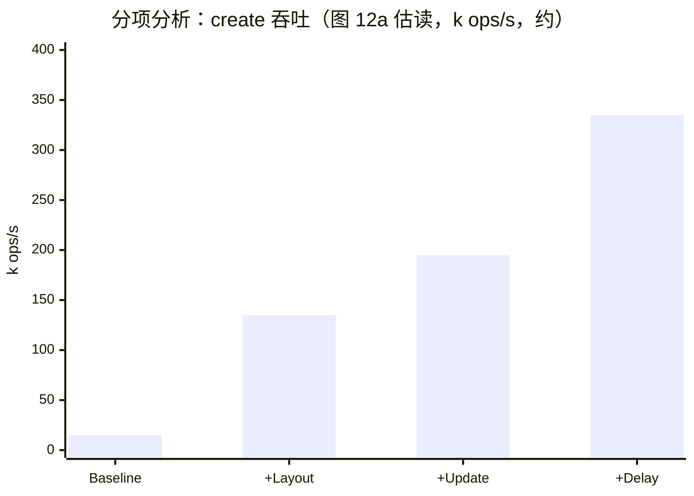

### 8.7 其他元数据操作（论文 §4.6，图 13）

单服务器；吞吐用 112 个客户端线程、各 10 万个文件，延迟用 1 个线程、100 万个文件；文件分布在深 3 层的浅目录树中。

| 操作 | MesaFS | ext4 | InfiniFS-emu | InfiniFS-tree |
|------|--------|------|-------------|--------------|
| chmod 吞吐（k ops/s，约） | 约 530 | 约 1,000 | 约 270 | 约 170 |
| rename 吞吐（k ops/s，约） | 约 205 | 约 110 | 约 130 | 约 80 |
| chmod 延迟（µs，约） | 约 21 | 约 8 | 约 14 | 约 6 |
| rename 延迟（µs，约） | 约 55 | 约 18 | 约 32 | 约 11 |

- **rename 吞吐**至少高 **1.59×**：有序更新和延迟持久化让 rename 只需两次有序 KV 更新，半有序布局又让它们变成约两次磁盘写；其他系统需要日志和全序维护。
- **chmod**：比 InfiniFS-emu、InfiniFS-tree 快 **1.97×**，但只有 ext4 的 **0.52×**。MesaFS 中 chmod 和 create 一样需要一次磁盘写（得益于延迟持久化），没有更低的代价；而 ext4 的 chmod 只记录一个元数据对象，create 要两个。
- **延迟**：两种操作 MesaFS 都比对手高，因为 MesaFS 同步落盘（chmod 一次写，rename 两次有序写）；单服务器下其他系统可以用本地事务把更新缓冲在内存中。

### 8.8 崩溃恢复（论文 §4.7）

每台元数据服务器 1,000 万到 1 亿文件：恢复吞吐 **446 万文件/s**（1,000 万文件）、**518 万文件/s**（1 亿文件），接近 §3.5 的理论分析，说明恢复高度并行、充分利用了 SSD 带宽。

---

## 9. 论文中的不一致与可疑之处

| 位置 | 问题 | 判断 |
|------|------|------|
| §1 与 §4.2.1 | 引言说单服务器上 MesaFS 吞吐"最高为 ext4 / InfiniFS-emu 的 **1.93× / 3.14×**"。§4.2.1 的 1.93× 是 delete 相对**所有其他系统中最好者**（图 8 中为 InfiniFS-emu）的下限；按图 8 估读，delete 对 ext4 约 2.7×（约），create 对 InfiniFS-emu 约 3.1×。3.14× 在 §4.2.1 正文中没有出现，§4.3 却说"与 §4.2.1 的 3.14× 相近" | 引言把"相对最好对手的下限"写成了"相对 ext4 的上限"，归属不清 |
| §4.2.1 与 §4.3 | mkdir 的单服务器优势：§4.2.1 写"至少 **1.46×**"，§4.3 回引单服务器结果时写 **1.55×**（rmdir 1.25×、rename 1.59× 两处一致） | mkdir 数字前后不一 |
| §1 | 引言说多服务器上吞吐"最高为 InfiniFS 的 **8.29×**"，§4.3 正文只给出"至少 3.90×/4.67×/3.58×"，没有 8.29×。按图 10 估读，rename 对 InfiniFS-emu 约 9×（约），可能是其来源 | 摘要式数字在正文中没有对应 |
| §1 与 §3.5 | WO-HTree 的扇出：引言说"例如 **250**"，§3.5 说"约 **200**" | 小问题 |
| 图 1 与图 10 | 图 1 说 create、mkdir、rmdir 在元数据存储中需 2 次写，rename 需 4 次；图 10 的 Raw-SSD 定义为"每个涉及的服务器一次同步写"，rename 与 mkdir 的 Raw-SSD 高度相同 | 两种 Raw-SSD 口径都合理，但 rename 的"4 次写"在 Raw-SSD 中被合并为每台服务器 1 次，说明 Raw-SSD 是很宽松的上限 |
| §4.1 | InfiniFS-emu、InfiniFS-tree **不立即同步**元数据更新，持久性弱于 MesaFS；与 MesaFS 持久性相同的 InfiniFS-sync 在多数实验中因"性能太差"被略去 | 吞吐对比中 MesaFS 已在持久性上让步给对手，结论对 MesaFS 更保守；但延迟对比中 MesaFS 输给 ext4、InfiniFS-tree 也因此可以理解 |
| §4.1 | 所有实验创建**零长度文件**，没有数据路径；最多 3 台元数据服务器 | 多服务器结论只到 3 台，没有更大规模的扩展实验 |
| §3.2.1 | 不变式 1 把"父目录 ctime/mtime = 子项时间最大值"作为定义，但 POSIX 允许用 utimens 任意设置目录 mtime | 崩溃恢复可能覆盖用户显式设置的目录 mtime，论文没有讨论 |
| §3.5、§4.7 | 崩溃恢复需要全盘扫描（518 万文件/s），论文没有说明扫描期间服务是否可用 | 1 亿文件约 19 秒、10 亿文件约 3 分钟；与 HMFS 的按需恢复相比是明显代价 |
| §3.3.2 | 单页更新的原子性依赖"页大小通常等于 NVMe SSD 的 AWUPF" | 若所用 SSD 的 AWUPF 小于页大小，前提不成立；论文只引用了 PM9A3，没有给出回退方案 |
| 全文 | 没有独立的相关工作章节，对 HMFS、SingularFS 等同组工作，以及 LocoFS、CFS 等的对比只零散出现 | 读者难以判断与同组 PM 方案（HMFS）的关系 |

---

## 10. 与本仓库中其他系统的对照

| 系统 | 介质 | 元数据索引 | 目录遍历 | 崩溃一致 | 恢复方式 |
|------|------|-----------|---------|---------|---------|
| **MesaFS** | NVMe SSD | 目录间哈希表 + 目录内 WO-HTree（哈希序） | 遍历该目录的 WO-HTree | 有序同步写 + 父目录延迟持久化 + 临时 backpointer，单页原子写 | 全盘扫描修复不变式，518 万文件/s |
| [HMFS](hmfs-socc2025.md) | PM | 每服务器一个 PM 哈希表 | 目录内单链表 | 8/16 字节原子写 + 有序写 | 按需恢复，65.7 ms 恢复服务 |
| [SingularFS](singularfs-atc2023.md) | PM | PM 有序树（P-Masstree） | 有序范围扫描 | 无日志有序更新 + 时间戳 | 启动时检测 |
| [InfiniFS](infinifs-fast2022/deep-read.md) | SSD（RocksDB） | 有序 LSM | 范围查询 | 本地事务 + 跨服务器 2PC | RocksDB 日志重放 |
| [CFS](cfs-eurosys2023.md) | SSD（TafDB、RocksDB） | 有序（范围分区）+ 哈希 | 范围查询 | 单分片原语，跨层不做 2PC | 数据库与 GC |
| [FalconFS](falconfs-nsdi2026.md) | SSD（PostgreSQL） | B-link 树 | 数据库查询 | 数据库事务 + 请求合并（合并 WAL 写） | WAL 重放 |
| [3FS](3fs-fireflyer-sc2024.md) | SSD（FoundationDB） | 有序 KV | 范围查询 | FoundationDB 事务 | 数据库 |

**解读**：

- **清华存储组近年的元数据路线**：[InfiniFS](infinifs-fast2022/deep-read.md)（分区与路径解析）→ [SingularFS](singularfs-atc2023.md)（单机 PM、无日志）→ [HMFS](hmfs-socc2025.md)（PM、哈希 + 链表）与 MesaFS（SSD、哈希 + WO-HTree）。后两者的共同判断是：**ls 只需"目录内可遍历"，不需要全局有序**；共同手段是：**把提交状态编码进对象（时间戳、状态位、backpointer），以有序写代替日志**。
- **介质决定数据结构**：PM 字节可寻址，链表的随机读代价小，HMFS 用链表；SSD 以页为单位，需要把同一目录的条目聚在同一页里，MesaFS 用 HTree。二者都避免了 B+ 树的重平衡和 LSM 树的合并。
- **对工业系统的启发**：3FS、CFS、FalconFS 等都把元数据放在通用事务数据库或有序 KV 上，每次 create 至少要写 WAL 和数据页。MesaFS 的分项分析（图 12）表明，换成"按目录分组的存储 + 无日志有序更新 + 父目录延迟持久化"，单服务器 create 吞吐可提升一个数量级以上（约 15k → 335k）。即使不自研存储引擎，"父目录 mtime/nlink 是冗余状态，可以批量合并写"这一点也值得借鉴，FalconFS 的请求合并与之思路相近。

---

## 11. 整体总结

### 11.1 核心贡献

1. **重新定位瓶颈**：客户端缓存解决路径解析后，元数据存储成为新瓶颈；InfiniFS 仿真在 3 台服务器上只达到裸 SSD 的 8.4%–37.2%，额外写来自拆分更新的崩溃一致（日志）和布局有序（重平衡、合并）（论文 §1、§2）。
2. **不变式感知的有序更新**：形式化"父子依赖"和"ID 唯一"两条不变式，按"先事实来源、后冗余状态"的顺序持久化，去掉日志；父目录更新缓冲合并；rename 用同 ID + 临时 backpointer 代替 2PC。create/delete 只需 1 次同步 KV 写，rename 2 次（论文 §3.2）。
3. **半有序元数据布局**：按目录分组、目录间不排序、目录内按哈希序；WO-HTree 利用哈希随机性实现 O(1) 分裂，80% 的更新 1 次写、平均 1.4 次（论文 §3.3）。
4. **评估**：单服务器 create/delete 至少 1.75×/1.93×；3 台服务器的分布式操作至少 3.58×–4.67×；create 达裸 SSD 的 95.1%，其他操作至少 62.0%；恢复 518 万文件/s（论文 §4）。

### 11.2 设计哲学

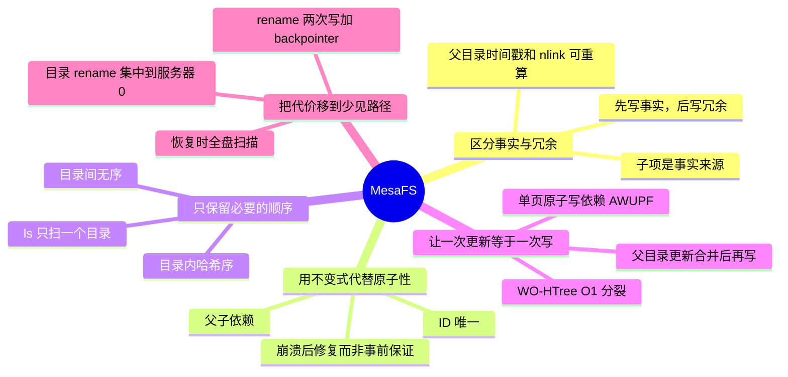

### 11.3 优点与局限

| 优点 | 局限 |
|------|------|
| 大多数更新只写一次 SSD，create 达裸 SSD 的 95.1% | 崩溃后需全盘扫描修复（1 亿文件约 19 秒），恢复期间可用性未说明 |
| 无需日志与 2PC 即可保证拆分更新与跨服务器 rename 的崩溃一致 | 依赖 SSD 的掉电原子写单位不小于页大小 |
| 每次更新同步落盘，持久性强于多数基线，尾延迟稳定（P99 只是平均的 1.4–1.7 倍） | 单线程延迟高于把更新缓冲在内存的 ext4、InfiniFS-tree |
| 大目录中 create 吞吐不随目录增大下降，没有 LSM 合并导致的波动 | 懒合并让目录变小时 delete 吞吐下降约一半 |
| 设计与介质匹配：页内聚集、哈希序、O(1) 分裂 | 只测到 3 台服务器、零长度文件；目录 rename 集中在服务器 0；多处摘要数字在正文中找不到出处 |

### 11.4 启示

1. **先问"哪些状态是冗余的"**。父目录的 mtime、nlink 可以由子项推出，就不必和子项原子更新，可以缓冲、合并、事后修复。很多系统的日志其实是在保护本可重算的冗余状态。
2. **把"可恢复"作为一致性的目标，而不是"每一步原子"**。用不变式描述正确状态，安排写入顺序让任何崩溃都只造成可检测、可修复的违反，就能去掉大部分日志。这一思路从本地文件系统的 soft updates 一路延续到 SingularFS、HMFS 和 MesaFS。
3. **只维护语义真正需要的顺序**。POSIX 的 ls 只要求"目录内能遍历"，不要求全局有序，也不要求字母序。按目录分组、目录内哈希序，可以同时避免 B+ 树重平衡和 LSM 合并。
4. **利用硬件提供的原子性**。NVMe 的 AWUPF、PM 的 16 字节原子写，都可以替代软件层的日志；前提是数据结构让"一次逻辑更新"落在"一个原子单元"内。
5. **恢复时间是被转移的成本**。MesaFS 把运行时的写省下来，代价是崩溃后的全盘扫描；HMFS 则选择按需恢复。选型时要同时评估正常吞吐和故障恢复时间。

### 11.5 一张图看懂 MesaFS

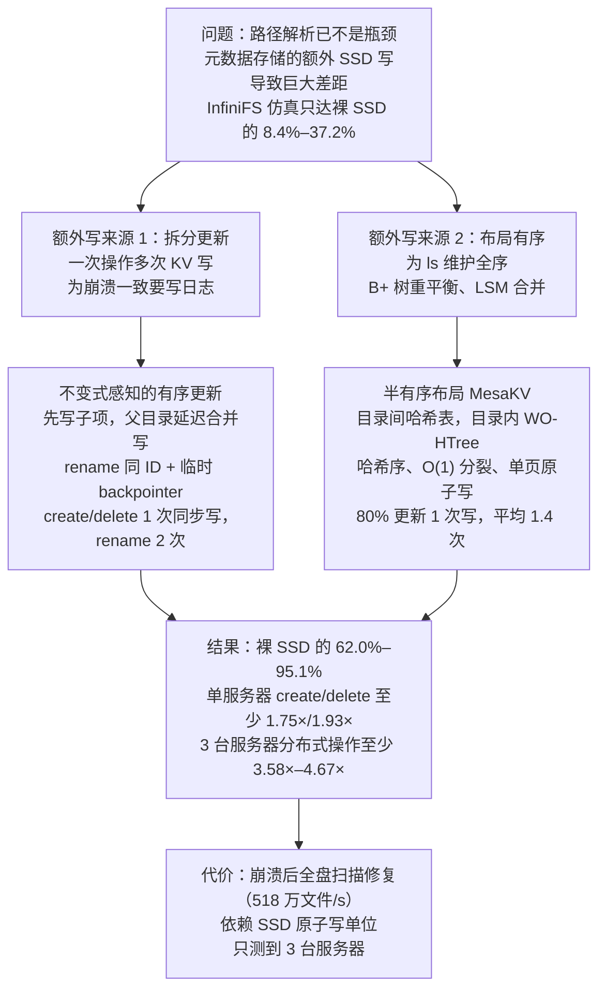

---

## 参考

- Hao Guo, Jiwu Shu, Youyou Lu. *MesaFS: An I/O-Efficient Metadata Service for Distributed File Systems*. ACM EuroSys 2026. <https://dl.acm.org/doi/10.1145/3767295.3803573>
- Wenhao Lv, Hao Guo, Qing Wang, Youyou Lu, Jiwu Shu. *Accelerating Distributed Filesystem Metadata Service via Decoupling Directory Semantics from Metadata Indexing*（HMFS）. ACM SoCC 2025.（本仓库精读：[hmfs-socc2025.md](hmfs-socc2025.md)）
- Hao Guo, Youyou Lu, Wenhao Lv, et al. *SingularFS: A Billion-Scale Distributed File System Using a Single Metadata Server*. USENIX ATC 2023.（本仓库精读：[singularfs-atc2023.md](singularfs-atc2023.md)）
- Wenhao Lv, Youyou Lu, Yiming Zhang, Peile Duan, Jiwu Shu. *InfiniFS: An Efficient Metadata Service for Large-Scale Distributed Filesystems*. USENIX FAST 2022.（本仓库精读：[infinifs-fast2022/deep-read.md](infinifs-fast2022/deep-read.md)）
- Gregory R. Ganger et al. *Soft Updates: A Solution to the Metadata Update Problem in File Systems*. ACM TOCS 18(2), 2000.
- Vijay Chidambaram et al. *Consistency Without Ordering*（backpointer-based consistency）. USENIX FAST 2012.
- Daniel Phillips. *A Directory Index for EXT2*（HTree）. ALS 2001.
- Bruce Reed. *How Tall is a Tree?* ACM STOC 2000.
- Kai Ren, Garth Gibson. *TABLEFS: Enhancing Metadata Efficiency in the Local File System*. USENIX ATC 2013.
- Baptiste Lepers et al. *KVell: The Design and Implementation of a Fast Persistent Key-Value Store*. ACM SOSP 2019.
- NVM Express. *NVMe Base Specification, Revision 1.4c*（AWUPF）.
- 本仓库相关：[元数据扩展性综述](metadata-scalability.md)、[HMFS 精读](hmfs-socc2025.md)、[SingularFS 精读](singularfs-atc2023.md)、[InfiniFS 精读](infinifs-fast2022/deep-read.md)、[CFS 精读](cfs-eurosys2023.md)、[FalconFS 精读](falconfs-nsdi2026.md)、[3FS 精读](3fs-fireflyer-sc2024.md)
