# Octopus+ 精读：把 RDMA 揉进文件系统内部的分布式持久内存文件系统（ACM TOS 2021）

> 论文：Bohong Zhu, Youmin Chen, Qing Wang, Youyou Lu, Jiwu Shu（通讯作者）. *Octopus+: An RDMA-Enabled Distributed Persistent Memory File System*. ACM Transactions on Storage, Vol. 17, No. 3, Article 19, 2021 年 8 月，25 页。投稿 2020-07，修改 2020-11，录用 2021-01。
>
> 机构：清华大学（计算机系存储研究组）。
>
> 链接：DOI <https://doi.org/10.1145/3448418>；PDF <https://storage.cs.tsinghua.edu.cn/papers/tos21octopus.pdf>。会议版：Youyou Lu, Jiwu Shu, Youmin Chen, Tao Li. *Octopus: an RDMA-enabled Distributed Persistent Memory File System*. USENIX ATC 2017，<https://www.usenix.org/conference/atc17/technical-sessions/presentation/lu>
>
> 篇幅：正文约 21 页 + 参考文献约 4 页，共 25 页；17 张图、1 张表。
>
> 精读日期：2026-11-24。**数字和机制描述都摘自论文**，用"论文 §x / 图 x / 表 x"标注出处。标"解读"的段落是本文作者的分析和推论，不是原文。多数图没有数据标签，图上读数为本文估读，标注"约"（对数坐标图误差较大）。标"示例"的是为说明机制构造的例子。与会议版的对比来自 ATC'17 论文原文。
>
> 相关文档：
> - [新硬件综述 §3](new-hardware.md#3-octopus-an-rdma-enabled-distributed-persistent-memory-file-system)：本文的简述版。
> - [Assise（OSDI 2020）精读](assise-osdi2020.md)：同为 Optane + RDMA 时代的 DFS，但把 NVM 放在客户端本地，并把 Octopus 当作主要对比对象。
> - [LineFS（SOSP 2021）精读](linefs-sosp2021.md)：把 PM DFS 的后台工作卸载到 SmartNIC，相关工作中把 Octopus 列为"PM 优化的客户端-服务器 DFS"。
> - [SingularFS（ATC 2023）精读](singularfs-atc2023.md)：同一研究组在 PM 上做单机元数据服务，延续了"少日志、少往返"的思路。
> - [CFS（EuroSys 2023）精读](cfs-eurosys2023.md)、[MesaFS（EuroSys 2026）精读](mesafs-eurosys2026.md)：用分布式事务或有序更新解决跨服务器元数据一致性的其他做法。

## 目录

- [0. 一页速览](#0-一页速览)
- [1. 背景与动机](#1-背景与动机)
- [2. 整体架构](#2-整体架构)
- [3. 高吞吐数据 IO](#3-高吞吐数据-io)
- [4. 低延迟元数据访问](#4-低延迟元数据访问)
- [5. 实现：索引、复制与一致性](#5-实现索引复制与一致性)
- [6. 期刊版相对 ATC'17 会议版的变化](#6-期刊版相对-atc17-会议版的变化)
- [7. 评估](#7-评估)
- [8. 论文中的不一致与可疑之处](#8-论文中的不一致与可疑之处)
- [9. 设计上没有回答的问题](#9-设计上没有回答的问题)
- [10. 与本仓库中其他系统的对照](#10-与本仓库中其他系统的对照)
- [11. 整体总结](#11-整体总结)
- [参考](#参考)

---

## 0. 一页速览

**一句话**：早期给分布式文件系统"加 RDMA"的做法（CephFS + Accelio、GlusterFS RDMA、NVFS、Crail）大多只是**把通信模块换成 RDMA 库**，文件系统和网络两层仍然严格隔离。论文测得，在 NVM + RDMA 上 GlusterFS 的软件延迟占到约 99%，只用了 NVM 带宽的 23.8%、InfiniBand 带宽的 11%。Octopus+ 的主张是**让文件系统内部机制直接围绕 RDMA 原语重新设计**：数据侧把每台服务器 NVM 的数据区注册成 RDMA 内存区，组成全局**共享持久内存池**，省掉服务端的消息池与 mbuf 拷贝；客户端先通过 RPC 拿到数据地址，再用单边 RDMA READ/WRITE **自己搬数据**（client-active），把服务器 CPU 从数据搬运中解放出来。元数据侧用 `write_with_imm` 实现**自识别 RPC**，立即数里带上发送方的节点号和缓冲区偏移，服务器不必轮询扫描。跨服务器更新用 **collect-dispatch 事务**：协调者收集读写集后只在本地记日志，再用 RDMA WRITE 分发结果、用 RDMA CAS 远程解锁。期刊版相对 ATC'17 新增了三项：集中式目录元数据服务器（DMS），元数据用操作日志、数据由客户端写多副本的**复制**机制，以及在**真实 Optane DCPMM** 上的评估。

**关键数字**（论文 §2.2、§5）：

| 指标 | 数值 | 出处 |
|------|------|------|
| GlusterFS 在 NVM + RDMA 上的软件延迟占比 | 约 99%（1 KB 同步写，总延迟 367 µs） | 图 1(a) |
| GlusterFS 在 NVM + RDMA 上的带宽利用率 | NVM 的 23.8%，InfiniBand 的 11% | §2.2，图 1(b) |
| 远程 IO 一次需要的内存拷贝 | GlusterFS 7 次，PM 本地 FS 直连 6 次，Octopus+ 4 次 | §3.2.1，图 4 |
| Octopus+ Mkdir 软件延迟 | 6.3 µs（约占总延迟 30 µs 的 20%）；memGlusterFS 363 µs（超过 99%） | §5.2.1，图 8(a) |
| 单服务器读/写带宽 | 11.9 / 5.7 GB/s（NVM 的 59% / 90%） | §5.2.1，图 8(b) |
| 元数据吞吐（6 台服务器） | Stat 约 190 万、Mknod 约 140 万 ops/s；Mkdir 约 5.5 万 ops/s | 图 9 |
| 16 KB 读写吞吐（单服务器） | 写 415 Kops/s、读 763 Kops/s，为 NVFS 的 2.2 倍、1.4 倍 | §5.2.3，图 10 |
| 6 台服务器聚合带宽 | 写约 29.5 GB/s、读约 63.5 GB/s | 图 11 |
| 自识别 RPC 吞吐 | 16 B 时 4.1 Mops/s，高于 eRPC、LITE、DaRPC | §5.3.2，图 13 |
| 元数据延迟 | Stat 42 µs、Mknod 63 µs、Mkdir 88 µs、Readdir 103 µs | 图 14 |
| Filebench（单服务器） | 论文称"最多两个数量级"，本文估读最大约 50～60 倍 | §5.4，图 17 |

**阅读地图**：

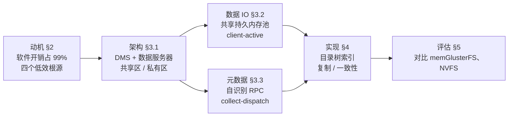

---

## 1. 背景与动机

### 1.1 NVM 与 RDMA（论文 §1、§2.1）

| 硬件 | 论文给出的特性 |
|------|----------------|
| Intel Optane DCPMM | 首个商用持久内存，容量 128/256/512 GB。单条最大读/写带宽 6.6 / 2.3 GB/s，读/写延迟 305 / 169 ns（引自 Izraelevitz 等的测量） |
| RDMA | 100 Gbps InfiniBand 上测得平均延迟 0.94 µs、带宽 12.3 GB/s；对照千兆以太网 75 µs、188 MB/s |

RDMA 有两类命令（论文 §2.1）：

- **消息语义**（`send`/`recv`）：类似 socket，接收端要先投递 `recv` 并指定接收地址。
- **内存语义**（`read`/`write`，即"单边"）：远端地址由发送方指定，不需要远端 CPU 参与，带宽更高、延迟更低。
- 另有原子命令 `compare_and_swap`、`fetch_and_add`，可原子地访问远端内存。

### 1.2 软件开销成为瓶颈（论文 §2.2，图 1）

论文在 GlusterFS 上做了两组测量。diskGluster 跑在磁盘 + 千兆网上，memGluster 跑在 EXT4-DAX（NVM）+ RDMA 上：

| 测量 | diskGluster | memGluster |
|------|-------------|------------|
| 1 KB 同步写延迟（10,000 次平均） | 约 39 ms，存储占约 99% | 约 367 µs，**软件占约 99%** |
| 1 MB 写带宽占原始硬件的比例 | 磁盘 76.8%，千兆网 74.4% | **NVM 23.8%，InfiniBand 11%** |

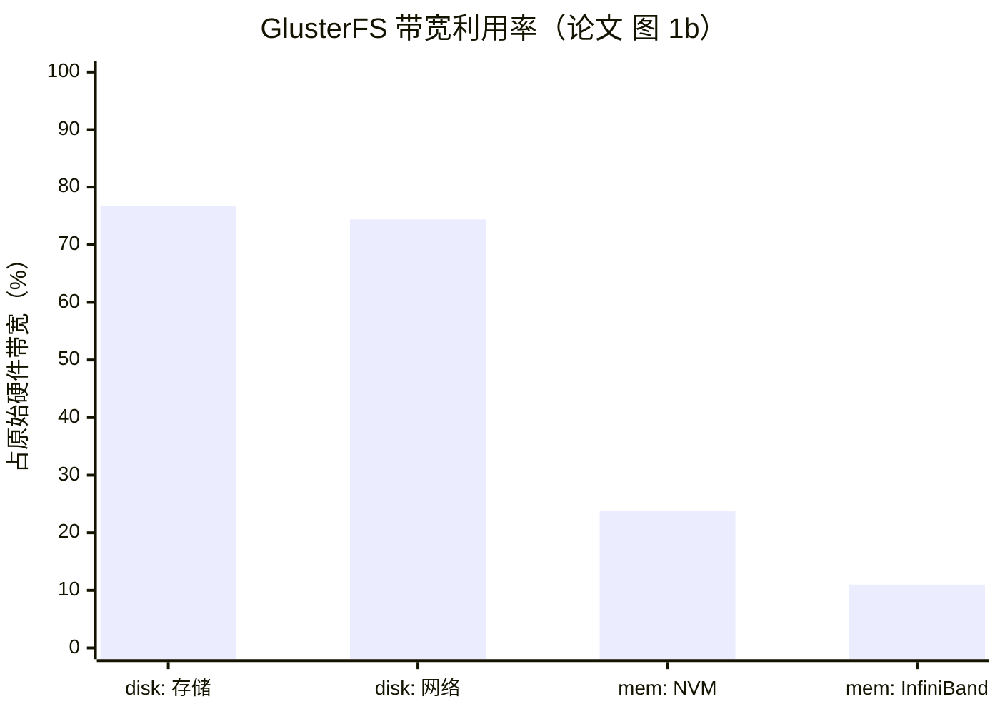

论文把低效归结为四个机制（§2.2）：

1. **多次内存拷贝**：数据在用户缓冲区、文件系统页缓存、网络缓冲区之间反复拷贝。
2. **服务器 CPU 成为瓶颈**：网络变快后，服务端 CPU 处理大量客户端请求时先饱和。
3. **事件驱动 RPC 通知延迟高**：硬件已提供微秒级通信，软件通知机制跟不上。
4. **分布式事务一致性开销大**：多次网络往返和复杂的处理逻辑。

Octopus+ 的四个机制与这四个问题一一对应：

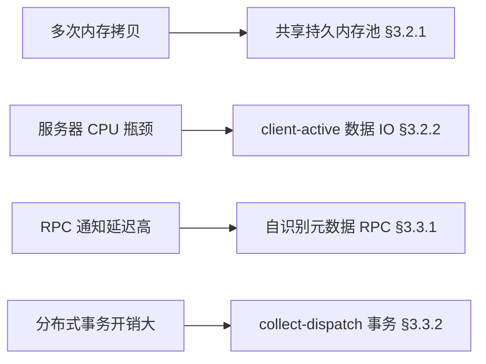

> 解读：这篇论文的出发点和 2010 年代中期"微秒级 IO 时代"的一系列工作（Swanson 的 "Refactor, Reduce, Recycle"、FaRM、HERD、FaSST）一致：硬件延迟降到微秒级，曾经可以忽略的软件栈就成了主要开销。Octopus 是较早把这一判断落实到**分布式文件系统**上的工作。

---

## 2. 整体架构

### 2.1 组件（论文 §3.1，图 2）

Octopus+ 部署在配有 NVM 和 RDMA 网卡的服务器集群上，由**客户端**和**数据服务器**两部分组成：

- **目录元数据服务器（DMS）**：一台指定的服务器，保存**全部目录**。
- **数据服务器**：文件按 `hash(父目录 ID + 文件名)` 分布到所有服务器上（论文引用 LocoFS 的做法）。
- **共享区与私有区**：每台服务器的 NVM 分为数据区和元数据区。数据区导出给整个集群做远程直接访问；元数据区出于一致性考虑保持私有，只能通过 RPC 访问。

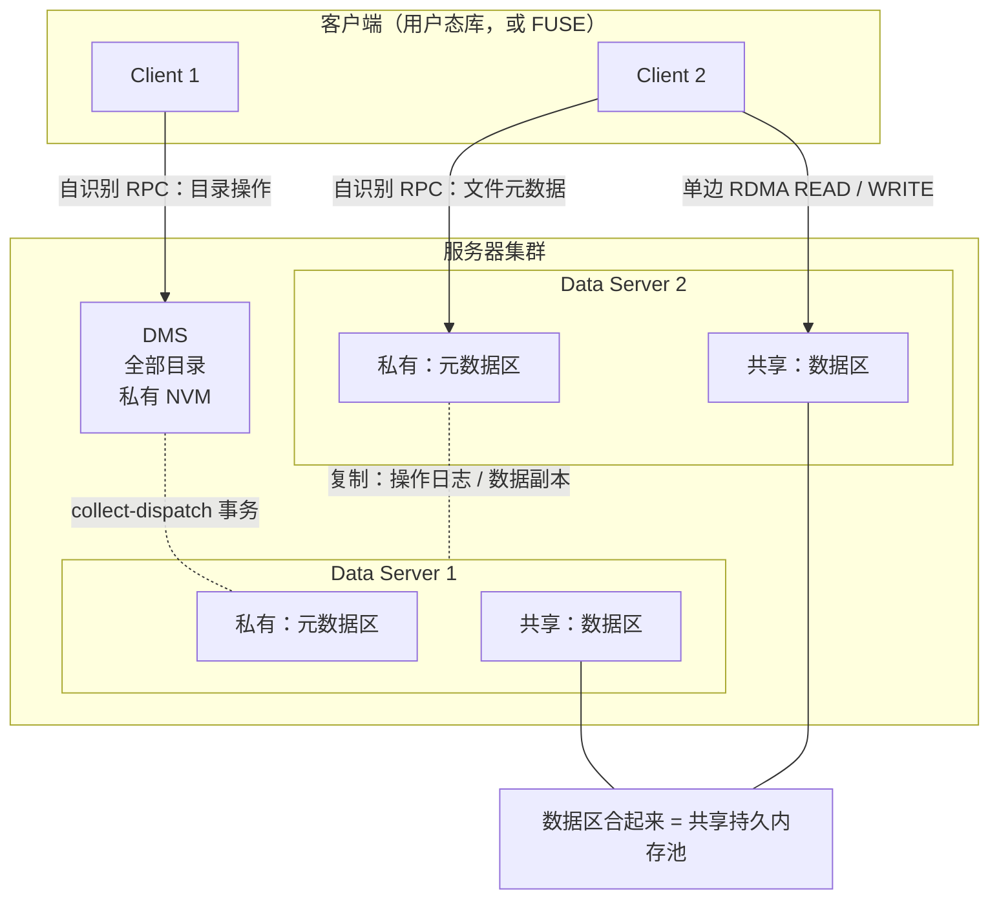

### 2.2 单台服务器的 NVM 布局（论文 §3.1，图 3）

| 区域 | 内容 | 共享 / 私有 |
|------|------|-------------|
| Super Block | 文件系统元数据 | 私有 |
| Directory Tree Zone | 组成目录树的索引，含一张哈希表，索引本服务器上的文件（键为 `<ID, Name>`，值为 Inode 指针） | 私有 |
| Metadata Zone | 位图 + Inode 等文件元数据结构 | 私有 |
| Data Zone | 位图 + 数据块 | **共享**（注册给 RDMA） |
| Log Zone | 事务日志块，保证文件系统一致性 | 私有 |


内存池在启动时用一个静态 XML 配置文件初始化，记录池大小和集群信息（论文 §3.1）。

### 2.3 两个操作的完整流程（论文 图 2）

图 2 给出了 `mkdir("/home/a")` 和 `write("/home/testfile")` 两条路径。

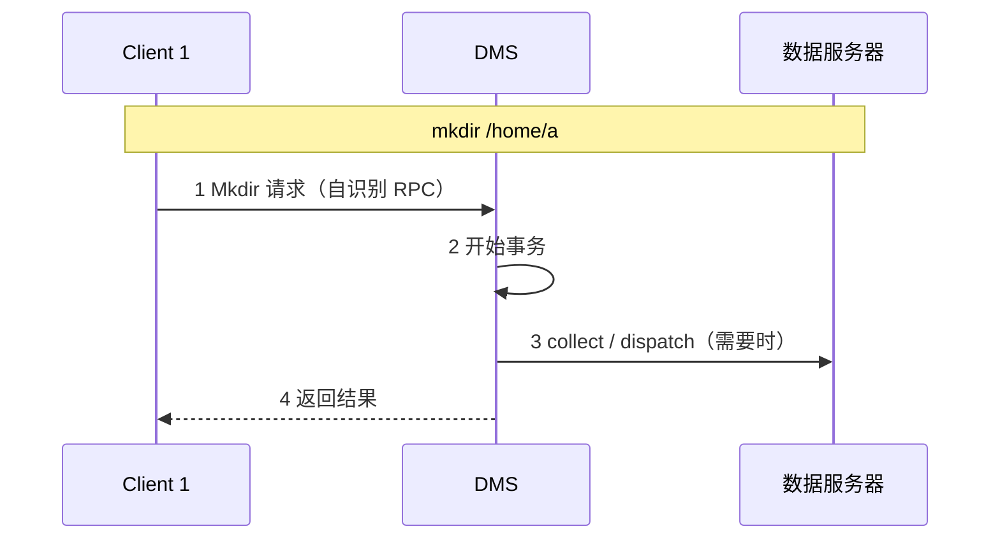

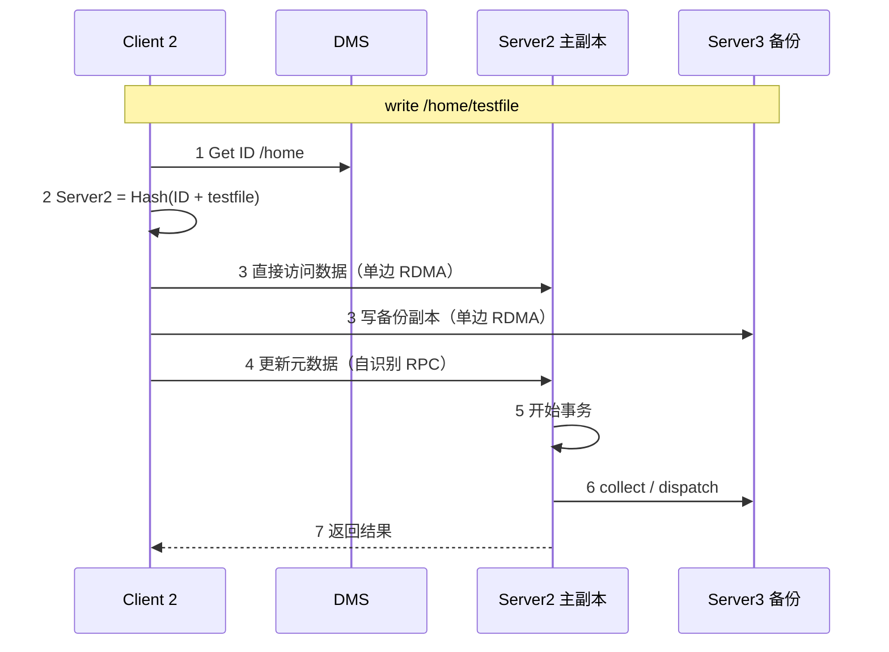

> 解读：图 2 中"先找 DMS 要父目录 ID，再哈希定位数据服务器"是文件操作的通用前缀。论文没有说明客户端是否缓存目录 ID，还明确说过"即使没有客户端缓存"元数据延迟也很低（§5.3.2）。如果每次文件操作都要访问 DMS，DMS 就会成为文件操作的瓶颈。这一点和文件操作吞吐随服务器数扩展（图 9）之间的关系，见 [§9](#9-设计上没有回答的问题)。

---

## 3. 高吞吐数据 IO

### 3.1 共享持久内存池（论文 §3.2.1，图 4）

传统 DFS 堆叠在本地文件系统之上，一次远程读写要把数据复制到多个地方：内核网络缓冲区（mbuf）、用户缓冲区（把分布式对象存成本地文件）、内核页缓存、NVM 中的文件系统镜像。

| 系统形态 | 一次远程 IO 的拷贝次数（含 NIC） | 省掉了什么 |
|----------|----------------------------------|-----------|
| GlusterFS（堆叠在本地 FS 上） | 7 | — |
| GlusterFS + PM 本地 FS（DAX，如 PMFS、EXT4-DAX） | 6 | 只绕过了页缓存 |
| Crail（从零构建的 RDMA DFS） | 少于堆叠式 | 不经过服务端用户缓冲区 |
| **Octopus+** | **4** | 还省掉服务端的消息池和 mbuf |

Octopus+ 的做法是：数据服务器加入集群时，把 NVM 的数据区用 `ibv_reg_mr` 注册，远端就能直接访问文件系统镜像，不需要任何缓存。Octopus+ 不依赖本地文件系统，自己管理每台服务器的数据分布和布局。

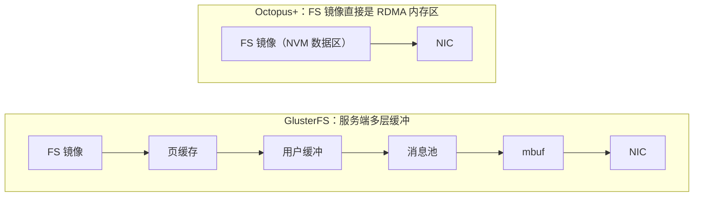

> 解读：这里"拷贝次数"把 NIC 的 DMA 也算在内，且是服务端和客户端合计。共享内存池真正消除的是**服务端**的全部软件拷贝：NIC 直接从 NVM 镜像 DMA。客户端一侧仍有消息池到用户缓冲区的拷贝，所以总数是 4 而不是 2。§5.3.1 的消融实验在客户端额外加一次拷贝，只损失最多 9% 的吞吐（见 [§7.5](#75-内部机制消融论文-53图-1216)），说明在这个硬件组合下，单次内存拷贝并不是主要开销，真正的收益来自去掉整套堆叠软件栈。

### 3.2 Client-active 数据 IO（论文 §3.2.2，图 5）

**server-active**（传统做法）：客户端发读请求，服务器查找数据、准备并发回，一个网络往返完成。论文的观察是：在他们的集群里，1 KB 写的网络能力约 500 万 IOPS，但服务器仅"定位数据"就要约 2 µs，相当于 50 万 IOPS 的上限。**小 IO 的瓶颈在服务器 CPU，而不是网络。**

**client-active**（Octopus+）用多一次往返换服务器 CPU：

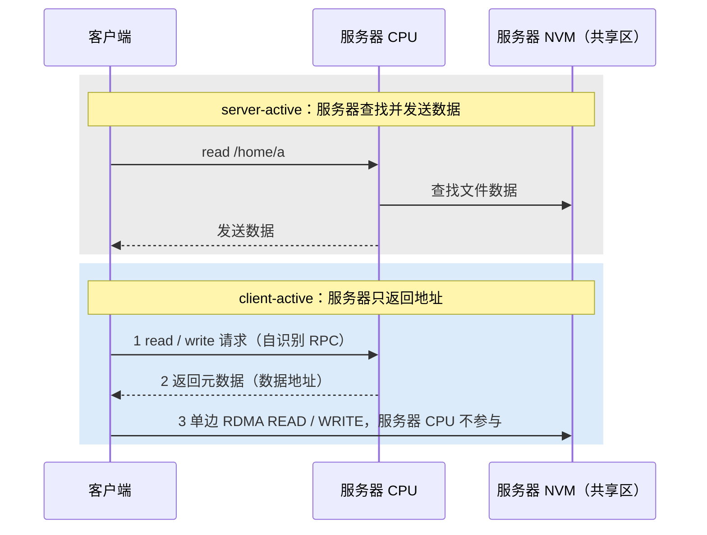

结果是把原来压在服务器上的负载转移到客户端和网络，在并发请求下得到更高的吞吐（论文 §3.2.2）。

### 3.3 CPU 原子指令 + RDMA 原子命令混合的文件锁（论文 §3.2.2）

client-active IO 期间，多个客户端可能并发访问同一文件，Octopus+ 用**每文件读写锁**串行化：

- **加锁**由服务器在本地用 CPU 原子指令完成（处理第 1 步请求时）。
- **解锁**由客户端在数据 IO 结束后用 RDMA 原子命令远程完成。

论文承认 CPU 原子指令和 RDMA 原子命令之间**没有相互的原子性保证**（NIC 与 CPU 之间缺乏原子性，引用 InfiniBand 规范、Kalia 等、Wei 等的工作），但认为两者分别只用于加锁和解锁阶段，这种"隔离"避免了 CPU 与 NIC 的竞争，从而保证正确性。

> 解读：对**互斥锁**这个论证基本成立：锁被持有时，其他请求在 CPU 上 CAS 失败、不改值，只有持锁者通过 NIC 写回"未锁"值。但论文说的是**读写锁**。共享读锁通常要维护读者计数：新读者在 CPU 上加计数，离开的读者经 NIC 减计数，两者可能同时修改同一个字。由于 NIC 的原子操作对 CPU 并不原子，这时可能丢失更新。论文没有给出锁字的编码方式，无法判断是否规避了这种情况。另一个问题是客户端在解锁前崩溃，锁就无人释放。论文没有描述租约或超时机制。

---

## 4. 低延迟元数据访问

### 4.1 自识别元数据 RPC（论文 §3.3.1）

元数据操作走 RPC。两种传统实现各有缺点：

| 方案 | 做法 | 问题 |
|------|------|------|
| 消息式 RPC | `send`/`recv`，每个到达的 `send` 消耗一个预投递的 `recv` | 延迟较高、吞吐较低；UD 模式吞吐高但不可靠，不适合 DFS |
| 内存式 RPC | 单边 `write` 写到服务器的消息缓冲区 | 服务器不知道有新消息，只能**反复扫描**缓冲区；客户端越多要扫的缓冲区越多，CPU 开销和延迟都上升 |
| **自识别 RPC** | 用 `write_with_imm`：数据像单边写一样写入，同时立即数字段携带客户端的 `node_id` 和接收缓冲区偏移 | — |

`write_with_imm` 与普通 RDMA `write` 有两点不同，自识别 RPC 正好利用了这两点：

1. **能携带立即数**：服务器从立即数直接得知是哪个客户端、消息在哪，不用扫描。
2. **会立即通知远端**：它消耗远端 QP 的一个接收请求，到达后立刻产生完成事件。

服务器处理完后，用 RDMA `write` 把结果写回 `node_id` 客户端的 `offset` 处。

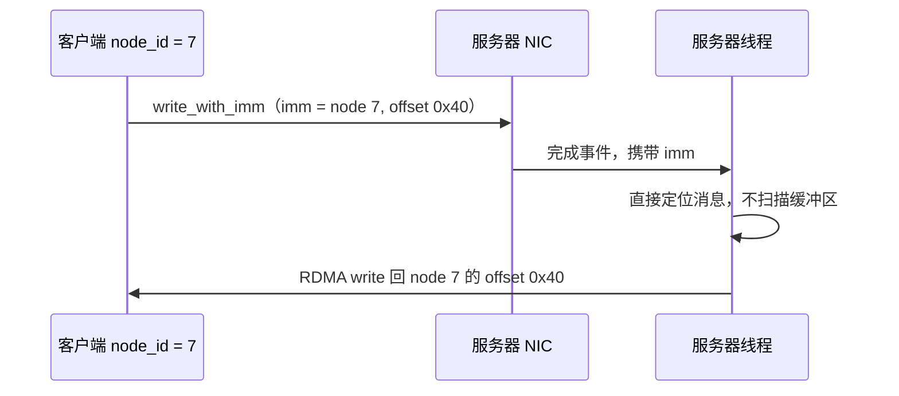

### 4.2 Collect-dispatch 事务（论文 §3.3.2，图 6）

Octopus+ 中 `mkdir`、`rmdir` 这类操作要更新多台服务器。开启复制后，几乎所有修改文件系统的操作都会变成跨服务器更新。这需要分布式事务同时提供**并发控制**和**崩溃原子性**。

传统**两阶段提交（2PC）**的开销在于，协调者和参与者都要加锁、都要记日志，并且需要多轮网络往返来协商日志的持久化顺序。

**Collect-dispatch** 有两个关键想法：

1. **本地日志 + 远程原地更新**（负责崩溃一致）
   - **收集（collect）阶段**：协调者从参与者收集读写集，在本地执行事务、在本地记日志。参与者不记日志，因此协调者和参与者之间不需要协商日志持久化顺序。
   - **分发（dispatch）阶段**：协调者用 RDMA `write` 把更新后的写集写到参与者，再用 RDMA 原子命令释放参与者的锁，参与者 CPU 不参与。
2. **CPU 与 RDMA 混合加锁**（负责并发控制）：协调者和参与者都在本地用 `compare_and_swap` 加锁。协调者用本地 CAS 解自己的锁，用 RDMA CAS 解每个参与者的锁。

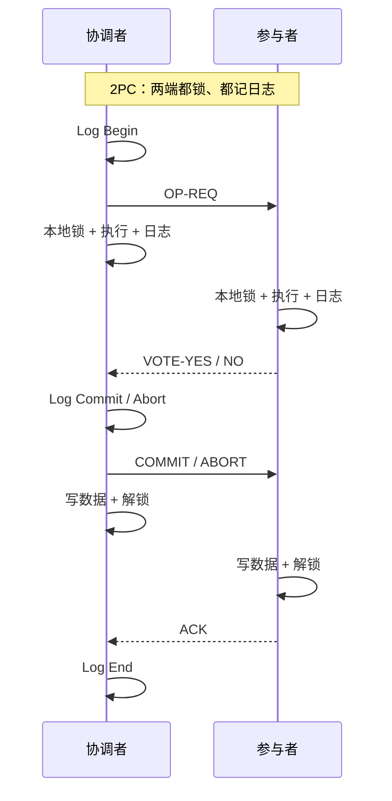

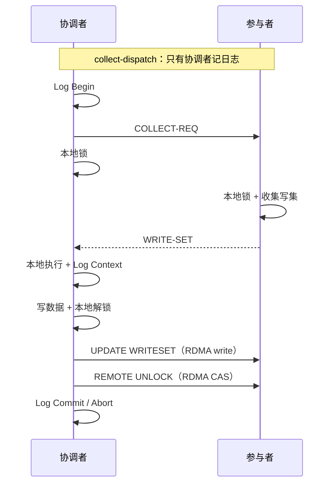

**开销对比**（论文 §3.3.2）：collect-dispatch 需要 1 次 RPC + 1 次 RDMA write + 1 次 RDMA 原子操作，2PC 需要 2 次 RPC。消息数更多，但论文认为 collect-dispatch 仍然更便宜，因为（1）RPC 的延迟高于单边 RDMA 原语，（2）单边原语不占用远端 CPU。

> 解读：collect-dispatch 本质上是**把参与者降级为"被远程写的内存"**：只有协调者有日志，参与者的状态由协调者的 redo 日志决定。这让崩溃恢复变得简单（只看协调者日志），代价是协调者的日志成为单点。期刊版用"把操作日志同步复制到备份服务器"来弥补（[§5.2](#52-复制论文-42图-7)）。另外，**期刊版删掉了会议版中 collect-dispatch 对比 2PC 的实验**（ATC'17 报告延迟最多降低 37%、吞吐最多提高 79%），所以 TOS 版本身没有验证这个机制的收益，见 [§6](#6-期刊版相对-atc17-会议版的变化)。

---

## 5. 实现：索引、复制与一致性

Octopus+ 提供两种访问方式：**用户态库模式**和基于 FUSE 的 POSIX 模式。评估全部使用用户态库模式，以避开 FUSE 的瓶颈。NVM 配置为 DAX 模式，用 `mmap` 映射进地址空间（论文 §4）。

### 5.1 索引机制（论文 §4.1）

**目录树索引：从"全哈希"改为"目录集中 + 文件哈希"**

会议版 Octopus 把所有目录和文件都哈希分布到各服务器。访问第 N+1 层的文件，要向不同服务器发 N 次 RPC 解析每一级祖先目录，往返太多。Octopus+ 改为：

- **DMS 集中保存全部目录**。每个目录在创建时由 DMS 分配一个唯一的 64 位 ID，根目录 ID 为保留值。DMS 上的链式哈希表以 `(父目录 ID, 目录名)` 为键，表项中记录 dentry。路径解析从根开始逐级查找，全部在 DMS 本地完成。
- **文件哈希分布**。用 `hash(父目录 ID, 文件名)` 算出数据服务器 ID，在该服务器的哈希表里用同一个键找到 Inode 指针。
- **readdir**：每个目录在 DRAM 中维护一个子项名列表，不需要持久化，可以从数据服务器上的持久 dentry 恢复。

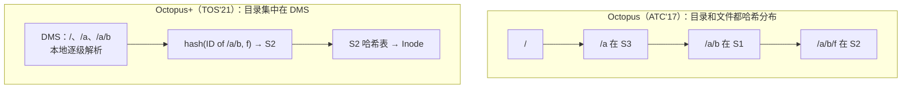

> 示例：访问 `/a/b/f`。在会议版中，解析 `/a`、`/a/b` 可能落在两台不同服务器上，加上文件本身共 3 次 RPC；在 Octopus+ 中，一次 RPC 到 DMS 得到 `/a/b` 的 ID，一次 RPC 到文件所在服务器，共 2 次，且与路径深度无关。

**数据索引：每文件一个持久跳表**

- 数据块固定 4 KB。为简化管理，**一个文件的数据不跨服务器分布**。
- 每个 Inode 用一个完全驻留在 NVM 上的**跳表**记录数据块。每个节点表示 NVM 池中若干连续数据块，有三个字段：文件内偏移 `offset`、长度 `size`、NVM 地址 `s_addr`。相邻节点不重叠，查找复杂度 O(log n)。
- 读操作时，服务器在跳表中收集客户端要读的范围，把地址信息发回给客户端（即 client-active 的第 2 步）。

### 5.2 复制（论文 §4.2，图 7）

用户可以设置复制因子 RF，可以全局设置，也可以按文件设置。备份服务器随机选择，以均衡负载。元数据和数据采用不同的复制协议：

| | 元数据复制 | 数据复制 |
|---|---|---|
| 特点 | 单次更新小、频率高，直接复制太贵 | 体量大 |
| 协议 | **基于操作日志**，借鉴 RAMCloud | **client-active 复制**：客户端负责把数据写到所有副本 |
| 流程 | 在 collect-dispatch 的本地日志阶段，用单边 RDMA write 把一条操作日志**同步**写到备份；备份的后台线程**异步**回放 | 客户端向主副本请求地址后，用 RDMA write 写主副本和每个备份 |
| 好处 | 一个操作涉及多处元数据更新，只需同步一条日志；单边写不占备份 CPU | 复用 client-active 路径，服务器不转发数据 |

DMS 上的元数据也用类似方法复制到多台服务器。

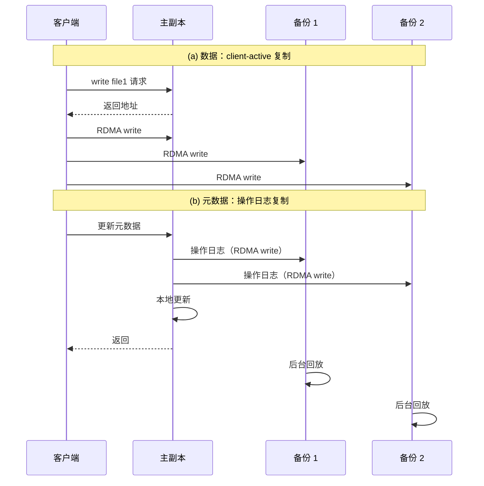

### 5.3 文件系统一致性（论文 §4.3）

RDMA 遇上 NVM，有三个问题要处理：远程持久性、故障原子性、并发控制。

**远程持久性**：商用 RDMA 网卡不支持"远程 flush"。开启 DDIO 时，RDMA write 的数据直接写进远端的末级缓存（LLC），而不是 NVM。Octopus+ 的办法是在每次 RDMA write 后**追加一次 RPC**：

1. 客户端用 `write_with_imm` 写远端 PM，立即数作为 ID。
2. 同时发一个 RPC，携带写入区域的地址和长度。
3. 服务器收到该立即数，即知远程写已完成，便代客户端对该地址执行 flush。

论文期待未来能用硬件远程 flush 替代（如 SNIA 的 remote durability、RDMA commit，或 Mojim 那样用可用性换崩溃一致）。

**故障原子性**：

- **数据写时复制（COW）**：客户端从不 RDMA 写到已存放有效数据的 PM 区域，所有更新重定向到新分配的空间；元数据原子切换后，数据块要么是旧状态要么是新状态。
- **元数据事务**：所有元数据更新包在 collect-dispatch 事务中。先写 redo 日志再原地更新，保证"全有或全无"。
- **write / append 两者并用**：客户端必须在数据传输完成后才能发元数据更新请求，所以文件从旧状态原子地切换到新状态。
- **协调者故障**：选一个副本服务器当新协调者，依据其他副本的状态（如操作日志）恢复集群一致性。如果故障服务器不再回来，某些文件会少一个副本。

**并发控制**（论文 §4.3 的两个场景）：

| 操作 | 流程 |
|------|------|
| `create` | 在新文件所在服务器开启事务，并锁住 DMS 上的父目录节点（collect）→ 本地创建 Inode、插入哈希表（写数据）→ 用一次 RDMA write 更新父目录的"文件数"字段，并解锁父目录（dispatch）。`unlink` 同理，在本地删除 Inode、回收数据块 |
| `write` / `append` | 文件不跨服务器，元数据和数据块都在本地。client-active IO 完成后，在文件所在服务器开启事务，加文件写锁，在本地更新元数据，然后解锁并返回客户端 |

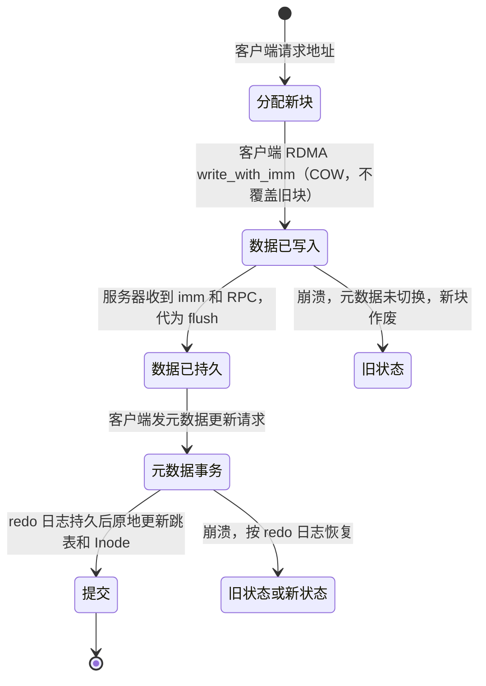

> 解读：远程持久性这一步的代价不小。每次数据写都要追加一次 RPC，而且 `write_with_imm` 本身也会唤醒服务器 CPU。这样，client-active 写路径上"服务器 CPU 不参与"的说法对**写**只部分成立：服务器不搬数据，但仍要处理一次通知和一次 flush。此外，论文只对**客户端写数据**描述了这个 flush 步骤；collect-dispatch 分发阶段写参与者元数据的 RDMA write、复制操作日志到备份的 RDMA write，同样会落进 DDIO 的 LLC，论文没有说明如何保证它们持久，见 [§9](#9-设计上没有回答的问题)。

---

## 6. 期刊版相对 ATC'17 会议版的变化

下表对照 ATC'17 Octopus 原文与 TOS'21 Octopus+：

| 方面 | Octopus（ATC'17） | Octopus+（TOS'21） |
|------|-------------------|--------------------|
| 作者 | Youyou Lu, Jiwu Shu, Youmin Chen, Tao Li | Bohong Zhu, Youmin Chen, Qing Wang, Youyou Lu, Jiwu Shu |
| 目录组织 | 目录和文件全部哈希分布 | **目录集中在 DMS**，文件哈希分布（§4.1） |
| 复制 | 无 | **新增**：元数据操作日志复制，数据 client-active 复制（§4.2） |
| 数据持久性 | 元数据日志用 `clflush` 持久；数据 IO 不在事务内，数据一致性留作未来工作 | **新增**：写后追加 RPC 让服务器 flush；数据 COW + 元数据事务（§4.3） |
| 硬件 | DRAM 上用 Linux 共享内存模拟持久内存，每台 20 GB；56 Gbps FDR InfiniBand（ConnectX-3） | **真实 Optane DCPMM**（每台 3 × 256 GB 用于实验）；100 Gbps EDR InfiniBand（ConnectX-5） |
| 对比系统 | memGluster、NVFS、Crail；大数据实验还有 memHDFS、Alluxio | 只有 memGlusterFS、NVFS |
| 机制评估 | 含 collect-dispatch 与 2PC 对比（延迟最多降 37%，吞吐最多升 79%） | 删去事务对比；**新增** RPC 框架对比（eRPC、DaRPC、LITE）、目录树设计对比、复制因子实验 |
| 应用评估 | Hadoop 上的 TestDFSIO、Teragen、Wordcount | Filebench 的 Varmail、Fileserver、Webproxy、Webserver |

> 解读：期刊版的主要增量在**可用性**（复制）和**正确性**（远程持久性、故障原子性）上，这正是会议版最常被质疑的地方。但期刊版同时删掉了 Crail 这个最接近的"从零构建的 RDMA DFS"对比对象，也删掉了 collect-dispatch 的消融实验。结果是 TOS 版的评估中，所有对手都是"堆叠在本地文件系统上"的系统，难以区分收益来自"去掉堆叠软件栈"还是来自 Octopus+ 的具体机制。

---

## 7. 评估

### 7.1 实验环境与对比系统（论文 §5.1，表 1）

| 项目 | 配置 |
|------|------|
| 服务器 | 2 × Xeon Gold 6240M（2.60 GHz，每颗 36 核），192 GB DRAM，6 × 256 GB Optane DCPMM（每个 NUMA 节点 3 条）。**只用一个 NUMA 节点上的 768 GB NVM**，以避开跨 NUMA 流量；Ubuntu 18.04，Linux 4.15 |
| 客户端 | 2 × Xeon E5-2650 v4，128 GB DRAM；CentOS 7，Linux 3.10 |
| 网络 | ConnectX-5 EDR HCA（100 Gbps InfiniBand / 100 GbE），Mellanox MSB7790 交换机 |
| 带宽错配 | NVM 写 6.7 GB/s、读 20 GB/s；网卡读写都是 12 GB/s。因此**写的瓶颈是 NVM，读的瓶颈是网络** |
| 对比系统 | **memGlusterFS**：GlusterFS 跑在 EXT4-DAX 上，用 RDMA 通信；**NVFS**：为 NVM 和 RDMA 优化的 HDFS |
| Octopus+ 模式 | 全部使用用户态库模式 |
| 负载 | mdtest（元数据）、fio（读写）、基于 openMPI 的自研读写工具（聚合 IO）、filebench（宏基准） |

### 7.2 延迟与带宽分解（论文 §5.2.1，图 8）

所有目录和文件都创建在根目录下。

| | 总延迟 | 存储 | 网络 | 软件 |
|---|---|---|---|---|
| Mkdir | 30 µs | 66.7% | 13.3% | **20.0%（约 6 µs，正文称 6.3 µs）** |
| Stat | 22 µs | 54.5% | 17.7% | 27.7%（约 6 µs） |
| memGlusterFS Mkdir（对照） | — | — | — | 363 µs，超过 99% |

| | 原始存储 | 原始网络 | Octopus+ | 占存储 | 占网络 |
|---|---|---|---|---|---|
| 读 | 20 GB/s（多线程 memcpy） | 12.3 GB/s | 11.9 GB/s | 59% | 正文称 99%（按数字算约 97%） |
| 写 | 6.3 GB/s（多线程 memcpy） | 12.3 GB/s | 5.7 GB/s | 90% | 46% |

> 解读：Octopus+ 的软件延迟已和硬件延迟处在同一量级。Mkdir 30 µs 中有 2/3 是"存储"，即 NVM 访问和持久化（flush、fence）；Mkdir 涉及多处 NVM 更新且要串行化，这也解释了它在图 9 中吞吐偏低。

### 7.3 元数据吞吐（论文 §5.2.2，图 9）

mdtest，客户端以多级目录方式创建、访问、删除目录和文件，服务器数从 1 增加到 6。图 9 为对数坐标（Mkdir 为线性坐标），以下为估读值：

| 操作 | Octopus+（1 → 6 台） | NVFS（6 台） | memGlusterFS（6 台） | 趋势 |
|------|----------------------|--------------|----------------------|------|
| Mkdir | 约 5.6 万 → 5.3 万 | 约 2.1 万 | 约 0.9 万 | 目录操作平稳 |
| Mknod | 约 50 万 → 140 万 | 约 1 万 | 约 3.5 万 | 文件操作扩展 |
| Readdir | 约 60 万 → 60 万 | 约 5 万 | 约 0.7 万 | 平稳 |
| Stat | 约 55 万 → 190 万 | 约 6 万 | 约 5.5 万 | 扩展 |
| Rmnod | 约 33 万 → 130 万 | 约 3 万 | 约 8 万 | 扩展 |
| Rmdir | 约 85 万 → 87 万 | 约 6 万 | 约 0.8 万 | 平稳 |

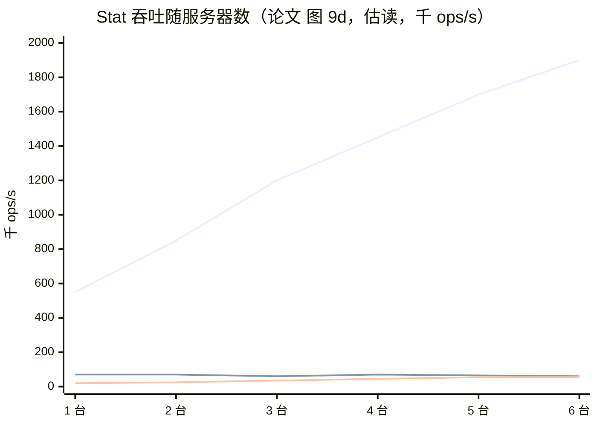

> 注：xychart 不支持图例。三条线自上而下依次为 Octopus+、NVFS、memGlusterFS。

论文的解释（§5.2.2）：

- **文件操作扩展好**：RPC 和事务设计本身可扩展，文件按哈希分散到各服务器。
- **目录操作平稳**：所有目录都在一台 DMS 上，不随服务器数增加。
- **NVFS 基本不扩展**：单元数据服务器是瓶颈。
- **memGlusterFS 目录操作极差**：GlusterFS 的去中心化元数据会在每台服务器上创建同一个目录。
- **Octopus+ 的 Mkdir 偏低**：当前实现中 Mkdir 需要更多 NVM 访问，并且必须串行执行。

### 7.4 数据读写（论文 §5.2.3，图 10、图 11）

**单服务器、多客户端，不同 IO 大小**（图 10），每个客户端操作自己的文件：

| IO 大小 | Octopus+ 写 / 读 | NVFS 写 / 读 | memGlusterFS 写 / 读 |
|---------|------------------|--------------|----------------------|
| 16 KB | 415 / 763 Kops/s（NVFS 的 2.2 倍 / 1.4 倍） | 约 185 / 540 Kops/s | 32 Kops/s / 约 45 Kops/s |
| 64 KB | 约 110 / 190 Kops/s | 约 78 / 160 Kops/s | 约 12 / 25 Kops/s |
| 1 MB | 约 6 / 12 Kops/s | 略低于 Octopus+ | 1,529 op/s（写） |

论文把小 IO 优势归于 client-active IO、自识别 RPC 和 collect-dispatch 元数据更新的共同作用。

**多服务器聚合带宽**（图 11）：

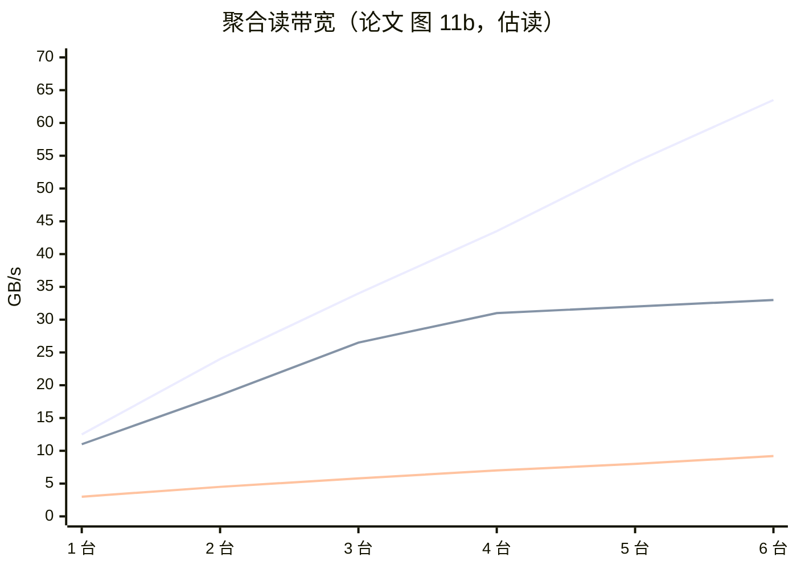

> 注：三条线自上而下依次为 Octopus+、NVFS、memGlusterFS。6 台服务器时 memGlusterFS 正文给出的数字为读 9,156 MB/s、写 8,867 MB/s。

| 6 台服务器 | 写 | 读 |
|------------|----|----|
| Octopus+ | 约 29.5 GB/s（每台约 4.9 GB/s，约为 NVM 写带宽的 78%） | 约 63.5 GB/s（每台约 10.6 GB/s，约为网卡的 86%） |
| NVFS | 约 18 GB/s | 约 33 GB/s（4 台后饱和） |
| memGlusterFS | 8.9 GB/s | 9.2 GB/s |

### 7.5 内部机制消融（论文 §5.3，图 12–16）

**减少拷贝**（§5.3.1，图 12）：在客户端额外加一次拷贝做成 Octopus+ +copy，多客户端写单服务器。去掉这次拷贝最多带来 **9%** 吞吐提升，论文认为规模更大时收益会更多。

**自识别 RPC**（§5.3.2，图 13）：与 eRPC、DaRPC、LITE 比较，所有框架都关闭批处理。

| RPC 框架 | 16 B 吞吐 | 1 KB 吞吐 | 延迟（16 B → 1 KB） | 说明 |
|----------|-----------|-----------|----------------------|------|
| **自识别 RPC** | 4.1 Mops/s | 约 3.45 Mops/s（正文写作"1 MB"） | 约 3.8 → 4.3 µs | `write_with_imm` |
| eRPC | 约 3.5 Mops/s | 约 2.45 Mops/s | 约 5 → 6 µs | 性能接近，论文认为延迟稍高是因为软件栈更复杂 |
| LITE | 约 3.2 Mops/s | 约 2.45 Mops/s | 约 6 → 7 µs | 内核态，系统调用的上下文切换带来额外开销 |
| DaRPC | 2.6 Mops/s | 约 2.45 Mops/s | 约 15 → 20 µs | 基于 `send`/`recv`，可能还受 jVerbs 接口限制 |

**元数据延迟**（§5.3.2，图 14）：多级目录下创建目录并填入文件。

```mermaid
xychart-beta
    title "元数据延迟（论文 图 14，µs）"
    x-axis ["Mkdir", "Mknod", "Readdir", "Stat", "Rmnod", "Rmdir"]
    y-axis "µs" 0 --> 2100
    bar [1990, 1550, 1770, 470, 410, 860]
    bar [1560, 1945, 1000, 420, 460, 450]
    bar [88, 63, 103, 42, 61, 81]
```

> 注：三组柱依次为 memGlusterFS、NVFS、Octopus+。Octopus+ 的数字取自图上标签，memGlusterFS Mkdir 1,990 µs 与 NVFS Mknod 1,945 µs 取自正文，其余为估读。

Octopus+ 在**没有客户端缓存**的情况下仍取得全场最低延迟。Mkdir 从图 8 的 30 µs（根目录下）升到图 14 的 88 µs（多级目录），说明路径深度对延迟有明显影响。

**目录树设计**（§5.3.3，图 15）：对比新设计与会议版的全哈希设计（Octopus-origin）。

| | 1 台服务器 | 6 台服务器 |
|---|---|---|
| Mkdir：Octopus+ / Octopus-origin | 约 66K / 19K（约 3.4 倍） | 约 63K / 32K（约 2 倍） |
| Create：Octopus+ / Octopus-origin | 约 520K / 200K（约 2.6 倍） | 约 1,370K / 890K（约 1.5 倍） |

论文的结论是"高出数倍"，主要因为网络往返减少了。

> 解读：图 15 还透露了一个论文没有讨论的趋势。Octopus-origin 的 Mkdir 随服务器数从约 19K 增长到约 32K，而 Octopus+ 的 Mkdir 基本不变（DMS 是单点），两者差距从 3.4 倍缩小到 2 倍。按这个趋势外推，服务器更多时全哈希设计的目录操作吞吐可能追上甚至超过集中式 DMS。Octopus+ 实际上是用**目录操作的扩展性**换取了**路径解析的往返次数**。

**复制因子**（§5.3.4，图 16）：

| RF | Octopus+ 写 | NVFS 写 | memGlusterFS 写 | Octopus+ 读 |
|----|-------------|---------|-----------------|-------------|
| 1 | 约 5.75 GB/s | 约 4.5 GB/s | 约 1.55 GB/s | 约 12.5 GB/s |
| 6 | 约 4.6 GB/s（降约 20%） | 约 3.5 GB/s | 约 1.45 GB/s | 约 12.7 GB/s |

写带宽随 RF 增大而下降，Octopus+ 因 client-active 复制减轻了服务器压力而始终领先。读带宽几乎不受影响，因为客户端只从主副本读。读上 NVFS 与 Octopus+ 相当。

### 7.6 Filebench（论文 §5.4，图 17）

单台服务器，不开复制。NVFS 没有 POSIX 接口，作者用 libhdfs 实现了 filebench 的调用，这会带来 JNI 开销，某些操作还要调用两次 libhdfs 接口。线程增加到一定程度后曲线进入平台，论文认为是单台客户端机器饱和。

| 负载（20 线程，估读，Kops/s） | Octopus+ | memGlusterFS | NVFS | 对 memGlusterFS | 对 NVFS |
|------------------------------|----------|--------------|------|-----------------|---------|
| Varmail | 约 110 | 约 8 | 约 4 | 约 14 倍 | 约 27 倍 |
| Fileserver | 约 190 | 约 23 | 约 3.5 | 约 8 倍 | 约 54 倍 |
| Webproxy | 约 370 | 约 13 | 约 10 | 约 28 倍 | 约 37 倍 |
| Webserver | 约 260 | 约 62 | 约 16 | 约 4 倍 | 约 16 倍 |

论文称 Octopus+ "最多获得两个数量级的加速"。按图估读，最大的比值出现在少线程时对 NVFS（例如 Varmail 4 线程约 90K 对约 1.5K，约 60 倍），没有达到 100 倍。

---

## 8. 论文中的不一致与可疑之处

| 位置 | 问题 | 影响 |
|------|------|------|
| §1 | 称千兆以太网测得 188 MB/s 带宽，超过 1 Gbps 的线速（约 125 MB/s）。可能是双向合计，但论文没有说明 | 动机数据的口径不清 |
| §2.2 / 图 1(b) | diskGluster 的文件系统带宽标签为 190 MB/s，正文说它是千兆网带宽的 74.4%，据此千兆网应为约 255 MB/s，与 §1 的 188 MB/s 对不上 | 图与正文无法对齐 |
| §5.2.1 | 读带宽 11.9 GB/s"是网络带宽的 99%"，按 12.3 GB/s 算约为 97% | 小误差 |
| §5.1 与 §5.2.1 | NVM 写带宽一处写 6.7 GB/s，一处写 6.3 GB/s（多线程 memcpy 测得） | 口径不同，影响"90% 利用率"的分母 |
| §5.2.2 / 图 9 | 正文说"Stat、Mknod 和 Unlink"达到 10⁶ 量级，但图中没有 Unlink，对应的是 Rmnod | 名称不一致 |
| §5.2.2 / 图 9 | 正文说比 memGlusterFS 和 NVFS"高两个数量级"。6 台服务器时 Stat 约 190 万对约 6 万，约 30 倍；Mknod 对 NVFS 约 140 倍，对 memGlusterFS 约 40 倍 | 仅部分成立 |
| §5.2.3 | memGlusterFS 6 台服务器的聚合带宽 9.2 GB/s，被说成"只接近原始硬件带宽的一半"，实际约为 6 × 12.3 GB/s 的 12%；只有 NVFS（约 33 GB/s，约 45%）接近一半 | 表述不准确 |
| §5.3 引言 | 说会评估"拷贝、RPC、复制"三项，实际还有 §5.3.3 目录树设计 | 小疏漏 |
| §5.3.2 / 图 13 | 正文说 1 MB 时 3.4 Mops/s，但图 13 横轴最大为 1024 B；按 100 Gbps 计，1 MB 消息不可能达到每秒 340 万次。应为 1 KB | 单位错误 |
| §5.3.3 / 图 15 | Mkdir 与 §5.2.2 使用"相同的基准"，但图 15 的 Octopus+ Mkdir 约 63～68K，图 9 约 51～58K | 同一配置两张图数字不同 |
| §5.3.3 | "高出数倍"在 6 台服务器时只有 1.5～2 倍 | 只在少服务器时成立 |
| §5.3.4 / 图 16 | 称"与 §5.2.3 相同流程"测集群聚合带宽，但 RF = 1 时写约 5.75 GB/s、读约 12.5 GB/s，接近单服务器的值，而不是图 11 中 6 台服务器的 29.5 / 63.5 GB/s。服务器数没有说明 | 无法判断实验规模，也无法判断复制开销 |
| §5.4 / 图 17 | "最多两个数量级"，按图估读最大约 50～60 倍 | 夸大 |
| §3.2.2 与 §4.3 | §3.2.2 说锁由服务器在数据 IO 前加、由客户端在 IO 后用 RDMA 解；§4.3 说 write 在 client-active IO **之后**才开启事务、加文件写锁、更新元数据再解锁。两处描述的加锁时机不一致 | 无法确定数据 IO 期间是否持锁 |
| §4.1 | 跳表节点"按 `s_addr` 排序"。要按文件偏移查范围，按 `offset` 排序才合理 | 疑似笔误 |
| §4.1、§5.2.3 | 正文中混入"342 s Inodes""Octopus+ 523 still shows"这类审稿行号残留 | 排版问题 |
| §5.1 / 表 1 | 正文写"Table 1 lists DFSs for comparison"，表中只有两个系统；Crail 出现在动机（图 4）和相关工作中，却没有参与评估 | 对比面窄 |

---

## 9. 设计上没有回答的问题

以下都是本文作者的解读，论文没有直接讨论。

1. **DMS 是否在每次文件操作的路径上？** 图 2 中文件写的第 1 步是向 DMS 要父目录 ID。如果客户端不缓存目录 ID，所有文件操作都要经过 DMS，那么图 9 中 Stat 在 6 台服务器时约 190 万 ops/s，意味着单台 DMS 至少要承担同样多的查询。论文说 Octopus+"即使没有客户端缓存"也有低延迟，却没有说明 mdtest 中目录 ID 是否被缓存。这决定了 DMS 是否会成为文件操作的瓶颈。
2. **单个文件只放在一台服务器上**。§4.1 明确说文件数据不跨服务器分布。单文件的带宽和容量都受限于一台服务器（写约 5.7 GB/s，NVM 容量 768 GB），这对大文件和 HPC 的 N-1 共享写负载不友好。fio 实验中每个客户端操作自己的文件，回避了这个问题。
3. **远程持久性只覆盖了客户端的数据写**。collect-dispatch 分发阶段写参与者元数据、复制操作日志到备份，都是单边 RDMA write，在 DDIO 打开时同样只到达远端 LLC。论文没有说明这两处如何保证持久。如果分发写没有持久就宣告提交，参与者断电会丢失已提交的元数据。如果靠协调者的 redo 日志重放来恢复，就需要说明日志何时可以截断。
4. **故障检测与成员管理**。"选一个副本服务器做新协调者"需要有人检测故障、达成共识，论文没有提到集群管理服务、租约或配置版本。客户端持锁时崩溃，锁由谁释放也没有描述。
5. **复制一致性窗口**。备份上的元数据操作日志是异步回放的。主副本故障后，新主副本需要先回放完日志才能服务。论文没有评估故障切换时间，也没有说明读请求能否打到备份。
6. **安全与隔离**。共享持久内存池把每台服务器的数据区直接暴露给所有客户端做单边读写。只要拿到地址和 rkey，客户端就能读写任意文件的数据块。论文没有讨论权限检查（对比 Assise 用只读映射加内核旁路做隔离）。

---

## 10. 与本仓库中其他系统的对照

| 系统 | 数据放在哪 | 元数据组织 | 跨服务器一致性 | 复制 | 关键硬件 |
|------|-----------|-----------|----------------|------|---------|
| **Octopus+**（TOS'21） | 服务器 NVM 组成的共享内存池，客户端单边 RDMA 直取 | 目录集中在 DMS，文件哈希分布 | collect-dispatch：协调者本地日志 + 单边分发 | 元数据操作日志 + 客户端写多副本 | Optane + RDMA |
| [Assise](assise-osdi2020.md)（OSDI'20） | 客户端本地 NVM 缓存 + 热副本 | 层级租约，集群管理器 | CC-NVM：操作日志 + 租约，线性一致 | `fsync` 时 RDMA 链式复制 | Optane + RDMA |
| [LineFS](linefs-sosp2021.md)（SOSP'21） | 同 Assise | 同 Assise | 同 Assise | 复制与发布卸载到 SmartNIC 流水线 | Optane + BlueField |
| [SingularFS](singularfs-atc2023.md)（ATC'23） | 单机 PM | 单机 PM 上的混合索引 | 单机内的无日志元数据更新 | 不涉及 | Optane |
| [CFS](cfs-eurosys2023.md)（EuroSys'23） | 对象存储 | TafDB 分片，属性与 dentry 拆分 | 单分片原语，去掉大部分分布式事务 | 底层数据库复制 | 通用硬件 |
| [MesaFS](mesafs-eurosys2026.md)（EuroSys'26） | 分布式存储 | 分布式元数据服务 | 按不变量排序的有序更新，避免日志双写 | 元数据服务复制 | 通用硬件 |
| [DAOS](daos-scfa2020.md)（SCFA'20） | 服务器 PM（元数据）+ NVMe（数据） | 对象模型 | 分布式事务 | 复制 / EC | Optane + NVMe + RDMA |

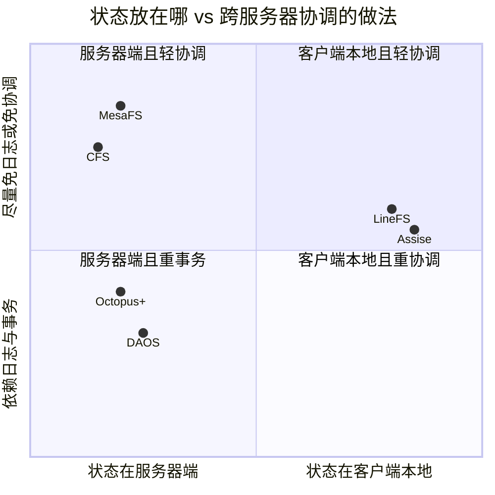

> 注：坐标为本文的定性判断，不是论文数据。

> 解读：Octopus+ 和 Assise 是 Optane 时代两条对立的路线。Octopus+ 把 NVM **池化在服务器**，靠单边 RDMA 让远端访问变便宜。Assise 把 NVM **放在客户端本地**，认为再便宜的远端访问也比不上本地。Assise 的评估中，Octopus 的小写延迟最多是 Assise 的 2.1 倍，小读最多是 Assise 远端读（Assise-RMT）的 3.54 倍（它测的是会议版加 FUSE，见 [Assise 精读 §8.2](assise-osdi2020.md#82-微基准论文-52图-3图-5)），这正是"远端池化"路线的代价。而 Octopus+ 的优势在于客户端无状态、服务器 CPU 卸载，更接近今天主流的分离式存储架构。

---

## 11. 整体总结

### 11.1 核心贡献

1. **设计主张**：RDMA 不应只是 DFS 通信层的替换件，文件系统的数据和元数据机制都应围绕 RDMA 原语重新设计（论文 §1、§3）。
2. **数据路径**：把 NVM 数据区注册成全局共享持久内存池，一次远程 IO 的拷贝从 7 次降到 4 次；client-active IO 用一次额外往返把数据搬运从服务器 CPU 转给客户端和网卡（论文 §3.2）。
3. **元数据路径**：用 `write_with_imm` 的自识别 RPC 同时拿到单边写的低延迟和双边通知的及时性；collect-dispatch 事务把日志集中在协调者，用单边写分发、用 RDMA 原子命令远程解锁（论文 §3.3）。
4. **期刊版增量**：集中式目录元数据服务器、元数据操作日志复制与客户端驱动的数据复制、写后 flush RPC 解决 DDIO 下的远程持久性，以及在真实 Optane DCPMM 上的完整评估（论文 §4、§5）。

### 11.2 设计哲学

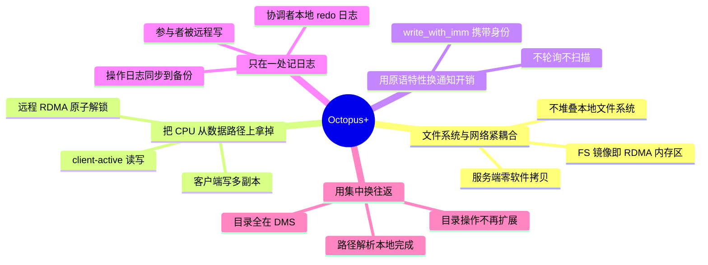

### 11.3 优点与局限

| 优点 | 局限 |
|------|------|
| 把软件延迟从 GlusterFS 的数百微秒压到约 6 µs，与硬件同量级 | 依赖 Optane PM（已停产）和 RDMA；DDIO 下的远程持久要额外一次 RPC |
| 大 IO 接近硬件带宽：单服务器读 11.9 GB/s、写 5.7 GB/s，6 台服务器聚合读约 63.5 GB/s | 单文件不跨服务器，单文件带宽和容量受限于一台服务器 |
| 自识别 RPC 简单有效，吞吐和延迟优于 eRPC、LITE、DaRPC（无批处理时） | 目录全部在一台 DMS 上，Mkdir 只有约 5.5 万 ops/s 且不随服务器数扩展 |
| collect-dispatch 让参与者免日志，复制可以直接挂在本地日志阶段 | 分发写和日志复制的远程持久性、锁泄漏、故障检测都没有说明 |
| 期刊版补上了复制和故障原子性，弥补会议版最明显的短板 | 只对比两个堆叠式系统，删去 Crail 和 2PC 消融；多个"两个数量级""数倍"在图上对不上 |

### 11.4 启示

1. **硬件变快后，先看软件栈的占比**。GlusterFS 在磁盘上软件只占约 1%，在 NVM + RDMA 上占约 99%。性能问题的位置会随硬件迁移，这比任何单个优化都更值得先测量。
2. **单边 RDMA 的真正收益是"让服务器 CPU 不在数据路径上"，而不是省一次往返**。client-active 主动多花一次往返，换来服务器从数据搬运中解脱，这与今天"客户端直连存储节点、控制面不在 IO 路径上"的分离式架构完全一致（3FS、DAOS 都是这一路线）。
3. **小 RPC 的通知机制值得专门设计**。`write_with_imm` 只是一个原语选择，却同时解决了"单边写无通知"和"轮询扫描随客户端数增长"两个问题。这个技巧在后来的 RDMA RPC 中很常见。
4. **把日志集中到一个参与者，是降低分布式事务成本最直接的办法**。collect-dispatch 与 CFS 把操作收敛到单分片、MesaFS 用有序更新去掉日志双写，目标一致：减少需要协商持久化顺序的参与方。但"只有一处日志"必须配上该日志的复制和远程持久性保证，否则就是新的单点。
5. **集中与分散的取舍要看规模**。用集中式 DMS 换路径解析往返，在 6 台服务器内划算，但图 15 已显示差距在缩小。同一研究组的 LocoFS（SC'17）、SingularFS（ATC'23），以及 InfiniFS、CFS 等系统，都在寻找"既少往返又可扩展"的目录组织方式。
6. **PM 已退场，RDMA 设计仍然适用**。Optane 停产后，共享持久内存池的"持久"部分要换成 NVMe 或带电容的 DRAM，但"FS 镜像直接注册为 RDMA 内存区、客户端单边直取、元数据走轻量 RPC"的路径分工依然适用。

### 11.5 一张图看懂 Octopus+

```mermaid
flowchart TB
    P["问题：NVM + RDMA 上传统 DFS 的软件开销占约 99%<br/>多次拷贝、服务器 CPU 瓶颈<br/>RPC 通知慢、2PC 往返多"]
    P --> I["思路：文件系统内部机制围绕 RDMA 原语重新设计<br/>而不是只换通信库"]
    I --> D1["数据<br/>共享持久内存池：FS 镜像注册为 RDMA 内存区<br/>client-active：RPC 拿地址，单边 RDMA 直取<br/>CPU 加锁 + RDMA 解锁"]
    I --> D2["元数据<br/>自识别 RPC：write_with_imm 携带 node_id 和 offset<br/>collect-dispatch：协调者本地日志，单边分发与解锁<br/>目录集中在 DMS，文件哈希分布"]
    I --> D3["可用性与一致性（期刊版新增）<br/>元数据操作日志复制，数据客户端写多副本<br/>数据 COW + 元数据 redo 事务<br/>写后 RPC 让服务器 flush"]
    D1 --> R["结果：Mkdir 软件延迟 6.3 µs<br/>单服务器读 11.9 GB/s，写 5.7 GB/s<br/>Stat 6 台约 190 万 ops/s，RPC 4.1 Mops/s"]
    D2 --> R
    D3 --> R
    R --> L["代价：依赖 Optane + RDMA<br/>DMS 单点，目录操作不扩展，单文件不跨服务器<br/>远程持久与故障处理细节缺失"]
```

---

## 参考

- Bohong Zhu, Youmin Chen, Qing Wang, Youyou Lu, Jiwu Shu. *Octopus+: An RDMA-Enabled Distributed Persistent Memory File System*. ACM Transactions on Storage 17(3), Article 19, 2021. <https://doi.org/10.1145/3448418>
- Youyou Lu, Jiwu Shu, Youmin Chen, Tao Li. *Octopus: an RDMA-enabled Distributed Persistent Memory File System*. USENIX ATC 2017, 773–785. <https://www.usenix.org/conference/atc17/technical-sessions/presentation/lu>
- Siyang Li, Youyou Lu, Jiwu Shu, Yang Hu, Tao Li. *LocoFS: A Loosely-Coupled Metadata Service for Distributed File Systems*. SC 2017.
- Nusrat Sharmin Islam, Md Wasi-Ur Rahman, Xiaoyi Lu, Dhabaleswar K. Panda. *High Performance Design for HDFS with Byte-Addressability of NVM and RDMA*（NVFS）. ICS 2016.
- Patrick Stuedi et al. *DaRPC: Data Center RPC*. ACM SoCC 2014；Crail：<https://github.com/zrlio/crail>
- Anuj Kalia, Michael Kaminsky, David G. Andersen. *Datacenter RPCs can be General and Fast*（eRPC）. USENIX NSDI 2019.
- Shin-Yeh Tsai, Yiying Zhang. *LITE Kernel RDMA Support for Datacenter Applications*. ACM SOSP 2017.
- John Ousterhout et al. *The RAMCloud Storage System*. ACM TOCS 33(3), 2015.
- Jian Yang, Joseph Izraelevitz, Steven Swanson. *Orion: A Distributed File System for Non-Volatile Main Memory and RDMA-Capable Networks*. USENIX FAST 2019.
- Thomas E. Anderson et al. *Assise: Performance and Availability via Client-local NVM in a Distributed File System*. USENIX OSDI 2020.（本仓库精读：[assise-osdi2020.md](assise-osdi2020.md)）
- Joseph Izraelevitz et al. *Basic Performance Measurements of the Intel Optane DC Persistent Memory Module*. arXiv:1903.05714, 2019.
