# 盘古 2.0 精读：从"卖容量"到"卖性能"的存储演进（FAST 2023）

> 论文：Qiang Li, Qiao Xiang, Yuxin Wang, Haohao Song, Ridi Wen, Wenhui Yao, …, Jiwu Shu, Jiesheng Wu（共 29 位作者）. *More Than Capacity: Performance-oriented Evolution of Pangu in Alibaba*. USENIX FAST 2023（Deployed Systems），Santa Clara，2023-02。
>
> 机构：阿里巴巴集团；厦门大学（Qiao Xiang、Jiwu Shu，以及 3 位同时署名厦门大学与阿里巴巴的作者）。
>
> 链接：<https://www.usenix.org/conference/fast23/presentation/li-qiang-deployed>；PDF <https://www.usenix.org/system/files/fast23-li-qiang_more.pdf>
>
> 篇幅：正文 12 页（论文集第 331–345 页，含参考文献），10 张图，无表格。
>
> 精读日期：2026-11-23。**数字和机制描述都摘自论文**，用"论文 §x / 图 x"标注出处。标"解读"的段落是本文作者的分析和推论，不是原文。图 5–8 没有数据标签，相关读数是本文从图上估读的，标注"约"，误差约 ±5%；图 10 带数据标签，直接引用。
>
> 相关文档：
> - [Fisc（FAST 2023）精读](fisc-fast2023.md)：同一会议、同一团队，盘古之上的云原生文件系统接入层。
> - [InfiniFS（FAST 2022）精读](infinifs-fast2022.md)：盘古元数据服务采用的并行路径解析等技术来源。
> - [工业界生产系统中的盘古小节](industry-production-systems.md#3-alibaba-pangu-more-than-capacityfast-2023)。
> - [Tectonic（FAST 2021）精读](tectonic-fast2021/README.md)：同为"重客户端"的超大规模生产文件系统。
> - [EBS Glory（FAST 2024）精读](ebs-fast2024.md)：建在盘古之上的阿里云块存储三代演进，可与本文流量放大、FPGA 压缩部分对照。

## 目录

- [0. 一页速览](#0-一页速览)
- [1. 盘古的定位与两代演进](#1-盘古的定位与两代演进)
- [2. 总体架构与设计目标](#2-总体架构与设计目标)
- [3. 阶段一：只追加的文件系统](#3-阶段一只追加的文件系统)
- [4. 阶段一：chunkserver 用户态存储操作系统 USSOS](#4-阶段一chunkserver-用户态存储操作系统-ussos)
- [5. 阶段一：毫秒级 P999 的 SLA 保障](#5-阶段一毫秒级-p999-的-sla-保障)
- [6. 阶段一的生产数据](#6-阶段一的生产数据)
- [7. 阶段二：业务转向与泰山服务器](#7-阶段二业务转向与泰山服务器)
- [8. 网络瓶颈：带宽扩容与流量放大](#8-网络瓶颈带宽扩容与流量放大)
- [9. 内存瓶颈：从加内存条到 RDCA](#9-内存瓶颈从加内存条到-rdca)
- [10. CPU 瓶颈：序列化、超线程与硬件卸载](#10-cpu-瓶颈序列化超线程与硬件卸载)
- [11. 单节点有效吞吐提升 6.1 倍的六个阶段](#11-单节点有效吞吐提升-61-倍的六个阶段)
- [12. 运维经验与案例](#12-运维经验与案例)
- [13. 经验教训](#13-经验教训)
- [14. 论文中的不一致与可疑之处](#14-论文中的不一致与可疑之处)
- [15. 与相关系统的对比](#15-与相关系统的对比)
- [16. 整体总结](#16-整体总结)
- [参考](#参考)

---

## 0. 一页速览

**一句话**：盘古是阿里巴巴从 2009 年开始建设的统一存储底座，EBS、OSS、NAS、PolarDB、MaxCompute 都建在它上面。这篇论文讲的是盘古 2.0 的两个阶段。第一阶段（2015 年起）把文件系统改成**统一的只追加持久层**，在 chunkserver 上做了**用户态存储操作系统 USSOS**，用 SSD + RDMA 做到 100 µs 级平均延迟、毫秒级 P999。第二阶段（2018 年起）业务从"卖容量"转向"卖性能"，网络从 2×25 Gbps 升级到 2×100 Gbps 后，瓶颈依次落到**网络、内存、CPU** 上，盘古用 EC + 压缩降低流量放大、用 RDCA 绕开内存、用混合 RPC 和硬件卸载省 CPU，最终把单存储节点的有效吞吐提升了 **6.1 倍**。

| 维度 | 要点 |
|------|------|
| 规模 | EB 级容量，管理万亿级文件；支撑淘宝、天猫、蚂蚁、阿里妈妈和阿里云 EBS/OSS/NAS/PolarDB/MaxCompute（论文 §1） |
| 架构 | 重客户端 + master（Raft，命名空间服务与 stream 元数据服务分离）+ chunkserver（USSFS）；上层 Pangu Service，旁路监控系统 Perseus（论文 §2.1） |
| 持久层 | 统一只追加接口 FlatLogFile，取代早期 LogFile、TempFile、随机访问文件等多种文件类型（论文 §3.1.1） |
| chunk | 自包含布局：每个 sector unit 带 footer（chunk ID、长度、CRC），一次写完数据和元数据；变长 chunk 1 MB–2 GB（论文 §3.1.3、§3.1.4） |
| 元数据 | 先按目录树、再按哈希分区；并行路径解析；客户端 LRU 缓存、批量请求、投机预取；创建 chunk 与写数据合并，省一个 RTT（论文 §3.1.4） |
| USSOS | run-to-completion 线程模型；网络与存储共享大页内存实现零拷贝；超时任务移到后台；优先级队列；轮询与事件驱动切换（论文 §3.2） |
| SLA | chasing（3 副本写成 2 个即返回）、non-stop write、backup read、两类黑名单（论文 §3.3） |
| 阶段一效果 | 2018 双十一数据库访问平均 <280 µs（峰值 55 万 TPS）；OTS 延迟降近一个数量级；EBS 写 P999 <1 ms；搜索读 P999 <5 ms（论文 §3.4） |
| 泰山服务器 | 2 × 24 核 Skylake、12 × 8 TB SSD（96 TB）、128 GB 内存、2 块双口 100 Gbps 网卡；单机 SSD 吞吐 >20 GB/s（论文 §4） |
| 网络 | 25→100 Gbps；从无损 RDMA 改为**有损 RDMA**（关闭 PFC）；EC(4,2) + LZ4 压缩把写放大从 6.375× 降到 2.9375×；前后台带宽动态分配（论文 §4.1） |
| 内存 | 加小容量内存条占满通道；后台流量从 TCP 改 RDMA（内存带宽省约 75%）；**RDCA** 让 RDMA 数据驻留在 LLC，内存带宽省约 89%（论文 §4.2） |
| CPU | 数据路径用类 FlatBuffer 原始结构替代 Protobuf（每核吞吐 +59%）；超线程用 monitor/mwait（吞吐 +31.6%）；FPGA 压缩、网卡算 CRC（论文 §4.3） |
| 总效果 | 单存储节点归一化有效吞吐 1 → 6.1（论文图 10） |

**解读**：

- 这篇论文的价值不在某个新算法，而在于**完整记录了一个十年级生产系统如何跟着硬件和业务走**。它最有意思的观察是：硬件升级后，瓶颈不会消失，只会转移。网络升到 100 Gbps 后，先卡在内存带宽，解决内存后又卡在 CPU，每一步都需要专门的软件工作才能吃到硬件红利。
- 盘古的整体取舍是"**统一底层、复杂上移**"：底层只提供只追加语义，块、对象、文件、表的随机更新都由上层服务用 KV 映射和 GC 实现。这与 GFS、Tectonic、Colossus 一脉相承，也是 EC 和压缩能大规模铺开的前提。
- 论文讲"做了什么"多，讲"为什么这样做、代价是什么"少。很多机制只有一段描述，没有消融实验，数字大多是生产观测。阅读时要把它当作经验报告，而不是可复现的研究。

---

## 1. 盘古的定位与两代演进

### 1.1 时间线（论文 §1）

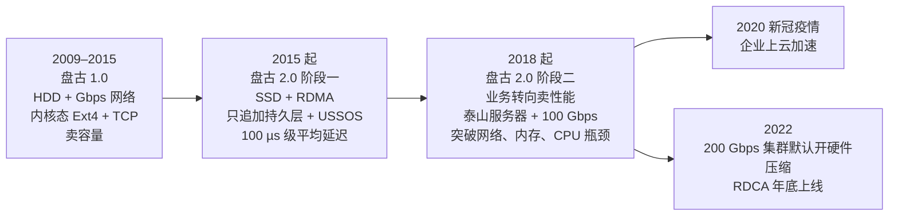

| | 盘古 1.0 | 盘古 2.0 阶段一 | 盘古 2.0 阶段二 |
|--|---------|----------------|----------------|
| 时间 | 2009–2015 | 2015 起 | 2018 起 |
| 硬件 | 商用 CPU + HDD，Gbps 级网络 | SSD + 25 Gbps RDMA | 泰山服务器（96 TB SSD）+ 100 Gbps RDMA |
| 软件栈 | 基于 Ext4 的内核态分布式文件系统 + 内核 TCP | 统一只追加持久层 + 用户态 USSOS | 在阶段一基础上优化网络、内存、CPU |
| 业务模式 | 卖容量：客户主要要大空间 | 开始追求性能 | 卖性能：企业上云，对延迟要求严格 |
| 目标 | 存得下 | 100 µs 级平均延迟，毫秒级 P999 | 单节点有效吞吐接近硬件能力 |

### 1.2 为什么要重做（论文 §1）

论文列出盘古 1.0 面对 SSD 和 RDMA 时的三个问题：

1. 1.0 的多种文件类型，尤其是允许随机访问的类型，在 SSD 上表现差。SSD 擅长顺序操作。
2. 内核态软件栈因为数据拷贝和频繁中断，跟不上 SSD 和 RDMA 的高 IOPS 和低延迟。
3. 数据中心从以服务器为中心转向**存算分离**，给低延迟带来额外挑战。

**解读**：第三点值得注意。存算分离后，每次 IO 都要过网络，存储系统的延迟预算里网络占比变大。盘古后面的很多设计（RDMA、省 RTT 的 piggyback、backup read）都是在压缩网络这一段。

---

## 2. 总体架构与设计目标

### 2.1 三层架构（论文 §2.1，图 1）

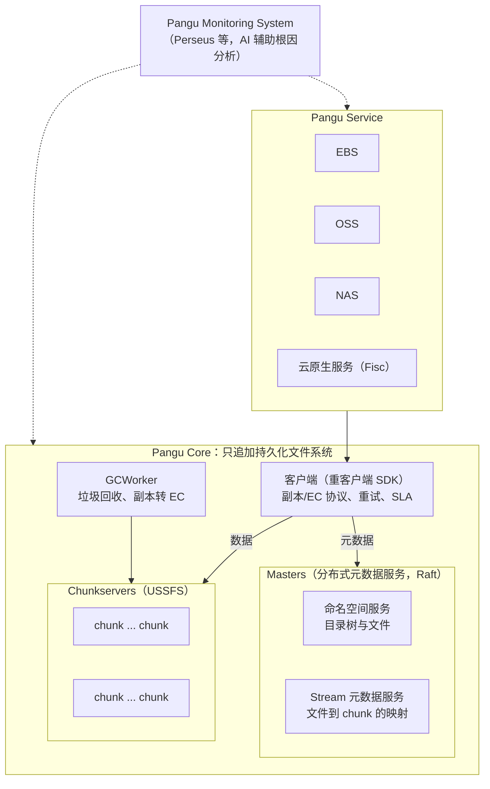

| 组件 | 职责 |
|------|------|
| 客户端 | 给上层服务提供 SDK；与 master 交互元数据、与 chunkserver 交互数据；负责副本和 EC 协议、SLA 保障、数据一致性。和 Tectonic、Colossus 一样是**重客户端** |
| Masters | 管理全部元数据，用基于 Raft 的协议保证一致。为了横向扩展到千亿级文件，拆成**命名空间服务**（目录树、命名空间）和 **stream 元数据服务**（文件到 chunk 位置的映射；stream 是一组 chunk 的抽象）。两者都先按目录树分区保证局部性，再用哈希细分做负载均衡（引用 InfiniFS） |
| Chunkservers | 以 chunk 为单位存数据，运行定制的用户态存储文件系统 **USSFS**，为不同硬件提供只追加存储引擎（如面向 HM-SMR 盘的 SMRSTORE） |
| 冗余 | 阶段一：先写 3 副本，之后 GCWorker 做垃圾回收并转成 EC 存储；阶段二：关键业务（如 EBS）逐步直接用 EC 替代 3 副本，以减少流量放大（§8.2） |
| Pangu Service | 在 Core 之上提供 EBS、OSS、NAS 等传统云存储，以及通过 Fisc 提供的云原生存储 |
| 监控 | Perseus 等，提供实时监控和 AI 辅助根因分析 |

**解读**：

- 注意两个名字的区别：**USSOS** 是 chunkserver 的用户态存储**操作系统**（线程模型、内存、调度），**USSFS** 是运行在其上的用户态存储**文件系统**（只追加引擎）。前者是运行时，后者是存储引擎。
- 命名空间和 stream 元数据分离，类似 Tectonic 把 Name、File、Block 三层元数据分开。好处是文件到 chunk 的映射（访问最频繁）可以独立扩展，不受目录树操作拖累。

### 2.2 设计目标（论文 §2.2）

| 目标 | 内容 |
|------|------|
| 低延迟 | 在存算分离架构下达到 100 µs 级平均 IO 延迟；在网络抖动和服务器故障等动态环境下仍提供毫秒级 P999 SLA |
| 高吞吐 | 存储服务器的有效吞吐接近其硬件能力 |
| 统一高性能 | 为在线搜索、流式分析、EBS、OSS、数据库等所有上层服务提供统一的高性能支持 |

---

## 3. 阶段一：只追加的文件系统

### 3.1 统一只追加持久层 FlatLogFile（论文 §3.1.1，图 2）

早期盘古为不同服务提供不同接口：给低延迟的 NAS 提供 LogFile，给高吞吐的 MaxCompute 提供 TempFile。每接一个新服务就要设计实现一个新接口，复杂、费人力、易出错。

受计算机网络分层架构启发，盘古引入统一文件类型 **FlatLogFile**：

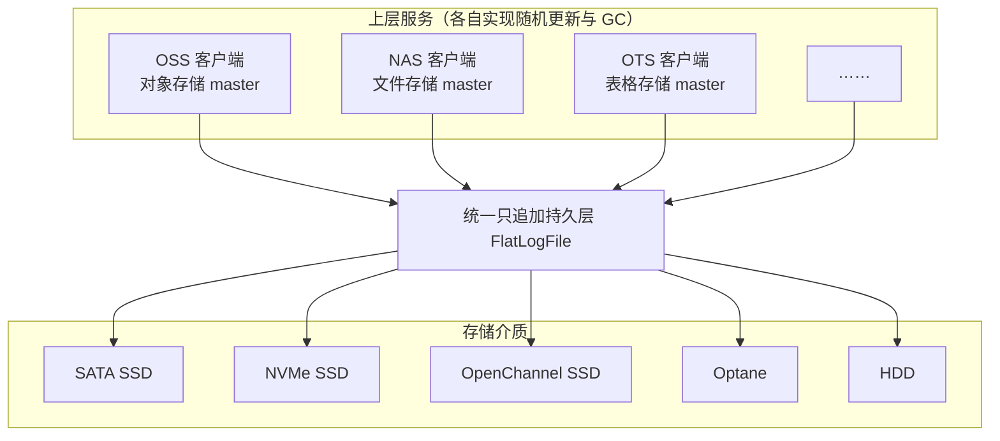

- FlatLogFile 只提供**追加**语义。上层服务（如 OSS）用类 KV 的映射实现数据更新，用垃圾回收压缩历史数据。
- 所有上层服务的升级和变更对盘古开发者透明，盘古只需保证 FlatLogFile 上的操作（尤其是写）在介质上高效可靠。
- 在 SSD 上，把 FlatLogFile 的顺序操作对齐，以获得高吞吐和高 IOPS。

**解读**：这就是网络里的"细腰"思想：中间层只提供最简单的语义（类似 IP），上下两端各自演进。代价是上层服务都要自己做日志结构存储（映射 + GC），而 GC 产生的后台流量正是阶段二流量放大的主要来源之一（§8.2）。

### 3.2 重客户端（论文 §3.1.2）

| 职责 | 说明 |
|------|------|
| 数据与元数据 | 与 chunkserver 做数据操作，与 master 获取和更新元数据 |
| 冗余协议 | 拿到 chunk 信息后，由客户端执行副本协议和 EC 协议 |
| 抗抖动 | 重试机制（如 backup read）应对网络丢包等偶发抖动 |
| 探测 | 定期从 master 获取最新 chunkserver 状态，评估各 chunkserver 的服务质量 |
| 参数选择 | 像 Tectonic 的客户端一样，按服务需求选择读写参数 |

**解读**：重客户端是盘古低延迟的关键（数据路径不经过任何代理，客户端直连 chunkserver），但也是 [Fisc](fisc-fast2023.md) 要解决的问题：在容器和多租户环境里，重客户端占用资源、升级困难、隔离差。两篇论文同年发表，可以对照着读：盘古讲重客户端怎么做到快，Fisc 讲怎么把它变轻。

### 3.3 自包含 chunk 布局（论文 §3.1.3，图 3）

Ext4 这类文件系统把文件数据和元数据分两次写到介质上，既增加写延迟，又缩短 SSD 寿命。盘古改为**自包含 chunk**：每个 chunk 同时存数据和自己的元数据，一次写完。

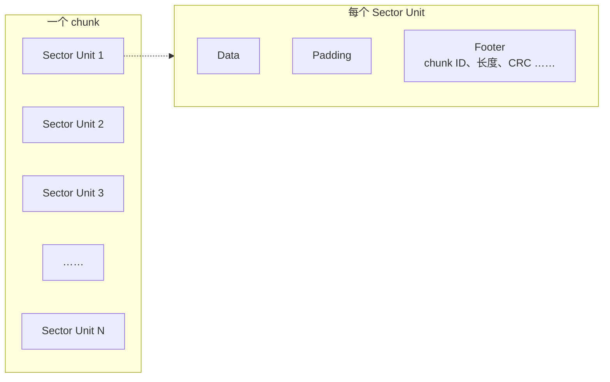

**崩溃恢复**：客户端连续写自包含 chunk 时，chunkserver 在内存中保存这些 chunk 的元数据副本，并定期 checkpoint 到介质。故障导致写操作未完成时，chunkserver 加载 checkpoint，与 chunk 内的元数据比对；有出入就检查 chunk 的 CRC，恢复到最新的正确状态。

**解读**：每个 sector unit 都带 footer，相当于把日志的"提交记录"嵌进了数据本身。这样做不需要单独的 journal，一次顺序写就同时完成数据和元数据的持久化；代价是每个 sector unit 都有 padding 和 footer 的空间开销，论文没有给出这部分开销的大小。

### 3.4 元数据操作优化（论文 §3.1.4）

| 机制 | 做法 | 效果 |
|------|------|------|
| 并行元数据处理 | 命名空间和 stream 服务都采用并行处理（如 InfiniFS）：用哈希把高内聚的元数据映射到不同服务器；新的数据结构支持**可预测的目录 ID**，客户端可以并行解析路径 | 降低元数据访问延迟 |
| 大块变长 chunk | 选用大 chunk 以减少元数据数量、减少客户端频繁申请 chunk 的延迟、延长 SSD 寿命；为避免碎片，chunk 变长（1 MB–2 GB）。EBS 的 chunk 大小 P95 为 64 MB，P99 为 286.4 MB | 兼顾元数据量与碎片，兼容盘古 1.0 |
| 客户端缓存 chunk 信息 | 每个客户端维护本地元数据缓存池，LRU 更新。缓存未命中，或命中但 chunkserver 告知元数据已过期（如副本迁移）时，才向 master 请求 | 减少元数据请求 |
| 请求批量化 | 客户端在短时间窗口内聚合多个 chunk 信息请求批量发送，master 并行处理后合并返回，客户端再拆分分发 | 提高查询效率 |
| 投机预取 | 贪心、概率性的预取：读请求时 master 顺带返回其他 chunk 的元数据；写请求时多分配一些可用 chunk，客户端遇到写异常可以直接切换 chunk | 减少请求次数，加快故障切换 |
| 数据捎带 | 受 QUIC 和 HTTP/3 启发，客户端拿到 chunk 地址后，把"创建 chunk"请求和要写的数据合并成一个请求发给 chunkserver | 写延迟减少一个 RTT |

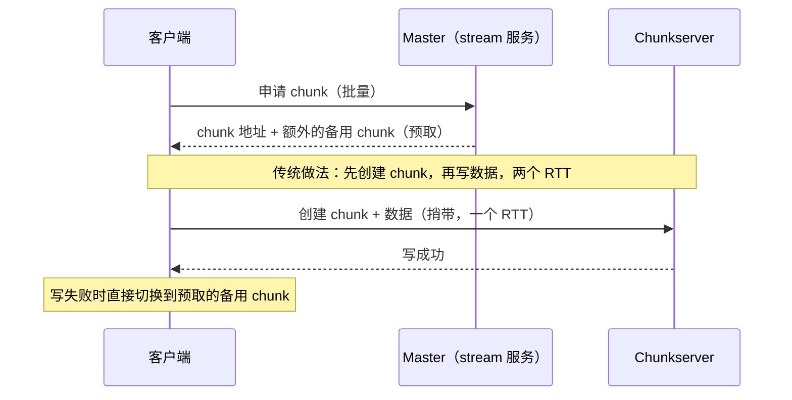

**解读**：可预测目录 ID 与 InfiniFS 的"基于出生三元组哈希的推测式路径解析"是同一思路：只要 ID 能由父目录和名字算出来，客户端就可以并行查询路径上的每一级，而不必逐级等待。详见 [InfiniFS 精读](infinifs-fast2022.md)。

---

## 4. 阶段一：chunkserver 用户态存储操作系统 USSOS

chunkserver 承担所有数据操作。在高速网络和存储介质面前，走内核态会带来频繁中断（消耗 CPU）和用户态/内核态之间不必要的数据拷贝。盘古因此做了内核旁路的用户态存储操作系统 **USSOS**，在设备管理和 run-to-completion 线程模型之外，还实现了用户态内存管理、轻量调度和用户态文件系统 USSFS（论文 §3.2）。

### 4.1 用户态内存管理：零拷贝（论文 §3.2.1）

USSOS 基于现有用户态技术构建（网络栈用 RDMA、DPDK，存储栈用 SPDK），并把两个栈统一起来：

- **run-to-completion**：一个请求从头到尾在一个线程上执行，避免流水线模型中的上下文切换、线程间通信和同步开销。
- **共享大页内存**：线程申请大页内存，作为网络栈和存储栈之间的共享内存。网络收到的数据通过 RDMA 直接落到大页内存，再把地址和大小交给存储栈，由 SPDK 直接从大页写到介质。

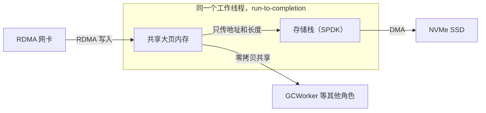

chunkserver 与 GCWorker 等不同角色之间的数据传输也可以通过共享大页实现零拷贝。

### 4.2 用户态调度（论文 §3.2.2）

| 问题 | 原因 | 做法 |
|------|------|------|
| 一个任务阻塞后续任务 | 每个 chunkserver 的工作线程数固定，请求按文件哈希分到线程，同一线程内先到先服务。查表、遍历、内存分配、监控统计等耗时任务会占住线程 | 重任务：用心跳监控任务执行时间并报警，超出时间片的任务移到后台线程。系统开销：用 TCMalloc 的缓存让高频操作在缓存内完成 |
| 低优先级请求挡住高优先级请求 | 用户请求和 GC 请求可能被分到同一线程 | 按 QoS 目标建立优先级队列 |
| 大量中断开销 | 低负载时轮询浪费 CPU，高负载时中断太多 | 轮询与事件驱动切换（类似 Linux NAPI）：默认事件驱动；收到网卡通知后进入轮询；一段时间没有 IO 再切回事件驱动 |

**解读**：run-to-completion 最怕的就是"一个慢任务拖住整条线程"。论文的三个机制本质上都是在用户态补回内核调度器的能力：时间片（心跳监控 + 后台线程）、优先级（多队列）、中断合并（NAPI 式切换）。这也是 §13 "用户态系统要向内核学习"这条教训的来源。

### 4.3 只追加的 USSFS（论文 §3.2.3）

| 特点 | 说明 |
|------|------|
| 接口 | 基于 chunk 的语义：open、close、seal、format、read、append，不是 POSIX |
| 写读模式 | 只追加顺序写，充分利用 SSD 顺序写友好；已写成功的数据支持随机读 |
| 无 page cache、无 journal | 依靠自包含 chunk 布局（§3.3）减少数据操作次数 |
| 无目录层级 | 不像 Ext4 那样建立 inode 与目录的层级关系；所有文件操作记录到日志文件，挂载时重放日志重建元数据 |
| 轮询 | 用轮询而不是中断 |
| 分配粒度 | 单个 SSD 节点容量达几十甚至上百 TB，chunk 通常 64 MB，因此最小空间分配粒度设为 **1 MB**，兼顾空间管理元数据的内存占用和 SSD 空间利用率 |

**解读**：USSFS 的设计与 DAOS 的 VOS、3FS 的 chunk 引擎属于同一类：**放弃通用文件系统语义，换取一次写入、零拷贝和可预测的延迟**。1 MB 的分配粒度意味着小于 1 MB 的 chunk 会浪费空间，这与"变长 chunk 最小 1 MB"（§3.4）是对应的。

---

## 5. 阶段一：毫秒级 P999 的 SLA 保障

盘古用四种机制在故障和抖动下保证毫秒级 P999（论文 §3.3）：

| 机制 | 针对的情况 |
|------|-----------|
| Chasing | 短暂的异常抖动（网络闪断、incast 引起的重传），系统能自动恢复 |
| Non-stop write | chunk 不可用 |
| Backup read | 读请求在限定时间内没有返回 |
| Blacklisting | 服务质量差或故障的 chunkserver |

### 5.1 Chasing：写成大多数就返回（论文图 4）

客户端写 MaxCopy 个副本，只要有 MinCopy 个成功就向应用返回成功，其中 2 × MinCopy > MaxCopy。以 MaxCopy = 3、MinCopy = 2 为例：

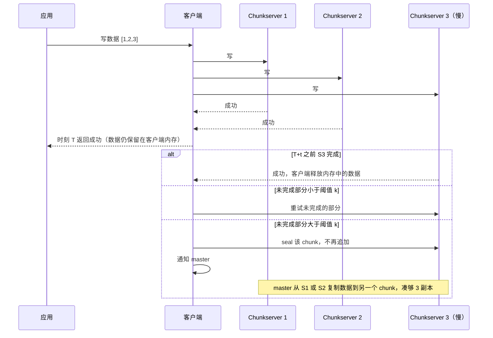

- t 是一个经验性的毫秒级阈值，k 是经验性的数据量阈值。
- **数据丢失风险分析**：在 [T, T+t] 期间，系统里仍有 3 份数据，第三份在客户端内存里。只有两个 chunkserver 的 SSD 都损坏，且客户端内存中的副本也丢失（客户端故障或集群断电）时才会丢数据。SSD 年故障率约 1.5%，服务器年宕机率 <2%，两者接近，所以"两份写成、一份在追"时的丢数据概率与"三份都写成"大致相同。
- 盘古部署 chasing 超过十年，没有发生过由 chasing 导致的数据丢失。

**解读**：

- Chasing 是"**多数派确认 + 客户端兜底**"。和 Raft/Paxos 的多数派写不同，这里的第三份副本最终一定会补齐：要么追上，要么 seal 后由 master 重新复制。它把尾延迟从"最慢副本"降到"第二慢副本"。
- 论文的风险分析比较粗：它把客户端内存副本的可靠性类比为服务器的年宕机率，但没有考虑客户端进程崩溃（比服务器宕机更频繁）的情况，也没有给出 t 和 k 的具体值。窗口 t 是毫秒级，丢数据需要三件事在毫秒内同时发生，实际风险确实很低。

### 5.2 Non-stop write（论文 §3.3）

chunk 写失败时：客户端 seal 该 chunk，把已成功写入的长度报告给 master，然后**换一个新 chunk 继续写**未完成的数据。如果 sealed chunk 中的数据损坏，后台用其他副本把这段数据复制到新 chunk；如果没有可用副本，客户端把这段数据重新写到新 chunk。

**解读**：只追加语义让这件事很简单：失败的 chunk 直接封存，不需要原地修复，写入永远可以"向前走"。配合 §3.4 的预取备用 chunk，切换几乎不需要等 master。

### 5.3 Backup read（论文 §3.3）

客户端在收到前一个读请求的响应之前，向其他 chunkserver 发送额外的备份读请求。两个关键参数是**发多少个**和**等多久再发**：盘古按不同盘型和 IO 大小统计延迟，动态调整发送备份读的时机，并限制备份读的数量以控制系统负载。

### 5.4 两类黑名单（论文 §3.3）

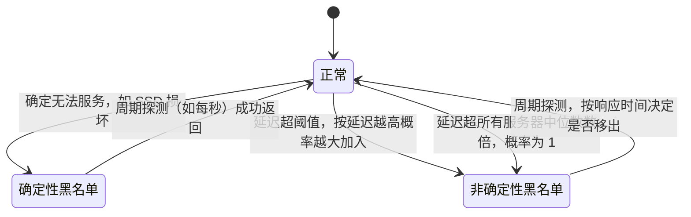

- 限制黑名单中服务器的总数，保证系统可用性。
- 每台服务器加入和移出黑名单都有宽限期，避免抖动。
- TCP 和 RDMA 链路上的故障服务器可能不同，因此**分别维护 TCP 和 RDMA 两套黑名单**，在两条链路上都做探测。

**解读**：非确定性黑名单是针对**慢节点**（fail-slow）的，而不是故障节点。按概率加入避免了一个慢节点被所有客户端同时拉黑造成的负载骤变。同期的 Perseus（FAST 2023，同为阿里）专门研究了云存储的慢盘检测。

---

## 6. 阶段一的生产数据

### 6.1 四组生产观测（论文 §3.4，图 5–8）

| 图 | 场景 | 条件 | 论文结论 | 本文估读（±5%） |
|----|------|------|---------|---------------|
| 图 5 | 2018 双十一数据库访问 | 峰值 55 万 TPS（至少是平日的 10 倍），约 6 分钟 | 访问延迟 <280 µs | 平均延迟在约 240–280 µs 之间波动 |
| 图 6 | OTS 查询，盘古 1.0 vs 2.0 | 相同 SSD、25 Gbps 网络、相同压力，12 小时 | 延迟降低近一个数量级 | 1.0 约 2,300–7,600 µs；2.0 约 300 µs，比值约 8–25 倍 |
| 图 7 | 在线 EBS 集群写延迟 | 一个月，读写比约 1:10 | 长尾 <1 ms | 平均约 50–80 µs；P999 约 650–950 µs，日周期波动 |
| 图 8 | 在线搜索集群读延迟 | 一个月，读密集 | 长尾 <5 ms | 平均约 150–200 µs；P999 约 1,500–3,000 µs，第 10 天有一次约 4,300 µs 的尖峰 |

**解读**：

- 图 6 的提升来自"读写操作延迟更低、单线程处理能力更强"，即只追加持久层 + USSOS 的综合效果，论文没有拆分各项贡献。
- 图 7 中 EBS 写的平均延迟只有几十微秒，P999 却接近 1 ms，两者相差 10 倍以上。这说明盘古 2.0 的平均延迟已经很低，**主要矛盾在尾延迟**，这也是 §5 四种机制的意义。
- 图 5 只覆盖约 6 分钟，只是峰值时段的一个切片。

---

## 7. 阶段二：业务转向与泰山服务器

### 7.1 从卖容量到卖性能（论文 §4）

2018 年起，越来越多企业把业务搬到阿里云，对存储性能和延迟要求很高，2020 年疫情后这一趋势加快。盘古需要持续升级基础设施，但沿着 Clos 拓扑（如 Fat-Tree）用原有服务器和交换机横向扩展不经济：总拥有成本（机柜、电、制冷、人力）高，碳排放也高。

### 7.2 泰山存储服务器（论文 §4）

| 项 | 配置 |
|----|------|
| CPU | 2 × 24 核 Skylake |
| SSD | 12 × 8 TB 商用 SSD，共 96 TB |
| 内存 | 128 GB DDR |
| 网卡 | 2 块双口 100 Gbps 网卡 |
| 单机 SSD 吞吐 | 经 SSD 厂商优化（缓存、通道）后超过 20 GB/s |

论文特别说明：**本可以继续加大单机容量，但为了保持较高的写 IOPS/GB 而没有这样做**，以适应卖性能的业务模式。

**解读**：

- "IOPS/GB"是理解这次转型的关键指标。卖容量时，每 GB 成本最重要，盘越大越好；卖性能时，每 GB 能分到的 IOPS 和带宽才重要，盘太大反而会摊薄性能。
- 20 GB/s 的 SSD 吞吐相当于 160 Gbps，单块 100 Gbps 网卡跟不上，这就是网络必须升级的直接原因。但一升级，瓶颈就跑到了别处。

### 7.3 瓶颈转移

有了高性能存储服务器，网络、内存、CPU 自然成为新的瓶颈。论文强调"与通常的看法相反"，在升级后的基础设施上提供高性能低延迟 IO 并不简单，因为新硬件在大规模部署时会带来新的技术挑战。

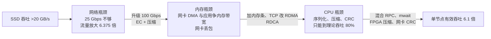

---

## 8. 网络瓶颈：带宽扩容与流量放大

### 8.1 带宽扩容：从无损到有损 RDMA（论文 §4.1.1）

为了匹配单节点全部 SSD 的吞吐，网络从 25 Gbps 升级到 100 Gbps。

- **硬件**：高性能网卡/RNIC、光模块（QSFP28 DAC、AOC 等）、单模/多模光纤、高性能交换机。
- **软件**：先采用**无损 RDMA**，并为大规模部署设计了一些机制，例如 RDMA 网络上 pause 帧过多时关闭网卡端口，或临时（几秒）从 RDMA 切换到 TCP（详见 NSDI 2021 的 *When Cloud Storage Meets RDMA*）。但这些机制解决不了基于 pause 帧流控的其他问题，比如死锁和队头阻塞。因此盘古**升级到有损 RDMA**，关闭 pause 帧，以避免这些问题并提高性能。

**解读**：从 PFC 无损网络转向有损 RDMA，是 2020 年前后云厂商的共同方向（如 IRN 等研究、阿里 Solar 网络栈）。它要求网卡的重传机制足够好，代价是丢包时的恢复延迟。对比 [Fire-Flyer](fireflyer-aihpc-sc2024.md) 在 IB 网络上关闭 DCQCN、依赖信用流控的做法，两者都在回避"通用拥塞控制参数难调"的问题，但方向相反：Fire-Flyer 保留无损、去掉拥塞控制；盘古去掉无损、保留拥塞控制。

### 8.2 流量放大：EC + 压缩（论文 §4.1.2，图 9）

**流量放大率** = 网络传输的数据量 / 文件实际大小。以 EBS 写一个文件的完整生命周期为例：

| 方案 | a | b | c | d | 合计 | 100 Gbps 下 EBS 可用带宽上限 |
|------|--:|--:|--:|--:|----:|---------------------------:|
| 3 副本，GC 后转 EC(8,3) | 1 | 3 | 1 | 1.375 | **6.375×** | 100 / 6.375 ≈ 15.7 Gbps（论文："不到 16 Gbps"） |
| 前台改用 EC(4,2) | 1 | 1.5 | 1 | 1.375 | **4.875×** | ≈ 20.5 Gbps |
| EC(4,2) + 客户端和 GCWorker 都做 LZ4 压缩（压缩率 50%） | 1 | 0.75 | 0.5 | 0.6875 | **2.9375×** | ≈ 34.0 Gbps |

> 合计与"可用带宽上限"一列中后两行是本文按论文公式复算的；论文为简化忽略了 GC 前后文件大小的变化。

**两个挑战与做法**：

| 挑战 | 做法 |
|------|------|
| 小文件用 EC 很贵：固定长度编码需要大量补零 | 小写请求聚合；EC 与 3 副本之间动态切换 |
| EC 计算带来不可忽略的延迟 | 用 Intel ISA-L，比 Jerasure 快 2.5–3 倍 |

**压缩**：FlatLogFile 冗余度很高，盘古客户端和 GCWorker 在写之前都做压缩，选用 LZ4。生产数据显示平均压缩率可达 50%。

**前后台带宽动态分配**：动态调整后台流量（如 GC）可用的带宽阈值。集群空闲空间充足时，临时调低阈值，让前台流量多用带宽。例如淘宝业务从白天到午夜设低阈值以应对大量前台访问，午夜后前台流量下降再调高。

**解读**：

- 这张表最能说明"**卖性能**"的含义：同样的网卡，流量放大从 6.375 降到 2.94，相当于前台可用带宽翻了一倍多，比升级网卡便宜得多。
- EC(4,2) 和 3 副本一样能容忍两个故障，存储开销从 3× 降到 1.5×，网络放大也相应减半。代价是写延迟（编码计算）和小写的补零浪费，论文分别用 ISA-L 和小写聚合来缓解。
- GC 读写（c、d 两步）在 6.375× 中占了 2.375×，超过三分之一。这是只追加设计的固有代价（§3.1），盘古的应对是压缩它和在时间上错开它，而不是消除它。

---

## 9. 内存瓶颈：从加内存条到 RDCA

### 9.1 问题（论文 §4.2）

根本问题是接收端主机上，**网络（网卡 DMA）和应用（数据拷贝、复制、GC）争抢内存带宽**。网卡拿不到足够的内存带宽，就会对网卡产生严重的 PCIe 反压，网卡缓冲区被在途报文填满后开始丢包，触发网络拥塞控制，导致整体性能下降：

| 指标 | 影响（每台服务器） |
|------|------------------|
| 网络吞吐 | 下降 30% |
| 延迟 | 增加 5%–10% |
| IOPS | 下降 10% |

论文指出这不是盘古独有的现象，Google 也报告过类似问题（*Understanding Host Interconnect Congestion*，HotNets 2022）。

盘古分三步解决：

### 9.2 第一步：加小容量内存条（论文 §4.2.1）

瓶颈在内存**带宽**而不是**容量**，所以给服务器插更多小容量内存条（如 16 GB），占满内存通道，提高每台服务器的可用内存带宽。同时启用 NUMA，避免跨 socket 内存访问受 UPI 限制。

### 9.3 第二步：后台流量从 TCP 改为 RDMA（论文 §4.2.2）

25 Gbps 时代，后台流量走 TCP，原因是 25 Gbps 交换机上 RDMA 只有一个硬件队列，要保证前台流量的 QoS 只能把后台流量放到 TCP 上。升级到 100 Gbps 后，后台流量也改走 RDMA：

- TCP 比 RDMA 至少多 4 次内存拷贝，切换后**后台流量消耗的内存带宽减少约 75%**。
- 为保证前台 QoS，设计了类似 Linux tc 的主机端限速，控制后台流量注入网络的速率。

### 9.4 第三步：RDCA，远程直接缓存访问（论文 §4.2.3）

RDCA 让发送端**绕过接收端的内存，直接访问它的缓存**。其依据是一个生产观察：数据离开网卡后在内存中停留的时间很短，平均只有几百微秒。

**容量估算**：假设平均停留 200 µs，双口 100 Gbps 网卡（25 GB/s）只需要 200 µs × 25 GB/s = **5 MB** 来暂存离开网卡的数据。

已有的 DCA 和 Intel DDIO 等缓存访问技术存在 **leaky DMA** 问题：新到达的报文频繁触发缓存驱逐，数据还没被处理就被挤出 LLC 写回内存。RDCA 通过三个组件，回收一小块 LLC 支撑网卡线速运行：

| 组件 | 做法 |
|------|------|
| 缓存常驻缓冲池 | 小消息用共享接收队列（SRQ），大消息用带窗口限速的 READ 缓冲区，使 RDMA 所需的内存缓冲区能放进缓存 |
| 快速缓存回收 | 流水线并行处理数据，并用硬件卸载和轻量（反）序列化优化处理，缩短数据离开网卡后的停留时间，用尽量少的 LLC 支撑 100 Gbps 线速 |
| 缓存压力感知的逃逸机制 | 监控预留 LLC 的使用情况，应对 SSD 慢写、应用异常等偶发抖动：① 给慢数据换一块新缓冲区加入池中，保持可用缓存大小不变；② 替换过多时，把慢应用的数据主动拷贝到内存；③ 拷贝失败或不足以缓解压力时，让网卡在 CNP 中标记 ECN，通知发送端降速 |

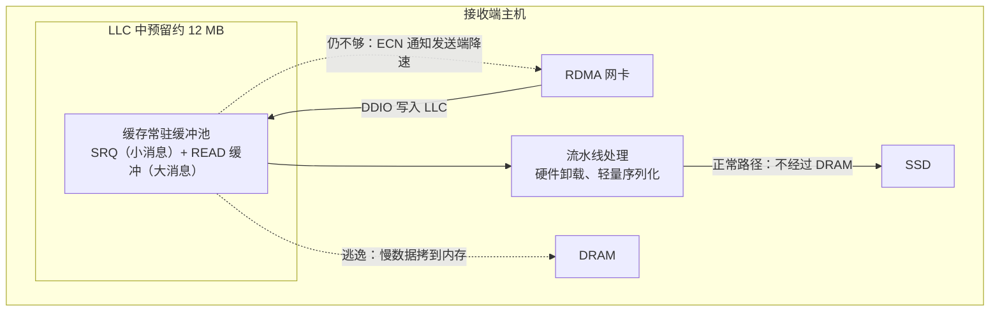

**实现与效果**：基于 Intel DDIO 在商用硬件上实现。在部分盘古集群上的评估显示，典型存储负载下：

| 指标 | 结果 |
|------|------|
| 每台服务器占用 LLC | 12 MB（约占总缓存 20%） |
| 平均内存带宽消耗 | 降低约 89% |
| 网络吞吐 | 提升 9% |
| 非存储负载（延迟敏感的 HPC 集合通信） | 平均延迟最多降低 35.1% |

RDCA 于 2022 年底在盘古上线。

**解读**：

- RDCA 的核心洞察是"**存储数据在主机上是过路数据**"：从网卡进来，很快写到 SSD 或转发出去，根本不需要进 DRAM。只要处理足够快，LLC 就够用。这与传统认为"存储需要大内存做缓冲"的直觉相反。
- 12 MB 约占 20% 的数字与 DDIO 默认只用 LLC 的 2/11 路（约 18%）相符，说明 RDCA 是在 DDIO 现有的缓存配额内工作，而不是修改硬件。
- 89% 的内存带宽节省远大于 9% 的吞吐提升，说明在这些集群上内存带宽已不是唯一瓶颈（论文接着就讲 CPU 瓶颈）；RDCA 更大的价值可能在于为 CPU 和其他任务释放内存带宽、降低丢包风险。
- RDCA 只有一段描述，没有给出缓冲池大小的设定方法、逃逸触发频率等细节。

---

## 10. CPU 瓶颈：序列化、超线程与硬件卸载

即使突破了网络和内存瓶颈，100 Gbps 网络下盘古的吞吐仍只能达到**理论值的 80%**，因为序列化/反序列化、数据压缩、CRC 计算消耗了大量 CPU（论文 §4.3）。

### 10.1 混合 RPC（论文 §4.3.1）

- 用 Protobuf 做 RPC 序列化和反序列化，约占 **30% 的 CPU 开销**。
- 这部分开销主要发生在数据路径上的少数几种 RPC。
- 做法：数据路径改用类似 FlatBuffer 的原始结构，直接收发数据而不做序列化；控制路径继续用 Protobuf，保留其灵活性。
- 效果：**每核网络吞吐提升约 59%**。

### 10.2 用 CPU Wait 支持超线程（论文 §4.3.2）

盘古起初不用超线程，CPU 核变得稀缺后开始启用，但遇到两个问题：同一物理核上两个超线程需要切换上下文；两个超线程同时执行任务会互相影响，两边延迟都上升。

例如，一个超线程上跑网络空轮询线程，另一个超线程同时用 LZ4 压缩 4 KB 数据，压缩延迟比独占物理核时**增加 25%**。

做法是用 **CPU wait** 指令（monitor + mwait）：网络空轮询线程在被监视的内存地址上 mwait，直到该地址被其他线程写入才醒来。mwait 期间该超线程进入 C0 以外的空闲睡眠状态，不干扰同核的另一个超线程。用系统调用唤醒超线程需要毫秒级时间，而 CPU wait 避免了这一开销。在上述例子中，**网络吞吐提升 31.6%**。

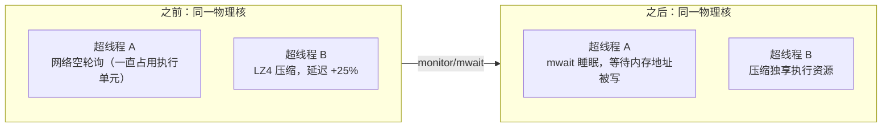

**解读**：这是一个很实际的优化。用户态存储系统为了低延迟普遍采用轮询，而轮询线程在超线程环境下会"偷走"兄弟线程的执行资源。mwait 让轮询变成"硬件级等待"：不占执行单元，又能在数据到达时以极低延迟醒来。论文"调用它们需要不到 5 ms"的说法单位存疑，见 §14。

### 10.3 软硬件协同：卸载压缩和 CRC（论文 §4.3.3）

| 卸载 | 硬件 | 效果 |
|------|------|------|
| 数据压缩 | 基于 FPGA 的计算型存储盘 | 3 GB/s 吞吐时约节省 10 个物理核（Xeon Platinum 2.5 GHz） |
| CRC 计算 | 支持 RDMA 的网卡计算每个数据块的 CRC，CPU 聚合这些 CRC 并做轻量检查 | 相同吞吐下比软件 CRC 节省 30% CPU 开销 |

---

## 11. 单节点有效吞吐提升 6.1 倍的六个阶段

论文图 10 给出了 EBS 和高性能 ESSD 存储节点在演进过程中的**归一化单节点有效吞吐**（NETPSN）（论文 §4.4）：

| 阶段 | 变化 | NETPSN | 理想值 | 没达到理想值的原因 |
|------|------|-------:|------:|------------------|
| ① | 2 × 25 Gbps 网络，4 TB SSD | **1.0** | — | 基线 |
| ② | SSD 升到 8 TB；网络升到 100 Gbps（服务器只支持 PCIe 3.0，所以是 1 × 100 Gbps） | **1.7** | 2.0 | 读写占用的内存带宽达 90 GB/s，接近服务器上限 105 GB/s |
| ③ | 内存带宽优化（§9） | **2.0** | 2.0 | 达到 |
| ④ | 升级 PCIe 4.0，网络 2 × 100 Gbps | **3.3** | 4.0 | 流量放大约 6 倍 |
| ⑤ | 客户端采用 EC(4,2)、压缩等，流量放大减半（约 3 倍） | **5.0** | 6.6 | 压缩等操作消耗大量 CPU |
| ⑥ | 压缩和 CRC 卸载到硬件（§10） | **6.1** | — | — |

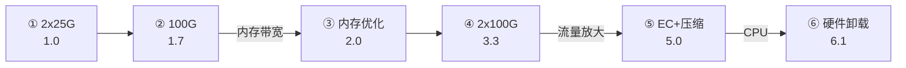

**解读**：

- 这张图是全文的骨架，把 §8–§10 串成一条线：**每次硬件升级都带来"理想值"，每次没达到理想值都暴露一个新瓶颈，下一步就去解决它**。
- 阶段 ② 的数据很说明问题：100 Gbps 网络（12.5 GB/s）却消耗了 90 GB/s 的内存带宽，即每字节网络数据产生约 7 字节内存访问。这正是 RDCA 要消除的。
- 网络带宽从 2 × 25 到 2 × 100 Gbps 是 4 倍，有效吞吐却提升了 6.1 倍。超出的部分来自流量放大的降低：同样的网络带宽能承载更多有效数据。
- NETPSN 是归一化值，论文没有给出绝对吞吐，也没有说明"有效吞吐"的精确定义（是否指前台业务数据量）。另外第 ① 到 ② 阶段同时换了 SSD 容量，各因素的贡献不完全可分。

---

## 12. 运维经验与案例

### 12.1 运维周期（论文 §5.1）

盘古 2.0 对监控系统做了两项改进以匹配 100 µs 级延迟：

1. 监控时间粒度从 **15 秒缩短到 1 秒**，并扩展日志服务做按需追踪，可以对**每个文件操作**做追踪，捕获内存分配异常、日志打印超时等细粒度异常事件。
2. 用 AI 捕捉异常事件与根因之间的因果关系，运维团队对推断出的根因打分并反馈给模型，提高准确率，减少人力。

### 12.2 案例（论文 §5.2）

| 案例 | 现象 | 根因 | 处理 |
|------|------|------|------|
| 数据完整性 | 端到端 CRC 报错 | 某些 CPU 的**静默错误** | 与 Intel 合作，在整体负载低时于生产环境运行静默错误检测工具，取得一定成效 |
| USSOS 的 SLA 抖动 | 延迟抖动 | ① TCMalloc 进入全局分配阶段（新线程申请内存）或内存整理阶段（大量 RDMA QP 申请高阶内存）时很慢；② 日志打印等周期性重任务；③ 内存占用高时 USSOS 做内存回收导致 CPU 飙升 | ① 用户态内存分配池，RDMA 驱动改用匿名页；② 重任务移到异步线程；③ 调整内存回收阈值，后台回收 buffer 和 cache |
| 可纠正 MCE | USSOS 按过时的虚拟/物理地址映射访问已被内核迁移的物理页，导致错误 | USSOS 能监测硬件故障，但感知不到内核为隔离异常而迁移物理内存 | 在 MCE 监控守护进程中加处理器：可纠正 MCE 超过阈值时暂停相关用户态进程，通知内核迁移内存，迁移完成后进程恢复并更新映射表。例：一个 2,300 台服务器的集群 22 天内出现 <330 次可纠正 MCE |
| 内存带宽差异 | 集群性能下降 | 不同厂商的 128 GB 内存在 1:1 读写下带宽分别为 94、84、60 GB/s，相差 57% | 更关注内存性能而不只是容量；这也是接收端主机数据路径拥塞的最早证据，以及 RDCA 的直接动机 |
| 2019 双十一 | RDS 读尾延迟飙升 | 一个 chunk 的两个副本正在做均衡迁移，同时存放第三个副本的 chunkserver 故障；客户端要把三个副本都试一遍失败后，才去请求最新的 chunkserver 地址 | 客户端定期从 master 拉取异常 chunkserver 上的 chunk 信息；所需 chunk 在异常服务器上时立即请求最新元数据 |
| 2020 双十一 | 尾延迟再次飙升 | 由于内部问题，很多 chunkserver 被判为异常，客户端收到大量异常服务器信息，耗费大量资源做反序列化和地址解析，长时间 IO 挂起 | 大促前临时关闭该机制；之后升级：异常服务器处理用独立线程，限制每次请求的异常服务器数量 |

**解读**：

- 两次双十一案例是全文最有启发性的部分：**2019 年的修复机制在 2020 年变成了新问题**。一个机制在"少数异常"时有效，在"大量异常"时反而放大故障。这是分布式系统中典型的"恢复机制过载"问题，修复方法（独立线程、限流）也是通用的。
- CPU 静默错误、内存带宽厂商差异，与 [Fire-Flyer](fireflyer-aihpc-sc2024.md) 中 ECC 漏检的 GPU 计算错误是同一类教训：**硬件不报错不等于结果正确，标称规格相同不等于性能相同**。端到端 CRC 在这里起到了兜底作用。

---

## 13. 经验教训

### 13.1 用户态系统（论文 §6）

| 教训 | 内容 |
|------|------|
| 用户态系统更易开发和运维 | 内核态文件系统修一个 bug 约两个月，USSFS 只需几周；在用户态开发 ZNS 等新特性所需人手更少、时间更短；也更容易监控、追踪和调参 |
| 用户态系统要向内核学习 | 高性能 USSOS 不仅要统一存储栈和网络栈，还要设计内存管理、CPU 调度和硬件故障处理模块，而这些正是内核擅长的 |
| 用户态的收益不限于 SSD | USSFS 也加速了 HDD：利用自包含 chunk 布局减少元数据操作，利用磁盘内外道的差异提高 HDD 写效率 |

### 13.2 性能与成本（论文 §6）

满足新业务需求时，盘古通常先在 TCO 允许的范围内加硬件（升级网络、加内存条、换更强的 CPU）。加硬件有效，但因为成本无法持续，所以盘古也花大量精力提高资源利用率和效率（如流量优化）。

### 13.3 持久内存（论文 §6）

PMem 有很多优点：持久化快、对 RDMA 友好、读延迟低（PMem 6 µs vs SSD 80 µs）、尾延迟低、对缓存友好。盘古基于 PMem 开发了 **30 µs 级的 EBS 服务**。但 Intel 决定停止 PMem 业务，迫使他们重新考虑这项服务。教训是开发新服务时需要更周全的规划，考虑可替代性、可持续性和成本；论文对未来出现更好的存储级内存保持乐观。

**解读**：这与 [DAOS](daos-scfa2020.md)、[LineFS](linefs-sosp2021.md) 等基于 Optane 的系统面临的问题相同。盘古的特别之处在于它是已经上线的商业服务，Optane 停产直接影响了产品。

### 13.4 硬件卸载（论文 §6）

| 方面 | 内容 |
|------|------|
| 争议 | 成本与收益的权衡是硬件卸载的根本问题，从 2018 年起一直在盘古内部争论 |
| 投入 | 硬件压缩卸载由一个 **20 人团队用了两年**，解决了 FPGA 硬件成本、压缩数据完整性、与硬件上其他功能共存等问题 |
| 收益 | 显著降低压缩的平均和尾延迟，在低延迟下有效减少网络流量，基础设施的服务能力提升约 **50%**，收益远超成本 |
| 上线节奏 | 2020 年开始缓慢上线，先内部服务（日志、监控），再逐步扩展到 EBS 等核心外部服务 |
| 数据安全 | 为防止硬件 bug 破坏数据完整性，在硬件上做解压和 CRC 校验，并例行做软件 CRC 抽查 |
| 现状 | 2022 年起，盘古所有 200 Gbps 集群默认开启硬件压缩，事故越来越少 |

**解读**："20 人两年"是论文里难得的成本数字。它说明硬件卸载不是"买块 FPGA 插上去"那么简单，验证、数据完整性、灰度上线都是长期投入，只有在盘古这样的规模上收益才能覆盖成本。

---

## 14. 论文中的不一致与可疑之处

| 位置 | 问题 | 本文的处理 |
|------|------|-----------|
| §1 vs §3.4 | 在线搜索读 P999：引言写"<11 ms"，§3.4 和图 8 是"<5 ms"（图中最高约 4.3 ms） | 以 §3.4 和图 8 为准 |
| §1 vs §3.4 | OTS 延迟：引言写"降低一个数量级"，§3.4 写"近一个数量级" | 估读图 6 约 8–25 倍，两种说法都大致成立 |
| §4.3.2 | "调用 monitor/mwait 需要不到 5 ms"、"用系统调用唤醒超线程需要毫秒级时间"：mwait 的唤醒延迟通常在微秒甚至更低量级，系统调用唤醒线程也通常是微秒级，单位很可能有误 | 照录并标注存疑 |
| §4.2.1 | 关于 NUMA 与 UPI 的一句引用了 [51]，而 [51] 是 Intel Stratix 10 FPGA 的产品页，与 UPI 无关 | 引用错位 |
| §4 vs §1、§4.4 | 泰山服务器配"2 块双口 100 Gbps 网卡"（4 个口），其他地方说网络是"2 × 100 Gbps"；阶段 ② 又说受 PCIe 3.0 限制只有 100 Gbps | 理解为物理端口多于实际可用带宽，论文未解释 |
| §4.1.1 vs 摘要 | 摘要和 §4.1.1 说 RDMA 从 25 Gbps 升到 100 Gbps，引言说 2 × 25 升到 2 × 100 Gbps | 口径不同（单口 vs 双口） |
| §3.3 | Chasing 的数据丢失分析把 SSD 年故障率与服务器年宕机率类比，没有考虑客户端进程崩溃，也没有给出 t、k 的取值 | 见 §5.1 解读 |
| §4.4 | NETPSN 只有归一化值，没有绝对吞吐和"有效吞吐"的定义；阶段 ① → ② 同时改变了 SSD 和网络 | 见 §11 解读 |
| §4.2.3 | RDCA 的 89% 内存带宽节省和 9% 吞吐提升只说"部分集群"，没有给出负载和对照条件 | 照录 |
| 全文 | 各项机制（chasing、backup read、黑名单、混合 RPC 等）都没有消融实验，数字多为生产观测或单点微基准 | 按经验报告阅读 |
| 图 9 标题 | "c2 after client compression"：c2 是 GCWorker 读取已被客户端压缩的数据，措辞容易误解为"客户端压缩后读" | 见 §8.2 图 |

**解读**：工业界经验论文的数字普遍"有出处但无条件"。引用盘古的数字时，最稳妥的是 §8.2 的流量放大计算（可以复算）和 §11 的 NETPSN 阶段（有数据标签），而不是引言中的概括。

---

## 15. 与相关系统的对比

| 维度 | 盘古 2.0（本文） | Tectonic（FAST 2021） | 3FS（SC 2024 + 开源） | Fisc（FAST 2023） |
|------|---------------|---------------------|---------------------|-----------------|
| 定位 | 阿里统一存储底座 | Meta 多租户 EB 级文件系统 | DeepSeek AI 训练存储 | 盘古之上的云原生接入层 |
| 底层语义 | 只追加（FlatLogFile） | 只追加（块） | 随机读写 chunk | 继承盘古只追加语义 |
| 客户端 | 重客户端 | 重客户端（客户端库） | 客户端直连存储，FUSE 或原生 | 瘦客户端 + DPU agent + 存储侧 proxy |
| 元数据 | 命名空间与 stream 分离，Raft，目录树 + 哈希分区 | Name/File/Block 三层，存于 ZippyDB | 无状态 meta + FoundationDB | 由盘古决定 |
| 冗余 | 3 副本 → EC(4,2)，GC 后 EC(8,3) | 副本与 RS 编码按租户选择 | CRAQ 链复制（副本） | 由 proxy 执行 |
| 尾延迟手段 | chasing、backup read、黑名单 | 写入时的 hedged quorum 追加等尾延迟优化 | — | 文件粒度路由、就近读 |
| 节点内优化 | USSOS、RDCA、mwait、FPGA 压缩、网卡 CRC | 论文未重点讨论 | 用户态 chunk 引擎、RDMA | DPU、FPGA 快路径 |
| 网络 | RoCE，从无损改为有损 | 以太网 | IB，关闭 DCQCN | RDMA（Luna/Solar） |

> 对比表中他人系统的特征只是概括，细节以各自论文和本仓库对应精读为准：[Tectonic](tectonic-fast2021/README.md)、[3FS](3fs-fireflyer-sc2024.md)、[Fisc](fisc-fast2023.md)。

**解读**：盘古和 Tectonic 在架构层面非常相似（只追加、重客户端、元数据分层），差别主要在**关注点**：Tectonic 论文讲的是如何把多个专用集群合并成一个多租户集群（效率来自规模），盘古论文讲的是如何在单节点上把硬件吃满（效率来自深度优化）。3FS 则代表另一种取舍：为 AI 训练的大块随机读放弃只追加语义，用链复制换取全副本读带宽。

---

## 16. 整体总结

### 16.1 核心贡献

1. **统一只追加持久层的工业验证**：用一个 FlatLogFile 接口支撑块、对象、文件、表等所有上层服务，配合自包含 chunk 布局和用户态 USSFS，一次写完数据和元数据。
2. **USSOS**：把用户态网络栈和存储栈统一起来，用 run-to-completion、共享大页零拷贝、用户态调度（超时任务后移、优先级队列、NAPI 式切换）实现 100 µs 级平均延迟。
3. **毫秒级 P999 的一组实用机制**：chasing、non-stop write、backup read、两类黑名单，以及十年无数据丢失的运行记录。
4. **"瓶颈转移"的完整记录**：硬件升级后依次突破网络（EC + 压缩，流量放大 6.375× → 2.94×）、内存（加内存条、TCP 改 RDMA、RDCA）、CPU（混合 RPC、mwait、硬件卸载），单节点有效吞吐提升 6.1 倍。
5. **运维经验**：秒级监控与 AI 根因分析、CPU 静默错误、MCE 处理、内存厂商差异、两次双十一事故，以及用户态系统、性能成本、PMem、硬件卸载四条教训。

### 16.2 设计哲学

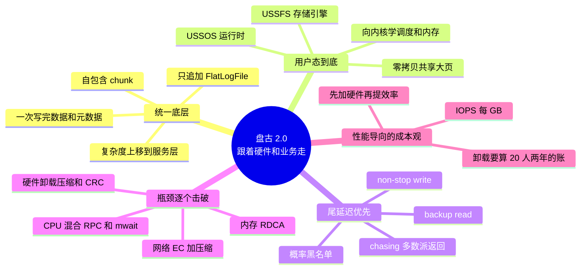

### 16.3 优点与局限

| 优点 | 局限 |
|------|------|
| 覆盖十年演进，阶段清晰，NETPSN 六阶段把各项优化串成一条因果链 | 几乎没有消融实验，单项机制的贡献无法量化；很多机制只有一段描述 |
| 流量放大等计算可以复算，论证透明 | 绝对性能数字很少（NETPSN 是归一化值），无法与其他系统横向比较 |
| RDCA、mwait 等节点内优化对其他用户态存储系统有直接参考价值 | RDCA 依赖 Intel DDIO，换 CPU 平台需要重新评估；mwait 方案也依赖特定 CPU 指令 |
| 坦诚记录了失败案例（2020 双十一）和放弃的方向（PMem EBS） | 部分数字前后不一致，个别单位和引用有误（§14） |
| 给出了"20 人两年""bug 修复两个月 vs 几周"等工程成本数字 | 元数据部分只是概述，细节要看 InfiniFS 等其他论文 |
| 只追加 + EC + 压缩的组合在 EB 级规模上验证 | 只追加把随机更新的复杂度推给上层，GC 流量是固有代价，论文只做了缓解 |

### 16.4 启示

**对存储系统设计者**：

- **先算流量放大，再谈网络升级**。6.375× 的放大意味着 100 Gbps 网卡只剩 16 Gbps 给用户。降低放大（EC、压缩、错峰 GC）往往比升级网卡更划算。
- **存储数据是"过路数据"**。在 RDMA 和高速 SSD 之间，数据只需在主机上停留几百微秒，LLC 就够用。设计数据路径时应尽量避免让数据进入 DRAM。
- **用户态系统要补齐内核的能力**：调度、内存管理、硬件故障处理（如 MCE）。只做内核旁路而不做这些，会在生产中遇到各种抖动。
- **尾延迟要靠冗余换**：写用多数派返回（chasing），读用备份请求（backup read），慢节点用概率黑名单，三者都是用一点额外资源换确定性。
- **恢复机制本身要能扛住大规模故障**。2020 双十一的案例说明，针对"少数异常"设计的机制在"大量异常"时可能成为新故障源，需要限流和隔离。

**对业务与架构决策者**：

- 业务模式决定硬件指标：卖容量看 $/GB，卖性能看 IOPS/GB 和带宽/GB。泰山服务器刻意不加大单机容量就是这一转变的体现。
- 硬件卸载要算总账：开发、验证、灰度、数据完整性保障都要投入，规模不够时可能得不偿失。
- 依赖单一厂商的新型硬件（如 Optane）要考虑可替代性。

### 16.5 一张图看懂盘古 2.0

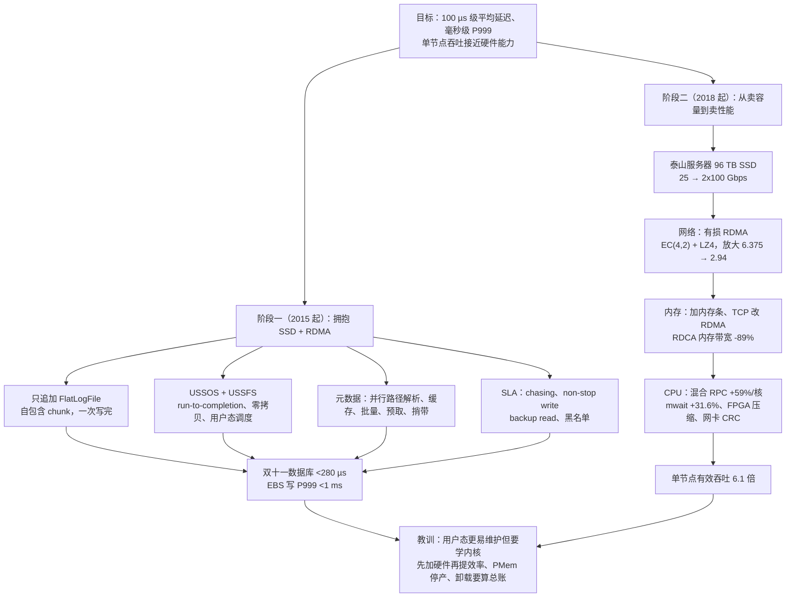

---

## 参考

- Qiang Li et al. *More Than Capacity: Performance-oriented Evolution of Pangu in Alibaba*. USENIX FAST 2023. <https://www.usenix.org/conference/fast23/presentation/li-qiang-deployed>
- Qiang Li et al. *Fisc: A Large-scale Cloud-native-oriented File System*. USENIX FAST 2023.（本仓库精读：[fisc-fast2023.md](fisc-fast2023.md)）
- Wenhao Lv et al. *InfiniFS: An Efficient Metadata Service for Large-Scale Distributed Filesystems*. USENIX FAST 2022.（本仓库精读：[infinifs-fast2022.md](infinifs-fast2022.md)）
- Su Zhou et al. *SMRSTORE: A Storage Engine for Cloud Object Storage on HM-SMR Drives*. USENIX FAST 2023.
- Ruiming Lu et al. *Perseus: A Fail-Slow Detection Framework for Cloud Storage Systems*. USENIX FAST 2023.
- Yixiao Gao et al. *When Cloud Storage Meets RDMA*. USENIX NSDI 2021.
- Rui Miao et al. *From Luna to Solar: The Evolutions of the Compute-to-Storage Networks in Alibaba Cloud*. ACM SIGCOMM 2022.
- Satadru Pan et al. *Facebook's Tectonic Filesystem: Efficiency from Exascale*. USENIX FAST 2021.（本仓库精读：[tectonic-fast2021/README.md](tectonic-fast2021/README.md)）
- Saksham Agarwal et al. *Understanding Host Interconnect Congestion*. ACM HotNets 2022.
- Intel. *Data Direct I/O Technology (DDIO): A Primer*.
- 本仓库相关：[工业界生产系统](industry-production-systems.md)、[客户端与通用技术](client-and-general-techniques.md)（纠删码章节）、[Fire-Flyer AI-HPC 精读](fireflyer-aihpc-sc2024.md)、[DAOS 精读](daos-scfa2020.md)、[LineFS 精读](linefs-sosp2021.md)
