# SingularFS 论文精读：A Billion-Scale Distributed File System Using a Single Metadata Server（ATC 2023）

> 论文：Hao Guo, Youyou Lu, Wenhao Lv, Xiaojian Liao, Shaoxun Zeng, Jiwu Shu. *SingularFS: A Billion-Scale Distributed File System Using a Single Metadata Server*. USENIX ATC 2023, pp. 915–928.
>
> 机构：清华大学。通讯作者 Youyou Lu（陆游游）。
>
> 链接：<https://www.usenix.org/conference/atc23/presentation/guo> ；PDF：<https://www.usenix.org/system/files/atc23-guo.pdf>
>
> 精读日期：2026-11-22。文中**数字、表格与机制描述均摘自论文原文**（标注所在章节）；标注"解读"的段落是本文作者的分析与推论，不是论文原话。
>
> 相关文档：[元数据扩展性综述中的 SingularFS 小节](metadata-scalability.md#24-singularfs-a-billion-scale-distributed-file-system-using-a-single-metadata-serverusenix-atc-2023)、[新硬件综述中的 SingularFS 小节](new-hardware.md#7-singularfs-a-billion-scale-distributed-file-system-using-a-single-metadata-server)、[InfiniFS（FAST 2022）精读](infinifs-fast2022.md)（同一团队的多服务器路线，也是本文的主要对比对象）、[CFS（EuroSys 2023）精读](cfs-eurosys2023.md)（同年另一条"裁剪临界区"路线）、[HMFS（SoCC 2025）精读](hmfs-socc2025.md)（同组后续工作，把有序树换成哈希表 + 目录内链表，并以本文为主要基线）、[MesaFS（EuroSys 2026）精读](mesafs-eurosys2026.md)（同一第一作者在 SSD 上的后续工作，无日志有序更新 + 半有序布局）。

## 目录

- [0. 一页速览](#0-一页速览)
- [1. 背景：为什么单台元数据服务器就够](#1-背景为什么单台元数据服务器就够)
- [2. 现有方案的问题与三大挑战](#2-现有方案的问题与三大挑战)
- [3. 总体架构与数据组织](#3-总体架构与数据组织)
- [4. 无日志元数据操作](#4-无日志元数据操作)
- [5. 层级并发控制](#5-层级并发控制)
- [6. 混合 inode 分区](#6-混合-inode-分区)
- [7. 崩溃恢复](#7-崩溃恢复)
- [8. 评估](#8-评估)
- [9. 与相关工作的对比](#9-与相关工作的对比)
- [10. 整体总结](#10-整体总结)

---

## 0. 一页速览

**一句话**：SingularFS 反其道而行：大多数数据中心的文件系统只有数十亿文件，一台装满持久内存（PM）、配 RDMA 网卡的服务器就装得下全部元数据，那就不做分布式元数据，而是把**单台元数据服务器**的性能压榨到极限。它从三处入手：用父目录时间戳与子 inode 出生/死亡时间之间的**单调依赖**实现无日志的崩溃一致；把父目录 ctime/mtime 的并发更新变成 **16 字节 CAS** 的无锁操作；按"父目录时间戳 + 子项"分组把元数据放到 **NUMA 节点**上，节点内再哈希到多个有序索引以减少锁竞争。

| 维度 | 要点 |
|------|------|
| 核心判断 | 现代数据中心绝大多数分布式文件系统在**十亿级**文件以内，单台服务器能容纳 TB 级元数据；单服务器省掉分布式事务和跨服务器负载均衡，实现简单、TCO 更低（§1、§2.1） |
| 挑战 1：崩溃一致开销 | 日志要写两遍，日志结构要垃圾回收；NOVA 用日志结构把私有目录 create/delete 做到其他系统的 7.17×/12.19×，但仍有多 inode 协调日志和 GC 开销（§2.2、§2.3） |
| 挑战 2：共享目录锁竞争 | NOVA 在共享目录下的 create/delete 吞吐只有私有目录的 0.17×/0.13×（§2.2） |
| 挑战 3：NUMA | 现有系统按条带或随机散布，元数据操作缺少 NUMA 局部性；远端 PM 写入下降明显（§2.2、§2.3） |
| 技术 1：无日志元数据操作 | 利用 KV 后端的单对象原子性 + 不变式 `父.ctime ≥ max(子.btime, 子.dtime)`，按固定顺序更新；create 两步、delete 三步，不写日志（§3.2） |
| 技术 2：层级并发控制 | 写者用每 inode 读写锁；只改 ctime/mtime 的"更新者"之间用 `cmpxchg16b` 无锁更新；读者以 ctime 为版本号做乐观校验（§3.3） |
| 技术 3：混合 inode 分区 | NUMA 间：目录拆成时间戳元数据与访问元数据，"目录时间戳 + 子文件 inode + 子目录访问元数据"成组，按一致性哈希放 NUMA 节点；NUMA 内：哈希到 n 个有序索引（§3.4） |
| rename | 唯一保留日志的操作：日志 + 严格两阶段锁；对两个父目录用有序更新，日志 inode 数从 4 降到 2（§3.1） |
| 结果 | 单台元数据服务器 create/stat 达 **8.36M / 18.80M ops/s**，超过 InfiniFS 原论文中 32 台服务器的结果；私有目录 create 是 InfiniFS 的 22.49×；共享目录比其他系统至少高 7.76×；每 NUMA 节点可容纳 **17.5 亿**文件且吞吐稳定（§1、§5） |

---

## 1. 背景：为什么单台元数据服务器就够

### 1.1 十亿级是常态（§1、§2.1）

论文的出发点是一个规模判断：现代数据中心中绝大多数分布式文件系统都在**数十亿文件以内**，作者称之为"十亿级分布式文件系统"。即便阿里巴巴这样的大型数据中心，海量文件也是由很多小存储集群管理的，每个集群都在十亿级以内（引用 InfiniFS 论文中盘古的数据）。

一台服务器通常能容纳 TB 级元数据，足以装下这个规模的全部元数据。（"绝大多数在十亿级以内"这一判断，论文引用的是一篇超算 I/O 监测论文 *End-to-End I/O Monitoring on Leading Supercomputers*（TOS 2022）和 InfiniFS 中的阿里云数据，并没有给出自己的统计。）与多台元数据服务器相比，单台的好处是：

- **实现与性能**：不需要跨服务器的分布式事务和负载均衡，实现更简单、性能更好；
- **TCO**：安装、维护和日常成本都低于多台服务器。

问题在于**性能**：元数据操作占全部文件系统操作的一半以上。正因为单台服务器性能不够，大多数系统才选择扩展元数据服务器数量。论文要探索的就是"在单台元数据服务器上实现高性能的十亿级分布式文件系统"的设计空间。

### 1.2 新硬件提供的机会（§2.1）

| 硬件 | 论文引用的能力 |
|------|----------------|
| NVIDIA ConnectX-6 网卡 | 小包 **215 Mpps**；RedN 测得 64 B RDMA 写 **112M verbs/s** |
| Intel Optane DIMM（PM） | 访问粒度小于 256 B 时，读、写分别至少 **29.06 Mops/s**、**8.75 Mops/s**，同时具备内存语义和持久性 |
| inode 大小 | 文件系统的 inode 通常很小，例如 Ext4 为 128 B |

小粒度访问性能高，意味着用单台元数据服务器构建高性能分布式文件系统成为可能。

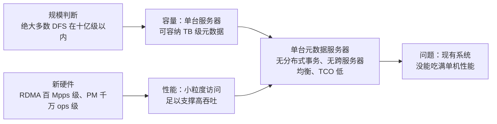

**解读**：这篇论文和同一团队一年前的 InfiniFS 形成鲜明对照。InfiniFS 面向"一个数据中心一个文件系统、千亿文件"，所以必须分布式；SingularFS 面向"大量独立的十亿级集群"，所以选择单机。两者引用的是同一份阿里云数据，得出的是互补的结论：**超大实例需要分布式元数据，而大量中等实例用单机就够**。

---

## 2. 现有方案的问题与三大挑战

### 2.1 对比实验（§2.2，图 1）

作者选了两类共四个系统：本地 PM 文件系统 **Ext4-DAX**、**NOVA**；分布式文件系统 **CephFS**、**InfiniFS**。逐步增加客户端线程直到峰值，测每 NUMA 节点的 create、delete 吞吐，分私有目录（每个客户端一个目录）和共享目录两种场景。三条观察：

| 观察 | 细节（§2.2） |
|------|-------------|
| **崩溃一致开销限制多 inode 更新的吞吐** | Ext4-DAX 用预写日志（WAL），InfiniFS、CephFS 用存储后端的事务，都给多 inode 更新带来额外开销。NOVA 用日志结构元数据降低了开销，私有目录 create/delete 吞吐是其他系统的 **7.17× / 12.19×**，但协调多 inode 更新时仍无法完全去掉日志，且引入 GC 开销 |
| **锁竞争限制共享目录吞吐** | NOVA 在共享目录下 create/delete 吞吐只有私有目录的 **0.17× / 0.13×**，因为它直接拿共享目录的写锁。其他三个系统没有明显下降，但那是因为它们无论私有还是共享目录都用日志或后端事务统一协调，两种场景性能都受限 |
| **无法在多 NUMA 节点上扩展且保持局部性** | NOVA 不支持多 NUMA 节点；Ext4-DAX 可以挂在跨所有 NUMA 节点 PM 的 RAID 0 上，但简单条带布局保证不了元数据操作的 NUMA 局部性；InfiniFS、CephFS 把元数据对象散布到所有 PM DIMM 上，没有 NUMA 感知的分区规则 |

**解读**：引言写的是 NOVA 共享目录 create 吞吐"只有私有目录的 **0.14×**"，§2.2 写的是 **0.17×**（delete 为 0.13×）。两处数字不一致，可能来自不同的目录树规模（引言特别注明是"百万级目录树、无网络影响"）。引用时建议注明出处章节。

### 2.2 三大挑战（§2.3）

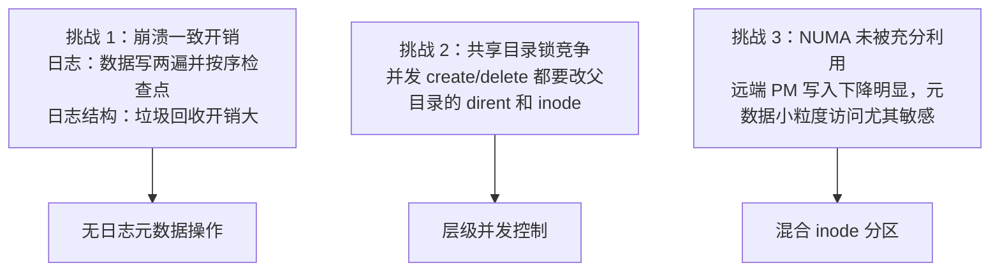

- **挑战 2 的现有方案为什么不适用**：一类是在 dirent 内部分区，但这消除不了公共父 inode 上的锁竞争；另一类是把大目录分区到多个元数据服务器进程上（CephFS 等），而单服务器上没法这么做。HPC 和大数据中经常有大量进程并发访问一个大共享目录，例如 N-N checkpoint、图像处理。
- **挑战 3 的现有方案为什么不适用**：把 inode 随机散布到 NUMA 节点上解决不了问题，因为 create、delete 要同时改多个 inode，必然跨 NUMA 访问；DRAM 缓存、线程迁移、线程委托等方法又都要为协调或数据结构维护浪费额外资源。

---

## 3. 总体架构与数据组织

### 3.1 三条设计原则（§3）

| 原则 | 对应技术 |
|------|----------|
| 不用日志保证崩溃一致：大多数元数据操作不需要日志等额外机制，同时保持 POSIX 语义 | 无日志元数据操作（§3.2） |
| 最大化共享目录内的并行度，减少同步开销 | 层级并发控制（§3.3） |
| 减少 NUMA 间访问和 NUMA 内锁竞争 | 混合 inode 分区（§3.4） |

### 3.2 架构（§3.1，图 2）

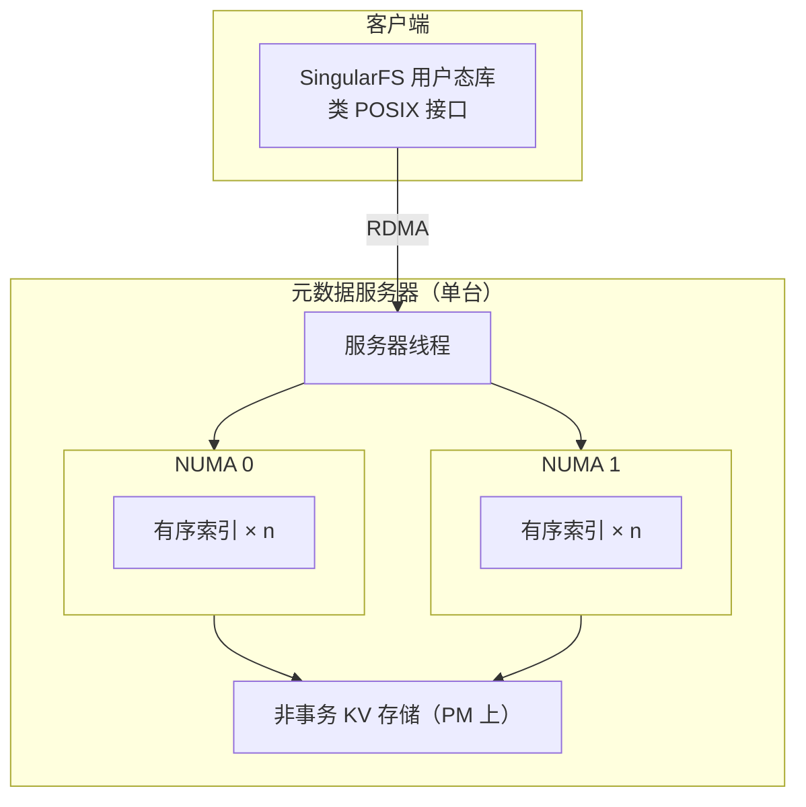

- 系统由**客户端**和**服务器**组成。服务器在 PM 中维护全局目录树；客户端通过用户态库提供的类 POSIX 接口访问；双方都配 RDMA 网卡。
- **存储后端**：一个通用 KV 存储，只要求支持**点查询**和**前缀匹配**，并以较低代价保证**单对象操作的原子性**。实现中使用 **P-Masstree** 作为有序索引。

与其他基于 KV 的文件系统（IndexFS、InfiniFS、LocoFS、Tectonic 等）相比，SingularFS 有两点不同（§3.1）：

1. **不依赖 KV 后端的事务**（图 2 中的"非事务 KV 存储"），而是用轻量的有序更新和并发控制；
2. **不是每台服务器一个有序 KV**，而是用混合 inode 分区把共享索引拆成分散在各 NUMA 节点上的多个有序索引。

### 3.3 inode 与 dirent 的组织（§3.1，图 3）

- **新增两个字段**：出生时间 `btime` 和死亡时间 `dtime`，用于借助时间戳依赖识别元数据不一致；
- **目录 inode 拆成两部分**：**时间戳元数据**（atime、ctime、mtime）和**访问元数据**（inode ID、权限、btime、dtime 等）；
- **键设计**：

| 对象 | 键 |
|------|----|
| 目录访问元数据、文件 inode | `<父 inode ID + 名字>` |
| 目录时间戳元数据 | `<inode ID>` |
| 数据块（对象存储中） | `<inode ID + 块号>` |

- 根目录 inode ID 固定为 0；路径解析从根开始**逐级**取目录访问元数据；
- **dirent 不单独存**：目录项与子 inode 的键值对放在一起，dirent 更新和 inode 更新合并为**一次 KV 更新**；
- `readdir` 时对目标目录 ID 做**前缀匹配**取出所有子项键值对，用键生成 `d_name`，读值得到 `d_ino` 和 `d_type`。

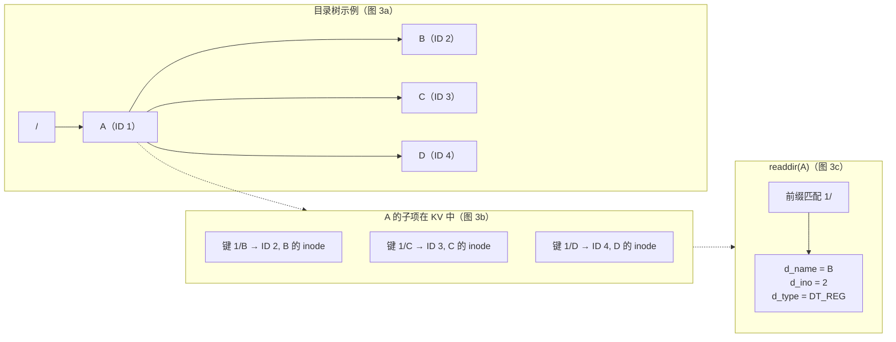

- **数据管理**：元数据与数据解耦，可以直接复用现有数据管理方案，目前用对象存储，按 `<inode ID + 块号>` 索引数据块。

**解读**：这套键设计与 InfiniFS 几乎相同：目录拆成"访问元数据（跟随父目录）"和"时间戳/内容元数据（按自身 ID）"，dirent 与子 inode 合并存放。差别在于 InfiniFS 用这种拆分把元数据**分到不同服务器**，SingularFS 用它把元数据**分到同一台服务器的不同 NUMA 节点**。同一个思想，换了一个尺度。

### 3.4 rename（§3.1）

rename 是唯一仍用**日志**保证崩溃一致的操作。作为优化，涉及的两个父目录用下文的有序更新保证一致，被日志记录的 inode 数从 **4 个降到 2 个**。并发控制用**严格两阶段锁**。

---

## 4. 无日志元数据操作

### 4.1 元数据写操作的分类（§3.2.1，表 1）

| 类型 | 操作 | 改动的对象 |
|------|------|------------|
| 单节点操作 | open、close、read、write、chmod、chown、utimens | 只改目标 inode |
| 双节点操作 | mkdir、rmdir、create、delete | 目标 inode + 父目录时间戳（dirent 与子 inode 合并，无需单独更新） |
| rename | rename | 原 inode、新 inode 及其父目录 |

根据 InfiniFS 和 HopsFS 论文中的真实负载，常规元数据操作（读操作、单节点操作、双节点操作）占全部文件系统操作的 **90% 以上**。单节点操作的崩溃一致由 KV 后端的单对象原子性直接保证，所以要解决的就是**双节点操作**。

### 4.2 时间戳依赖（§3.2.2）

双节点操作会把父目录的 ctime 设为目标 inode 的 btime 或 dtime。由此得到一个不变式：

> 对任意 inode d，`d.ctime ≥ max(c.btime, c.dtime)`，其中 c 是 d 的任意子 inode。

只要按固定顺序更新，崩溃后就可以通过检查这个不变式发现并修复不一致。

### 4.3 有序更新（§3.2.2，图 4）

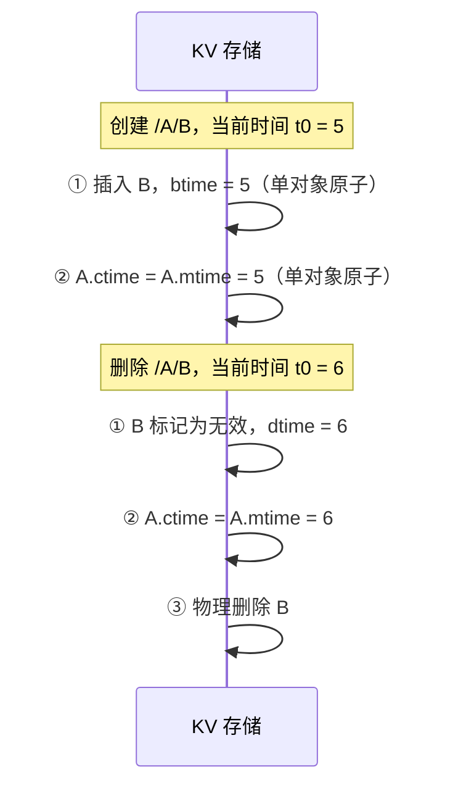

| 崩溃位置 | 如何发现 | 如何修复 |
|----------|----------|----------|
| create 的 ① 与 ② 之间；delete 的 ① 与 ② 之间 | 子 inode 的最大 btime / dtime **大于**父目录 ctime | 把父目录 ctime、mtime 设为该最大值 |
| delete 的 ② 与 ③ 之间 | 目标 inode 处于**无效**状态 | 物理删除该 inode |

最直接的做法是扫描整棵目录树，但代价很高；SingularFS 改为在访问到不一致目录时**惰性检测和修复**（见第 7 节）。

**解读**：

- 这是 Soft Updates 思想在 KV 元数据上的极简版。Soft Updates 难用，是因为要维护任意元数据块之间的依赖顺序；SingularFS 只需要维护"子 inode 时间戳 → 父目录时间戳"这一种依赖（论文 §6 也这样对比）。
- 与 CFS 的"先写不可见部分、后写索引"对照：两者都是用**写入顺序代替日志或分布式事务**。CFS 的顺序跨两个存储系统（FileStore 与 TafDB），靠 GC 回收孤儿；SingularFS 的顺序在同一个 KV 里，靠时间戳不变式在访问时修复。
- 这个方案隐含一个前提：**时钟单调**。不变式依赖 btime、dtime、ctime 来自同一个单调递增的时间源；如果服务器重启后系统时钟回退，新创建的子项 btime 可能小于父目录旧 ctime，崩溃检测就会漏判。单台服务器场景下这个前提容易满足（可用单调计数器代替墙钟），但论文没有讨论。

---

## 5. 层级并发控制

### 5.1 问题收敛到父目录时间戳（§3.3）

传统文件系统中，共享目录下的双节点操作会在父目录 dirent 和时间戳上竞争。SingularFS 中 dirent 更新已与子 inode 更新合并，其并发由 KV 后端保证，所以剩下的问题只有**父目录时间戳的并发更新**。

双节点操作只改父目录的 ctime 和 mtime，两者合计 **16 字节**，可以用 16 字节原子比较交换指令无锁完成。

### 5.2 三类操作（§3.3）

| 角色 | 定义 | 例子 |
|------|------|------|
| **更新者（updater）** | 只改目标 inode 的 ctime 和 mtime | create、delete 对**父目录**而言是更新者 |
| **写者（writer）** | 其他所有更新 | create、delete 对**目标 inode** 而言是写者；chmod 等 |
| **读者（reader）** | 所有读操作 | 文件 stat |

### 5.3 算法 1

```c
struct Inode {
    ...
    uint64 ctime;   // 16 字节对齐
    uint64 mtime;
    ...
};

def writer(this):
    this->write_lock()          // 与所有其他操作同步
    modify_inode(this)
    this->write_unlock()

def updater(this, timestamp):
    this->read_lock()           // 只与写者同步
    while True:
        cur = { this->ctime, this->mtime }      // 取快照
        nxt = { timestamp, timestamp }
        if cur[0] >= timestamp or cmpxchg16b(&this->ctime, cur, nxt):
            break               // 已被更晚的时间戳更新过，或 CAS 成功
    this->read_unlock()

def reader(this):
    this->read_lock()           // 只与写者同步
    while True:
        last_ctime = this->ctime                // ctime 作版本号
        compiler_barrier()
        inode = *this
        compiler_barrier()
        if this->ctime == last_ctime:           // 乐观校验
            break
    this->read_unlock()
    return inode
```

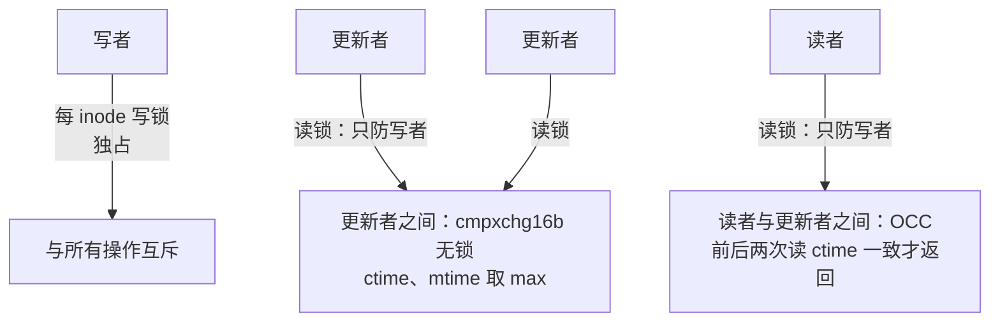

- **写者与其他操作**：每 inode 读写锁。写者拿写锁独占；更新者和读者拿读锁，防止并发写者更新或删除 inode；
- **更新者之间**：为最小化临界区，用原子指令无锁同步。ctime、mtime 放在 16 字节对齐的块中，用 `cmpxchg16b` 把两者原子更新为"参数时间戳与原值的较大者"。如果当前 ctime 已经不小于参数时间戳，说明已被另一个更晚的更新者改过，直接放弃；
- **更新者与读者之间**：更新者修改 inode 时 ctime 单调递增，语义等同于版本号。读者在读整个 inode 前后各读一次 ctime，相等才认为读到了一致快照（类似乐观并发控制）。

**解读**：

- 关键在于"**更新者**"这个角色的发现：create、delete 对父目录只做"把时间戳推到至少 t"这一件事，而"取最大值"满足交换律和幂等性，天然可以无锁合并。CFS 的 last-writer-wins 与这里的"取 max"是同一个想法：CFS 在数据库原语层面实现，SingularFS 在 CPU 指令层面实现。
- 读写锁仍然存在，只是更新者和读者都只拿**读锁**，彼此之间不互斥。在共享目录高并发 create 时，所有请求都拿父目录的读锁，读锁本身的原子计数仍可能成为 cache line 热点；论文的因素分析显示在低冲突场景下这套机制带来约 10% 的开销（见 8.4 节）。

---

## 6. 混合 inode 分区

### 6.1 NUMA 间分区：保证文件操作的局部性（§3.4.1）

文件操作占元数据操作的大多数，所以优先保证它们的 NUMA 局部性：

- **单节点文件操作**：把请求委托给对应 NUMA 节点处理即可；
- **双节点文件操作**（create、delete）：涉及的两个 inode 可能在不同 NUMA 节点上。但这些操作只改父目录的 ctime、mtime，所以只要把**父目录的时间戳和子文件 inode 放到同一 NUMA 节点**，局部性就能保证。

因此 SingularFS 把每个目录的"**时间戳元数据 + 子文件 inode + 子目录的访问元数据**"组成一个**元数据组**，组内对象放在同一 NUMA 节点上，各组用**一致性哈希**分布到元数据服务器的 NUMA 节点。

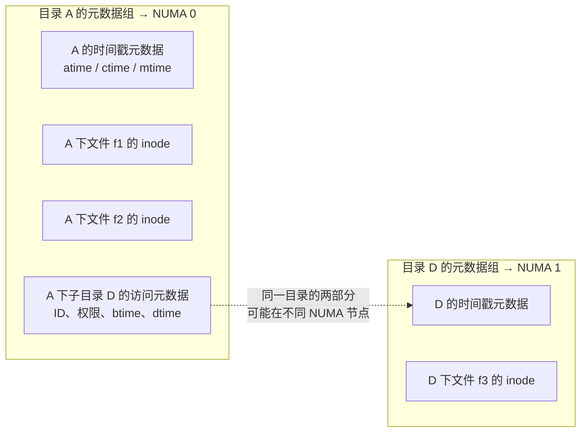

### 6.2 跨 NUMA 的目录操作如何保证一致（§3.4.1）

目录被拆成两个 KV 对象后，KV 后端无法保证跨两个对象的崩溃一致。SingularFS 同样用固定顺序解决：

| 操作 | 涉及对象 | 做法 |
|------|----------|------|
| mkdir / rmdir | 目标目录的访问元数据、时间戳元数据，父目录的时间戳元数据（3 个） | 新目录的所有时间戳初始都等于其 btime（存于访问元数据），所以**先创建访问元数据、后创建时间戳元数据**；崩溃后可由访问元数据重新生成时间戳元数据 |
| 目录 set_permission | 访问元数据、时间戳元数据（2 个） | 把 btime 的语义扩展为"出生时间与最近一次 set_permission 时间的较大者"。先同时更新权限和 btime，再更新 ctime；恢复时若 btime 大于 ctime 就修复 |

### 6.3 NUMA 内分区：减少锁竞争（§3.4.2）

生成 dirent 依赖有序索引的范围查询。但典型的 B+ 树类有序索引在更新密集时，遍历和节点分裂会造成严重锁竞争，尤其是大量键共享同一前缀（同一目录）时。SingularFS 在每个 NUMA 节点内部用哈希把元数据均匀分散到 **n 个有序索引**（n 可配置，实验中为 8）：

- **点查询**：按键哈希找到对应索引；
- **范围查询**（如 readdir）：在所有 n 个索引中分别查询再合并结果。

**rmdir 的优化**：判断目录是否为空原本可以用前缀匹配，但分成 n 个索引后要查 n 次，代价高。SingularFS 给每个目录加一个 `num_dents` 计数：

- 崩溃一致容易保证：恢复时做一次完整前缀匹配即可重建；
- 并发更新：更新者之间用 `fetch_and_add` / `fetch_and_sub` 同步；
- rmdir 时值正确：rmdir 是目标目录的**写者**，执行期间不会有并发更新者，`num_dents` 不会变化。

**解读**：混合分区里有两个层次的"哈希"：NUMA 间按**目录**（元数据组）一致性哈希，保证同一目录下的文件操作在一个节点内完成；NUMA 内按**键**哈希，打散同一目录前缀造成的索引热点。前者保局部性，后者保并行度，和 CFS"TafDB 按目录范围分区 + FileStore 按 id 哈希"的思路相同，只是尺度从集群缩小到了一台机器。代价也一样：同一目录下的所有文件操作最终受限于**一个 NUMA 节点**的能力（见 8.3 节"共享目录吞吐收敛到约 4M ops/s"）。

---

## 7. 崩溃恢复

### 7.1 恢复算法（§4，算法 2）

```python
def recover(ino):
    ino.num_dents = 0
    recreate_timestamp_meta(ino)            # 重建不完整的时间戳元数据（mkdir 中断）
    if ino.btime > ino.ctime:               # set_permission 中断
        ino.ctime = ino.btime
    for c in ino.child_inodes:
        if (c.valid and c.btime > ino.ctime) or (not c.valid and c.dtime > ino.ctime):
            # 时间戳更新前崩溃
            ino.ctime = max(c.btime, c.dtime)
            ino.mtime = max(c.btime, c.dtime)
            redo(c)                         # 重做 create / delete
        elif not c.valid:
            remove(c)                       # 清理无效 inode
        ino.num_dents += 1                  # 重建 num_dents
```

它覆盖了三类修复：无日志操作中的父目录时间戳恢复与无效 inode 清理；NUMA 间分区中的目录时间戳元数据恢复；NUMA 内分区中的 `num_dents` 重建。

### 7.2 惰性检测（§4）

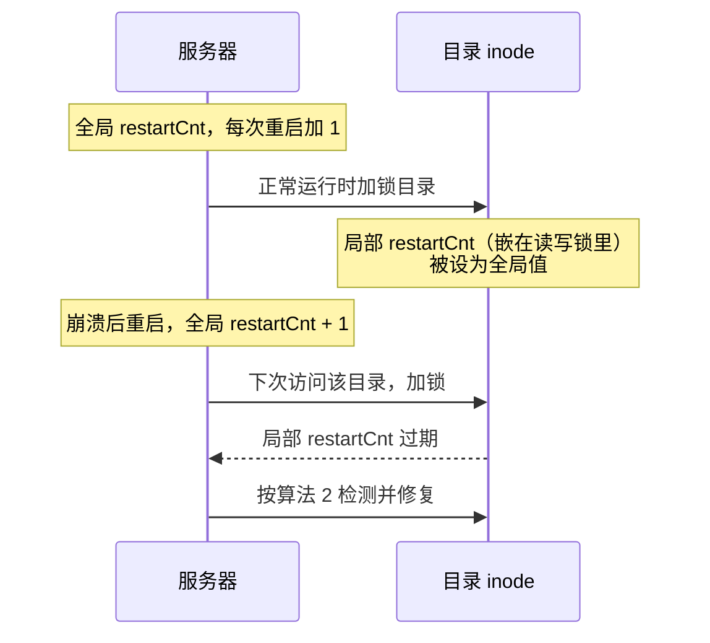

全局 `restartCnt` 每次重启加 1；每个目录 inode 的读写锁里嵌一个局部 `restartCnt`，加锁时把它设为全局值。崩溃后，不一致的目录会带着过期的局部值，下次被访问时就按算法 2 检测并修复。

**解读**：惰性恢复让重启时间与目录树规模无关（见 8.7 节，启动时间为 0 s），代价是**第一次访问每个"可能不一致"的目录时要扫描它的全部子项**。注意判断依据是"上次加锁是在哪次启动"，所以重启后**所有**目录第一次被访问时都会触发检查，而不仅是真正不一致的那些；对含百万子项的大目录，第一次访问会很慢。

---

## 8. 评估

### 8.1 实验设置（§5.1）

| 项目 | 配置 |
|------|------|
| 服务器 | 1 台（元数据与数据服务器同机）；2 颗 Intel Xeon Gold 6330（每颗 28 核，关闭超线程）；每个 socket 4 条 128 GB Optane DCPMM（App Direct 模式）、256 GB DRAM、1 块 200 Gb/s ConnectX-6 |
| 客户端 | 1–2 台；2 颗 Xeon Platinum 8360Y（每颗 36 核 72 线程）；每 socket 256 GB DRAM、1 块 200 Gb/s ConnectX-6；Mellanox QM8790 交换机 |
| 本地 PM 基线 | Ext4-DAX、NOVA；每次 stat 前清空 VFS 缓存 |
| 分布式基线 | CephFS 15.2.16（延迟用 RDMA 模式测；吞吐用 IPoIB 模式测，因为 RDMA 模式长时间运行总会崩溃）；InfiniFS（作者用 eRPC 为其加上 RDMA 和多网卡支持，RocksDB 跑在跨所有 PM 的 RAID 0 + Ext4-DAX 上） |
| SingularFS | P-Masstree 作有序索引，每 NUMA 索引数 n = 8；与 InfiniFS 一样用 56 个工作线程内联处理请求；数据对象也存 PM |
| 负载 | mdtest 3.3.0（OpenMPI 4.1.2）；文件长度为 0；端到端用 Filebench |
| 公平性处理 | NOVA、CephFS 不支持多 NUMA，所以比较**每 NUMA 节点**吞吐：Ext4-DAX、NOVA 限制在一个 NUMA 节点；CephFS 限制服务器端 PM 与网卡；SingularFS、InfiniFS 不限资源，吞吐取 NUMA 平均 |

### 8.2 私有目录的吞吐与延迟（§5.2，图 5、图 6）

每个客户端在自己的私有目录中处理 200 万个目录和 200 万个文件（CephFS、InfiniFS 规模稍小，以取得其峰值）。

| 操作 | SingularFS 相对倍数（每 NUMA 吞吐） | 原因（§5.2.1） |
|------|-------------------------------------|----------------|
| 文件 create / delete | NOVA 的 **3.13× / 1.93×**；InfiniFS 的 **22.49× / 23.57×** | 无日志操作把事务逻辑移出关键路径，省 PM 带宽和等待持久化的 CPU；NUMA 间分区保证局部性 |
| 目录 mkdir / rmdir | NOVA 的 **0.96× / 0.73×**；InfiniFS 的 **7.82× / 7.77×** | 要写目标目录的访问元数据和时间戳元数据，二者不保证在同一 NUMA 节点；但被无日志操作化为几次简单 KV 写 |
| 文件 stat | NOVA / Ext4-DAX 的 **9.54× / 10.10×**；CephFS / InfiniFS 的 **7.54× / 10.97×** | 事务逻辑与 KV 存储分离，可以用 P-Masstree 这样的轻量 KV |

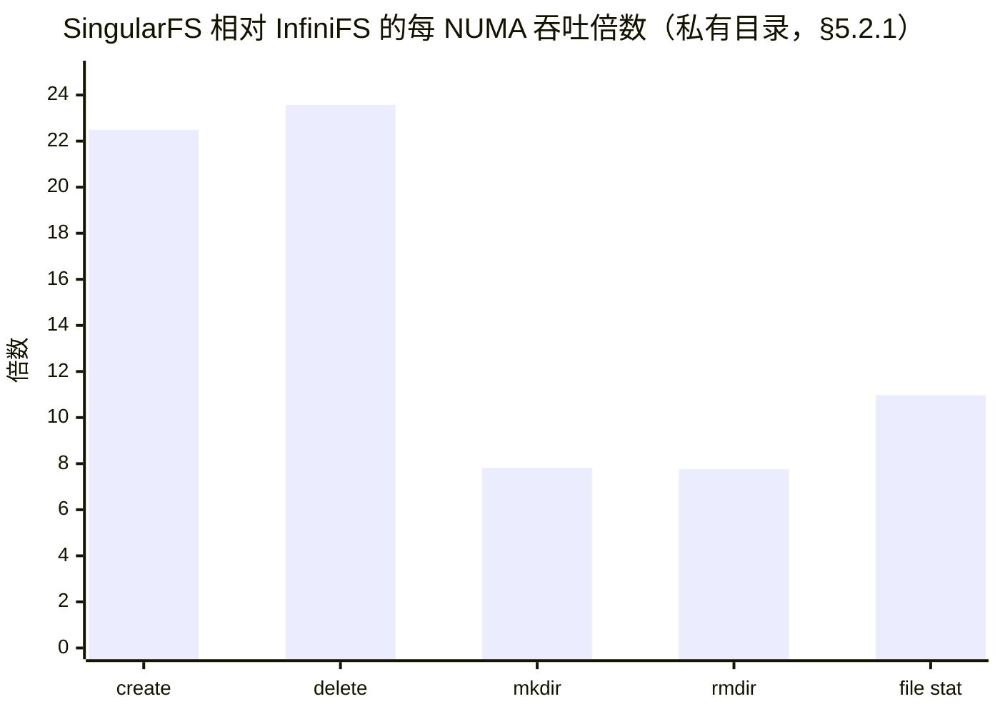

- **NUMA 扩展性**：SingularFS 使用了全部硬件资源而非一个 NUMA 节点，但其文件操作的**每 NUMA** 吞吐仍高于只跑在一个 NUMA 节点上的系统。
- **延迟**（单客户端，图 6）：文件操作上 SingularFS 与 Ext4-DAX、NOVA 相当（后两者不含网络延迟），低于 CephFS 和 InfiniFS。论文只给出了图，没有正文数字。

**解读**：目录操作是 SingularFS 的相对弱项：mkdir/rmdir 吞吐比 NOVA 还低（0.96×/0.73×），因为目录的两部分可能跨 NUMA 节点。这与 InfiniFS 的情况一致（InfiniFS 的 mkdir/rmdir 也跨两台服务器），是"拆分目录元数据"这一设计的固有代价，只是 SingularFS 把跨服务器的 2PC 换成了跨 NUMA 的有序写，代价小得多。

### 8.3 共享目录扩展性（§5.3，图 7）

逐步增加 mdtest 客户端，在**同一个共享目录**中 create、delete：

- SingularFS 的扩展性远好于其他系统，create/delete 至少高 **7.76× / 5.61×**；
- 整台元数据服务器的 create/delete 吞吐**收敛到约 4M ops/s**，接近图 5 中 SingularFS 的**每 NUMA** 峰值。原因是共享目录下的所有 inode 都在同一 NUMA 节点上，该节点的峰值就是上限。

**解读**：这个结果有两面。正面看，单个共享目录能跑到约 4M ops/s，已经是很高的数字；反面看，这也说明"一个目录一个 NUMA 节点"让单目录性能**无法**利用整台服务器（两个 NUMA 节点共约 8M ops/s），极端的单目录热点负载只能用到一半的机器。

### 8.4 因素分析（§5.4，图 8）

**Baseline**：在 SingularFS 框架上实现，但去掉关键设计：P-Masstree 跑在跨全部 PM 的 RAID 0 + Ext4-DAX 上，用悲观两阶段锁（2PL）+ WAL 提供事务。逐项叠加：

| 配置 | 含义 |
|------|------|
| +Inter-NUMA Partition | 加入 NUMA 间 inode 分区 |
| +Log-free | 用无日志操作代替 WAL |
| +CC | 用层级并发控制代替 2PL |
| +Intra-NUMA Partition | 加入 NUMA 内 inode 分区（即完整 SingularFS） |

结果为整台服务器吞吐（不按 NUMA 平均）。私有目录：112 个客户端、每个 200 万文件；共享目录：客户端数从 1 增加到 112 取峰值。

| 步骤 | 私有目录 create（吞吐 / 平均延迟） | 共享目录 create / delete（吞吐） |
|------|-----------------------------------|--------------------------------|
| +Inter-NUMA Partition | **1.52×** / 降低 1.05× | 与 +Log-free 合计 **1.21× / 1.15×** |
| +Log-free | 再 **1.58×** / 再降低 1.06× | （同上） |
| +CC | 与 +Intra-NUMA 合计**下降约 10%**，延迟略增 | **7.66× / 6.09×** |
| +Intra-NUMA Partition | （同上） | 再 **1.72× / 1.62×** |
| 合计 vs Baseline | create **2.15×** 吞吐、延迟降低 1.13×；delete **1.58×**、1.16× | **15.93× / 11.40×** |

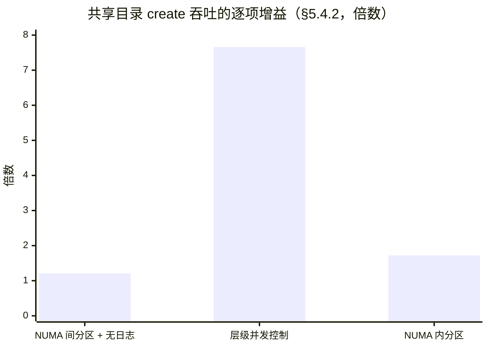

- 私有目录中，层级并发控制和 NUMA 内分区在冲突很少时引入额外同步开销，NUMA 内分区还损害了整体数据结构的缓存友好性，因此吞吐下降约 10%；
- 共享目录中，主要瓶颈是共享目录上的锁竞争：前两项只缩短了临界区（1.21×），层级并发控制缓解锁竞争带来 7.66×，此时达到 P-Masstree 在公共前缀高锁竞争下的峰值；NUMA 内分区再缓解索引内部的锁竞争，带来 1.72×。

**解读**：这组因素分析很诚实地展示了**技术与场景的对应关系**：无日志和 NUMA 间分区主要服务私有目录（无冲突），层级并发控制和 NUMA 内分区主要服务共享目录（高冲突），后两者在私有目录下反而有约 10% 的负收益。这对系统设计者很有参考价值：如果负载几乎没有共享目录写，后两项可以不做。

### 8.5 十亿级目录树（§5.5，图 9）

每轮在每个 NUMA 节点上 create 并 stat 5000 万个文件，直到文件系统写满：

- SingularFS 吞吐稳定：每 NUMA 节点 create 约 **4.40M ops/s**、stat 约 **9.10M ops/s**，分别是 Ext4-DAX 的 **41.90×** 和 **9.83×**；NOVA 在目录树接近空时吞吐较高，但到十亿级时还不如 Ext4-DAX；
- 容量：SingularFS 每 NUMA 节点支持 **17.5 亿**文件，高于 Ext4-DAX（10 亿），低于 NOVA（20.5 亿）。原因是 SingularFS 用 KV 存 inode，索引的空间开销高于 NOVA 的每核链表，但性能高得多。

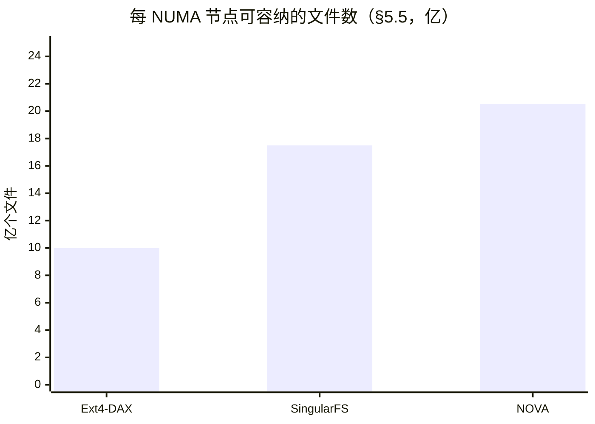

**解读**：两颗 CPU、每颗 4 × 128 GB Optane，即每 NUMA 节点 512 GB PM 装下 17.5 亿个文件，平均每个文件约 290 字节（含索引开销）。整台服务器约 35 亿文件，这正是"十亿级"标题的来源。

### 8.6 rename 与端到端（§5.6、§5.7，图 10、图 11）

**rename**（每个客户端把 100 万个目录和 100 万个文件从一个目录移到另一个目录）：

- **文件 rename**：延迟与本地 PM 文件系统相当，每 NUMA 吞吐至少是其他系统的 **3.95×**。日志很轻，只记录两个目标键值对，父目录的日志被有序更新省掉了。但由于日志开销和不可避免的跨 NUMA 访问，文件 rename 吞吐只有 create/delete 的 **0.17× / 0.15×**，低于理论上限（一半）；
- **目录 rename**：延迟和吞吐都比文件 rename 差，因为 SingularFS 与 IndexFS、InfiniFS、LocoFS 一样使用**目录元数据缓存**，目录 rename 会导致缓存失效和路径重新解析。

**Filebench**（每 NUMA 吞吐；Varmail 文件数 10 万；InfiniFS 只是元数据服务，未参与）：

| 负载 | 相对 Ext4-DAX | 相对 NOVA |
|------|---------------|-----------|
| Fileserver | **1.05×** | **0.74×** |
| Varmail（元数据密集） | **1.71×** | **0.41×** |

SingularFS 低于 NOVA，是因为负载中存在客户端之间的元数据依赖（例如客户端 1 创建文件、客户端 2 删除它），元数据服务器吃不满，此时单次操作延迟成为主导，而 SingularFS 要走网络，延迟高于本地的 NOVA。

### 8.7 崩溃恢复开销（§5.8，表 2）

服务器崩溃留下一个含 10 万文件的不一致目录，整棵目录树 1 亿文件：

| 方法 | 启动时恢复时间 | 一致目录中 create 延迟 | 不一致目录中首次 create 延迟 |
|------|----------------|------------------------|------------------------------|
| 扫描（启动时扫整棵树） | **32.1 s** | 5.3 µs | — |
| 惰性（访问时修复） | **0 s** | 5.3 µs | **30.8 ms** |

惰性恢复远快于全树扫描（只扫 10 万文件而不是 1 亿），但仍比普通元数据操作高几个数量级，因为要扫描不一致目录中的全部子项；目录越小恢复越快。

---

## 9. 与相关工作的对比

### 9.1 论文自述的对比（§6）

| 方向 | 代表工作 | SingularFS 的不同 |
|------|----------|-------------------|
| 本地 PM 文件系统的元数据一致性 | BPFS（写时复制 + 8 字节原地原子更新）、PMFS（更大的原地原子更新 + 日志）、NOVA（日志结构） | — |
| 分布式文件系统的元数据一致性 | HopsFS（行锁 + NDB）、InfiniFS（本地 KV 事务 + 跨服务器 2PC）、CephFS、CFS（依赖存储后端） | 这些方法 CPU 开销可观；SingularFS 用无日志操作以最小代价保证崩溃一致，用层级并发控制最大化并行度 |
| 基于顺序的一致性 | Soft Updates 按序写数据和元数据 | Soft Updates 要维护任意元数据块之间的顺序，过于复杂；SingularFS 只需维护时间戳元数据的顺序，更实用 |
| NUMA 感知文件系统 | NThread（线程迁移）、Assise（片上 DMA 绕过缓存一致性）、OdinFS（NUMA 感知委托线程） | 主要面向数据服务；元数据操作开销不比线程迁移大、索引逻辑复杂、访问粒度小，不适用。SingularFS 用混合 inode 分区，调度开销最小 |

### 9.2 与本仓库调研系统的对照（解读）

| 维度 | InfiniFS（FAST 2022） | CFS（EuroSys 2023） | SingularFS（ATC 2023） |
|------|----------------------|---------------------|-----------------------|
| 目标规模 | 千亿文件，单实例覆盖数据中心 | 生产多租户，数十亿以上文件 | 十亿级，单台服务器约 35 亿 |
| 元数据服务器数 | 多台 | 多台（TafDB 分片） | **1 台** |
| 目录拆分 | 访问元数据 / 内容元数据 | id 记录 / `/_ATTR` 属性记录 | 访问元数据 / 时间戳元数据 |
| 拆分后放哪 | 不同服务器（一致性哈希） | 同一 TafDB 分片（范围分区） | 不同 NUMA 节点（一致性哈希） |
| 父目录属性并发更新 | 本地 KV 事务（同目录互斥） | delta apply + last-writer-wins | `cmpxchg16b` 取 max（无锁） |
| 崩溃一致 | KV 事务 + 2PC | 固定写入顺序 + GC | 时间戳不变式 + 惰性修复 |
| rename | 中心协调者 | 快路径原语 / Renamer + 2PC | 日志（2 个 inode）+ 严格 2PL |
| 存储介质 | RAMdisk（实验）/ RocksDB | TafDB（NVMe） | Optane PM + P-Masstree |
| 高可用 | 论文未重点讨论 | Raft 复制 | **论文未讨论** |

**解读**：

- 三篇论文在 2022–2023 年间不约而同地走向同一个结论：**父目录属性的并发更新是可合并的，不应该加锁**。InfiniFS 还在用事务，CFS 用数据库原语合并，SingularFS 用 CPU 原子指令合并，粒度越来越细。
- SingularFS 与 InfiniFS 出自同一实验室（作者重叠，Wenhao Lv 是 InfiniFS 第一作者），可以把它看作 InfiniFS 的"单机版"：沿用了访问/时间戳拆分、元数据分组、一致性哈希、目录元数据缓存，把"服务器"换成了"NUMA 节点"，把 2PC 换成了有序更新。
- 引言称单台 SingularFS 的 create/stat（8.36M/18.80M ops/s）"超过 InfiniFS 原论文中 32 台服务器的结果"。这是**跨论文、跨硬件**的比较：InfiniFS 原论文用的是 RAMdisk 与 Thrift/TCP，本文是 Optane + RDMA。它说明了单机路线的潜力，但不是同条件对比。

---

## 10. 整体总结

### 10.1 核心贡献

1. **重新提出设计问题**：指出十亿级是数据中心文件系统的常态，单台元数据服务器在容量上足够，并用实验识别出吃满单机性能的三个障碍：崩溃一致开销、共享目录锁竞争、NUMA 局部性。
2. **无日志元数据操作**：利用 KV 单对象原子性和"父目录 ctime ≥ 子 inode btime/dtime"不变式，以固定顺序完成双节点操作，常规操作不写日志；rename 的日志也从 4 个 inode 减到 2 个。
3. **层级并发控制**：区分写者、更新者、读者；更新者之间用 16 字节 CAS 无锁合并时间戳，读者以 ctime 为版本号做乐观校验。
4. **混合 inode 分区**：按"目录时间戳 + 子项"分组到 NUMA 节点保证文件操作局部性，节点内再哈希到多个有序索引缓解锁竞争；跨 NUMA 的目录操作同样用有序写和扩展的 btime 语义保证一致。
5. **评估**：单台服务器 create/stat 8.36M/18.80M ops/s；私有目录 create 是 InfiniFS 的 22.49×；共享目录至少 7.76×；每 NUMA 节点 17.5 亿文件下吞吐稳定；惰性恢复启动时间为 0。

### 10.2 设计哲学

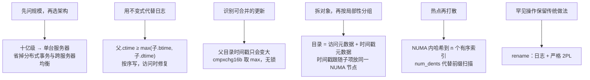

**解读**：SingularFS 的方法论可以概括为"**把分布式元数据的设计技巧搬回单机**"。分布式系统里为了避免跨服务器协调而发明的技术（对象拆分、按局部性分组、一致性哈希、可合并更新、顺序写代替事务），在单机多核多 NUMA 的环境里同样适用，因为 NUMA 节点之间、核与核之间本质上也是一个小型分布式系统。

### 10.3 优点与局限

| 优点 | 局限 / 未回答的问题 |
|------|---------------------|
| 单台服务器性能极高，免去分布式事务和负载均衡的全部复杂度 | **硬件前提已不存在**：Intel Optane 已停产，论文的性能和容量数字都建立在 Optane DIMM 上；换成 DRAM + NVMe 或 CXL 内存后，无日志方案仍成立，但需要重新评估持久化开销 |
| 无日志设计简洁，只依赖 KV 单对象原子性，可移植到其他 KV 后端 | **没有讨论高可用**：单台元数据服务器宕机即服务不可用，论文未涉及复制、主备切换和复制带来的写放大 |
| 层级并发控制把共享目录吞吐提升了一个数量级 | 引言称"不牺牲多服务器扩展性"，正文没有任何多服务器设计或实验支撑 |
| 因素分析清楚地展示了每项技术对应的场景，包括负收益 | 单目录吞吐受限于一个 NUMA 节点（约 4M ops/s），只能用到半台机器 |
| 惰性恢复使重启时间与目录树规模无关 | 重启后每个目录的首次访问都要扫描全部子项，大目录首访延迟可达数十毫秒甚至更高 |
| 端到端 Filebench 与 rename 结果如实报告了劣势（不如 NOVA） | 不变式依赖单调时钟，时钟回退的情况未讨论；mkdir/rmdir 吞吐低于 NOVA |
| — | 与 InfiniFS 32 台服务器的比较是跨论文、跨硬件的；CephFS 吞吐在 IPoIB 而非 RDMA 模式下测得；文件长度为 0 |

### 10.4 对分布式文件系统设计者的启示

1. **先估算规模上限**：如果单个文件系统实例最多几十亿文件，认真考虑"单台强元数据服务器 + 主备"方案，它可能比分布式元数据简单一个数量级，性能还更高。
2. **把 dirent 和子 inode 合成一个 KV 对象**：键为 `<父 ID + 名字>`，readdir 用前缀匹配。这样 create、delete 对目录项的修改天然是单对象原子的。
3. **给 inode 加 btime / dtime，用时间戳不变式代替日志**：只要父目录时间戳与子项时间戳之间有单调关系，就可以按序写、事后修复。用单调计数器而不是墙钟更安全。
4. **把"只推进时间戳"的操作单独识别出来**：它们之间可以用原子指令无锁合并；在数据库或 KV 层面，可以用 delta / max 合并原语实现同样效果（对照 CFS）。
5. **多核多 NUMA 服务器也要做"分区"**：按目录分组到 NUMA 节点保证局部性，按键哈希打散单目录前缀热点。同时要接受单目录性能受限于一个分组的代价。
6. **恢复可以惰性化**：用"重启代数"标记判断对象是否需要检查，让重启时间与数据规模无关；但要评估大目录首次访问的延迟尖峰。
7. **做因素分析时报告负收益**：SingularFS 显示部分技术在无冲突场景下有约 10% 的开销。按自己的负载（共享目录写的比例）决定是否引入这些机制。

### 10.5 一张图看懂 SingularFS

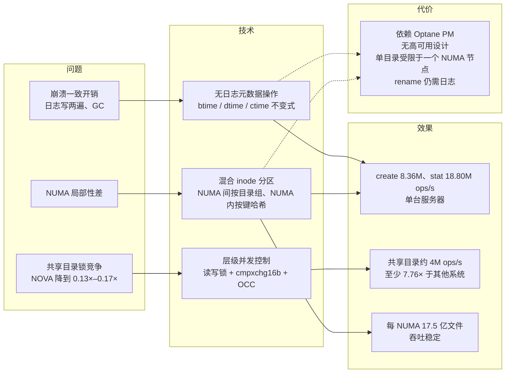

---

## 参考

- Hao Guo, Youyou Lu, Wenhao Lv, Xiaojian Liao, Shaoxun Zeng, Jiwu Shu. *SingularFS: A Billion-Scale Distributed File System Using a Single Metadata Server*. USENIX ATC 2023. <https://www.usenix.org/conference/atc23/presentation/guo>
- Wenhao Lv et al. *InfiniFS: An Efficient Metadata Service for Large-Scale Distributed Filesystems*. USENIX FAST 2022. 本仓库精读：[infinifs-fast2022.md](infinifs-fast2022.md)
- Yiduo Wang et al. *CFS: Scaling Metadata Service for Distributed File System via Pruned Scope of Critical Sections*. EuroSys 2023. 本仓库精读：[cfs-eurosys2023.md](cfs-eurosys2023.md)
- Jian Xu, Steven Swanson. *NOVA: A Log-structured File System for Hybrid Volatile/Non-volatile Main Memories*. USENIX FAST 2016.
- Gregory R. Ganger et al. *Soft Updates: A Solution to the Metadata Update Problem in File Systems*. ACM TOCS 2000.
- Se Kwon Lee et al. *Recipe: Converting Concurrent DRAM Indexes to Persistent-Memory Indexes*. SOSP 2019.（P-Masstree 出处）
- Qing Wang, Youyou Lu, Junru Li, Jiwu Shu. *Nap: A Black-Box Approach to NUMA-Aware Persistent Memory Indexes*. OSDI 2021.（远端 PM 访问开销与 DRAM 缓存方案）
- Diyu Zhou et al. *ODINFS: Scaling PM Performance with Opportunistic Delegation*. OSDI 2022.（NUMA 感知委托线程）
- 新硬件路线与 Optane 停产后的替代方案：见[新硬件综述](new-hardware.md)
