# SwitchFS 精读：用可编程交换机协调的异步元数据更新（EuroSys 2026）

> 论文：Jingwei Xu, Mingkai Dong*, Qiulin Tian, Ziyi Tian, Tong Xin, Haibo Chen（* 通讯作者）. *SwitchFS: Asynchronous Metadata Updates for Distributed Filesystems with In-Network Coordination*. ACM EuroSys '26，爱丁堡，2026-04-27～30。早期 arXiv 版本名为 AsyncFS。
>
> 机构：上海交通大学并行与分布式系统研究所（IPADS）。
>
> 链接：ACM <https://dl.acm.org/doi/10.1145/3767295.3769349>；arXiv <https://arxiv.org/abs/2410.08618>（本文依据 v3，2025-12-30，标注 "Accepted by EuroSys'26"）
>
> 篇幅：arXiv v3 共 20 页：正文 14 页、参考文献约 4 页、附录 A（一致性证明与重配置容错）2 页；22 张图、5 张表。
>
> 精读日期：2026-11-24。**数字和机制描述都摘自论文**，用"论文 §x / 图 x / 表 x"标注出处。标"解读"的段落是本文作者的分析和推论，不是原文。部分图带数据标签，直接引用；没有标签的读数为本文估读，标注"约"，误差约 ±5%。标"示例"的是为说明机制构造的例子。
>
> 相关文档：
> - [元数据扩展性综述 §2.11](metadata-scalability.md#211-switchfs-asynchronous-metadata-updates-for-distributed-filesystems-with-in-network-coordinationeurosys-2026)：本文的简述版。
> - [FalconFS（NSDI 2026）精读](falconfs-nsdi2026.md)：同一第一作者、同一团队的同期工作，同样针对目录争用，但走"服务端请求合并"路线。
> - [CFS（EuroSys 2023）精读](cfs-eurosys2023.md)：SwitchFS 的主要基线之一（Emulated-CFS，P/C 分离），其 delta apply 与本文的 change-log 合并同源。
> - [InfiniFS（FAST 2022）精读](infinifs-fast2022/deep-read.md)：另一个主要基线（Emulated-InfiniFS，P/C 聚合）。
> - [Mantle（SOSP 2025）精读](mantle-sosp2025.md)、[MesaFS（EuroSys 2026）精读](mesafs-eurosys2026.md)：同样"推迟或追加父目录更新"的另外两种做法。

## 目录

- [0. 一页速览](#0-一页速览)
- [1. 背景：分区方式与可编程交换机](#1-背景分区方式与可编程交换机)
- [2. 动机：负载特征与两个挑战](#2-动机负载特征与两个挑战)
- [3. 总体设计](#3-总体设计)
- [4. 异步元数据操作](#4-异步元数据操作)
- [5. change-log 合并与主动聚合](#5-change-log-合并与主动聚合)
- [6. 容错](#6-容错)
- [7. 交换机数据平面与网内脏集合](#7-交换机数据平面与网内脏集合)
- [8. 正确性：附录 A 的论证](#8-正确性附录-a-的论证)
- [9. 评估](#9-评估)
- [10. 相关工作](#10-相关工作)
- [11. 论文中的不一致与可疑之处](#11-论文中的不一致与可疑之处)
- [12. 与本仓库中其他系统的对照](#12-与本仓库中其他系统的对照)
- [13. 整体总结](#13-整体总结)
- [参考](#参考)

---

## 0. 一页速览

**一句话**：分布式文件系统的元数据更新通常是同步的：create 要同时改新文件的 inode 和父目录。如果父子放在同一台服务器（P/C 聚合，如 InfiniFS），大目录会成为热点；如果按文件打散（P/C 分离，如 CFS），每次 create 都要跨服务器协调；而且无论哪种方式，同一目录下的并发更新都在父目录上排队。SwitchFS 认为同步更新**过于保守**：阿里盘古的负载中目录更新占 30.76%，目录读只占 4.19%，至少 86% 的目录更新之后不会被立刻读。于是它采用**异步目录更新**：create/delete/mkdir/rmdir 只在新文件所在服务器上改 inode，并把对父目录的修改追加到本机的 **change-log**，就向客户端返回；等到有人读这个目录（statdir/readdir）时，再从所有服务器**聚合**这些修改。为了不读到旧数据，需要知道哪些目录有未应用的修改：SwitchFS 把这个**脏集合**放在机架顶部的 **Tofino 可编程交换机**里，以线速插入、查询、删除目录指纹，几乎不增加延迟。聚合前再利用目录属性更新的可交换性做 **change-log 合并**。结果：在倾斜负载下，吞吐最高是 Emulated-InfiniFS 的 13.34 倍，延迟比 Emulated-CFS 低 57.3%。

| 维度 | 要点 |
|------|------|
| 关键观察 | 盘古三个实例中目录更新 30.76%、目录读 4.19%；按鸽巢原理至少 (30.76 − 4.19)/30.76 ≈ 86% 的目录更新之后不会紧接着被读（论文 §3.1，表 2） |
| 两个挑战 | ① 分区粒度在"操作开销"和"负载均衡"之间两难；② 同一目录的并发更新在父目录上串行，服务器间、服务器内的并行度都上不去（论文 §3.2，图 2） |
| 分区 | P/C 分离：按 (pid, name) 哈希分布所有文件和目录元数据，负载均衡；目录项存在目录 inode 所在服务器（论文 §4.3，表 3） |
| 异步更新 | 双 inode 操作拆成"本地半"（写目标 inode + 把父目录修改记入本机 change-log + WAL）和"远端半"（读目录时聚合并应用）；大多数操作 1 个 RTT 完成（论文 §5.2） |
| 网内脏集合 | 49 位目录指纹（17 位索引 + 32 位标签）；10 级流水线 × 131,072 个 32 位寄存器，组相联，最多 1,310,720 个指纹，占 5 MiB；P4 程序 847 行；插入失败时回退为同步更新（论文 §6） |
| change-log 合并 | 属性增量可交换、时间戳只保留最大值、不同名目录项增删可交换、同名增删按 FIFO 顺序；聚合前合并，减少 KV 写；满一个 MTU 或空闲一段时间就主动推送（论文 §5.3） |
| 结果 | 单大目录中 create/delete/mkdir/rmdir 随服务器线性扩展，基线不扩展；create 延迟约 12 µs；突发负载下吞吐稳定，基线下降 47%–72%；真实负载端到端吞吐比 CephFS、E-InfiniFS、E-CFS 分别提升 21.1×、1.1×、0.3×（论文 §7） |
| 代价 | 读散乱目录要聚合，连续 create 后 statdir 延迟最高约 500 µs；statdir 平时也比基线高 28.6%；交换机是单点故障，恢复期间整体吞吐为零（论文 §7.2.2、§7.5、§7.7） |

**解读**：

- SwitchFS 的思想可以概括为"**写时只记账，读时再结算**"。目录的 mtime、size、nlink、目录项列表都是由子项操作派生的状态，推迟应用不影响子项本身的正确性；只要读的时候能把账结清，就仍满足 POSIX 的"操作返回后对后续操作可见"。
- 真正的难点是"怎么知道哪本账还没结"。放在专门的服务器上要多一个 RTT、容量有限；放在目录所属服务器上要多一倍包；交换机天然在每个请求的路径上、处理能力达数十亿包每秒，正好用来做这件事。这是"**把协调状态下沉到网络**"的典型案例，与 NetCache、Harmonia 一脉相承。
- 它与 [FalconFS](falconfs-nsdi2026.md)（同一第一作者）、[Mantle](mantle-sosp2025.md)、[MesaFS](mesafs-eurosys2026.md)、[CFS](cfs-eurosys2023.md) 共享一个越来越清晰的共识：**父目录属性是热点，但它是可以延后、合并、交换次序的派生状态**。各家的差别只是"推迟到哪里、用什么记账、靠什么保证不读旧值"。

---

## 1. 背景：分区方式与可编程交换机

### 1.1 两类分区方式（论文 §2.1，图 1，表 1）

按"文件 inode 是否与父目录放在一起"可分为：

| | P/C 聚合（parent-children grouping） | P/C 分离（parent-children separation） |
|---|------|------|
| 做法 | 文件 inode 与父目录在同一服务器；目录可按子树（CephFS、HDFS）或按目录哈希（BeeGFS、InfiniFS、HopsFS、Tectonic、IndexFS）独立分布 | 文件 inode 与父目录位置无关，例如按文件哈希（GlusterFS、CFS） |
| 单 inode 操作 | 本地 | 本地 |
| 双 inode 操作 | 文件 create/delete 本地；mkdir、rmdir 跨服务器 | create、delete、mkdir、rmdir 全部跨服务器 |
| 负载均衡 | 同一目录的文件都在一台服务器，倾斜负载下形成**目录热点** | 均衡 |
| 代表 | CephFS、InfiniFS | GlusterFS、CFS |

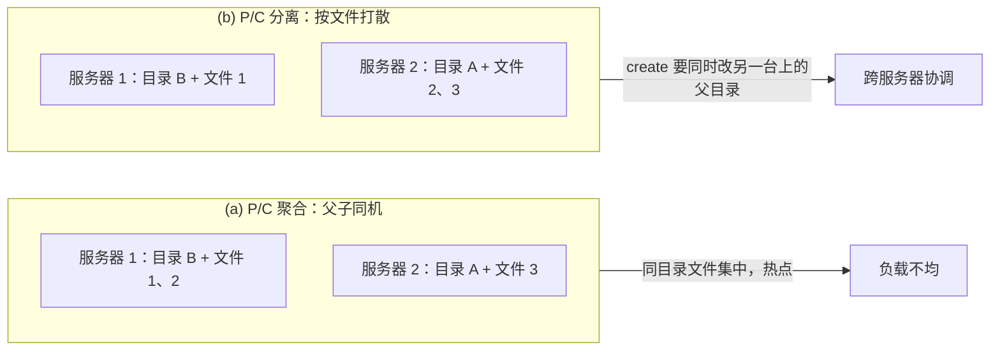

### 1.2 可编程交换机（论文 §2.2）

可编程交换机带可编程 ASIC 和有状态内存（Intel Tofino、Cisco Nexus、Cavium XPliant），能在线速转发的同时对包做自定义处理。相比用普通服务器处理包，它有两个优势：

1. 位于网络中心，能看到所有通信；
2. ASIC 以线速处理，吞吐高、延迟低（论文 §7.3.3 用实验支撑）。

---

## 2. 动机：负载特征与两个挑战

### 2.1 目录通常不会在更新后立刻被读（论文 §3.1，表 2）

阿里盘古三个部署实例（数据处理、对象存储、块存储等负载）的元数据操作比例：

| 类别 | 占比 | 细分 |
|------|------|------|
| 目录更新 | **30.76%** | create 9.58%、delete 11.88%、mkdir 0.01%、rmdir 0.01%、文件 rename 9.29% |
| 目录读 | **4.19%** | statdir 0.28%、readdir 3.91% |
| 其他 | 65.05% | open/close 52.59%、stat 12.35%、其他 0.10% |

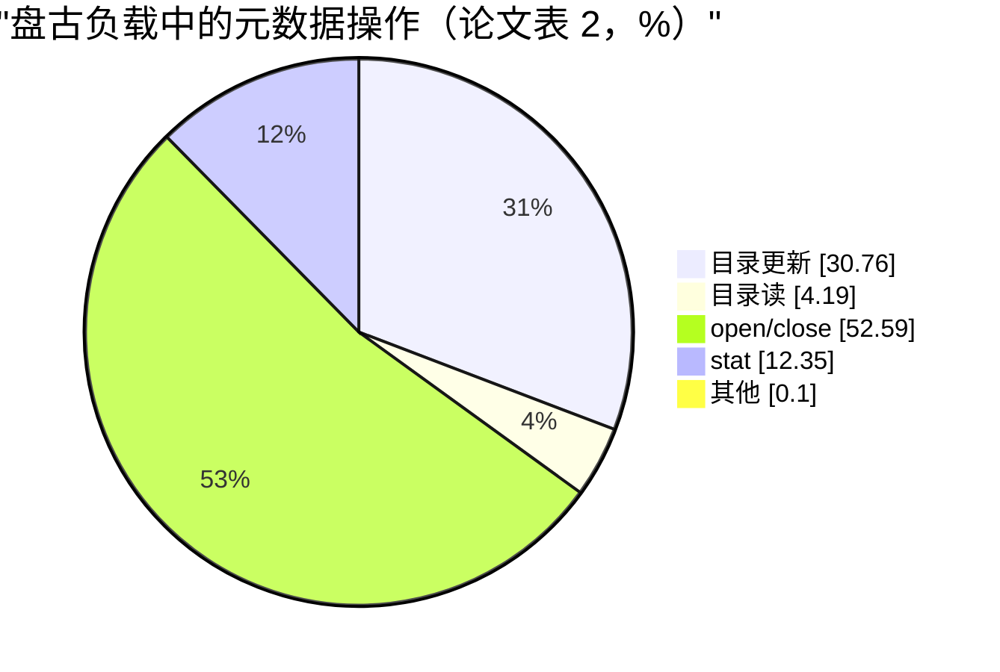

按鸽巢原理，至少 (30.76% − 4.19%) / 30.76% ≈ **86.3%** 的目录更新之后不会紧接着被读：要么该目录之后再也没被读，要么在被读之前又被至少一个其他操作更新过。所以延迟应用目录更新可以隐藏延迟、缓解争用。注意相互依赖的更新（如同一文件的创建与删除）的偏序必须保持，SwitchFS 会保证这一点。

**数据中心负载在多个维度上倾斜**：

- **目录层次不均衡**：多数目录的条目不足 128 个，但有的目录超过一百万个，给 inode 分布和负载均衡带来困难；
- **目录热点**：应用常把相关文件放在一个目录里并在短时间内访问，形成时间上的热点。

**解读**：表 2 把文件 rename（9.29%）也算作目录更新，但 SwitchFS 中 rename 仍走同步的分布式事务（见 [§4.4](#44-rmdir论文-523图-6)）。能真正异步化的是 create、delete、mkdir、rmdir，约占 21.5%。鸽巢论证给的是全局下界，对单个目录不一定成立：一个"写一次就立刻 ls"的工作流（例如 Spark 写完输出就列目录）恰好是异步化收益最小、聚合代价最大的场景。

### 2.2 挑战 1：分区粒度两难（论文 §3.2，图 2a、2b）

用作者仿真的 **Emulated-InfiniFS**（P/C 聚合）和 **Emulated-CFS**（P/C 分离），8 台服务器、每台 4 核，在一个共享目录中测试：

- **stat 随机文件**（图 2a）：E-CFS 随服务器数线性扩展（16 台时约 4 Mops/s，约），E-InfiniFS 不扩展（所有文件 inode 在同一台服务器上，约 0.2 Mops/s，约）。E-CFS 的负载均衡更好。
- **create 延迟拆分**（图 2b）：E-CFS 的 create 延迟（约 26 µs，约）高于 E-InfiniFS（约 16 µs，约），主要是跨服务器协调带来的网络开销。E-InfiniFS 的操作开销更低。

### 2.3 挑战 2：父目录争用（论文 §3.2，图 2c、2d）

在单个目录中并发创建文件（数据准备、编译、解压等）时，每个 create 都要更新父目录的属性和目录项列表：

- 即使在 P/C 分离下文件创建可以分散到多台服务器，父目录的更新仍在其所在服务器上串行，**服务器间并行度低**；
- 传统方法依赖事务和锁保证原子性，服务器无法利用多核，**服务器内并行度低**。

图 2c、2d 中两种系统的 create 吞吐都卡在约 80–85 Kops/s，既不随服务器数（4 → 16）增长，也不随每台服务器的核数（2 → 6）增长。

---

## 3. 总体设计

### 3.1 设计思路（论文 §4.1）

- **关键思路：异步目录更新**。除 rename 外，文件系统操作最多更新两个元数据对象：目标对象和其父目录。把对**远端**父目录的更新推迟，操作就能在单台服务器上本地完成，隐藏跨服务器开销，并让对同一父目录的并发更新并行执行。
- **性能使能者：可编程交换机**。为了让推迟的更新对后续访问可见，用一台集中的可编程交换机以线速、亚 RTT 延迟存储目录状态。
- **为什么交换机放得下**：虽然目录总数可能很大，但最近一段时间内被修改过的目录不多。例如每秒能创建或删除一百万个文件的文件系统，每 100 ms 内最多修改十万个目录，能放进交换机的片上内存。只要周期性地应用推迟的更新并清理交换机上的状态，片上跟踪就是可行的。

### 3.2 架构（论文 §4.2）

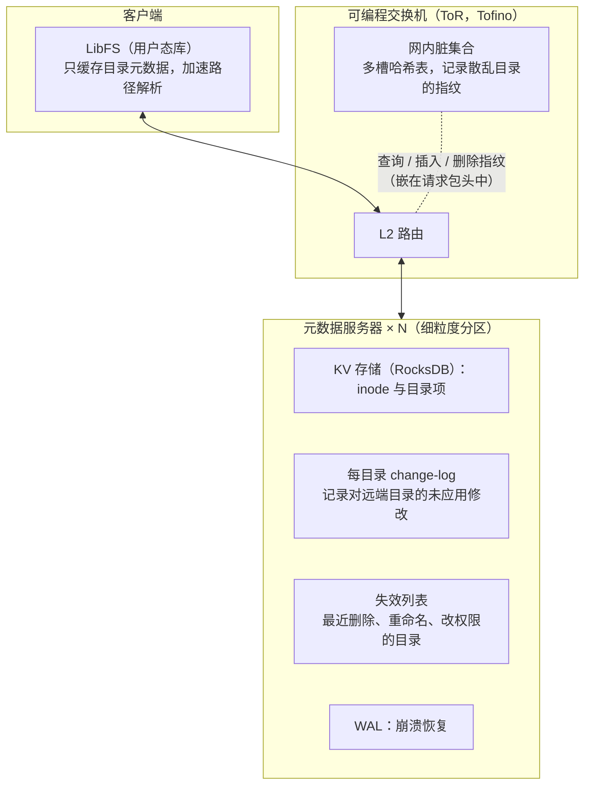

| 组件 | 作用 |
|------|------|
| 客户端 | LibFS 与服务器通信；元数据缓存只缓存目录元数据 |
| 元数据服务器 | 细粒度分区；元数据存在 RocksDB 中；用每目录 change-log 记录对远端目录的推迟修改；用失效列表记录最近删除的目录；用 WAL 做崩溃恢复 |
| 网内脏集合 | 交换机监视网络流量，维护推迟更新的集中脏集合；为高效利用片上内存，存为多槽哈希表 |

多台交换机的扩展见 [§7.4](#74-扩展到多机架论文-64图-11)。

### 3.3 元数据模式（论文 §4.3，表 3）

| 对象 | 键 | 值 | 分区依据 |
|------|-----|-----|---------|
| 目录元数据 | (pid, name) | id、时间戳、权限等 | 键 |
| 目录项 | (pid, name) | 文件类型、权限 | 不单独分区，与该目录的 inode 放在同一服务器 |
| 文件元数据 | (pid, name) | 完整的普通文件元数据 | 键 |

- 每个目录创建时分配唯一的 **256 位 id**。
- 采用 **P/C 分离**：按 (pid, name) 哈希分区。一个目录的目录项列表由多个"目录项"KV 组成，全部与该目录的 inode 放在同一台服务器上。
- 每个目录还有一个由 (pid, 目录名) 哈希得到的 **49 位指纹**，作为交换机中的目录标识，以适应交换机寄存器宽度。不同目录可能有相同指纹；SwitchFS 保证同一**指纹组**（指纹相同的所有目录）放在同一台服务器上，以简化冲突处理。

### 3.4 目录状态（论文 §5.1，图 3）

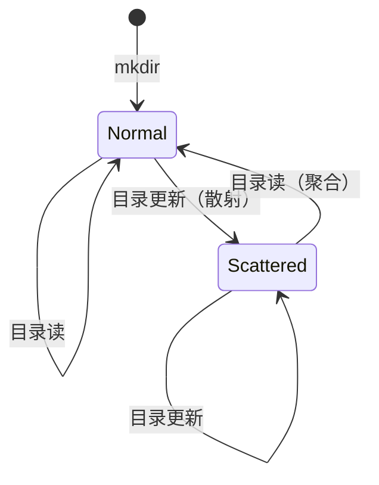

- **normal**：所有已返回的对该目录的更新都已应用到它的 inode；
- **scattered**：一个或多个 change-log 中有尚未应用的更新。
- 状态转换的粒度是**指纹组**：一次聚合会聚合目标指纹组中的所有目录；由于同组目录都在同一台服务器上，这不增加复杂度。

---

## 4. 异步元数据操作

### 4.1 三类操作（论文 §5.2）

| 类型 | 操作 | SwitchFS 的处理 |
|------|------|----------------|
| 双 inode 操作 | create、delete、mkdir、rmdir | 推迟对父目录的更新，在单台服务器上完成执行（§5.2.1、§5.2.3） |
| 单 inode 操作 | 文件：open、close、stat | 与 InfiniFS、CFS 一样同步执行 |
| | 目录：statdir、readdir | 读目录属性，要检查 inode 是否过时，可能触发聚合（§5.2.2） |
| rename | 最多更新 4 个 inode | 分布式事务保证一致；用集中的 rename 协调者避免孤儿环（同 InfiniFS、CFS）；若源是目录，rename 开始时先发起聚合，应用所有推迟的更新 |

**协议直觉**：把双 inode 操作拆成两半：

- **本地半**：更新目标对象的 inode，并把对父目录的更新持久化到 change-log；
- **远端半**：当父目录被读时，聚合并应用 change-log 条目。

这样目录更新被推迟到读时，操作可以提前返回，隐藏跨服务器开销。为了不丢更新，SwitchFS 用交换机上的脏集合协调目录读写，并在附录 A.2 中证明操作可串行化且保持实时顺序。

**服务器上的数据结构**：

| 结构 | 说明 | 存放 |
|------|------|------|
| change-log | 每服务器、每目录的 FIFO 队列，记录已提交但尚未应用的异步目录更新 | 内存 |
| 失效列表 | 用于惰性失效客户端缓存（同 InfiniFS）：目录被删除、重命名或修改权限时，其 inode 所在服务器向所有服务器广播，接收者把该目录加入失效列表；客户端访问服务器时据此失效过时的缓存 | 内存 |
| KV 存储 | inode 和目录项 | 内存 |
| WAL | 记录已提交操作的顺序，并标记对应的异步更新是否已应用到远端 | 持久 |

### 4.2 mkdir、create、delete（论文 §5.2.1，图 4）

以 create(/a/b) 为例（Server B 是 /a/b 的 inode 所属服务器，按 /a/b 的 pid 和 name 哈希确定）：

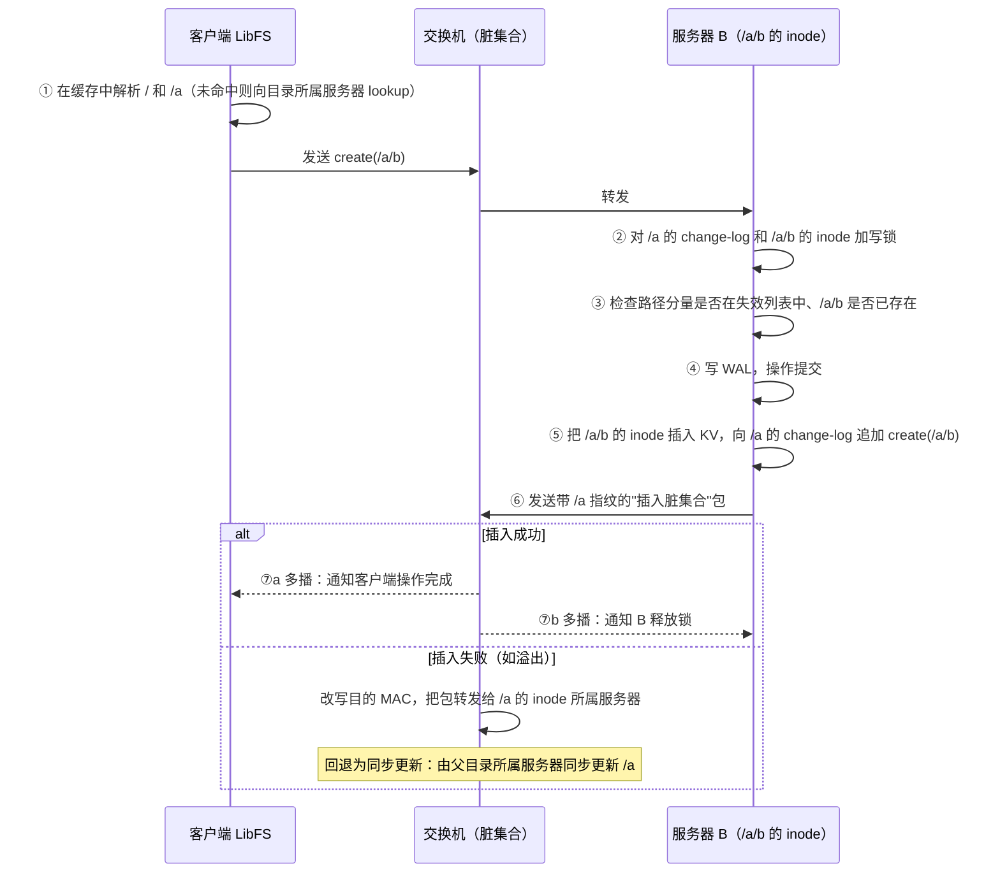

- 失效检查不通过时，Server B 让客户端失效过时缓存并重试整个操作。
- **讨论**：多台服务器可能各自独立地为同一目录记录更新。这些更新不冲突，因为目录属性的更新可交换，下一次 statdir 或 readdir 会聚合它们（§5.2.2、§5.3）。

**解读**：交换机在这里不只是"记一笔"，还替服务器做了**回包**：插入脏集合成功后，交换机把同一个包多播给客户端（完成通知）和服务器（解锁通知）。所以"插入脏集合"不增加 RTT，客户端看到的仍是一个 RTT。这也是论文强调交换机"在每个请求的路径上"的原因：专门服务器做同样的事要多一跳（§9.5 实测约 3 µs）。

### 4.3 statdir、readdir（论文 §5.2.2，图 5）

以 statdir(/a) 为例（Server A 是 /a 的 inode 所属服务器）：

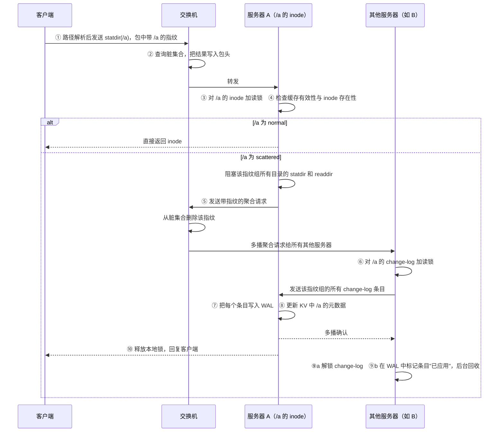

### 4.4 rmdir（论文 §5.2.3，图 6）

以 rmdir(/c) 为例（Server A 是 /c 的所属服务器）。前几步（路径解析、加锁、有效性与存在性检查）与 create 相同。之后 Server A 必须**收集 /c 的最新更新**，才能判断目录是否为空，并防止客户端过时的 /c 缓存被继续使用：

1. Server A 向交换机发送聚合请求；交换机删除指纹并多播给所有其他服务器（④）。
2. 每台其他服务器先把 /c 加入**失效列表**（⑤），再对 /c 的 change-log 加读锁，把条目发给 Server A（⑥）。
3. Server A 应用所有条目，判断 /c 是否为空（⑦）：为空则写 WAL、提交（⑧）；否则返回 ENOTEMPTY。
4. 其余步骤与 create 相同（对 /c 的父目录做异步更新）；最后 Server A 通知其他服务器解锁，并把它们发来的条目在 WAL 中标记为"已应用"（⑫）。

**讨论**：通过惰性失效防止客户端读到过时的目录元数据。rmdir(/c) 在真正删除目录（⑨）**之前**就把 /c 追加到所有服务器的失效列表（⑤）。之后任何 /c 下的操作在检查路径有效性时都会失败，转而发起 lookup(/c)；由于 rmdir(/c) 持有 /c inode 的写锁（②），lookup 会等到 rmdir 完成，看到最新元数据。

**rename 与硬链接**（论文 §5.2、§5.5）：

- rename 用分布式事务和集中 rename 协调者同步执行；源是目录时先聚合。
- 硬链接：把文件元数据拆成**引用**（(pid, name) → (server_id, file_id)）和**属性**（file_id → (ref_count, size, timestamps, …)）。创建文件时两者都在 (pid, name) 哈希到的服务器上；创建硬链接只在新位置创建引用，指向可能在另一台服务器上的属性；ref_count 降为 0 时删除属性。两者都由两阶段锁保护，跨服务器更新用两阶段提交。

**解读**：rmdir 是 SwitchFS 中最"贵"的双 inode 操作：必须先把所有服务器上关于该目录的 change-log 拉回来才能判断是否为空，还要多播失效。这解释了评估中 rmdir 吞吐低于 mkdir（图 12）、多目录场景下 rmdir 与基线持平（多播开销抵消了异步收益）。

---

## 5. change-log 合并与主动聚合

### 5.1 change-log 结构（论文 §5.3，图 7）

每台服务器为每个散乱目录维护一份本地 change-log。每个条目表示一个推迟的目录更新，包含**时间戳、操作类型（create、delete 等）、文件名**。

### 5.2 可合并的依据（论文 §5.3）

对同一目录的更新是**有条件可交换**的。目录更新涉及三类动作：

| 动作 | 例子 | 可交换性 |
|------|------|---------|
| (a) 对属性施加增量 | size、nlink | 任意顺序结果相同 |
| (b) 覆盖时间戳 | atime、mtime | 只保留最大的时间戳 |
| (c) 在目录项列表中插入或删除条目 | create、delete | 不同条目的插入删除互不冲突、可任意顺序；**同名**条目的反复插入删除必须按提交顺序应用（如 mkdir(/a)、rmdir(/a)）。由于同一名字的插入和删除总由同一台服务器记录（按 (pid, name) 哈希），change-log 的 FIFO 结构保证了这一顺序 |

### 5.3 合并流程（论文 §5.3）

- 追加更新时，change-log 维护所有条目的**最大时间戳**，并存储操作类型和文件名。
- 收到聚合请求后，服务器把相关 change-log 发给目录所属服务器；所属服务器遍历操作队列更新目录项列表，并**原子地**更新 inode 属性（时间戳、size 等）。

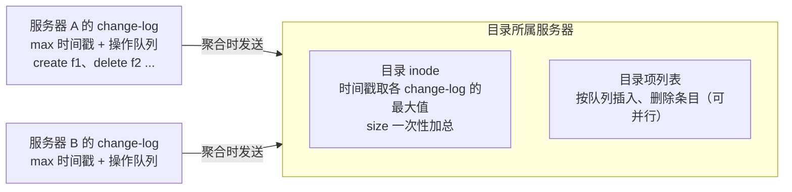

合并从两方面缓解争用：

1. 异步更新让每台服务器在**本地** change-log 中先合并对远端父目录的更新，提升服务器间并行度；
2. 合并预先把时间戳和 size 增量折叠，减少 KV 存储的 put() 次数。

### 5.4 主动聚合（论文 §5.3）

为了避免一连串目录更新后第一次目录读被长时间阻塞，服务器会**主动**把 change-log 条目推给目录所属服务器：

- 累积的条目足以填满一个 **MTU**；或
- 在一个可配置的时间间隔内没有新条目追加。

目录所属服务器收到推送后启动计时器；在配置的时间内没有新的推送就主动发起聚合，让目录回到 normal 状态，之后的目录读不再触发聚合。评估中所有实验都启用了主动聚合（论文 §7.1）。

---

## 6. 容错

### 6.1 不可靠网络（论文 §5.4.1）

协议基于 **UDP**，可能丢包、乱序：

- **丢包**：超时重发。
- **乱序**：同一操作的包逐个收发，不同操作之间相互独立、不假设顺序，所以乱序没有问题。
- **重复**：服务器用每个包附带的（发送服务器、序号）检测并丢弃重复包。交换机对三种脏集合操作分别处理：
  - 重复的**查询**无副作用；重复的**插入**可能引发不必要的聚合，但不影响正确性；
  - 只有重复的**删除**会出问题：聚合发出的删除请求若在聚合完成后才到达交换机，会删掉后续操作插入的指纹。为此每个删除请求带一个单独的**删除序号**，每次新请求或重发都递增；交换机记录每台服务器的最大删除序号，只处理更大的请求；服务器重发删除后只等最后一次重发的响应。这样聚合完成后不会有重复的删除生效。

### 6.2 崩溃恢复（论文 §5.4.2）

| 故障 | 恢复过程 | 期间服务 |
|------|---------|---------|
| 元数据服务器 | 数据结构在 DRAM 中，用 WAL 恢复（与盘古、HDFS 等生产部署相同）：① 重做 WAL 中的操作，重建本地 KV 和**尚未标记"已应用"**的 change-log 条目（已应用的条目已持久化在目录所属服务器的 WAL 中，无需重建）；② 主动聚合它拥有的所有目录，确保崩溃前它发起但被中断的聚合执行完毕；③ 从其他服务器克隆失效列表 | 该服务器不服务正常请求 |
| 交换机 | 交换机上的状态全部丢失：初始化空的脏集合，通知所有服务器聚合所有目录。全部聚合完成后，所有 change-log 条目都已发送并应用，所有目录回到 normal，与空脏集合一致 | **所有服务器**停止服务正常请求 |

### 6.3 集群重配置（论文 §5.5、附录 A.3）

用一致性哈希把 inode 映射到服务器，增减服务器时只迁移少部分元数据。迁移是**停机式**的：集中协调者通知所有服务器停止服务并聚合自己拥有的目录 → 全部确认后下发新配置，各服务器按一致性哈希找出不再归自己的 inode，用两阶段提交迁移给新所有者 → 全部确认后恢复服务。哈希函数在客户端和服务器上，交换机无需改动。每一步幂等，协调者在本地 WAL 中记录每一步的开始和完成，崩溃后从未完成的那一步重做。

**解读**：SwitchFS 的容错设计偏保守：交换机故障、集群重配置都要全局停服并聚合所有目录。评估中交换机故障后的恢复需要 3.82 秒，期间吞吐为零（§9.9）。论文承认交换机是潜在的单点故障并留作未来工作。在生产环境中，ToR 交换机重启、升级固件并不罕见，这一点会直接影响可用性。

---

## 7. 交换机数据平面与网内脏集合

### 7.1 包格式（论文 §6.1，图 9）

基于 UDP。UDP 负载以一个**可选**的脏集合操作头开头，交换机可以解析；之后是给服务器处理的 DFS 请求或响应。SwitchFS 预留两个 UDP 端口，分别用于带和不带脏集合操作头的包，交换机据此区分。

| 字段 | 位宽 | 含义 |
|------|------|------|
| OP | — | 操作类型：插入、查询、删除 |
| RET | 8 位 | 操作结果 |
| 指纹索引 | 17 位 | 组索引（指纹高 17 位） |
| 指纹标签 | 32 位 | 唯一标识指纹的其余位 |
| SEQ / 备用 MAC | 48 位 | 删除请求的序号，或插入失败时的回退目的 MAC |
| 请求 / 响应 | — | DFS 负载 |

### 7.2 数据平面布局（论文 §6.2，图 8）

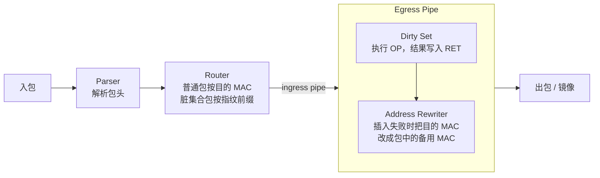

- 一台交换机可能有多个 pipe，pipe 之间不共享状态。脏集合放在 **egress pipe**，以无共享方式划分：每个 pipe 负责不同前缀的指纹，包按指纹路由；若包访问的指纹不归其目的端口所在 pipe 管，交换机把它**镜像**到负责的 pipe（同 NetCache、Pegasus 等前作）。

### 7.3 脏集合结构与操作（论文 §6.3，图 9、图 10）

由于编程约束无法实现复杂的索引结构，SwitchFS 把 32 位寄存器组织成类似**组相联缓存**的形式：

- 数据平面有多级（stage），每级一个寄存器数组；不同级同一位置的寄存器横向组成一个**组**（set）。
- 配置：**10 级**，每级 **131,072（2¹⁷）**个寄存器，最多存 **1,310,720** 个指纹；指纹高 17 位作组索引，其余 32 位作标签。

三种寄存器动作：

| 动作 | 语义 |
|------|------|
| register query | 比较寄存器值与 tag，返回是否相等 |
| conditional insert | 返回寄存器值是否等于 0 或 tag；若原值为 0 则写入 tag |
| conditional remove | 若原值等于 tag 则写 0 |

三种脏集合操作：

- **查询**：所有级依次做 register query，任意一级返回真则结果为真；
- **删除**：所有级依次做 conditional remove；
- **插入**：各级依次做 conditional insert，直到某级返回真；**之后的各级做 conditional remove**，确保组内不留重复的 tag。

**示例**（论文图 10）：插入 tag 0xcd，组中四级原值为 0xab、0x00、0xcd、0x00。第 1 级 0xab ≠ 0 且 ≠ 0xcd，返回假；第 2 级为 0，写入 0xcd 并返回真；第 3、4 级执行 conditional remove，第 3 级原有的 0xcd 被清零。结果为 0xab、0xcd、0x00、0x00，RET 为真。

**性质**：交换机架构保证 ① 同一级内的操作是原子的；② 有序执行：若包 P_A 先于 P_B 到达级 S_A，则对之后的级 S_B 也先到达。由此脏集合操作是**幂等**的（连续重复操作等价于一次）且**可线性化**的（对同一指纹的操作被流水线串行化）。

**解读**：插入时"后续级做 conditional remove"是一个巧妙的细节。组内同一个 tag 可能因为之前在较后的级插入、后来前面的槽被删空而出现在较后的位置；新的插入会落到最前面的空槽，再顺手把后面的旧副本清掉，保证每个 tag 在组内至多一份，删除时就不会漏。

### 7.4 扩展到多机架（论文 §6.4，图 11）

- 单机架：脏集合放在 ToR 可编程交换机上，能看到机架内所有流量。
- 多机架：采用 leaf-spine 拓扑，ToR 用普通交换机，**可编程交换机部署在 spine 层**。进一步扩展时，按指纹对目录状态做**范围分区**，把涉及每个子集的包导向相应的交换机。已有研究表明交换机之间额外的网络跳数开销可忽略。这种做法能适应倾斜负载：指纹随机，目录在交换机上分布均匀；每台交换机都能处理整个元数据集群的流量。

### 7.5 资源与局限（论文 §6.5）

- 交换机程序：**847 行 P4 + 303 行 C**；占用 **1,310,720 个 32 位寄存器，共 5 MiB**；在 Tofino 上初始化不到 10 秒。
- 片上内存有限，难以与状态较重的网络功能（如网内缓存）共存，但可以与流控、包过滤等轻量功能共存。
- 交换机是潜在的单点故障，留作未来工作。

**解读**：5 MiB 寄存器在 Tofino 有限的片上 SRAM 中占了相当大的一块，这限制了在生产交换机上与其他 P4 功能共存（论文自己也承认这一点）。评估中"没有发生脏集合溢出"（§7.1），说明测试负载下最近修改的目录数远小于 131 万；但在百亿文件、数千台客户端的规模下，主动聚合间隔与目录修改速率之间的关系决定了溢出频率，论文只测了强制溢出（§9.5），没有给出真实负载下的溢出率。

---

## 8. 正确性：附录 A 的论证

论文附录 A 给出崩溃恢复的正确性（A.1）和操作一致性（A.2）的论证。

### 8.1 两条性质（附录 A.2）

- **性质 1：可串行化**。以 α = create(/a/b)（Server B 记 change-log）与 β = readdir(/a)（Server A 读）为例，按 β 查询脏集合的结果分类：

| 情况 | 时序 | 结果 |
|------|------|------|
| 1.a β 看到 scattered，α 在 β 加锁前已写 change-log | β 聚合时取到 α 的更新 | α 先于 β |
| 1.b β 看到 scattered，α 在 β 加锁后才写 change-log | β 取不到 α 的更新；但 α 插入指纹在 β 删除指纹之后，后续读会再次聚合 | α 后于 β |
| 2.a β 看到 normal，直接读 inode | β 查询脏集合在 α 插入指纹之前 | α 后于 β |
| 2.b β 看到 normal，但另一个读 γ 在其间发起了聚合 | β 的请求被 γ 的聚合锁阻塞，读到包含 α 的结果（网络乱序可能导致此情况） | α 先于 β |

所有情况都正确串行化，不存在检查时与使用时不一致（TOCTTOU）的问题。

- **性质 2：实时顺序**。α 返回之后发出的任何操作 β 都能看到 α 的修改。同步操作在返回前已就地更新；对异步更新，若之后的读看到 scattered，会触发聚合，且必然在 α 写 change-log 之后加锁，所以能看到；若看到 normal，说明指纹已被某次更早的聚合删除，而聚合会阻塞目录读直到完成，所以也能看到 α。

### 8.2 崩溃下的一致性（附录 A.1、A.2.2）

被中断的操作不会返回，客户端在恢复后重试；被中断的读和未提交的更新对客户端不可见、无副作用。恢复按提交（写入 WAL）的顺序重做操作，而提交顺序由锁串行化，与无崩溃时的顺序一致，因此崩溃下也可串行化。恢复过程本身是幂等的。

**解读**：性质 2 的关键依赖在于"**α 插入指纹的时间点**"：α 先写 change-log、提交，再插入指纹，最后才由交换机回包给客户端。也就是说，客户端看到 α 完成时，指纹一定已在脏集合中。插入失败时回退为同步更新，同样在回包之前完成。这条"先登记、后回复"的顺序是整个协议的正确性核心，相当于把"写屏障"放在了交换机上。这类交错也非常适合用 TLA+ 建模：变量包括各服务器的 change-log、目录 inode、交换机脏集合和在途包，检查"返回后的写对后续读可见"。

---

## 9. 评估

### 9.1 实验环境（论文 §7.1，表 4）

| 项目 | 配置 |
|------|------|
| 服务器集群 | 8 台，每台 2 颗 Xeon Gold 5317（3.00 GHz，12 核）、16 × 16 GB DDR4、Intel Optane 持久内存、2 块 ConnectX-5 100GbE；扩展到 16 台服务器时每个 socket 部署一个元数据服务器（使用该 NUMA 节点的核、内存、网卡） |
| 客户端集群 | 3 台，每台 2 颗 Xeon E5-2650 v4（2.20 GHz，12 核）、2 块 ConnectX-4 100GbE |
| 交换机 | Wedge100BF-32X（Tofino ASIC）；受硬件所限，没有评估多台可编程交换机 |
| 基线 | CephFS v12.2.13；IndexFS；**Emulated-InfiniFS**（按论文实现）；**Emulated-CFS**（把 InfiniFS 的按目录哈希换成 CFS 的按文件哈希）。E-InfiniFS、E-CFS 与 SwitchFS 共享同一套存储与网络框架。未比较 SingularFS（单机 PM + RDMA，正交）与 DeltaFS（面向 HPC，语义不同于 POSIX） |
| 配置 | 三者都用异步写模式的 RocksDB 存元数据；基于 DPDK 21.11.2 的协程化非阻塞 RPC 引擎；默认每台元数据服务器 4 核；客户端用 LibFS。CephFS 部署多个活跃 MDS，与 OSD 同机。所有实验都启用主动 change-log 聚合，聚合开销计入结果；评估中没有发生脏集合溢出 |

### 9.2 吞吐（论文 §7.2.1，图 12）

逐步增加并发请求（最多 512 个）直到吞吐不再上升。两种访问模式：单个大目录（反映负载均衡）、多个目录（反映操作开销）。

**单个大目录**（1,000 万个文件，随机访问；图 12a，估读）：

| 操作 | 16 台服务器时 SwitchFS（约） | E-InfiniFS / E-CFS（约） | 观察 |
|------|-------------------------|-----------------------|------|
| create | 约 380 Kops/s（4 台约 250） | 约 85 / 约 85，不随服务器增加 | SwitchFS 扩展；基线不扩展 |
| delete | 约 250 Kops/s | 约 70 / 约 70 | 同上 |
| mkdir | 约 330 Kops/s | 约 60 / 约 60 | 同上 |
| rmdir | 约 190 Kops/s | 约 60 / 约 60 | rmdir 要多播失效，低于 mkdir |
| stat | 约 4.3 Mops/s | 约 0.3 / 约 4.3 Mops/s | SwitchFS 与 E-CFS 线性扩展；E-InfiniFS 所有文件在一台服务器上，严重不均 |
| statdir | 约 4.5 Mops/s | 约 4.3 / 约 4.5 Mops/s | 除 CephFS 外都线性扩展，脏集合检查开销可忽略 |

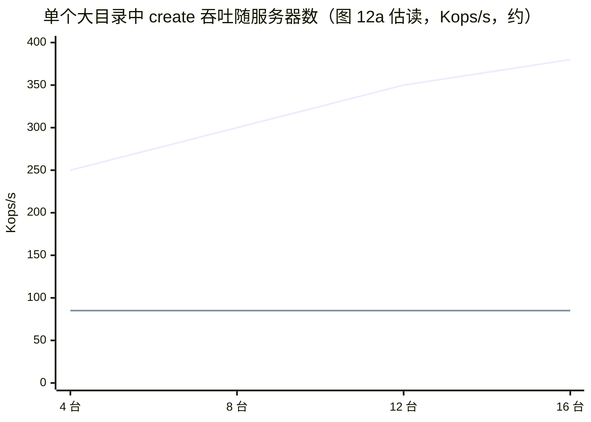

（第一条折线为 SwitchFS，第二条为 E-InfiniFS / E-CFS；xychart 不显示图例。）

- SwitchFS 的双 inode 操作随服务器数扩展：① 细粒度分区让负载均匀；② 异步协议让双 inode 操作只访问一台服务器，避免跨服务器协调、隐藏目录争用；③ change-log 合并化解目录争用。
- E-CFS 虽然也是细粒度分区，create、delete、mkdir、rmdir 几乎不扩展，因为它们在每个目录上串行，争用严重。
- CephFS 吞吐低于 100 Kops/s：软件栈重、子树分区不灵活。IndexFS 在单大目录上总是报错崩溃，结果未列出。

**多个目录**（1,000 万个文件均匀分布在 1,024 个目录中，随机访问；图 12b）：

- 争用很小，各系统接近最优。SwitchFS 所有操作都最好，说明异步更新在常规路径上开销可忽略。
- create、delete：SwitchFS 与 E-InfiniFS 相当（16 台约 1.35 Mops/s，约），优于 E-CFS（约 0.8 Mops/s，约）。E-InfiniFS 父子同机，本地更新；SwitchFS 用异步更新隐藏了更新父目录的开销；E-CFS 父子分离，需要跨服务器事务。
- mkdir：SwitchFS 优于 IndexFS、E-InfiniFS、E-CFS（16 台约 820 对约 450 Kops/s，约），异步更新隐藏了更新两台服务器上两个目录元数据的协调开销。rmdir 与 E-InfiniFS、E-CFS 相近，多播开销抵消了异步收益。IndexFS 的 rmdir 实现不完整，结果略去。

### 9.3 延迟（论文 §7.2.2，图 13）

单客户端逐个发请求，8 台服务器（µs；CephFS、IndexFS 为图中数据标签，其余为估读）：

| 操作 | CephFS | IndexFS | E-InfiniFS | E-CFS | SwitchFS |
|------|--------|---------|-----------|-------|---------|
| stat | 587.4 | 198.1 | 约 18 | 约 18 | 约 16 |
| statdir | 592.6 | 410.6 | 约 18 | 约 18 | 约 24 |
| create | 758.5 | 171.7 | 约 17 | 约 27 | 约 12 |
| mkdir | 1,027.7 | 441.6 | 约 38 | 约 32 | 约 15 |
| delete | 1,085.9 | 216.6 | 约 28 | 约 45 | 约 20 |
| rmdir | 1,140.3 | 407.7 | 约 68 | 约 62 | 约 40 |

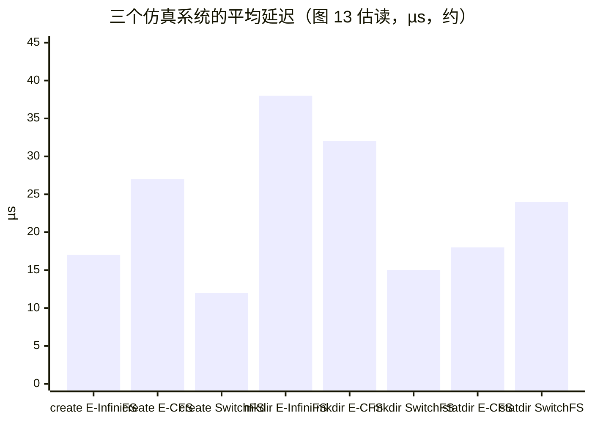

- SwitchFS 显著降低 create、delete、mkdir、rmdir 的延迟：异步更新隐藏了更新父目录的开销。
- SwitchFS 的 **statdir 延迟比 E-InfiniFS、E-CFS 高 28.6%**：异步更新为正确性引入的额外检查。

### 9.4 各项技术的贡献（论文 §7.3.1，图 14）

客户端在单个目录中创建 1,000 万个文件，8 台服务器；吞吐测试中改变每台服务器的核数。

| 配置 | 说明 | 平均延迟（约） | 吞吐 |
|------|------|-------------|------|
| Baseline | SwitchFS 框架 + 细粒度分区 + 同步操作 | 约 25 µs | 约 100 Kops/s，不随核数增长 |
| +Async | 异步更新，无合并 | 比 Baseline **低 34.7%**（约 16.5 µs） | 不变：隐藏了延迟，但没有减少更新开销；聚合时对父目录元数据的更新仍被 KV 存储串行化 |
| +Compaction | 完整 SwitchFS | 比 +Async 再**低 18.2%**（约 13.5 µs）；**P99 从 173 µs 降到 22 µs** | 最高提升 **2.48 倍**，并随核数增长（6 核约 355 Kops/s，约） |

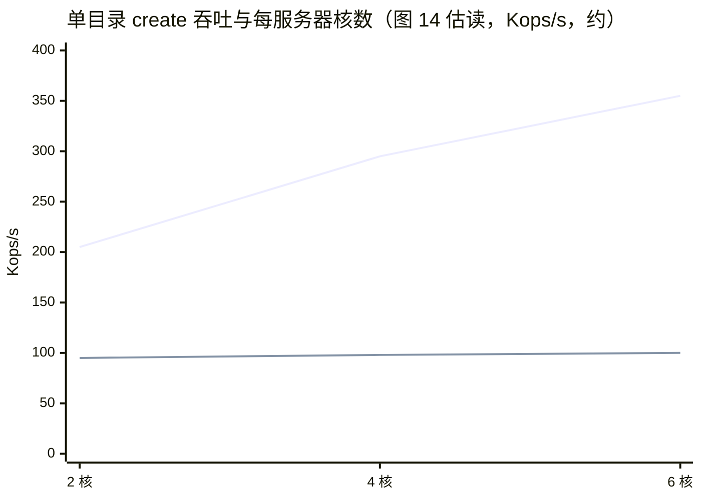

（第一条折线为 +Compaction，第二条为 Baseline 与 +Async；xychart 不显示图例。）

### 9.5 脏集合溢出与替代方案（论文 §7.3.2、§7.3.3，图 15、图 16）

**强制溢出**：让脏集合插入总是失败（全部回退为同步更新），create 吞吐下降 **69.7%**，平均延迟上升 **0.85 倍**，与 Baseline 相近。

**改用专门服务器跟踪目录状态**：

- 涉及脏集合的操作多一个 RTT（约 3 µs），create、statdir 平均延迟分别上升 **24.1%、13.1%**（图 15a）。
- 吞吐上限（图 15b）：在 100 万个目录上做 statdir，每台服务器 12 核，专门服务器用 DPDK 处理包，**专门服务器在 11 Mops/s 封顶**；交换机随元数据服务器数线性扩展（15 台约 38 Mops/s，约）。理论上一台可编程交换机能处理 **48 亿包/s**，远超元数据集群的需求；专门服务器要满足需求就得把指纹分到多台机器上。

**改用目录所属服务器自己跟踪**：

- mkdir、create 等双 inode 操作的峰值吞吐下降约 **10%**：每个操作处理的包数翻倍，消耗本就是瓶颈的 CPU。
- 延迟（图 16）：

| 负载 | 中位数 | P90 | P99 |
|------|-------|-----|-----|
| 中等（50 Kops/s） | +23.2% | +24.9% | **+107.4%** |
| 重载（120 Kops/s） | +36.9% | **+80.8%** | +36.4% |

目录更新的关键路径上多了一台服务器，带来额外排队和队头阻塞，负载越高越明显。

**解读**：这组实验很有价值，它把"交换机"这一硬件依赖的收益量化了：相比专门服务器，交换机省了约 3 µs 的 RTT 并去掉了 11 Mops/s 的吞吐上限；相比所属服务器自己跟踪，省了约 10% 的 CPU 和明显的尾延迟。也就是说，**异步更新协议本身不依赖交换机**，没有可编程交换机的环境可以退而用所属服务器跟踪，代价是延迟上升 23%–107%、吞吐降 10%。

### 9.6 突发负载（论文 §7.4，图 17）

把"时间上的负载不均"建模为**突发**：同一目录中连续的一组 create，相邻突发在不同目录。8 台服务器，客户端保持 32 或 256 个在途请求，改变突发大小。

| 在途请求 | 系统 | 突发 50 相比突发 10 | 突发 1000 相比突发 10 |
|---------|------|------------------|--------------------|
| 32 | E-InfiniFS | **−53.7%** | **−71.9%** |
| 32 | E-CFS | **−47.1%** | **−66.1%** |
| 32 / 256 | SwitchFS | 基本不变 | 基本不变（约 450–500 / 约 650–700 Kops/s，约） |

SwitchFS 把突发缓冲在 change-log 中稍后应用，吞吐稳定。

### 9.7 目录聚合开销（论文 §7.5，图 18）

在目录中连续 create 后测 statdir 延迟（聚合之前 create 产生的 change-log 条目）：

- **随 create 次数增加**（图 18a，8 台服务器）：1 次约 15 µs、10 次约 80 µs、100 次约 400 µs、1,000 次约 430 µs、10,000 次约 470 µs（约），最终收敛在约 **500 µs**。收敛的原因是主动推送：每台服务器上每个目录的条目数有上限（实现中为 **29**），一旦能填满一个 MTU 就主动推给目录所属服务器。
- **随服务器数增加**（图 18b，100 次 create 后）：4 台约 280 µs、8 台约 400 µs、12 台约 460 µs、16 台约 480 µs（约）。服务器越多，主动聚合前能在 change-log 中积累的条目越多，statdir 时要聚合的也越多。

**解读**：这就是"写时记账、读时结算"的账单：一个刚被大量写入的目录，第一次 statdir 要慢 20 倍以上（约 24 µs → 约 500 µs）。对"写完就 ls"的工作流（例如 Spark 作业提交时列出输出目录、训练前扫描数据集目录），读延迟会被放大；主动聚合能缓解，但需要在推送间隔与额外消息之间权衡。

### 9.8 端到端（论文 §7.6，图 19，表 5）

8 台元数据服务器 + 8 台数据节点，客户端 256 个在途请求；没有发生脏集合溢出。

| 负载 | 操作比例（论文表 5） | 说明 |
|------|------------------|------|
| 数据中心服务（合成） | 52.6% open/close、12.4% stat、9.58% create、11.9% delete、9.3% 文件 rename、0.1% chmod、3.9% readdir、0.2% statdir | 按盘古比例生成，1,000 万次操作、1,024 个目录，80% 的操作落在 20% 的目录上；因缺少数据访问比例，只测元数据 |
| CV 训练（表中写作 CNN Training） | 42.8% open/close、21.4% stat、14.2% read、7.1% write、7.1% create、7.1% delete、各 0.1% mkdir/rmdir/statdir/readdir | AlexNet 在 ImageNet 上训练的 trace，128 万个文件（多数小于 256 KB），1,000 个目录，覆盖下载、访问、删除全生命周期 |
| 缩略图 | 43.9% open/close、21.9% stat、12.2% read、10.9% write、10.9% create、各 0.1% mkdir/statdir/readdir | 访问 100 万张图片（多数小于 256 KB）并生成缩略图 |

结果（图 19 估读，Kops/s）：

| 负载 | CephFS | E-InfiniFS | E-CFS | SwitchFS |
|------|--------|-----------|-------|---------|
| 合成（元数据） | 约 5 | 约 360 | 约 330 | 约 540 |
| CV 训练（端到端） | 约 5 | 约 170 | 约 270 | 约 360 |
| CV 训练（元数据） | 约 8 | 约 180 | 约 350 | 约 600 |
| 缩略图（端到端） | 约 5 | 约 140 | 约 210 | 约 260 |
| 缩略图（元数据） | 约 5 | 约 130 | 约 250 | 约 400 |

论文：相对 CephFS、E-InfiniFS、E-CFS，元数据吞吐最高提升 **76.3×、2.1×、0.7×**，端到端最高提升 **21.1×、1.1×、0.3×**（这里的"×"是提升幅度，即"高出多少倍"，见 [§11](#11-论文中的不一致与可疑之处)）。

### 9.9 崩溃恢复时间（论文 §7.7）

在 10 万个目录中创建 1,000 万个文件后模拟故障，8 台服务器：

- **服务器故障**：崩溃的服务器用 **5.77 秒**恢复约 125 万个 inode 和约 125 万个未应用的 change-log 条目；
- **交换机故障**：交换机重启后，所有服务器用 **3.82 秒**刷出未应用的 change-log 条目，恢复一致状态。
- 恢复时间与待恢复操作数成正比，可以用检查点大幅缩短。**恢复期间端到端吞吐为零。**

---

## 10. 相关工作

论文 §8：

| 类别 | 代表 | SwitchFS 的区别 |
|------|------|----------------|
| 元数据分区 | 单服务器：GFS、HDFS、Farsite、QFS；子树：AFS、CephFS（易不均）；按目录：BeeGFS、IndexFS、HopsFS、Tectonic、InfiniFS（目录密集操作时不均）；按文件：CFS（均衡但双 inode 操作要跨服务器） | 按文件分区保证均衡，用异步更新隐藏跨服务器开销，"两全其美" |
| 目录争用 | LocoFS 放宽 POSIX，不为双 inode 操作更新目录元数据；DeltaFS 不提供全局共享命名空间，由客户端显式管理同步范围；CFS 仍需跨服务器协调，但用有序更新和数据库原语裁剪临界区；SingularFS 在单台服务器的 NVMM 上用原子指令更新目录 | 提供 POSIX 兼容的全局命名空间，不依赖 NVMM；change-log 合并消除目录更新的单点串行化，可与前述技术结合 |
| 网内加速 | KV 缓存（NetCache、DistCache、Pegasus、SwitchKV 等）、网内计算（ATP 等）、分布式内存（MIND）、分布式锁、共识与并发控制（NetPaxos、P4xos、Eris、NOPaxos、Harmonia）、调度 | 网内结构与 Harmonia 相似，但 Harmonia 做网内冲突检测以加速 KV 复制，SwitchFS 做网内状态跟踪以实现"零成本"异步 DFS 操作；作者称这是第一个把网内优化引入分布式文件系统的工作 |
| 异步更新 | xsyncfs（Rethink the sync）、POSIX 数据写：异步数据更新，允许崩溃后丢更新，不适用于元数据；DeltaFS：客户端间异步元数据同步，用显式 get/publish API | SwitchFS 的异步协议是持久且一致的，对用户透明并兼容 POSIX |

---

## 11. 论文中的不一致与可疑之处

| 位置 | 问题 | 判断 |
|------|------|------|
| 摘要、§1、§7.6 | "提升 21.1×、1.1×、0.3×"和"加速 76.3×、2.1×、0.7×"。§7.6 把它们称为 **speedup**，但"0.3× / 0.7× 的加速"字面意思是变慢。按图 19 估读，合成负载元数据 SwitchFS 约 540、E-CFS 约 330 Kops/s，比值约 1.64，即"高出 0.64 倍" | 这些数字是"提升幅度"（加速比减 1），§7.6 误称为 speedup；§7.3.1 的"吞吐最高提升 2.48×"（图 14 中 6 核时约 3.5 倍）、§7.3.2 的"延迟上升 0.85×"也是同一口径 |
| 摘要 | "吞吐最高为 E-InfiniFS、E-CFS 的 **13.34×、3.85×**，延迟低 **61.6%、57.3%**"。正文没有直接给出这四个数字。按图 12a 估读，单大目录中 stat 对 E-InfiniFS 约 14 倍，可能是 13.34× 的来源；create、mkdir 对 E-CFS 约 4.5–5.5 倍（约），3.85× 无法对应 | 无法从正文复核；延迟的两个数与图 13 中 mkdir 对 E-InfiniFS、create 对 E-CFS 的估读大致吻合 |
| §3.1 | 鸽巢原理算得 **86.3%**；(30.76 − 4.19)/30.76 = 0.8638，应为 86.4% | 截断而非四舍五入，小问题 |
| 表 2 与 §5.2 | 表 2 把文件 rename（9.29%）计入"目录更新"，但 rename 在 SwitchFS 中走同步分布式事务，不享受异步更新 | 能异步化的目录更新约 21.5%，不是 30.76% |
| §7.2.1 | "多个目录"一段写"Fig. 12(a) shows"，实际应为图 12(b) | 笔误 |
| 表 5 与正文、图 19 | 表 5 写 "CNN Training"，正文和图 19 写 "CV Training" | 命名不一致 |
| 图 2b | 柱标签写 "InfiniFS / CFS-KV"，图例与正文写 Emulated-InfiniFS / Emulated-CFS | 小问题 |
| §4.2、§7.1 | 服务器"把 change-log、失效列表、KV 存储放在内存中"，RocksDB 又是"异步写模式"；持久性依赖 WAL，但论文没有说明 WAL 是否每次同步落盘（硬件表中有 Optane PM） | 持久性语义不清；若 WAL 也是异步的，与"POSIX 禁止丢失任何元数据更新"的表述矛盾 |
| §7.1 | 所有实验"没有发生脏集合溢出"；强制溢出时吞吐下降 69.7% | 没有给出真实规模负载下的溢出率，也没有分析主动聚合间隔与溢出的关系 |
| §6.5、§5.4.2、§7.7 | 交换机是单点故障；交换机故障或集群重配置都要全局停服、聚合所有目录 | 论文承认并留作未来工作；对生产可用性影响较大 |
| §7.1 | CephFS 用的是 v12.2.13（2019 年的 Luminous），基线较旧 | 对 CephFS 的 21.1× 提升不宜直接引用 |

---

## 12. 与本仓库中其他系统的对照

"父目录属性是热点，但它是可推迟、可合并的派生状态"已经成为多篇论文的共识，做法各不相同：

| 系统 | 如何处理父目录更新 | 推迟到哪里 | 怎样保证不读旧值 | 额外依赖 |
|------|-----------------|----------|---------------|---------|
| **SwitchFS** | 记入**文件所在服务器**的 change-log，异步 | 目录被读时（或主动推送） | 交换机上的脏集合，读时查询并聚合 | 可编程交换机 |
| [CFS](cfs-eurosys2023.md) | 单分片原语内的 delta apply，同步 | 不推迟，只是把冲突移出临界区 | 同步完成 | TafDB 原语 |
| [Mantle](mantle-sosp2025.md) | TafDB 中插入 delta 记录，异步合并 | 后台合并；dirstat 时扫描 delta | 读时扫描 delta 行 | 仅在持续竞争时启用 |
| [MesaFS](mesafs-eurosys2026.md) | 父目录更新缓冲在内存、合并后写盘 | 下一次以父目录为目标的操作 | 内存中始终是最新的，只是落盘推迟；崩溃后从子项重算 | 父子同机（按目录分区） |
| [FalconFS](falconfs-nsdi2026.md) | 同类请求合并进一个事务 | 不推迟，只是批量 | 同步完成 | — |
| [HMFS](hmfs-socc2025.md) | 16 字节 CAS 同时更新 child_ptr 与 mtime | 不推迟 | 同步完成 | PM |
| [InfiniFS](infinifs-fast2022/deep-read.md) | 父子同机，本地事务 | 不推迟 | 同步完成 | — |

**解读**：

- SwitchFS 与 MesaFS 的"推迟"有本质区别：MesaFS 推迟的是**持久化**，父目录在内存中始终正确（因为父子在同一台服务器上）；SwitchFS 推迟的是**应用**，父目录在任何地方都不是最新的，直到被读时从多台服务器收集。前者只需要解决崩溃一致，后者必须解决"读的时候知道去收集"，这就是需要脏集合的原因。
- SwitchFS 能用 P/C 分离（按文件打散，负载均衡）却不付跨服务器代价，正是因为它把父目录更新从关键路径上拿掉了。这是对"分区粒度两难"最直接的回答；Mantle 的 IndexNode、FalconFS 的全量目录树复制则是从路径解析角度回答同一个问题。
- 同一团队的 FalconFS 与 SwitchFS 几乎同时发表，可以看作两条互补路线：FalconFS 在服务端合并请求、改造客户端解析，不依赖特殊硬件；SwitchFS 在网络中协调、异步应用，依赖可编程交换机。

---

## 13. 整体总结

### 13.1 核心贡献

1. **问题分析**：指出分区粒度在操作开销与负载均衡之间的固有两难，以及父目录争用限制服务器间和服务器内的并行；用盘古负载说明至少约 86% 的目录更新之后不会被立刻读（论文 §3）。
2. **异步元数据更新协议**：双 inode 操作只在一台服务器上执行，父目录修改记入本地 change-log，读时聚合；附录证明可串行化与实时顺序（论文 §5.2、附录 A）。
3. **change-log 合并与主动聚合**：利用目录属性更新的可交换性合并后再应用，P99 延迟从 173 µs 降到 22 µs（论文 §5.3、§7.3.1）。
4. **网内脏集合**：组相联寄存器结构、10 级 × 2¹⁷ 槽、131 万指纹、5 MiB，线速插入、查询、删除，幂等且可线性化；溢出时回退为同步更新（论文 §6）。
5. **评估**：单大目录中双 inode 操作随服务器线性扩展；突发下吞吐稳定；真实负载端到端吞吐提升 0.3–21.1 倍（论文 §7）。

### 13.2 设计哲学

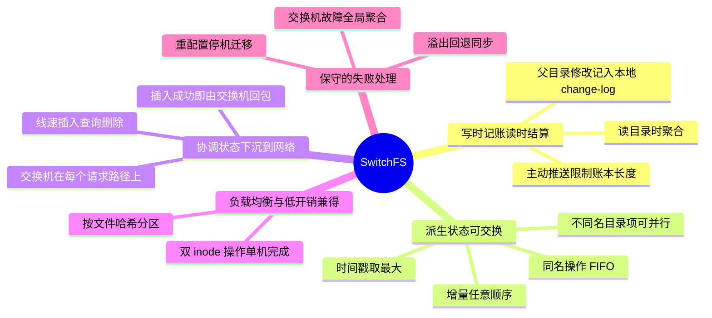

### 13.3 优点与局限

| 优点 | 局限 |
|------|------|
| 按文件分区保证负载均衡，同时让 create/delete/mkdir 在单台服务器上 1 个 RTT 完成 | 依赖 Tofino 可编程交换机，且占用 5 MiB 寄存器，难与其他有状态 P4 功能共存 |
| change-log 合并让单目录 create 随服务器数和核数扩展，突发负载下吞吐稳定 | 读散乱目录要聚合，大量写入后的第一次 statdir 最多约 500 µs；平时 statdir 也慢 28.6% |
| 协议不依赖交换机，可退化为所属服务器跟踪（延迟上升、吞吐降约 10%） | 交换机是单点故障；交换机故障、集群重配置都要全局停服 |
| 有附录形式的一致性论证（可串行化、实时顺序、恢复幂等） | rename 和硬链接仍需同步分布式事务；WAL 的持久化时机未说明 |
| 与 CFS、Mantle、MesaFS 等"延迟父目录更新"的思路可组合 | 只测到 16 台服务器、单交换机；没有真实规模下的脏集合溢出率；数字口径（"提升"与"加速"）混用 |

### 13.4 启示

1. **把父目录当作派生状态**。mtime、size、nlink、目录项列表都可以由子项操作推出，更新可交换。只要读的时候能结清，就可以推迟、合并、在多处分别记账。这是元数据服务缓解目录热点最有效的手段，不需要可编程交换机也能用（MesaFS、Mantle 已经在用）。
2. **"知道哪本账没结"是异步化的关键**。异步更新的难点不在推迟本身，而在保证读能找到所有未应用的修改。SwitchFS 用网络中的一个小集合解决了这个问题；没有交换机时，可以放在所属服务器上（多一倍包），或者像 MesaFS 那样让父子同机、只推迟落盘。
3. **协调状态下沉到网络是有条件的**。它需要：状态小（只记最近修改的目录）、操作简单（插入、查询、删除）、能容忍溢出（回退到慢路径）、能在故障后重建（全局聚合）。满足这些条件时，交换机比专门服务器快一个 RTT、高数个数量级的吞吐。
4. **先登记、后回复**。异步协议的正确性核心是：客户端看到"完成"之前，"这里有未结的账"必须已经登记在所有读者都会查询的地方。SwitchFS 让交换机在插入成功后才回包，把这条顺序做成了网络的固有行为。
5. **用负载统计证明"推迟"划算**。"目录更新 30% 而目录读 4%"这类简单统计，是判断异步化能否成立的第一步；同样要检查反例负载（写完立刻 ls），评估最坏情况的读延迟。

### 13.5 一张图看懂 SwitchFS

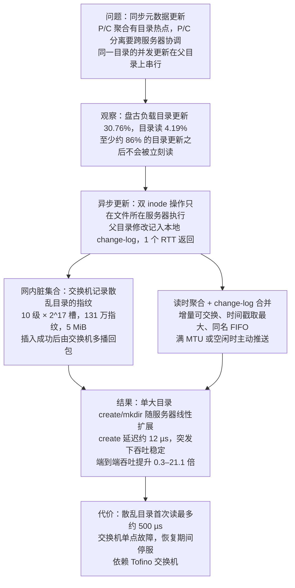

---

## 参考

- Jingwei Xu, Mingkai Dong, Qiulin Tian, Ziyi Tian, Tong Xin, Haibo Chen. *SwitchFS: Asynchronous Metadata Updates for Distributed Filesystems with In-Network Coordination*. ACM EuroSys 2026. <https://dl.acm.org/doi/10.1145/3767295.3769349>；arXiv:2410.08618 <https://arxiv.org/abs/2410.08618>
- Jingwei Xu et al. *FalconFS: Distributed File System for Large-Scale Deep Learning Pipeline*. USENIX NSDI 2026.（本仓库精读：[falconfs-nsdi2026.md](falconfs-nsdi2026.md)）
- Yiduo Wang et al. *CFS: Scaling Metadata Service for Distributed File System via Pruned Scope of Critical Sections*. ACM EuroSys 2023.（本仓库精读：[cfs-eurosys2023.md](cfs-eurosys2023.md)）
- Wenhao Lv et al. *InfiniFS: An Efficient Metadata Service for Large-Scale Distributed Filesystems*. USENIX FAST 2022.（本仓库精读：[infinifs-fast2022/deep-read.md](infinifs-fast2022/deep-read.md)）
- Xin Jin et al. *NetCache: Balancing Key-Value Stores with Fast In-Network Caching*. ACM SOSP 2017.
- Jialin Li et al. *Pegasus: Tolerating Skewed Workloads in Distributed Storage with In-Network Coherence Directories*. USENIX OSDI 2020.
- Hang Zhu et al. *Harmonia: Near-Linear Scalability for Replicated Storage with In-Network Conflict Detection*. PVLDB.
- Jialin Li, Ellis Michael, Dan R. K. Ports. *Eris: Coordination-Free Consistent Transactions Using In-Network Concurrency Control*. ACM SOSP 2017.
- Edmund B. Nightingale et al. *Rethink the Sync*. ACM TOCS 26(3), 2008.
- Qing Zheng et al. *DeltaFS: A Scalable No-Ground-Truth Filesystem for Massively-Parallel Computing*. SC 2021.
- Austin T. Clements et al. *The Scalable Commutativity Rule*. CACM 60(8), 2017.
- 本仓库相关：[元数据扩展性综述](metadata-scalability.md)、[FalconFS 精读](falconfs-nsdi2026.md)、[CFS 精读](cfs-eurosys2023.md)、[InfiniFS 精读](infinifs-fast2022/deep-read.md)、[Mantle 精读](mantle-sosp2025.md)、[MesaFS 精读](mesafs-eurosys2026.md)、[HMFS 精读](hmfs-socc2025.md)、[新硬件综述](new-hardware.md)
