# Tectonic 论文精读：Facebook's Tectonic Filesystem: Efficiency from Exascale（FAST 2021）

> 论文：Satadru Pan, Theano Stavrinos, Yunqiao Zhang, … , Ethan Katz-Bassett, Wyatt Lloyd. *Facebook's Tectonic Filesystem: Efficiency from Exascale*. USENIX FAST 2021, pp. 217–231.
>
> 机构：Facebook（现 Meta）、Princeton University、Columbia University
>
> 链接：<https://www.usenix.org/conference/fast21/presentation/pan> ；PDF：<https://www.usenix.org/system/files/fast21-pan.pdf>
>
> 精读日期：2026-11-16。文中**数字、表格与机制描述均摘自论文原文**（标注所在章节）；标注"解读"的段落是本文作者的分析与推论，不是论文原话。
>
> 相关文档：[工业界生产系统综述中的 Tectonic 小节](industry-production-systems.md#1-facebooks-tectonic-filesystem-fast-2021)、[元数据扩展性综述](metadata-scalability.md)、[论文清单](essential-papers-2000-2026.md)。

## 目录

- [0. 一页速览](#0-一页速览)
- [1. 背景：Tectonic 之前的"存储星座"](#1-背景tectonic-之前的存储星座)
- [2. 总体架构](#2-总体架构)
- [3. Chunk Store：扁平的 EB 级数据层](#3-chunk-store扁平的-eb-级数据层)
- [4. Metadata Store：分层 + 哈希分片的元数据](#4-metadata-store分层--哈希分片的元数据)
- [5. Client Library 与单写者语义](#5-client-library-与单写者语义)
- [6. 后台服务与 Copyset](#6-后台服务与-copyset)
- [7. 多租户：资源共享与隔离](#7-多租户资源共享与隔离)
- [8. 租户定制优化：数仓与 Blob 存储](#8-租户定制优化数仓与-blob-存储)
- [9. 生产数据与评估](#9-生产数据与评估)
- [10. 简洁与性能的权衡](#10-简洁与性能的权衡)
- [11. 妥协与经验教训](#11-妥协与经验教训)
- [12. 与相关系统的对比](#12-与相关系统的对比)
- [13. 整体总结](#13-整体总结)

---

## 0. 一页速览

**一句话**：Tectonic 是 Facebook 的数据中心级（单集群 EB 级）多租户分布式文件系统。它用"扁平 chunk 存储 + 分层哈希分片的 KV 化元数据 + 胖客户端按请求定制"三件套，把 Blob 存储（Haystack、f4）和数仓（几十个 HDFS 集群）合并进同一套系统，性能与原来的专用系统相当甚至更好，资源利用率更高，运维也更简单。

| 维度 | 要点 |
|------|------|
| 规模 | 单集群覆盖整个数据中心；代表性集群容量 1590 PB、已用 1250 PB、107 亿文件、150 亿 block、4208 个存储节点（§6.1，表 2） |
| 租户 | 每个集群约 10 个租户（Blob 存储、数仓等），每个租户下有数百个应用（§3.1） |
| 数据面 | Chunk Store：存储节点运行 XFS，chunk 以本地文件存放；每节点 36 块 HDD + 1 TB SSD（存 XFS 元数据、缓存热 chunk）（§3.2） |
| 元数据 | Name / File / Block 三层解耦，各层**按 ID 哈希分片**，持久化在 ZippyDB（RocksDB + Paxos 的线性一致分片 KV），元数据服务无状态（§3.3） |
| 一致性 | 仅分片内强一致；同目录操作保证 read-after-write；跨目录 move 不是原子的（§3.3） |
| 写语义 | 追加写（append-only），单写者，用 write token 保证（§3.4） |
| 冗余 | 每个 block 单独选择：副本或 RS(r,k)。数仓长期数据用 RS(9,6)，短期数据用 RS(3,3)；Blob 先写副本，seal 后转码为 RS(10,4)（§5） |
| 多租户 | 容量（non-ephemeral）按租户做硬配额；IOPS、元数据 QPS（ephemeral）按 TrafficGroup（每集群约 50 个）+ TrafficClass（Gold / Silver / Bronze）弹性共享（§4） |
| 成效 | 数仓集群数减少 10 倍；Blob 有效复制因子从 Haystack 的 5.3 倍降到约 2.8 倍；数仓借用 Blob 的空闲磁盘时间扛峰值，省下约 17% 的超配（§1、§2、§6.2） |

---

## 1. 背景：Tectonic 之前的"存储星座"

### 1.1 旧架构

论文把 Tectonic 之前的状态称为由多个小型专用系统组成的 "constellation"（星座）（§1、§2）：

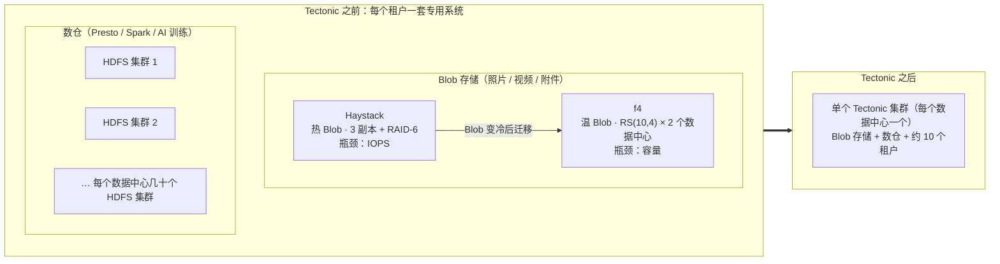

### 1.2 三个系统各自的问题

| 系统 | 负载 | 问题（§2） |
|------|------|------------|
| Haystack | 热 Blob，低延迟读写 | 理想有效复制因子是 **3.6 倍**（3 副本 × RAID-6 的 1.2 倍）。磁盘越来越大，但单盘 IOPS 基本不变，所以**每 TB 的 IOPS 不断下降**。为扛住热数据的 IOPS 只能多加盘，空出来的容量用不上，有效复制因子涨到 **5.3 倍** |
| f4 | 温 Blob | RS(10,4) 存在两个数据中心，有效复制因子 **2.8 倍**。瓶颈是容量，IOPS 大量闲置。而且越来越多的短命媒体在迁到 f4 之前就被删了，导致更多数据停留在高复制因子的 Haystack 里 |
| HDFS | 数仓分析，大块吞吐 | 单个 NameNode 限制了集群规模，每个数据中心需要**几十个集群**。单个数据集常常比一个集群还大，只能拆开存放。数据集在集群间的放置变成**二维装箱问题**（同时受容量和吞吐约束） |

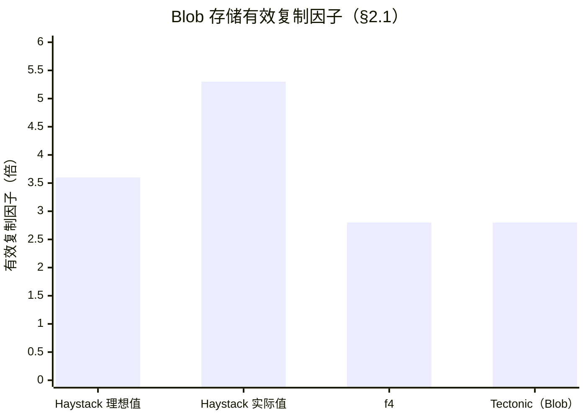

**解读**：问题的根子在硬件趋势。HDD 容量在涨、IOPS 不涨，"按冷热把数据分到不同系统"的做法会让 IOPS 和容量这两种资源各自被困在不同系统里（stranded）。只有把它们放进同一个资源池，才能让 IOPS 密集型和容量密集型的负载互补。这正是 Tectonic 的出发点：**整合本身就是效率的来源**。

### 1.3 三大挑战

论文给自己定了三个目标（§1）：

1. **扩展到 EB 级**：单集群覆盖整个数据中心，消除联邦与装箱问题；
2. **租户间性能隔离**：合并之后不能互相拖累；
3. **租户定制优化**：通用系统要做到专用系统的性能。

---

## 2. 总体架构

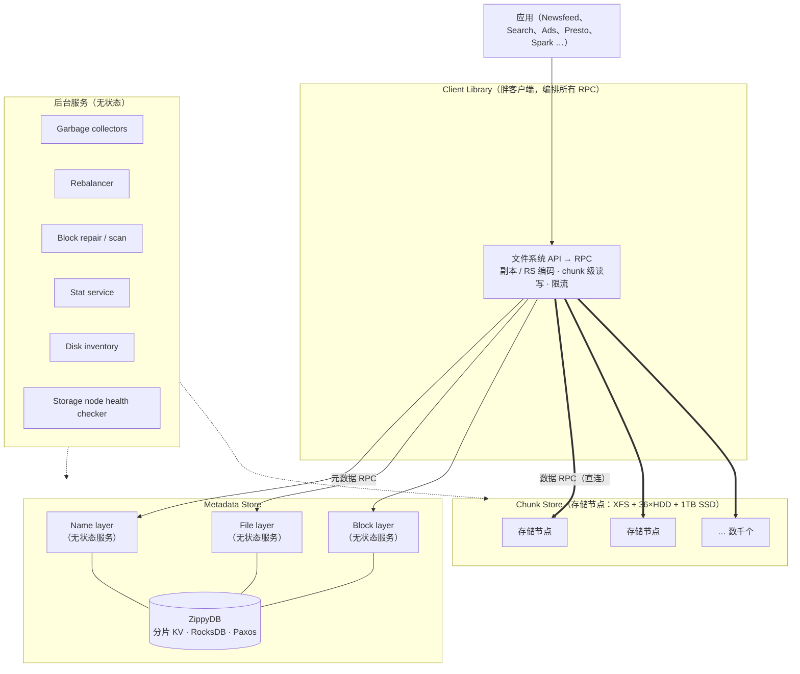

*图 1：Tectonic 架构（对应论文图 2）。除 Chunk Store 和 Metadata Store 的 KV 外，所有组件都是无状态的。*

关键点（§3.1）：

- **集群**是顶层部署单元，**只在单个数据中心内**提供持久、容错的存储（能容忍主机、机架、供电域故障）。**跨数据中心的地理复制由租户自己实现**。
- 一个集群可以承载**任意数量、任意大小的 namespace**，一般每个租户拥有一个 namespace。
- 接口是**层级式文件系统 API + 追加写语义**（与 HDFS 类似）。不同之处在于 API 行为**可以在运行时按每次调用配置**，而不是按集群或租户预先配死。
- 系统采用**客户端驱动的微服务架构**：Chunk Store 和 Metadata Store 各自是独立服务，由 Client Library 编排。

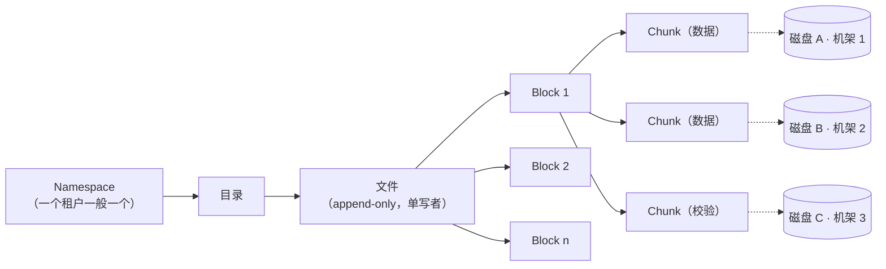

*图 2：数据模型。文件由 block 组成；block 是持久性单元，由分布在不同故障域的多个 chunk 组成；chunk 是存储单元。*

---

## 3. Chunk Store：扁平的 EB 级数据层

### 3.1 两个设计属性（§3.2）

1. **扁平（flat）**：chunk 数量随存储节点数线性增长，没有中间层级，可以一直扩到 EB 级。
2. **不感知上层抽象**：Chunk Store 不知道 block 和文件的存在，这些抽象由 Client Library 借助 Metadata Store 构建。

**解读**：第 2 点是 Tectonic 能做租户定制的物理基础。因为存储节点只认 chunk，"一个 block 怎么切、写到哪几个节点、何时确认"这些策略全都可以交给客户端按请求决定，不需要改存储节点。

### 3.2 存储节点

| 项目 | 内容 |
|------|------|
| 本地文件系统 | XFS，每个 chunk 是一个本地文件 |
| 硬件 | 每节点 **36 块 HDD**（Bryce Canyon 平台）+ **1 TB SSD** |
| SSD 用途 | 存放 XFS 元数据（定制版 XFS 把本地元数据放在 flash 上），以及缓存热 chunk。前者对 Blob 场景尤其有用，因为新 Blob 以 append 方式写入，会频繁更新 chunk 大小 |
| 缓存管理 | 由感知 flash 寿命的缓存库管理（CacheLib） |
| API | get / put / append / delete chunk，list / scan chunk |
| 职责 | 在本地公平地把资源分给各租户（见 §7.3） |

### 3.3 Block：持久性单元

- 对上层来说，block 只是一段字节数组；实际上它由若干 chunk 共同提供持久性。
- **每个 block 单独选择冗余方式**：
  - **RS(r, k)**：block 切成 r 个等长数据 chunk（必要时补齐），再生成 k 个校验 chunk；
  - **副本**：每个 chunk 与 block 一样大，存多份。
- 同一 block 的各个 chunk 放在不同故障域（如不同机架），丢失或损坏后由后台服务修复。

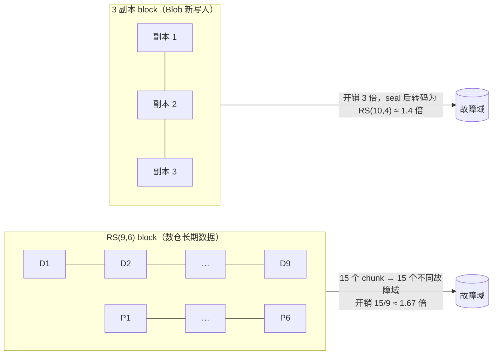

---

## 4. Metadata Store：分层 + 哈希分片的元数据

这是论文最核心的一节（§3.3）。

### 4.1 底座：ZippyDB

- ZippyDB 是一个**线性一致、容错、分片**的 KV 存储；节点内部用 RocksDB（SSD 上的单机 KV）存放分片副本，分片之间用 **Paxos** 复制。
- **所有操作都限定在单个分片内**，分片也是复制的单位；任一副本可以服务读，强一致读走 primary。
- **不提供跨分片事务**，这直接限制了部分文件系统操作（见 §4.5）。
- 分片大小经过调整，使每个元数据节点能托管多个分片。节点故障时，多个分片可以**并行**迁到不同新节点，缩短恢复时间；也便于细粒度负载均衡（KV 层会透明地迁移分片）。

### 4.2 三层元数据 Schema（论文表 1）

| 层 | Key | Value | 分片依据 | 映射 |
|----|-----|-------|----------|------|
| Name | `(dir_id, subdirname)` | subdir_info, subdir_id | dir_id | 目录 → 子目录列表（展开） |
| Name | `(dir_id, filename)` | file_info, file_id | dir_id | 目录 → 文件列表（展开） |
| File | `(file_id, blk_id)` | blk_info | file_id | 文件 → block 列表（展开） |
| Block | `blk_id` | list\<disk_id\> | blk_id | block → 磁盘（即 chunk）列表 |
| Block | `(disk_id, blk_id)` | chunk_info | blk_id | 磁盘 → block 列表（展开，反向索引） |

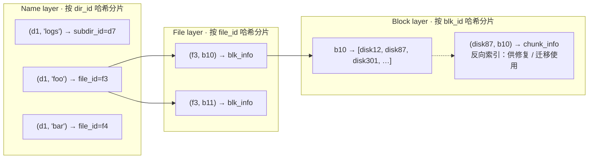

*图 3：一次"按路径读文件"在三层元数据中的查询链。三层分别位于不同分片，彼此没有局部性。*

**"展开"（expanded）存储**：列表型映射不存成一个大 value，而是把每个元素拆成一个独立 key，以真实 key 作前缀。例如目录 d1 下有 foo 和 bar，就在 d1 的 Name 分片中存两个 key：`(d1, foo)` 和 `(d1, bar)`。这样：

- 增删一个条目不需要读出再写回整个列表（目录可能有上百万文件），文件创建和删除的开销明显降低；
- 列出内容时对前缀做一次 prefix scan 即可。

### 4.3 为什么用哈希分片，而不是范围分片

论文明确与 ADLS（Azure Data Lake Store）对比：ADLS 同样分层，但用**范围分片**，相关数据（如一棵子树）会落在同一个分片，不仔细切分就容易出热点（§3.3、§6.3）。

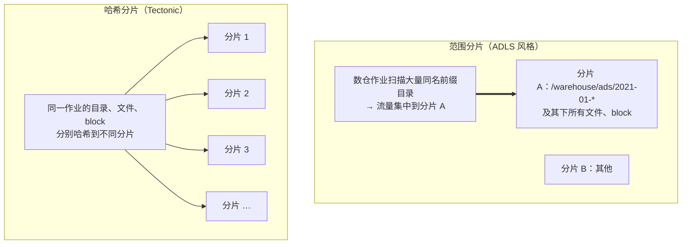

哈希分片的效果（§3.3、§6.3）：

- Name 层中，**单个目录的直接子项一定在同一个分片**（所以 list 一个目录只需访问一个分片），但它的两个子目录多半在不同分片；
- Block 层的定位信息按 blk_id 打散，与所属目录、文件无关。**约 2/3 的元数据操作由 Block 层处理**，哈希分片保证这部分流量均匀分布；
- 层级越高，单分片聚合的租户操作越多，各分片 QPS 的分布也越分散（Name 层 > File 层 > Block 层）。

**代价**：没有子树局部性。递归 list 要访问很多分片，所以 Tectonic **不提供递归 list API**，也**没有 du**，目录用量统计只能定期汇总，可能是旧的（§6.5）。

### 4.4 Seal：用不可变性换缓存

元数据分片的吞吐有限。为降低读负载，block、文件、目录都可以被 **seal**（§3.3）：

- seal 之后内容不再变化，它的元数据可以**在元数据节点和客户端安全地缓存**，不损害一致性；
- 目录 seal **不递归**，只禁止在该目录这一层新增对象；
- **例外**是 block → chunk 映射：chunk 可能在磁盘间迁移，会使 Block 层缓存失效。读取时可以发现缓存已过期并触发刷新。

### 4.5 一致性保证与跨分片操作

Tectonic 依赖 KV 的强一致操作和**分片内原子 read-modify-write 事务**，保证以下操作的 read-after-write 一致性：

- 数据操作（append、read）；
- 只涉及单个对象的文件或目录操作（create、list）；
- 源和目标在**同一个父目录**下的 move（因为一个目录下的文件都在该目录的分片里）。

跨分片操作**不是原子的**：

| 操作 | 实现（§3.3） |
|------|--------------|
| 目录移到另一分片上的父目录下 | 两阶段：先从新父目录建链接，再删除旧父目录的链接。被移动的目录保存一个指向父目录的 **backpointer**，用于发现进行中的 move，保证同一目录同时只有一个 move 在执行 |
| 跨目录移动文件 | "复制 + 删除"：复制步骤创建一个**引用原 block** 的新文件对象，不搬数据，然后从源目录删除 |

#### 竞态示例：rename 与覆盖式 create

论文给了一个具体例子：目录 d 下的文件 f1 被 rename 为 f2，同时有人以覆盖方式新建同名文件 f1。

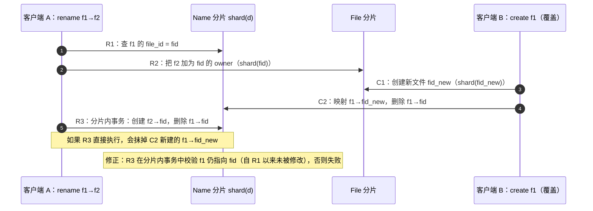

**解读**：没有跨分片事务时，Tectonic 的思路是让多步操作的**最后一步**落在单个分片的事务里，并在这个事务中校验前面步骤读到的状态没有变（相当于乐观并发控制的 compare-and-set）。中间步骤失败留下的不一致，交给后台 GC 清理（§6）。

---

## 5. Client Library 与单写者语义

### 5.1 胖客户端编排（§3.4）

- Client Library 把应用的文件系统 API 调用转换为对 Chunk Store 和 Metadata Store 的 RPC；
- 它负责副本复制或 RS 编码，**直接**把 chunk 写到存储节点；读时从存储节点取 chunk，必要时重建；
- 读写以 **chunk 粒度**执行（系统中最细的粒度），客户端几乎可以按任意方式执行操作。

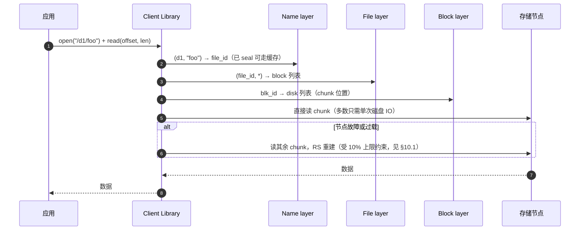

*图 4：读路径。正常情况下一次读只涉及一块磁盘（连续 RS 布局，见 §10.1）。*

### 5.2 单写者 + write token

- 每个文件**只允许一个写者**，省去串行化多写者的复杂性，客户端可以**并行**直写存储节点（这也是并行复制和 hedged 写的前提）；
- 需要多写者语义的租户自己在 Tectonic 之上实现串行化；
- 实现方式：进程以 append 方式打开文件时，在文件元数据里写入一个 **write token**，之后每次加 block 的元数据写都必须带上匹配的 token。第二个进程打开同一文件时会生成新 token，**覆盖**旧 token，成为唯一写者，并在 open 调用中 seal 掉前一写者打开的 block。

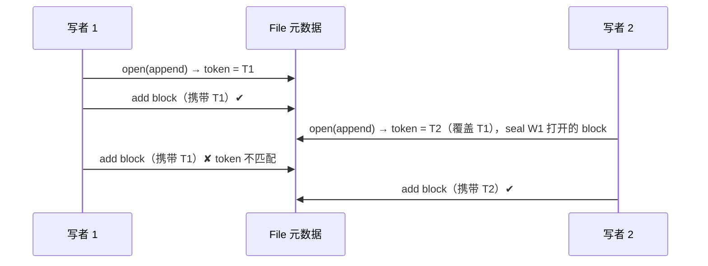

**解读**：这本质上是一种 **fencing token**。它不依赖租约过期时间，靠"后来者覆盖"直接让旧写者失效，适合追加写场景下的故障接管。

---

## 6. 后台服务与 Copyset

### 6.1 后台服务（§3.5）

后台服务也按元数据的分层组织，**每次处理一个分片**：

| 服务 | 作用 |
|------|------|
| Garbage collectors（每两层之间一个） | 清理**可接受**的元数据不一致。来源有两个：多步客户端操作中途失败；延迟删除（删除时只做标记，这是降低实时延迟的优化） |
| Rebalancer | 判断哪些 chunk 需要迁移（硬件故障、扩容、机架下线） |
| Repair service | 实际执行数据搬迁：对每块盘，把 chunk 列表和"磁盘 → block"反向索引做对账。按"Block 层分片 × 磁盘"切分任务，横向扩展 |
| Stat / Disk inventory / Health checker | 统计发布、磁盘资产、节点健康 |

### 6.2 Copyset

**Copyset**（Cidon 等，ATC 2013）指共同存放同一个 block 冗余数据的一组磁盘，例如一个 RS(10,4) block 的 copyset 是 14 块盘。

- copyset 太多：磁盘故障突增时，更可能有某个 copyset 失去足够多的盘，导致数据不可用；
- copyset 太少：一块盘坏了，与它共享大量 chunk 的同伴盘承受很高的重建负载。

Tectonic 的做法：Block 层和 Rebalancer 各自**在内存中保留约一百个"所有磁盘的一致性洗牌"（consistent shuffle）**。写入时，Block 层根据 block ID 选中一个洗牌，从中取连续的若干块盘作为 copyset；Rebalancer 尽量让 block 的 chunk 留在这个 copyset 里。由于集群成员不断变化，这只是**尽力而为**。

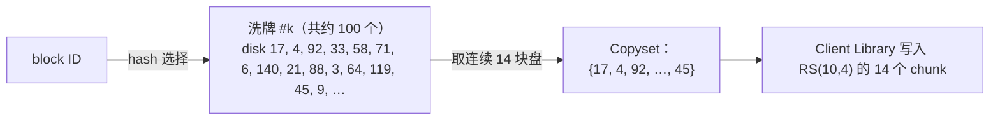

**解读**：用固定数量的洗牌把 copyset 总数控制在一个可调范围内，同时避免维护显式的 copyset 表。这在磁盘数以十万计的集群里很实用。

---

## 7. 多租户：资源共享与隔离

### 7.1 两类资源（§4.1）

| 类型 | 资源 | 管理方式 |
|------|------|----------|
| Non-ephemeral | 存储容量 | 变化慢、可预测，**一旦分给某个租户就不能给别人**。按租户设**硬配额**，没有自动弹性；租户间调整靠人工，但可以立即生效、不停机。租户内部再由租户自己分配给应用 |
| Ephemeral | 存储 IOPS、元数据查询能力 | 需求时刻变化，分配可以实时调整，需要细粒度的实时自动管理 |

### 7.2 TrafficGroup 与 TrafficClass：降低基数

按租户管理太粗（一个租户里同时有用户在线流量和后台 GC 流量），按应用管理太细（数百个应用）。Tectonic 引入两个中间概念：

- **TrafficGroup**：一组资源和延迟需求相近的应用，**每集群约 50 个**；由租户为自己的应用选择 TrafficGroup；
- **TrafficClass**：每个 TrafficGroup 被分配一个类别，表示延迟要求：**Gold（延迟敏感）/ Silver（普通）/ Bronze（后台）**。

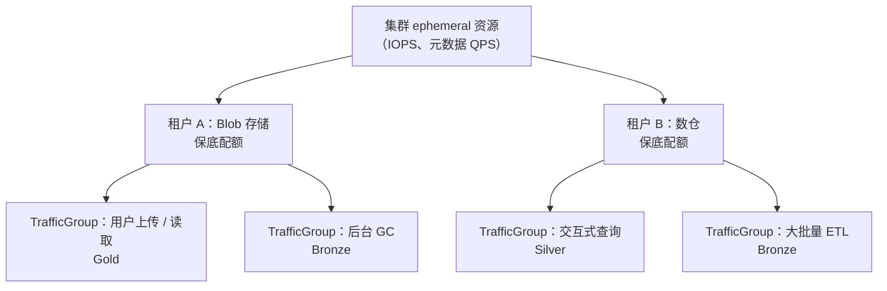

*图 5：资源分配层次（示例中的 TrafficGroup 名称为示意，非论文原文）。*

**富余资源的分配顺序**：

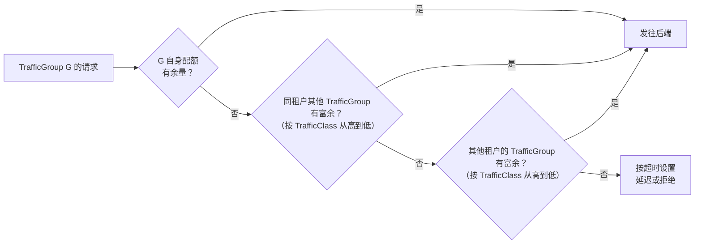

还有一条细节规则：一个 TrafficGroup 借用另一个 TrafficGroup 的资源时，这部分流量取**两者中较低的 TrafficClass**。这样各类流量的总体比例不会因借用而改变，节点也就能维持各 TrafficClass 的延迟目标。

### 7.3 全局与本地两级执行

**全局（客户端侧）**：Client Library 内置限流器，基于**高性能、近实时的分布式计数器**，统计每个租户、每个 TrafficGroup 在最近一个短时间窗内的需求，实现一个**改进版漏桶算法**。请求先增加计数，再按上图顺序查找余量，找不到就延迟或拒绝。限流放在客户端，可以在请求可能被浪费**之前**就施加背压。

**本地（元数据节点、存储节点）**：用**加权轮询（WRR）调度器**做公平共享，如果某个 TrafficGroup 这一轮会超出配额，就暂时跳过它。存储节点还有三项专门保护 Gold 延迟的优化（防止小的 Blob IO 被数仓的大 IO 拖慢）：

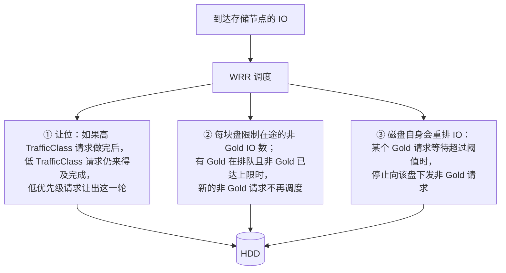

### 7.4 多租户访问控制（§4.2）

- 粗粒度：租户之间互相隔离；细粒度：租户内部的权限控制；
- 因为 Client Library 直接访问每一层，**每层都要做鉴权**，而且每次读写都要经过，所以必须轻量；
- 采用**基于 token 的授权**：授权服务对顶层请求（如 open）鉴权，生成发给下一层的 token，之后每一层再为它的下一层签发 token。token 的 payload 描述可访问的资源，每层**完全在内存里**校验，耗时为**几十微秒**。token 搭载在已有协议中传递，进一步降低开销。

---

## 8. 租户定制优化：数仓与 Blob 存储

定制优化依赖两个前提（§5）：

1. 客户端以 chunk 粒度操作，几乎完全掌控交互方式；
2. 配置**按每次调用生效**。例如 HDFS 按目录配置持久性，Tectonic 按**每次 block 写**配置。可扩展的 Metadata Store 能承受由此增加的元数据量。

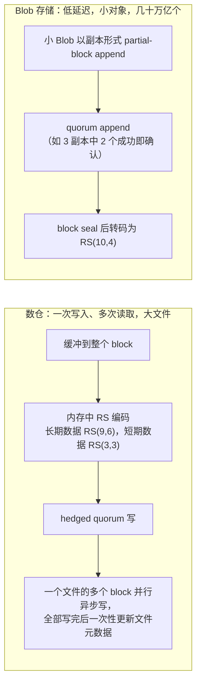

### 8.1 数仓：整 block RS 编码 + 异步写（§5.1）

数仓的典型模式是写一次、读多次：文件在创建者 close 之前对读者不可见，此后终生不变。由于没有中途读，应用关心的是**整个文件的写入时间**，而不是单次 append 的延迟。

- **整 block RS 编码写**：应用把数据缓冲到 block 大小，在内存里做 RS 编码，把各 chunk 直接写到存储节点。与副本相比，写入数据总量少，节省**空间、网络带宽和磁盘 IO**。RS(9,6) 虽然要写 15 块盘、IOPS 更多，但每次写都不大，而且 block 足够大，整 block 写的瓶颈在磁盘带宽而不在 IOPS；
- **并行异步写 block**：一个文件的多个 block 并行写入，写完后一次性更新文件元数据。文件在写完之前不可见，所以不会产生不一致。

### 8.2 数仓：Hedged quorum 写（§5.1）

普通的 hedging 会把数据多发给几个节点；Tectonic 的变体是**先发预留请求（reservation），再发数据**，避免把数据传给会因资源不足或配额超限而拒绝的节点。以 RS(9,6) 为例：

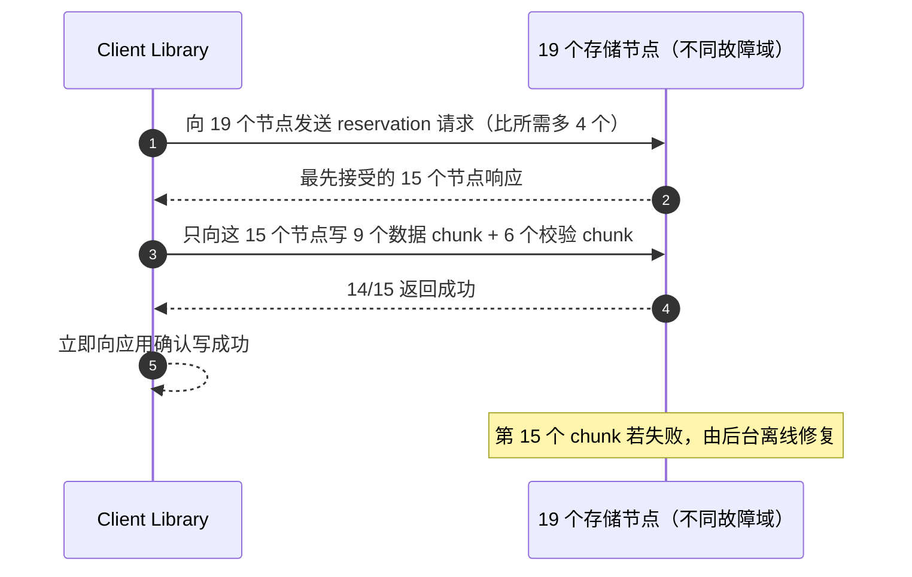

效果：在吞吐利用率约 80% 的测试集群上，72 MB 整 block 写的 **p99 延迟降低约 20%**（论文图 3a）；负载越高，hedging 越有效。

### 8.3 Blob 存储：一致的 partial-block quorum append（§5.2）

Facebook 存有**几十万亿个 Blob**。Blob 存储（它本身也是 Tectonic 的租户）把很多 Blob 追加到日志结构文件里，用"blob ID → 文件内位置"的映射来定位，以此控制元数据量。Blob 远小于 Tectonic 的 block，又处在用户请求路径上，所以：

- 新 Blob 以**小的、多副本的 partial-block append** 写入，追求低延迟；
- 要求 **read-after-write**：上传成功后必须立刻可读；
- 用 **quorum append**：一部分节点落盘即确认（例如 3 副本中的 2 个）。持久性的暂时下降可以接受，因为 block 很快会被转码，而且 Blob 存储会在另一个数据中心再写一份。

难点在于掉队的 append 会使各副本 chunk 长度不一致。Tectonic 的解法是严格控制**谁能 append、何时可见**：

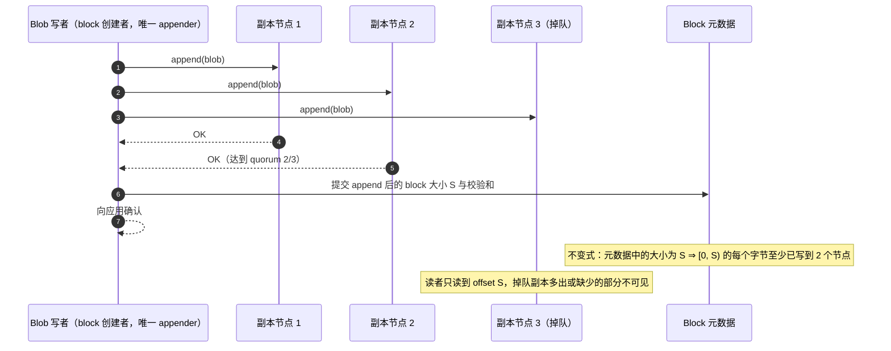

- 只有**创建该 block 的写者**能 append；
- 每次 append 完成后，**先把新长度和校验和提交到 block 元数据，再确认**；
- 因此元数据中长度为 S，就意味着 S 之前的字节至少写到了两个节点，读者最多读到 S；所有已确认的写都已反映在元数据里，后续读一定能看到。

论文图 3b、3c 显示：Tectonic 上 Blob 的读写延迟**与 Haystack 相当**，quorum append 明显缩短了写延迟尾部。

### 8.4 Blob 存储：seal 后转码（§5.2）

直接对小 append 做 RS 编码在 IO 上不划算：小写受 IOPS 限制，用 RS(10,4) 每次要 14 个 IO，而 3 副本只要 3 个。所以 Client Library 在 block **seal 之后**才把它从副本形式**转码为 RS(10,4)**，此时只需在 14 个目标节点上各做一次大 IO。

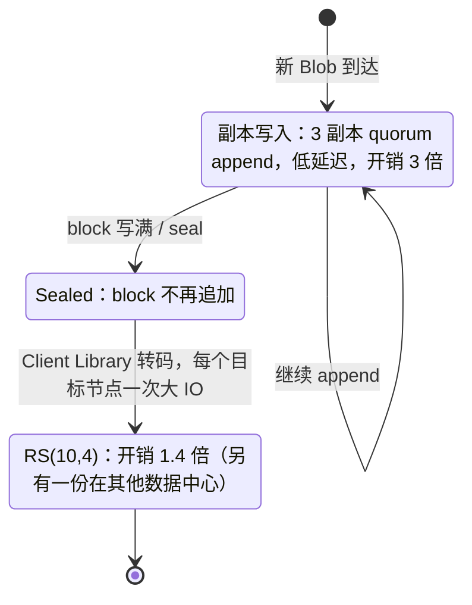

**解读**：这套设计等于在一个通用文件系统里，用"按请求选择编码 + 状态迁移"复刻了 Haystack（热数据用副本）到 f4（温数据用 EC）的分层。区别在于分层发生在 **block 级**、同一个系统内部，数据不需要跨系统迁移，资源也不会被困住。

---

## 9. 生产数据与评估

### 9.1 代表性多租户集群（§6.1，表 2）

| 容量 | 已用 | 文件数 | Block 数 | 存储节点 |
|------|------|--------|----------|----------|
| 1590 PB | 1250 PB（约 70%） | 107 亿 | 150 亿 | 4208 |

集群上有两个租户：Blob 存储约占已用空间的 49%，数仓约占 51%。

**解读**：由表 2 粗略推算，每个存储节点约 1590 PB / 4208 ≈ 0.38 PB 容量（36 块盘，单盘约 10 TB 量级）；平均每个文件约 1250 PB / 107 亿 ≈ 117 MB，每个 block 约 1250 PB / 150 亿 ≈ 83 MB，与数仓 72 MB 整 block 写的量级吻合。（推算值，仅用于建立量级直觉，论文未直接给出。）

### 9.2 整合的收益：共享磁盘时间（§6.2，表 3）

- 数仓负载有大而规律的尖峰（由超大作业触发），Blob 负载平滑、可预测；
- Blob 请求小，受 IOPS 限制；数仓请求大，受带宽限制。IOPS 和带宽都无法公平地衡量两者的用量，因此用**磁盘时间**（disk time，即磁盘忙的时间比例）作为统一的瓶颈资源度量。例如一块盘 1 秒内做 10 次 IO，每次 50 ms，就忙了 500/1000 ms；
- 按已用空间折算，给出两个租户在各自独立成集群时的磁盘时间"供给"，再与三天中三个日峰值的需求对比：

| | 数仓 | Blob 存储 | 合计 |
|--|------|-----------|------|
| 供给 | 0.51 | 0.49 | 1.00 |
| 峰值 1 需求 | 0.60 | 0.12 | 0.72 |
| 峰值 2 需求 | 0.54 | 0.14 | 0.68 |
| 峰值 3 需求 | 0.57 | 0.11 | 0.68 |

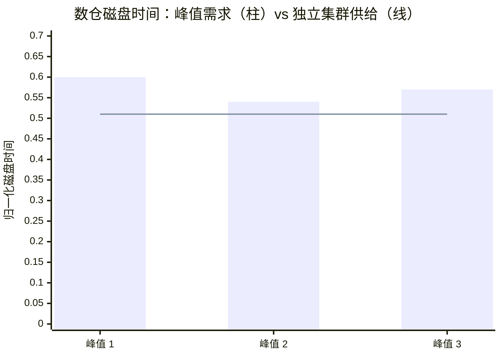

结论：数仓在三个峰值时的需求都超过了它自己的供给，单独部署需要**约 17% 的磁盘超配**（0.60 / 0.51 ≈ 1.18）。而 Blob 存储峰值时只用了 0.11–0.14，大量磁盘时间富余。合并之后，富余部分正好吸收数仓的尖峰，合计需求峰值只有 0.72。

### 9.3 元数据热点（§6.3）

- 元数据的瓶颈资源是 **QPS**。生产中**每个分片最多 10 KQPS**（由当前元数据节点资源隔离机制设定）；
- 三天内，File 层和 Block 层的所有分片都低于上限；**约 1% 的 Name 层分片**因为持有极热的目录而触顶。没处理掉的少量请求退避后重试，此时节点已消化掉初始尖峰，重试可以成功；
- 如果改用范围分片：数仓作业常读大量名字相近的目录，会造成极端热点；作业对 File 层的操作远多于 Name 层，把同目录文件放在同一 File 分片会产生更大的尖峰。哈希分片让 Tectonic 能用**更少的节点**扛住元数据尖峰；
- **与租户协同设计**：计算引擎常见的模式是 orchestrator 先 list 目录，再把文件分发给 worker 并行 open，这会让大量几乎同时的 open 集中打到一个目录分片。为此 Tectonic 的 **list-files API 会同时返回文件 ID**，worker 直接按 file ID open，不必再查目录分片。

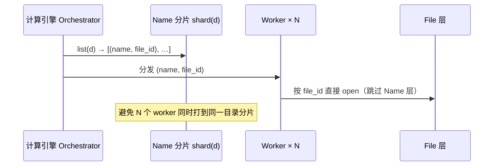

---

## 10. 简洁与性能的权衡

论文说 Tectonic 总体上"**简洁优先于效率**"，但有两处为了性能接受了额外复杂度（§6.4）。

### 10.1 控制重建负载：防止"重建风暴"

- RS 数据有两种布局：**连续（contiguous）**，每个 chunk 连续写到一个节点；**条带化（striped）**，切成更小的单元轮流分布到各节点；
- Tectonic 用连续布局，而多数读比一个 chunk 小，所以**通常是直接读，一次磁盘 IO 就够**；需要重建的读要多 **10 倍 IO**（RS(10,4)）。重建由硬件故障和节点过载触发，比例难以预测。

```mermaid
flowchart LR
    OL["部分存储节点过载"] --> DF["直接读失败"]
    DF --> RR["触发重建读（10 倍 IO）"]
    RR --> ML["其余节点负载上升"]
    ML --> OL
    CAP["限制：重建读 ≤ 全部读的 10%"] -. 打断正反馈 .-> RR
```

- 简单的办法是用条带布局，让每次读都走重建，故障前后 IO 数不变，就不会有风暴，但正常读会贵很多；
- Tectonic 的选择是把**重建读限制在所有读的 10% 以内**。在生产中这个比例通常足以应对磁盘、主机和机架故障。代价是多一些调参复杂度，好处是不需要超配磁盘。

### 10.2 客户端直连 vs 代理

- 客户端直连存储节点：Client Library 的 bug 会变成应用二进制的 bug，这是额外复杂度；但相比前置代理，**省掉每秒 TB 级数据的一跳网络**，网络和硬件资源效率高得多；
- **例外**：客户端离集群很远（跨地域）时，多轮编排 RPC 的网络开销太大，这类远程请求会被转发到**与存储节点同数据中心的无状态代理**。

---

## 11. 妥协与经验教训

### 11.1 迁移付出的代价（§6.5）

| 妥协 | 说明 | 应对 |
|------|------|------|
| 元数据延迟更高 | HDFS 元数据全在一台机器的内存里；Tectonic 的元数据分层存放在分片 KV 中，一次 open 至少要访问 Name 和 File 两层 | 数仓调整用法。例如计算引擎原来在作业结束后**串行地**逐个 rename 文件，现在改为**并行** rename，以掩盖单次 rename 的额外延迟 |
| 无递归 list，无 du | 目录按哈希分片，递归 list 要访问大量分片 | 租户在客户端基于单层 list 自己封装；目录用量由系统**定期汇总**，可能不是最新的 |

### 11.2 设计与部署经验（§6.6）

1. **高扩展性靠迭代，微服务架构让迭代可行**
   - Chunk Store 第一版为减少元数据，把冗余方案相同的若干 block 合成 **block group**，整体 RS 编码，每个 group 对应一组固定的存储节点（这是很常见的做法）。但它在生产中太僵硬：**只要 5% 的存储节点不可用，80% 的 block group 就不能写**，也排除了 hedged quorum 写这类优化。后来改成每个 block 独立放置；
   - Metadata Store 第一版**没有分开 Name 层和 File 层**，目录查找和列出文件 block 访问同一批分片，结果因元数据热点导致不可用，于是进一步拆分。

```mermaid
flowchart LR
    subgraph V1["初版"]
        BG["Block group：多个 block 合并编码<br/>固定绑定一组节点"]
        NF["Name + File 合在同一批分片"]
    end
    subgraph V2["现版本"]
        PB["每个 block 独立选 copyset<br/>→ 支持 hedged 写，局部故障影响小"]
        SEP["Name / File / Block 三层分离<br/>→ 消除热点导致的不可用"]
    end
    BG -->|"5% 节点不可用<br/>⇒ 80% group 不可写"| PB
    NF -->|"元数据热点<br/>⇒ 不可用"| SEP
```

2. **大规模下内存损坏是常态**。解决办法是在**进程间和进程内**都强制校验 checksum：对数据 D 做内存变换 D' = F(D)（如 RS 编码、加密）时，为 D' 生成新 checksum，同时用逆变换 G 把 D' 还原，与原 checksum C_D 比对。逆变换可能很贵，但为了数据完整性值得。所有涉及移动、复制、变换数据的 API 边界都要补上 checksum 信息，防止损坏在节点故障后扩散到重建出的 chunk 中。

### 11.3 不用 Tectonic 的服务（§6.7）

- **自举类服务**（如软件包部署系统）要求零依赖，而 Tectonic 依赖 KV、配置管理、部署系统等，所以不能用；
- **图存储**（TAO 等）需要 SSD 级低延迟的 KV 负载，Tectonic 尚未针对它优化；
- 很多服务**通过大租户间接使用**（经由 Blob 存储或数仓），而不是直接接入。这体现了 Tectonic"关注点分离"的理念：存储节点只认 chunk；Tectonic 只负责数据中心内的容错；地理复制、跨数据中心容量管理交给大租户。小应用直接接 Tectonic 等于重新实现租户已有的功能。

---

## 12. 与相关系统的对比

| 系统 | 元数据方案 | 规模限制 / 特点 | 与 Tectonic 的区别（§7） |
|------|------------|-----------------|--------------------------|
| HDFS / GFS | 单 metadata 节点、全内存 | 每集群几十 PB | Tectonic 单集群 EB 级 |
| HDFS Federation / WAS | 多个单 NameNode namespace 共享存储节点 | 仍有数据集装箱问题；跨实例迁移需要重量级拷贝 | Tectonic 无装箱问题 |
| Ceph / FDS | 对象 ID 哈希定位，无中心元数据 | 集群越大故障越频繁，哈希到位置的映射更新要传播到所有节点；扩容和下线时缺少可控迁移 | Tectonic **显式记录** chunk → 节点映射，可以控制迁移 |
| ADLS / HopsFS | 元数据分层，存于分片存储 | 相关目录放在同一分片，存在子树热点；ADLS 的 block 存储用 WAS 联邦架构 | Tectonic 目录**哈希分片**，block 存储是**扁平**的 |
| Colossus | 元数据存于 Spanner（全局一致数据库），客户端直连 | 集群级多 EB | Tectonic 底座只有分片内强一致，论文称"在实践中不是问题" |
| Blob / 对象存储 | 没有层级目录树 | 更容易扩展 | 数仓负载需要层级 namespace |
| Lustre / GPFS | 元数据节点数量有限 / 完整 POSIX | 为高吞吐并行访问调优 | Lustre 元数据扩展性受限；GPFS 的 POSIX 元数据开销在此场景下没必要 |

另外，论文提到 Tectonic 的部分细节曾以 **"Warm Storage"** 为名在演讲中公开过（§7）。

---

## 13. 整体总结

### 13.1 核心贡献

1. **证明了"单数据中心单集群 EB 级 + 多租户整合"可以在生产中实现**，并量化了收益：数仓集群减少 10 倍；Blob 有效复制因子从 5.3 倍降到约 2.8 倍；跨租户共享磁盘时间省下约 17% 的超配。
2. **一套可复用的元数据扩展方案**：分层解耦（Name / File / Block）、各层哈希分片、状态下沉到成熟的分片强一致 KV、服务无状态、展开存储列表、seal 后缓存。这套方案后来被大量论文作为基线引用和对比（InfiniFS、CFS、Mantle 等）。
3. **"通用系统做出专用性能"的方法**：扁平、无语义的 chunk 层，加上胖客户端**按请求**选择编码和写协议，让数仓（RS 整 block 写 + hedged quorum）和 Blob（副本 quorum append + seal 后转码）在同一系统里各取所需。
4. **以降低基数为核心的多租户资源管理**：资源分成 non-ephemeral 和 ephemeral；用约 50 个 TrafficGroup 加 3 个 TrafficClass 代替数百个应用；客户端做全局限流，节点上用 WRR 和 Gold 保护做本地执行。简单、可运维，不追求理论上最优的公平。

### 13.2 设计哲学

```mermaid
mindmap
  root((Tectonic 设计哲学))
    整合即效率
      消除资源孤岛
      IOPS 型与容量型负载互补
      单集群，无装箱问题
    关注点分离
      存储节点只认 chunk
      元数据交给 ZippyDB
      地理复制交给租户
    语义换扩展性
      仅分片内强一致
      跨目录 move 非原子
      append-only + 单写者
      无递归 list / du
    客户端驱动
      按请求配置
      chunk 粒度编排
      直连存储节点
    简洁优先
      降低基数的多租户
      copyset 尽力而为
      只在两处为性能加复杂度
```

### 13.3 优点与局限

| 优点 | 局限 |
|------|------|
| 元数据横向扩展能力强，哈希分片天然负载均衡，生产中 99% 的分片不触顶 | 元数据延迟高于全内存的 HDFS，一次 open 要访问多层多分片；租户需要改造用法（如并行 rename） |
| 数据面扁平，block 独立放置，局部故障影响面小，支持 hedged 写 | 没有子树局部性：无递归 list、无 du，统计只能定期汇总 |
| 按 block 选择冗余，副本到 EC 的转码在系统内完成，不需要跨系统迁移 | 跨目录 move 非原子，需要 backpointer、分片内 CAS 和 GC 兜底，正确性推理负担落在实现者身上 |
| 多租户模型简单可运维，富余资源可以跨租户借用 | 胖客户端：库的 bug 就是应用的 bug，升级和跨语言支持成本高；远程访问还要另加代理 |
| 存储节点简单（XFS + chunk 文件），易于运维和替换 | 只做数据中心内的容错，地理复制、跨数据中心容量管理推给租户，不适合直接服务小应用 |
| 有完整的生产数据支撑（表 2、表 3、图 3、图 4） | HDD 为主的设计，不适合低延迟 KV 类负载；后来为 AI 训练又在其上加了 flash 层（Tectonic-Shift，ATC 2023） |

### 13.4 对分布式文件系统设计者的启示

1. **先问资源会不会被困住**。按冷热或业务拆成多个系统，看起来各自最优，但在"容量涨、IOPS 不涨"的硬件趋势下，整体往往更差。设计存储平台时，可以把"跨负载共享 IOPS 或磁盘时间"作为一项明确目标，并像论文那样用**磁盘时间**做统一计量。
2. **元数据：先分层，再选分片方式**。哈希分片均衡、简单，适合"大量相近目录 + 批量作业"的数仓负载；范围分片保留局部性，适合需要子树操作（递归 list、du、快照、配额）的负载。这是取舍，没有对错，应该在设计文档里明确写出来。InfiniFS、CFS、Mantle 等后续工作都在试图兼得两者。
3. **用不可变性换缓存和简单**：append-only、单写者、seal。这三个约束组合起来，让"无跨分片事务"的元数据底座也能提供足够的一致性，同时让客户端和元数据节点可以放心缓存。
4. **在 KV 事务边界之内收尾**：多步跨分片操作的最后一步放进单分片事务，并校验前置状态；中间态的不一致交给后台 GC 清理。这是"没有分布式事务也能写出正确元数据操作"的一个实用范式。
5. **数据面保持"无语义"**，把策略放到客户端或上层，以支持按请求定制。但要预留代理路径，应对远程访问、云原生或瘦客户端场景（参见 [Fisc](industry-production-systems.md) 对胖客户端的反思）。
6. **故障放大要有闸门**：重建读设上限、预留后再发数据的 hedging、TrafficClass 借用时降级，都是防止局部问题演变成全局雪崩的机制，值得放进新系统的默认配置。
7. **端到端 checksum，覆盖到进程内的变换**。在这个规模下内存损坏是常态，不能只在网络和磁盘边界做校验。

### 13.5 与本仓库所调研系统的对照

| 设计点 | Tectonic | [CephFS](../project/cephfs/README.md) | [3FS](../project/3fs/README.md) | [JuiceFS](../project/juicefs/README.md) | HDFS |
|--------|----------|--------|-----|---------|------|
| 元数据存储 | ZippyDB（分片 KV + Paxos） | MDS 集群 + RADOS 中的 journal / omap | FoundationDB（事务 KV） | 外置 Redis / TiKV / SQL 等 | NameNode 内存 + editlog |
| 元数据分区 | 三层，各按 ID 哈希 | 动态子树分区（保留局部性） | 按 inode / 目录项 key 落在 FDB | 取决于所选引擎 | 不分区（单点，或联邦） |
| 跨分区 rename | 非原子（两阶段 + backpointer） | MDS 间协调保证原子 | FDB 事务，原子 | 取决于引擎的事务能力 | 单 NameNode，原子 |
| 数据定位 | 显式 block → disk 映射 | CRUSH 计算（无查表） | 链表 / chain table | 对象存储 key | 显式 block → DataNode |
| 冗余 | 每个 block 选副本或 RS，可转码 | 按 pool 选副本或 EC | 链式复制 CRAQ | 依赖对象存储 | 副本，或按目录选 EC |
| 写语义 | append-only，单写者 | POSIX，随机写 | 近 POSIX，面向 AI 负载 | POSIX | append-only，单写者 |
| 客户端 | 胖客户端直连 | 内核 / FUSE 客户端直连 OSD | FUSE + 原生 USRBIO 接口 | FUSE / SDK | 胖客户端直连 |

**解读**：Tectonic 与 3FS 同属"元数据下沉到 KV、服务无状态"一派，区别在于 3FS 选了带跨 key 事务的 FoundationDB，因而能保证原子 rename；Tectonic 接受 ZippyDB 只有分片内事务的限制，用语义上的让步换取底座的成熟度和规模。与 CephFS 相比，它们代表了"元数据保留局部性（动态子树）"和"元数据彻底打散（哈希）"两个极端。

---

## 参考

- 论文原文：S. Pan et al. *Facebook's Tectonic Filesystem: Efficiency from Exascale*. FAST 2021. <https://www.usenix.org/system/files/fast21-pan.pdf>
- 前序系统：Haystack（OSDI 2010）、f4（OSDI 2014），见[论文清单](essential-papers-2000-2026.md)核心必读 #4、#6
- 对比系统：ADLS（SIGMOD 2017）、HopsFS（FAST 2017）、Copysets（ATC 2013）、CacheLib（OSDI 2020）
- 后续工作：Tectonic-Shift（ATC 2023），见[工业界生产系统](industry-production-systems.md#2-tectonic-shift-atc-2023)
