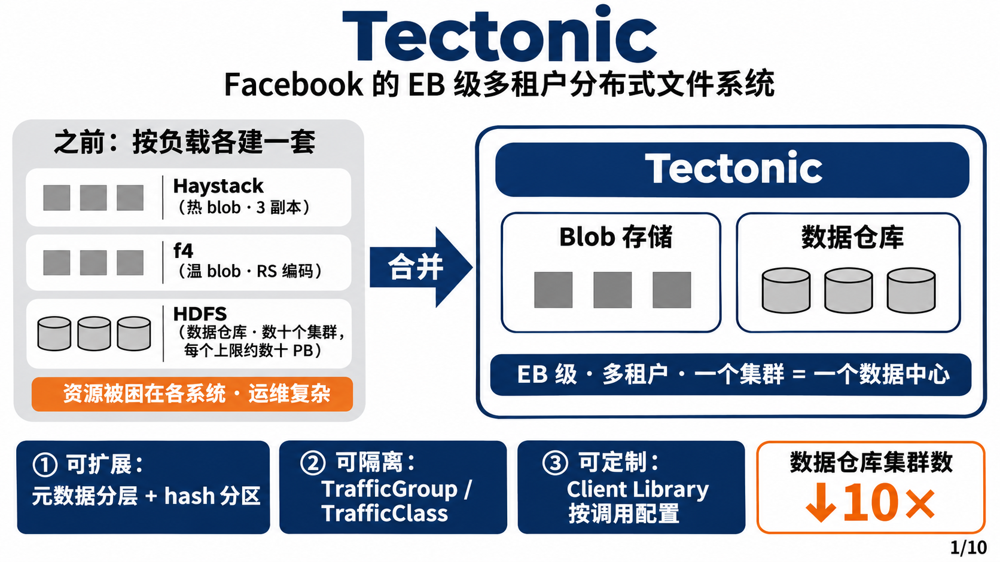
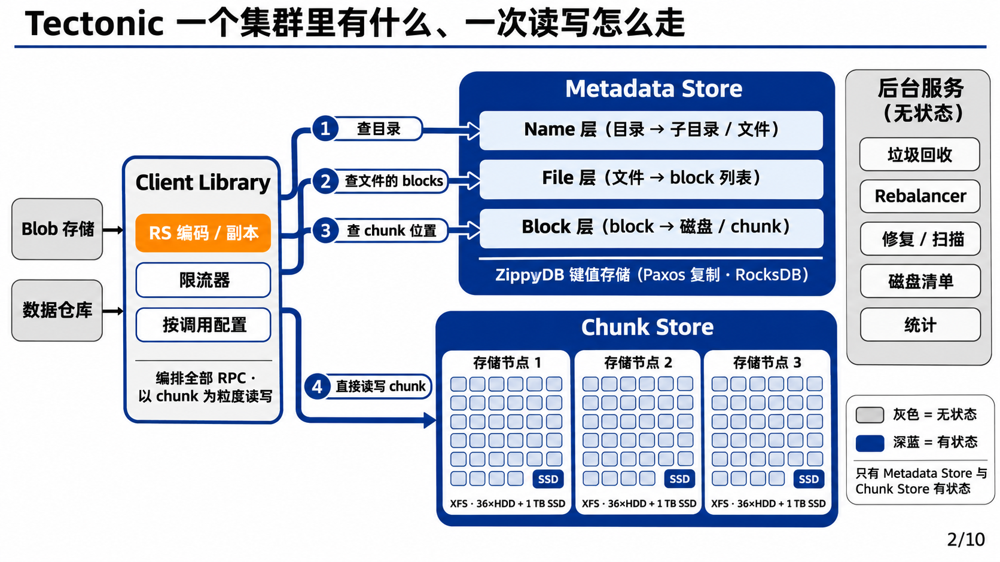
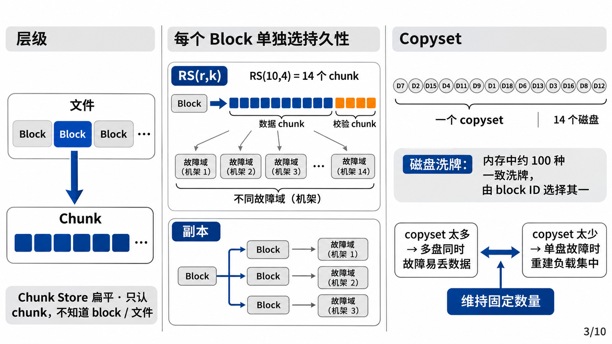
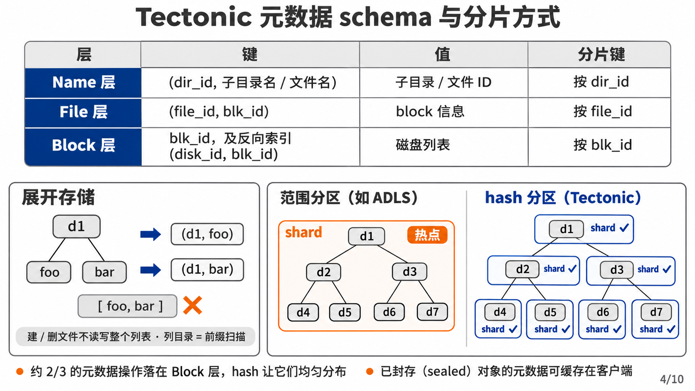
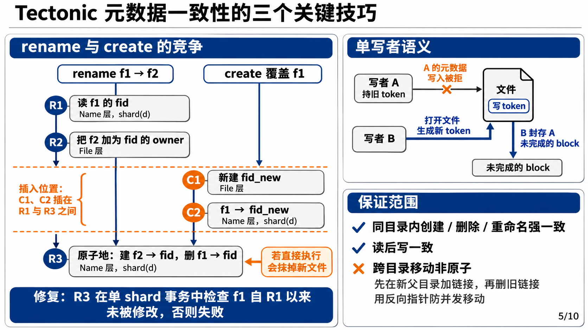
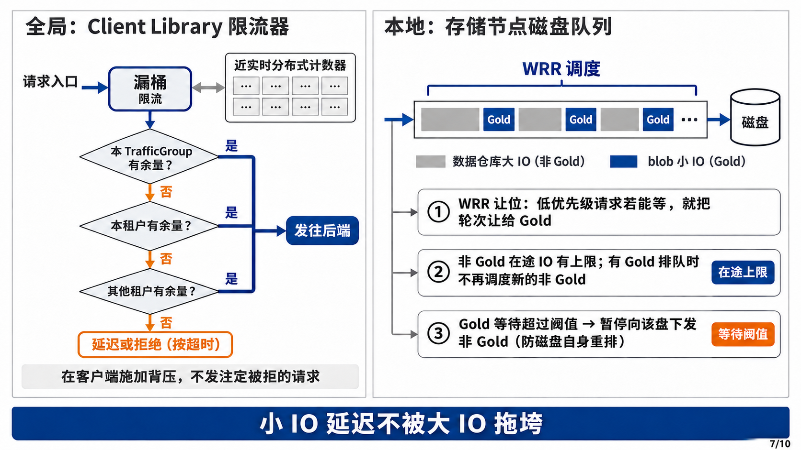
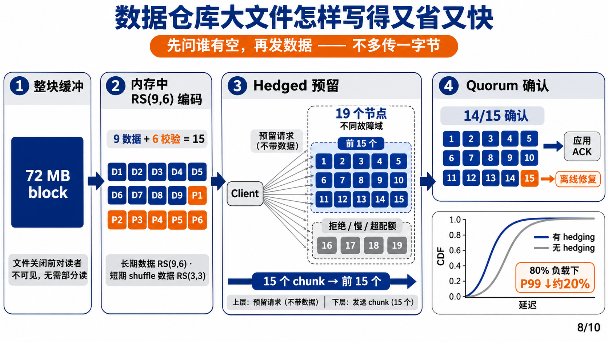
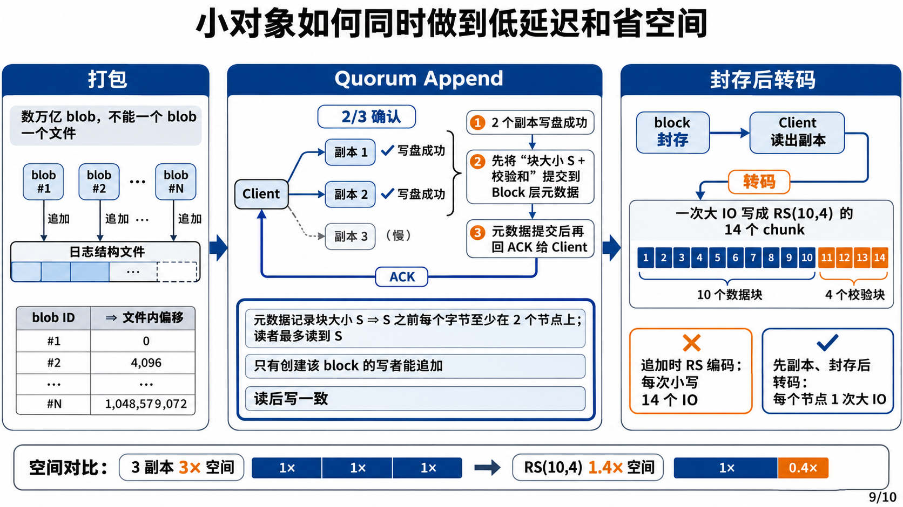
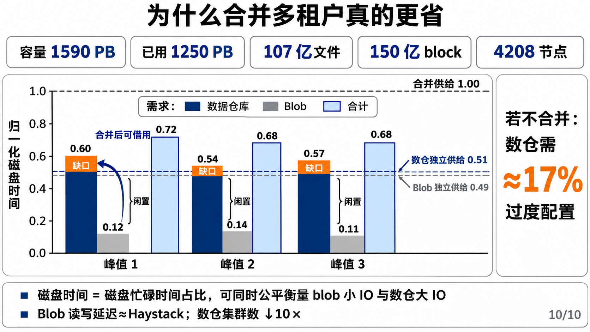

# Facebook's Tectonic Filesystem: Efficiency from Exascale — 图解

## 论文信息

- 论文：Satadru Pan et al., *Facebook's Tectonic Filesystem: Efficiency from Exascale*, FAST 2021 — <https://www.usenix.org/conference/fast21/presentation/pan>（[PDF](https://files.usenix.org/s3fs-public/cdn/fast21-pan.pdf)，本地副本：[fast21-pan.pdf](fast21-pan.pdf)）
- 精读文档：[deep-read.md](deep-read.md)（逐章精读，相关图解已嵌入对应章节）
- 风格：paper-figure · 中文 · 16:9 · 用于论文阅读笔记
- 页数：10（封面 + 9 页机制 / 结果）
- 生成方式：`prompts/*.json` 为每页作图规格；图片由 Codex CLI 内置 imagegen 生成。也可用 `bash generate.sh [页号...]` 走 Giiisp 重新生成（需 `GIIISP_AUTH_TOKEN`）。

## 封面

**一句话**：Facebook 把 Haystack（热 blob）、f4（温 blob）和数十个 HDFS 集群（数仓）合并成一个数据中心级、EB 级、多租户的文件系统 Tectonic。资源不再被困在各个专用系统里，数仓集群数降为原来的 1/10，性能与原来的专用系统持平。

## 第1页：整体架构

**讲解**：Tectonic 只有两个有状态的层：**Metadata Store**（Name / File / Block 三层逻辑，存放在 ZippyDB 中；ZippyDB 用 Paxos 复制，底层是 RocksDB）和 **Chunk Store**（每个存储节点有 36 块 HDD 和 1 TB SSD，本地文件系统是 XFS）。其余组件都无状态：后台服务负责 GC、rebalance、修复和统计，**Client Library** 负责编排所有 RPC。一次读要经过四步：查 Name 层 → 查 File 层 → 查 Block 层 → 直接读 chunk。关键在于"客户端驱动"：编码、复制、限流、写策略都由客户端按每次调用决定，这是后面所有租户定制优化的基础。

## 第2页：Chunk Store 与 Block 持久性

**讲解**：Chunk Store 是扁平的对象存储，只认识 chunk，不知道 block 和文件，所以容量随节点数线性扩展。**block** 是持久性单位：每个 block 可以单独选择 RS(r,k) 编码（切成 r 个数据 chunk 和 k 个校验 chunk）或多副本，同一个 block 的 chunk 分布在不同机架上。**Copyset** 负责控制数据丢失风险和重建负载之间的平衡：Block 层和 rebalancer 在内存中保留约 100 种全盘洗牌序列，取一个序列里连续的若干块盘组成一个 copyset，由 block ID 决定用哪一种洗牌，从而让 copyset 总数保持固定。

## 第3页：分层 + hash 分区的元数据

**讲解**：元数据拆成三层。Name 层存目录 → 子目录/文件，按 dir_id 分片；File 层存文件 → block，按 file_id 分片；Block 层存 block → 磁盘，另有磁盘 → block 的反向索引，按 blk_id 分片。与 ADLS 的区别在于 Tectonic 用 **hash 分区**，而不是**范围分区**：范围分区会把整棵子树放进同一个 shard，产生热点；hash 分区下，同一目录的两个子目录大概率落在不同 shard。约 2/3 的元数据操作发生在 Block 层，hash 分区让这部分负载天然均匀。目录内容用"展开键"存储，例如 `(d1, foo)` 和 `(d1, bar)`，建删文件时不必读改写整个列表。已封存（sealed）的对象不可变，可以缓存在客户端。

## 第4页：没有跨 shard 事务时的一致性

**讲解**：ZippyDB 只提供单 shard 事务。文件放在其父目录的 shard 里，因此同目录内的创建、删除、重命名都是强一致的。最难的情况是 rename 和"覆盖式 create"交错执行：如果 C1、C2 发生在 R1 和 R3 之间，R3 会抹掉新文件。解决办法是 R3 在 shard 内事务中检查 f1 从 R1 到现在没有被修改过。跨目录 move 不是原子的，分两步完成（先加新链接，再删旧链接），用反向指针防止并发移动。写入采用**单写者**模型：打开文件时写入一个 token，新写者会覆盖旧 token，并封存旧写者留下的未完成 block。

## 第5页：多租户资源层级

**讲解**：存储容量是非瞬时资源，按租户硬配额，只能手动调整。磁盘 IOPS 和元数据 QPS 是瞬时资源，管理粒度既不是租户（太粗），也不是应用（几百个，太细），而是约 50 个 **TrafficGroup**。每个 TrafficGroup 属于 Gold / Silver / Bronze 中的一个 **TrafficClass**。空闲资源按三级顺序借出：先用本组的保证配额，再借同租户其他组的，最后借其他租户的，每一级都按 TrafficClass 优先。借来的流量取双方中较低的等级，这样节点上各优先级流量的比例保持不变。

## 第6页：隔离的执行

**讲解**：隔离在两个地方执行。**全局**由 Client Library 的限流器负责，它用近实时分布式计数器和改进的漏桶算法，依次检查本组、本租户、其他租户是否还有余量，没有就延迟或拒绝请求，在客户端提前施加背压。**本地**由存储节点的 WRR 调度器负责，并用三招保护 Gold 小 IO：① 低优先级请求如果等得起，就把轮次让给 Gold；② 限制非 Gold 的在途 IO 数，有 Gold 排队时不再调度新的非 Gold；③ Gold 等待超过阈值时，暂停向该盘下发非 Gold，防止磁盘自身重排序拖慢 Gold。最终效果是数仓的大 IO 不会拖垮 blob 的小 IO。

## 第7页：数据仓库写路径

**讲解**：数仓的文件写一次、读多次，关闭前对读者不可见，所以可以把数据攒满整块再写：在内存中做 RS(9,6) 编码（短期的 shuffle 数据用 RS(3,3)），各 block 并行异步写，写完后统一提交元数据。**Hedged quorum 写**分两步：先向 19 个故障域分散的节点发预留请求（不带数据），再把 15 个 chunk 写给最先响应的 15 个节点，其中 14 个成功就确认，第 15 个由离线修复补上。数据只传一次，又能避开慢节点和已超配额的节点。在 80% 负载下，72 MB block 的 P99 写延迟降低约 20%。

## 第8页：Blob 写路径

**讲解**：Facebook 有数万亿个 blob，因此先把 blob 追加进日志结构文件，再用 blob ID → 偏移的索引定位。为了低延迟，写入采用 3 副本的**部分块 quorum append**，2 个副本写盘就确认。一致性的关键是顺序：先把新块大小 S 和校验和提交到 block 元数据，再回 ACK，并且只有创建 block 的写者可以追加。这样，元数据里的 S 就保证 S 之前的每个字节至少在 2 个节点上，读者也只读到 S。block 封存后，客户端用每个节点一次大 IO 的方式把它转码为 RS(10,4)，避免追加时直接做 RS 编码带来的 14 次小 IO。

## 第9页：关键结果

**讲解**：代表性生产集群的规模是 1590 PB 容量、107 亿文件、150 亿 block、4208 个存储节点。衡量 IO 用的是"磁盘时间"，因为它能同时公平地计量 blob 的小 IO（受 IOPS 限制）和数仓的大 IO（受带宽限制）。三个日峰值里，数仓需求分别是 0.60、0.54、0.57，都超过它自身的供给 0.51；blob 需求只有 0.12、0.14、0.11，而供给是 0.49。合并后的总需求 0.72、0.68、0.68，始终低于总供给 1.00。合并后数仓可以借用 blob 闲置的磁盘时间；如果不合并，数仓需要多备约 17% 的磁盘。Blob 的读写延迟与 Haystack 相当。元数据方面，只有约 1% 的 Name 层 shard 碰到每 shard 10K QPS 的上限，靠退避重试化解。

## 总结：3 个核心要点

1. **元数据分层 + hash 分区**：Name / File / Block 三层独立扩展，hash 分区消除目录热点，让单集群达到 EB 级、百亿文件。
2. **按 TrafficGroup 管资源**：把几百个应用收敛成约 50 个组，再配合三档优先级、三级借用顺序，以及客户端限流加节点调度两层执行，实现多租户的隔离和资源共享。
3. **客户端驱动、按调用配置**：数仓用整块 RS 编码加 hedged quorum 写，Blob 用副本 quorum append 再转码为 RS，同一套系统达到两种专用系统的性能。
