# Tectonic-Shift 论文精读：A Composite Storage Fabric for Large-Scale ML Training（ATC 2023）

> 论文：Mark Zhao, Satadru Pan, Niket Agarwal, Zhaoduo Wen, David Xu, Anand Natarajan, Pavan Kumar, Shiva Shankar P, Ritesh Tijoriwala, Karan Asher, Hao Wu, Aarti Basant, Daniel Ford, Delia David, Nezih Yigitbasi, Pratap Singh, Carole-Jean Wu, Christos Kozyrakis. *Tectonic-Shift: A Composite Storage Fabric for Large-Scale ML Training*. USENIX ATC 2023, pp. 433–449.
>
> 机构：Stanford University、Meta
>
> 链接：<https://www.usenix.org/conference/atc23/presentation/zhao> ；PDF：<https://www.usenix.org/system/files/atc23-zhao.pdf>
>
> 精读日期：2026-11-21。文中**数字、表格与机制描述均摘自论文原文**（标注所在章节）；标注"解读"的段落是本文作者的分析与推论，不是论文原话。
>
> 前置阅读：[Tectonic（FAST 2021）精读](tectonic-fast2021/deep-read.md)。Tectonic-Shift 是在 Tectonic 之上为 ML 训练加的一层 flash 缓存，很多概念（block、chunk、seal、Client Library、Metadata Layer）直接沿用前作。
>
> 相关文档：[工业界生产系统综述中的 Tectonic-Shift 小节](industry-production-systems.md#2-tectonic-shiftatc-2023)、[HPC 与 AI 训练存储](hpc-ai-storage.md)、[论文清单](essential-papers-2000-2026.md)。

## 目录

- [0. 一页速览](#0-一页速览)
- [1. 背景：Meta 的训练数据存储与摄取（DSI）流水线](#1-背景meta-的训练数据存储与摄取dsi流水线)
- [2. 硬件设计空间：为什么要"复合"存储](#2-硬件设计空间为什么要复合存储)
- [3. 负载特征：训练数据的复用长什么样](#3-负载特征训练数据的复用长什么样)
- [4. 缓存软件设计空间：为什么通用缓存和 ML 缓存都不行](#4-缓存软件设计空间为什么通用缓存和-ml-缓存都不行)
- [5. Tectonic-Shift 架构](#5-tectonic-shift-架构)
- [6. 应用感知的缓存策略](#6-应用感知的缓存策略)
- [7. 策略评估](#7-策略评估)
- [8. 生产结果](#8-生产结果)
- [9. 经验教训与开放问题](#9-经验教训与开放问题)
- [10. 与相关工作的对比](#10-与相关工作的对比)
- [11. 整体总结](#11-整体总结)

---

## 0. 一页速览

**一句话**：Tectonic-Shift 在每个 HDD Tectonic 集群前面透明地加一层由 flash 存储节点组成的缓存 Shift，让 flash 吸收训练读的 IO、让 HDD 只负责容量。缓存命中率的关键不在淘汰算法，而在**准入**：Shift 从训练作业的数据集规格（要读哪些表分区）推断未来访问，只让"未来还会被多个作业读"的数据进 flash。结果是比 LRU flash 缓存多吸收 1.51–3.28 倍 IO，生产集群存储功耗下降 29%。

| 维度 | 要点 |
|------|------|
| 问题 | 训练 IO 需求的增速约是存储容量需求的 **2 倍**；纯 HDD 集群为了扛 IO，要多配 **9.92 倍**的容量（100 PB 数据要配约 1.6 EB 盘）（§1、§3.1） |
| 优化目标 | **功耗**（watt），这是 Meta 全舰队的首要预算指标；ML 存储的功耗常常比训练器本身还高（§1、§3.1） |
| 硬件选择 | HDD 管容量 + flash 管 IO。理想复合集群的功耗比纯 HDD 低 **3.69 倍**（§3.1，表 1） |
| 软件形态 | flash 做**无元数据、非持久**的缓存，不做 Tectonic 内部的分层存储（§3.1） |
| 四条原则 | 透明（API 不变）、简单（基于 CacheLib，不改 Metadata Layer）、可扩展（一致性哈希、完全去中心化）、智能（读作业规格推断未来访问）（§4.1） |
| 缓存单位 | Tectonic block（通常 72 MiB）切成 **256 KB 的 segment** 放入 CacheLib（§4.2、§5.2） |
| 策略核心 | segment 按**目录**（即表分区）归入 bucket；每 10 秒按 bucket 优先级决定是否准入 / 重插入；优先级 = 预计每个 segment 未来被读几次，来自历史（RHW）和未来（GMS 作业规格）两个信号（§5.1） |
| flash 寿命 | PID 反馈环动态调准入阈值，使写入速率低于 flash 耐久上限；且准入判断发生在回源读 HDD **之前**（§5.1） |
| 成效 | 基准负载下 IO 吸收量是 LRU 的 1.51–3.28 倍；同等写入速率下 cache fill（HDD 回源读）比 CacheLib Dynamic 少 96%；PB 级生产集群功耗降低 **29%**（§6） |
| 部署 | Tectonic 2015 年上线；Shift 2022 年初上线，PB 级规模部署在多个服务 DLRM 训练的 Tectonic 集群旁（§6） |

---

## 1. 背景：Meta 的训练数据存储与摄取（DSI）流水线

Meta 的 ML 基础设施需求以**深度学习推荐模型（DLRM）**训练为主，论文也主要讨论 DLRM（§2）。每个训练集群有数千 GPU，需要一个能存 EB 级数据、以每秒数十 TB 供读的存储层（§1）。

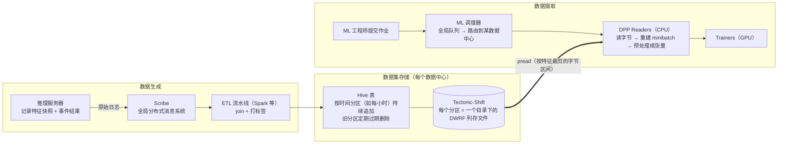

*图 1：DSI 流水线（对应论文图 1）。Tectonic-Shift 是每个数据中心训练数据的持久存储层。*

几点关键事实（§2）：

- **数据新鲜度要求高**：样本来自线上推理请求日志，持续生成。每条流水线的样本写入一张 Hive 表，按时间分区，每张表**复制到所有有训练集群的数据中心**，训练作业只读本地 Tectonic。
- **统一宽表 schema**：所有特征存放在少数几个 map 列里，占每行字节数的 **99% 以上**。每列把整数 feature ID 映射到值（dense 特征是 float，categorical 特征是 list 或 map）。
- **数据集规格**：ML 工程师给每个作业指定一个数据集，包含**一组表分区**和**一组 feature ID**。Readers 在作业生命周期内持续读不相交的 minibatch，直到所有 Readers 合起来把指定分区读完一遍。
- **读路径**：Readers 先查 Hive Metastore 把分区映射到 Tectonic 文件，再按文件 footer 中的元数据**只读所需特征对应的字节**（过滤下推到存储），并把读合并成 **O(1 MB)** 的大 IO 以减少 HDD 寻道。

Tectonic 本身（§2，详见[前作精读](tectonic-fast2021/deep-read.md)）：文件切成 block（通常 **72 MiB**），block 再切成 chunk（通常 **8 MiB**），以副本或 RS 编码分布到 HDD 存储节点；Client Library 暴露 `pread` 接口，直接读 chunk；元数据由基于 ZippyDB 的哈希分片 Metadata Layer 提供。

**解读**：这里有两个后文反复用到的前提。第一，训练作业读什么是**作业启动时就确定的**（分区列表 + 特征列表），只是读的时间点不确定。第二，训练数据是**写一次、seal 后不再修改**的，缓存不需要处理失效。Shift 的设计几乎都建立在这两点上。

---

## 2. 硬件设计空间：为什么要"复合"存储

### 2.1 功耗建模（§3.1，表 1）

论文用 Meta 的 HDD 服务器（Bryce Canyon）和 flash 服务器（Yosemite v3）规格，计算满足 **100 PB 存储 + 10 TB/s 读带宽**（代表性需求）所需的功耗，归一化到"纯 HDD 只满足存储需求"：

| 集群形态 | 只满足存储 | 只满足 IO | 同时满足存储与 IO |
|----------|-----------:|----------:|------------------:|
| HDD 集群 | 1.00 | 9.92 | 9.92 |
| Flash 集群 | 6.53 | 1.88 | 6.53 |
| HDD + Flash（理想复合） | 1.00 | 1.88 | **2.69** |

HDD+Flash 一行的算法是：容量只由 HDD 提供，IO 只由 flash 提供；同时满足时不计 HDD 自身的 IO 能力。正文说理想复合集群只需 **1.69 倍**的 flash 功耗满足 IO、加 **1.00 倍**的 HDD 功耗满足存储，合计 2.69，比方案 1 低 **3.69 倍**（9.92 / 2.69）。

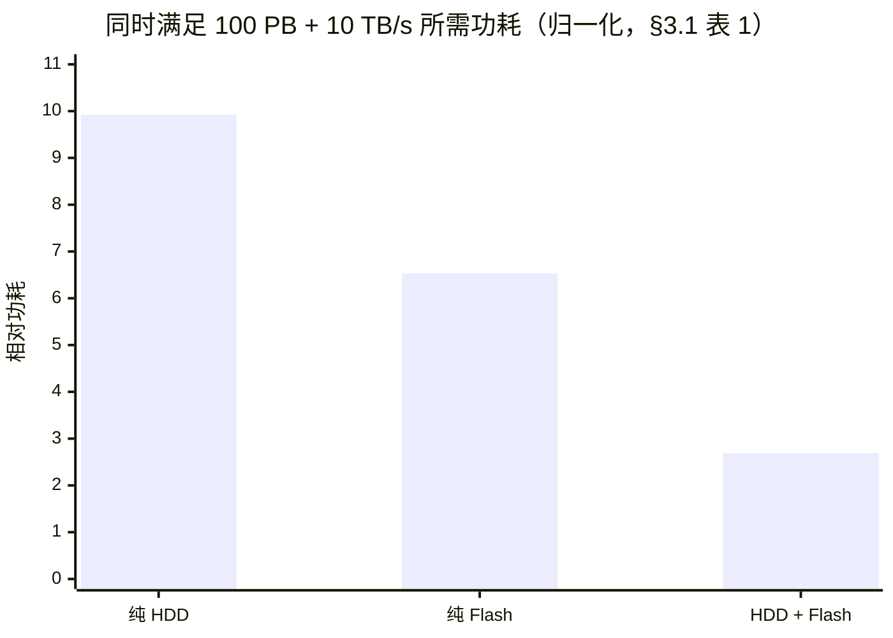

### 2.2 逐个方案

| 方案 | 结论（§3.1） |
|------|--------------|
| 1. 纯 HDD（现状） | 继续往 Tectonic 里加 HDD 节点，IO 能力线性增长。但要多配 **9.92 倍**容量，按 RS(9,6) 算约 **1.6 EB** 盘。IO 需求增速又是容量需求的 2 倍，不可持续 |
| 2. 纯 Flash | 满足 IO 的功耗比 HDD 低 **5.28 倍**，满足存储的功耗却高 **6.53 倍**。同时满足两者时比纯 HDD 好，但 IO 能力严重过剩 |
| 3.1 HDD + DRAM | 不选。DRAM 存储节点的瓶颈是网卡（如 100 Gbps），不是 DRAM 带宽。现代 SSD 能以 O(1 W) 功耗提供 O(1 GB/s) 读带宽，flash 节点能以相近功耗提供相同 IO，且容量是 O(10 TB)，缓存效果好得多 |
| 3.2 HDD + Flash | **采用**。前提是 flash 能装下"热的那部分字节"，承担大部分 IO |

### 2.3 Flash 放在哪里：分层存储 vs 缓存

最直接的做法是在同一个持久存储里建 HDD 和 flash 两套 Chunk Store，由 Tectonic Metadata Layer 按读热度在两者之间搬 block。论文否决了这条路（§3.1），理由有三：

1. flash 上要额外承担 **RS 编码开销**（因为它是持久层）；
2. block 位置变化会带来**元数据更新开销**；
3. 热度是**字节区间**级别的（见 §3 列维度复用），要让 Metadata Layer 支持 sub-block 粒度，改动很大。

于是 flash 被定位为一个**无元数据（metadata-less）、非持久（non-durable）的缓存**。

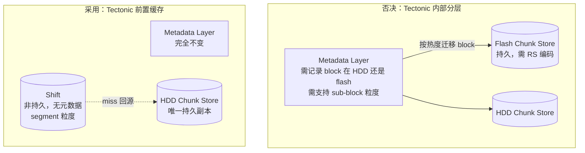

**解读**：这是整篇论文最重要的工程决策之一。做成缓存后，Shift 坏了只是性能下降，不影响正确性和持久性；Tectonic 一行元数据代码都不用改。代价是"放什么进 flash"不再由一个有全局视图的元数据服务决定，只能由各个缓存节点本地判断，这就是 §5 策略设计要解决的问题。

---

## 3. 负载特征：训练数据的复用长什么样

论文对生产训练作业做了刻画（§3.2.1），结论是：这是一种对缓存非常不友好的负载。

### 3.1 行维度复用（表、分区）

- **表热度服从幂律**：一天内 85 张表的 IO 需求呈明显的幂律分布，长尾很长（图 3）。不同模型类型通常用不同的表，模型热度差异直接体现为表热度差异。
- **只读一部分分区，且只读一遍**：模型通常不用读完所有行就能收敛，所以作业一般只读表的部分分区，而且**只读一个 epoch**。
- **IO 主要来自读得多的作业**：以某张热门表为例，大多数作业只读几个日期分区；但按读取分区数加权后，**大部分 IO 来自读 20 个以上日期分区的作业**（图 4a）。
- **分区热度是多峰的**（图 4b）：最新的日期分区流量最大（持续更新模型的 recurring 作业、要用最新数据的探索作业）；此外还有几组热门的日期区间，因为多个大规模训练作业为了结果可比会使用相近的日期范围。

### 3.2 列维度复用（特征）

受 GPU 显存等硬件限制，作业通常只用全部特征中的一部分（§3.2.1）。对读同一日期分区的 **1265 个**生产作业的分析显示（图 5a）：

- **超过 75%** 的字节至少被读过一次；
- 但大约**一半的字节**（热门特征）承担了**几乎全部** IO。

特征以列式字节流存放在大的 DWRF 文件里，所以：

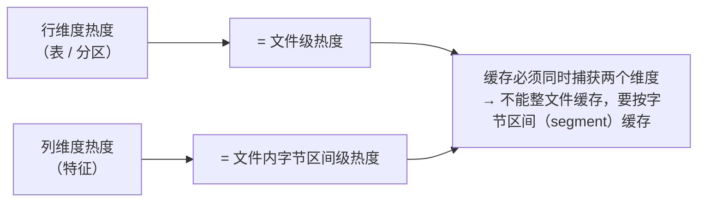

### 3.3 时间维度

对一周内启动的、读同一张热门表的 **642 个**作业画时间线（图 5b），得到三点（§3.2.1）：

1. **作业高度异步**：不能假设作业同时启动、具有很强的时间局部性（超参搜索那种高度同步的情况只是少数）；
2. **复用只发生在少数作业之间**：与 Web 负载动辄数十亿次请求不同；
3. **作业持续数小时到数天**：存储和时间上的足迹都很大。

### 3.4 小结：四个特征

| 特征（§3.2.1） | 对缓存的含义 |
|----------------|--------------|
| 复用**只发生在不同的单 epoch 作业之间**，作业内部没有复用 | 不能指望 "multi-epoch 第二遍命中" |
| 活跃工作集巨大：85 张以上活跃表，每张 O(1–10 PB) | 远超缓存容量 |
| 大部分 IO 来自读几十个日期分区的作业，单个日期分区 O(100 TB)，这类作业工作集是 PB 级 | 单个作业就能把缓存刷一遍 |
| 分区热度不均且随时间变化（新分区生成、旧分区删除） | 静态的"热表白名单"会过时 |

---

## 4. 缓存软件设计空间：为什么通用缓存和 ML 缓存都不行

论文比较了三种管理 flash 层的方式（§3.2.2）：

| 方案 | 做法 | 问题 |
|------|------|------|
| 1. 通用软件缓存 | 部署一组 flash 节点，每个用 CacheLib 管理，缓存文件字节区间。CacheLib 提供 LRU / FIFO 淘汰，以及随机、reject-first 两种准入（用于控制 flash 寿命） | **扫描（scan）**：冷门表的作业工作集可达数十 PB，比整个缓存还大，一次长扫描就能把缓存全部刷掉。**抖动（churn）**：即使热门样本也会被反复淘汰又插入，原因是每个数据中心作业数量相对少、复用间隔长、工作集大于缓存。scan 和 churn 是公认的缓存对抗模式 |
| 2. ML 专用缓存（Quiver、CoorDL、OneAccess、DIESEL、Cachew 等） | 应用显式把样本缓存在高带宽存储里 | 假设不符：它们缓存**整个文件**（如图片），依赖作业内多 epoch 复用和高并发超参搜索作业间的复用；而 Meta 需要缓存文件内的字节区间，复用只在高度异步的作业间。**安全**：应用控制的缓存要处理多份数据副本的访问控制与删除。**推广成本**：需要用户改代码，拖慢部署速度和 ML 工程师效率 |
| 3. 透明的应用感知缓存 | 兼顾两者：像软件缓存一样透明、通用；像 ML 缓存一样了解应用。关键机会是作业的数据集规格**确定性地**说明了它在整个生命周期内会读哪些特征、表和分区 | **采用** |

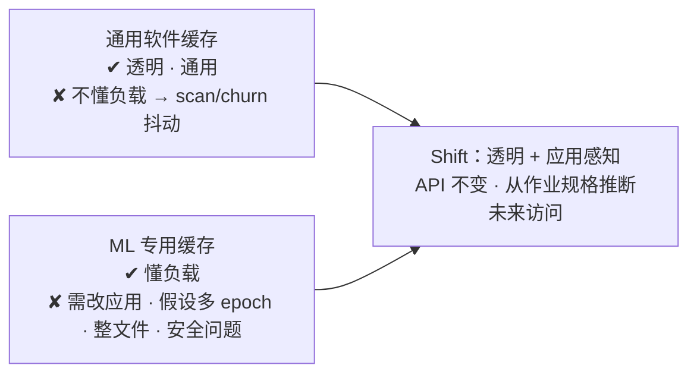

**解读**：这里的论证逻辑值得注意。很多学术 ML 缓存的前提是"同一份数据要读很多遍"，而 Meta 的工业负载恰好反过来：单 epoch、数据持续更新、作业异步。复用存在，但只在**作业之间**，而且间隔长。在这种负载下，LRU 依据的"最近访问过的很快会再被访问"基本不成立，必须换一种信号。

---

## 5. Tectonic-Shift 架构

### 5.1 四条设计原则（§4.1）

| 原则 | 做法 | 带来的好处 |
|------|------|------------|
| **透明（Transparency）** | Shift 透明地放在每个 HDD Tectonic 集群前面，暴露与 Tectonic 完全相同的 API 和语义，服务本数据中心所有训练负载的读 | 不把存储决策暴露给 ML 工程师（避免低效配置、不影响效率）；可以渐进上线、在底层重新平衡集群；Meta 大部分存储服务都用 Tectonic，通用 API 便于将来接入其他变成 IO 瓶颈的业务 |
| **简单（Simplicity）** | 只能通过 Client Library 访问 Shift，Client Library 使用 Tectonic Metadata Layer；利用训练数据存在**不可变的 sealed block** 中，不处理缓存失效或修改；节点内部用 CacheLib | 所有访问控制在到达 Shift 之前已校验；不需要失效协议；复用 CacheLib 团队的投入 |
| **可扩展（Scalability）** | 完全去中心化，只有放在**一致性哈希环**上的 flash 存储节点；缓存决策只在节点本地做，并根据观测到的负载动态调整 | 任意规模都有效、部署快、易扩容 |
| **智能（Intelligence）** | 根据作业初始的数据集规格推断访问模式，结合历史与预期未来访问最大化 IO 吸收 | 见 §6 |

### 5.2 组件全景

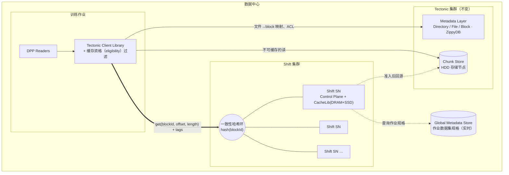

*图 2：Tectonic-Shift 组件（对应论文图 2 与图 6）。Tectonic 的 Metadata Layer 与 Chunk Store 都不需要修改。*

### 5.3 一次读请求的生命周期（§4.2，图 6）

**Client Library 侧**：

1. Readers 通过 Tectonic Metadata Layer 拿到文件句柄，从文件 footer 解出"特征/行 → 文件字节区间"的映射，然后调用 `pread(file, offset, count)`。
2. Client Library 查 File Layer，把 `pread` 拆成若干 **block 读**。
3. 对每个 block 读判断是否**缓存资格合格**（§6.4）：
   - 不合格 → 直接从 Tectonic Chunk Store 读（①a）；
   - 合格 → 向 Shift 发 `get(blockId, offset, length)`（①b），并**捎带一组 tag**（文件路径、训练作业 ID 等）供 Shift 策略使用。按 `hash(blockId)` 选择 Shift 存储节点（SN）。
4. SN 返回数据（②a）或 cache miss（②b）；miss 的 block 由客户端回 Tectonic 读（①a）。所有 block 取齐后返回 `pread` 结果。

**Shift SN 侧（数据面）**：

1. 每个 Tectonic block（通常 72 MiB）切成**固定大小的 segment**（256 KB，见 §6.3），segment 是放进 CacheLib 的对象；
2. SN 把 `get` 的范围拆成 segment。全部命中则直接返回（②a）；
3. 有 segment 缺失时，先做**准入判断**（③）。只要有一个 segment 不被准入，就向客户端返回"不可缓存的 miss"（②b），由客户端自己回源；
4. 全部准入则 SN **自己从 Tectonic 取回**这些 segment 并插入缓存（④），再返回数据（②a）；
5. 插入可能导致 segment 被**淘汰**（⑤）；对每个被淘汰的 segment，SN 可以选择**重插入**（⑥），以避免它在不久后被访问时 miss。

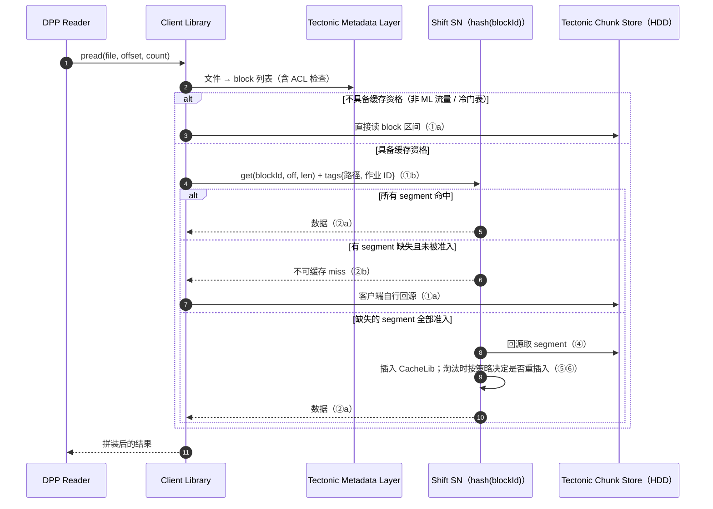

*图 3：Tectonic-Shift 读路径。注意"未准入"时 SN 不会去读 HDD，回源由客户端完成。*

### 5.4 抽象与保证（§4.2）

- **只服务读，不暴露 `put`**：Shift 的唯一目标是吸收热门字节对应的 IO。缓存插入只发生在 `get` miss 时。
- **语义完全沿用 Tectonic**：Tectonic 是追加写语义，数据流水线会 seal block，Shift 不需要处理修改。所有元数据操作都走 Tectonic Metadata Layer，Shift SN 只是数据面的一部分。
- **一致性**：SN 只能通过 Client Library 访问，而 Client Library 总是先查 Metadata Layer 拿文件到 block 的映射，所以不会读到已重命名或已删除的文件。
- **安全**：Client Library 在向 Shift 发请求前对每个 block 做 ACL 检查，未授权的读进不了 Shift。
- **容错**：Shift 没有中心化状态；元数据依赖容错的 Tectonic Metadata Layer；策略在每个 SN 本地执行，单个 SN 故障不影响其他 SN；SN 故障时（如超时）客户端退回直接读 Tectonic。

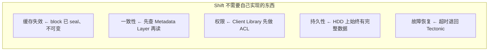

**解读**：Shift 把几乎所有"难的分布式问题"都推给了已有的 Tectonic，自己只做一件事：决定哪些字节值得留在 flash 上。这和 Tectonic 前作"把 chunk store 做成不感知上层抽象"的思路一脉相承。block 不可变这个前提尤其关键，它让缓存一致性问题直接消失；如果将来要缓存可变数据，这套设计就不能照搬。

---

## 6. 应用感知的缓存策略

### 6.1 优化目标与策略位置（§5）

每个 SN 只服务一致性哈希环上属于自己的那一段，所以**每个 SN 最大化本地吸收的 IO，就等于最大化整个集群吸收的 IO**。论文给出的"吸收 IO"定义是：

> 吸收 IO = 成功返回给客户端的 `get` 带宽 − 因 miss 回源 Tectonic 的带宽。未准入的请求不影响吸收 IO；重插入的 segment 不产生 Tectonic 回源。

策略分布在两处：

- **SN 的 Control Plane**：准入（admission）和重插入（reinsertion）；
- **Client Library**：缓存资格（eligibility），减少 RPC 压力，挡住"不可缓存"的负载。

**为什么在准入/重插入上做文章，而不是改淘汰算法**（§5）：

1. 准入能直接挡住 scan 和 churn 造成的抖动；
2. 准入能控制 flash 的写入速率，从而管理 flash 寿命。

准入后的淘汰仍使用 CacheLib 自带的 LRU 或 FIFO。

### 6.2 Control Plane 与 Data Plane（§5.1，图 7）

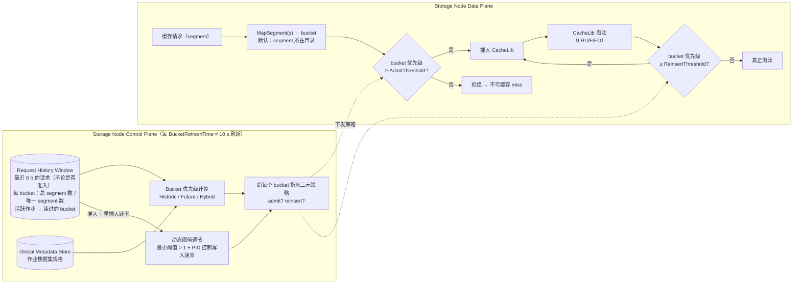

*图 4：Shift SN 的控制面与数据面（对应论文图 7）。数据面只做查表式的二元判断，所有计算在控制面周期性完成。*

可配置参数（论文表 2）：

| 参数 | 含义 | 默认 / 示例 |
|------|------|-------------|
| `MapSegment(s)` | segment 到 bucket 的映射函数 | segment 所在目录 |
| `BucketPriority(b)` | bucket b 的优先级函数 | Historic / Future / Hybrid |
| `AdmitThreshold` | 准入 bucket 的动态标量阈值 | 最小值严格大于 1，PID 动态上调 |
| `ReinsertThreshold` | 重插入 bucket 的动态标量阈值 | 绑定为 `AdmitThreshold` + 固定偏移（如 +1） |
| `BucketRefreshTime` | bucket 策略更新周期 | 10 秒 |
| `RHW Size` | 请求历史窗口保留时长 | 6 小时 |

### 6.3 Segment → Bucket（§5.1）

每个 bucket 代表一组**很可能被一起访问**的 segment，对应应用里的一个逻辑分组。默认以 segment 所在**目录**作为 bucket：

- 每个分区对应一个目录，作业指定一组分区，并扫描每个分区目录下的文件；
- 多个作业之间的数据复用可以通过它们的数据集分区（也就是目录）关联起来；
- 更细的映射（文件、特征即文件字节区间）也可以，但作业在每个文件里读的特征大体相同（§3），目录粒度已经足够。

**解读**：bucket 的作用是把"决策单元"从数以亿计的 segment 压缩到数量少得多的目录。决策单元少了，控制面才能每 10 秒对所有 bucket 重新算一遍优先级，而且一个新 segment 第一次被请求时就能沿用所在目录的策略，不需要等它自己积累访问历史。这和 Tectonic 前作用 TrafficGroup 降低多租户资源管理基数的思路很像。

### 6.4 Bucket 优先级：历史、未来与混合（§5.1）

优先级的直观含义：**预计这个 bucket 里每个 segment 在近期还会被读几次**。优先级高的 bucket 优先进缓存，总体吸收的 IO 更多。

| 优先级 | 计算方式 | 信息来源 |
|--------|----------|----------|
| **Historic** | `TotalBytes(b) / UniqueBytes(b)`，即窗口内每个唯一字节平均被读了几次 | RHW：传统缓存信号，假设过去的访问模式能代表未来 |
| **Future** | 数据集中**包含该分区的活跃作业数**，扣除已经读完该 bucket 的作业 | RHW 记录活跃作业及其读过的 bucket（靠请求捎带的作业 ID tag），GMS 提供每个作业的数据集规格 |
| **Hybrid** | `max(Historic(b), Future(b))` | 两者结合（§6 评估中使用） |

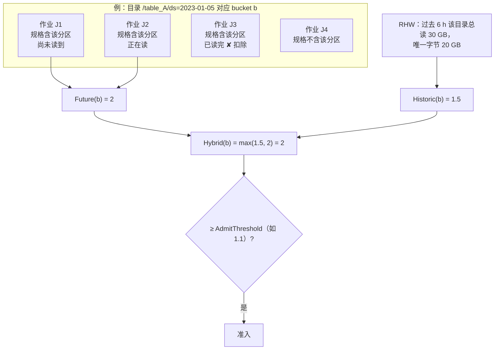

*图 5：优先级计算示意。数值为本文构造的示例，用于说明公式，不是论文数据。*

论文也指出这只是一个可扩展框架：基于 RHW 和 GMS 可以容易地构造变体，例如让读取顺序更靠前（更快会被读到）的目录获得更高优先级（§5.1）。

### 6.5 阈值调节与 flash 寿命（§5.1）

Control Plane 持续调整 `AdmitThreshold` 和 `ReinsertThreshold`，依据两个因素：

1. **最小阈值**：防止冷门负载把整个缓存刷掉。取值**严格大于 1**（即"每个 segment 至少预计还会被读超过一次"才准入），并根据观测效果不断调整；
2. **PID 反馈环**：保证"准入速率 + 重插入速率"（由 RHW 报告）**严格低于** flash 耐久上限（定义为最大平均写入速率）。写入速率高时，阈值会升到最小值以上，准入和重插入的 segment 随之减少。

只调 `AdmitThreshold`，`ReinsertThreshold` 固定为它加一个偏移（如 +1），**优先保证准入、压低重插入**，以限制重插入带来的写放大。

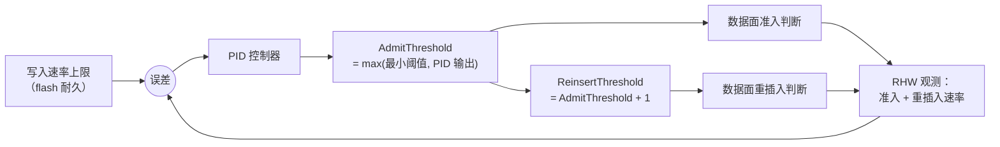

**在 CacheLib 之上做准入的额外好处**（§5.1）：CacheLib 自带的限速器是在 DRAM 淘汰时有选择地把对象写入 flash，这意味着数据**必须先进 DRAM**，也就必须先从 Tectonic 读出来。如果这些数据随后因为写入限额被丢掉，那次 HDD 读就白做了。Shift 的准入判断发生在**回源 Tectonic 之前**，被限速的数据根本不会产生 HDD 读。

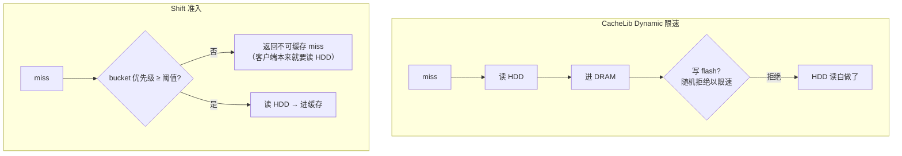

### 6.6 CacheLib 调参：segment 大小（§5.2）

以往的 flash 缓存工作主要对付小对象（如 < 1 KB）带来的写放大；Shift 的一个优势是 **segment 大小可配**：

- segment 相对于请求太大：按 segment 粒度取数和存储，会多读多存；
- segment 太小：DRAM 和 flash 上的元数据开销与写放大都会增加。

最终选择 **256 KB**，并依赖 CacheLib 的 Large Object Cache 处理 flash 上的数据布局和写放大（§5.2、§8）。DRAM 和 flash 的淘汰策略评估后发现 **LRU 配合 Shift 的准入策略效果就很好**。

**解读**：256 KB 与 Readers 合并后的 O(1 MB) IO 大小是相匹配的，一次读大约对应几个 segment；同时 72 MiB 的 block 被切成 288 个 segment，足以在 block 内部区分热特征和冷特征的字节区间。

### 6.7 客户端缓存资格（§5.3）

Tectonic 服务着 Meta 大量训练和非 ML 负载。Client Library 上的资格策略用来挡住：

- 尚未接入 Shift 的业务（**目前所有非 ML 流量都被过滤**，以保障训练容量）；
- 低优先级和不常见（可缓存性差）的表。

这些请求即便发到 SN 多半也会被准入策略拒绝，但先在客户端过滤一道，能显著降低每个 SN 的 RPC 负载和内存压力。基线启发式是：**如果一张表的 IO 需求用存储它所需的 HDD 容量就足以满足，就把它过滤掉**（这类冷门表的 IO 让 Tectonic HDD 直接扛就够了）。过滤规则按需求持续调整。

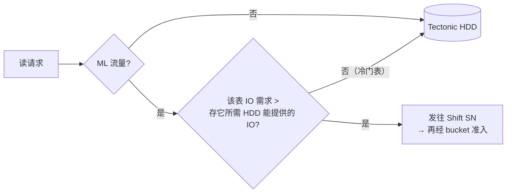

*图 6：两级过滤。客户端资格是粗筛（按业务和表），SN 准入是细筛（按目录和动态阈值）。*

---

## 7. 策略评估

### 7.1 实验设置（§6.1）

三种基准负载都从生产 DLRM 训练作业 trace 中提炼、按比例缩小到评估集群规模。`{…}j` 表示作业 j 按顺序读的分区，每个分区工作集约 **5 TB**（论文表 3）：

| 负载 | 作业与分区 | 场景 |
|------|-----------|------|
| Synchronized | {P1,P2,P3}₁, {P4,P5,P6}₂, {P1,P2,P3}₃, {P7,P8,P9}₄, {P1,P2,P3}₅；同时启动 | 多租户超参搜索或探索作业：多个读相同分区的作业同时启动，中间夹着读其他分区的作业 |
| Pipelined | {P1,P2,P3}₁, {P2,P3}₂, {P3}₃；同时启动 | 长期运行作业：用户杀掉表现不佳的作业，用同一数据集换一个新模型 |
| Sequential | {P1}₁…₄, {P2}₅, {P3}₆, {P1}₇, {P4}₈, {P5}₉；1–3、4–6、7–9 三批分别一起启动 | 训练资源有限，作业排队，资源释放后一批批启动 |

```mermaid
gantt
    title 三种基准负载的读顺序示意（时间轴仅示意先后关系）
    dateFormat X
    axisFormat %s
    section Synchronized
    J1 读 P1 P2 P3 :0, 3
    J2 读 P4 P5 P6 :0, 3
    J3 读 P1 P2 P3 :0, 3
    J4 读 P7 P8 P9 :0, 3
    J5 读 P1 P2 P3 :0, 3
    section Pipelined
    J1 读 P1 P2 P3 :0, 3
    J2 读 P2 P3 :0, 2
    J3 读 P3 :0, 1
    section Sequential
    批次1 J1 J2 J3 都读 P1 :0, 1
    批次2 J4 读 P1 J5 读 P2 J6 读 P3 :1, 2
    批次3 J7 读 P1 J8 读 P4 J9 读 P5 :2, 3
```

*图 7：三种基准负载（对应论文表 3）。Sequential 中第一批只有 P1 被读；第二、三批里 P1 仍被一个作业读，同时有冷分区 P2–P5 来争抢缓存。*

其他设置：

- 6 节点 Shift 集群，生产配置；每个 Reader 以约 **1.5 GB/s** 读 Tectonic-Shift；
- 每节点 **16 GB** DRAM 缓存；三种负载的 flash 缓存总量分别为 1.28 TB、5 TB、5 TB，每作业 Reader 数分别为 4、5、5；
- 在不同节点上配置不同策略、**并发**评估，保证读局部性一致（一致性哈希使请求均匀分布到各节点）；
- 默认用目录作 bucket，关闭重插入和写入限速；
- 指标是吸收的 IO。由于一致性哈希使各 SN 请求速率相同，比较命中率会得到类似结论。

### 7.2 准入策略能否提升 IO 吸收（§6.1，图 8）

对比对象：CacheLib 自带的纯 FIFO、纯 LRU 淘汰；Shift 的 Historic、Future、Hybrid 准入（最小阈值 1.1，即 "reject first"，淘汰用 LRU）。结果归一化到 LRU：

| 负载 | FIFO | Historic | Future | Hybrid |
|------|-----:|---------:|-------:|-------:|
| Synchronized | 1.01 | 2.01 | 2.27 | **2.32** |
| Pipelined | 1.86 | 0.80 | **5.84** | 0.99 |
| Sequential | 1.06 | 1.71 | **1.74** | 1.69 |
| **平均** | 1.31 | 1.51 | **3.28** | 1.67 |

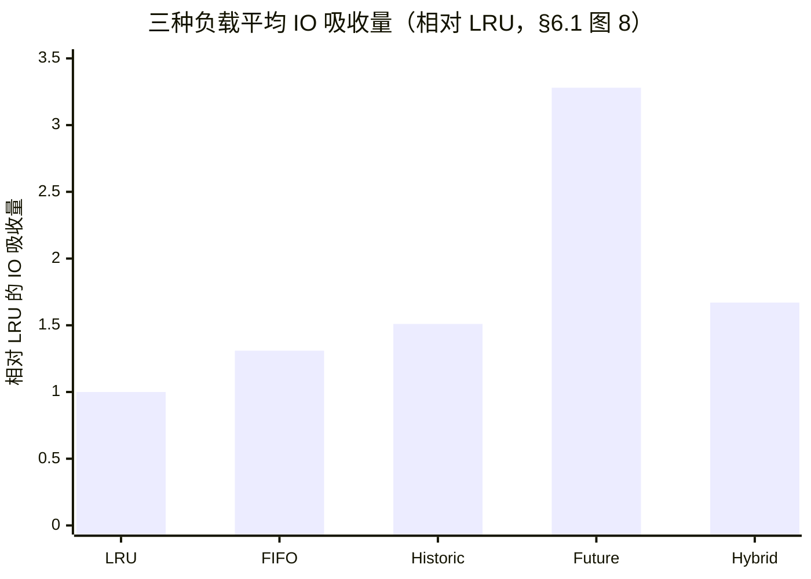

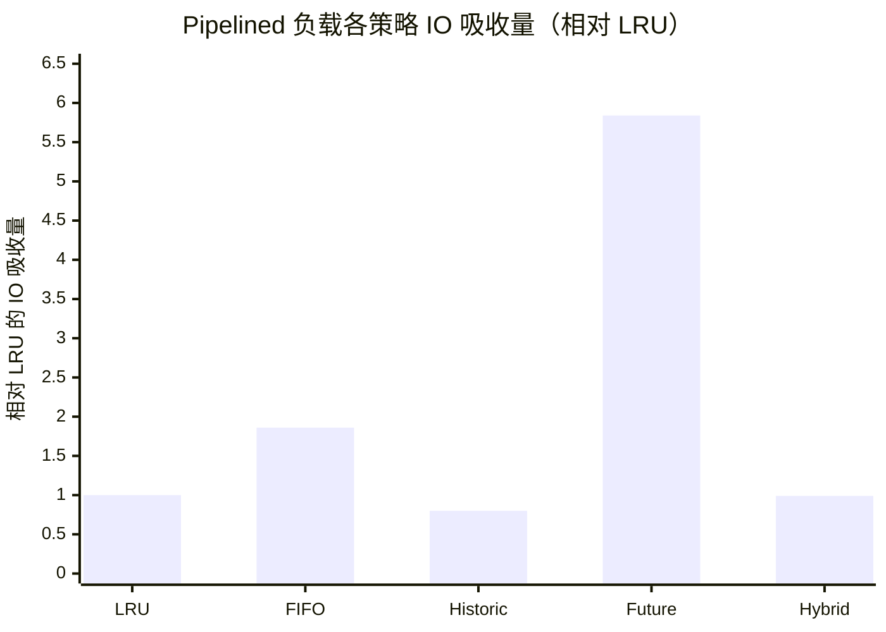

摘要里的"比 LRU 多吸收 1.51–3.28 倍 IO"，就是 Historic（1.51）到 Future（3.28）这两个平均值构成的区间。

逐个负载的原因分析（§6.1）：

- **Synchronized**：Historic 不准入 P4–P9，避免了它们引起的抖动，达到 2.01 倍；Future 和 Hybrid 还能**立刻**缓存 P1–P3，不必等 RHW 积累历史时拒掉开头的读，所以更好（2.27、2.32 倍）。
- **Pipelined**：FIFO 比 LRU 好（1.86 倍），因为 churn 使 LRU 在 J1 读到 P3 之前就把 P3 的更多对象淘汰掉了。Historic 反而不如 LRU（0.80 倍）：直到 J2 才开始准入 P3 的字节。Future 一开始就知道 P2、P3 会被 J2、J3 读，首次读就准入，达到 **5.84 倍**。Hybrid 只和 LRU 持平（0.99 倍）：它在 J1 期间根据历史热度持续准入 P2，结果把 P3 的数据挤出了缓存。
- **Sequential**：第一批作业只读 P1，所有策略命中率都很高；第二、三批中 Shift 策略拒绝了 P2–P5 的读，避免与 P1 争用，三种 Shift 策略都约为 1.7 倍。

**解读**：Pipelined 的结果最有说服力，也最暴露问题。Future 赢在"知道谁会来读"；Hybrid 输在用 `max` 合并两个信号时，历史信号的"误报"（P2 过去很热）压过了未来信号的"正确的否定"（P2 只剩 J2 会读，而 P3 有两个作业要读）。这说明 `max` 并不是合并两个信号的最好方式，论文 §7 也把"如何更好地利用未来信息"列为开放问题。生产环境仍选 Hybrid，大概是因为 GMS 的规格信息并不总是完整可得，需要历史信号兜底（这一点论文没有明说，是本文推测）。

### 7.3 准入策略能否管住 flash 寿命（§6.1，图 9）

重跑 Synchronized，给每个节点设 flash 写入上限。对比 CacheLib 的两种主流准入：**Dynamic**（随机拒绝 flash 写入以维持写入上限）和 **Reject First**（拒绝对象第一次写 flash），以及不做准入（Admit All）。都用 LRU 淘汰；Shift 策略和 Dynamic 都限制为每节点 **100 MB/s** 写入；为了完整测试阈值调节器，这里不设最小阈值。结果归一化到 Dynamic：

| 策略 | IO 吸收 | flash 写入量 | 是否满足写入限额 |
|------|--------:|-------------:|------------------|
| Dynamic（CacheLib） | 1.00 | 1.00 | 是 |
| Reject First（CacheLib） | 1.51 | 3.78 | 否 |
| Admit All | 2.66 | 10.38 | 否 |
| Shift Historic | 2.14 | ≈1（5% 以内） | 是 |
| Shift Future | **3.07** | ≈1 | 是 |
| Shift Hybrid | 2.99 | ≈1 | 是 |

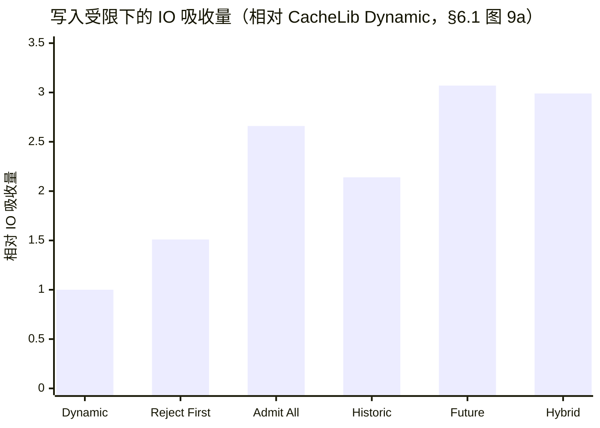

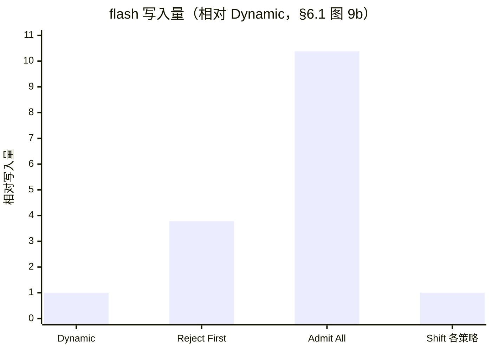

另外，Shift 策略拒绝时不产生 HDD 读，而 Dynamic 总是先把对象读进 DRAM 再决定是否写 flash。Shift 各策略的 **cache fill（HDD 回源读）比 Dynamic 少 96%**（图 9c）。

结论：Shift 的阈值调节机制能在写入约束下最大化 IO 吸收，同时不给 Tectonic 集群带来多余的读。

### 7.4 重插入是否有效（§6.1，表 4）

重跑 Synchronized，写入上限 1 GB/s，重插入阈值比动态准入阈值高 1.0，最小准入阈值 1.1。对比"Hybrid + 动态重插入"与"仅 Hybrid"：

| 指标（相对仅 Hybrid） | 值 |
|-----------------------|----|
| 命中率 | 1.03（+3%） |
| HDD IO（cache fill） | 0.82（−18%） |

但基线（不重插入）的 flash 写入速率约 **300 MB/s**，而开启重插入并动态调阈值后，Shift **始终顶在写入上限**：重插入引发更多重插入，直到超过限额。论文的结论是：**目前重插入只在"减少 HDD 读"比"减少 flash 写"更重要时才值得**；将来 CacheLib 的改进（见 §9）也许能在保留收益的同时消除持续重插入的写开销。

**解读**：重插入本质上是在只支持 LRU/FIFO 的引擎上模拟"按优先级淘汰"。被淘汰的高优先级对象重新写回 flash，每次都是一次真实的 flash 写入，这和 flash 寿命约束天然冲突。这个结果说明，缓存引擎提供的原语（只有 LRU/FIFO）限制了上层策略的发挥。

---

## 8. 生产结果

论文第 5 节的策略已在生产集群启用。由于各数据中心的作业组合和资源不同，每个集群的策略配置都在持续调整（§6.2）。

### 8.1 对比设置（§6.2，图 10）

在一个 **PB 级生产集群**上取 9 小时的代表性 trace，比较：

| 策略 | 说明 |
|------|------|
| Admit All（无准入） | IO 吸收**接近零**，训练作业之间的缓存争用太严重 |
| Expert（专家手调） | LRU + 只准入高 IOPS 的表；必要时叠加 CacheLib Dynamic 准入 |
| Shift Hybrid | 最小准入阈值 **3.0**，不开重插入 |

两者都使用客户端资格策略和生产写入限额。结果归一化到**功耗持平点**（power-neutral）：Shift 要吸收多少 IO，才能让"HDD + flash"的总功耗不高于纯 HDD 方案。

### 8.2 结果

- **Expert 策略在省电上无效**，因为它抓不住 §3 刻画的那种有限的、作业间的数据复用；
- **只部署 flash 缓存、不配智能策略是低效的**：生产 trace 显示只能吸收达到功耗持平所需 IO 的 **0.21 倍**，也就是说加了 flash 反而更费电；
- **Shift 的应用感知策略**使训练数据存储的功耗比纯 HDD **降低 29%**。

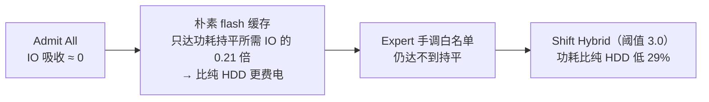

**解读**：生产最小阈值选 3.0，比评估时的 1.1 高得多，意思是只有预计"每个 segment 至少还会被读 3 次"的目录才进 flash。生产环境作业更多、工作集更大、写入限额更紧，阈值高一些才能把有限的 flash 写入额度留给最值得的数据。"功耗持平点"这个归一化方式也值得借鉴：缓存的价值不按命中率衡量，而按"省下的 HDD 是否抵得上新增 flash 的功耗"衡量。论文没有公开持平点对应的具体 IO 数值。

---

## 9. 经验教训与开放问题

### 9.1 经验（§7）

| 经验 | 内容 |
|------|------|
| 定义对的用户接口 | 透明但智能的接口是成功的关键。透明使接入新用户只需配置缓存资格策略、应用零改动；也使团队可以细粒度地运营 Shift：渐进上线、在不同 SN 上 A/B 测试策略、甚至回滚以减轻请求压力，都不影响用户性能。同时又必须与 AI 基础设施和 ML 工程团队紧密合作，弄清应该提取哪些应用元数据来优化策略。其他 ML 领域（视觉、NLP 等）和非 ML 应用用的是同一个 Tectonic API，接入时只需要和用户一起找出最有用的特征 |
| 依赖完善的测试、实验与监控 | 压测、生产 A/B 测试、基于 trace 的仿真、影子流量、仪表盘，持续调整第 5 节的各项策略和配置。举例：这个规模下**数据损坏很常见**，因此每个 Shift segment 都要计算、存储并校验校验和；上线前用影子部署让客户端拉取 Shift 的校验和，与从 Tectonic 读到的数据比对 |
| 有效使用 DRAM | 相对 flash 容量，DRAM 容量可以忽略，所以 DRAM 优先用于存**元数据**（如 RHW）以提升策略效果；但仍需为 CacheLib 预留数十 GB 内存来缓冲和高吞吐地服务请求。进一步降低 CacheLib 内存需求、研究数据与元数据之间的最佳内存划分，可能继续提升性能 |

### 9.2 开放问题（§7）

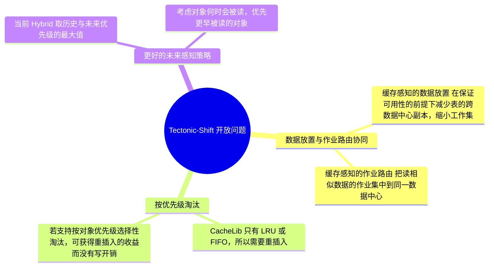

**解读**：第一个开放问题最有意思。缓存效果不只取决于缓存本身，也取决于"哪些作业被调度到哪里"。把调度器和存储缓存联合优化，在推荐系统训练这种"读什么提前已知"的场景下空间很大。它也说明 Shift 目前的去中心化、本地决策设计虽然简单，但看不到跨数据中心的全局最优。

---

## 10. 与相关工作的对比

### 10.1 论文自述的对比（§8）

| 类别 | 代表系统 | 与 Tectonic-Shift 的区别 |
|------|----------|--------------------------|
| 软件 DRAM / flash 缓存 | Redis、memcached、RAMCloud、Pocket；准入 TinyLFU、LARC；淘汰 ARC、LRU、2Q、OPT；ML 驱动的策略调优（LeCaR、CACHEUS 等） | 依赖历史（或理想化的先知）访问模式；flash 专用策略主要处理写放大。Shift 用大 segment（256 KB）和 CacheLib Large Object Cache 处理写放大，并独立于 CacheLib 动态调节准入和重插入 |
| Google CacheSack（ATC 2022） | Colossus Flash Cache 的准入策略，按类别切分对象、对每类调准入 | 目标相似（从 HDD 吸收 IO）。Shift 专门面向工业 ML 训练作业，并且**从作业规格推断未来访问** |
| Google Janus（ATC 2013） | Colossus 的 flash 层 | 文件先写 flash 再淘汰到 HDD，是写入路径上的分层；Shift 只做读缓存 |
| 异构存储 / 分层文件系统 | OpenStack Swift 的可配置哈希环、OctopusFS、HP AutoRAID、Anna、HPC burst buffer | 架构手法相近（一致性哈希、异构设备），Shift 的新意在应用感知策略 |
| ML 专用缓存 | CoorDL（单机本地 SSD）、Quiver 与 OneAccess（同步超参搜索作业间共享）、DIESEL（小文件）、DLFS 与 DeepIO（专用硬件随机化 minibatch）、Cachew（基于 tf.data，把中间数据放云存储） | 都需要用户改造接入；Tectonic-Shift 对用户完全透明，面向 EB 级、持续为数据中心规模 GPU 集群供数 |
| 生产 ML 负载刻画 | Google tf.data | 发现了相似的特征（普遍的数据复用、选择性读取）；Tectonic-Shift 建立在 Meta 此前 DSI 刻画（ISCA 2022）之上 |

### 10.2 与本仓库调研系统的对照（解读）

| 系统 | 训练数据读加速方式 | 与 Shift 的关键差异 |
|------|--------------------|---------------------|
| [Tectonic（FAST 2021）](tectonic-fast2021/deep-read.md) | 存储节点每台 1 TB SSD 缓存热 chunk + 存 XFS 元数据 | 节点内、chunk 粒度、通用策略；Shift 是独立的 flash 集群、segment 粒度、应用感知 |
| Quiver（FAST 2020） | 按样本的内容寻址缓存，利用深度学习对样本顺序不敏感来"替换"未命中的样本 | Quiver 能改变读取顺序，因为它和训练框架紧耦合；Shift 对应用透明，只能决定缓存什么 |
| SHADE（FAST 2023） | 按样本重要性做缓存与采样 | 同样是"应用语义驱动缓存"，但 SHADE 要改训练流程 |
| 3FS（DeepSeek） | 全 NVMe + RDMA，不靠缓存 | 直接选择"纯 flash"路线（即论文表 1 的方案 2）；适合数据集相对小、IO 极高的 LLM 训练，与 DLRM PB 级数据集的取舍不同 |
| CacheSack（ATC 2022，[精读](cachesack-atc2022.md)） | Colossus flash 缓存准入，按类别优化 | 最接近的工业对照；信号来自历史统计，Shift 额外引入未来信号 |

---

## 11. 整体总结

### 11.1 核心贡献

1. **一套以功耗为目标的软硬件设计空间探索**：用功耗模型证明同构存储（纯 HDD 或纯 flash）都无法在不过度配置的情况下同时满足训练的容量和 IO 需求，复合存储在理想情况下功耗低 3.69 倍；再用生产负载刻画证明通用缓存和 ML 专用缓存都抓不住这种负载的复用特征。
2. **Tectonic-Shift 的工程化设计**：把 flash 层做成透明、无元数据、非持久、完全去中心化的读缓存，Tectonic 不做任何改动，复用 CacheLib、Metadata Layer、ACL 与 seal 语义。
3. **应用感知的准入/重插入框架**：segment → 目录 bucket → 优先级（历史 RHW + 未来 GMS）→ 动态阈值（最小值 + PID 写入速率控制）。核心新意是**利用作业规格中"将会读什么"的确定性信息预测未来访问**。
4. **生产验证**：基准负载下比 LRU 多吸收 1.51–3.28 倍 IO；写入受限时以相同 flash 写入量吸收 2–3 倍 IO，同时 HDD 回源读减少 96%；PB 级生产集群功耗降低 29%。

### 11.2 设计哲学

```mermaid
flowchart TB
    P1["以功耗为第一指标<br/>（不是命中率、不是延迟）"] --> D1["HDD 管容量 · flash 管 IO<br/>按'功耗持平点'衡量缓存价值"]
    P2["能复用的都复用"] --> D2["不改 Tectonic 元数据<br/>CacheLib 做引擎 · seal 免失效 · ACL 在客户端"]
    P3["缓存，而不是分层"] --> D3["flash 非持久 · 无元数据<br/>坏了只掉性能，不丢数据"]
    P4["准入比淘汰更重要"] --> D4["在数据进入缓存之前挡住 scan/churn<br/>同时管住 flash 写入"]
    P5["透明但懂应用"] --> D5["API 不变 · 靠请求 tag + 作业规格<br/>获得应用语义"]
    P6["本地决策、全局最优"] --> D6["一致性哈希分片<br/>每个 SN 最大化本地吸收 IO"]
```

**解读**：如果用一句话概括这篇论文的思想，就是"**在可预测的负载上，准入策略的信息优势比淘汰算法的精巧更值钱**"。LRU、ARC 这类算法花了几十年在"只看过去"的前提下猜未来；而 ML 训练作业在启动时就把未来告诉了你，只是之前没有系统去听。Shift 做的就是在不破坏透明性的前提下把这条信息接进缓存决策。

### 11.3 优点与局限

| 优点 | 局限 / 未回答的问题 |
|------|---------------------|
| 对用户和 Tectonic 都零侵入，上线、A/B、回滚都很容易 | 只适用于**只读、不可变**数据；可变数据需要失效协议，这套设计不能直接搬用 |
| 用 flash 写入速率作为显式约束，策略与硬件寿命绑定 | 依赖 GMS 中作业规格的准确性与实时性；论文没讨论规格缺失、作业中途变更或被杀时的影响，Pipelined 实验里 Hybrid 的表现已显示信号合并方式不完美 |
| 准入发生在回源之前，拒绝不产生额外 HDD 读 | 生产评估只有一条 9 小时 trace 和一个 29% 的结论，没有给出跨集群分布、尾延迟、SN 故障时的影响等数据 |
| 去中心化，单 SN 故障只影响一段哈希环，客户端超时回退 | 基准实验在 6 节点集群上用缩小后的负载完成，策略对比与生产规模之间的可迁移性没有量化 |
| 框架可扩展：换 `MapSegment` / `BucketPriority` 就能尝试新策略 | 淘汰仍受限于 CacheLib 的 LRU/FIFO，重插入的写开销是被引擎原语逼出来的 |
| 以"功耗持平点"为基准，直接回答"加 flash 值不值" | 论文主要围绕 DLRM；对 LLM、视觉等数据集更小、多 epoch 的训练，复用模式不同，结论是否成立需另行验证 |

### 11.4 对分布式文件系统设计者的启示

1. **把功耗（或 TCO）建模放进容量规划**：当 IO 需求增速超过容量需求增速时，同构介质一定会在某一维过度配置。先用类似表 1 的模型算清楚"容量受限"和"IO 受限"的交叉点，再决定介质组合。
2. **优先做缓存，而不是分层存储**：只要底层能保证持久性，flash 层做成非持久缓存可以免掉 EC 开销、元数据更新和 sub-block 粒度改造；故障域也更简单。
3. **为缓存准入预留"应用语义通道"**：在客户端 SDK 的读请求里捎带作业 ID、路径等 tag，在侧路维护作业规格库，几乎不增加接口复杂度，却能把"未来访问"信息带给缓存。
4. **决策单元要粗**：按目录（分区）而不是按对象做策略，控制面才算得过来，冷启动的新对象也能直接继承策略。
5. **把介质寿命作为控制环的约束量**：用反馈控制（PID）把写入速率钉在耐久上限以下，并让阈值自适应，而不是写死一个准入概率。
6. **在回源之前拒绝**：任何"先读进来再决定丢不丢"的设计都会浪费后端带宽，准入判断应尽量前置。
7. **segment 大小要和请求大小、介质特性一起调**：大对象缓存（数百 KB）能显著缓解 flash 写放大，同时要保证块内足以区分冷热字节区间。
8. **评估缓存要看"省下了什么"**：命中率之外，应直接度量回源带宽、flash 写入量，以及最终的功耗或成本。

### 11.5 与 Tectonic（FAST 2021）放在一起看

| 维度 | Tectonic（FAST 2021） | Tectonic-Shift（ATC 2023） |
|------|-----------------------|-----------------------------|
| 核心问题 | 多个专用存储系统之间资源被困（stranded），集群太多 | HDD 的 IO/瓦特跟不上训练 IO 需求 |
| 解法 | 整合成单一 EB 级多租户集群，资源池化 | 在 HDD 集群前加透明的 flash 读缓存，介质异构化 |
| 效率来源 | 不同租户的 IOPS 与容量需求互补 | 不同介质的 IO 与容量效率互补 |
| 定制化方式 | 胖客户端按请求选择编码、写法 | 客户端 tag + SN 本地策略，按作业规格准入 |
| 共同底座 | append-only、seal、Client Library、哈希分片 Metadata Layer、CacheLib | 同左，Shift 完全沿用 |

两篇论文讲的是同一条思路的两步：Tectonic 用"整合"解决资源错配，Tectonic-Shift 发现整合后仍有一种错配（单一介质的 IO 与容量比例固定），于是用"复合介质 + 懂应用的缓存"继续解决。前作留下的 seal、胖客户端、元数据服务与数据面分离这几项设计，正是 Shift 能做到"零侵入"的前提。

---

## 参考

- Mark Zhao et al. *Tectonic-Shift: A Composite Storage Fabric for Large-Scale ML Training*. USENIX ATC 2023. <https://www.usenix.org/conference/atc23/presentation/zhao>
- Satadru Pan et al. *Facebook's Tectonic Filesystem: Efficiency from Exascale*. USENIX FAST 2021. 本仓库精读：[tectonic-fast2021/deep-read.md](tectonic-fast2021/deep-read.md)
- Mark Zhao et al. *Understanding Data Storage and Ingestion for Large-Scale Deep Recommendation Model Training*. ISCA 2022.（论文中的 DSI 负载刻画来源）
- Benjamin Berg et al. *The CacheLib Caching Engine: Design and Experiences at Scale*. OSDI 2020.
- Tzu-Wei Yang et al. *CacheSack: Admission Optimization for Google Datacenter Flash Caches*. USENIX ATC 2022.
- Abhishek Vijaya Kumar, Muthian Sivathanu. *Quiver: An Informed Storage Cache for Deep Learning*. USENIX FAST 2020.
