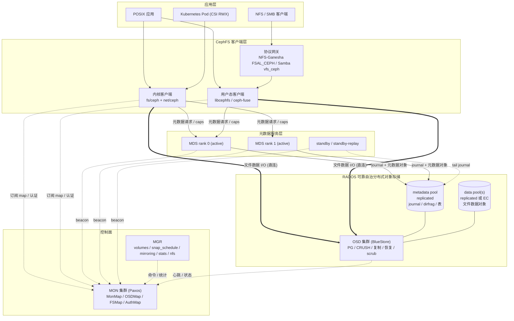
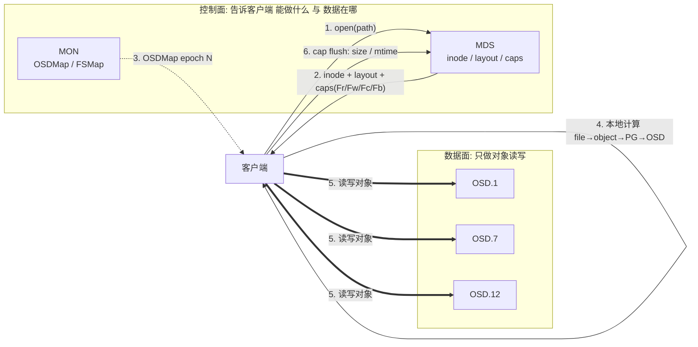
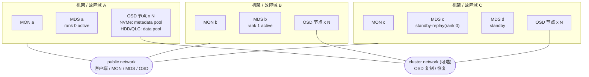
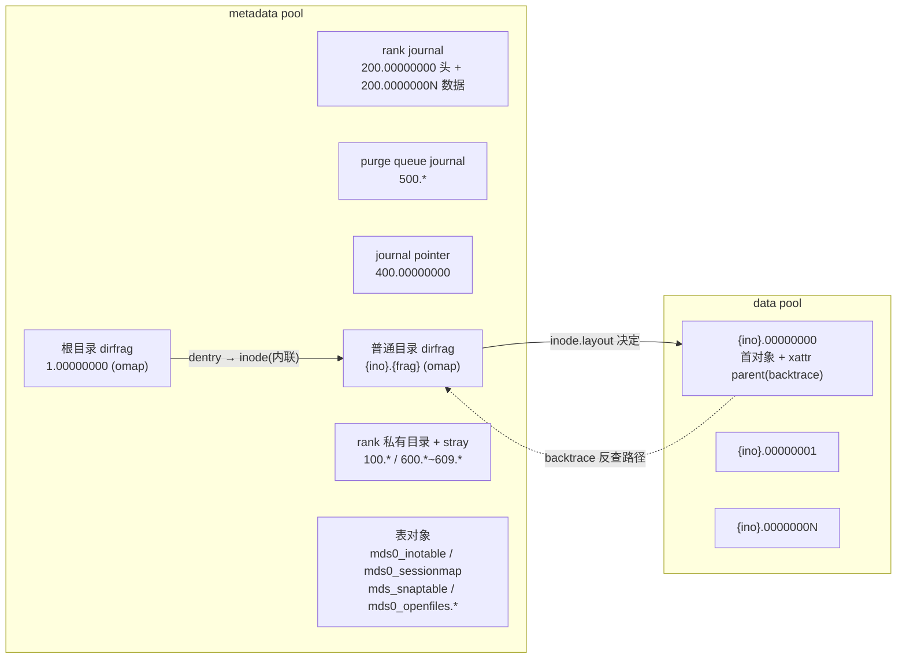

# CephFS 总体架构设计

## 1. 设计目标与约束

CephFS 的设计起点是 2006 年 Sage Weil 的 OSDI 论文《Ceph: A Scalable, High-Performance Distributed File System》，核心目标至今未变：

| 目标 | 设计回应 |
|------|----------|
| 数据容量与带宽随节点线性扩展 | 文件数据不经过 MDS；客户端用 CRUSH 计算对象位置后直连 OSD |
| 元数据可横向扩展 | namespace 按目录子树动态分区到多个 MDS rank；大目录可再哈希分片（dirfrag） |
| 强一致的 POSIX 共享语义 | MDS 通过 capabilities（caps）授予/撤销客户端的缓存与写权限 |
| 任意节点失效不丢元数据 | MDS 本地无持久状态，所有 journal 与元数据对象都存放在 RADOS（多副本） |
| 无中心化数据定位表 | CRUSH 伪随机确定性放置，只需分发一张很小的 OSDMap |
| 自修复与在线运维 | RADOS 负责数据复制/恢复/重平衡；MDS 负责 namespace scrub、damage 表和修复工具 |

同时存在必须接受的约束：

- **MDS 是单线程为主的事件驱动服务**（一个大锁 `mds_lock` 保护 rank 内全部缓存状态），单 rank 吞吐受单核 CPU 与内存缓存约束，扩展主要靠多 rank 分区。
- **强一致缓存协议把客户端拉进了正确性闭环**：慢客户端、失联客户端会直接影响其他客户端延迟，需要 eviction + blocklist 兜底。
- **复用 RADOS 对象模型**：每个文件至少一个对象，不做小文件打包；元数据对象依赖 omap（RocksDB）性能。

## 2. 分层架构

图中三类线条代表三种不同的流量契约：

| 流量 | 端点 | 特征 |
|------|------|------|
| 元数据 + 一致性（细线） | 客户端 ↔ MDS | 小消息、高频、有状态（session、caps、lease） |
| 文件数据（粗线） | 客户端 ↔ OSD | 大块、无 MDS 参与、受 caps 门控 |
| 集群映射（虚线） | 所有组件 ↔ MON | 低频、epoch 递增、作为全局“时钟”和 fencing 依据 |

## 3. 组件职责与边界

| 组件 | 职责 | 持久状态 | 失效影响 |
|------|------|----------|----------|
| MON | 维护 FSMap（文件系统、rank 分配、standby）、OSDMap（含 blocklist）、认证密钥；Paxos 多数派 | MON 本地 RocksDB | 少数派失效无影响；失去多数派时集群无法变更 map，现有 I/O 尽量继续 |
| MGR | 编排与运维接口：subvolume、快照调度、镜像、统计、NFS 导出 | 部分存放在 RADOS / MON KV | 管理面不可用，数据面不受影响 |
| MDS | namespace、inode 属性、目录、权限、锁、caps、快照元数据、配额、删除回收调度 | **无**（全部在 metadata pool） | 所属 rank 的元数据操作暂停直到 standby 接管 |
| OSD | 对象存储、复制/EC、PG peering、恢复与回填、scrub、快照 clone | BlueStore（裸盘 + RocksDB） | 由 PG 副本自动接管，降级期间可继续读写 |
| 客户端 | VFS 适配、元数据缓存、页缓存/对象缓存、条带计算、直连 OSD | 无（脏数据在内存） | 持有的 caps 被回收、写锁失效；未刷盘脏数据丢失 |

**核心不变量**：

1. 任一 inode 在任一时刻只有一个 authoritative MDS rank 可以修改它。
2. 任一 rank 的状态都可以仅凭 metadata pool 中该 rank 的 journal 和元数据对象重建。
3. 客户端只有在持有相应 caps 时才可以缓存、读写文件数据或缓存元数据。
4. 被判定失联的客户端或 MDS 在其他方接管之前必须先被 OSD 层 fence（blocklist），之后它的任何 I/O 都会被 OSD 拒绝。

## 4. 控制面 / 数据面分离

这种分离带来三点设计收益：

- **吞吐解耦**：MDS 处理一次 `open` 后，后续 GB 级数据 I/O 与 MDS 无关。
- **定位无查询**：OSD 位置靠 CRUSH 计算，不需要像 HDFS NameNode 那样维护 block → DataNode 映射表。
- **元数据可延迟回写**：文件 size、mtime 由持有 `Fw` 的客户端在 cap flush 时上报，不是每次 write 都同步更新 MDS。

代价是：MDS 必须知道“谁可能正在写”，才能在其他客户端 `stat` 时给出正确 size，这正是 caps 协议存在的根本原因（详见 [一致性设计](cephfs-design-consistency.md)）。

## 5. 部署拓扑参考

推荐基线：

| 维度 | 建议 | 理由 |
|------|------|------|
| MON | 3 或 5 个，跨故障域 | Paxos 多数派 |
| MDS | `max_mds` 个 active + 至少 1 个 standby；关键 rank 配 standby-replay | 多 active 是分区不是冗余 |
| metadata pool | 3 副本，NVMe/SSD，独立 CRUSH rule | journal 顺序写与 omap 随机读延迟决定元数据性能 |
| 默认 data pool | 3 副本（存放 backtrace，即使文件数据在其他池） | 默认池不建议 EC，见 [数据设计](cephfs-design-data.md) |
| 额外 data pool | EC（需 `allow_ec_overwrites`）通过目录 layout 挂载 | 容量型目录 |
| 网络 | 25GbE+；复制流量大时分离 cluster network | OSD 复制带宽是客户端写带宽的 (副本数-1) 倍 |

## 6. RADOS 对象全景

CephFS 中“一切皆 RADOS 对象”。理解对象全景是理解恢复和运维工具的前提：

- **目录即对象**：一个目录分片（dirfrag）对应一个 metadata pool 对象，dentry 存放在对象 omap 中，普通文件的 inode 内联在其 primary dentry 里。
- **文件即对象序列**：数据对象名 `<inode 十六进制>.<对象序号 8 位十六进制>`，位置完全由 inode 号 + layout 推导，不需要额外映射表。
- **反向指针**：文件首对象的 `parent` xattr 保存 backtrace（祖先 inode + dentry 名），用于 hard link 查找、`lookup_ino` 和灾难恢复。

详细编码见 [持久化格式](../implementation/cephfs-impl-on-disk-format.md)。

## 7. 关键设计决策（ADR 摘要）

| # | 决策 | 备选方案 | 选择理由 | 代价 |
|---|------|----------|----------|------|
| D1 | 元数据 authority 按**目录子树**动态分区 | 静态哈希分片（如按 inode 哈希） | 保持路径局部性，`readdir`/`stat` 大量命中同一 rank；可随负载迁移 | 迁移协议复杂；热点子树需要 dirfrag 和 pin 配合 |
| D2 | MDS 无本地状态，journal 写入 RADOS | MDS 间 Raft 复制 | 复用 RADOS 的副本与修复；任何节点可接管任何 rank | failover 需 replay + 客户端重连，RTO 为秒到分钟级 |
| D3 | inode 内联在 dentry 中 | 独立 inode 表 | `lookup`+`stat` 一次对象读；`readdir` 批量返回属性 | hard link 需要 remote dentry + backtrace 间接寻址 |
| D4 | 客户端持有 caps 做写回缓存 | NFS 式 close-to-open + 属性超时 | 单写者场景接近本地文件系统性能，且多客户端强一致 | 协议复杂；需要 recall、eviction 和 fencing |
| D5 | CRUSH 计算放置 | 中心化 block map | 无元数据瓶颈，扩容只需更新 OSDMap | 数据分布受 PG 数与 CRUSH 权重影响，需要 balancer |
| D6 | size/mtime 由写者异步上报 | 每次写同步更新 MDS | 写路径不经过 MDS | 写者崩溃时需要 MDS 通过对象探测恢复 size |
| D7 | 删除异步化（stray + purge queue） | 同步删除所有对象 | `unlink` 延迟与文件大小无关 | 空间回收滞后，需要监控 backlog |
| D8 | 快照为任意目录粒度、元数据 COW + RADOS 对象 clone | 卷级快照 | 适配用户目录、子卷等细粒度需求 | SnapRealm 合并/拆分复杂，快照越多 omap 越大 |

## 8. 与常见分布式文件系统的架构对照

| 维度 | CephFS | Lustre | HDFS | JuiceFS |
|------|--------|--------|------|---------|
| 元数据服务 | 多 active MDS，动态子树 + dirfrag | 多 MDT，DNE 静态/条带目录 | 单 active NameNode（Federation 分区） | 外置 KV/SQL 引擎 |
| 元数据持久化 | RADOS journal + omap 对象 | ldiskfs/ZFS 本地 + failover 共享盘 | edit log + fsimage（QJM） | 由外部引擎负责 |
| 数据定位 | CRUSH 计算 | MDS 返回 layout(OST 列表) | NameNode 返回 block 位置 | chunk → 对象存储 key |
| 缓存一致性 | caps（可撤销租约，强一致） | LDLM 分布式锁 | 单写者、追加为主 | close-to-open + 可选 session 缓存 |
| 冗余位置 | 存储层（RADOS） | 存储层 RAID / FLR | DataNode 副本 / EC | 对象存储 |

结论：CephFS 是“**统一存储底座 + 独立 namespace 服务**”路线的代表，其扩展性来源于 RADOS，其复杂度主要来自 MDS 的分布式缓存一致性协议。
