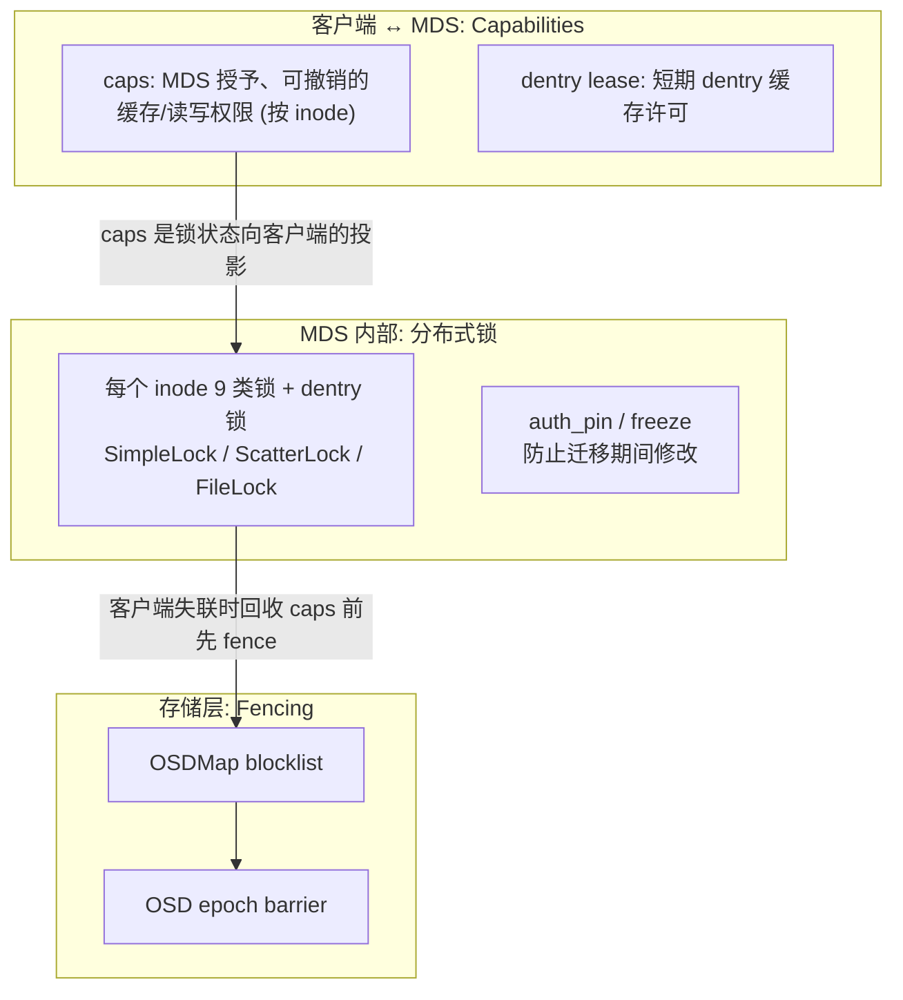
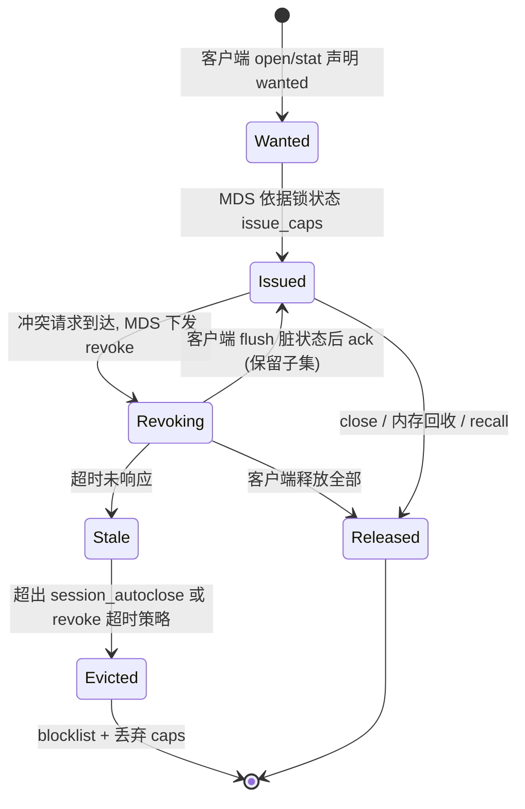
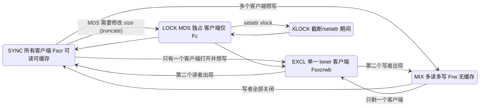
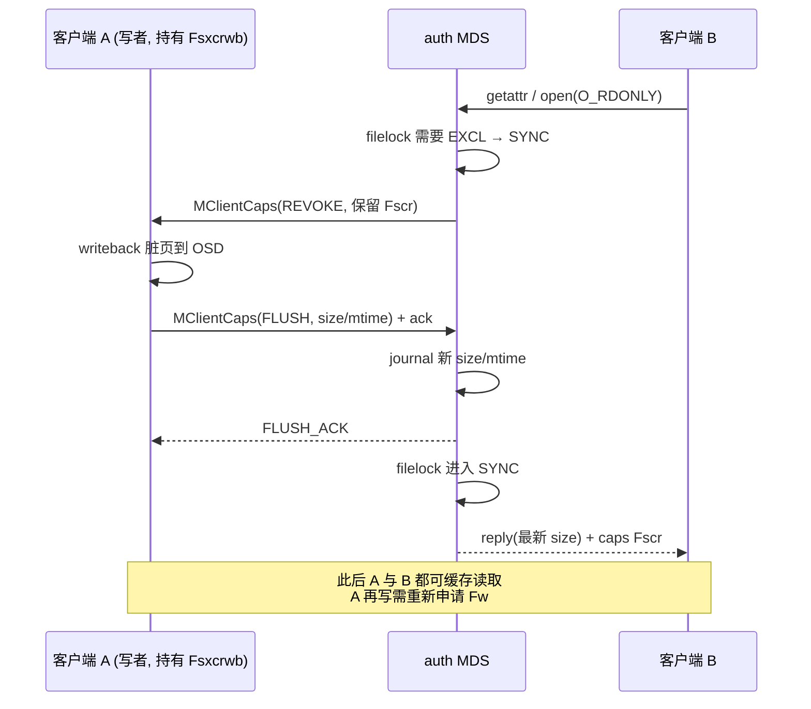
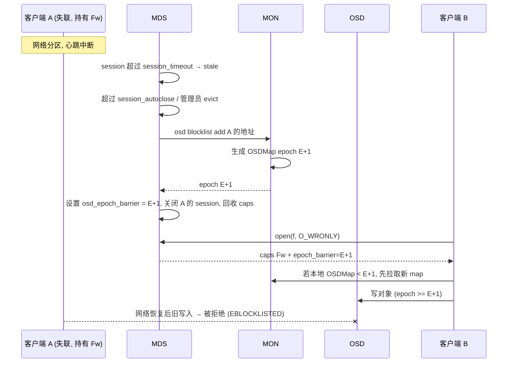

# CephFS 一致性与并发控制设计

## 1. 设计目标

CephFS 希望同时做到：

1. **单客户端访问时接近本地文件系统性能**——允许写回缓存、元数据缓存、异步目录操作；
2. **多客户端共享时保持强一致**——一个客户端 `write` 后另一个客户端 `read` 能看到新数据，`stat` 能看到新 size；
3. **故障时安全**——失联客户端不能在其缓存权限被收回后继续写数据。

实现手段是三层机制的组合：

## 2. Capabilities 模型

### 2.1 caps 位设计

caps 由“类别 + 动作”组合而成。类别对应 inode 上的不同锁：

| 类别 | 前缀 | 覆盖的 inode 状态 | 对应 MDS 锁 |
|------|------|-------------------|-------------|
| Pin | `p` | inode 存在（被引用） | — |
| Auth | `A` | mode、uid、gid | `authlock` |
| Link | `L` | nlink | `linklock` |
| Xattr | `X` | 扩展属性 | `xattrlock` |
| File | `F` | size、mtime、atime、文件数据 | `filelock` |

动作位（主要作用于 `F`，`A/L/X` 只有 `s/x`）：

| 位 | 名称 | 允许客户端 |
|----|------|------------|
| `s` | shared | 缓存并读取该类元数据 |
| `x` | exclusive | 本地修改该类元数据并延迟回写 |
| `r` | read | 从 OSD 读取文件数据 |
| `c` | cache | 缓存读到的数据 |
| `w` | write | 向 OSD 写数据、扩展 size |
| `b` | buffer | 写回缓存（延迟写） |
| `l` | lazyio | 放松一致性的共享 I/O（应用显式启用） |

常见组合：`pAsLsXsFscr`（只读共享）、`pAsxLsXsxFsxcrwb`（独占读写）、`pAsLsXsFrw`（多写者共享，无缓存）。

> 目录 inode 上复用部分 `F` 位语义：例如 `Fs` 允许缓存目录内容（readdir 结果），`Fx` 配合委托 inode 号允许客户端异步 create/unlink。

### 2.2 caps 生命周期

每个 Capability 在 MDS 端记录 `issued`（已发出）、`pending`（希望客户端持有）、`wanted`（客户端声明需要）、`seq`（发放序号）和 `mseq`（迁移序号）。客户端 ack 时带回 seq，MDS 据此判断撤销是否完成，避免消息乱序导致的误判。

## 3. MDS 分布式锁

### 3.1 锁类型

| 锁 | 类 | 保护 | 说明 |
|----|----|------|------|
| dentry lock (`DN`) | SimpleLock | dentry 存在性与链接 | `xlock` 用于 create/unlink/rename |
| `authlock` | SimpleLock | mode/uid/gid | 对应 `A` caps |
| `linklock` | SimpleLock | nlink | 对应 `L` caps |
| `xattrlock` | SimpleLock | xattr | 对应 `X` caps |
| `snaplock` | SimpleLock | SnapRealm | 快照操作 |
| `policylock` | SimpleLock | layout/quota/pin 等策略 | |
| `filelock` | ScatterLock（文件上为 FileLock 状态机） | size/mtime/数据；目录上为 dirstat | 对应 `F` caps，最复杂 |
| `nestlock` | ScatterLock | rstat | 支持多 rank 并发更新再汇聚 |
| `dirfragtreelock` | ScatterLock | fragtree | 分片变更 |
| `flocklock` | SimpleLock | fcntl/flock 状态 | |
| versionlock | LocalLock | projected version | 仅本地，不复制 |

锁的模式：`rdlock`（共享读）、`wrlock`（scatter 写，可多 rank 并发）、`xlock`（排他写）。复杂性在于：**锁不仅在 MDS 之间分布（auth 与 replica），还要同步投影为客户端 caps。**

### 3.2 filelock 状态机（简化）

每次状态切换都经过一个**中间态**（如 `SYNC_MIX`、`EXCL_SYNC`），在中间态中 MDS 等待客户端 ack 撤销的 caps，然后才进入目标态。这就是“写者出现时读者短暂阻塞”的来源。

**loner 机制**：当只有一个客户端想要 caps（或其他客户端只需要 pin）时，MDS 将其选为 loner 并进入 EXCL，使其获得完整写回缓存能力——这是单客户端场景性能接近本地 FS 的关键。

### 3.3 scatter-gather（ScatterLock）

目录的 `dirstat` 与 `rstat` 需要被多个 rank（各自持有该目录的不同 dirfrag 或子树）并发更新：

- 进入 `MIX`（scatter）态后，各 replica 可以本地累积更新（`wrlock`）；
- 需要读取精确值时，auth 将锁切到 `LOCK`/`SYNC`（gather），所有 replica 把增量发回 auth 合并；
- 后台周期性 `scatter_nudge` 保证增量最终被汇聚到祖先。

这种设计让大目录多 rank 并发 create 成为可能，代价是 `rstat`/`nfiles` 只保证最终一致。

### 3.4 加锁顺序与死锁避免

一个元数据请求可能需要锁住多个对象（如 rename 涉及两个父目录、两个 dentry、源 inode 与可能被覆盖的目标 inode）。`Locker::acquire_locks` 的策略：

1. 收集本请求需要的全部 rdlock/wrlock/xlock；
2. 按**对象全局顺序**排序（先 dentry 后 inode，同类按指针/ino 排序）；
3. 依次 auth_pin 所有对象（迁移中的 frozen 对象会让请求等待重试）；
4. 依次获取锁，任一锁不可得时把请求挂入等待队列并释放已持有的不兼容状态，之后**从头重试**。

跨 rank 的锁（远端 wrlock/xlock）通过 peer request 获取，同样受排序约束。

## 4. 冲突处理：cap recall 时序

注意：**B 的延迟 = A 刷完脏数据的时间**。如果 A 有 GB 级脏数据、或 A 的网络异常，B 将被长时间阻塞。这是 CephFS 强一致的直接成本，也是 `MDS_CLIENT_LATE_RELEASE`（客户端未及时释放 caps）告警的含义。

## 5. Dentry lease 与目录缓存

- MDS 可以向客户端授予 dentry lease（`MClientLease`），客户端在 lease 有效期内无需询问 MDS 即可信任该 dentry（包括负 dentry）。
- 若客户端持有父目录的 `Fs`（目录 shared caps），可以缓存整个目录的 dentry 列表并本地回答 `readdir` 和负查找。
- 任何改变该目录的操作都需要 xlock 对应 dentry，从而触发 lease 撤销与目录 caps 回收。

## 6. Fencing：保证失联客户端无法破坏数据

caps 是“租约”，租约的安全性要求：**MDS 把 caps 给别人之前，原持有者必须已无法写入**。CephFS 用 OSD 层 blocklist 实现：

- **epoch barrier** 保证：B 在开始使用新 caps 前，所有 OSD 至少能看到包含 A 被 blocklist 的 OSDMap（OSD 收到更高 epoch 的请求时会先追上 map），从而杜绝“A 的旧写入在 B 的新写入之后落盘”。
- 被 blocklist 的 kernel 客户端需要重新挂载（或启用 `recover_session=clean` 自动恢复但丢弃脏数据）。
- 默认 `mds_cap_revoke_eviction_timeout=0`：仅因“不释放 caps”不会自动驱逐，需管理员决策或打开此参数。

## 7. POSIX 语义边界

| 语义 | CephFS 行为 | 工程注意 |
|------|-------------|----------|
| 跨客户端 read-after-write | 强一致（依赖 caps） | 优于 NFS close-to-open |
| `stat` 获取 size/mtime | 强一致，但可能触发写者 flush，延迟高 | 监控场景避免高频 `stat` 活跃写文件 |
| 并发写同一文件不同区域 | 正确（MIX 态同步写） | 性能退化为无缓存同步 I/O |
| 跨对象 write 原子性 | 无 | 两个客户端重叠写同一跨对象区间可能交错 |
| 共享可写 `mmap` 多客户端 | 不保证一致 | 仅单客户端或只读共享安全 |
| `O_APPEND` 多写者 | kernel 客户端需获得 EXCL/最新 size，代价高 | 日志类场景建议每写者独立文件 |
| `atime` | 默认不严格维护（类似 relatime 的懒更新） | 不要依赖 atime 做逻辑 |
| `flock`/`fcntl` 锁 | 支持，由 MDS `flocklock` 管理 | 客户端失联会被释放 |
| `rename` 原子性 | 同 rank 原子；跨 rank 通过两阶段提交保证原子 | 跨 rank rename 延迟显著更高 |
| `readdir` 在并发修改下 | 保证不重复、不遗漏已存在项（基于 offset hash） | 大目录分片后的 offset 编码与本地 FS 不同 |
| LazyIO | `ceph_lazyio` / `O_LAZY` 放松一致性 | HPC 应用自行协调 |

## 8. 设计权衡

| 选择 | 收益 | 代价 |
|------|------|------|
| 强一致 caps | 应用无需感知分布式 | 客户端故障/慢节点影响他人；协议复杂度极高 |
| loner + EXCL | 单写者性能好 | 第二个访问者到来时有明显切换停顿 |
| scatter 统计 | 大目录多 rank 并发 | 统计最终一致，配额软执行 |
| blocklist fencing | 简单可靠，不依赖客户端配合 | 被驱逐客户端需重挂载，脏数据丢失 |

对于设计新系统：**若 workload 大多是“单写者 + 多读者”或“读多写少”，可以借鉴 caps 的租约 + 撤销 + fencing 骨架，但缩小语义面（例如只保证 close-to-open），将显著降低实现复杂度与尾延迟风险。**
