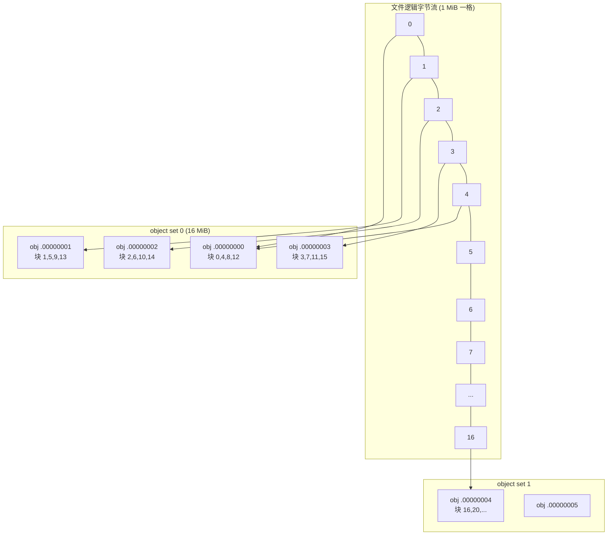
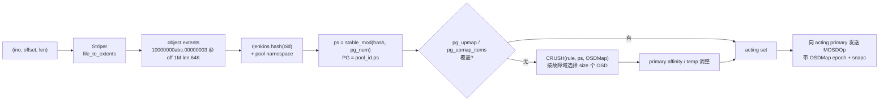
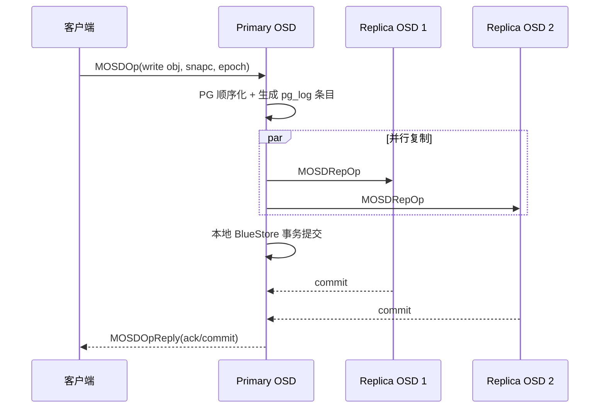
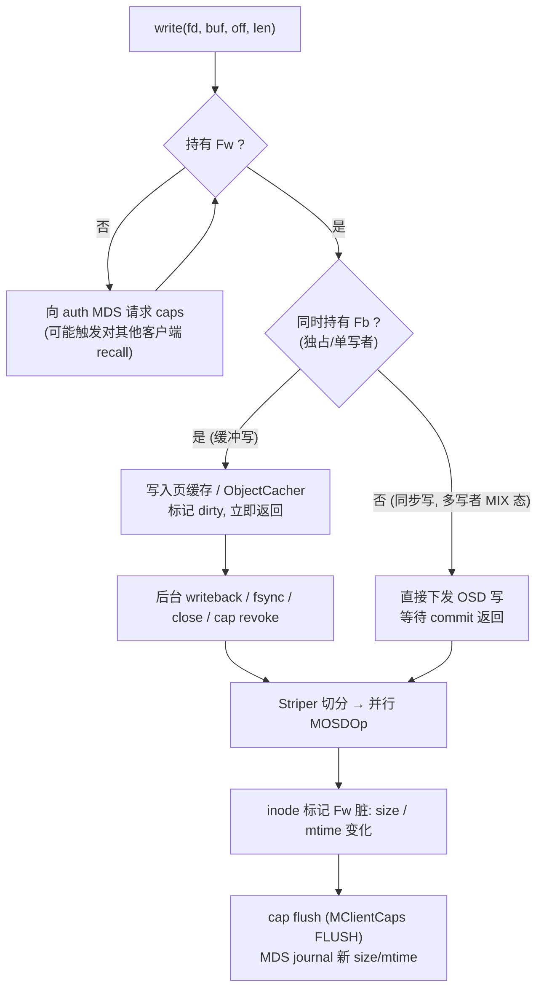
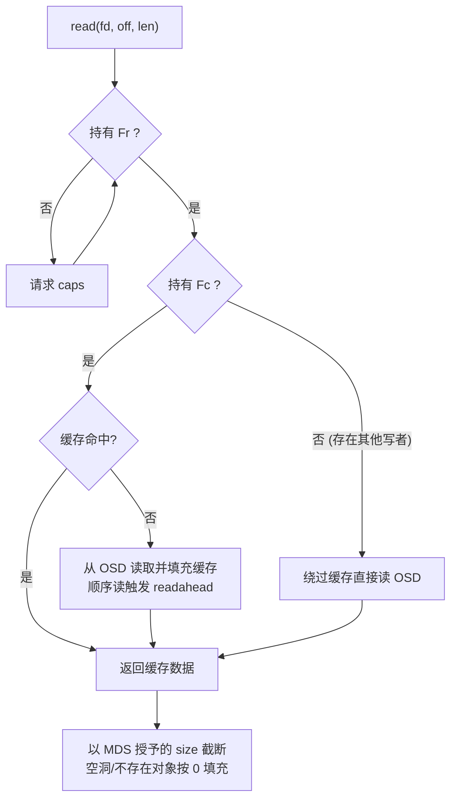
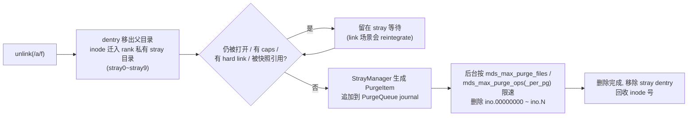

# CephFS 数据布局与 I/O 设计

## 1. 设计要点

- 文件内容被**条带化**为一组 RADOS 对象，对象名由 `inode 号 + 对象序号` 确定，无需任何块映射表。
- 对象到 OSD 的映射由 `hash → PG → CRUSH` 两级计算完成，客户端只需持有最新 OSDMap。
- 读写是否允许、能否缓存，由 MDS 授予的文件 caps（`Fr/Fw/Fc/Fb/Fs/Fx/Fl`）决定；数据本身从不经过 MDS。
- 文件 `size/mtime` 由写者通过 cap flush 异步上报，MDS 是这些属性的最终权威。
- 冗余（副本 / EC）、校验、恢复全部在 RADOS 层完成，CephFS 不重复实现。

## 2. 文件布局（file layout）

### 2.1 参数

| 字段 | 虚拟 xattr | 默认值 | 约束 |
|------|------------|--------|------|
| `stripe_unit` (su) | `ceph.file.layout.stripe_unit` | 4 MiB | `object_size` 必须是 su 的整数倍 |
| `stripe_count` (sc) | `ceph.file.layout.stripe_count` | 1 | 一个条带横跨的对象数 |
| `object_size` (os) | `ceph.file.layout.object_size` | 4 MiB | 单对象最大字节数 |
| `pool` | `ceph.file.layout.pool` | 文件系统默认 data pool | 必须已 `fs add_data_pool` |
| `pool_namespace` | `ceph.file.layout.pool_namespace` | 空 | 用于 CephX 隔离（如子卷） |

- 目录可以设置 `ceph.dir.layout.*`，新建文件**继承最近祖先**的目录 layout。
- 文件 layout 只能在文件为空（尚未写数据）时修改；已有数据的文件需要复制迁移。

### 2.2 条带映射算法

```text
给定文件偏移 off：
  stripes_per_object = os / su
  blockno      = off / su                 # 第几个 stripe unit
  stripeno     = blockno / sc             # 第几个条带
  stripepos    = blockno % sc             # 条带内第几个对象
  objectsetno  = stripeno / stripes_per_object
  objectno     = objectsetno * sc + stripepos
  obj_off      = (stripeno % stripes_per_object) * su + off % su
对象名 = sprintf("%llx.%08llx", ino, objectno)
```

以 `su=1 MiB, sc=4, os=4 MiB` 为例：



**设计取舍**：

| 布局 | 优点 | 缺点 |
|------|------|------|
| 默认 `4M/1/4M` | 简单；顺序 I/O 每 4 MiB 换一个对象；单对象读写原子性最好 | 单个大文件的单流带宽受单 PG 主 OSD 限制 |
| 宽条带 `sc>1` | 单文件并行写多个 OSD，提高单流带宽 | 小 I/O 被切碎；跨对象写无原子性 |
| 大对象 `os` 64 MiB+ | 对象数更少，降低 PG/omap 压力 | 恢复粒度变大，热点集中 |

## 3. 对象放置：从文件到磁盘



关键性质：

- **计算而非查询**：放置是 `f(object name, OSDMap)` 的纯函数，任何持有相同 epoch OSDMap 的客户端得到相同结果。
- **PG 作为间接层**：对象数可以是万亿级，但 CRUSH 只需对 PG（通常每 OSD 100~200 个）求解；PG 也是复制、恢复、scrub 的单位。
- **epoch 一致性**：OSD 收到请求时若客户端 epoch 过旧，会要求客户端更新 map 并重发；这也是 blocklist 生效的通道。

## 4. 冗余策略设计

| 池 | 推荐冗余 | 原因 |
|----|----------|------|
| metadata pool | 3 副本，SSD/NVMe | journal 追加 + omap 随机 I/O；EC 不支持 omap |
| 默认 data pool | 3 副本 | 每个文件的首对象都在这里存放 backtrace（即使数据落到其他池），小对象 + xattr 在 EC 上开销大 |
| 附加 data pool | EC `k+m`（如 4+2、8+3），`allow_ec_overwrites=true` | 容量型目录，通过 `ceph.dir.layout.pool` 挂接 |

### 4.1 副本写



所有副本持久化后才应答，因此 RADOS 写是**强一致、全副本持久**的；PG 内部按 pg_log 版本号保证顺序和恢复。

### 4.2 EC 写

- 全条带写：primary 切分为 k 个数据块 + m 个校验块并行下发。
- 部分覆盖写：需要读-改-写（读旧数据/校验，计算新校验），延迟和放大显著；Tentacle 引入 EC 优化（部分读、部分写路径改进，需 pool 打开 `allow_ec_optimizations`），但仍应以 PoC 量化小写延迟。
- 建议：EC 池只承载大文件、顺序写、低覆盖率的目录（归档、数据集、备份）。

## 5. caps 门控的读写路径

### 5.1 写路径



### 5.2 读路径



### 5.3 size 与 mtime 的权威

- 写者持有 `Fw` 时可以本地扩展 size；MDS 记录 `max_size`（客户端被允许写到的上限），写超过时客户端需申请扩大，防止崩溃后 size 无界。
- 其他客户端 `stat` 时，MDS 若发现有人持有 `Fw`，需要先让 filelock 进入可读状态（recall/flush）以获得最新 size——这是“写者在跑时 `ls -l` 变慢”的根因。
- 写者崩溃：MDS 通过 `RecoveryQueue` 调用 `Filer::probe` 探测 `[size, max_size)` 范围内最后存在的对象，恢复出真实 size 与 mtime。

## 6. 持久性语义

| 操作 | 保证 |
|------|------|
| `write()` 返回（缓冲写） | 数据只在客户端内存 |
| `fsync(fd)` | 该文件脏数据已全部写入 OSD 全部副本，并且 size/mtime 等元数据已被 MDS journal 持久化 |
| `fdatasync(fd)` | 数据已持久；元数据仅在影响读取（如 size）时持久 |
| `fsync(dir)` | 该目录相关的 unsafe 元数据请求已 safe |
| `O_DIRECT` | 绕过客户端缓存同步写 OSD，但跨对象 I/O 不具备原子性 |
| `close()` | 不保证持久；kernel 客户端会触发 writeback 与 cap 释放 |

## 7. 删除与空间回收



- `unlink` 延迟只与元数据操作有关，与文件大小无关；`rm -rf` 1 TB 目录很快返回，但空间要等待后台 purge。
- PurgeQueue 独立 journal（`500.*` 对象）保证 MDS 重启后继续删除。
- 监控：`ceph fs status`、`mds_cache.num_strays`、`purge_queue.pq_executing`；backlog 过高时可适度上调 purge 并发，但要考虑对前台 OSD 的冲击。

## 8. 小文件特性

| 现象 | 原因 | 影响 |
|------|------|------|
| 每个文件 ≥ 1 个 data 对象 | 无内联数据（inline data 特性已废弃） | 海量小文件 → OSD 对象数、BlueStore onode 内存与 RocksDB 压力 |
| 每个文件有 backtrace | 首对象 `parent` xattr 在默认数据池 | 即使数据在 EC 池，也会在默认池产生小对象 |
| 创建路径 = MDS 往返 + OSD 写 | 元数据与数据分离 | 小文件 create 延迟 ≈ MDS 请求 + 首次 OSD 写；kernel 异步 create 可隐藏 MDS 往返 |

对于亿级小文件、读多写少的数据集（如 AI 训练样本），更适合在应用层打包（tar/TFRecord/WebDataset）后放入 CephFS，或直接使用 RGW 对象存储。

## 9. 扩容与重平衡

- 增加 OSD → OSDMap 更新 → CRUSH 结果变化的 PG 进入 backfill，数据迁移量约为 `新增容量/总容量`。
- CephFS 层无需任何操作：文件到对象的映射与 OSD 无关。
- `balancer` mgr 模块（upmap 模式）会微调 PG 分布，降低 OSD 利用率方差。
- PG 数由 `pg_autoscaler` 管理；metadata pool 通常数据量小但 I/O 密集，可设置 `bulk` 标志或手动给出较高 `pg_num` 以避免热点。
