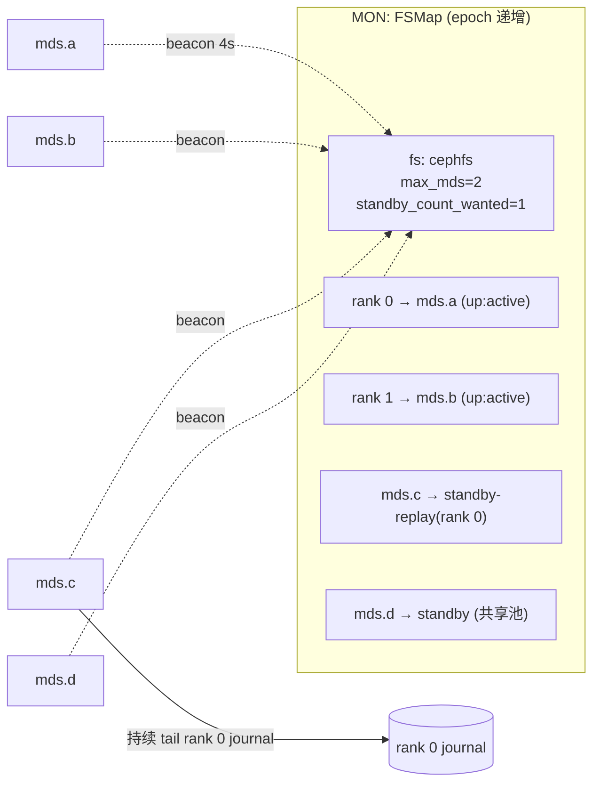
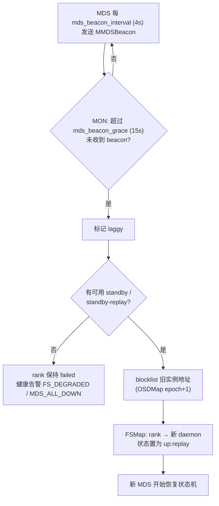
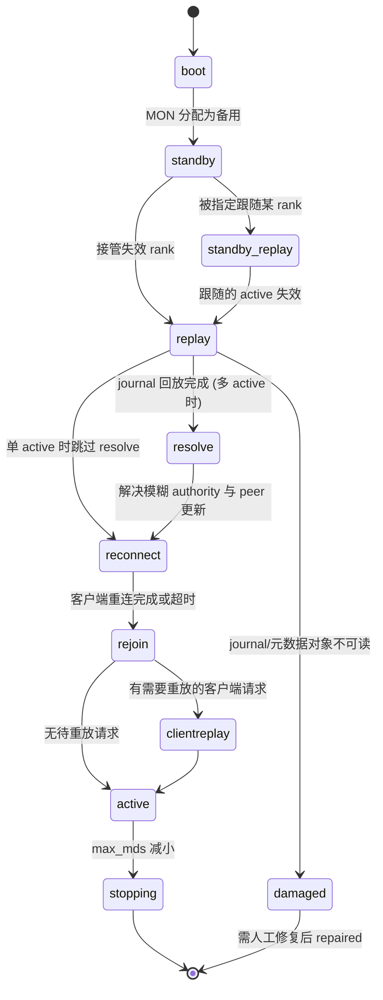
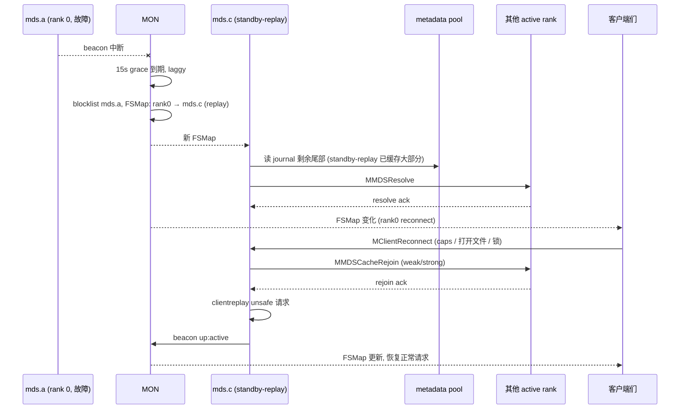
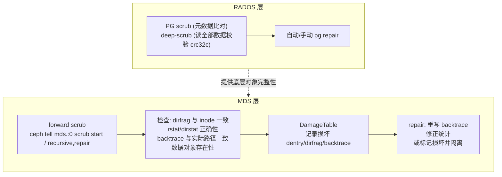
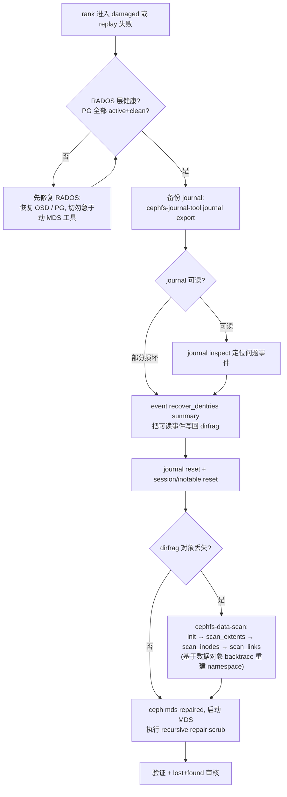

# CephFS 高可用与恢复设计

## 1. 设计原则

| 原则 | 体现 |
|------|------|
| 无状态守护进程 | MDS 不持有本地持久数据，任何节点可以接管任何 rank |
| 单一事实来源 | MON 的 FSMap 决定“谁是哪个 rank 的 active”，OSDMap 决定“谁被 fence” |
| 先 fence 后接管 | 旧 MDS 实例在新实例开始 replay 前被 blocklist，防止脑裂双写 journal |
| 状态机显式化 | 恢复过程拆成 replay → resolve → reconnect → rejoin → clientreplay → active，每阶段职责单一 |
| 分层修复 | RADOS 层修对象（副本/EC/scrub），MDS 层修 namespace（forward scrub、damage table、离线工具） |

## 2. 角色与 rank 模型

- **rank** 是元数据分区的逻辑身份（0 ~ `max_mds-1`），**daemon** 是承载 rank 的进程。rank 与 daemon 的绑定由 FSMap 记录。
- **standby** 进程属于全局池，可被任意文件系统的任意失效 rank 使用；可以用 `mds_join_fs` 设定亲和。
- **standby-replay** 绑定某个 rank，持续读取该 rank 的 journal 维持热缓存，接管时只需补读少量尾部事件，显著缩短 RTO。

## 3. 故障检测

MDS 自身也会做“自我健康检查”：内部心跳线程检测 dispatch 线程是否长时间卡住（`mds_heartbeat_grace`），卡住则停止发送 beacon，让 MON 主动替换，从而把“活着但卡死”的进程转化为可恢复的故障。

## 4. 恢复状态机

| 阶段 | 做什么 | 主要耗时因素 |
|------|--------|--------------|
| `replay` | 从 journal `expire_pos` 读到 `write_pos`，逐条应用 `EMetaBlob` 重建缓存；恢复 subtree map、session、inotable | journal 长度、metadata pool 读延迟 |
| `resolve` | 与其他 rank 交换 `MMDSResolve`：确认 replay 中“导入/导出到一半”的子树归属，以及跨 rank 操作（peer update）提交或回滚 | rank 数 |
| `reconnect` | 等待客户端发送 `MClientReconnect`（其持有的 caps、打开文件、snaprealm、flock 状态） | 客户端数量；`mds_reconnect_timeout`（45s） |
| `rejoin` | rank 之间交换 `MMDSCacheRejoin`，重建 replica 关系与分布式锁状态；把客户端上报的 caps 与 inode 关联（必要时从 RADOS 加载 inode） | 缓存规模、需加载的 inode 数（open file table 用于预取） |
| `clientreplay` | 重放客户端持有的 unsafe 请求与已 reply 但未 journal 的操作 | unsafe 请求数 |
| `active` | 正常服务 | — |

### 4.1 failover 端到端时序

**RTO 构成** ≈ 检测（≤ beacon_grace） + replay（journal 尾部）+ reconnect（客户端响应，最长 45s）+ rejoin（缓存重建）。生产上降低 RTO 的手段：standby-replay、控制 journal 长度、metadata pool 用低延迟介质、提升客户端版本以缩短 reconnect。

## 5. 客户端侧的 HA

| 场景 | 客户端行为 |
|------|------------|
| MDS failover | 请求挂起，订阅 FSMap；新 rank 进入 reconnect 时上报状态；数据 I/O 若已持有 caps 可继续 |
| OSD 故障 | Objecter 根据新 OSDMap 重算 PG 主并重发；对应用透明 |
| 客户端短暂失联 | session 变 stale，caps 暂停；恢复后 renew 即可 |
| 客户端长时间失联 | 被 evict + blocklist；kernel 需重新挂载或 `recover_session=clean` |
| MON 故障 | 切换到其他 MON；多数派丢失期间无法获取新 map |

## 6. 数据完整性与修复设计

### 6.1 两层 scrub

- **damage table** 的设计意义：遇到损坏元数据时，MDS 不必整体宕机，而是把损坏条目记录下来、对访问返回 `EIO`，其他部分继续服务（`MDS_DAMAGE` 告警）。
- scrub 由 `ScrubStack` 驱动，以后台低优先级运行，可暂停/中止。

### 6.2 灾难恢复决策树

- 这些工具大多**破坏性、不可逆**，必须在备份 journal、确认 RADOS 健康后按官方流程执行。
- `cephfs-data-scan` 需要遍历数据池全部对象，亿级文件可能耗时数小时至数天（可多 worker 并行）。这是“backtrace 作为最后一道恢复防线”设计的成本：可恢复，但很慢。

## 7. 故障矩阵

| 故障 | 影响范围 | 自动恢复 | RPO | 典型 RTO 量级 |
|------|----------|----------|-----|----------------|
| 单 MDS 进程崩溃（有 standby-replay） | 所属 rank 子树的元数据操作 | 是 | 0（已 journal 部分），unsafe 请求由客户端重放 | 秒级 ~ 数十秒 |
| 单 MDS 崩溃（只有冷 standby） | 同上 | 是 | 0 | 数十秒 ~ 分钟（取决于 journal 长度与缓存） |
| 所有 MDS 不可用 | 整个文件系统元数据冻结；已持有 caps 的数据 I/O 可能短时继续 | 否 | 0 | 人工 |
| 单 OSD / 单主机故障 | 对应 PG 降级 | 是 | 0 | 秒级（peering） |
| 超过副本数的同时故障 | 部分 PG down/incomplete | 否 | 可能丢数据 | 人工 |
| 客户端崩溃 | 其持有的 caps、未刷盘数据 | 是（session 超时 + 文件 size 恢复） | 未 fsync 数据丢失 | session 超时后 |
| 网络分区（客户端侧） | 该客户端 | 是（evict + blocklist） | 未 fsync 数据丢失 | 分钟级 |
| metadata pool 对象损坏 | 对应目录 | 部分（damage table 隔离） | 视修复 | 人工 |
| 整个站点故障 | 全部 | 否（依赖异步镜像） | 最近一次镜像完成的快照 | 人工切换 |

## 8. 设计启示

- **把 HA 下沉到共享存储**（journal 在 RADOS）让 MDS 的 failover 设计大幅简化：没有选主协议、没有日志复制，只有“fence + replay”。
- 代价在于 RTO：必须重建缓存与客户端状态。CephFS 用 standby-replay、open file table 预取、客户端 reconnect 协议逐步降低这部分成本。
- **显式恢复状态机**（每阶段可观测、可在 `ceph fs status` 中看到）是可运维性的关键，值得任何有状态分布式服务借鉴。
