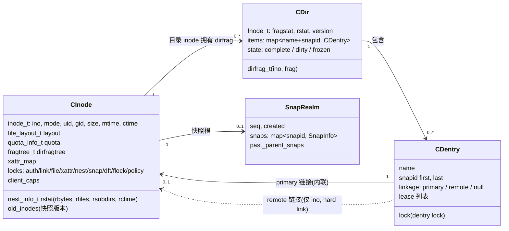
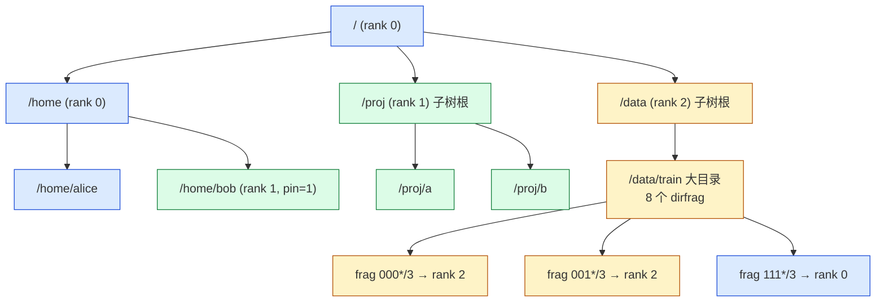
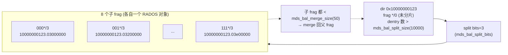
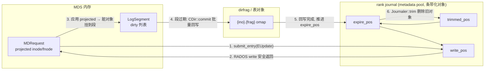
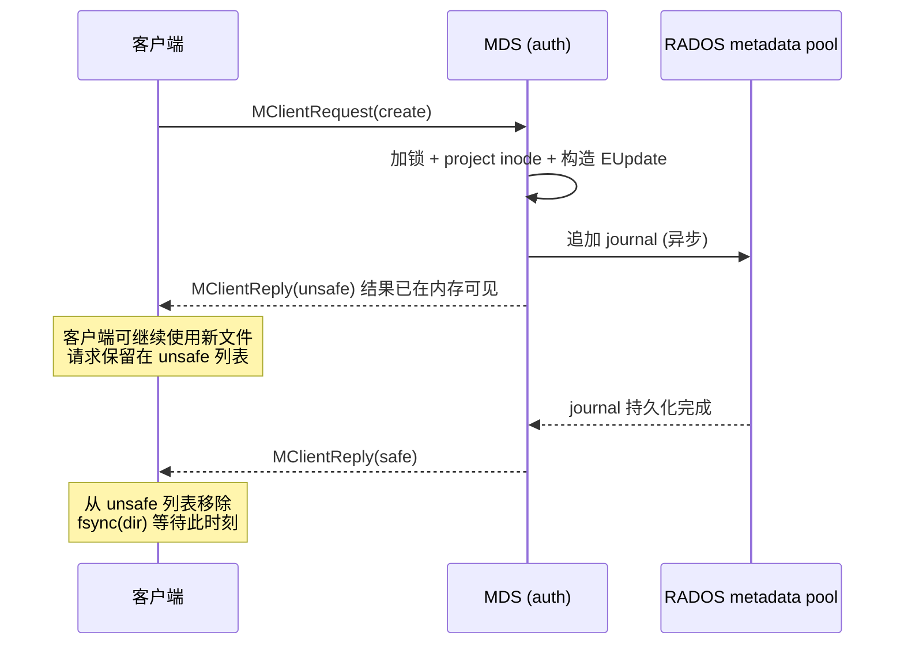
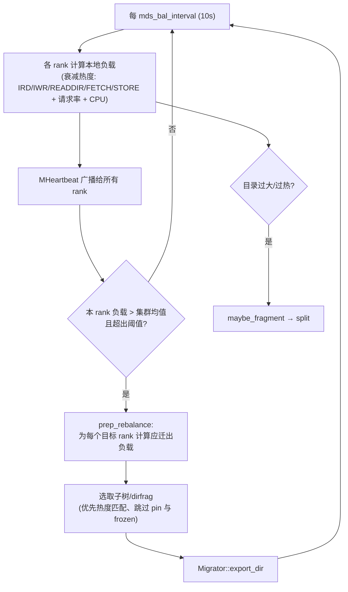
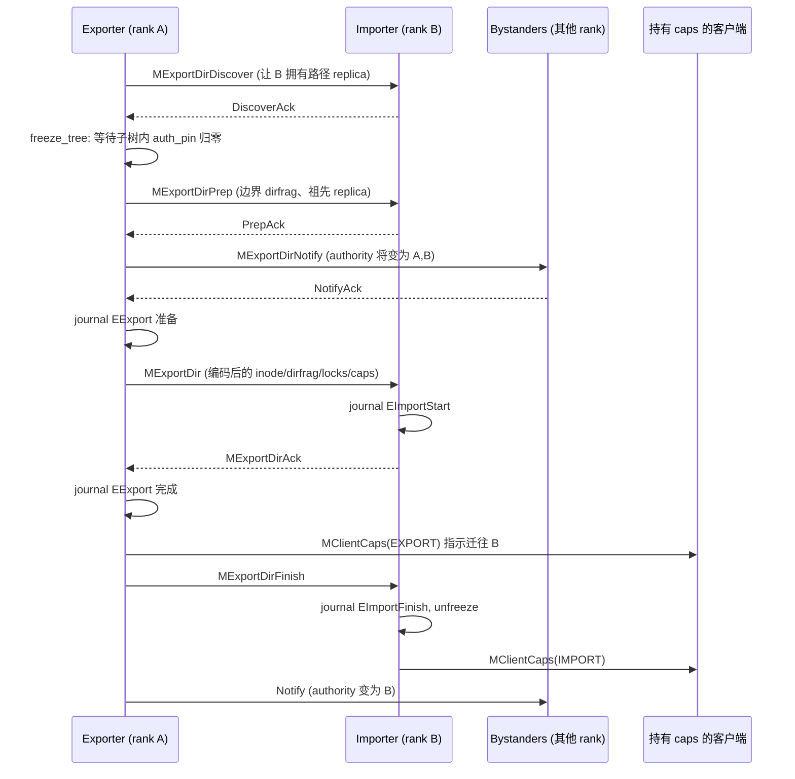

# CephFS 元数据设计

## 1. 设计要点

CephFS 元数据层可以概括为四句话：

1. **数据模型**：namespace 是一棵目录树；目录被切成一个或多个 dirfrag，每个 dirfrag 是 metadata pool 中的一个 omap 对象；普通 inode 内联在其 primary dentry 中。
2. **分区模型**：authority 以“子树（subtree）”为单位分配给 MDS rank，子树边界可以落在任意 dirfrag 上；一个 inode 同一时刻只有一个 auth rank。
3. **持久化模型**：所有修改先追加到该 rank 的 journal（RADOS 对象流），之后再惰性回写（commit）到 dirfrag 对象；journal 是唯一的 crash consistency 机制。
4. **缓存模型**：MDS 是“带 journal 的元数据缓存”，工作集在内存中；RADOS 只是 backing store。性能分水岭是工作集能否放进 `mds_cache_memory_limit`。

## 2. Namespace 数据模型

### 2.1 核心实体

| 链接类型 | 含义 | 持久形态 |
|----------|------|----------|
| primary | dentry 拥有 inode，inode 完整编码在 dentry 值里 | omap 值类型 `I` |
| remote | hard link，dentry 只记录目标 ino 和类型 | omap 值类型 `L`，需借助 backtrace 找到 primary |
| null | 负 dentry 或已删除但仍被快照/锁引用 | 仅内存或带快照范围 |

### 2.2 为什么 inode 内联在 dentry 中

- 路径解析 `lookup(name)` 和随后的 `getattr` 在同一 omap 读取中完成，没有第二跳。
- `readdir` 一次 omap 迭代即可返回 dentry + 完整属性（相当于 `readdirplus`）。
- 目录的物理局部性 = namespace 的逻辑局部性，迁移 authority 时整体搬运一个 dirfrag 即可。

代价是 hard link：被多次链接的 inode 只能内联在一个 primary dentry 中，其他 remote dentry 通过 ino 间接查找，必要时依赖数据池首对象中的 backtrace 定位 primary。旧版本还用过“anchor table”，现已由 backtrace 取代。

### 2.3 递归统计（rstat）

每个目录维护两类统计：

| 统计 | 字段 | 语义 | 一致性 |
|------|------|------|--------|
| fragstat / dirstat | `nfiles`、`nsubdirs`、`mtime` | 本目录直接子项 | 通过 `filelock`（目录上作 scatter 用）汇聚 |
| rstat | `rbytes`、`rfiles`、`rsubdirs`、`rctime`、`rsnaps` | 整棵子树递归值 | 通过 `nestlock` scatter-gather **惰性**向上传播 |

rstat 是 CephFS 配额、`getfattr -n ceph.dir.rbytes`、快照镜像增量检测（依赖 `rctime`）的基础。由于是惰性传播，跨 rank 的子树汇聚存在秒级滞后（受 `mds_dirstat_min_interval` 等参数影响），这也是配额“软执行”的根本原因之一。

## 3. 分区设计：动态子树 + dirfrag

### 3.1 子树分区

- 每个 rank 维护 **subtree map**：自己是 auth 的子树根 dirfrag 集合，以及这些子树的“边界”（bounds，即被切走给其他 rank 的子 dirfrag）。
- 祖先路径上的 inode 会以 **replica** 形式缓存在下游 rank 中，以便本地完成路径遍历和权限检查；replica 只读，修改必须转发到 auth。
- 子树切分可以发生在任何 dirfrag 上，因此一个大目录可以被多个 rank 分担（上图 `/data/train`）。

### 3.2 子树分配的三种方式

| 方式 | 配置 | 行为 | 适用 |
|------|------|------|------|
| 自动均衡 | `MDBalancer`，fs 级开关 `balance_automate` | 周期性交换负载心跳，热点 rank 把子树 export 给冷 rank | 负载未知、变化缓慢的通用场景；新版本新建文件系统默认关闭，需显式开启 |
| 显式 export pin | `setfattr -n ceph.dir.pin -v <rank>` | 子树固定到指定 rank，均衡器不再移动 | 多租户、用户目录、可预测负载（官方推荐） |
| 临时（ephemeral）pin | `ceph.dir.pin.distributed=1` / `ceph.dir.pin.random=
` | 子目录按一致性哈希分散到所有 rank / 随机概率 pin | `/home` 下大量同构子目录、海量小目录 |

**设计取舍**：自动均衡曾是 CephFS 论文的亮点，但在生产中频繁迁移会造成 freeze 停顿、cap 迁移和缓存失效；当前社区共识是“**能 pin 就 pin，均衡器作为补充**”。

### 3.3 目录分片（dirfrag）

dirfrag 用 `frag_t(value, bits)` 表示 dentry 名哈希空间中的一段前缀；整个目录的分片情况记录在目录 inode 的 `fragtree_t` 中。

| 触发 | 默认阈值 | 说明 |
|------|----------|------|
| 尺寸分裂 | `mds_bal_split_size = 10000` dentry | 防止单个 omap 对象过大、提升并行度 |
| 热度分裂 | `mds_bal_split_rd = 25000` / `mds_bal_split_wr = 10000`（衰减计数） | 热点目录即使不大也可拆分 |
| 合并 | `mds_bal_merge_size = 50` | 所有兄弟 frag 都很小时合并 |
| 硬上限 | `mds_bal_fragment_size_max`（默认 100000） | 单 frag 达上限后拒绝创建（`ENOSPC`），保护 OSD omap |

分片过程会 freeze 目录、写 `EFragment` journal 事件（prepare → commit → finish 三阶段），保证分裂中途崩溃可回滚或续做。

## 4. 持久化设计：Journal 优先

### 4.1 为什么是 journal

dirfrag 对象的 omap 更新是随机小写；若每次 `create` 都同步更新父目录对象、inode、rstat 祖先链，延迟和写放大都不可接受。CephFS 的做法与本地日志文件系统一致：

- **前台**：把一次操作涉及的全部元数据变化打包为一个 `EMetaBlob`，作为单条事件顺序追加到 journal。
- **后台**：journal 段过期（expire）时，把段中涉及的脏 dirfrag/inode 批量 commit 回 omap，然后推进 `expire_pos` 并 trim 旧对象。

这样**多次修改同一目录会在内存中合并**，只在段过期时写一次 dirfrag 对象。

### 4.2 Journal 生命周期

| 参数 | 默认 | 作用 |
|------|------|------|
| `mds_log_events_per_segment` | 1024 | 逻辑段大小 |
| `mds_log_max_segments` | 128 | 超过后积极 expire；超过 2 倍报 `MDS_TRIM` 告警 |
| `mds_early_reply` | true | journal 未持久前先给客户端 unsafe 回复 |

**journal 长度直接决定 failover 时间**：standby 接管时需要 replay 从 `expire_pos` 到 `write_pos` 的全部事件。journal 积压（trim 跟不上）是长 replay 的头号原因。

### 4.3 Early reply 与 unsafe 请求

如果 MDS 在 unsafe 与 safe 之间崩溃，客户端会在新 MDS 的 `clientreplay` 阶段重放 unsafe 请求，保证结果不丢失。

## 5. inode 号分配

- 每个 rank 拥有独立的 `InoTable`，号段为 `[(rank+1) << 40, (rank+2) << 40)`，rank 0 从 `0x10000000000` 开始。因此 inode 号天然编码了“最初创建它的 rank”，但 authority 之后可以迁移。
- 为支持客户端异步创建（kernel `nowsync`），MDS 会向 session 预分配并**委托**一段 inode 号（`delegated_inos`），客户端无需等待 MDS 回复即可本地生成 inode。
- 系统保留 ino：`1` 根目录、`0x100+rank` rank 私有目录（mdsdir）、`0x600+rank*10+i` stray 目录等。

## 6. 负载均衡设计

- 热度计数器采用指数衰减（半衰期 `mds_decay_halflife`，默认 5s），避免对瞬时尖峰过度反应。
- 可通过 Mantle（Lua 脚本，`balancer` fs 属性）自定义均衡策略，属于实验特性。
- `bal_rank_mask` 可限制参与自动均衡的 rank 集合，便于“部分 rank 自动、部分 rank 静态 pin”的混合模式。

## 7. 子树迁移协议（概要）

迁移是 CephFS 元数据设计中最复杂的协议：要在**不中断客户端、不丢 caps、可崩溃恢复**的前提下转移 authority。

不变量：在 `EImportStart` 与 `EExport` 都持久化之前，authority 处于“模糊（ambiguous）”状态；若此时任一方崩溃，恢复阶段 `resolve` 会在两方之间协商，确定 authority 最终归属（见 [HA 设计](cephfs-design-ha.md)）。

## 8. 规模与瓶颈分析

| 瓶颈 | 根因 | 设计层缓解 |
|------|------|------------|
| 单 rank CPU | `mds_lock` 大锁，请求处理基本串行 | 多 active rank + pin |
| MDS 内存 | 每 inode/dentry/cap 常驻内存，工作集决定命中率 | 调大 cache limit；限制单客户端 caps |
| 大目录 | 单 omap 对象过大 → OSD 慢请求 | dirfrag 自动分裂；硬上限保护 |
| 跨 rank 操作 | rename/link 跨 auth 需要 peer 请求与两阶段 journal | 业务目录结构对齐 rank 边界 |
| 深路径遍历 | 每级目录都需 replica 与权限检查 | 客户端 dentry lease 缓存 |
| journal 积压 | metadata pool 写延迟高或段 expire 慢 | metadata pool 用 NVMe、监控 `MDS_TRIM` |
| 根/热点目录锁竞争 | 大量客户端在同一目录 create | dirfrag + 分布式 pin；kernel 异步 create |

## 9. 设计启示

- **把 authority 与持久副本解耦**是 CephFS 最可借鉴的设计：authority 可在秒级迁移，而数据安全完全托付给底层对象存储。
- **journal + 惰性回写**把随机元数据更新变为顺序写，是所有高性能元数据服务的共性。
- **子树分区对 rename 友好、对热点不友好**；哈希分区则相反。CephFS 通过 dirfrag 在两者之间取得折中，但也引入了两套切分维度的复杂度。
