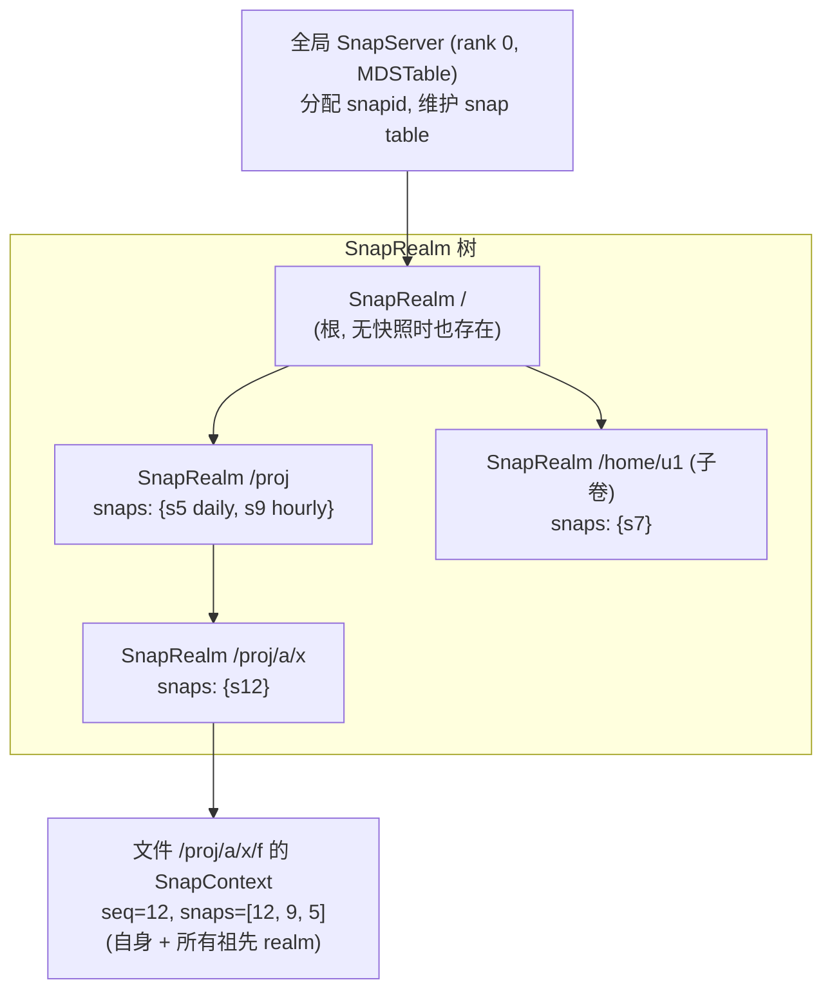
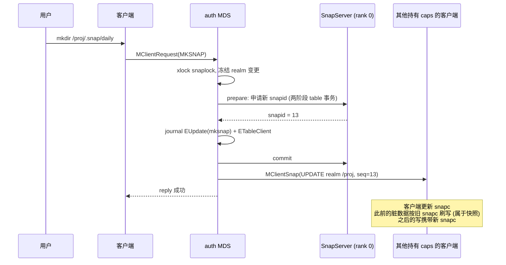
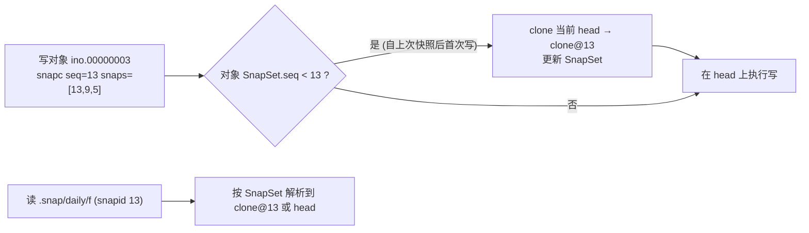
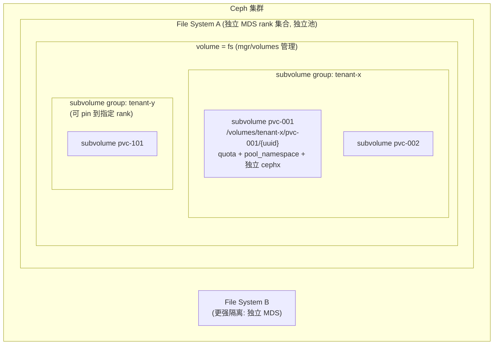
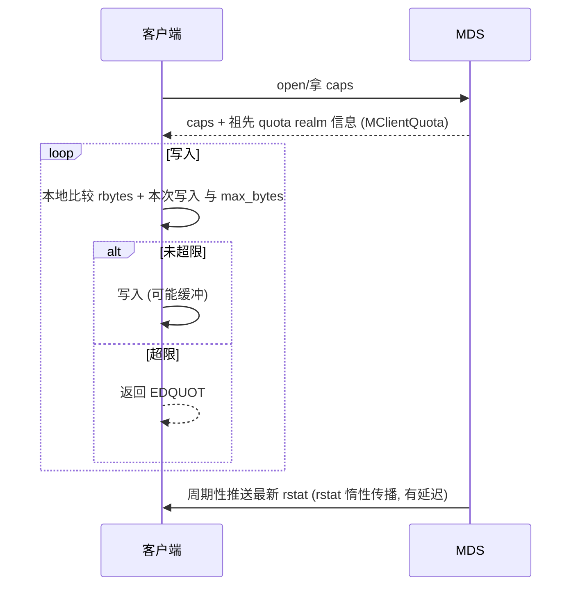
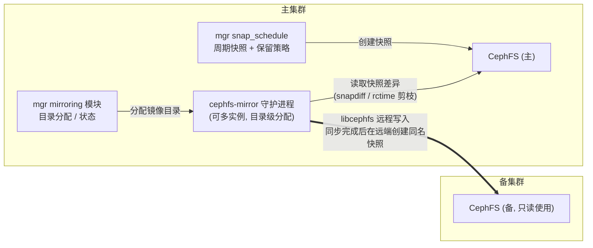

# CephFS 快照、多租户与灾备设计

## 1. 快照设计

### 1.1 目标与约束

- **任意目录粒度**：在任何目录下 `mkdir .snap/<name>` 即可创建该子树快照，无需卷级操作。
- **创建 O(1)**：创建快照只修改元数据（分配 snapid、更新 SnapRealm），不复制数据。
- **按需 COW**：数据层依赖 RADOS 自管理快照（self-managed snaps）在对象首次被覆盖时 clone；元数据层在 dentry/inode 被修改时保留旧版本。
- **约束**：快照不是瞬时一致点（客户端脏数据异步固化）；快照数越多，元数据和 OSD SnapSet 越重；跨快照边界的 rename/hard link 会产生“past parent”复杂性。

### 1.2 核心概念

| 概念 | 含义 |
|------|------|
| snapid | 全局单调递增 ID，由 SnapServer 分配 |
| SnapRealm | 存在快照的目录会成为一个 realm；realm 内所有 inode 共享同一组快照 |
| SnapContext (snapc) | `{seq, snaps[]}`，客户端每次写对象都必须携带，OSD 据此决定是否 clone |
| past parent | inode 被 rename 移出某 realm 后，仍需记住旧 realm 的快照 |
| `.snap` | 虚拟目录，不存在于 omap 中，通过 snapid 维度访问历史版本 |

### 1.3 快照创建流程

- 快照返回成功时，**其他客户端缓存中的脏数据仍在写回途中**，它们会以“快照前”的 snapc 落盘并归入快照。这就是“快照不是瞬时一致点”的含义：快照包含所有在快照时刻之前已产生的数据，但不保证 mksnap 返回时这些数据已经持久化。
- 应用一致性快照需要应用层配合（停写或 fsync 后再快照）。

### 1.4 数据 COW（RADOS 层）

- clone 在 BlueStore 中是写时共享 extent，不立即复制数据；后续覆盖才真正产生新块。
- 删除快照：MDS 更新 snap table，OSD 把被删 snapid 加入 `removed_snaps`，后台 **snaptrim** 遍历并删除不再需要的 clone；大规模删快照会产生显著后台 I/O（`osd_snap_trim_sleep` 限速）。

### 1.5 元数据版本化

- dentry 带 `[first, last]` snapid 区间；`last = CEPH_NOSNAP` 表示 head 版本。
- 被快照覆盖的目录中修改 dentry/inode 时，旧版本以 `name_<snapid>` 键写入 dirfrag omap，inode 的历史版本可保存在 `old_inodes` 中。
- 访问 `.snap/<name>/...` 时，MDS 按 snapid 选择对应版本的 dentry 与 inode。

## 2. 多租户设计

### 2.1 隔离层次

| 隔离维度 | 机制 | 强度 |
|----------|------|------|
| 命名空间可见性 | CephX `mds 'allow rw path=/volumes/tenant-x/...'` 限定挂载根 | 强（MDS 强制） |
| 数据对象访问 | CephX `osd 'allow rw pool=cephfs.data namespace=fsvolumens_...'` | 强（OSD 强制），需要配合 pool namespace layout |
| 元数据算力 | 子卷组/子卷 pin 到 rank；或独立文件系统 | 中（pin 隔离），强（多 fs） |
| 容量 | 目录递归配额 `ceph.quota.max_bytes / max_files` | **弱**：客户端协作执行，存在超限窗口 |
| 性能 QoS | 无原生 MDS/OSD 每租户 QoS（mClock 针对 OSD 后台/客户端类别，而非租户） | 弱 |
| root squash | `allow rw root_squash` | 中 |

### 2.2 配额执行设计

- 配额检查发生在**客户端**，依据 MDS 推送的递归统计；多个客户端并发写同一配额目录时，各自看到的余量都可能偏旧，因此会**超出若干个写缓冲/秒级写入量**。
- 被篡改或不支持配额的旧客户端可以完全绕过配额。对不可信租户，应结合 CephX path 限制 + 监控告警，或在网关层（NFS-Ganesha）执行。

### 2.3 子卷生命周期（mgr/volumes）

| 操作 | 实现 |
|------|------|
| create | 建目录 `/volumes/<group>/<name>/<uuid>`，写 `.meta` 元数据文件，设置 layout/quota/mode |
| resize | 修改 `ceph.quota.max_bytes` |
| snapshot | 在子卷目录 `.snap` 下创建 |
| clone | 从快照**全量复制**到新子卷（mgr 异步线程，`ceph fs clone status`），不是 COW 克隆 |
| rm | 先移入 `/volumes/_deleting` 回收站，再由异步 purge 线程删除 |
| retain-snapshots 删除 | 删除数据但保留快照，便于后续从快照克隆 |

**设计注意**：子卷 clone 是全量拷贝，对大子卷耗时长；这与 RBD 的 COW clone 有本质区别，是 CSI “从快照创建 PVC”场景最常见的性能误区。

## 3. 灾备设计：快照镜像

### 3.1 架构

### 3.2 同步算法

1. 对每个被镜像目录，比较本地快照列表与远端快照列表，找到“远端最新已同步快照 S_prev”与“本地下一个快照 S_next”。
2. 计算 `S_prev → S_next` 的差异：新版本优先使用 **snapdiff API**（基于 RADOS 快照差异，不必逐文件比较），否则基于 `rctime` 剪枝递归遍历。
3. 将差异写入远端目录的 head 版本。
4. 全部写完后在远端创建同名快照 `S_next`，标志该点一致。
5. 循环。

| 特性 | 说明 |
|------|------|
| 方向 | 单向 push；远端目录应只读使用 |
| RPO | ≥ 快照间隔 + 同步耗时 |
| 一致性 | 以快照为单位一致；同步过程中远端 head 处于中间态，应使用远端快照而非 head |
| 不复制 | 部分特殊文件类型、硬链接关系等存在限制，需以版本文档为准 |
| 故障切换 | 人工：停止镜像 → 远端提升为读写 → 反向重建（需要全量或基于共同快照的增量） |

## 4. 设计启示

- **快照把“一致点”交给了 RADOS 的 snapc 机制**：MDS 只负责分配 snapid 与通知客户端，数据 COW 完全在对象层完成，是“控制面定义版本、数据面执行版本”的优雅分工。
- **配额/QoS 是 CephFS 多租户的短板**：设计新系统时，如果多租户是一等需求，应在服务端（MDS 或写路径）实现硬配额与租户级 QoS。
- **基于快照的异步镜像**实现简单且语义清晰（快照 = 恢复点），代价是 RPO 不为零；rctime 递归时间戳是低成本增量检测的关键。
