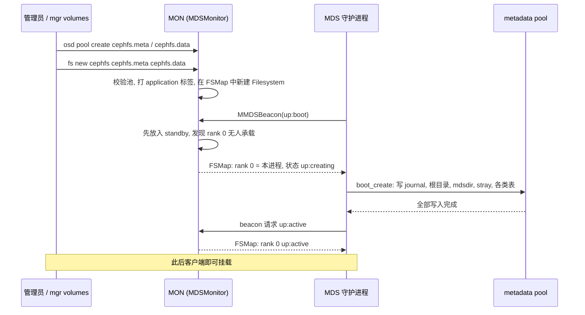
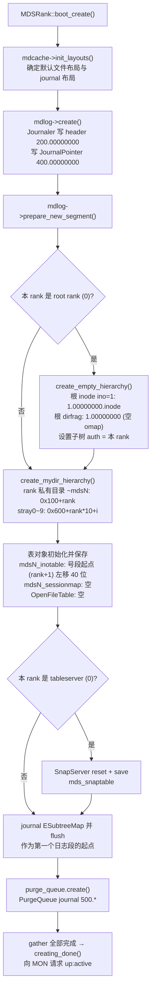

# CephFS 文件系统初始化流程

> 基线：Ceph Tentacle `v20.2.3`。MON 侧入口 `src/mon/FSCommands.cc`、`src/mon/MDSMonitor.cc`、`src/mds/FSMap.cc`；MDS 侧入口 `src/mds/MDSRank.cc`（`boot_create`、`creating_done`）、`src/mds/MDCache.cc`（`create_empty_hierarchy`、`create_mydir_hierarchy`）。

## 1. 概述

一个 CephFS 文件系统的初始化分三层完成：

| 层 | 动作 | 是否写 RADOS 对象 |
|----|------|-------------------|
| 管理员 / mgr | 创建 metadata pool 与 data pool | 否（只建池） |
| MON | `fs new`：校验池、在 FSMap 中登记文件系统 | 否（只改集群映射） |
| MDS | 第一个分到 rank 0 的 MDS 以 `up:creating` 执行 `boot_create()`，写出空目录树、journal 与各类表 | 是（仅 metadata pool） |

数据池在初始化时不写任何对象；第一个文件第一次写入时，数据对象才由 OSD 隐式创建。

## 2. 总体时序



## 3. 第一步：准备 RADOS 池

```bash
ceph osd pool create cephfs.meta          # 元数据池：必须 replicated，建议 SSD/NVMe
ceph osd pool create cephfs.data          # 默认数据池：建议 replicated
ceph fs new cephfs cephfs.meta cephfs.data
```

也可以使用一条命令 `ceph fs volume create cephfs`：由 mgr `volumes` 模块自动创建 `cephfs.<name>.meta` / `cephfs.<name>.data` 两个池，调用 `fs new`，并通过编排器（cephadm / Rook）部署 MDS 守护进程。

## 4. 第二步：MON 侧的 `fs new`

`fs new` 由 `FSCommands.cc` 中的 `NewFileSystemHandler` 处理，只修改集群映射：

1. **校验**
   - 两个池必须已存在，且未被其他文件系统占用；
   - metadata pool 默认必须为空，否则需要 `--force`（残留的旧元数据会被当成现有状态）；
   - 默认数据池若是 EC 池，要求已开启 `allow_ec_overwrites` 且显式 `--force`，因为每个文件的 backtrace 都写在默认数据池。
2. **打标签**：为两个池设置 `application cephfs`，并写入 `metadata=<fs名>` / `data=<fs名>`。
3. **在 FSMap 中新建 Filesystem**：
   - 分配 `fscid`（文件系统 ID）；
   - 初始化其 MDSMap：`max_mds=1`、`metadata_pool`、`data_pools`、`root=0` 与 `tableserver=0`（根目录与 SnapServer 都归 rank 0）、`max_file_size`（默认 1 TiB）、兼容特性集、创建时间等；
   - 此时 rank 0 位于 `in` 集合但无人承载，等待 MDS 接管。
4. **Paxos 提交**新的 FSMap epoch。

## 5. 第三步：MDS 分到 rank 并进入 `up:creating`

MDS 进程启动后向 MON 发送 `up:boot` 信标并成为 standby。MDSMonitor 发现某文件系统缺少 rank 时，把一个 standby 提升上去，初始状态取决于该 rank 的历史：

| rank 的历史 | 分配后的状态 | 含义 |
|-------------|--------------|------|
| 全新 rank（文件系统刚建，或首次调大 `max_mds`） | `up:creating` | 从零创建该 rank 的全部持久状态 |
| 曾正常停止（在 `stopped` 集合中） | `up:starting` | 读取已有 journal 等状态后直接启动 |
| 运行中失效 | `up:replay` | 走故障恢复状态机，见 [HA 设计](../design/cephfs-design-ha.md) |

`MDSRank::handle_mds_map` 检测到本 rank 状态为 `up:creating` 后调用 `boot_create()`。

## 6. 第四步：`MDSRank::boot_create()` 写出初始元数据

所有写操作挂在同一个 `MDSGatherBuilder` 上，全部完成后才触发 `C_MDS_CreateFinish` → `creating_done()`：



要点：

- **journal 先于目录树创建**，之后第一个日志段以 `ESubtreeMap` 开头，保证后续任何 replay 都有明确的 authority 起点。
- `create_empty_hierarchy` 与 `create_mydir_hierarchy` 创建的 dirfrag 被标记为 complete 并立即 commit，inode 立即 store；因此初始化完成后无需 replay 即可从 RADOS 重建空目录树。
- 创建流程跳过 reconnect 阶段，所以 `boot_create` 中会直接启用 Objecter 的 blocklist 事件监听。

### 6.1 初始化完成后的对象（rank 0）

| 对象 | 作用 |
|------|------|
| `1.00000000`、`1.00000000.inode` | 根目录 dirfrag 与根 inode |
| `100.00000000`、`100.00000000.inode` | rank 0 私有目录 `~mds0` |
| `600.00000000` ~ `609.00000000` | stray0~9，暂存已删除的 inode |
| `200.00000000`、`200.00000001` | rank 0 journal 的 header 与第一个数据对象 |
| `400.00000000` | JournalPointer |
| `500.*` | PurgeQueue journal |
| `mds0_inotable`、`mds0_sessionmap`、`mds0_openfiles.0` | rank 级表 |
| `mds_snaptable` | 全局快照表 |

可用 `rados -p cephfs.meta ls` 直接查看；此时 `rados -p cephfs.data ls` 为空。各对象的编码见 [持久化格式](cephfs-impl-on-disk-format.md)。

## 7. 第五步：进入 `up:active` 并开始服务

- `creating_done()` 请求 `up:active`，MON 更新 FSMap 后 `ceph fs status` 显示 rank 0 active，`MDS_ALL_DOWN` 告警消失。
- 客户端挂载：MON 认证并订阅 FSMap → 向 rank 0 打开会话 → getattr 根目录拿到根 inode 与 caps，详见 [关键请求流程](cephfs-impl-request-flows.md) 第 1 节。
- 第一次 `create` 从 InoTable 分配 `0x10000000000` 起的 inode 号；第一次 `write` 时 OSD 在数据池中隐式创建 `<ino>.00000000`，MDS 再异步写入 backtrace（`parent` xattr）。

## 8. 其他 rank 的初始化

执行 `ceph fs set cephfs max_mds 2` 后，MON 把一个 standby 以 `up:creating` 分到 rank 1，同样执行 `boot_create()`。rank 1 既不是 root rank 也不是 tableserver，只创建自己的部分：

| 对象 | rank 1 的值 |
|------|-------------|
| 私有目录 `~mds1` | ino `0x101` |
| stray 目录 | ino `0x60a` ~ `0x613` |
| journal / JournalPointer / PurgeQueue | `201.*`、`401.00000000`、`501.*` |
| InoTable | `mds1_inotable`，号段从 `0x20000000000` 起 |

rank 1 启动时不负责任何子树，直到通过 pin 或负载均衡迁入子树（见 [元数据设计](../design/cephfs-design-metadata.md)）后才承担元数据负载。

## 9. 易混淆的几点

- **`fs new` 不初始化元数据**：它只登记 FSMap，真正写对象的是第一个 MDS。只执行 `fs new` 而没有 MDS 时，池是空的，文件系统不可用。
- **`fs reset`、`cephfs-data-scan init` 不属于正常初始化**：它们属于灾难恢复工具，用于重建根目录与 mdsdir 等基础 inode 或丢弃 MDSMap 状态，具有破坏性，不能用来“重新初始化”。
- **重建文件系统的正确做法**：`ceph fs fail` → `ceph fs rm` → 删除或清空池 → 重新 `fs new`，不要直接复用残留数据的 metadata pool 并加 `--force`。
