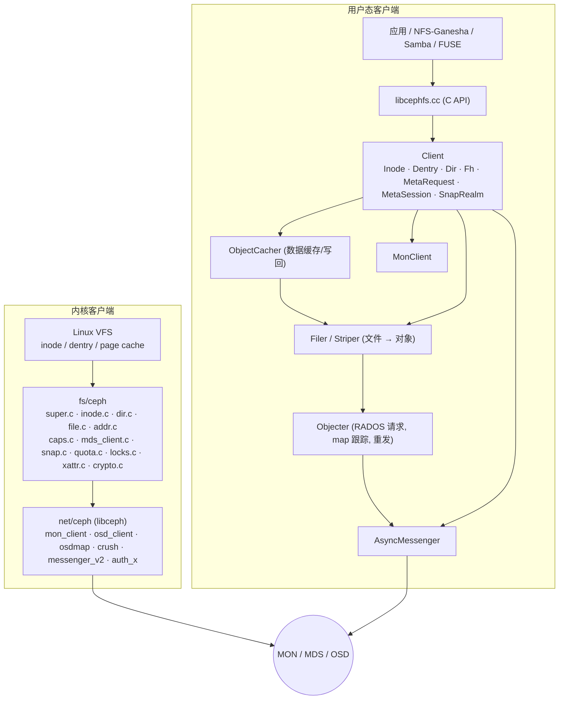
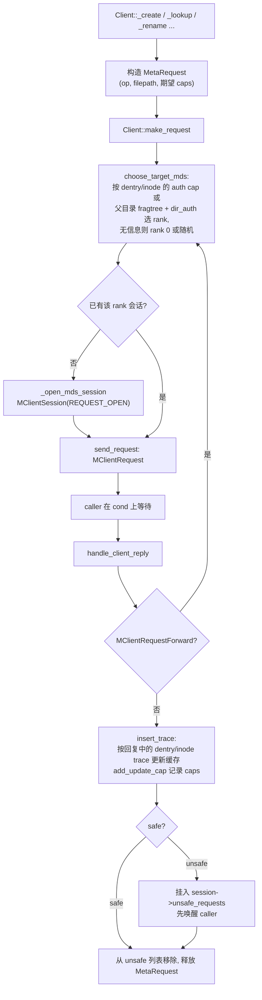
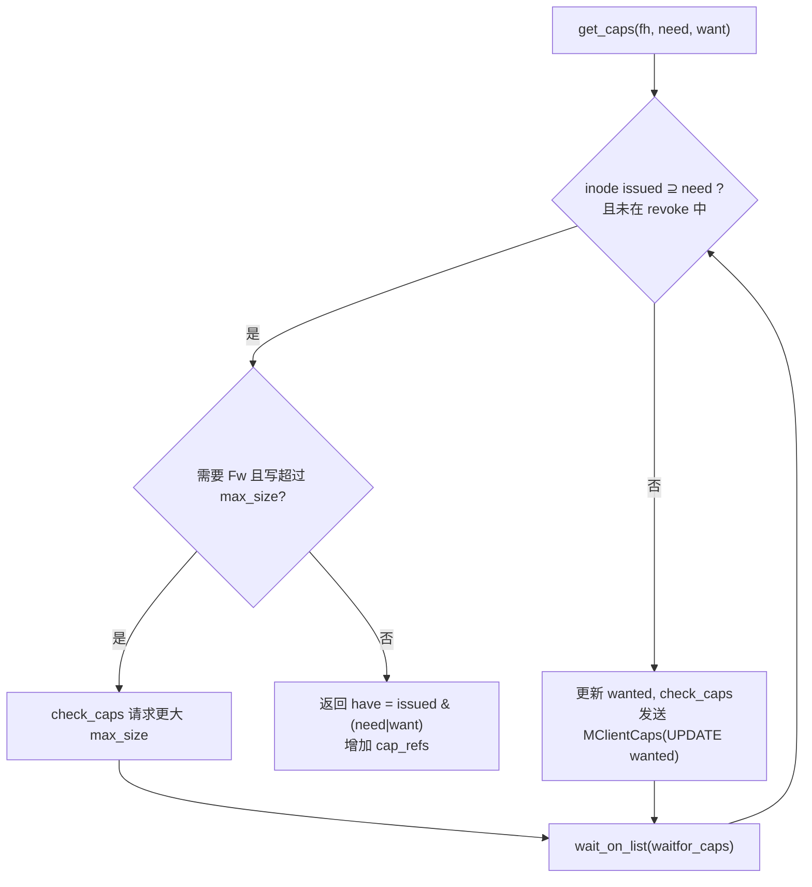
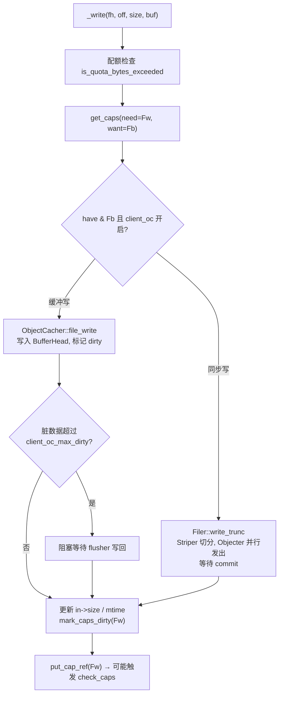
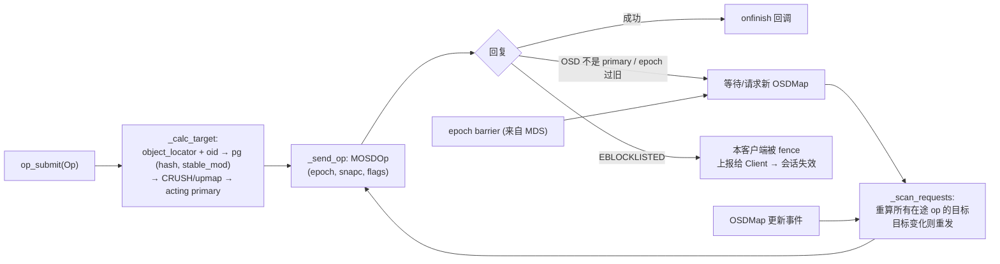
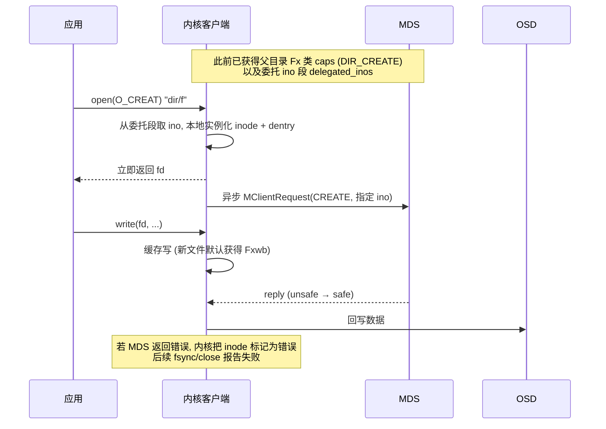

# CephFS 客户端实现剖析

CephFS 有两套独立实现的客户端，协议相同、代码不共享：

| 维度 | 内核客户端 | 用户态客户端 |
|------|------------|--------------|
| 代码 | Linux `fs/ceph` + `net/ceph`（libceph） | Ceph `src/client/Client.cc` + `src/osdc` |
| 接入 | `mount -t ceph`，VFS 直接调用 | `ceph-fuse`（FUSE lowlevel）、libcephfs（NFS-Ganesha、Samba、cephfs-mirror、mgr、应用直接链接） |
| 数据缓存 | Linux page cache（netfs 层 + 可选 fscache） | `ObjectCacher`（`client_oc`，默认 200 MiB） |
| 版本节奏 | 跟随内核发行 | 跟随 Ceph 发行 |
| 典型选择 | 性能优先、生产主流 | 新特性优先、容器/无内核模块环境、网关 |

## 1. 客户端栈结构

## 2. 用户态 Client 的核心数据结构

| 结构 | 文件 | 内容 |
|------|------|------|
| `Inode` | `client/Inode.h` | 缓存的 inode 属性、`caps`（按 MDS 分的 `Cap` 对象）、`auth_cap`、`dirty_caps`、`flushing_caps`、`max_size`、`snaprealm`、引用计数、`oset`（ObjectCacher 对象集） |
| `Cap` | `client/Inode.h` | `issued`、`implemented`、`wanted`、`seq`、`issue_seq`、`mseq`、`gen`、所属 `MetaSession` |
| `Dentry` / `Dir` | `client/Dentry.h`、`Dir.h` | 名字 → Inode；lease 到期时间；目录完整性标记（`I_COMPLETE`/`I_DIR_ORDERED`） |
| `MetaRequest` | `client/MetaRequest.h` | 一次 MDS 请求：tid、op、路径/ino、`resend_mds`、`got_unsafe`、`unsafe_item`、等待的 caller |
| `MetaSession` | `client/MetaSession.h` | 与某 MDS rank 的会话状态、caps 列表、`unsafe_requests`、`flushing_caps` |
| `Fh` | `client/Fh.h` | 打开文件句柄：mode、偏移、readahead 状态 |
| `SnapRealm` | `client/SnapRealm.h` | 快照 realm 及 `SnapContext` 缓存 |

所有状态由 `Client::client_lock` 保护（用户态同样是一把大锁），网络与 Objecter 回调在独立线程执行后通过锁与条件变量与调用者交互。

## 3. 元数据请求

- **trace**：MDS 回复携带从目标起向上的 dentry/inode 信息及其 caps/lease，客户端借此一次性填充多级缓存，减少后续 lookup。
- **重定向**：`MClientRequestForward` 让客户端直接把请求发往 auth rank；之后同一目录的请求会自动选对 rank。
- **failover**：会话所在 rank 进入 reconnect 时，`Client::send_reconnect` 发送其持有的全部 caps、打开状态、snaprealm 和 flock；active 后 `resend_unsafe_requests` 与 `kick_requests` 重新发送 unsafe 与在途请求。

## 4. caps 处理

### 4.1 获取 caps：`Client::get_caps`

### 4.2 处理 MDS 的 caps 消息：`Client::handle_caps`

| op | 处理函数 | 行为 |
|----|----------|------|
| `GRANT` / `REVOKE` | `handle_cap_grant` | 更新属性（size/mtime/mode...）；revoke 时：丢弃 `Fc` 缓存（`_invalidate_inode_cache`）、刷写 `Fb` 脏数据（`_flush`），完成后 `check_caps` 发 ack |
| `TRUNC` | `handle_cap_trunc` | 截断缓存 |
| `FLUSH_ACK` | `handle_cap_flush_ack` | 按 flush tid 清除 `flushing_caps`，唤醒 `fsync` 等待者 |
| `FLUSHSNAP_ACK` | `handle_cap_flushsnap_ack` | 快照 capsnap 刷写完成 |
| `EXPORT` / `IMPORT` | `handle_cap_export` / `handle_cap_import` | 依据 `mseq` 把 cap 从旧 rank 移到新 rank |

### 4.3 回写 caps：`Client::check_caps` 与 `send_cap`

- 计算 `wanted`（根据打开模式与 `cap_refs`）与 `used`，若 `issued` 中有不再需要的位或有 dirty 状态，构造 `MClientCaps(UPDATE / FLUSH)`。
- 脏元数据（`dirty_caps`）在 flush 时转为 `flushing_caps`，分配 `flush_tid`，直到 `FLUSH_ACK` 才清除，保证 `fsync` 语义。
- 快照：当 SnapRealm 更新时，已有的脏状态被冻结为 `CapSnap`（`queue_cap_snap`），以旧 snapc 刷写并 `FLUSHSNAP`，从而让快照包含正确的旧内容。

## 5. 数据 I/O

### 5.1 写入：`Client::_write`

- `ObjectCacher` 后台 flusher 线程按 `client_oc_max_dirty_age` 等参数写回；写回通过 `Objecter` 下发 `CEPH_OSD_OP_WRITE`，带当前 SnapContext。
- `fsync`：`_fsync` 依次等待：(1) ObjectCacher 中该 inode 的脏数据写回并 commit；(2) dirty caps flush 并收到 `FLUSH_ACK`；(3) 如有需要，等待相关 unsafe 元数据请求 safe。

### 5.2 读取：`Client::_read`

- `get_caps(need=Fr, want=Fc)`；持有 `Fc` 时走 `_read_async`（ObjectCacher 读 + readahead，由 `client_readahead_max_bytes/periods` 控制），否则 `_read_sync` 直接调用 `Filer::read_trunc`。
- 读取结果按 inode 的 `size` 截断；对象不存在（ENOENT）或稀疏区域填 0。

### 5.3 Objecter：RADOS 请求引擎

- Objecter 是**所有 Ceph 用户态客户端共享的组件**（RBD、RGW、MDS 本身都使用）。它对上层隐藏了 OSD 故障与 PG 迁移：只要 PG 最终可用，请求就会被重发到正确的 primary。
- `Striper::file_to_extents` 实现第 [数据设计](../design/cephfs-design-data.md) 中的条带公式，把文件区间拆成多个 `ObjectExtent`，`Filer` 为每个 extent 生成一个 op 并用 gather 等待全部完成。

## 6. 内核客户端要点

| 子系统 | 文件 | 要点 |
|--------|------|------|
| 挂载 | `super.c` | 解析 `mon_addr`/`fs=`/`name=`/`ms_mode=`；`ceph_real_mount` 打开到 MDS 的 session 并 getattr 根 |
| MDS 客户端 | `mds_client.c` | `ceph_mdsc_do_request`、`__choose_mds`、`handle_reply`、`send_mds_reconnect`；`/sys/kernel/debug/ceph/*/mdsc` 显示在途请求 |
| caps | `caps.c` | `ceph_get_caps`/`try_get_cap_refs`、`ceph_check_caps`、`handle_cap_grant`、`__send_cap`；延迟释放队列 `cap_delay_list` |
| 数据 | `file.c`、`addr.c` | 基于 netfs 库的 `read_folio`/`readahead`/`writepages`；`O_DIRECT` 与同步写走 `ceph_sync_write`；`ceph_osdc_*` 发请求 |
| 异步目录操作 | `dir.c`、`file.c` | 挂载选项 `nowsync`（新内核默认 `wsync` 或随版本变化，以具体内核为准）：持有父目录 `DIR_CREATE`/`DIR_UNLINK` caps 且有委托 ino 时，`ceph_atomic_open` / `ceph_unlink` 不等 MDS 回复即返回 |
| 快照 | `snap.c` | realm 层级、`ceph_queue_cap_snap`、capsnap flush |
| 配额 | `quota.c` | `ceph_quota_is_max_bytes_exceeded` 等，基于 MDS 推送的 realm 信息 |
| 加密 | `crypto.c` | fscrypt 集成：文件名与内容在客户端加密（需要较新内核与 Ceph 版本配合） |
| 会话恢复 | `mds_client.c` | `recover_session=clean`：被 blocklist 后自动重连，丢弃脏数据与锁 |

### 6.1 异步 create 时序（内核 `nowsync`）

异步目录操作把小文件 create/unlink 的延迟从“一次 MDS RTT”降到“本地操作”，对 `untar`、`rm -rf` 类负载提升明显；代价是错误只能延迟报告。

## 7. 客户端性能相关参数

| 参数 | 默认 | 说明 |
|------|------|------|
| `client_oc` | true | 用户态数据缓存开关 |
| `client_oc_size` | 200 MiB | ObjectCacher 容量 |
| `client_oc_max_dirty` | 100 MiB | 脏数据上限，超过阻塞写 |
| `client_cache_size` | 16384 | 用户态 inode/dentry 缓存条目数 |
| `client_readahead_max_bytes` | 0（按 periods 计算） | readahead 上限 |
| `fuse_big_writes` / `fuse_max_write` | — | FUSE 写块大小 |
| 内核 `rasize`、`wsize`、`rsize` | 8 MiB / 64 MiB 量级（随版本） | readahead 与单次 OSD 请求大小 |
| 内核 `caps_max` | 0（不限） | 客户端可持有 caps 上限 |

具体数值以所用版本 `src/common/options/mds-client.yaml.in` 与内核文档 `Documentation/filesystems/ceph.rst` 为准。
