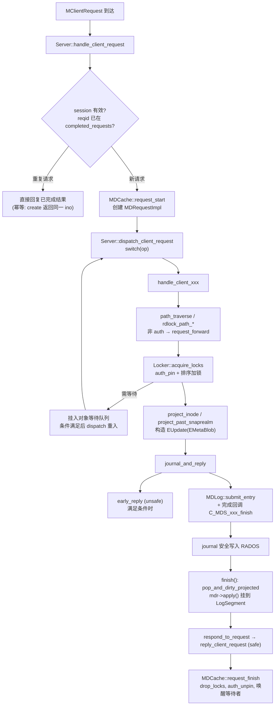
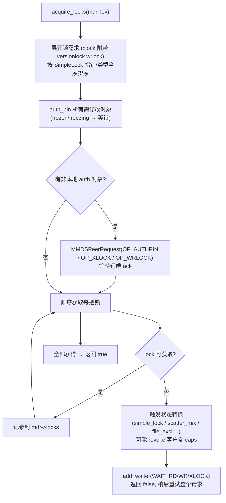
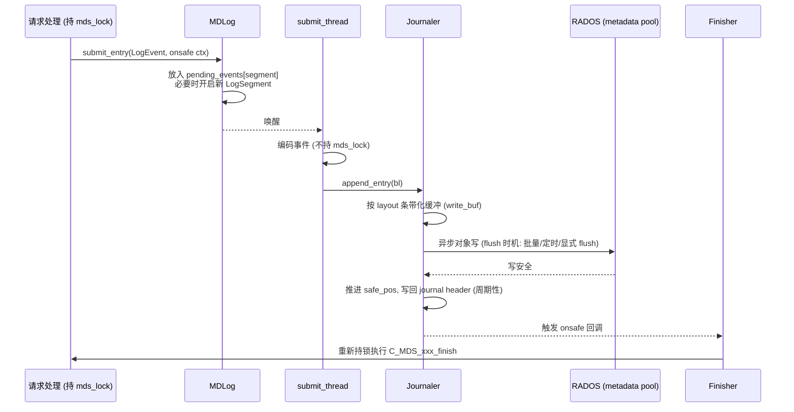
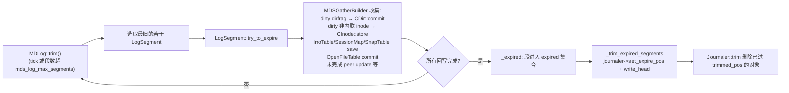
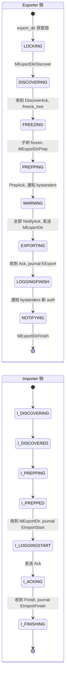
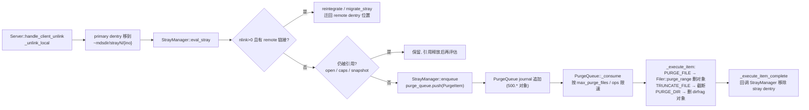

# CephFS MDS 实现剖析

本文沿“进程启动 → 请求处理 → 锁与 caps → journal → 缓存 → 迁移/均衡 → 删除回收 → 会话管理”的顺序，说明 MDS 关键子系统在 v20.2.3 中的实现方式。函数名均可在 `src/mds/` 中直接检索。

## 1. MDSDaemon 与 MDSRank

- `MDSDaemon`（`MDSDaemon.cc`）是进程级对象：初始化 messenger、MonClient，处理 `MMDSMap`。当 FSMap 为本进程分配了 rank，它构造 `MDSRankDispatcher`（`MDSRank` 子类）。
- `MDSRank::handle_mds_map` 比较新旧 MDSMap 中本 rank 的状态，调用对应的入口：

| 新状态 | 入口函数 | 主要动作 |
|--------|----------|----------|
| `up:replay` | `replay_start()` → `boot_start(MDS_BOOT_INITIAL)` | 打开 InoTable/SessionMap/SnapServer/OpenFileTable，读取 journal 头 |
| | `boot_start(MDS_BOOT_OPEN_ROOT)` | 打开根与 mdsdir |
| | `boot_start(MDS_BOOT_PREPARE_LOG)` | `MDLog::replay()` 启动回放线程 |
| | `boot_start(MDS_BOOT_REPLAY_DONE)` | `replay_done()`，进入下一状态 |
| `up:standby-replay` | `standby_replay_restart()` | 周期性 `MDLog::replay` 追 journal 尾 |
| `up:resolve` | `resolve_start()` | `MDCache::send_resolves()` |
| `up:reconnect` | `reconnect_start()` | `Server::reconnect_clients()`，开启 `mds_reconnect_timeout` 计时 |
| `up:rejoin` | `rejoin_start()` | `MDCache::rejoin_send_rejoins()` |
| `up:clientreplay` | `clientreplay_start()` | 重新分发 `replay_queue` 中的请求 |
| `up:active` | `active_start()` | 打开服务、启动 balancer、scrub、purge queue |
| `up:stopping` | `stopping_start()` | 把全部子树 export 给其他 rank，flush journal |

- 消息分发：`MDSRankDispatcher::ms_dispatch` → `MDSRank::handle_message` → 按消息类型交给 `Server`、`Locker`、`MDCache`、`Migrator`、`MDBalancer`、`SnapServer` 等。若当前状态不能处理（如 replay 中收到客户端请求），消息被挂入 `waiting_for_active` / `waiting_for_replay` 等队列，状态切换后重新分发。

## 2. 客户端请求生命周期

### 2.1 管线总览

### 2.2 MDRequestImpl

`Mutation.h` 中的 `MutationImpl` / `MDRequestImpl` 是一次元数据操作的全部上下文：

| 字段 | 作用 |
|------|------|
| `reqid` | `client.<id>:<tid>`，用于去重与 replay |
| `client_request` | 原始消息 |
| `locks`（`LockOpVec`/已持有锁集合） | 已获得的 rd/wr/xlock 及远端锁 |
| `auth_pins` / `remote_auth_pins` | 本地与远端 auth_pin 的对象 |
| `projected` 对象列表 | 已 project 但未应用的 inode/fnode |
| `more()` | 跨 rank 操作的额外状态：witnesses、peer 请求、rename 导入导出信息 |
| `internal_op` | MDS 内部操作（如 fragment、scrub、export） |
| `flag_point` / `events` | 供 `dump_ops_in_flight` 观察进度 |

### 2.3 投影（projection）与版本

MDS 采用“**先投影、journal 持久后再应用**”的模式：

1. `CInode::project_inode(mdr)` 生成一份可修改的 inode 副本挂在 projected 链表上；后续读取（`get_projected_inode()`）可以看到将要生效的值，使同一 inode 上的后续请求可以流水执行。
2. `MDCache::predirty_journal_parents` 沿父目录链向上投影 fnode 的 `fragstat/rstat` 变更，并把它们加入 `EMetaBlob`。
3. journal 安全后，回调中 `pop_and_dirty_projected_inode` 将投影版本变为当前版本，并把对象标记为 dirty 挂到当前 `LogSegment`。

`EMetaBlob` 记录的是**完成状态的完整 dentry/inode 快照**（不是操作日志），因此 replay 只需按顺序把这些状态写入缓存即可，无需重新执行业务逻辑。这是 replay 实现简洁、可做 `recover_dentries` 的关键。

### 2.4 early reply 条件

`Server::early_reply` 仅在满足以下条件时发送 unsafe 回复：`mds_early_reply=true`、请求不涉及跨 rank peer（`has_more() && peer witnesses` 时不行）、不是需要立即持久化的操作（例如部分快照操作）。客户端收到 unsafe 回复后把请求挂在 `unsafe_requests` 上，直到 safe 回复到来。

## 3. Locker：锁与 caps 的实现

### 3.1 锁状态表

`locks.c` 用静态表定义每种锁的状态机（`sm_simplelock`、`sm_scatterlock`、`sm_filelock`、`sm_locallock`），每个状态条目包含：

| 列 | 含义 |
|----|------|
| `next` | 中间态最终要到达的稳定状态 |
| `loner` | 该状态是否只在有 loner 时可用 |
| `can_rdlock` / `can_wrlock` / `can_xlock` / `can_lease` | 谁（`ANY`、`AUTH`、`XCL`）可以执行该操作 |
| `caps` / `loner_caps` / `xlocker_caps` / `replica_caps` | 处于该状态时可以发给普通客户端、loner、xlock 持有者、replica rank 的 caps 位 |

`SimpleLock::gcaps_allowed(who)` 查表得到某状态下允许的通用 caps 位，再由 `CInode::get_caps_allowed_*` 按锁类型移位组合（`A`、`L`、`X`、`F` 各占一段位）。**caps 就是从锁状态表“投影”出来的。**

### 3.2 acquire_locks

为降低高频操作的加锁开销，Octopus 起随异步目录操作一起引入 **lock cache**（`MDLockCache`）：客户端持有目录的异步操作 caps 时，MDS 可以为该目录的 create/unlink 缓存一组已获得的锁，后续同类请求直接复用。

### 3.3 caps 发放与回收

- `Locker::issue_caps(CInode*)`：遍历 inode 的所有 `Capability`，计算 `allowed = get_caps_allowed_for_client(...)`，`pending = wanted & allowed`（loner 可获得额外位）。若新 pending 是旧 issued 的子集，就是 revoke；否则是 grant。通过 `MClientCaps(CEPH_CAP_OP_GRANT / REVOKE)` 发送，`Capability::issue()` 递增 `seq` 并记录 `revokes` 列表。
- `Locker::handle_client_caps`：处理客户端的 `UPDATE / FLUSH / RELEASE / ack`。
  - 若带有 dirty 位（`Fw` 的 size/mtime、`Ax` 的 mode、`Xx` 的 xattr），调用 `_do_cap_update` 投影 inode 并提交 `EUpdate("cap update")`，journal 安全后回复 `FLUSH_ACK`；
  - 根据 ack 的 seq 确认 revoke 完成，`eval()` 推进锁状态机，唤醒等待该锁的请求。
- `Locker::caps_tick`：检查 revoke 超时（`mds_session_cap_acquisition_*`、`mds_cap_revoke_eviction_timeout`），触发 `MDS_CLIENT_LATE_RELEASE` 告警或驱逐。
- `Locker::eval(CInode*, mask)`：在 caps 变化、请求结束等时机重新评估各锁状态，决定是否切换 loner、进入 EXCL/MIX/SYNC。

### 3.4 Capability 迁移

子树 export 时 caps 随之迁移：exporter 发送 `MClientCaps(EXPORT)`（带目标 rank、新 `mseq`），importer 发送 `MClientCaps(IMPORT)`。客户端以 `mseq` 判断两条消息的先后，即使乱序到达也能正确切换 cap 的归属 MDS。

## 4. MDLog 与 Journaler

### 4.1 写入路径

- 批量提交：多个请求的事件被合并成一次 RADOS 写，`mds_log_events_per_segment` 决定段边界；`MDLog::flush()` 可显式刷盘（`fsync` 目录、MDS 关闭时调用）。
- journal header（`Journaler::Header`）包含 `trimmed_pos`、`expire_pos`、`write_pos`、`layout`、`stream_format`，并非每次写都更新，replay 时会从 header 的 `write_pos` 向后探测真实尾部。

### 4.2 段过期与 trim

`CDir::commit` → `_omap_commit`：把 dirty dentry 编码为 omap `set` 与 `rm` 操作，写回 `<ino>.<frag>` 对象；大目录按 `mds_dir_max_commit_size` 分批提交。

### 4.3 主要事件类型

| 事件 | 来源 | replay 行为 |
|------|------|-------------|
| `EUpdate` | 绝大多数客户端操作、cap update | 应用 `EMetaBlob` |
| `EOpen` | 打开文件以便恢复时知晓 | 标记 inode 为 open |
| `ESession` / `ESessions` | 会话打开/关闭、预分配 ino | 恢复 SessionMap |
| `ESubtreeMap` | 每个（major）段开头 | 确定 replay 起点的 authority 视图 |
| `EExport` / `EImportStart` / `EImportFinish` | 子树迁移 | 恢复或标记模糊导入 |
| `EPeerUpdate` | 跨 rank 操作的 peer 侧 prepare/commit/rollback | resolve 阶段决定提交或回滚 |
| `ECommitted` | leader 侧跨 rank 操作完成 | 清理 uncommitted leader |
| `EFragment` | dirfrag 分裂/合并 | 完成或回滚分片 |
| `ETableClient` / `ETableServer` | SnapTable 两阶段事务 | 恢复表事务状态 |
| `EPurged` | purge 完成后回收 ino | 更新 InoTable |
| `ENoOp` / `EResetJournal` / `ESegment` / `ELid` | 填充、重置、段标记 | — |

## 5. MDCache

### 5.1 路径遍历

`MDCache::path_traverse(mdr, cf, path, flags, ...)` 逐级解析路径：

1. 从基 inode（root、mdsdir 或 `ino` 指定）开始，对每一级：选定 dirfrag（`pick_dirfrag(name)` 通过 fragtree 哈希定位）；
2. dirfrag 不在缓存 → `CDir::fetch()` 发起 omap 读取，请求挂起；
3. dirfrag 不是本 rank auth 且需要修改 → 返回 `MDS_TRAVERSE_FORWARD`，`request_forward` 把请求转给 auth rank（客户端随后会直连该 rank）；
4. dentry 是 remote 链接 → `open_remote_dentry` 通过 ino 查找（必要时 `open_ino` 读取 backtrace）；
5. 根据 flags 对路径上的 dentry 加 rdlock（`MDS_TRAVERSE_RDLOCK_PATH`）、对最后一级 xlock（`MDS_TRAVERSE_XLOCK_DENTRY`）或 `MDS_TRAVERSE_DISCOVER` 从远端获取 replica。

### 5.2 缓存回收

- 对象按 LRU 组织：`lru`（普通）与 `bottom_lru`（优先淘汰，如 null dentry、stray）。
- `MDCache::trim()` 在 `cache_toofull()` 时从 LRU 尾部淘汰 dentry：只有未被 pin（无 caps、无请求引用、非 dirty、非子树根）的对象可以淘汰；淘汰 replica 时向 auth 发送 `MCacheExpire`。
- 若客户端 caps 阻止淘汰，`Server::recall_client_state` 按 `mds_recall_max_caps`、`mds_recall_max_decay_rate` 等参数向客户端发送 `CEPH_SESSION_RECALL_STATE`，要求释放 caps。

### 5.3 子树管理

`MDCache::subtrees`（`map<CDir*, set<CDir*>>`）记录子树根到其边界的映射。`adjust_subtree_auth`、`adjust_bounded_subtree_auth` 在迁移、分片、rename 时维护；`show_subtrees()` 打印当前分区，等价于 `ceph tell mds.x get subtrees`。

## 6. Migrator：子树迁移状态机

- 任一阶段失败（对端崩溃、超时、被取消）调用 `export_try_cancel` / `import_reverse` 回滚，unfreeze 子树。
- `MExportDir` 中的元数据由 `encode_export_dir` / `encode_export_inode` 编码：inode、dirfrag、dentry、锁状态、caps（以客户端为维度）、replica 列表。
- 迁移期间子树处于 frozen 状态，所有写请求等待——这就是频繁自动均衡导致延迟尖刺的直接原因。`mds_max_export_size` 限制单次迁移规模。

## 7. MDBalancer

| 函数 | 作用 |
|------|------|
| `hit_inode` / `hit_dir` | 在请求处理路径上累加 `dirfrag_load_vec_t`（`META_POP_IRD`、`IWR`、`READDIR`、`FETCH`、`STORE` 五个衰减计数器） |
| `tick` | 每 `mds_bal_interval` 发送心跳；rank 0 汇总后驱动均衡 |
| `send_heartbeat` / `handle_heartbeat` | 交换 `mds_load_t`（请求率、CPU、队列长度、各类 pop） |
| `prep_rebalance` | 计算各 rank 目标负载，确定 export 目标 |
| `try_rebalance` | 在本 rank 子树中挑选合适的 dirfrag（`find_exports`），调用 `Migrator::export_dir_nicely` |
| `maybe_fragment` | 检查 dirfrag 大小/热度，`queue_split` / `queue_merge` 交给 `MDCache::split_dir` / `merge_dir` |
| `mantle_prep_rebalance` | 加载 Lua 策略（Mantle） |
| `handle_export_pins` | 处理 `ceph.dir.pin` 与 ephemeral pin，优先于自动均衡 |

## 8. 删除回收：StrayManager 与 PurgeQueue

PurgeQueue 与主 journal 分离的好处：purge 积压不会阻塞主 journal 的 trim，也就不会延长 failover replay 时间。

## 9. 会话、驱逐与 fencing 实现

| 机制 | 实现 |
|------|------|
| 会话状态 | `Session::state`：`OPENING → OPEN → STALE → CLOSING/KILLING → CLOSED`；`SessionMap` 持久化到 `mds<rank>_sessionmap` omap |
| 续租 | 客户端定期 `REQUEST_RENEWCAPS`；`Server::find_idle_sessions` 检查 `session_timeout`（默认 60s）→ stale，`session_autoclose`（默认 300s）→ 驱逐 |
| 驱逐 | `MDSRank::evict_client(client_id, wait, blocklist, ...)`：向 MON 发送 `osd blocklist add <addr>` → 等待 OSDMap 更新 → `Server::kill_session` 回收 caps、释放锁 |
| epoch barrier | `MDSRank::set_osd_epoch_barrier(epoch)`；之后发给客户端的 caps 消息附带 barrier，客户端 Objecter 必须先追上该 epoch 才能使用写 caps |
| 请求去重 | `Session::completed_requests` 记录 `tid → 创建的 ino`；客户端在请求中带 `oldest_client_tid` 让 MDS 修剪记录 |
| 预分配 ino | `Session::info.prealloc_inos`（MDS 用于该会话的 create）与 `delegated_inos`（委托给客户端异步 create），通过 `ESession` journal |

## 10. 其他子系统

| 子系统 | 文件 | 要点 |
|--------|------|------|
| OpenFileTable | `OpenFileTable.cc` | 记录打开文件的 inode 及祖先 anchor，持久化在 `mds<rank>_openfiles.<n>`；rejoin 时预取，避免逐个 `open_ino` |
| RecoveryQueue | `RecoveryQueue.cc` | 写者崩溃后用 `Filer::probe` 探测对象以恢复 size/mtime；`mds_max_file_recover` 限并发 |
| ScrubStack | `ScrubStack.cc`、`CInode::validate_disk_state` | 后台遍历子树，比较缓存、omap、backtrace、rstat；结果进 `DamageTable` |
| SnapServer / SnapClient | `SnapServer.cc`、`SnapClient.cc`、`MDSTableServer.cc` | 基于 `MDSTable` 的两阶段（prepare/agree/commit/ack）表事务协议 |
| QuiesceDb | `QuiesceDbManager.cc` 等 | Squid 起引入的“静默”协议，用于一致性组快照（多子卷同时快照） |
| MetricAggregator | `MetricAggregator.cc` | rank 0 汇总客户端与各 rank 指标，供 mgr `stats` 模块 |
