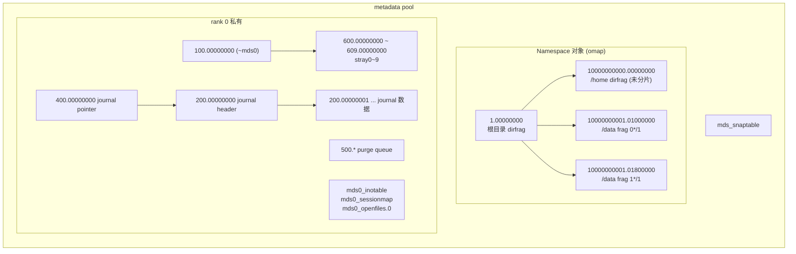
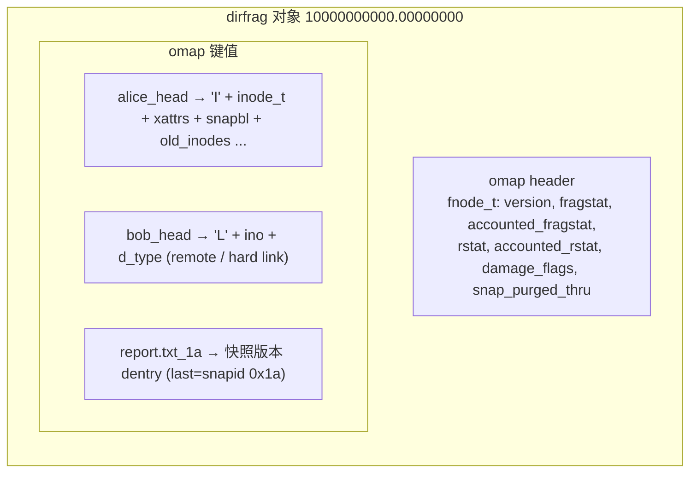
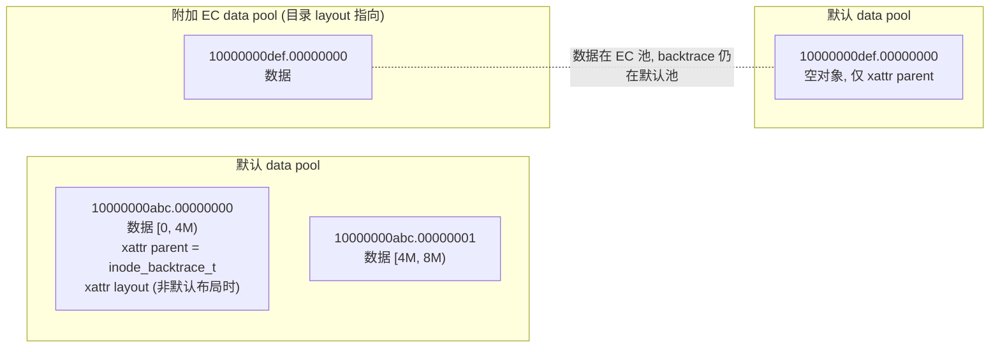
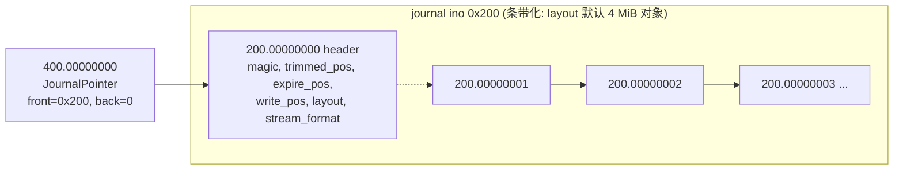
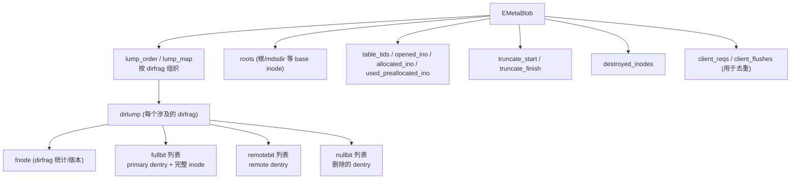

# CephFS 持久化格式

CephFS 自身没有磁盘格式，它的全部持久状态都是 RADOS 对象（数据 + xattr + omap）。理解这些对象的命名与编码，是使用 `rados ls`、`cephfs-journal-tool`、`cephfs-data-scan` 排障与恢复的前提。以下内容以 v20.2.3 为准，编码细节可在 `src/mds/CDir.cc`（`_omap_commit`/`_omap_fetched`）、`src/mds/CInode.cc`、`src/osdc/Journaler.cc`、`src/include/ceph_fs.h`、`src/mds/mdstypes.h` 中核对。

## 1. 保留 inode 号与对象命名

| ino（十六进制） | 用途 | 对象名示例 |
|-----------------|------|------------|
| `0x1` | 根目录 `/` | `1.00000000`（dirfrag）、`1.00000000.inode`（根 inode） |
| `0x100 + rank` | rank 私有目录 `~mdsN`（mdsdir） | `100.00000000`、`100.00000000.inode` |
| `0x200 + rank` | rank 的元数据 journal | `200.00000000`（header）、`200.00000001`... |
| `0x300 + rank` | journal 备份/迁移用（`journal backup`） | `300.*` |
| `0x400 + rank` | JournalPointer（指向当前前台/后台 journal ino） | `400.00000000` |
| `0x500 + rank` | PurgeQueue journal | `500.00000000`... |
| `0x600 + rank*10 + i` | stray 目录 `stray0~stray9` | `600.00000000`... `609.00000000`（rank 0） |
| `(rank+1) << 40` 起 | 普通 inode（rank 0 从 `0x10000000000` 起） | `10000000000.00000000` |

其他具名对象：

| 对象 | 内容 |
|------|------|
| `mds<rank>_inotable` | InoTable：已分配/空闲 ino 区间 |
| `mds<rank>_sessionmap` | SessionMap（header + 每会话一个 omap 条目） |
| `mds_snaptable` | SnapServer 表（全局，仅 rank 0 管理） |
| `mds<rank>_openfiles.<n>` | OpenFileTable（omap：ino → anchor） |

## 2. metadata pool 对象全景



dirfrag 对象名为 `<目录 ino 十六进制>.<frag_t 编码 8 位十六进制>`。`frag_t` 把 `bits`（前缀长度）放在高 8 位、`value`（前缀值，左对齐到 24 位）放在低 24 位：未分片目录为 `00000000`；按 1 bit 拆分后两半分别是 `01000000`（0\*/1）和 `01800000`（1\*/1）。

## 3. dirfrag 对象编码



| 元素 | 编码 | 说明 |
|------|------|------|
| omap key | `<dentry 名>_<snapid>` | head 版本 snapid 写作 `head`；快照版本写 `last` 的十六进制 |
| value 前缀 | `first` snapid | dentry 生效的起始 snapid |
| 类型 `I` | primary dentry | 后随完整 `InodeStore`：`inode_t`、xattr map、symlink 目标、dirfragtree（目录）、old_inodes、snap blob 等 |
| 类型 `L` | remote dentry | 后随目标 `ino` 与 `d_type` |
| 新类型（`i`/`l`） | 新版本扩展编码 | 支持 `alternate_name`（fscrypt 长文件名等），老版本无法读取 |
| omap header | `fnode_t` | dirfrag 级统计与版本 |

- 目录 inode 自身存放在父目录 dirfrag 中（同样是 `I` 类型），而不是自己的 dirfrag 里；只有根和 mdsdir 这类没有父目录的 inode 使用 `.inode` 独立对象。
- 单个 dirfrag 的 omap 条目数受 `mds_bal_fragment_size_max` 约束，以避免 OSD 上出现超大 omap（`LARGE_OMAP_OBJECTS` 告警）。

## 4. 数据对象与 backtrace



`inode_backtrace_t` 内容：

```text
ino      : 0x10000000abc
ancestors: [ (dirino=0x10000000123, dname="f.dat", version=17),
             (dirino=0x10000000001, dname="a",     version=9),
             (dirino=0x1,           dname="proj",  version=3) ]
pool     : 当前数据所在池 id
old_pools: 历史上使用过的池（layout 变更后用于清理）
```

用途：

1. **open by ino**（NFS 文件句柄、hard link remote dentry、`lookup_ino`）：从 backtrace 得到祖先链，逐级打开目录即可定位 primary dentry；
2. **灾难恢复**：`cephfs-data-scan scan_inodes` 读取所有首对象的 backtrace，重建丢失的 dirfrag；
3. **scrub 校验**：`validate_disk_state` 比较 backtrace 与缓存中的真实路径。

backtrace 由 MDS 在 inode 首次回写或 rename 后异步更新（`CInode::store_backtrace`），因此它可能短暂落后于真实路径，使用方需要能容忍并逐级校验。

`scan_extents` 阶段还会遍历所有数据对象，用最大对象序号与对象大小推算文件 size 与 mtime，写入首对象的临时 xattr，供 `scan_inodes` 重建 inode。

## 5. Journal 格式

### 5.1 结构



- journal 是逻辑上连续的字节流，按 `layout` 条带化到 `200.<objno>` 对象中（header 单独为对象 0）。
- `trimmed_pos ≤ expire_pos ≤ write_pos`：`[trimmed, expire)` 可删除，`[expire, write)` 是 replay 区间。
- **JournalPointer** 允许在线重写 journal（例如格式升级）：先写入备份 ino `0x300+rank`，完成后切换指针，崩溃也不会丢失前台 journal。

### 5.2 条目编码（stream_format = RESILIENT）

```text
+-------------------+----------------+-----------------------+------------------+
| sentinel (u64)    | entry_size(u32)| payload (entry_size)  | start_ptr (u64)  |
| 0x3141592653589793|                | LogEvent 编码         | 本条目起始偏移    |
+-------------------+----------------+-----------------------+------------------+
```

- `sentinel` 使工具在中间对象损坏时可以向后扫描找到下一个有效条目（`journal inspect` 能报告损坏区间）。
- `start_ptr` 便于从尾部反向校验条目边界。
- payload 是 `LogEvent` 编码：事件类型（`EVENT_UPDATE`、`EVENT_SUBTREEMAP`...）+ 时间戳 + 事件体。绝大多数事件体包含一个 `EMetaBlob`。

### 5.3 EMetaBlob



replay 实现（`src/mds/journal.cc` 中 `EMetaBlob::replay`）：

1. 对每个 dirlump：确保 dirfrag 在缓存中（必要时创建空 CDir，标记为不完整）；应用 fnode；
2. 对每个 fullbit：创建或更新 dentry 与 inode，设置版本、标记 dirty；
3. 对 remotebit / nullbit：链接或解除链接；
4. 根据 ino 分配信息推进 InoTable / Session 的预分配状态；
5. 记录 `client_reqs`，使 clientreplay 阶段能识别已完成的请求。

由于 fullbit 存放的是完整状态，**replay 是幂等的**：重复应用同一条事件得到相同结果，这对于 standby-replay 持续跟随和多次崩溃恢复都很关键。

## 6. 表对象

| 表 | 编码要点 | 更新方式 |
|----|----------|----------|
| InoTable | `free`/`projected_free` 区间集合 | 在 `ESession`/`EUpdate` 中记录 ino 分配，段过期时整体保存 |
| SessionMap | header 记录版本；omap 中 `client.<id>` → `session_info_t`（客户端元数据、`completed_requests`、`prealloc_inos`、`delegated_inos`、`completed_flushes`） | 增量 omap 写 |
| SnapTable | `snaps`（snapid → SnapInfo：所属 ino、名称、时间）、`need_to_purge`、`pending_*` | `ETableServer` 两阶段事务 |
| OpenFileTable | omap：`<ino>` → `Anchor`（父 ino、dname、d_type、引用计数）；多对象分片 | 段过期时 commit，rejoin 时 `prefetch_inodes` |

## 7. 使用工具查看格式

```bash
# 列出 metadata pool 中的 rank 0 journal 对象
rados -p cephfs.meta ls | grep '^200\.'

# 查看某目录 dirfrag 中的 dentry 键
rados -p cephfs.meta listomapkeys 10000000000.00000000

# 解码某文件的 backtrace
rados -p cephfs.data getxattr 10000000abc.00000000 parent > bt.bin
ceph-dencoder type inode_backtrace_t import bt.bin decode dump_json

# 离线检查 journal
cephfs-journal-tool --rank=cephfs:0 journal inspect
cephfs-journal-tool --rank=cephfs:0 event get --type=UPDATE summary
```

以上命令中只读操作可以在生产环境执行；所有 `reset`、`recover_dentries`、`data-scan` 等写操作必须遵循官方灾难恢复流程，并先 `journal export` 备份。
