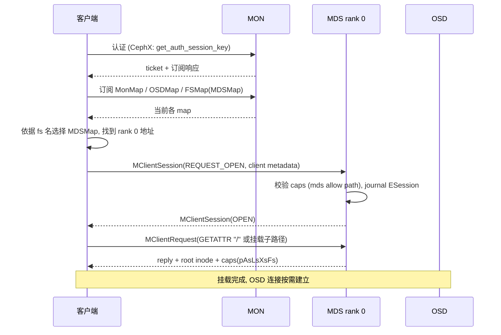
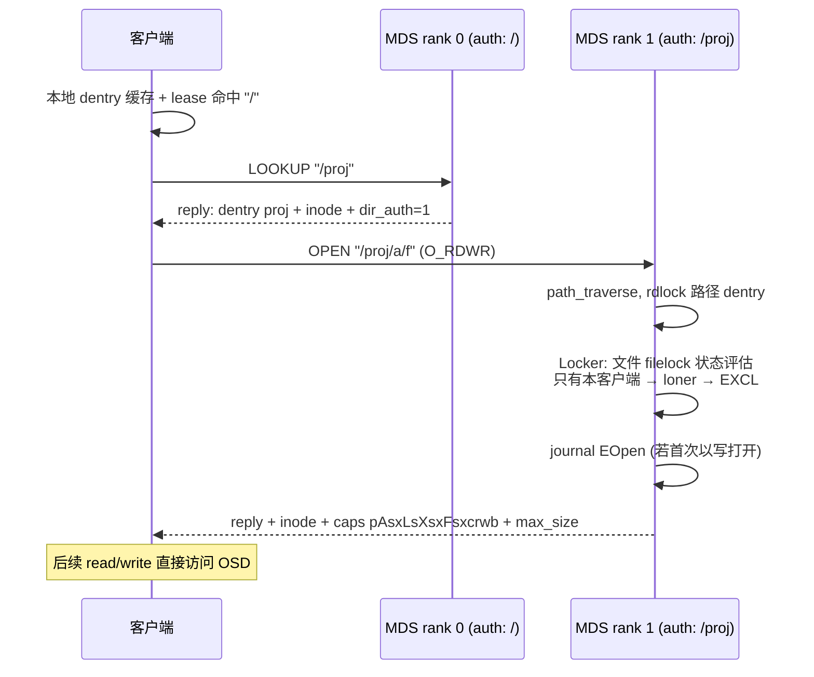
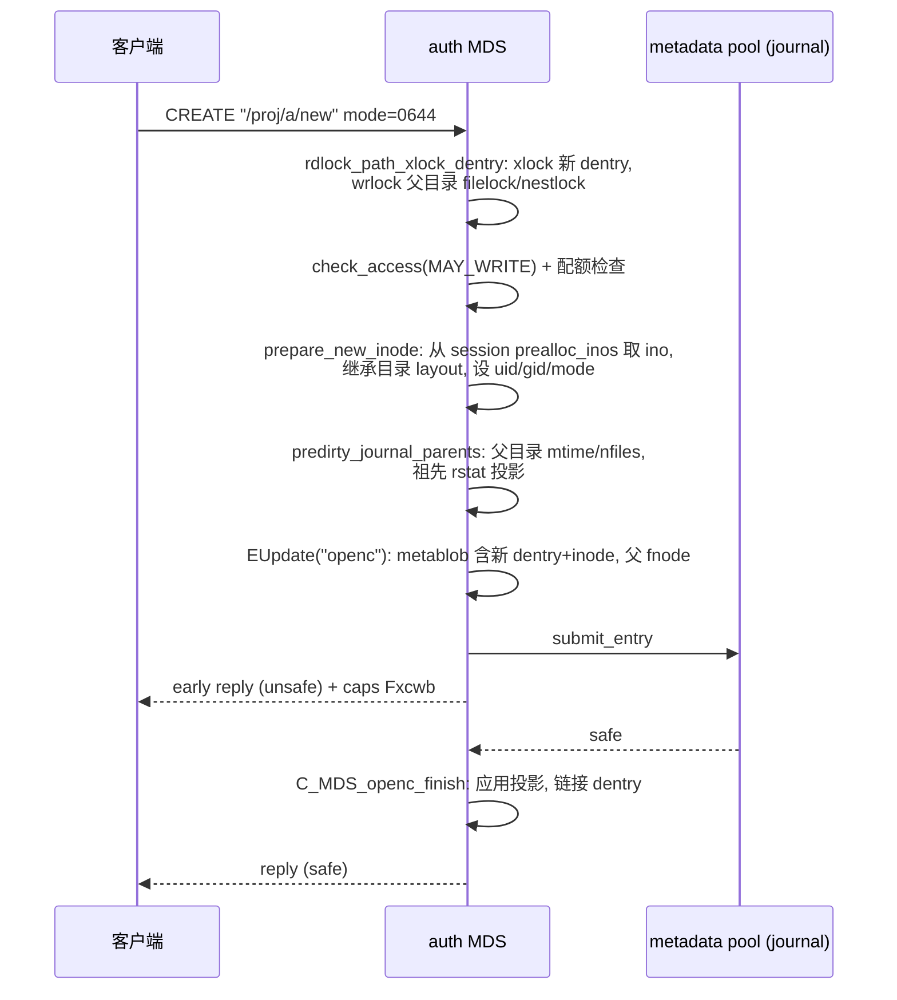
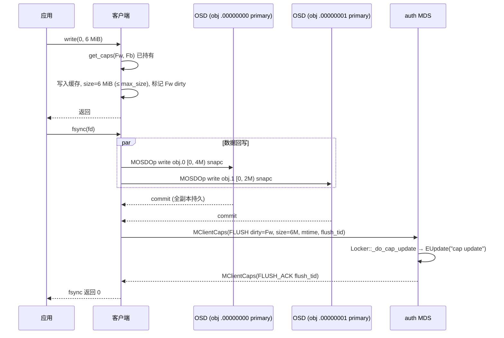
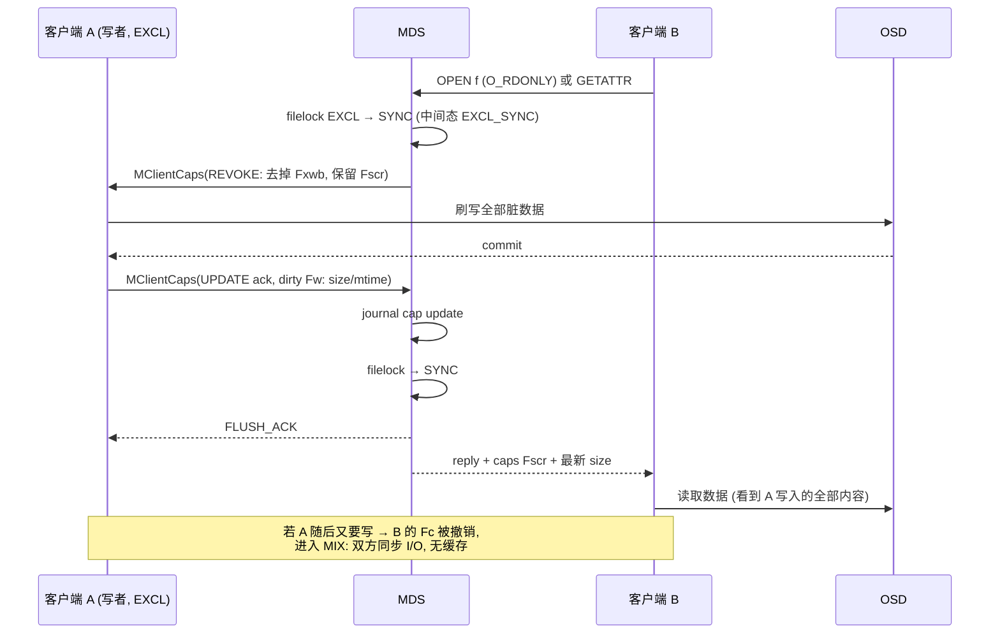
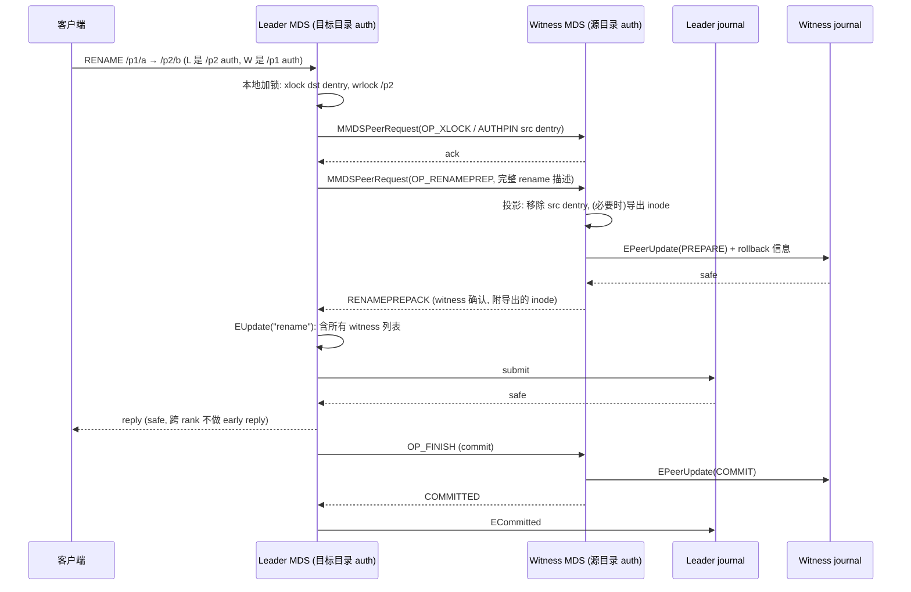
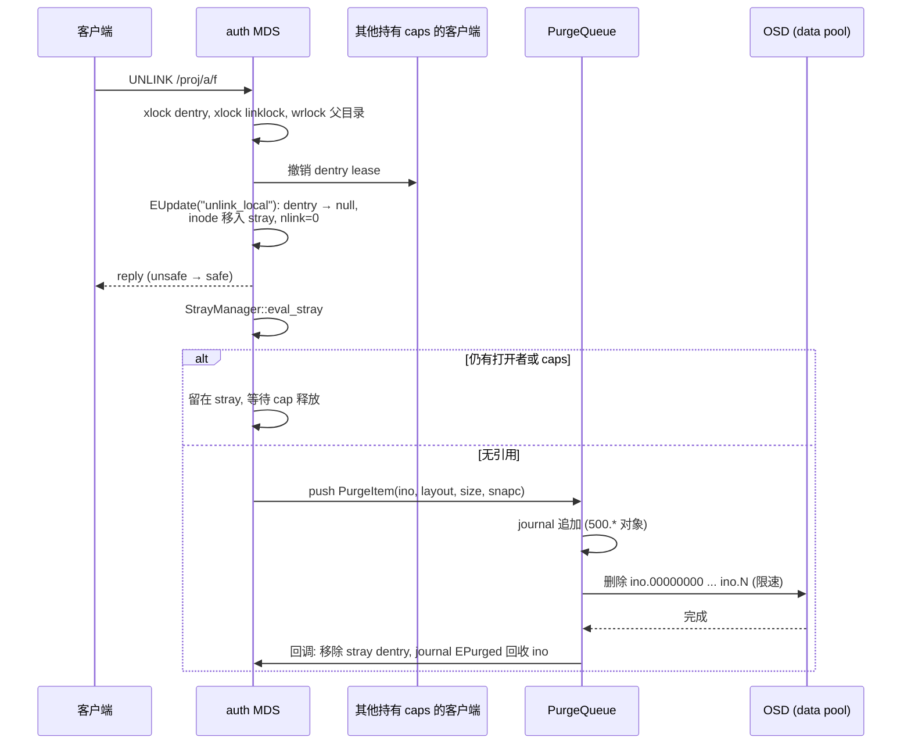
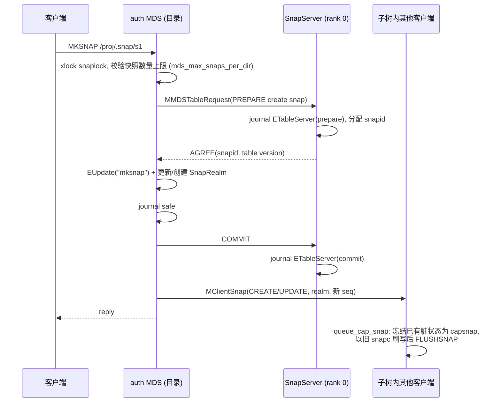
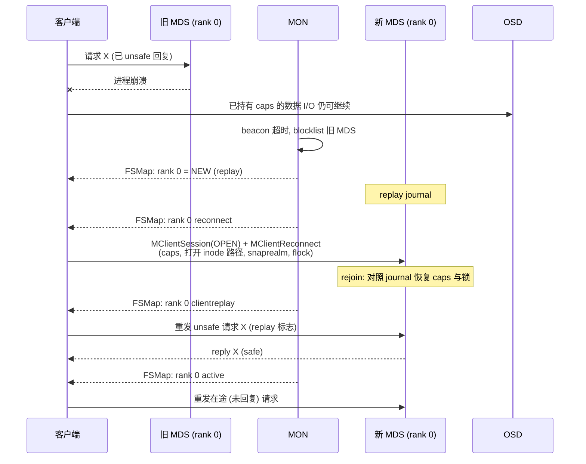

# CephFS 关键请求端到端流程

本文以时序图串联客户端、MDS、MON、OSD 在典型操作中的交互，并在每张图后标出对应的源码入口（用户态客户端 `src/client/Client.cc`、MDS `src/mds/*`）。时序图展示的是常见路径，省略了部分错误处理与优化分支。

## 1. 挂载（mount）

- 客户端：`Client::mount` → `authenticate` → `subscribe_mdsmap` → `_open_mds_session` → `path_walk(mount_root)`。
- MDS：`Server::handle_client_session` → `ESession` journal → 回复。会话打开时检查 `MDSAuthCaps`（`mds 'allow rw path=/x'`），之后每次请求按路径校验。

## 2. 路径查找与打开（lookup + open）

- 客户端：`Client::_lookup` / `Client::_open` → `make_request(CEPH_MDS_OP_OPEN)`。
- MDS：`Server::handle_client_open` → `rdlock_path_pin_ref` → `Locker::issue_new_caps` → `Server::_do_open`（有写模式时 `mdlog->start_submit_entry(EOpen)`）。
- 若客户端缓存中没有 `/proj` 的 auth 信息，请求会先发往 rank 0，被 `request_forward` 转给 rank 1。

## 3. 创建文件（create）

- MDS：`Server::handle_client_openc`（含 `O_EXCL` 检查）→ `prepare_new_inode` → `journal_and_reply`。新文件的数据对象**并不在此时创建**，第一次写入时由 OSD 隐式创建；backtrace 在首次写入/元数据回写时由 MDS 存储（`CInode::store_backtrace`）。
- 重试幂等：若客户端未收到回复而重发，`completed_requests` 中记录的 ino 让 MDS 返回同一 inode。

## 4. 写入与 fsync

- 若写入超出 `max_size`，客户端先发送 `MClientCaps(UPDATE)` 请求扩大，MDS 在 `Locker::check_inode_max_size` 中 journal 新 `max_size` 后授予——这保证写者崩溃时 MDS 只需探测 `[size, max_size)` 区间。
- 内核客户端路径：`ceph_write_iter` → `ceph_get_caps` → 页缓存写 → `ceph_writepages_start` → `ceph_osdc_start_request`；`ceph_fsync` → `filemap_write_and_wait_range` + `ceph_flush_caps`/`wait_caps_flush`。

## 5. 多客户端读写冲突

这张图是 CephFS 强一致的完整体现：**B 的 open/stat 延迟包含了 A 刷脏的时间**。

## 6. 跨 rank rename

- 实现：`Server::handle_client_rename` → `_rename_prepare_witness` → `handle_peer_rename_prep` / `_logged_peer_rename` → `_rename_prepare` → `_rename_apply` → `MDCache::committed_leader_peer`。
- 崩溃处理：若 leader 在 witness PREPARE 后崩溃，resolve 阶段 leader（新实例）根据自己 journal 中是否有 `EUpdate` 告知 witness 提交或回滚（witness 使用 PREPARE 中记录的 rollback blob）。
- 若被移动的 inode 本身的 auth 也随之改变（例如移动目录），还涉及 inode 导入/导出，复杂度进一步上升——跨 rank rename 是 CephFS 最慢、最容易出 bug 的路径之一，运维上应尽量让 rename 发生在同一 rank 子树内。

## 7. 删除与后台回收（unlink + purge）

- 实现：`Server::handle_client_unlink` → `_unlink_local` → `_unlink_local_finish` → `MDCache::notify_stray` → `StrayManager::eval_stray` → `StrayManager::_purge` / `PurgeQueue::push`。
- 删除目录（rmdir）要求目录为空，且需检查所有 dirfrag（可能在多个 rank 上），跨 rank 时也需要 peer 协议。

## 8. 快照创建（mksnap）

- 实现：`Server::handle_client_mksnap` → `SnapClient::prepare_create` → `_mksnap_finish` → `MDCache::send_snap_update` / `do_realm_invalidate_and_update_notify`。
- 一致性组快照（多个子卷同时快照）在 Squid 之后可通过 quiesce 协议先暂停相关 I/O 再创建，由 mgr volumes 模块编排。

## 9. MDS failover 中的客户端视角

- 客户端：`Client::handle_mds_map` 检测 rank 状态变化 → `send_reconnect` → `resend_unsafe_requests` → `kick_requests`。
- MDS：`Server::handle_client_reconnect` 收集 caps；`MDCache::rejoin_open_ino_finish` / `process_imported_caps` 关联 inode；`Server::reconnect_tick` 在 `mds_reconnect_timeout` 后驱逐未重连的客户端（并 blocklist）。
- 未在 reconnect 窗口内重连的客户端会失去全部 caps，其未刷写数据丢失——这也是客户端版本过旧、网络抖动时 failover 后出现大批驱逐的原因。
