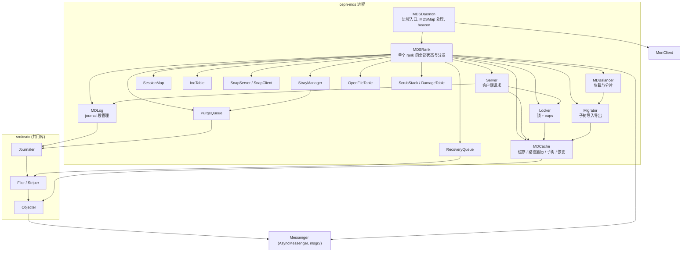
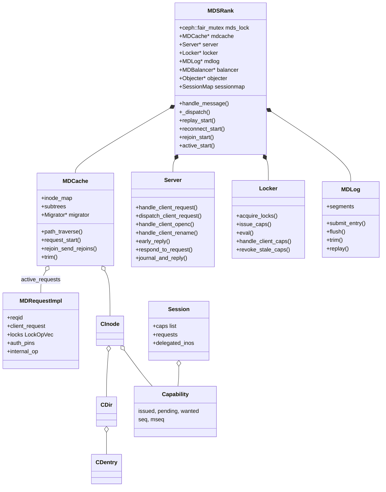
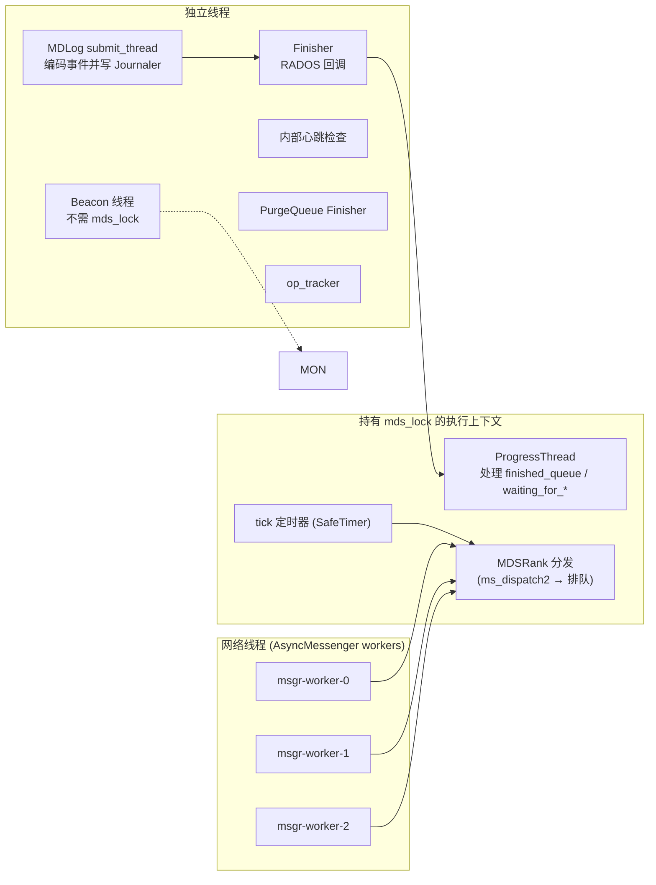

# CephFS 源码地图与进程模型

## 1. 源码目录

以 `ceph/ceph@v20.2.3` 为准，与 CephFS 直接相关的目录：

| 路径 | 内容 | 说明 |
|------|------|------|
| `src/mds/` | MDS 守护进程全部实现 | 十万行量级 C++，CephFS 核心 |
| `src/mds/events/` | journal 事件类型（`EUpdate`、`EExport`、`ESubtreeMap`...） | 编解码与 `replay()` 实现在 `src/mds/journal.cc` |
| `src/mds/locks.c` / `locks.h` | SimpleLock / ScatterLock / FileLock 状态转换表 | C 代码，定义每个锁状态允许的 caps 与操作 |
| `src/client/` | 用户态客户端 `Client`（libcephfs、ceph-fuse 共用） | `Client.cc` 单文件超过 1.5 万行 |
| `src/libcephfs.cc` / `include/cephfs/libcephfs.h` | C API 封装 | NFS-Ganesha、Samba、mirror、mgr 都通过它访问 |
| `src/ceph_fuse.cc` / `src/client/fuse_ll.cc` | FUSE lowlevel 适配 | |
| `src/osdc/` | 客户端侧 RADOS 访问：`Objecter`、`ObjectCacher`、`Filer`、`Striper`、`Journaler` | MDS 与客户端共用 |
| `src/messages/MClient*.h`、`MMDS*.h` | 客户端↔MDS、MDS↔MDS 消息定义 | |
| `src/mon/MDSMonitor.cc`、`src/mds/FSMap.cc`、`MDSMap.cc` | FSMap 管理与 MDS 选派 | 运行在 MON 中 |
| `src/tools/cephfs/` | `cephfs-journal-tool`、`cephfs-table-tool`、`cephfs-data-scan`、`cephfs-meta-injection` | 离线修复工具 |
| `src/tools/cephfs_mirror/` | `cephfs-mirror` 守护进程 | |
| `src/pybind/mgr/volumes/`、`snap_schedule/`、`mirroring/`、`stats/` | mgr Python 模块 | 子卷、快照调度、镜像编排、性能统计 |
| `src/include/ceph_fs.h`、`include/fs_types.h` | caps 位、锁类型、文件布局等协议常量 | 与内核共享定义 |
| `src/include/cephfs/metrics/` | 客户端上报的指标类型 | |
| Linux `fs/ceph/` | 内核客户端：`super.c`、`mds_client.c`、`caps.c`、`file.c`、`addr.c`、`inode.c`、`dir.c`、`snap.c`、`quota.c`、`locks.c`、`crypto.c` | 与 Ceph 版本独立演进 |
| Linux `net/ceph/` | 内核 libceph：`osd_client.c`、`mon_client.c`、`messenger_v2.c`、`osdmap.c`、`crush/mapper.c` | 内核 RBD 也使用 |

## 2. 模块依赖

## 3. 核心类关系

缓存对象（`CInode`、`CDir`、`CDentry`）都继承 `MDSCacheObject`，提供：引用计数与 pin 原因（`PIN_*`）、`auth_pin` 计数、`replica_map`（auth 侧记录哪些 rank 有副本）、`state` 位（`STATE_AUTH`、`STATE_DIRTY`、`STATE_FROZEN` 等）和等待队列（`waiting`，按 `WAIT_*` 掩码唤醒）。**“挂起等待 + 条件满足后重新分发请求”**是 MDS 代码最核心的编程范式。

## 4. 进程与线程模型

- **一把大锁**：`MDSRank::mds_lock`（`ceph::fair_mutex`）保护几乎全部缓存与锁状态。消息分发、请求处理、回调执行都要先持锁，因此单 rank 的元数据处理本质上是串行的。
- **可并行的部分**：网络收发与编解码在 messenger 线程；journal 事件编码与写出在 `MDLog::submit_thread`；RADOS I/O 异步进行，完成回调经 Finisher 回到持锁上下文。
- **Beacon 独立于大锁**：保证 MDS 在长时间持锁任务中仍能向 MON 报告，同时内部 heartbeat 检测分发线程是否卡死（`mds_heartbeat_grace`），卡死时故意停止 beacon 以触发替换。
- 这种模型的工程含义：**单 rank 吞吐上限 ≈ 单核处理能力**；提高吞吐靠多 rank，降低延迟靠减少持锁时间内的阻塞（例如避免在锁内做同步 RADOS 读）。

## 5. 消息体系

| 方向 | 消息 | 作用 |
|------|------|------|
| 客户端 → MDS | `MClientSession` | 打开/续租/关闭会话（`REQUEST_OPEN`、`REQUEST_RENEWCAPS`、`REQUEST_CLOSE`） |
| 客户端 → MDS | `MClientRequest` | 元数据操作（`CEPH_MDS_OP_LOOKUP`、`OPEN`、`CREATE`、`RENAME`、`SETATTR`、`READDIR`、`MKSNAP`...） |
| MDS → 客户端 | `MClientReply` | 结果 + trace（路径上的 dentry/inode）+ unsafe/safe 标志 |
| 双向 | `MClientCaps` | caps 授予、撤销、flush、flush_ack、export/import、grant、trunc |
| MDS → 客户端 | `MClientLease` | dentry lease 撤销 |
| MDS → 客户端 | `MClientSnap` | SnapRealm 创建/更新/拆分 |
| MDS → 客户端 | `MClientQuota` | 配额 realm 的最新 rstat |
| 客户端 → MDS | `MClientReconnect` | failover 后上报 caps、snaprealm、flock |
| 客户端 → MDS | `MClientMetrics` | 客户端性能指标（供 `ceph fs perf stats`） |
| MDS ↔ MDS | `MMDSPeerRequest` | 跨 rank 锁与两阶段更新 |
| MDS ↔ MDS | `MExportDir*`、`MExportCaps` | 子树/caps 迁移 |
| MDS ↔ MDS | `MDiscover` / `MDiscoverReply` | 获取远端 inode/dirfrag replica |
| MDS ↔ MDS | `MLock`、`MCacheExpire`、`MDentryLink`/`Unlink` | 锁状态同步、副本回收、链接变更通知 |
| MDS ↔ MDS | `MMDSResolve`、`MMDSCacheRejoin` | 恢复阶段协商 |
| MDS ↔ MDS | `MHeartbeat` | 负载交换 |
| MDS → MON | `MMDSBeacon` | 存活、状态、健康信息 |

所有消息通过 msgr2 协议传输，连接模式由 `ms_client_mode` / `ms_service_mode` 决定（默认 `crc secure`，即优先 CRC 校验，服务端也接受 secure 加密）。
