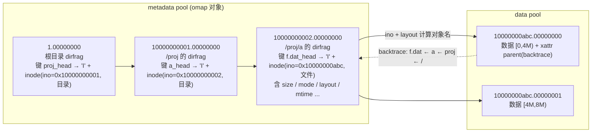
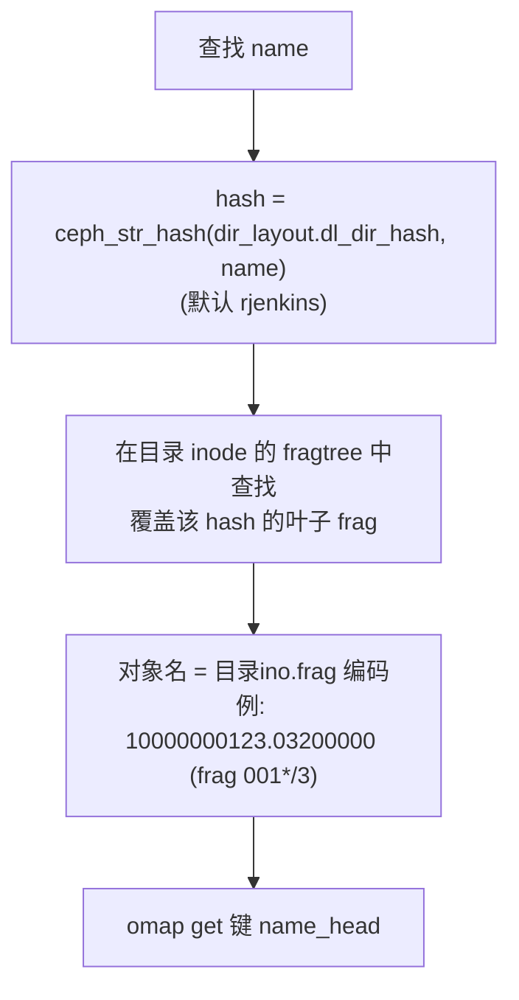
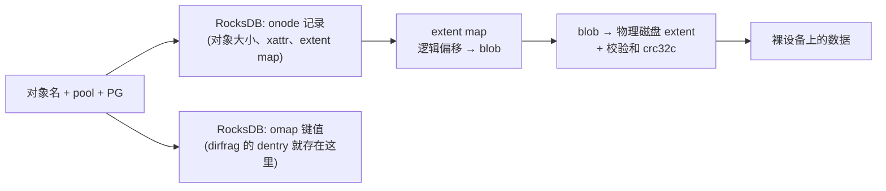
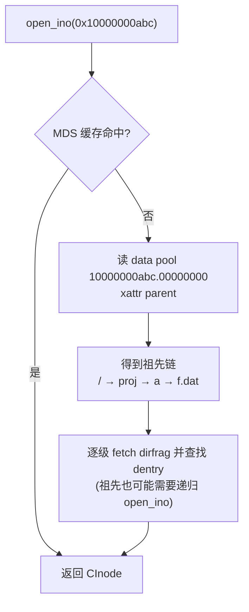

# CephFS 文件、目录与数据块的存储和索引

> 基线：Ceph Tentacle `v20.2.3`。相关源码：`src/mds/CDir.cc`（`_omap_commit` / `_omap_fetched`）、`src/mds/CInode.cc`（`store_backtrace`、`open_ino`）、`src/mds/MDCache.cc`（`path_traverse`、`open_ino`）、`src/osdc/Striper.cc`、`src/os/bluestore/BlueStore.cc`。

## 1. 总览

CephFS 不维护专门的 inode 表或块映射表，三类信息的存法各不相同：

| 信息 | 存在哪里 | 怎么找到它 |
|------|----------|------------|
| 文件信息（inode） | **内联**在父目录的 dirfrag 对象中，作为对应 dentry 的 omap 值 | 沿路径逐级查目录 |
| 目录信息 | 目录自己的 inode 同样内联在**父目录**中；目录的内容（子项列表）存放在**它自己的**一个或多个 dirfrag 对象中 | 由目录 inode 号和 fragtree 算出对象名 |
| 数据块 | data pool 中的 RADOS 对象，对象名为 `<ino>.<对象序号>` | 不查表，由 inode 号加布局参数**计算**得出，再由 CRUSH 算出所在 OSD |

最终的持久化索引落在 OSD 上：BlueStore 用 RocksDB 存放 omap 键值和对象元数据（onode），用 extent map 记录对象数据在磁盘上的位置。

## 2. 以 `/proj/a/f.dat` 为例



## 3. 文件信息：inode 内联在 dentry 中

一个目录分片（dirfrag）就是 metadata pool 中的一个对象，对象名为 `<目录 ino>.<frag>`，例如 `10000000002.00000000`。目录中的每个子项是该对象 omap 中的一个键值对：

| 部分 | 内容 |
|------|------|
| 键 | `<文件名>_head`（当前版本）；快照版本写作 `<文件名>_<snapid 十六进制>` |
| 值（类型 `I`，primary dentry） | 完整的 inode 编码：`ino`、`mode`、`uid/gid`、`nlink`、`size`、`truncate_seq`、`mtime/ctime/atime`、**`layout`**（数据池与条带参数）、`rstat`、`quota`，以及 xattr、软链接目标、快照旧版本等 |
| 值（类型 `L`，remote dentry） | 只存目标 `ino` 和文件类型，用于硬链接 |

这样设计的好处：

- `lookup` 加 `stat` 只需读一次 omap；
- `readdir` 一次 omap 遍历即可同时拿到名字和完整属性，相当于 NFS 的 readdirplus；
- 不需要单独的 inode 表，也就省去了 dentry → inode 的第二跳。

代价落在硬链接上：一个 inode 只能内联在一个 primary dentry 中，其他链接只能是 remote dentry，必须借助 ino 再定位到真正的 inode（见第 6 节）。

## 4. 目录信息：自己的 inode 在父目录，内容在自己的分片中

一个目录的信息分三处存放：

1. **目录 inode**（权限、属主、时间、`fragtree`、`dir_layout`、递归统计 `rstat` 等）：与普通文件一样，内联在**父目录**的 dirfrag 中。根目录和每个 MDS rank 的私有目录 `~mdsN` 没有父目录，单独存为 `1.00000000.inode`、`100.00000000.inode` 这样的对象。
2. **目录内容**：存放在目录自己的 dirfrag 对象中，每个子项一个 omap 键。
3. **分片级统计**：存放在每个 dirfrag 对象的 omap header 中，记录为 `fnode_t`，包括 `fragstat`（直接子项的文件数、子目录数、mtime）、`rstat`（整棵子树的递归统计）和版本号。

### 4.1 大目录分片（dirfrag）

目录项超过 `mds_bal_split_size`（默认 10000）或访问过热时，MDS 会按**文件名哈希的前缀**把目录拆成多个分片，每个分片是一个独立对象：



`fragtree` 本身存放在目录 inode 中，所以只要拿到目录 inode，任何文件名应当去哪个对象查找都能直接算出，不需要额外的索引对象。frag 的编码方式见 [持久化格式](cephfs-impl-on-disk-format.md) 第 2 节。

## 5. 数据块：计算得出，不查表

CephFS **没有块映射表**。文件第 N 个字节的位置完全由 `ino` 和 inode 中的 `layout` 计算：

```text
默认 layout: stripe_unit = 4 MiB, stripe_count = 1, object_size = 4 MiB
offset 9 MiB → 对象序号 2, 对象内偏移 1 MiB
对象名 = "10000000abc.00000002"

对象 → PG  : pg = stable_mod(rjenkins(对象名), pg_num)
PG  → OSD : CRUSH(规则, pg, OSDMap) → [osd.3, osd.17, osd.42]，第一个为 primary
```

条带参数不是默认值时，按 [数据设计文档](../design/cephfs-design-data.md) 中的条带公式在多个对象之间轮转。几点推论：

- **没有分配表**：对象不存在即为空洞，读取时返回 0。文件 size 以 inode 中记录的值为准，而不是统计对象数量。
- **客户端可独立定位**：拿到 inode（经 MDS）和 OSDMap（经 MON）后，所有数据的位置都在本地算出，MDS 不在数据路径上。
- **删除与截断**：MDS 根据 size 和 layout 推算出需要删除的对象范围，由 PurgeQueue 在后台批量删除。

### 5.1 对象在 OSD 内部的索引（BlueStore）



因此在 OSD 这一层：

- **目录项的物理索引是 RocksDB**：dirfrag 的 omap 键就是 RocksDB 中的有序键，PG 的每个副本 OSD 上各有一份；
- **文件数据的物理索引是 BlueStore 的 extent map**。

## 6. 按 inode 号查找文件：backtrace

按路径查找是从根目录逐级向下。但 NFS 文件句柄、硬链接、`lookup_ino`、scrub 和灾难恢复都需要**只凭 ino 找到文件**，而 CephFS **没有全局的 ino → 位置表**。它依次尝试以下途径：

1. **MDS 内存缓存**：`MDCache::inode_map` 是 ino → CInode 的哈希表，命中即返回。
2. **OpenFileTable**：`mds<rank>_openfiles.*` 对象记录打开文件的祖先信息，主要在故障恢复时用于预取。
3. **backtrace**：文件首个数据对象 `<ino>.00000000` 的 `parent` xattr 中保存了祖先链，例如 `[(0x10000000002,"f.dat"), (0x10000000001,"a"), (0x1,"proj")]`。MDS 读出后逐级打开这些目录，即可找到 primary dentry。目录也有 backtrace，存放在 metadata pool 中。



backtrace 由 MDS 异步更新，可能暂时落后于真实路径，因此使用方需要逐级校验。

**硬链接的处理**：remote dentry（类型 `L`）中只有 ino，访问时按上述途径找到 primary dentry 的位置，再读出真正的 inode。

## 7. 内存与日志中的索引

上文描述的是长期持久化形态。运行时还有两层：

| 层 | 结构 | 作用 |
|----|------|------|
| MDS 缓存 | `inode_map`：ino → CInode 哈希表；`CDir::items`：按 (名字, snapid) 排序的 map；`subtrees`：子树 → 负责它的 MDS rank | 热数据全部在内存中，命中时不访问 RADOS |
| MDS journal | `200.*` 对象中的 `EMetaBlob`，记录完整的 dentry 与 inode 状态 | 修改先追加到这里，日志段过期时再批量写回 dirfrag 的 omap |
| 客户端缓存 | Inode / Dentry 缓存，以及 caps 和 lease | 持有 caps 或 lease 时，本地即可回答 `stat` 和 `lookup` |

因此 dirfrag 对象中的内容可能**落后于** journal。这也是 MDS 重启后必须先 replay journal 才能对外服务的原因。

## 8. 快照版本

- **元数据**：被快照覆盖的旧 dentry 以 `<名字>_<snapid>` 键保留在同一个 dirfrag 中，inode 的历史版本存放在 `old_inodes` 中。
- **数据**：客户端写对象时携带 SnapContext，OSD 在快照后首次覆盖该对象时先做 clone，版本信息记录在对象的 SnapSet 中。读取 `.snap/<名字>/f.dat` 时，按 snapid 选到对应的 clone。

## 9. 动手验证

```bash
# 目录 /proj/a 的 ino（十六进制）
printf '%x\n' $(stat -c %i /mnt/cephfs/proj/a)

# 列出该目录分片中的 dentry 键
rados -p cephfs.meta listomapkeys 10000000002.00000000

# 某文件的数据对象
printf '%x\n' $(stat -c %i /mnt/cephfs/proj/a/f.dat)      # 例如 10000000abc
rados -p cephfs.data ls | grep '^10000000abc\.'
ceph osd map cephfs.data 10000000abc.00000000             # 查看 PG 和所在 OSD

# 解码 backtrace
rados -p cephfs.data getxattr 10000000abc.00000000 parent > bt.bin
ceph-dencoder type inode_backtrace_t import bt.bin decode dump_json
```

注意：刚创建的文件可能尚未写回 omap（修改仍在 journal 中），`listomapkeys` 会暂时看不到。执行 `ceph tell mds.<id> flush journal` 后即可看到。

## 10. 相关文档

- [持久化格式](cephfs-impl-on-disk-format.md)：对象命名、omap 与 journal 编码细节
- [元数据设计](../design/cephfs-design-metadata.md)：namespace 模型、子树分区与 dirfrag
- [数据布局与 I/O 设计](../design/cephfs-design-data.md)：条带公式、CRUSH 放置与读写路径
